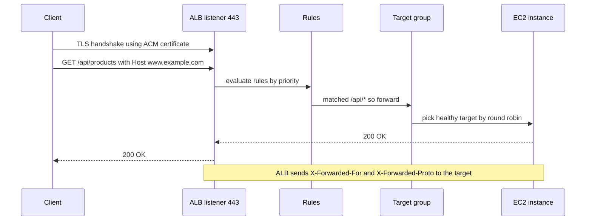
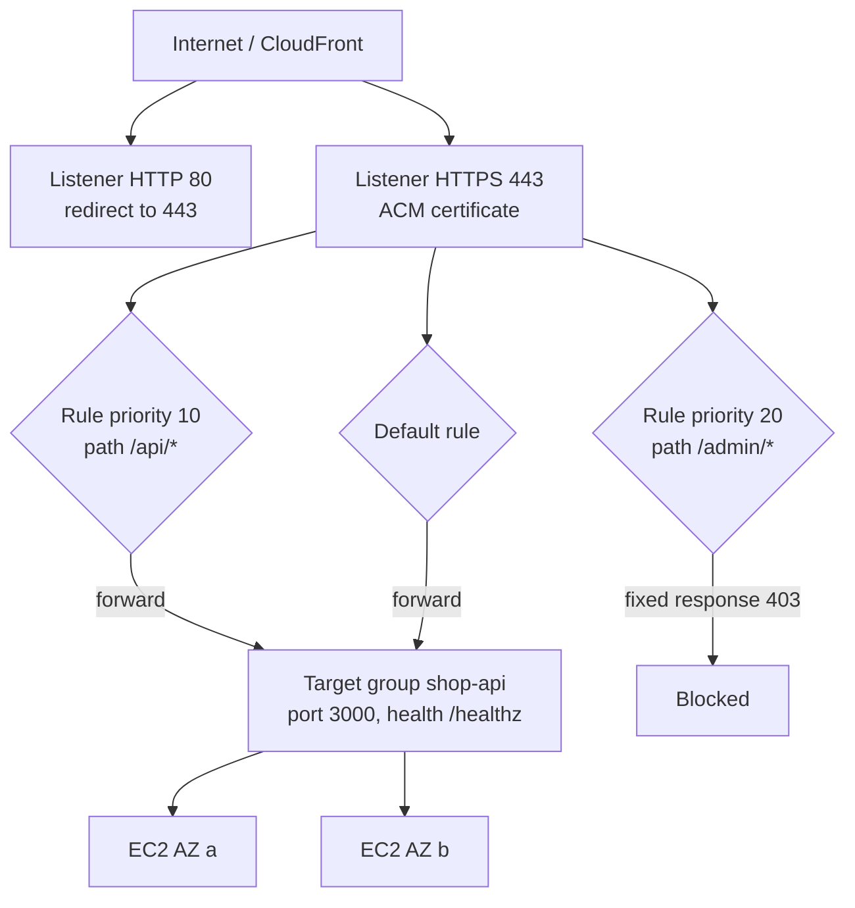

# L6.14 — Application Load Balancer

> **Level 6: Cloud (AWS)** · Topic 14 of 18 · ⏱ ~5 hours · Difficulty: Intermediate

## 1. What it is

An **Application Load Balancer (ALB)** is AWS's managed **Layer 7** (HTTP/HTTPS/gRPC) load balancer. It accepts connections from
clients, terminates TLS, reads each HTTP request, decides where it should go, and forwards it to a healthy backend. The backends
are grouped into **target groups** — EC2 instances, IP addresses, Lambda functions or even another ALB — and the ALB constantly
**health checks** them so that traffic only reaches targets that are answering correctly.

An ALB is made of four things you will configure over and over: **listeners** (a protocol and port to listen on, such as
HTTPS:443), **rules** (if the host/path/header matches, do this action), **target groups** (where to send traffic and how to check
health) and a **certificate** from **AWS Certificate Manager (ACM)** for TLS. AWS runs the load balancer nodes for you across the
subnets (Availability Zones, AZs) you pick, scales them automatically and replaces them when they fail. Its Layer 4 sibling, the
Network Load Balancer (NLB), is covered conceptually in [L4 versus L7 Load Balancing](../level-02-networking/09-l4-vs-l7-load-balancing.md).

## 2. Why it matters in DevOps

- **It is the front door:** every user request to `shop-api` goes through it. A bad listener rule or failing health check is a
  full outage, even when every server is healthy.
- **It enables everything else in this level:** [Auto Scaling](02-auto-scaling.md) registers new instances into a target group
  automatically; deployments (rolling, blue/green, canary — see [Blue/Green](../level-05-cicd/11-blue-green-deployments.md)) are traffic shifts between target groups.
- **Health checks are your failure detector:** a check that is too shallow keeps broken servers in rotation; one that is too deep
  (calls the database) can take the whole fleet out of rotation when the database hiccups.
- **Debugging vocabulary:** 502, 503 and 504 from an ALB each point to a different layer of the problem (section 5).
- **Security and cost:** the ALB is where you enforce HTTPS, attach AWS WAF, hide instances in private subnets, and where an idle
  forgotten ALB quietly bills you every hour.

## 3. Real-world system example

**Amazon ECS and EKS service load balancing.** AWS's container services use ALB target groups as the standard way to expose services:
ECS registers each task's IP into a target group, and the AWS Load Balancer Controller for Kubernetes creates an ALB from an
`Ingress` resource, mapping Ingress path rules to ALB listener rules and pods to `ip` targets (see
[Ingress](../level-08-kubernetes/05-ingress.md)). The same pattern — one ALB, many services, routing by host name or path — is
documented by AWS as a way to cut cost, because a single ALB with host- and path-based rules can serve many microservices instead of
needing one load balancer per service. Large platforms commonly run many services behind a small number of such shared entry
points, and use weighted target-group forwarding for canary releases.

## 4. Diagram

How one HTTPS request is handled:



The `shop-api` entry point:



## 5. How it works

**Components**

| Component | What it does | Key settings |
|-----------|--------------|--------------|
| **Load balancer** | The entry point; **internet-facing** (public IPs) or **internal** (private IPs only) | needs **at least 2 subnets in 2 different AZs**; a security group; scheme; IP type (IPv4 / dual-stack) |
| **Listener** | Checks for connection requests on one protocol and port | `HTTP:80`, `HTTPS:443`; a default action; the TLS certificate and security policy for HTTPS |
| **Rule** | Condition(s) + action, evaluated in **priority order** (lowest number first); the default rule is last | conditions: host header, path pattern, HTTP header, query string, source IP, HTTP method |
| **Action** | `forward` (to one or several weighted target groups), `redirect`, `fixed-response`, or authenticate (OIDC / Amazon Cognito) | redirect HTTP to HTTPS with a `301` |
| **Target group** | A set of targets of one type: `instance`, `ip`, `lambda`, or `alb` | protocol/port, health check, deregistration delay, stickiness, load-balancing algorithm |
| **Target** | One backend (instance ID + port, IP + port, a Lambda) | registered manually or by Auto Scaling / ECS / the Kubernetes controller |

**Health checks** are configured on the target group and run from every ALB node:

| Setting | Typical default | Meaning |
|---------|-----------------|---------|
| Path | `/` | URL requested; use a dedicated `/healthz` |
| Interval | 30 s | time between checks (5-300 s) |
| Timeout | 5 s | how long to wait for an answer |
| Healthy threshold | 5 | consecutive successes to become healthy (2-10) |
| Unhealthy threshold | 2 | consecutive failures to become unhealthy (2-10) |
| Success codes | `200` | accepted codes (ranges such as `200-299` allowed) |

A target moves `initial → healthy → unhealthy → draining`. When all targets in a target group are unhealthy, the ALB **fails open**
and routes to all of them rather than returning errors for everything — a behavior that surprises people.
When targets are removed or deregistered the ALB waits for the **deregistration delay** (default 300 s) to let in-flight requests
finish; lower it (for example to 30 s) for fast-responding APIs so deployments are quicker.

**Load-balancing algorithms** (per target group): `round_robin` (default), `least_outstanding_requests` (better when request
durations vary a lot) and `weighted_random` (enables anomaly mitigation). Optional **stickiness** uses a cookie to keep a client on one
target — avoid it unless sessions are truly local to the instance (prefer [ElastiCache](11-elasticache.md) for sessions). **Slow start**
mode eases a new target into rotation.

**TLS with ACM.** Request a free public certificate in ACM in the **same region as the ALB** (contrast with [CloudFront](13-cloudfront.md), which needs
`us-east-1`), prove you own the domain by **DNS validation** (one CNAME record, which [Route 53](12-route-53.md) can create for
you), and attach it to the HTTPS listener. ACM renews it automatically as long as the validation record stays in place. One listener can
carry many certificates, and the ALB chooses between them by **SNI** (Server Name Indication). Pick a modern security policy such as
`ELBSecurityPolicy-TLS13-1-2-2021-06` rather than relying on the default, and redirect port 80 to 443. The ALB **terminates TLS** by default: traffic to
the targets is plain HTTP unless you set the target group protocol to HTTPS. For the concept, see
[TLS Termination](../level-12-advanced-networking/11-tls-termination.md).

**Headers your app must understand.** The target sees the ALB's IP as the source, so the real client address arrives in
`X-Forwarded-For`, the original scheme in `X-Forwarded-Proto` and the port in `X-Forwarded-Port`. Configure the framework to trust the proxy (in
Express: `app.set('trust proxy', true)`), or redirects and secure cookies will misbehave.

**Reading the error codes**

| Code | Who generated it | Usual cause |
|------|------------------|-------------|
| `502 Bad Gateway` | ALB | target closed the connection, sent an invalid response, or its keep-alive timeout is **shorter than the ALB idle timeout (60 s)** |
| `503 Service Unavailable` | ALB | no registered targets, or the target group has none available |
| `504 Gateway Timeout` | ALB | target did not respond within the idle timeout, or a security group/NACL blocks the ALB from the target |
| Any `5xx` produced by your app | target | counted as `HTTPCode_Target_5XX_Count` (not `HTTPCode_ELB_5XX_Count`) — the application, not the ALB |

**Security groups.** The ALB has its own security group (inbound 80/443 from the world or from CloudFront). The instances' security group
should allow the app port **only from the ALB's security group** — never from `0.0.0.0/0` ([Security Groups](06-security-groups-and-nacls.md)).

**Metrics to watch** (namespace `AWS/ApplicationELB`): `HTTPCode_Target_5XX_Count`, `HTTPCode_ELB_5XX_Count`, `TargetResponseTime`,
`HealthyHostCount`, `UnHealthyHostCount`, `RequestCountPerTarget`, `ActiveConnectionCount`. Turn on **access logs** to an S3 bucket for
per-request investigation. **Cost:** an hourly charge per ALB plus Load Balancer Capacity Units (LCUs) for traffic; an ALB with no traffic still costs
money every hour. Free-tier terms differ by account age (older accounts had 750 ALB hours a month for 12 months, newer accounts use credit-based
plans), so check the Billing console's Free Tier page.

## 6. Step-by-step guide

**Prerequisites:** AWS CLI v2; the default VPC (it has public subnets in several AZs); two EC2 instances running a web server on
port 3000 (see [EC2](01-ec2.md); the quick option is two `t3.micro` instances whose user-data starts `python3 -m http.server 3000` serving a
folder with a `healthz` file). **Cost warning:** an ALB costs a few cents per hour plus LCUs (roughly $16-20 a month if left running); delete it
when you finish. Your **billing alarm should exist first** ([CloudWatch](18-cloudwatch.md)).

> **No AWS account?** LocalStack's ELBv2 support is in its paid tiers. The free alternative is to practise the *rule logic* with
> Nginx (step 8).

1. **Variables and security groups.**
   ```bash
   export AWS_REGION=us-east-1
   VPC_ID=$(aws ec2 describe-vpcs --filters Name=isDefault,Values=true --query 'Vpcs[0].VpcId' --output text)
   SUBNETS=$(aws ec2 describe-subnets --filters Name=vpc-id,Values=$VPC_ID Name=default-for-az,Values=true \
     --query 'Subnets[0:2].SubnetId' --output text)
   ALB_SG=$(aws ec2 create-security-group --group-name shop-alb-lab --description "shop alb lab" \
     --vpc-id $VPC_ID --query GroupId --output text)
   aws ec2 authorize-security-group-ingress --group-id $ALB_SG --protocol tcp --port 80  --cidr 0.0.0.0/0
   aws ec2 authorize-security-group-ingress --group-id $ALB_SG --protocol tcp --port 443 --cidr 0.0.0.0/0
   # allow the ALB to reach the instances (INSTANCE_SG = security group of your two EC2 instances)
   INSTANCE_SG=sg-0123456789abcdef0
   aws ec2 authorize-security-group-ingress --group-id $INSTANCE_SG --protocol tcp --port 3000 --source-group $ALB_SG
   ```

2. **Create the target group with a health check.**
   ```bash
   TG_ARN=$(aws elbv2 create-target-group --name shop-api-lab --protocol HTTP --port 3000 \
     --vpc-id $VPC_ID --target-type instance \
     --health-check-path /healthz --health-check-interval-seconds 10 --health-check-timeout-seconds 5 \
     --healthy-threshold-count 2 --unhealthy-threshold-count 2 --matcher HttpCode=200 \
     --query 'TargetGroups[0].TargetGroupArn' --output text)
   aws elbv2 modify-target-group-attributes --target-group-arn $TG_ARN \
     --attributes Key=deregistration_delay.timeout_seconds,Value=30
   aws elbv2 register-targets --target-group-arn $TG_ARN --targets Id=i-0aaaaaaaaaaaaaaaa Id=i-0bbbbbbbbbbbbbbbb
   ```

3. **Create the load balancer and an HTTP listener.**
   ```bash
   ALB_ARN=$(aws elbv2 create-load-balancer --name shop-alb-lab --type application --scheme internet-facing \
     --subnets $SUBNETS --security-groups $ALB_SG --query 'LoadBalancers[0].LoadBalancerArn' --output text)
   ALB_DNS=$(aws elbv2 describe-load-balancers --load-balancer-arns $ALB_ARN --query 'LoadBalancers[0].DNSName' --output text)
   aws elbv2 wait load-balancer-available --load-balancer-arns $ALB_ARN
   HTTP_L=$(aws elbv2 create-listener --load-balancer-arn $ALB_ARN --protocol HTTP --port 80 \
     --default-actions Type=forward,TargetGroupArn=$TG_ARN --query 'Listeners[0].ListenerArn' --output text)
   echo $ALB_DNS
   ```
   Expected: a name like `shop-alb-lab-1234567890.us-east-1.elb.amazonaws.com`.

4. **Check target health, then test.**
   ```bash
   aws elbv2 describe-target-health --target-group-arn $TG_ARN \
     --query 'TargetHealthDescriptions[].[Target.Id,TargetHealth.State,TargetHealth.Reason]' --output table
   curl -i http://$ALB_DNS/healthz
   ```
   Expected: both targets `healthy` after about 20-30 s (state `initial` first) and `HTTP/1.1 200 OK`. If a target says
   `unhealthy` with reason `Target.Timeout`, the instance security group is not allowing the ALB group (step 1).

5. **Add path rules.** A fixed response for `/admin/*` and a header rule:
   ```bash
   aws elbv2 create-rule --listener-arn $HTTP_L --priority 20 \
     --conditions Field=path-pattern,Values='/admin/*' \
     --actions Type=fixed-response,FixedResponseConfig='{StatusCode=403,ContentType=text/plain,MessageBody=forbidden}'
   curl -i http://$ALB_DNS/admin/users          # 403 forbidden, never reaches the instances
   aws elbv2 describe-rules --listener-arn $HTTP_L --query 'Rules[].[Priority,Conditions[0].Values[0]]' --output table
   ```

6. **TLS with ACM.** With a domain in Route 53 (replace `shop.example.com` with a name you own):
   ```bash
   CERT_ARN=$(aws acm request-certificate --domain-name shop.example.com --validation-method DNS \
     --query CertificateArn --output text)
   aws acm describe-certificate --certificate-arn $CERT_ARN \
     --query 'Certificate.DomainValidationOptions[0].ResourceRecord'      # create this CNAME (Route 53 console has a one-click button)
   aws acm wait certificate-validated --certificate-arn $CERT_ARN
   aws elbv2 create-listener --load-balancer-arn $ALB_ARN --protocol HTTPS --port 443 \
     --certificates CertificateArn=$CERT_ARN --ssl-policy ELBSecurityPolicy-TLS13-1-2-2021-06 \
     --default-actions Type=forward,TargetGroupArn=$TG_ARN
   aws elbv2 modify-listener --listener-arn $HTTP_L \
     --default-actions 'Type=redirect,RedirectConfig={Protocol=HTTPS,Port=443,StatusCode=HTTP_301}'
   ```
   *No domain?* ACM cannot issue a certificate for the `elb.amazonaws.com` name. For a lab, create a self-signed certificate and import it
   (browsers will warn, `curl -k` will work):
   ```bash
   openssl req -x509 -newkey rsa:2048 -nodes -days 7 -keyout lab.key -out lab.crt -subj "/CN=shop.example.com"
   CERT_ARN=$(aws acm import-certificate --certificate fileb://lab.crt --private-key fileb://lab.key \
     --query CertificateArn --output text)
   ```

7. **Break and watch a health check.** Stop the app on one instance and observe:
   ```bash
   aws elbv2 describe-target-health --target-group-arn $TG_ARN \
     --query 'TargetHealthDescriptions[].[Target.Id,TargetHealth.State]' --output text
   for i in $(seq 1 6); do curl -s -o /dev/null -w "%{http_code}\n" http://$ALB_DNS/healthz; done
   ```
   After about 20 s (2 failures x 10 s) the stopped instance becomes `unhealthy` and every response is `200` from the other one.

8. **Free local simulation (Nginx path routing and upstream health).**
   ```bash
   cat > alb-sim.conf <<'EOF'
   upstream shop_api { server host.docker.internal:3001 max_fails=2 fail_timeout=10s;
                       server host.docker.internal:3002 max_fails=2 fail_timeout=10s; }
   server {
     listen 8080;
     location /admin/ { return 403 "forbidden\n"; }
     location / { proxy_pass http://shop_api; proxy_set_header X-Forwarded-For $remote_addr; }
   }
   EOF
   python3 -m http.server 3001 & python3 -m http.server 3002 &
   docker run -d --name albsim -p 8080:8080 --add-host=host.docker.internal:host-gateway \
     -v "$PWD/alb-sim.conf:/etc/nginx/conf.d/default.conf:ro" nginx:1.27
   curl -i localhost:8080/admin/x            # 403
   ```

9. **Cleanup (do not skip).** Delete in this order: listeners go with the load balancer, then the target group, then security groups.
   ```bash
   aws elbv2 delete-load-balancer --load-balancer-arn $ALB_ARN
   sleep 60                                         # wait for network interfaces to release
   aws elbv2 delete-target-group --target-group-arn $TG_ARN
   aws ec2 delete-security-group --group-id $ALB_SG
   aws acm delete-certificate --certificate-arn $CERT_ARN      # only if you created one
   aws elbv2 describe-load-balancers --query 'LoadBalancers[].LoadBalancerName'     # must not list shop-alb-lab
   docker rm -f albsim 2>/dev/null; kill %1 %2 2>/dev/null
   ```
   Remember to remove the `INSTANCE_SG` rule you added and to terminate the two EC2 instances.

## 7. Real-world scenario

*Illustrative scenario.* After a release, `shop-api` shows a trickle of `502` errors — about 1 in 300 requests — only from the ALB, and only on
requests sent over reused connections. **Investigation:** `HTTPCode_ELB_502_Count` rises while `HTTPCode_Target_5XX_Count` is flat, so the
application never produced these errors. The ALB access log shows `target_status_code` of `-` with an ELB 502. The Node.js server's default
HTTP keep-alive timeout is 5 seconds, shorter than the ALB's 60-second idle timeout; the server closes an idle connection just as the ALB
sends a request on it. **Fix:** set `server.keepAliveTimeout = 65000` (and `headersTimeout` slightly above it) so the target always outlives the
load balancer's idle timer. **Lesson:** a 502 from the ALB is a conversation between the ALB and a target that went wrong; check which side
produced the status code before you touch the app.

## 8. Common mistakes and best practices

**Don't**

- Use `/` as the health check when that page renders the whole site; use a lightweight `/healthz`.
- Put database or third-party calls in the health check so a database blip removes every target at once.
- Allow the instance security group from `0.0.0.0/0`; allow only the ALB security group.
- Forget that the app sees the proxy's IP; logging or rate limiting by remote address will then punish everyone equally.
- Leave test ALBs running — they bill hourly even with no traffic.
- Keep the 300 s deregistration delay on a fast API; deployments crawl.

**Do**

- Spread the ALB and its targets across at least two AZs; keep instances in private subnets and the ALB in public ones.
- Redirect HTTP to HTTPS and choose a current TLS policy; let ACM manage renewals (keep the DNS validation record).
- Use one shared ALB with host- and path-based rules for many small services where it makes sense.
- Alarm on `UnHealthyHostCount`, `HTTPCode_Target_5XX_Count` and `TargetResponseTime` in [CloudWatch](18-cloudwatch.md); enable access logs for investigations.
- Attach the target group to an [Auto Scaling group](02-auto-scaling.md) and scale on `ALBRequestCountPerTarget`.
- Make the ALB itself code ([Terraform](../level-07-terraform-iac/01-providers-and-resources.md)).

## 9. Tasks

- [ ] **T1 — Put two instances behind an ALB** *(≈60 min, beginner)*
  - **Goal:** a public DNS name that load balances two EC2 instances.
  - **Steps:**
    1. Launch two instances that each return their own instance ID at `/` and `OK` at `/healthz` on port 3000.
    2. Complete steps 1-4 of the guide.
    3. Run `for i in $(seq 1 10); do curl -s http://$ALB_DNS/; done`.
  - **Done when:** the output shows both instance IDs, roughly alternating, and `describe-target-health` shows both `healthy`.

- [ ] **T2 — Add rules and a redirect** *(≈45 min, intermediate)*
  - **Goal:** route by path and block a path.
  - **Steps:**
    1. Create the `/admin/*` fixed-response rule at priority 20.
    2. Add a second rule at priority 10 for `/api/*` that forwards to the target group.
    3. Change the HTTP listener default action to a redirect once you have a certificate (task T3), or redirect only a path pattern in the meantime.
  - **Done when:** `/admin/x` returns `403 forbidden` and `curl -sI` of an HTTP URL shows `301` with a `Location: https://…` header.

- [ ] **T3 — HTTPS with ACM** *(≈60 min, intermediate)*
  - **Goal:** a trusted certificate on the HTTPS listener.
  - **Steps:**
    1. Request an ACM certificate for a hostname you control and validate it via DNS (a Route 53 alias record can then point the name to the ALB).
    2. Create the 443 listener with the TLS 1.3/1.2 policy.
    3. Run `curl -vI https://shop.example.com 2>&1 | grep -E "subject|issuer|TLS"` (use your name). If you have no domain, use the imported self-signed certificate with `curl -k`.
  - **Done when:** the request succeeds over TLS and you can name the certificate issuer, and ACM shows status `Issued` (or `Imported`).

- [ ] **T4 — Break the health check** *(≈45 min, intermediate)*
  - **Goal:** recognize each failure mode from its symptom.
  - **Steps:**
    1. Change the health check path to `/nope`; observe `unhealthy` and the response code you get from the ALB (the fail-open behavior).
    2. Restore it; remove the security group rule that allows the ALB to the instances; note the target reason (`Target.Timeout`) and the user-visible `504`.
    3. Deregister both targets and note the `503`.
  - **Done when:** you have a three-row table of change → target health reason → HTTP status seen by the client, verified with `curl -i`.

- [ ] **T5 — Observe and alarm** *(≈45 min, intermediate)*
  - **Goal:** metrics and a log-based view of traffic.
  - **Steps:**
    1. Enable access logs to an S3 bucket (`aws elbv2 modify-load-balancer-attributes --attributes Key=access_logs.s3.enabled,Value=true Key=access_logs.s3.bucket,Value=<bucket>` — the bucket needs the documented ELB log-delivery policy).
    2. Generate 50 requests, including some to a non-existent path.
    3. Create a CloudWatch alarm on `UnHealthyHostCount` greater than 0 for one minute.
  - **Done when:** a log file shows your requests in S3 and the alarm enters `ALARM` when you stop the app on one instance.

- [ ] **T6 — Prove it: blue/green with weighted target groups** *(≈60 min, advanced)*
  - **Goal:** shift traffic between two target groups without downtime, then tear everything down.
  - **Steps:**
    1. Without the guide, create a second target group `shop-api-green` with one instance that returns a different version string.
    2. Change the listener default action to forward 90/10 (`Type=forward,ForwardConfig={TargetGroups=[{TargetGroupArn=…,Weight=90},{TargetGroupArn=…,Weight=10}]}`), measure with 100 requests, then move to 0/100.
    3. Explain how this gives instant rollback, then run the cleanup (step 9).
  - **Done when:** your 100-request sample shows approximately a 90/10 split, the final state serves only the green version, and no load balancers remain.

## 10. Self-check questions

1. What is the difference between a listener, a rule, and a target group?
2. An ALB returns `504` for some requests and `502` for others. What does each tell you and where do you look first?
3. Why do you need at least two subnets in different AZs, and why is the instance security group tied to the ALB's group?
4. Where must the ACM certificate live for an ALB, and what keeps it renewing?
5. What happens when every target in a target group is unhealthy?
6. How does your app find out the real client IP and whether the client used HTTPS?

<details>
<summary>Answers</summary>

1. A listener is the protocol/port the ALB listens on; rules attached to it match requests (host, path, header...) and choose an action; a target group is the set of backends (with health checks) a forward action sends traffic to.
2. `504`: the target did not answer in time, or the network path (security group/NACL) blocks the ALB; look at `TargetResponseTime`, target health reason and the SG. `502`: the target broke the connection or sent an invalid response, often a keep-alive mismatch or a crash; compare ELB 5XX against Target 5XX and check the access logs.
3. The ALB nodes must exist in multiple AZs to survive an AZ failure; referencing the ALB's security group means only the load balancer, not the internet, can reach the instances.
4. In ACM in the same region as the ALB; auto-renewal works while the DNS validation CNAME remains in place.
5. The ALB fails open and sends traffic to all targets (so a bad health check does not black-hole everything), and `UnHealthyHostCount` alarms should already be firing.
6. From `X-Forwarded-For` and `X-Forwarded-Proto`, which the framework must be told to trust.
</details>

## 11. Further reading

- *Elastic Load Balancing User Guide: Application Load Balancers* (docs.aws.amazon.com/elasticloadbalancing) — listeners, rules, target groups, health checks, access logs.
- *AWS Certificate Manager User Guide* — DNS validation, renewal, regional behavior.
- *AWS Well-Architected Framework: Reliability pillar* — health checks and failure isolation.
- *Designing Data-Intensive Applications* by Martin Kleppmann — why load balancers and health checking matter in distributed systems.

<!-- nav -->
---
← Previous: [CloudFront](13-cloudfront.md) · [Level 6 index](README.md) · Next: [KMS](15-kms.md) →
