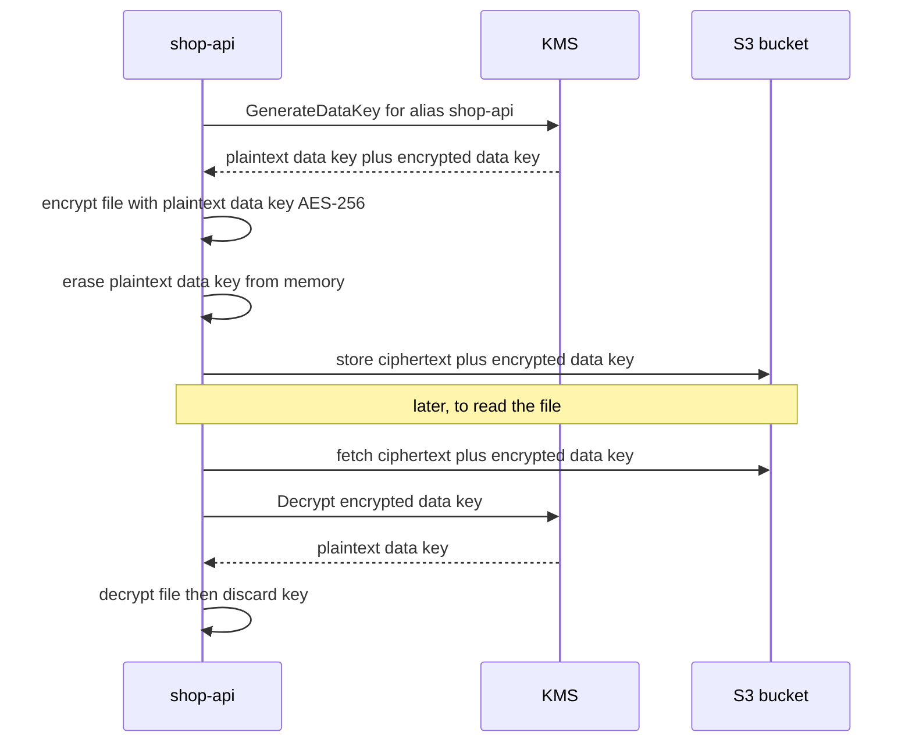
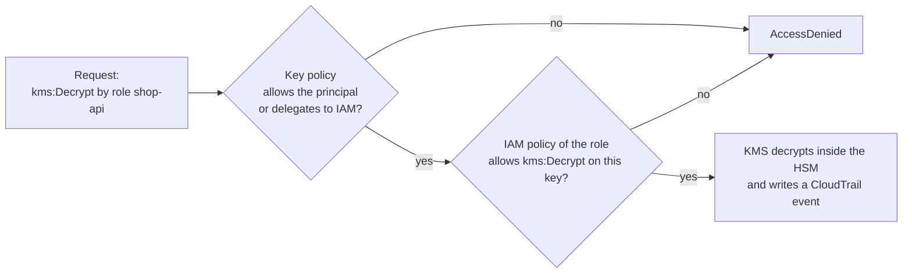

# L6.15 — KMS

> **Level 6: Cloud (AWS)** · Topic 15 of 18 · ⏱ ~4 hours · Difficulty: Intermediate

## 1. What it is

**AWS Key Management Service (KMS)** is the managed service that creates, stores and uses **encryption keys** for you. The defining
idea is that the key itself **never leaves KMS in plaintext**: you send data (or a small key) to the KMS API, KMS performs the
cryptographic operation inside AWS-operated hardware security modules (HSMs), and returns the result. Who may ask is controlled by IAM
policies *and* a **key policy** attached to the key, and every call is recorded in [CloudTrail](17-cloudtrail.md).

What KMS calls a **KMS key** (formerly "customer master key", CMK) is a *logical* key: a key ID, an ARN, optional **aliases**
(friendly names such as `alias/shop-api`), a policy, and the backing key material. Most keys are **symmetric** (AES-256-GCM); KMS also offers
asymmetric keys (RSA, ECC) for signing and encryption, and HMAC keys. Because a KMS key can directly encrypt only a few kilobytes (4 KB), real
workloads use **envelope encryption**, explained in section 5.

## 2. Why it matters in DevOps

- **Encryption at rest is a checkbox with consequences:** [S3](08-s3.md), [EBS](09-ebs-and-efs.md), [RDS](10-rds-and-aurora.md),
  [ElastiCache](11-elasticache.md), [Secrets Manager](16-secrets-manager.md), CloudWatch Logs and CloudTrail can all encrypt with KMS. Choose
  the key wrongly and you cannot share a snapshot, copy an AMI across accounts, or start instances.
- **It is a second permission system:** an engineer with full S3 access still cannot read an object encrypted with a key that their role
  may not use. That separation is the point — and the most common cause of mysterious `AccessDenied` errors.
- **Deleting a key destroys the data:** once the key is gone, everything encrypted under it is unrecoverable. Understanding the waiting
  period and "disable instead of delete" prevents career-limiting mistakes.
- **Compliance and audit:** PCI-DSS, HIPAA and SOC 2 reviews ask who can use which key, how it rotates, and where the evidence is.
- **Cost surprise:** a customer managed key costs a monthly fee plus per-request charges; chatty applications calling KMS for every
  record can rack up cost and hit throttling.

## 3. Real-world system example

**S3 server-side encryption with KMS (SSE-KMS)** is the clearest documented example of envelope encryption at scale. For each object S3 asks KMS to
generate a unique **data key**, encrypts the object with that data key, and stores the *encrypted* data key alongside the object; to read it,
S3 calls KMS to decrypt the data key. AWS documents the feature called **S3 Bucket Keys**, which reduces the number of KMS requests (and
cost) by having S3 reuse a bucket-level key for many objects. EBS and RDS follow the same pattern for volumes and database storage. The
**AWS Encryption SDK** packages the same envelope technique for application code. For the broader view on how encryption and secrets fit
together, see [Secrets Management and Encryption](../level-11-security-devsecops/04-secrets-management-and-encryption.md).

## 4. Diagram

Envelope encryption — the key idea of this topic:



Who can use a key — both layers must agree:



## 5. How it works

**Key types**

| Type | Who manages it | Cost | Notes |
|------|----------------|------|-------|
| **AWS owned keys** | AWS, invisible to you | free | used by default for some services (for example default DynamoDB encryption); no audit trail in your account |
| **AWS managed keys** (`aws/s3`, `aws/ebs`, `aws/rds`...) | AWS creates them in your account when you first use a service | no monthly fee; per-request fees may apply | you can view them and their usage in CloudTrail, but you cannot edit the key policy, and rotation is automatic and fixed (yearly) |
| **Customer managed keys** | you | monthly fee per key plus per-request charges | custom key policy, aliases, rotation settings, cross-account sharing, disable/delete |

**Symmetric vs asymmetric.** Symmetric keys (default, AES-256-GCM) are what AWS services use for encryption at rest. Asymmetric keys (RSA,
ECC) have a public/private pair, where the private half never leaves KMS — used for signing (for example code signing, JWT signing) or for encrypting data
for parties outside AWS. HMAC keys generate and verify message authentication codes.

**Envelope encryption.** KMS encrypts only small payloads directly. For larger data you call `GenerateDataKey`, which returns the data key twice:
once in plaintext (use it, then erase it) and once encrypted under your KMS key (store it next to the data). To decrypt, send the encrypted data
key to `Decrypt`. Benefits: data never travels to KMS (speed, no 4 KB limit), each object can have its own key, and re-keying only needs the small keys to be re-wrapped.

**Key policies and grants.** A **key policy** is the primary access control — a KMS key has *no access* unless its key policy allows it.
The standard default policy has one statement, "Enable IAM User Permissions", that delegates to IAM for the account:

```json
{
  "Version": "2012-10-17",
  "Statement": [
    { "Sid": "EnableIAMUserPermissions", "Effect": "Allow",
      "Principal": { "AWS": "arn:aws:iam::111122223333:root" },
      "Action": "kms:*", "Resource": "*" },
    { "Sid": "AllowShopApiRoleToUseKey", "Effect": "Allow",
      "Principal": { "AWS": "arn:aws:iam::111122223333:role/shop-api-ec2" },
      "Action": ["kms:Decrypt", "kms:GenerateDataKey"], "Resource": "*",
      "Condition": { "StringEquals": { "kms:EncryptionContext:app": "shop-api" } } }
  ]
}
```

Best practice is to separate **key administrators** (can manage but not use the key) from **key users** (can encrypt/decrypt but not delete or change the policy). **Grants**
are temporary, programmatic permissions that AWS services (EBS, RDS, Auto Scaling) create on your behalf. The `kms:ViaService` condition can limit a key
to use *through* a specific service, such as `s3.us-east-1.amazonaws.com`, so a stolen role cannot call KMS directly.

**Encryption context.** An optional set of key-value pairs bound to the ciphertext as additional authenticated data. Decryption fails unless the
same context is supplied, and the context appears in CloudTrail logs — so never put secrets in it, and use it to bind data to a purpose (`app=shop-api`).

**Rotation.** For symmetric customer managed keys you can turn on **automatic rotation**: KMS creates new key material on a schedule (default every
365 days, configurable from 90 to 2,560 days), keeps the old material so existing ciphertext still decrypts, and the key ID, ARN and aliases do not change. Applications notice nothing. Keys with imported key material,
asymmetric keys and HMAC keys do not rotate automatically; rotating those means creating a new key and repointing the alias. Rotating the material does not re-encrypt existing data; for that, re-encrypt (`ReEncrypt`) or rewrite the objects. Additional charges apply for rotated key versions.

**Deletion.** `ScheduleKeyDeletion` puts a key in `PendingDeletion` for **7 to 30 days** (30 by default). During that window the key
cannot be used and the deletion can be cancelled. When it ends the key and all data encrypted under it are permanently unrecoverable. **Disabling** a key is reversible
and is usually what you want.

**Other things to know.** *Multi-Region keys* (`mrk-…`) have related key material in several regions for cross-region decrypt/DR.
*Custom key stores* (CloudHSM / external key store) exist for regulatory needs. KMS has per-account request quotas (shared across keys in a region), and cryptographic operation requests
have a modest per-request fee, with a monthly free allowance in the free tier. KMS HSMs are validated under FIPS 140 programs; see AWS documentation for the current level.

## 6. Step-by-step guide

**Prerequisites:** AWS CLI v2 (and `base64`, `openssl`). **Cost warning:** a customer managed key costs about **$1 per month** (prorated hourly) from creation until
it is *deleted*, which takes at least 7 days of waiting — so the cleanup is "schedule deletion", and you pay a few cents. Request charges are tiny
for a lab, and the first 20,000 requests a month are in the free tier. Do the cleanup and keep your billing alarm ([CloudWatch](18-cloudwatch.md)).

> **LocalStack:** KMS is emulated in the free LocalStack. Run `docker run -d -p 4566:4566 localstack/localstack`, then add
> `--endpoint-url http://localhost:4566` to every command (with `AWS_ACCESS_KEY_ID=test AWS_SECRET_ACCESS_KEY=test AWS_REGION=us-east-1`).
> Key policies are stored but not strictly enforced locally, so the policy experiments need the real service.

1. **Create a key and an alias.**
   ```bash
   export AWS_REGION=us-east-1
   KEY_ID=$(aws kms create-key --description "shop-api lab key" --tags TagKey=project,TagValue=shop-api \
     --query KeyMetadata.KeyId --output text)
   aws kms create-alias --alias-name alias/shop-api-lab --target-key-id $KEY_ID
   aws kms describe-key --key-id alias/shop-api-lab \
     --query 'KeyMetadata.{Id:KeyId,State:KeyState,Spec:KeySpec,Usage:KeyUsage,Rotation:KeyRotationStatus}' --output table
   ```
   Expected: `Enabled`, `SYMMETRIC_DEFAULT`, `ENCRYPT_DECRYPT`.

2. **Encrypt and decrypt a small value directly (limit 4 KB).**
   ```bash
   echo -n 'db-password-example' > plain.txt
   aws kms encrypt --key-id alias/shop-api-lab --plaintext fileb://plain.txt \
     --encryption-context app=shop-api \
     --query CiphertextBlob --output text | base64 --decode > secret.bin
   aws kms decrypt --ciphertext-blob fileb://secret.bin --encryption-context app=shop-api \
     --query Plaintext --output text | base64 --decode; echo
   ```
   Expected: `db-password-example`. Note you did not pass the key ID to `decrypt` — it is embedded in the ciphertext. Run the decrypt again with
   `--encryption-context app=other` and see `InvalidCiphertextException`.

3. **Envelope-encrypt a file (the real pattern).**
   ```bash
   echo "card=4111-example" > customer.txt
   aws kms generate-data-key --key-id alias/shop-api-lab --key-spec AES_256 --encryption-context app=shop-api > dk.json
   jq -r .Plaintext dk.json > dk.plain.b64                                   # plaintext data key (base64 text)
   jq -r .CiphertextBlob dk.json | base64 --decode > dk.encrypted            # store this next to the data
   openssl enc -aes-256-cbc -pbkdf2 -in customer.txt -out customer.enc -pass file:dk.plain.b64
   shred -u dk.plain.b64 dk.json 2>/dev/null || rm -f dk.plain.b64 dk.json    # erase the plaintext key
   ls -l customer.enc dk.encrypted
   ```
   (`openssl enc` keeps the lab short; production code should use an authenticated mode such as AES-GCM, usually via the AWS Encryption SDK.)

4. **Decrypt it again: ask KMS for the key, then use it.**
   ```bash
   aws kms decrypt --ciphertext-blob fileb://dk.encrypted --encryption-context app=shop-api \
     --query Plaintext --output text > dk.plain.b64
   openssl enc -d -aes-256-cbc -pbkdf2 -in customer.enc -pass file:dk.plain.b64
   rm -f dk.plain.b64
   ```
   Expected: `card=4111-example`.

5. **Turn on rotation and inspect the policy.**
   ```bash
   aws kms enable-key-rotation --key-id $KEY_ID --rotation-period-in-days 365
   aws kms get-key-rotation-status --key-id $KEY_ID
   aws kms get-key-policy --key-id $KEY_ID --policy-name default --query Policy --output text | jq .
   ```
   The default policy created by the CLI is the "Enable IAM User Permissions" statement, so the IAM policies on your own user work.

6. **Use the key from S3 (SSE-KMS with a Bucket Key).**
   ```bash
   BUCKET=shop-kms-lab-$(aws sts get-caller-identity --query Account --output text)
   aws s3api create-bucket --bucket $BUCKET
   aws s3api put-bucket-encryption --bucket $BUCKET --server-side-encryption-configuration \
     "{\"Rules\":[{\"ApplyServerSideEncryptionByDefault\":{\"SSEAlgorithm\":\"aws:kms\",\"KMSMasterKeyID\":\"$KEY_ID\"},\"BucketKeyEnabled\":true}]}"
   aws s3 cp customer.txt s3://$BUCKET/customer.txt
   aws s3api head-object --bucket $BUCKET --key customer.txt --query '{SSE:ServerSideEncryption,Key:SSEKMSKeyId,BucketKey:BucketKeyEnabled}'
   ```

7. **See the audit trail.** KMS calls appear in CloudTrail within about 15 minutes:
   ```bash
   aws cloudtrail lookup-events --lookup-attributes AttributeKey=EventSource,AttributeValue=kms.amazonaws.com \
     --max-results 10 --query 'Events[].[EventTime,EventName,Username]' --output table
   ```

8. **Cleanup (do not skip).**
   ```bash
   aws s3 rm s3://$BUCKET --recursive && aws s3api delete-bucket --bucket $BUCKET
   aws kms delete-alias --alias-name alias/shop-api-lab
   aws kms schedule-key-deletion --key-id $KEY_ID --pending-window-in-days 7
   aws kms describe-key --key-id $KEY_ID --query 'KeyMetadata.[KeyState,DeletionDate]' --output text   # PendingDeletion
   rm -f plain.txt secret.bin customer.* dk.encrypted
   ```
   Billing for the key stops once it is in `PendingDeletion`. If you change your mind inside the window: `aws kms cancel-key-deletion --key-id $KEY_ID`.

## 7. Real-world scenario

*Illustrative scenario.* The `shop-api` team encrypts its AMIs and EBS volumes with a customer managed key and enables an
[Auto Scaling group](02-auto-scaling.md) in a new account. During a traffic spike, scale-out fails: instances launch and terminate within seconds, and the
group's activity history reports that the launch failed because of a KMS key permission (`Client.InvalidKMSKey.InvalidState` or an access error on the key). **Investigation:** the key
policy lists only the human admins and the application role. EBS volume creation for Auto Scaling is performed with the account's **service-linked role**
`AWSServiceRoleForAutoScaling`, which was never allowed to use the key. **Fix:** add the service-linked role to the key policy (or create a grant for it) with
`kms:Decrypt`, `kms:GenerateDataKey*`, `kms:ReEncrypt*`, `kms:CreateGrant` and `kms:DescribeKey`. **Lesson:** with customer managed keys, the *service* acting on your behalf
is a principal too; test scaling in a staging account before relying on it, and keep the key policy in version control.

## 8. Common mistakes and best practices

**Don't**

- Schedule key deletion to "clean up" without proving nothing depends on the key — every object, snapshot and secret under it becomes unreadable.
- Grant `kms:*` to application roles; they need `Decrypt` and `GenerateDataKey`, nothing else.
- Put secrets or personal data in the **encryption context** — it is logged in plaintext.
- Create one key per object or call KMS per record; use envelope encryption or S3 Bucket Keys to keep request counts and cost down.
- Remove the account-root statement from the key policy without an alternative — you can lock yourself out (and then need AWS Support).
- Copy a snapshot or AMI encrypted with an AWS managed key to another account — it cannot be shared; use a customer managed key.

**Do**

- Use customer managed keys where you need audit, sharing, or custom policies, and AWS managed keys where defaults suffice.
- Use aliases in code and templates (`alias/shop-api`) so you can swap the underlying key.
- Enable automatic rotation on symmetric customer managed keys; alarm on `ScheduleKeyDeletion` and `DisableKey` events (see [CloudTrail](17-cloudtrail.md)).
- Separate key administrators from key users, and constrain with `kms:ViaService` and `kms:EncryptionContext` conditions.
- Enable default EBS encryption in every region and require encryption in S3 with bucket policies/defaults.
- Define keys and their policies as code ([Terraform](../level-07-terraform-iac/01-providers-and-resources.md)).

## 9. Tasks

- [ ] **T1 — Create a key and round-trip a secret** *(≈30 min, beginner)*
  - **Goal:** use KMS directly.
  - **Steps:**
    1. Create a key with alias `alias/shop-api-lab` (step 1).
    2. Encrypt `db-password-example` with `aws kms encrypt` and decrypt it (step 2).
    3. Run `describe-key` and note the key state, spec and usage.
  - **Done when:** decrypt returns the original text and the ciphertext file is binary garbage when you `xxd` it.

- [ ] **T2 — Envelope encryption by hand** *(≈45 min, intermediate)*
  - **Goal:** understand why the plaintext key is thrown away.
  - **Steps:**
    1. Follow steps 3 and 4 to encrypt and decrypt a 1 MB file (`head -c 1M /dev/urandom > big.bin`) — note that direct `kms encrypt` on it fails at 4 KB.
    2. Show that `dk.encrypted` is safe to store beside the data.
    3. Draw the sequence from section 4 from memory.
  - **Done when:** the decrypted file's `sha256sum` equals the original's, and the direct call fails with a validation error about size.

- [ ] **T3 — Encryption context and policy** *(≈45 min, intermediate)*
  - **Goal:** bind ciphertext to a purpose and see it in logs.
  - **Steps:**
    1. Encrypt with `--encryption-context app=shop-api`; try decrypting with a different context and with none.
    2. Look up the `Decrypt` event in CloudTrail (`lookup-events`) and find the context in the event JSON.
    3. Add a key-policy condition requiring `kms:EncryptionContext:app` and verify a call without it is denied.
  - **Done when:** wrong or missing context returns an error and your CloudTrail event shows `encryptionContext`.

- [ ] **T4 — SSE-KMS on S3 and the cross-service denial** *(≈45 min, intermediate)*
  - **Goal:** see the second permission layer.
  - **Steps:**
    1. Configure the bucket default encryption with your key (step 6) and upload a file.
    2. Create an IAM role (or user) with `s3:GetObject` but no KMS permissions; try to read the object.
    3. Add `kms:Decrypt` for that role on the key and retry.
  - **Done when:** the first read fails with `AccessDenied` mentioning KMS and the second succeeds.

- [ ] **T5 — Rotation and the deletion safety net** *(≈30 min, intermediate)*
  - **Goal:** use rotation and the waiting period correctly.
  - **Steps:**
    1. Enable rotation and confirm with `get-key-rotation-status`; explain why existing ciphertext still decrypts.
    2. Disable the key (`disable-key`) and show `decrypt` failing with `DisabledException`; re-enable it.
    3. Schedule deletion with a 7-day window, then cancel it, then schedule it again at the end of the lab.
  - **Done when:** you demonstrated disable, re-enable, schedule and cancel, and can say why disable is the safe option.

- [ ] **T6 — Prove it: alarm on dangerous key actions** *(≈60 min, advanced)*
  - **Goal:** detect a key being disabled or scheduled for deletion.
  - **Steps:**
    1. Without the guide, write an EventBridge rule (or CloudWatch Logs metric filter on a CloudTrail log group) matching `DisableKey` and `ScheduleKeyDeletion` from `kms.amazonaws.com`, with an SNS email target.
    2. Trigger it by disabling and re-enabling your lab key.
    3. Explain in writing what a key admin can do vs a key user, and run the cleanup (step 8).
  - **Done when:** you received an email for the `DisableKey` event, and the key shows `PendingDeletion`.

## 10. Self-check questions

1. Why is envelope encryption used instead of encrypting data directly with a KMS key?
2. What is the difference between an AWS managed key and a customer managed key?
3. If a role has `kms:Decrypt` in its IAM policy but still gets `AccessDenied`, where do you look?
4. What does automatic rotation change, and what does it not change?
5. Why is "disable the key" preferred over "delete the key"?
6. Why must you never put sensitive values in an encryption context?

<details>
<summary>Answers</summary>

1. KMS only encrypts up to 4 KB per call and sending all data to KMS would be slow and costly; instead KMS protects a small data key that encrypts the data locally.
2. AWS managed keys are created and controlled by AWS for a service, with a fixed policy and rotation and no monthly fee; customer managed keys have your own policy, aliases, rotation options, cross-account sharing and cost a monthly fee.
3. The key policy (must allow the principal or delegate to IAM), grants, conditions such as `kms:ViaService`/encryption context, SCPs, and whether the key is in the right region/account and enabled.
4. It creates new backing key material on a schedule; the key ID, ARN and alias stay the same and old ciphertext still decrypts. It does not re-encrypt existing data.
5. Disabling is reversible; deletion (after the 7-30 day wait) permanently destroys the key and everything encrypted under it.
6. The encryption context is not secret: it is stored/logged in plaintext, for example in CloudTrail.
</details>

## 11. Further reading

- *AWS Key Management Service Developer Guide* (docs.aws.amazon.com/kms) — key policies, grants, rotation, deletion.
- *AWS KMS Cryptographic Details* whitepaper — how the HSM fleet and key hierarchy work.
- *AWS Encryption SDK* documentation — envelope encryption in application code.
- *Security Engineering* by Ross Anderson (free online) — key management in practice.

<!-- nav -->
---
← Previous: [Application Load Balancer](14-alb.md) · [Level 6 index](README.md) · Next: [Secrets Manager](16-secrets-manager.md) →
