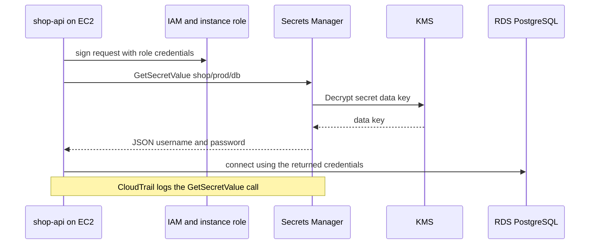
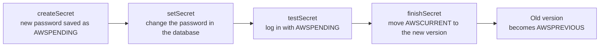

# L6.16 — Secrets Manager

> **Level 6: Cloud (AWS)** · Topic 16 of 18 · ⏱ ~4 hours · Difficulty: Intermediate

## 1. What it is

**AWS Secrets Manager** stores, encrypts, distributes and **rotates** secrets: database passwords, API keys, OAuth client secrets, TLS private
keys — anything that must not live in source code, an AMI or a plain environment file. A secret is a named object (for example
`shop/prod/db`) holding a small value, usually a JSON document, encrypted with a [KMS](15-kms.md) key. Every change creates a new
**version**, and labels called **staging labels** (`AWSCURRENT`, `AWSPREVIOUS`, `AWSPENDING`) say which version is live.

Applications fetch the secret at start-up (or periodically) with an API call authorized by their [IAM](07-iam.md) role, so no human ever
copies the password into a config file. Secrets Manager can also **rotate** a secret automatically on a schedule — for Amazon RDS it updates the
database user's password and the stored secret together, with no application redeploy.

## 2. Why it matters in DevOps

- **Leaked credentials are the classic breach.** Passwords committed to Git, baked into container images or printed in CI logs are found by scanners
  within minutes (see [Secrets Scanning](../level-11-security-devsecops/11-secrets-scanning.md)). A central store makes "where are our secrets?" answerable.
- **Rotation is how you shrink the blast radius:** a leaked password that expires in 30 days (or hours) is worth much less than one that never changes.
- **Auditability:** every `GetSecretValue` is logged in [CloudTrail](17-cloudtrail.md) with the caller, so you can answer "who read the production database password?"
- **Operational glue:** [EC2](01-ec2.md) instances, ECS tasks, Lambda functions and [RDS](10-rds-and-aurora.md) all integrate natively, so there is a supported
  path from "secret in the vault" to "environment variable in the process".
- **Cost and limits:** a per-secret monthly fee plus per-call charges means you choose deliberately between Secrets Manager and the cheaper Parameter Store (section 5).

## 3. Real-world system example

**Amazon RDS with a managed master user password.** AWS documents an RDS option (`--manage-master-user-password`) in which RDS creates the master
credentials *in Secrets Manager* for you, encrypts them with KMS, and rotates them on a schedule, so the database administrator password is never
known to a human or written in your infrastructure code. Similarly, **Amazon ECS** and **AWS Lambda** can inject a secret value into a container's
environment variable or fetch it through a Secrets Manager extension. On the incident-response side, when a SaaS provider announces a breach
(for example the January 2023 CircleCI security incident, after which the company urged customers to rotate their stored secrets), organizations with centralized secrets and
rotation can change credentials from one place instead of hunting through repositories and pipelines. For the principles, see
[Secrets Management and Encryption](../level-11-security-devsecops/04-secrets-management-and-encryption.md) and
[Secrets and Environment Variables in CI/CD](../level-05-cicd/05-secrets-and-environment-variables.md).

## 4. Diagram

Application retrieval at start-up:



The rotation state machine (Lambda-driven, alternating through the staging labels):



## 5. How it works

**Secret anatomy.** Name (path-style: `shop/prod/db`), ARN (ends in a random six-character suffix such as `shop/prod/db-AbCdEf`),
value (`SecretString` up to 64 KB, or `SecretBinary`), the KMS key (default `aws/secretsmanager` or your own customer managed key), resource policy, tags, rotation settings, and optional **multi-region replication**.
A typical database secret:

```json
{ "username": "shop_app", "password": "<GENERATED>", "engine": "postgres",
  "host": "shop-db.abc123.us-east-1.rds.amazonaws.com", "port": 5432, "dbname": "shop" }
```

**Versions and staging labels.** `AWSCURRENT` is what `GetSecretValue` returns by default. During rotation the new value is stored as `AWSPENDING`, tested, then
promoted; the old value becomes `AWSPREVIOUS`, which is the rollback path. Versions that carry no label are treated as deprecated and are cleaned up by Secrets Manager over time, so label a version if you need to keep it.

**Rotation.** Secrets Manager invokes a **rotation Lambda function** with four steps (`createSecret`, `setSecret`, `testSecret`, `finishSecret`). AWS provides templates for RDS,
Aurora, Redshift, DocumentDB; for other secrets you write your own function. Two strategies for databases:

| Strategy | How | Trade-off |
|----------|-----|-----------|
| **Single-user** | Changes the password of the one database user in place | Simple; short window where open connections or caches hold the old password; fine when apps reconnect on auth failure |
| **Alternating (multi-user)** | Keeps two users (`shop_app` and `shop_app_clone`), switches which one is current at each rotation | No downtime window; needs a second user and privileges (the superuser secret) |

The rotation Lambda must be able to reach both the database (run it in the VPC) and the Secrets Manager API (a NAT gateway or an interface VPC endpoint) — a very common cause of failed rotations. Applications
must **fetch again or retry** after an authentication error, or cache with a short TTL; otherwise rotation causes an outage. RDS's managed master password integration removes the Lambda from the picture for the master user.

**Retrieving secrets**

| Method | Notes |
|--------|-------|
| SDK / CLI call `GetSecretValue` | Simple; add a caching client (AWS provides caching libraries) to cut cost and latency |
| ECS task definition `secrets` / `valueFrom` | Injects the value as an environment variable when the task starts; needs the **task execution role** permission |
| Lambda | Use the AWS Parameters and Secrets Lambda Extension to cache locally |
| EKS | Secrets Store CSI driver with the AWS provider mounts secrets as files (see [Secrets in Kubernetes](../level-08-kubernetes/07-secrets.md)) |
| CloudFormation / Terraform dynamic reference | Resolves at deploy time; take care it does not land in state or logs unencrypted |

**Permissions.** Two-part: an IAM policy on the caller (`secretsmanager:GetSecretValue` on the secret's ARN, plus `kms:Decrypt` if you use a customer managed key) and optionally a
**resource policy** on the secret (useful for cross-account access). Because the ARN has a random suffix, policies use a wildcard: `arn:aws:secretsmanager:us-east-1:111122223333:secret:shop/prod/db-*`.

**Deletion.** `delete-secret` schedules deletion with a **recovery window of 7-30 days** (default 30), during which `restore-secret` works; `--force-delete-without-recovery` is immediate and irreversible.

**Secrets Manager vs SSM Parameter Store**

| | Secrets Manager | Systems Manager Parameter Store |
|--|-----------------|---------------------------------|
| Purpose | Secrets that benefit from rotation and lifecycle management | Configuration and (cheaply) secrets |
| Cost | Per secret per month plus per 10,000 API calls (about $0.40 and $0.05 at the time of writing; new secrets get a 30-day free trial) | **Standard** parameters: no charge (up to 10,000 per region, 4 KB each). **Advanced**: small per-parameter fee, 8 KB, parameter policies |
| Rotation | Built in (Lambda, managed rotation for RDS) | None built in (use EventBridge + your own code) |
| Encryption | Always KMS | `SecureString` uses KMS; `String` is plaintext |
| Size | 64 KB | 4 KB standard / 8 KB advanced |
| Versioning | Labels (`AWSCURRENT`, ...) | Version numbers and labels |
| Cross-account / replicas | Resource policy, multi-region replication | Cross-account sharing only for advanced parameters (via RAM) |
| Typical use | Database credentials, third-party API keys, anything rotated | Feature flags, endpoints, `LOG_LEVEL`, non-rotating tokens, AMI IDs |

Rule of thumb: **config goes in Parameter Store, credentials that rotate go in Secrets Manager.** Parameter Store can even read Secrets Manager secrets by the reserved path
`/aws/reference/secretsmanager/<name>`.

## 6. Step-by-step guide

**Prerequisites:** AWS CLI v2, `jq`, optionally Node.js 20+. **Cost warning:** each secret costs about $0.40 per month after the 30-day free trial; the lab uses one or two secrets for under an hour,
so it is effectively free, but secrets scheduled for deletion keep billing until they are deleted — use the force-delete option in cleanup for lab secrets only. A rotation Lambda adds negligible cost.

> **LocalStack:** the free image emulates Secrets Manager well for create/get/put/delete. Start it with `docker run -d -p 4566:4566 localstack/localstack` and use
> `export AWS_ENDPOINT_URL=http://localhost:4566 AWS_ACCESS_KEY_ID=test AWS_SECRET_ACCESS_KEY=test AWS_REGION=us-east-1` (the AWS CLI v2 honors `AWS_ENDPOINT_URL`).
> Real rotation against RDS needs the real service.

1. **Generate a password and create the secret** (never type it into the command line, which lands in shell history):
   ```bash
   export AWS_REGION=us-east-1
   PW=$(aws secretsmanager get-random-password --password-length 32 --exclude-punctuation --query RandomPassword --output text)
   jq -n --arg u shop_app --arg p "$PW" --arg h "shop-db.example.internal" \
     '{username:$u,password:$p,engine:"postgres",host:$h,port:5432,dbname:"shop"}' > secret.json
   aws secretsmanager create-secret --name shop/lab/db --description "shop-api lab database credentials" \
     --secret-string file://secret.json --tags Key=project,Value=shop-api
   rm secret.json; unset PW
   ```
   Expected: JSON with `ARN`, `Name` and `VersionId`.

2. **Read it back (and see how reads are logged).**
   ```bash
   aws secretsmanager get-secret-value --secret-id shop/lab/db --query SecretString --output text | jq .
   aws secretsmanager describe-secret --secret-id shop/lab/db --query '{Name:Name,Versions:VersionIdsToStages}'
   ```
   The versions map shows one version labeled `AWSCURRENT`.

3. **Update the value and watch the labels move.**
   ```bash
   aws secretsmanager put-secret-value --secret-id shop/lab/db \
     --secret-string "$(aws secretsmanager get-secret-value --secret-id shop/lab/db --query SecretString --output text | jq -c '.password="changed-by-hand-example"')"
   aws secretsmanager describe-secret --secret-id shop/lab/db --query VersionIdsToStages
   aws secretsmanager get-secret-value --secret-id shop/lab/db --version-stage AWSPREVIOUS --query SecretString --output text | jq -r .password   # the old one
   ```
   Expected: two versions, one `AWSCURRENT` and one `AWSPREVIOUS`.

4. **Least-privilege access for the app role.** Attach this policy to the EC2 instance role from [IAM](07-iam.md) (replace the account ID):
   ```json
   { "Version": "2012-10-17", "Statement": [
     { "Effect": "Allow", "Action": "secretsmanager:GetSecretValue",
       "Resource": "arn:aws:secretsmanager:us-east-1:111122223333:secret:shop/lab/db-*" } ] }
   ```
   Add `kms:Decrypt` on your key if the secret uses a customer managed key.

5. **Fetch it from the application** (Node.js, AWS SDK for JavaScript v3):
   ```bash
   mkdir -p app && cd app && npm init -y >/dev/null && npm install @aws-sdk/client-secrets-manager
   cat > db-config.mjs <<'EOF'
   import { SecretsManagerClient, GetSecretValueCommand } from "@aws-sdk/client-secrets-manager";
   const client = new SecretsManagerClient({ region: process.env.AWS_REGION ?? "us-east-1" });
   let cache; let fetchedAt = 0;
   export async function dbCredentials(ttlMs = 5 * 60 * 1000) {
     if (cache && Date.now() - fetchedAt < ttlMs) return cache;       // short TTL so rotation is picked up
     const out = await client.send(new GetSecretValueCommand({ SecretId: "shop/lab/db" }));
     cache = JSON.parse(out.SecretString); fetchedAt = Date.now();
     return cache;
   }
   const c = await dbCredentials();
   console.log("user:", c.username, "host:", c.host);                 // never log the password
   EOF
   node db-config.mjs
   ```
   Expected: `user: shop_app host: shop-db.example.internal`. On EC2 the SDK uses the instance role automatically; on a laptop it uses your CLI credentials.

6. **Turn on rotation (concept, against the capstone database).** For an RDS PostgreSQL secret use the AWS-provided template; the console flow *Secrets Manager → secret → Rotation → Edit rotation* creates the Lambda for you.
   The CLI equivalent once a rotation function exists:
   ```bash
   aws secretsmanager rotate-secret --secret-id shop/prod/db \
     --rotation-lambda-arn arn:aws:lambda:us-east-1:111122223333:function:SecretsManagerRDSPostgreSQLRotationSingleUser \
     --rotation-rules AutomaticallyAfterDays=30
   aws secretsmanager describe-secret --secret-id shop/prod/db --query '{Enabled:RotationEnabled,Next:NextRotationDate,Last:LastRotatedDate}'
   ```
   To force a rotation now: `aws secretsmanager rotate-secret --secret-id shop/prod/db`. For a brand-new RDS instance, prefer
   `aws rds create-db-instance ... --manage-master-user-password`, which creates and rotates the master secret for you ([RDS](10-rds-and-aurora.md)).

7. **Compare with Parameter Store.**
   ```bash
   aws ssm put-parameter --name /shop/lab/log_level --type String --value info
   aws ssm put-parameter --name /shop/lab/api_key --type SecureString --value 'example-key-not-real'
   aws ssm get-parameters-by-path --path /shop/lab --with-decryption --query 'Parameters[].[Name,Type]' --output table
   ```

8. **Cleanup (do not skip).**
   ```bash
   aws secretsmanager delete-secret --secret-id shop/lab/db --force-delete-without-recovery
   aws ssm delete-parameters --names /shop/lab/log_level /shop/lab/api_key
   aws secretsmanager list-secrets --query 'SecretList[].Name'      # must not list shop/lab/db
   rm -rf app
   ```
   Only use `--force-delete-without-recovery` for lab secrets. For real secrets keep the recovery window.

## 7. Real-world scenario

*Illustrative scenario.* The `shop-api` database password is rotated automatically every 30 days. At 02:00 on the first rotation after launch, the pager fires with
`password authentication failed for user "shop_app"`. **Investigation:** `describe-secret` shows the rotation succeeded at 01:58; the new password is `AWSCURRENT`.
The API instances read the secret once at boot and kept the password in a long-lived connection pool; new pool connections used the old password. **Fix:** restart the service for the immediate
recovery, then change the data layer to re-fetch the secret and retry once on an authentication error, with a 5-minute cache TTL; switch to the alternating-user rotation strategy so the previous
user stays valid for one more cycle. **Lesson:** rotation is a contract between the vault and the application — the consumer must be built to refresh, and the first rotation should be forced in staging.

## 8. Common mistakes and best practices

**Don't**

- Put secrets in environment files committed to Git, user-data scripts (readable via the instance metadata) or AMIs.
- Log the retrieved value, put it in an error message, or print it in CI output.
- Call `GetSecretValue` on every request — it is slow, costs money and may throttle; cache with a short TTL.
- Use `Resource: "*"` in the IAM policy; grant each application only its own secrets.
- Enable rotation without checking that the rotation Lambda can reach both the database and the Secrets Manager endpoint.
- Force-delete a production secret to "fix" a typo; use `put-secret-value`.

**Do**

- Name secrets hierarchically by environment and app (`shop/prod/db`) and tag them for cost and ownership.
- Use managed rotation (RDS) or AWS's rotation templates, test in staging, and alert on rotation failure ([CloudWatch](18-cloudwatch.md) alarms or EventBridge rules).
- Use Parameter Store for non-secret configuration and Secrets Manager only where rotation or cross-account/replication features pay for themselves.
- Use a customer managed [KMS](15-kms.md) key for high-value secrets so you can control and audit decryption separately.
- Monitor reads: alarm on unusual `GetSecretValue` volume or callers using [CloudTrail](17-cloudtrail.md).
- Prefer short-lived credentials where possible (IAM roles, IAM database authentication) so there is less to store in the first place.

## 9. Tasks

- [ ] **T1 — Create and read a secret** *(≈20 min, beginner)*
  - **Goal:** store a generated database credential safely.
  - **Steps:**
    1. Run step 1 to create `shop/lab/db` from a generated password.
    2. Read it with the CLI and confirm the password does not appear in your shell history (`history | grep -i password`).
    3. Run `describe-secret` and identify the version ID and its staging label.
  - **Done when:** `get-secret-value` returns the JSON and your history contains no password.

- [ ] **T2 — Versions and rollback** *(≈30 min, intermediate)*
  - **Goal:** use staging labels to see and restore the previous value.
  - **Steps:**
    1. Update the secret with `put-secret-value` (step 3).
    2. Retrieve `AWSPREVIOUS`.
    3. Move `AWSCURRENT` back with `aws secretsmanager update-secret-version-stage --secret-id shop/lab/db --version-stage AWSCURRENT --move-to-version-id <OLD_ID> --remove-from-version-id <NEW_ID>`.
  - **Done when:** `get-secret-value` returns the original password again.

- [ ] **T3 — Application retrieval with a role** *(≈45 min, intermediate)*
  - **Goal:** an EC2 instance reads the secret with no stored credentials.
  - **Steps:**
    1. Create an instance role with only the least-privilege policy from step 4 and launch a `t3.micro` with it ([EC2](01-ec2.md), [IAM](07-iam.md)).
    2. Run the Node.js script from step 5 on it (or the AWS CLI).
    3. Try to read a different secret and observe the denial.
  - **Done when:** the instance prints the user and host for `shop/lab/db`, and `AccessDeniedException` appears for any other secret. Terminate the instance afterward.

- [ ] **T4 — Rotation experiment** *(≈90 min, advanced)*
  - **Goal:** watch a real rotation (optional, requires an RDS instance; costs a few cents if you use a `db.t4g.micro` and delete it immediately).
  - **Steps:**
    1. Create an RDS PostgreSQL instance with `--manage-master-user-password` (or store its credentials in a secret and attach the AWS RDS rotation template).
    2. Run `rotate-secret` to force a rotation and watch the version labels with `describe-secret`.
    3. Connect with the new password.
  - **Done when:** `LastRotatedDate` is now, `AWSPREVIOUS` exists, and `psql` works with the new `AWSCURRENT` value. Delete the database afterward.

- [ ] **T5 — Break it: rotation with a stale app** *(≈30 min, intermediate)*
  - **Goal:** feel the failure mode from section 7 without a database.
  - **Steps:**
    1. Write a script that fetches the secret once and uses the value in a loop that checks it against the current secret every 10 seconds.
    2. Change the secret with `put-secret-value` during the loop.
    3. Add a refresh-on-mismatch with a 60-second TTL.
  - **Done when:** the first version of the script reports a mismatch forever and the fixed version recovers within one TTL.

- [ ] **T6 — Prove it: Secrets Manager or Parameter Store?** *(≈30 min, advanced)*
  - **Goal:** justify the choice for every value `shop-api` needs and clean up.
  - **Steps:**
    1. Without notes, classify these into Secrets Manager or Parameter Store with a one-line reason each: DB password, Redis auth token, Stripe API key, `LOG_LEVEL`, S3 bucket name, JWT signing key, feature flags.
    2. Estimate the monthly cost of 12 secrets with 2 million API calls and compare with Parameter Store standard parameters.
    3. Run the cleanup (step 8).
  - **Done when:** your table names the rotation or cost reason for each choice and `list-secrets` shows nothing left from the lab.

## 10. Self-check questions

1. What are the staging labels `AWSCURRENT`, `AWSPREVIOUS` and `AWSPENDING` for?
2. What are the four steps of the rotation Lambda, and which network paths must it have?
3. When would you choose Parameter Store over Secrets Manager?
4. Why does a long-lived connection pool break after rotation, and how do you design around it?
5. What permissions does an application need to read a secret encrypted with a customer managed KMS key?
6. What happens when you `delete-secret` without extra flags?

<details>
<summary>Answers</summary>

1. `AWSCURRENT` is the live value returned by default; `AWSPREVIOUS` is the prior value kept for rollback; `AWSPENDING` marks the new value during rotation before it is promoted.
2. `createSecret`, `setSecret`, `testSecret`, `finishSecret`. It needs network access to the database and to the Secrets Manager API (NAT gateway or VPC endpoint).
3. For configuration or non-rotating values, when cost matters (standard parameters are free), or when sizes are small and no automatic rotation is needed.
4. Existing connections keep working but new ones use the cached old password. Re-fetch on authentication failure, cache with a short TTL, and consider alternating-user rotation.
5. `secretsmanager:GetSecretValue` on the secret and `kms:Decrypt` on the key (allowed by both the key policy and the IAM policy).
6. The secret is scheduled for deletion with a 30-day recovery window (7-30 allowed); it can be restored with `restore-secret` until then.
</details>

## 11. Further reading

- *AWS Secrets Manager User Guide* (docs.aws.amazon.com/secretsmanager) — rotation, versions, resource policies, pricing.
- *AWS Systems Manager User Guide: Parameter Store* — standard vs advanced parameters, SecureString.
- *Amazon RDS User Guide*: password management with Secrets Manager.
- OWASP *Secrets Management Cheat Sheet* — vendor-neutral practices.

<!-- nav -->
---
← Previous: [KMS](15-kms.md) · [Level 6 index](README.md) · Next: [CloudTrail](17-cloudtrail.md) →
