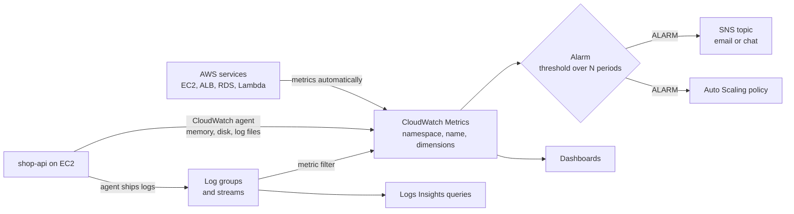
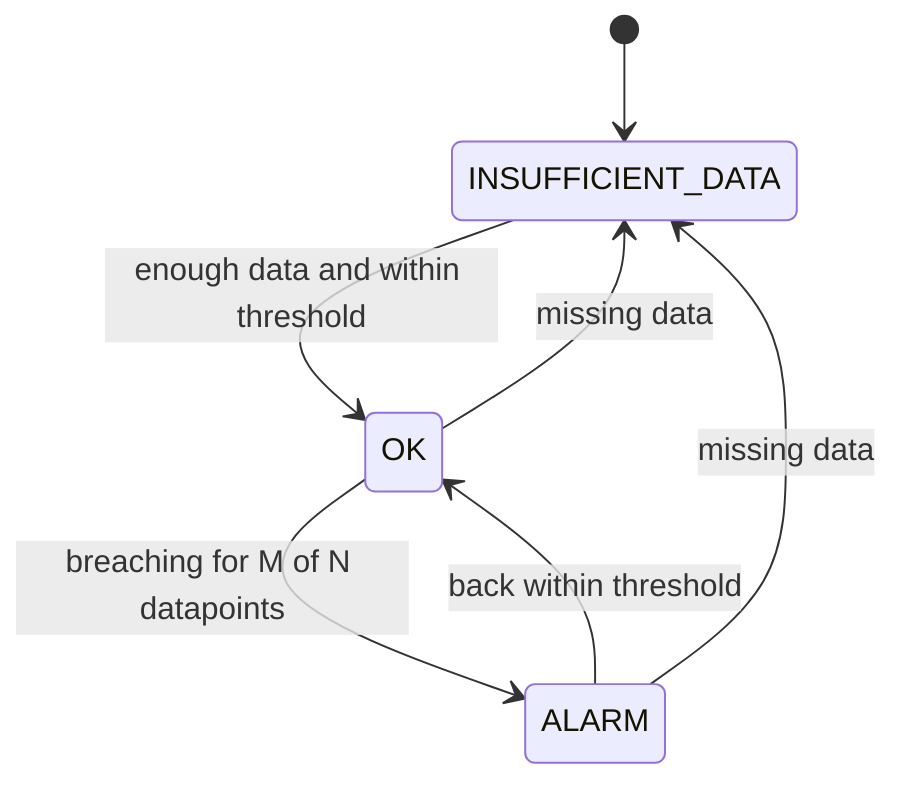

# L6.18 — CloudWatch

> **Level 6: Cloud (AWS)** · Topic 18 of 18 · ⏱ ~5 hours · Difficulty: Intermediate

## 1. What it is

**Amazon CloudWatch** is AWS's built-in observability service. It has four parts you will use constantly:

- **Metrics** — numbers over time (CPU utilization, ALB request count, queue depth), published automatically by almost every AWS service or by your own code.
- **Logs** — text and JSON events collected into **log groups** and **log streams**, searchable with **Logs Insights**.
- **Alarms** — rules that watch a metric and change state (`OK`, `ALARM`, `INSUFFICIENT_DATA`), then notify people or trigger actions such as scaling or an EC2 recovery.
- **Dashboards** — customizable pages of graphs and numbers.

CloudWatch is where the other topics of this level report their health: [EC2](01-ec2.md) CPU, [ALB](14-alb.md) 5xx counts, [RDS](10-rds-and-aurora.md) connections,
[ElastiCache](11-elasticache.md) evictions, [Lambda](03-lambda.md) errors and [CloudTrail](17-cloudtrail.md) events. It also hosts the most important alarm in a new AWS
account — the **billing alarm**.

## 2. Why it matters in DevOps

- **You cannot operate what you cannot see.** The first question in an incident is "what changed and what is broken?" — answered by graphs and logs.
- **Autoscaling is driven by it:** [Auto Scaling](02-auto-scaling.md) policies scale on CloudWatch metrics and alarms.
- **Alerting design is a skill:** noisy alarms train people to ignore pages (see [Alert Fatigue Reduction](../level-14-sre/08-alert-fatigue-reduction.md)); missing alarms mean customers tell you about outages first.
- **Money:** a billing alarm catches a runaway resource or a leaked key before the invoice does, and log ingestion itself is a classic hidden cost.
- **It is the default, zero-install option:** even teams that adopt Prometheus and Grafana ([Level 10](../level-10-observability/01-three-pillars.md)) still rely on CloudWatch for AWS-managed services.

## 3. Real-world system example

**AWS Lambda and Auto Scaling.** Lambda sends every function's logs to a CloudWatch log group named `/aws/lambda/<function-name>` and publishes invocation, error, duration and throttle metrics to the
`AWS/Lambda` namespace without any configuration. Similarly an Auto Scaling group's target-tracking policy creates and manages CloudWatch alarms on your behalf to keep a metric such as average CPU or
`ALBRequestCountPerTarget` at a target value. On the practice side, the Amazon Builders' Library article *Instrumenting distributed systems for operational visibility* describes how Amazon teams
treat metrics, structured logs and dashboards as part of the product, and AWS's Well-Architected Operational Excellence pillar says the same. The **embedded metric format (EMF)** lets an application write
a specially structured JSON log line from which CloudWatch extracts custom metrics automatically — a documented, low-overhead way to publish business metrics such as `OrdersPlaced`.
For the three-pillars concepts behind it, see [Observability](../level-00-what-devops-is/10-observability.md).

## 4. Diagram

The CloudWatch data flow:



Alarm state machine:



## 5. How it works

**Metrics.** A metric is identified by **namespace** (`AWS/EC2`, `AWS/ApplicationELB`, or your own such as `ShopApi`), **metric name** (`CPUUtilization`) and **dimensions** (name/value pairs such as `InstanceId=i-0abc…`, `LoadBalancer=app/shop-alb/…`). Each unique combination is a separate metric.
Data points have a timestamp, value and unit, and are aggregated by **statistic** (`Average`, `Sum`, `Minimum`, `Maximum`, `SampleCount`, percentiles like `p99`) over a **period**.

- EC2 metrics default to **5-minute** granularity (free "basic monitoring"); **detailed monitoring** gives 1 minute for an extra charge. Most other services publish at 1 minute. Custom metrics can be **high-resolution** (down to 1 second).
- **Resolution over time:** CloudWatch rolls data up as it ages — sub-minute data is kept for 3 hours, 1-minute data for 15 days, 5-minute data for 63 days, 1-hour data for 455 days (15 months).
- **What the hypervisor cannot see** — memory use, disk space, processes — is *not* published by default. Install the **CloudWatch agent** to collect it.
- **Metric math** combines metrics: error rate = `100 * errors / requests`. **Anomaly detection** builds an expected-value band instead of a fixed threshold.
- Custom metrics cost money per metric per month (every unique dimension combination counts), so avoid high-cardinality dimensions such as user IDs.

**Logs.** A **log group** is a collection with shared retention, encryption ([KMS](15-kms.md)) and access settings; a **log stream** is one source (an instance, a container). Key facts:

- **Retention defaults to "Never expire"** — set it (7, 14, 30, 90 days...) or storage grows forever.
- You pay for **ingestion (per GB)** and storage; ingestion is the large line item, so avoid noisy debug logs in production.
- **Metric filters** turn matching log lines into metrics (for example count lines containing `"level":"error"`), so you can alarm on them.
- **Subscription filters** stream logs in near real time to Kinesis, Lambda or OpenSearch.
- **Log classes** (Standard, Infrequent Access) trade features for a lower ingestion price.
- Structured **JSON logs** make Logs Insights queries easy (see [Structured Logging](../level-10-observability/05-structured-logging.md)).

**Logs Insights** is the query language for logs:

```sql
fields @timestamp, @message
| filter @message like /ERROR/
| stats count(*) as errors by bin(5m)
| sort @timestamp desc
| limit 50
```

Core commands: `fields`, `filter`, `stats` (with `count`, `avg`, `pct`, `sum`), `sort`, `limit`, `parse` (extract fields from text), `dedup`, `display`. It scans the log groups and time range you pick and is billed
per GB scanned, so narrow the window first.

**Alarms.** An alarm evaluates one metric (or a metric-math expression) over **period × evaluation periods**; with **datapoints to alarm** you can require, say, 3 out of 5. The most overlooked setting is **treat missing data**
(`missing`, `notBreaching`, `breaching`, `ignore`): a stopped server publishes *nothing*, so a "CPU is high" alarm stays quiet while a host is dead. Alarm actions: publish to an **SNS topic** (email, SMS, HTTPS, chat via AWS Chatbot), run an
**Auto Scaling** policy, stop/terminate/reboot/recover an EC2 instance, or create an OpsCenter item. **Composite alarms** combine alarms with AND/OR to cut noise. Each standard alarm has a small monthly cost; there is a free allowance of 10 alarms.

**Dashboards.** JSON-defined pages of widgets (line, number, gauge, logs table) that can span regions and accounts. A small number of dashboards is included in the free tier; beyond that each costs a monthly fee. Build one per service ("`shop-api` overview": requests, latency p99,
5xx, healthy hosts, DB connections, cache hit rate) following the golden signals ([What to Monitor](../level-10-observability/11-what-to-monitor.md)).

**The billing alarm.** AWS publishes the `EstimatedCharges` metric (namespace `AWS/Billing`, dimension `Currency=USD`) — **only in `us-east-1`**, updated several times per day, and **only after you enable billing alerts**
(*Billing and Cost Management → Billing preferences → Alert preferences → "Receive CloudWatch billing alerts"*; the account root user or an admin with billing permissions must do it; IAM users also need billing access activated). It is cumulative for the month. The alarm uses `Maximum` over a 6-hour (21,600 s) period.
Complementary tool: **AWS Budgets** (first budgets are free) sends alerts on actual and forecast spend and also supports per-service and per-tag budgets. Use both: the CloudWatch alarm is simple and always-on, Budgets is richer.

**Cost summary.** Free tier (always free at the time of writing; verify on the pricing page): 10 custom metrics and alarms, 3 dashboards (up to 50 metrics), 5 GB of log ingestion and storage per month, 1 million API requests. Beyond that: custom metrics, alarms,
dashboards, log ingestion/storage/scan and API calls (such as `GetMetricData` from third-party tools) are billed.

## 6. Step-by-step guide

**Prerequisites:** AWS CLI v2, an email address, and (for steps 5-6) an EC2 instance with an instance profile that includes the managed policy `CloudWatchAgentServerPolicy` (see [IAM](07-iam.md)). **Cost warning:** the lab fits inside the always-free tier (a couple of alarms,
a few KB of logs); the cost risks are leaving debug logs flowing and creating many custom-metric dimension combinations. Clean up at the end. **Do step 1 first, in every account you will ever use.**

> **LocalStack:** the free image supports CloudWatch metrics, alarms and Logs basics. Use `export AWS_ENDPOINT_URL=http://localhost:4566 AWS_ACCESS_KEY_ID=test AWS_SECRET_ACCESS_KEY=test AWS_REGION=us-east-1`.
> Alarms transition states there but the real `AWS/Billing` data and Logs Insights depth do not exist, so do step 1 on a real account.

1. **Create the billing alarm (first milestone of the capstone).** First enable *Receive CloudWatch billing alerts* in the Billing console (once per account), then in `us-east-1`:
   ```bash
   export AWS_REGION=us-east-1
   TOPIC_ARN=$(aws sns create-topic --name billing-alerts --query TopicArn --output text)
   aws sns subscribe --topic-arn $TOPIC_ARN --protocol email --notification-endpoint you@example.com
   # open the email AWS sends and click "Confirm subscription"
   aws cloudwatch put-metric-alarm --alarm-name billing-over-10-usd \
     --alarm-description "Estimated month-to-date charges exceed 10 USD" \
     --namespace AWS/Billing --metric-name EstimatedCharges --dimensions Name=Currency,Value=USD \
     --statistic Maximum --period 21600 --evaluation-periods 1 --threshold 10 \
     --comparison-operator GreaterThanOrEqualToThreshold --treat-missing-data notBreaching \
     --alarm-actions $TOPIC_ARN
   aws cloudwatch describe-alarms --alarm-names billing-over-10-usd \
     --query 'MetricAlarms[].[AlarmName,StateValue,Threshold]' --output table
   ```
   Expected: the alarm exists, state `INSUFFICIENT_DATA` or `OK`. Prove the notification path works without waiting for a bill:
   ```bash
   aws cloudwatch set-alarm-state --alarm-name billing-over-10-usd --state-value ALARM --state-reason "test"
   ```
   You should receive an email within a minute; the alarm returns to its real state at the next evaluation. Use a lower threshold (for example 5) if your normal spend is near zero, and add a second alarm at a higher level.
   (If `put-metric-alarm` succeeds but the alarm stays `INSUFFICIENT_DATA` for a day, billing alerts were probably not enabled.)

2. **Look at the metrics a service gives you for free.**
   ```bash
   aws cloudwatch list-metrics --namespace AWS/EC2 --metric-name CPUUtilization --query 'Metrics[0:3]'
   INSTANCE_ID=i-0123456789abcdef0        # replace with yours
   aws cloudwatch get-metric-statistics --namespace AWS/EC2 --metric-name CPUUtilization \
     --dimensions Name=InstanceId,Value=$INSTANCE_ID \
     --start-time "$(date -u -d '-1 hour' +%FT%TZ)" --end-time "$(date -u +%FT%TZ)" \
     --period 300 --statistics Average Maximum --output table
   ```

3. **Publish a custom metric and alarm on it.**
   ```bash
   for i in 1 2 3; do
     aws cloudwatch put-metric-data --namespace ShopApi --metric-name OrdersPlaced --value $((RANDOM % 20)) \
       --unit Count --dimensions Env=lab
     sleep 20
   done
   aws cloudwatch put-metric-alarm --alarm-name shop-no-orders --namespace ShopApi --metric-name OrdersPlaced \
     --dimensions Name=Env,Value=lab --statistic Sum --period 60 --evaluation-periods 5 --datapoints-to-alarm 5 \
     --threshold 1 --comparison-operator LessThanThreshold --treat-missing-data breaching \
     --alarm-actions $TOPIC_ARN
   ```
   `treat-missing-data breaching` makes "no data at all" count as a failure — the right choice for a "business is silent" alarm.

4. **Logs from the CLI: create a group, set retention, write, query.**
   ```bash
   aws logs create-log-group --log-group-name /shop-api/lab
   aws logs put-retention-policy --log-group-name /shop-api/lab --retention-in-days 7
   aws logs create-log-stream --log-group-name /shop-api/lab --log-stream-name manual
   NOW=$(($(date +%s%N)/1000000))
   aws logs put-log-events --log-group-name /shop-api/lab --log-stream-name manual --log-events \
     timestamp=$NOW,message='{"level":"info","msg":"order created","ms":42}' \
     timestamp=$((NOW+1)),message='{"level":"error","msg":"payment failed","ms":913}'
   ```
   Query it with Logs Insights (results arrive after a few seconds):
   ```bash
   QID=$(aws logs start-query --log-group-name /shop-api/lab \
     --start-time $(($(date +%s)-3600)) --end-time $(date +%s) \
     --query-string 'fields @timestamp, level, msg, ms | filter level = "error" | sort @timestamp desc' \
     --query queryId --output text)
   sleep 5; aws logs get-query-results --query-id $QID --query 'results'
   ```
   Live view: `aws logs tail /shop-api/lab --follow`.

5. **Turn a log pattern into a metric and an alarm.**
   ```bash
   aws logs put-metric-filter --log-group-name /shop-api/lab --filter-name errors \
     --filter-pattern '{ $.level = "error" }' \
     --metric-transformations metricName=AppErrors,metricNamespace=ShopApi,metricValue=1,defaultValue=0
   aws cloudwatch put-metric-alarm --alarm-name shop-app-errors --namespace ShopApi --metric-name AppErrors \
     --statistic Sum --period 60 --evaluation-periods 1 --threshold 1 --comparison-operator GreaterThanOrEqualToThreshold \
     --treat-missing-data notBreaching --alarm-actions $TOPIC_ARN
   ```
   Write another error line with `put-log-events` (use a new timestamp, and the sequence token is no longer required) and the alarm goes to `ALARM` within a couple of minutes.

6. **On EC2: CloudWatch agent for memory, disk and app logs** (Amazon Linux 2023):
   ```bash
   sudo dnf install -y amazon-cloudwatch-agent
   sudo tee /opt/aws/amazon-cloudwatch-agent/etc/config.json >/dev/null <<'EOF'
   {
     "metrics": { "namespace": "ShopApi/EC2",
       "append_dimensions": { "InstanceId": "${aws:InstanceId}" },
       "metrics_collected": {
         "mem":  { "measurement": ["mem_used_percent"] },
         "disk": { "measurement": ["used_percent"], "resources": ["/"] } } },
     "logs": { "logs_collected": { "files": { "collect_list": [
       { "file_path": "/var/log/shop-api/app.log", "log_group_name": "/shop-api/lab", "log_stream_name": "{instance_id}" } ] } } }
   }
   EOF
   sudo /opt/aws/amazon-cloudwatch-agent/bin/amazon-cloudwatch-agent-ctl -a fetch-config -m ec2 -s \
     -c file:/opt/aws/amazon-cloudwatch-agent/etc/config.json
   sudo /opt/aws/amazon-cloudwatch-agent/bin/amazon-cloudwatch-agent-ctl -m ec2 -a status
   ```
   Expected: `"status": "running"`. After a few minutes `mem_used_percent` appears under namespace `ShopApi/EC2`.

7. **A dashboard as code.**
   ```bash
   cat > dash.json <<'EOF'
   { "widgets": [
     { "type": "metric", "x": 0, "y": 0, "width": 12, "height": 6, "properties": {
         "title": "Orders placed", "region": "us-east-1", "stat": "Sum", "period": 60,
         "metrics": [ [ "ShopApi", "OrdersPlaced", "Env", "lab" ] ] } },
     { "type": "log", "x": 12, "y": 0, "width": 12, "height": 6, "properties": {
         "title": "Recent errors", "region": "us-east-1",
         "query": "SOURCE '/shop-api/lab' | fields @timestamp, msg | filter level = 'error' | sort @timestamp desc | limit 20" } } ] }
   EOF
   aws cloudwatch put-dashboard --dashboard-name shop-api-lab --dashboard-body file://dash.json
   ```
   Open *CloudWatch → Dashboards → shop-api-lab* in the console.

8. **Cleanup (do not skip).** Keep the billing alarm and its SNS topic permanently; delete everything else.
   ```bash
   aws cloudwatch delete-alarms --alarm-names shop-no-orders shop-app-errors
   aws cloudwatch delete-dashboards --dashboard-names shop-api-lab
   aws logs delete-metric-filter --log-group-name /shop-api/lab --filter-name errors
   aws logs delete-log-group --log-group-name /shop-api/lab
   sudo systemctl stop amazon-cloudwatch-agent 2>/dev/null     # on the EC2 instance
   aws cloudwatch describe-alarms --query 'MetricAlarms[].AlarmName'     # only billing-over-10-usd should remain
   ```
   Custom metrics cannot be deleted; they simply stop being billed about two weeks after the last data point.

## 7. Real-world scenario

*Illustrative scenario.* A team enables debug logging on `shop-api` to chase a rare bug and forgets to turn it off. Two weeks later the billing alarm fires at 60% of its monthly threshold, much earlier than usual. **Investigation:** Cost Explorer
shows CloudWatch as the second-largest line; in the console the `/shop-api/prod` log group's `IncomingBytes` metric jumped from about 2 GB/day to 90 GB/day when the debug flag was enabled. A Logs Insights query
(`stats count(*) by msg | sort count(*) desc | limit 10`) shows 80% of lines are one cache-debug message. **Fix:** set the log level to `info`, add a metric filter and alarm on `IncomingBytes` for the group, and set retention to 30 days
(the group had been "Never expire"). **Lesson:** observability has its own bill; the billing alarm bought two weeks of reaction time, and an alarm on the cost driver (log volume) would have caught it in a day.

## 8. Common mistakes and best practices

**Don't**

- Skip the billing alarm because "I'll stay in the free tier" — a mistake, a leaked key or an orphaned NAT gateway does not care.
- Leave log retention at "Never expire".
- Alarm on CPU only. A web tier fails on latency, errors and saturation long before CPU is the best signal.
- Assume a quiet alarm means a healthy system without setting `treat-missing-data` deliberately.
- Create custom metrics with unbounded dimensions (user ID, request ID, IP).
- Page a human for something that cannot be acted on; send it to a ticket or dashboard instead.

**Do**

- Create the billing alarm (plus an AWS Budget) before launching anything else in a new account.
- Alarm on symptoms users feel: ALB `HTTPCode_Target_5XX_Count`, `TargetResponseTime` p99, `UnHealthyHostCount`, RDS `FreeStorageSpace` and `DatabaseConnections`, ElastiCache `Evictions`, Lambda `Errors`/`Throttles`.
- Log structured JSON, correlate with a request ID ([Correlation IDs](../level-10-observability/07-correlation-ids.md)) and keep a handful of saved Logs Insights queries per service.
- Send alarm notifications to SNS topics (one for pages, one for tickets) and test the path with `set-alarm-state`.
- Install the CloudWatch agent through your AMI/launch template so memory and disk are collected from day one.
- Define alarms and dashboards as code ([Terraform](../level-07-terraform-iac/01-providers-and-resources.md)) so every environment gets them.

## 9. Tasks

- [ ] **T1 — Billing alarm first** *(≈30 min, beginner)*
  - **Goal:** a working, tested spending alert in the account.
  - **Steps:**
    1. Enable *Receive CloudWatch billing alerts* in Billing preferences.
    2. Create the SNS topic, confirm the email subscription and create the alarm in `us-east-1` (step 1).
    3. Run `set-alarm-state` to `ALARM`.
  - **Done when:** you received the alarm email and `describe-alarms` lists `billing-over-10-usd` with your threshold. (Optionally add an AWS Budget with an 80% forecast alert.)

- [ ] **T2 — Metrics, statistics and periods** *(≈30 min, beginner)*
  - **Goal:** read an AWS-provided metric correctly.
  - **Steps:**
    1. Launch (or use) a `t3.micro`; run `yes > /dev/null &` for a few minutes on it.
    2. Pull `CPUUtilization` with `get-metric-statistics` at periods of 300 and 60 seconds.
    3. Explain why the 60-second period shows few or no points unless detailed monitoring is on.
  - **Done when:** your table shows CPU rising and you can state the default EC2 granularity. Kill the process and stop the instance afterward.

- [ ] **T3 — Logs, retention and Insights** *(≈45 min, intermediate)*
  - **Goal:** ship logs and query them.
  - **Steps:**
    1. Create `/shop-api/lab` with 7-day retention and write 20 JSON log lines with varying `ms` and `level`.
    2. Write Logs Insights queries for: errors only; average and p95 of `ms`; count by `level` per minute (`stats count(*) by level, bin(1m)`).
    3. Save one query in the console.
  - **Done when:** each query returns the expected numbers and `describe-log-groups` shows `retentionInDays: 7`.

- [ ] **T4 — Metric filter and alarm** *(≈45 min, intermediate)*
  - **Goal:** alert on a log pattern.
  - **Steps:**
    1. Create the `AppErrors` metric filter and alarm from step 5.
    2. Write an error line; watch the alarm go to `ALARM` and the email arrive.
    3. Stop writing errors and watch it return to `OK`.
  - **Done when:** you captured the alarm's state history with `aws cloudwatch describe-alarm-history --alarm-name shop-app-errors`.

- [ ] **T5 — Break it: missing data** *(≈45 min, advanced)*
  - **Goal:** understand why dead hosts do not trigger "high" alarms.
  - **Steps:**
    1. Create an alarm on a custom metric `Heartbeat` that fires when `Sum < 1` for 3 of 3 one-minute periods with `treat-missing-data` set to `notBreaching`.
    2. Stop publishing the metric and show the alarm stays `OK`/`INSUFFICIENT_DATA`.
    3. Change to `breaching` and show it fires.
  - **Done when:** you have both behaviors demonstrated and can say which setting suits a heartbeat check.

- [ ] **T6 — Prove it: a dashboard and alarm set for shop-api, then tear down** *(≈90 min, advanced)*
  - **Goal:** operational visibility for the capstone stack.
  - **Steps:**
    1. Without the guide, create a dashboard with ALB request count and target 5xx, p99 `TargetResponseTime`, EC2 CPU and `mem_used_percent`, RDS connections and ElastiCache cache hit rate (`CacheHitRate` or `CacheHits`/`CacheMisses` math).
    2. Create alarms for ALB 5xx, unhealthy hosts, RDS free storage and ElastiCache evictions, all notifying one SNS topic.
    3. Explain how you would reduce noise (composite alarm, datapoints to alarm), then run the cleanup (step 8) but keep the billing alarm.
  - **Done when:** the dashboard renders data from at least four services and `describe-alarms` shows only the billing alarm after cleanup.

## 10. Self-check questions

1. What identifies a CloudWatch metric, and why do dimensions matter for cost?
2. Why do you need the CloudWatch agent on EC2, and what does it add?
3. What does `treat-missing-data` do, and which value would you use for a heartbeat alarm?
4. Where must the billing alarm be created, and what must be enabled first?
5. What is the default retention of a log group and why is that a problem?
6. When would you use a metric filter versus a Logs Insights query?

<details>
<summary>Answers</summary>

1. Namespace + metric name + the exact set of dimensions. Every unique combination is a separate (billable) custom metric, so high-cardinality dimensions explode cost.
2. Hypervisor-level metrics do not include memory, disk usage or application logs; the agent collects them from inside the OS and ships log files.
3. It defines how the alarm treats periods with no data (`missing`, `ignore`, `breaching`, `notBreaching`). For a heartbeat, use `breaching` so silence raises the alarm.
4. In `us-east-1` (that is where `AWS/Billing` metrics live), after enabling "Receive CloudWatch billing alerts" in Billing preferences.
5. "Never expire", so logs accumulate and are billed for storage forever; set a retention period.
6. A metric filter runs continuously on incoming logs to create a metric you can alarm on; Logs Insights is for ad-hoc, interactive investigation of past logs.
</details>

## 11. Further reading

- *Amazon CloudWatch User Guide* (docs.aws.amazon.com/cloudwatch) — metrics, alarms, Logs Insights query syntax, agent configuration.
- *Amazon CloudWatch pricing* page — current free tier and per-metric, per-alarm and per-GB rates.
- Amazon Builders' Library: *Instrumenting distributed systems for operational visibility*.
- *Site Reliability Engineering* (Google, free online), chapter on monitoring distributed systems.
- *AWS Budgets* documentation — complementary cost alerts.

<!-- nav -->
---
← Previous: [CloudTrail](17-cloudtrail.md) · [Level 6 index](README.md) · Next: [Level capstone project](99-capstone-project.md) →
