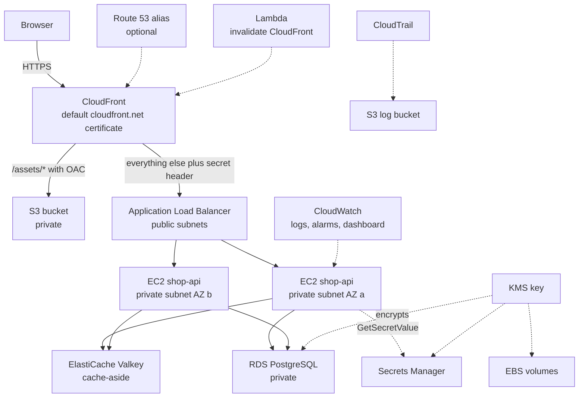
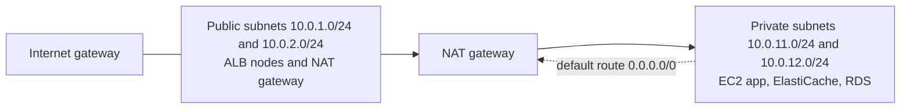

# L6 Capstone — shop-api on CloudFront, ALB, EC2, Redis, RDS and S3

> **Level 6: Cloud (AWS)** · Capstone · ⏱ ~10 hours

## 1. Goal and outcome

Build, secure, observe and then completely destroy the production-shaped AWS architecture from this level's roadmap: **CloudFront → ALB → EC2 instances (Auto Scaling) → Redis (ElastiCache) → RDS → S3**.
The `shop-api` sample app (a small Node.js service) serves `/api/products` from PostgreSQL through a Redis cache-aside layer; static files live in a private S3 bucket and are delivered by CloudFront.

When you finish you will have:

- a **billing alarm** (the first milestone) and a CloudTrail trail watching the account;
- a custom VPC with public and private subnets, an internet gateway, a NAT gateway and least-privilege security groups;
- an encrypted stack (KMS) whose database password lives in Secrets Manager and is never written down by you;
- one HTTPS URL (`https://dxxxx.cloudfront.net`) that returns cached static files, uncached API calls, and shows which instance answered;
- CloudWatch dashboards and alarms, a Lambda function, and a script-driven **teardown that leaves nothing billing**.

| Level 6 topic | Where it appears |
|---------------|------------------|
| 01 EC2, 09 EBS/EFS | Launch template, encrypted gp3 root volumes (EFS is a stretch goal) |
| 02 Auto Scaling | ASG with ELB health checks and a target-tracking policy |
| 03 Lambda | Post-deploy CloudFront invalidation function |
| 04 VPC, 05 route tables/IGW/NAT, 06 SGs | Milestone 2 network |
| 07 IAM | Instance role, Lambda role, least-privilege policies |
| 08 S3 | Private static-assets bucket with OAC |
| 10 RDS, 11 ElastiCache | Milestone 4 data tier |
| 12 Route 53 | Optional custom domain alias |
| 13 CloudFront, 14 ALB | Edge and load balancer |
| 15 KMS, 16 Secrets Manager | Customer managed key, managed master password |
| 17 CloudTrail, 18 CloudWatch | Audit trail, billing alarm, logs, dashboard, alarms |

## 2. Architecture



Network layout (two Availability Zones, one NAT gateway to keep the lab cheap):



## 3. Prerequisites and cost

- An AWS account you own, AWS CLI v2 (`aws sts get-caller-identity` works with an admin-level IAM Identity Center or IAM user — **not** the root user), `jq`, `zip`, `openssl`, `curl`. Region: `us-east-1`.
- Optional: a domain in Route 53 (about $12 a year plus $0.50 per month for the hosted zone — skip it for a free run).
- **Cost model (approximate, check the pricing pages):** the NAT gateway (~$0.045/hour plus data), the ALB (~$0.0225/hour plus LCUs), two `t3.micro` instances, a `db.t4g.micro` RDS instance, a `cache.t4g.micro` node, a KMS key ($1 a month, prorated) and Secrets Manager ($0.40 a month per secret after a trial). Together roughly **$0.15-0.25 per hour**, so a focused day costs a few dollars; free-tier credits or the 12-month free tier cover some lines depending on when your account was created.
- **The two rules:** (1) the billing alarm comes first; (2) run the teardown in section 7 the same day. Never leave the NAT gateway, ALB, RDS or ElastiCache running overnight.
- Everything is tagged `Project=shop-capstone`, and each created ID is appended to `lab.env` so you can resume in a new shell with `source lab.env`.

## 4. Build it step by step

Create a working folder and a state file:

```bash
mkdir -p ~/shop-capstone && cd ~/shop-capstone
export AWS_REGION=us-east-1 AWS_PAGER=""
ACCOUNT_ID=$(aws sts get-caller-identity --query Account --output text)
save() { echo "$1=$2" >> lab.env; }      # usage: save VPC_ID "$VPC_ID"
save ACCOUNT_ID $ACCOUNT_ID
```

### Milestone 0 — Billing alarm and CloudTrail (topics 18, 17)

Enable *Billing → Billing preferences → Receive CloudWatch billing alerts* first (once, console, root or billing admin).

```bash
TOPIC_ARN=$(aws sns create-topic --name shop-capstone-alerts --query TopicArn --output text); save TOPIC_ARN $TOPIC_ARN
aws sns subscribe --topic-arn $TOPIC_ARN --protocol email --notification-endpoint you@example.com   # confirm the email
aws cloudwatch put-metric-alarm --alarm-name billing-over-10-usd --namespace AWS/Billing \
  --metric-name EstimatedCharges --dimensions Name=Currency,Value=USD --statistic Maximum --period 21600 \
  --evaluation-periods 1 --threshold 10 --comparison-operator GreaterThanOrEqualToThreshold \
  --treat-missing-data notBreaching --alarm-actions $TOPIC_ARN
aws cloudwatch set-alarm-state --alarm-name billing-over-10-usd --state-value ALARM --state-reason test   # you should get an email
```

Now the audit trail (bucket policy exactly as in [CloudTrail](17-cloudtrail.md), step 3):

```bash
LOGBUCKET=shop-capstone-trail-$ACCOUNT_ID; save LOGBUCKET $LOGBUCKET
aws s3api create-bucket --bucket $LOGBUCKET
aws s3api put-public-access-block --bucket $LOGBUCKET --public-access-block-configuration \
  BlockPublicAcls=true,IgnorePublicAcls=true,BlockPublicPolicy=true,RestrictPublicBuckets=true
# put-bucket-policy with the two CloudTrail statements for trail "shop-capstone-trail" (see topic 17), then:
aws cloudtrail create-trail --name shop-capstone-trail --s3-bucket-name $LOGBUCKET \
  --is-multi-region-trail --enable-log-file-validation && aws cloudtrail start-logging --name shop-capstone-trail
```

### Milestone 1 — Encryption key (topic 15)

```bash
KEY_ID=$(aws kms create-key --description "shop-capstone key" --tags TagKey=Project,TagValue=shop-capstone \
  --query KeyMetadata.KeyId --output text); save KEY_ID $KEY_ID
aws kms create-alias --alias-name alias/shop-capstone --target-key-id $KEY_ID
aws kms enable-key-rotation --key-id $KEY_ID
# Auto Scaling launches instances with encrypted volumes: its service-linked role must be able to use the key
aws iam create-service-linked-role --aws-service-name autoscaling.amazonaws.com 2>/dev/null || true
aws kms create-grant --key-id $KEY_ID --name asg-grant \
  --grantee-principal arn:aws:iam::$ACCOUNT_ID:role/aws-service-role/autoscaling.amazonaws.com/AWSServiceRoleForAutoScaling \
  --operations Decrypt GenerateDataKeyWithoutPlaintext ReEncryptFrom ReEncryptTo CreateGrant DescribeKey
```

### Milestone 2 — Network (topics 04, 05, 06)

```bash
VPC_ID=$(aws ec2 create-vpc --cidr-block 10.0.0.0/16 --tag-specifications 'ResourceType=vpc,Tags=[{Key=Name,Value=shop-capstone},{Key=Project,Value=shop-capstone}]' --query Vpc.VpcId --output text); save VPC_ID $VPC_ID
aws ec2 modify-vpc-attribute --vpc-id $VPC_ID --enable-dns-hostnames
mk_subnet() { aws ec2 create-subnet --vpc-id $VPC_ID --cidr-block $1 --availability-zone $2 --query Subnet.SubnetId --output text; }
PUB_A=$(mk_subnet 10.0.1.0/24 us-east-1a);  PUB_B=$(mk_subnet 10.0.2.0/24 us-east-1b)
PRIV_A=$(mk_subnet 10.0.11.0/24 us-east-1a); PRIV_B=$(mk_subnet 10.0.12.0/24 us-east-1b)
for v in PUB_A PUB_B PRIV_A PRIV_B; do save $v ${!v}; done

IGW_ID=$(aws ec2 create-internet-gateway --query InternetGateway.InternetGatewayId --output text); save IGW_ID $IGW_ID
aws ec2 attach-internet-gateway --internet-gateway-id $IGW_ID --vpc-id $VPC_ID
PUB_RT=$(aws ec2 create-route-table --vpc-id $VPC_ID --query RouteTable.RouteTableId --output text); save PUB_RT $PUB_RT
aws ec2 create-route --route-table-id $PUB_RT --destination-cidr-block 0.0.0.0/0 --gateway-id $IGW_ID
aws ec2 associate-route-table --route-table-id $PUB_RT --subnet-id $PUB_A; aws ec2 associate-route-table --route-table-id $PUB_RT --subnet-id $PUB_B

EIP_ALLOC=$(aws ec2 allocate-address --domain vpc --query AllocationId --output text); save EIP_ALLOC $EIP_ALLOC
NAT_ID=$(aws ec2 create-nat-gateway --subnet-id $PUB_A --allocation-id $EIP_ALLOC --query NatGateway.NatGatewayId --output text); save NAT_ID $NAT_ID
aws ec2 wait nat-gateway-available --nat-gateway-ids $NAT_ID
PRIV_RT=$(aws ec2 create-route-table --vpc-id $VPC_ID --query RouteTable.RouteTableId --output text); save PRIV_RT $PRIV_RT
aws ec2 create-route --route-table-id $PRIV_RT --destination-cidr-block 0.0.0.0/0 --nat-gateway-id $NAT_ID
aws ec2 associate-route-table --route-table-id $PRIV_RT --subnet-id $PRIV_A; aws ec2 associate-route-table --route-table-id $PRIV_RT --subnet-id $PRIV_B
```

Security groups (each tier only accepts traffic from the tier in front of it):

```bash
mk_sg() { aws ec2 create-security-group --group-name $1 --description "$1" --vpc-id $VPC_ID --query GroupId --output text; }
ALB_SG=$(mk_sg shop-cap-alb); APP_SG=$(mk_sg shop-cap-app); DB_SG=$(mk_sg shop-cap-db); CACHE_SG=$(mk_sg shop-cap-cache)
for v in ALB_SG APP_SG DB_SG CACHE_SG; do save $v ${!v}; done
CF_PL=$(aws ec2 describe-managed-prefix-lists --filters Name=prefix-list-name,Values=com.amazonaws.global.cloudfront.origin-facing --query 'PrefixLists[0].PrefixListId' --output text)
aws ec2 authorize-security-group-ingress --group-id $ALB_SG --ip-permissions "IpProtocol=tcp,FromPort=80,ToPort=80,PrefixListIds=[{PrefixListId=$CF_PL}]"
aws ec2 authorize-security-group-ingress --group-id $APP_SG   --protocol tcp --port 3000 --source-group $ALB_SG
aws ec2 authorize-security-group-ingress --group-id $DB_SG    --protocol tcp --port 5432 --source-group $APP_SG
aws ec2 authorize-security-group-ingress --group-id $CACHE_SG --protocol tcp --port 6379 --source-group $APP_SG
```

The CloudFront prefix list counts as many rules toward the security-group rule quota (about 55 entries); this is expected, and if you hit the quota ask for an increase or rely on the secret-header check alone.

### Milestone 3 — S3 assets bucket and IAM role (topics 08, 07)

```bash
ASSETS=shop-capstone-assets-$ACCOUNT_ID; save ASSETS $ASSETS
aws s3api create-bucket --bucket $ASSETS
aws s3api put-public-access-block --bucket $ASSETS --public-access-block-configuration BlockPublicAcls=true,IgnorePublicAcls=true,BlockPublicPolicy=true,RestrictPublicBuckets=true
mkdir -p site/assets && echo '<h1>shop-api</h1><p>static asset from S3 via CloudFront</p>' > site/assets/hello.html
aws s3 sync site/ s3://$ASSETS/

cat > trust-ec2.json <<'EOF'
{"Version":"2012-10-17","Statement":[{"Effect":"Allow","Principal":{"Service":"ec2.amazonaws.com"},"Action":"sts:AssumeRole"}]}
EOF
aws iam create-role --role-name shop-capstone-app --assume-role-policy-document file://trust-ec2.json
aws iam attach-role-policy --role-name shop-capstone-app --policy-arn arn:aws:iam::aws:policy/AmazonSSMManagedInstanceCore        # Session Manager, no SSH
aws iam attach-role-policy --role-name shop-capstone-app --policy-arn arn:aws:iam::aws:policy/CloudWatchAgentServerPolicy
aws iam create-instance-profile --instance-profile-name shop-capstone-app
aws iam add-role-to-instance-profile --instance-profile-name shop-capstone-app --role-name shop-capstone-app
```

### Milestone 4 — Data tier: RDS with a managed secret, and Redis (topics 10, 11, 16, 15)

```bash
SUBNETS="$PRIV_A $PRIV_B"
aws rds create-db-subnet-group --db-subnet-group-name shop-cap --db-subnet-group-description "shop capstone" --subnet-ids $SUBNETS
aws elasticache create-cache-subnet-group --cache-subnet-group-name shop-cap --cache-subnet-group-description "shop capstone" --subnet-ids $SUBNETS

aws rds create-db-instance --db-instance-identifier shop-capstone --engine postgres --db-instance-class db.t4g.micro \
  --allocated-storage 20 --storage-type gp3 --storage-encrypted --kms-key-id $KEY_ID --db-name shop \
  --master-username shopadmin --manage-master-user-password --master-user-secret-kms-key-id $KEY_ID \
  --db-subnet-group-name shop-cap --vpc-security-group-ids $DB_SG --no-publicly-accessible \
  --backup-retention-period 1 --no-multi-az --tags Key=Project,Value=shop-capstone

aws elasticache create-replication-group --replication-group-id shop-cap-cache --replication-group-description "shop capstone" \
  --engine valkey --cache-node-type cache.t4g.micro --num-cache-clusters 1 \
  --transit-encryption-enabled --at-rest-encryption-enabled --kms-key-id $KEY_ID \
  --cache-subnet-group-name shop-cap --security-group-ids $CACHE_SG

aws rds wait db-instance-available --db-instance-identifier shop-capstone                  # ~10 minutes
aws elasticache wait replication-group-available --replication-group-id shop-cap-cache
DB_HOST=$(aws rds describe-db-instances --db-instance-identifier shop-capstone --query 'DBInstances[0].Endpoint.Address' --output text)
DB_SECRET_ARN=$(aws rds describe-db-instances --db-instance-identifier shop-capstone --query 'DBInstances[0].MasterUserSecret.SecretArn' --output text)
REDIS_HOST=$(aws elasticache describe-replication-groups --replication-group-id shop-cap-cache --query 'ReplicationGroups[0].NodeGroups[0].PrimaryEndpoint.Address' --output text)
for v in DB_HOST DB_SECRET_ARN REDIS_HOST; do save $v ${!v}; done
```

Allow the app role to read only that secret (and decrypt it):

```bash
cat > app-policy.json <<EOF
{"Version":"2012-10-17","Statement":[
 {"Effect":"Allow","Action":"secretsmanager:GetSecretValue","Resource":"$DB_SECRET_ARN"},
 {"Effect":"Allow","Action":"kms:Decrypt","Resource":"arn:aws:kms:us-east-1:$ACCOUNT_ID:key/$KEY_ID"}]}
EOF
aws iam put-role-policy --role-name shop-capstone-app --policy-name read-db-secret --policy-document file://app-policy.json
```

The RDS-managed secret holds only the master username and password; for a real system you would create a lower-privilege application user — see stretch goals.

### Milestone 5 — The app, launch template, ALB and Auto Scaling (topics 01, 09, 14, 02)

The app. Save as `userdata.tmpl` (placeholders are replaced with `sed`):

```bash
cat > userdata.tmpl <<'EOF'
#!/bin/bash
dnf install -y nodejs amazon-cloudwatch-agent
mkdir -p /opt/shop-api && cd /opt/shop-api && npm init -y >/dev/null && npm install pg redis @aws-sdk/client-secrets-manager
cat > server.js <<'JS'
const http = require('http'), os = require('os'), { Pool } = require('pg'), { createClient } = require('redis');
const { SecretsManagerClient, GetSecretValueCommand } = require('@aws-sdk/client-secrets-manager');
const E = process.env; let pool, redis;
async function init() {
  const sm = new SecretsManagerClient({ region: E.AWS_REGION });
  const s = JSON.parse((await sm.send(new GetSecretValueCommand({ SecretId: E.DB_SECRET_ARN }))).SecretString);
  pool = new Pool({ host: E.DB_HOST, user: s.username, password: s.password, database: 'shop', ssl: { rejectUnauthorized: false }, max: 5 });
  await pool.query('create table if not exists products(id serial primary key, name text not null, price_cents int not null)');
  if ((await pool.query('select count(*) from products')).rows[0].count === '0')
    await pool.query("insert into products(name, price_cents) values ('keyboard',4900),('monitor',17900),('mouse',1900)");
  redis = createClient({ url: `rediss://${E.REDIS_HOST}:6379` });
  redis.on('error', e => console.error('redis', e.message)); await redis.connect();
}
http.createServer(async (req, res) => {
  try {
    if (req.url === '/healthz') { res.writeHead(200); return res.end('ok'); }
    if (req.url === '/api/whoami') { res.writeHead(200, { 'Content-Type': 'application/json' }); return res.end(JSON.stringify({ host: os.hostname() })); }
    if (req.url === '/api/products') {
      let body = await redis.get('products:all'), cache = 'hit';
      if (!body) { cache = 'miss'; body = JSON.stringify((await pool.query('select * from products order by id')).rows); await redis.set('products:all', body, { EX: 60 }); }
      res.writeHead(200, { 'Content-Type': 'application/json', 'X-App-Cache': cache, 'X-App-Host': os.hostname() }); return res.end(body);
    }
    res.writeHead(404); res.end('not found');
  } catch (e) { console.error(e); res.writeHead(500); res.end('error'); }
}).on('error', e => { console.error(e); process.exit(1); });
init().then(() => http.createServer().close() || console.log('ready')).catch(e => { console.error(e); process.exit(1); });
JS
cat > /etc/shop-api.env <<ENV
AWS_REGION=us-east-1
DB_HOST=__DB_HOST__
DB_SECRET_ARN=__DB_SECRET_ARN__
REDIS_HOST=__REDIS_HOST__
PORT=3000
ENV
EOF
echo written

<!-- nav -->
---
← Previous: [CloudWatch](18-cloudwatch.md) · [Level 6 index](README.md) · Next level: [Level 7 — Terraform / Infrastructure as Code](../level-07-terraform-iac/README.md) →
