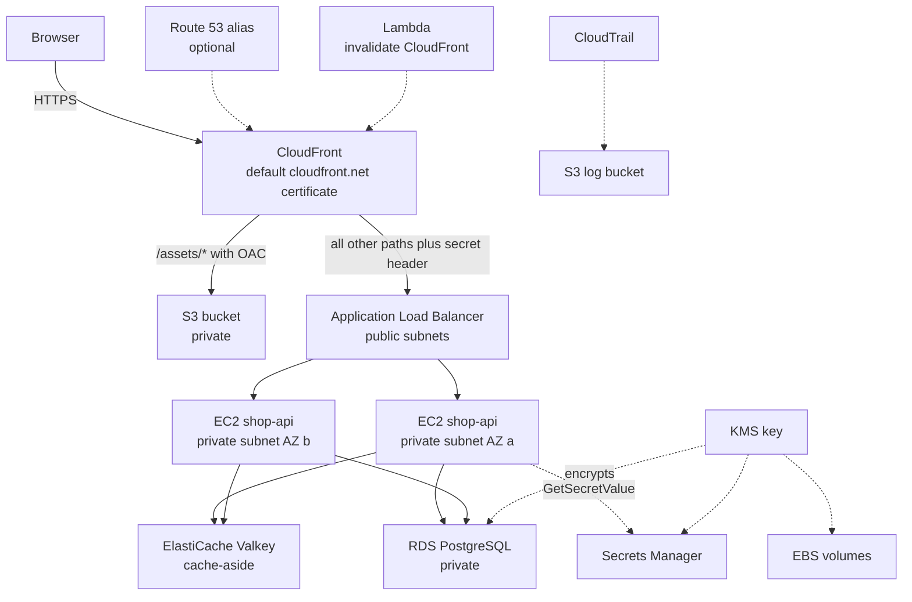
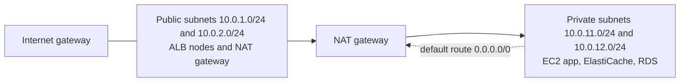

# L6 Capstone — shop-api on CloudFront, ALB, EC2, Redis, RDS and S3

> **Level 6: Cloud (AWS)** · Capstone · ⏱ ~10 hours

## 1. Goal and outcome

Build, secure, observe and then completely destroy the production-shaped AWS architecture from this level's roadmap:
**CloudFront → ALB → EC2 instances (Auto Scaling) → Redis (ElastiCache) → RDS → S3**. The `shop-api` sample app (a small Node.js service)
serves `/api/products` from PostgreSQL through a Redis cache-aside layer; static files live in a private S3 bucket and are delivered by CloudFront.

When you finish you will have:

- a **billing alarm** (the first milestone) and a CloudTrail trail watching the account;
- a custom VPC with public and private subnets, an internet gateway, a NAT gateway and least-privilege security groups;
- an encrypted stack (KMS) whose database password lives in Secrets Manager and is never typed or stored by you;
- one HTTPS URL (`https://dxxxx.cloudfront.net`) that returns cached static files, uncached API calls, and shows which instance answered;
- CloudWatch logs, alarms and a dashboard, a Lambda function, and a scripted **teardown that leaves nothing billing**.

| Level 6 topic | Where it appears |
|---------------|------------------|
| [01 EC2](01-ec2.md), [09 EBS and EFS](09-ebs-and-efs.md) | Launch template, encrypted gp3 root volumes (EFS is a stretch goal) |
| [02 Auto Scaling](02-auto-scaling.md) | ASG with ELB health checks and target tracking |
| [03 Lambda](03-lambda.md) | Post-deploy CloudFront invalidation function |
| [04 VPC](04-vpc-and-subnets.md), [05 routing and NAT](05-route-tables-igw-nat.md), [06 security groups](06-security-groups-and-nacls.md) | Milestone 2 |
| [07 IAM](07-iam.md) | Instance role, Lambda role, least privilege |
| [08 S3](08-s3.md) | Private static-assets bucket with OAC |
| [10 RDS](10-rds-and-aurora.md), [11 ElastiCache](11-elasticache.md) | Milestone 4 data tier |
| [12 Route 53](12-route-53.md) | Optional custom domain alias |
| [13 CloudFront](13-cloudfront.md), [14 ALB](14-alb.md) | Milestones 5 and 6 |
| [15 KMS](15-kms.md), [16 Secrets Manager](16-secrets-manager.md) | Customer managed key, managed master password |
| [17 CloudTrail](17-cloudtrail.md), [18 CloudWatch](18-cloudwatch.md) | Audit trail, billing alarm, logs, dashboard, alarms |

## 2. Architecture



Network layout (two Availability Zones, one NAT gateway to keep the lab cheap):



## 3. Prerequisites and cost

- An AWS account you own and AWS CLI v2 (`aws sts get-caller-identity` works with an admin-level IAM Identity Center or IAM user, **not** the root user), plus `jq`, `openssl`, `curl`, `zip`, `python3` and GNU `base64`. Region: `us-east-1`.
- Optional: a domain in Route 53 (about $12 a year plus $0.50 per month for the hosted zone); skip it for a free run.
- **Cost model (approximate, check the pricing pages):** NAT gateway (~$0.045 per hour plus data), ALB (~$0.0225 per hour plus LCUs), two `t3.micro` instances, one `db.t4g.micro`, one `cache.t4g.micro`, a KMS key ($1 a month, prorated) and a Secrets Manager secret ($0.40 a month after a trial). Together roughly **$0.15-0.25 per hour**, so a focused day costs a few dollars; the free tier or credits cover part of it depending on when your account was created.
- **The two rules:** (1) the billing alarm comes first; (2) run the teardown in section 7 **the same day**. Never leave the NAT gateway, ALB, RDS or ElastiCache running overnight.
- Every ID is appended to `lab.env`, so you can resume in a new shell with `source lab.env`.

## 4. Build it step by step

```bash
mkdir -p ~/shop-capstone && cd ~/shop-capstone
export AWS_REGION=us-east-1 AWS_PAGER=""
ACCOUNT_ID=$(aws sts get-caller-identity --query Account --output text)
save() { echo "$1=$2" >> lab.env; }          # usage: save NAME "$VALUE"
save ACCOUNT_ID $ACCOUNT_ID
```

### Milestone 0 — Billing alarm and CloudTrail (topics 18, 17)

First enable *Billing and Cost Management → Billing preferences → Receive CloudWatch billing alerts* (console, once per account).

```bash
TOPIC_ARN=$(aws sns create-topic --name shop-capstone-alerts --query TopicArn --output text); save TOPIC_ARN $TOPIC_ARN
aws sns subscribe --topic-arn $TOPIC_ARN --protocol email --notification-endpoint you@example.com     # click the confirmation link
aws cloudwatch put-metric-alarm --alarm-name billing-over-10-usd --namespace AWS/Billing \
  --metric-name EstimatedCharges --dimensions Name=Currency,Value=USD --statistic Maximum --period 21600 \
  --evaluation-periods 1 --threshold 10 --comparison-operator GreaterThanOrEqualToThreshold \
  --treat-missing-data notBreaching --alarm-actions $TOPIC_ARN
aws cloudwatch set-alarm-state --alarm-name billing-over-10-usd --state-value ALARM --state-reason test   # an email must arrive
```

The audit trail (use the bucket policy from [CloudTrail](17-cloudtrail.md), step 3, with trail name `shop-capstone-trail`):

```bash
LOGBUCKET=shop-capstone-trail-$ACCOUNT_ID; save LOGBUCKET $LOGBUCKET
aws s3api create-bucket --bucket $LOGBUCKET
aws s3api put-public-access-block --bucket $LOGBUCKET --public-access-block-configuration \
  BlockPublicAcls=true,IgnorePublicAcls=true,BlockPublicPolicy=true,RestrictPublicBuckets=true
# aws s3api put-bucket-policy --bucket $LOGBUCKET --policy file://trail-policy.json     (the two CloudTrail statements from topic 17)
aws cloudtrail create-trail --name shop-capstone-trail --s3-bucket-name $LOGBUCKET --is-multi-region-trail --enable-log-file-validation
aws cloudtrail start-logging --name shop-capstone-trail
```

### Milestone 1 — Encryption key (topic 15)

```bash
KEY_ID=$(aws kms create-key --description "shop-capstone key" --tags TagKey=Project,TagValue=shop-capstone --query KeyMetadata.KeyId --output text); save KEY_ID $KEY_ID
aws kms create-alias --alias-name alias/shop-capstone --target-key-id $KEY_ID
aws kms enable-key-rotation --key-id $KEY_ID
# Auto Scaling creates encrypted volumes through its service-linked role, which must be allowed to use the key
aws iam create-service-linked-role --aws-service-name autoscaling.amazonaws.com 2>/dev/null || true
aws kms create-grant --key-id $KEY_ID --name asg-grant \
  --grantee-principal arn:aws:iam::$ACCOUNT_ID:role/aws-service-role/autoscaling.amazonaws.com/AWSServiceRoleForAutoScaling \
  --operations Decrypt GenerateDataKeyWithoutPlaintext ReEncryptFrom ReEncryptTo CreateGrant DescribeKey
```

### Milestone 2 — Network (topics 04, 05, 06)

```bash
VPC_ID=$(aws ec2 create-vpc --cidr-block 10.0.0.0/16 --query Vpc.VpcId --output text); save VPC_ID $VPC_ID
aws ec2 create-tags --resources $VPC_ID --tags Key=Name,Value=shop-capstone Key=Project,Value=shop-capstone
aws ec2 modify-vpc-attribute --vpc-id $VPC_ID --enable-dns-hostnames
mk_subnet() { aws ec2 create-subnet --vpc-id $VPC_ID --cidr-block $1 --availability-zone $2 --query Subnet.SubnetId --output text; }
PUB_A=$(mk_subnet 10.0.1.0/24 us-east-1a);   PUB_B=$(mk_subnet 10.0.2.0/24 us-east-1b)
PRIV_A=$(mk_subnet 10.0.11.0/24 us-east-1a); PRIV_B=$(mk_subnet 10.0.12.0/24 us-east-1b)
for v in PUB_A PUB_B PRIV_A PRIV_B; do save $v ${!v}; done

IGW_ID=$(aws ec2 create-internet-gateway --query InternetGateway.InternetGatewayId --output text); save IGW_ID $IGW_ID
aws ec2 attach-internet-gateway --internet-gateway-id $IGW_ID --vpc-id $VPC_ID
PUB_RT=$(aws ec2 create-route-table --vpc-id $VPC_ID --query RouteTable.RouteTableId --output text); save PUB_RT $PUB_RT
aws ec2 create-route --route-table-id $PUB_RT --destination-cidr-block 0.0.0.0/0 --gateway-id $IGW_ID >/dev/null
for s in $PUB_A $PUB_B; do aws ec2 associate-route-table --route-table-id $PUB_RT --subnet-id $s >/dev/null; done

EIP_ALLOC=$(aws ec2 allocate-address --domain vpc --query AllocationId --output text); save EIP_ALLOC $EIP_ALLOC
NAT_ID=$(aws ec2 create-nat-gateway --subnet-id $PUB_A --allocation-id $EIP_ALLOC --query NatGateway.NatGatewayId --output text); save NAT_ID $NAT_ID
aws ec2 wait nat-gateway-available --nat-gateway-ids $NAT_ID
PRIV_RT=$(aws ec2 create-route-table --vpc-id $VPC_ID --query RouteTable.RouteTableId --output text); save PRIV_RT $PRIV_RT
aws ec2 create-route --route-table-id $PRIV_RT --destination-cidr-block 0.0.0.0/0 --nat-gateway-id $NAT_ID >/dev/null
for s in $PRIV_A $PRIV_B; do aws ec2 associate-route-table --route-table-id $PRIV_RT --subnet-id $s >/dev/null; done
```

Security groups, each tier accepting traffic only from the tier in front of it:

```bash
mk_sg() { aws ec2 create-security-group --group-name $1 --description "$1" --vpc-id $VPC_ID --query GroupId --output text; }
ALB_SG=$(mk_sg shop-cap-alb); APP_SG=$(mk_sg shop-cap-app); DB_SG=$(mk_sg shop-cap-db); CACHE_SG=$(mk_sg shop-cap-cache)
for v in ALB_SG APP_SG DB_SG CACHE_SG; do save $v ${!v}; done
CF_PL=$(aws ec2 describe-managed-prefix-lists --filters Name=prefix-list-name,Values=com.amazonaws.global.cloudfront.origin-facing --query 'PrefixLists[0].PrefixListId' --output text)
aws ec2 authorize-security-group-ingress --group-id $ALB_SG --ip-permissions "IpProtocol=tcp,FromPort=80,ToPort=80,PrefixListIds=[{PrefixListId=$CF_PL}]"
aws ec2 authorize-security-group-ingress --group-id $APP_SG --protocol tcp --port 3000 --source-group $ALB_SG
aws ec2 authorize-security-group-ingress --group-id $DB_SG --protocol tcp --port 5432 --source-group $APP_SG
aws ec2 authorize-security-group-ingress --group-id $CACHE_SG --protocol tcp --port 6379 --source-group $APP_SG
```

The CloudFront prefix list counts as roughly 55 rules against the security group rule quota; if you hit the quota, request an increase or rely on the secret-header check from Milestone 5 alone.

### Milestone 3 — S3 assets bucket and IAM role (topics 08, 07)

```bash
ASSETS=shop-capstone-assets-$ACCOUNT_ID; save ASSETS $ASSETS
aws s3api create-bucket --bucket $ASSETS
aws s3api put-public-access-block --bucket $ASSETS --public-access-block-configuration BlockPublicAcls=true,IgnorePublicAcls=true,BlockPublicPolicy=true,RestrictPublicBuckets=true
mkdir -p site/assets && echo '<h1>shop-api</h1><p>static file from S3 via CloudFront</p>' > site/assets/hello.html
aws s3 sync site/ s3://$ASSETS/

echo '{"Version":"2012-10-17","Statement":[{"Effect":"Allow","Principal":{"Service":"ec2.amazonaws.com"},"Action":"sts:AssumeRole"}]}' > trust-ec2.json
aws iam create-role --role-name shop-capstone-app --assume-role-policy-document file://trust-ec2.json >/dev/null
aws iam attach-role-policy --role-name shop-capstone-app --policy-arn arn:aws:iam::aws:policy/AmazonSSMManagedInstanceCore    # Session Manager instead of SSH
aws iam attach-role-policy --role-name shop-capstone-app --policy-arn arn:aws:iam::aws:policy/CloudWatchAgentServerPolicy
aws iam create-instance-profile --instance-profile-name shop-capstone-app >/dev/null
aws iam add-role-to-instance-profile --instance-profile-name shop-capstone-app --role-name shop-capstone-app
```

### Milestone 4 — Data tier: RDS with a managed secret, and Redis (topics 10, 11, 16, 15)

```bash
aws rds create-db-subnet-group --db-subnet-group-name shop-cap --db-subnet-group-description "shop capstone" --subnet-ids $PRIV_A $PRIV_B >/dev/null
aws elasticache create-cache-subnet-group --cache-subnet-group-name shop-cap --cache-subnet-group-description "shop capstone" --subnet-ids $PRIV_A $PRIV_B >/dev/null

aws rds create-db-instance --db-instance-identifier shop-capstone --engine postgres --db-instance-class db.t4g.micro \
  --allocated-storage 20 --storage-type gp3 --storage-encrypted --kms-key-id $KEY_ID --db-name shop \
  --master-username shopadmin --manage-master-user-password --master-user-secret-kms-key-id $KEY_ID \
  --db-subnet-group-name shop-cap --vpc-security-group-ids $DB_SG --no-publicly-accessible \
  --backup-retention-period 1 --no-multi-az --tags Key=Project,Value=shop-capstone >/dev/null

aws elasticache create-replication-group --replication-group-id shop-cap-cache --replication-group-description "shop capstone" \
  --engine valkey --cache-node-type cache.t4g.micro --num-cache-clusters 1 \
  --transit-encryption-enabled --at-rest-encryption-enabled --kms-key-id $KEY_ID \
  --cache-subnet-group-name shop-cap --security-group-ids $CACHE_SG >/dev/null

aws rds wait db-instance-available --db-instance-identifier shop-capstone                      # about 10 minutes
aws elasticache wait replication-group-available --replication-group-id shop-cap-cache
DB_HOST=$(aws rds describe-db-instances --db-instance-identifier shop-capstone --query 'DBInstances[0].Endpoint.Address' --output text)
DB_SECRET_ARN=$(aws rds describe-db-instances --db-instance-identifier shop-capstone --query 'DBInstances[0].MasterUserSecret.SecretArn' --output text)
REDIS_HOST=$(aws elasticache describe-replication-groups --replication-group-id shop-cap-cache --query 'ReplicationGroups[0].NodeGroups[0].PrimaryEndpoint.Address' --output text)
for v in DB_HOST DB_SECRET_ARN REDIS_HOST; do save $v ${!v}; done
```

Let the app role read only that one secret and use the key:

```bash
cat > app-policy.json <<EOF
{"Version":"2012-10-17","Statement":[
 {"Effect":"Allow","Action":"secretsmanager:GetSecretValue","Resource":"$DB_SECRET_ARN"},
 {"Effect":"Allow","Action":"kms:Decrypt","Resource":"arn:aws:kms:us-east-1:$ACCOUNT_ID:key/$KEY_ID"}]}
EOF
aws iam put-role-policy --role-name shop-capstone-app --policy-name read-db-secret --policy-document file://app-policy.json
```

The managed secret holds the master user. In a real system you would create a limited application user (stretch goal).

### Milestone 5 — App, launch template, ALB and Auto Scaling (topics 01, 09, 14, 02)

The application (cache-aside against Redis, credentials from Secrets Manager). Save as `server.js`:

```javascript
const http = require('http'), os = require('os'), { Pool } = require('pg'), { createClient } = require('redis');
const { SecretsManagerClient, GetSecretValueCommand } = require('@aws-sdk/client-secrets-manager');
const E = process.env; let pool, redis;

async function init() {
  const sm = new SecretsManagerClient({ region: E.AWS_REGION });
  const s = JSON.parse((await sm.send(new GetSecretValueCommand({ SecretId: E.DB_SECRET_ARN }))).SecretString);
  pool = new Pool({ host: E.DB_HOST, user: s.username, password: s.password, database: 'shop', ssl: { rejectUnauthorized: false }, max: 5 });
  await pool.query('create table if not exists products(id serial primary key, name text not null, price_cents int not null)');
  if ((await pool.query('select count(*) from products')).rows[0].count === '0')
    await pool.query("insert into products(name, price_cents) values ('keyboard',4900),('monitor',17900),('mouse',1900)");
  redis = createClient({ url: `rediss://${E.REDIS_HOST}:6379` });
  redis.on('error', e => console.error('redis', e.message));
  await redis.connect();
}

const json = { 'Content-Type': 'application/json' };
async function handle(req, res) {
  if (req.url === '/healthz') { res.writeHead(200); return res.end('ok'); }          // shallow check: the process is up
  if (req.url === '/api/whoami') { res.writeHead(200, json); return res.end(JSON.stringify({ host: os.hostname() })); }
  if (req.url === '/api/products') {
    let body = await redis.get('products:all'), cache = 'hit';
    if (!body) {
      cache = 'miss';
      body = JSON.stringify((await pool.query('select * from products order by id')).rows);
      await redis.set('products:all', body, { EX: 60 });
    }
    res.writeHead(200, { ...json, 'X-App-Cache': cache, 'X-App-Host': os.hostname() });
    return res.end(body);
  }
  res.writeHead(404); res.end('not found');
}

init().then(() => http.createServer((req, res) => handle(req, res).catch(e => { console.error(e); res.writeHead(500); res.end('error'); }))
  .listen(3000, () => console.log('shop-api ready on 3000'))).catch(e => { console.error(e); process.exit(1); });
```

The boot script (user-data). It embeds `server.js` and fills in the three endpoint placeholders. (RDS requires TLS; `rejectUnauthorized: false` keeps the lab short, production loads the RDS CA bundle.)

```bash
cat > userdata.sh <<'EOF'
#!/bin/bash
dnf install -y nodejs22 amazon-cloudwatch-agent || dnf install -y nodejs20 amazon-cloudwatch-agent    # AWS SDK v3 needs a current Node.js
mkdir -p /opt/shop-api && cd /opt/shop-api
npm init -y >/dev/null && npm install pg redis @aws-sdk/client-secrets-manager     # needs the NAT gateway
cat > /opt/shop-api/server.js <<'JS'
__SERVER_JS__
JS
printf 'AWS_REGION=us-east-1\nDB_HOST=__DB_HOST__\nDB_SECRET_ARN=__DB_SECRET_ARN__\nREDIS_HOST=__REDIS_HOST__\n' > /etc/shop-api.env
cat > /etc/systemd/system/shop-api.service <<'UNIT'
[Unit]
Description=shop-api
After=network-online.target
[Service]
EnvironmentFile=/etc/shop-api.env
WorkingDirectory=/opt/shop-api
ExecStart=/usr/bin/env node server.js
Restart=always
RestartSec=5
StandardOutput=append:/var/log/shop-api.log
StandardError=append:/var/log/shop-api.log
[Install]
WantedBy=multi-user.target
UNIT
cat > /opt/aws/amazon-cloudwatch-agent/etc/config.json <<'CW'
{"metrics":{"namespace":"ShopApi/EC2","append_dimensions":{"AutoScalingGroupName":"${aws:AutoScalingGroupName}"},
  "metrics_collected":{"mem":{"measurement":["mem_used_percent"]},"disk":{"measurement":["used_percent"],"resources":["/"]}}},
 "logs":{"logs_collected":{"files":{"collect_list":[{"file_path":"/var/log/shop-api.log","log_group_name":"/shop-api/capstone","log_stream_name":"{instance_id}"}]}}}}
CW
/opt/aws/amazon-cloudwatch-agent/bin/amazon-cloudwatch-agent-ctl -a fetch-config -m ec2 -s -c file:/opt/aws/amazon-cloudwatch-agent/etc/config.json
systemctl daemon-reload && systemctl enable --now shop-api
EOF
python3 - <<PY
t = open('userdata.sh').read().replace('__SERVER_JS__', open('server.js').read().rstrip())
for k, v in {'__DB_HOST__': '$DB_HOST', '__DB_SECRET_ARN__': '$DB_SECRET_ARN', '__REDIS_HOST__': '$REDIS_HOST'}.items():
    t = t.replace(k, v)
open('userdata.final.sh', 'w').write(t)
PY
grep -c "__[A-Z_]*__" userdata.final.sh || true      # expect 0: every placeholder was replaced
```

The unquoted `<<PY` lets the shell substitute the three `$` variables into the Python snippet before it runs.

Log group, launch template, load balancer and target group:

```bash
aws logs create-log-group --log-group-name /shop-api/capstone && aws logs put-retention-policy --log-group-name /shop-api/capstone --retention-in-days 7
jq -n --arg ud "$(base64 -w0 userdata.final.sh)" --arg sg $APP_SG --arg key $KEY_ID '{
  ImageId:"resolve:ssm:/aws/service/ami-amazon-linux-latest/al2023-ami-kernel-default-x86_64", InstanceType:"t3.micro",
  IamInstanceProfile:{Name:"shop-capstone-app"}, SecurityGroupIds:[$sg], UserData:$ud, MetadataOptions:{HttpTokens:"required"},
  BlockDeviceMappings:[{DeviceName:"/dev/xvda",Ebs:{VolumeSize:8,VolumeType:"gp3",Encrypted:true,KmsKeyId:$key,DeleteOnTermination:true}}]}' > lt.json
aws iam wait instance-profile-exists --instance-profile-name shop-capstone-app; sleep 10
aws ec2 create-launch-template --launch-template-name shop-capstone --launch-template-data file://lt.json >/dev/null

ORIGIN_SECRET=$(openssl rand -hex 16); save ORIGIN_SECRET $ORIGIN_SECRET
ALB_ARN=$(aws elbv2 create-load-balancer --name shop-capstone --type application --subnets $PUB_A $PUB_B --security-groups $ALB_SG --query 'LoadBalancers[0].LoadBalancerArn' --output text); save ALB_ARN $ALB_ARN
ALB_DNS=$(aws elbv2 describe-load-balancers --load-balancer-arns $ALB_ARN --query 'LoadBalancers[0].DNSName' --output text); save ALB_DNS $ALB_DNS
TG_ARN=$(aws elbv2 create-target-group --name shop-capstone --protocol HTTP --port 3000 --vpc-id $VPC_ID --health-check-path /healthz \
  --health-check-interval-seconds 15 --healthy-threshold-count 2 --unhealthy-threshold-count 2 --query 'TargetGroups[0].TargetGroupArn' --output text); save TG_ARN $TG_ARN
aws elbv2 modify-target-group-attributes --target-group-arn $TG_ARN --attributes Key=deregistration_delay.timeout_seconds,Value=30 >/dev/null
L_ARN=$(aws elbv2 create-listener --load-balancer-arn $ALB_ARN --protocol HTTP --port 80 \
  --default-actions 'Type=fixed-response,FixedResponseConfig={StatusCode=403,ContentType=text/plain,MessageBody=denied}' \
  --query 'Listeners[0].ListenerArn' --output text)
aws elbv2 create-rule --listener-arn $L_ARN --priority 1 \
  --conditions "[{\"Field\":\"http-header\",\"HttpHeaderConfig\":{\"HttpHeaderName\":\"X-Origin-Verify\",\"Values\":[\"$ORIGIN_SECRET\"]}}]" \
  --actions "Type=forward,TargetGroupArn=$TG_ARN" >/dev/null
```

Auto Scaling group: two instances across both AZs, replaced if the load balancer reports them unhealthy.

```bash
aws autoscaling create-auto-scaling-group --auto-scaling-group-name shop-capstone-asg \
  --launch-template LaunchTemplateName=shop-capstone,Version='$Latest' --min-size 2 --max-size 3 --desired-capacity 2 \
  --vpc-zone-identifier "$PRIV_A,$PRIV_B" --target-group-arns $TG_ARN --health-check-type ELB --health-check-grace-period 300 \
  --tags Key=Name,Value=shop-capstone,PropagateAtLaunch=true Key=Project,Value=shop-capstone,PropagateAtLaunch=true
aws autoscaling put-scaling-policy --auto-scaling-group-name shop-capstone-asg --policy-name cpu50 --policy-type TargetTrackingScaling \
  --target-tracking-configuration '{"PredefinedMetricSpecification":{"PredefinedMetricType":"ASGAverageCPUUtilization"},"TargetValue":50}' >/dev/null
# wait for 2 healthy targets (about 5 minutes); repeat this command until both say healthy
aws elbv2 describe-target-health --target-group-arn $TG_ARN --query 'TargetHealthDescriptions[].[Target.Id,TargetHealth.State]' --output text
```

The ALB security group only admits CloudFront, so to test directly from your laptop temporarily allow your own IP, then remove it again in Milestone 6:

```bash
MYIP=$(curl -s https://checkip.amazonaws.com); save MYIP $MYIP
aws elbv2 wait load-balancer-available --load-balancer-arns $ALB_ARN
aws ec2 authorize-security-group-ingress --group-id $ALB_SG --protocol tcp --port 80 --cidr $MYIP/32
curl -s -H "X-Origin-Verify: $ORIGIN_SECRET" http://$ALB_DNS/api/products; echo      # JSON rows from PostgreSQL
curl -si http://$ALB_DNS/api/products | head -1                                       # 403: no secret header
```

If targets stay unhealthy, open Session Manager (`aws ssm start-session --target <instance-id>`) and read `/var/log/cloud-init-output.log` and `/var/log/shop-api.log`.

### Milestone 6 — CloudFront in front, with OAC for S3 (topic 13; optional Route 53, topic 12)

```bash
aws ec2 revoke-security-group-ingress --group-id $ALB_SG --protocol tcp --port 80 --cidr $MYIP/32      # back to CloudFront-only
OAC_ID=$(aws cloudfront create-origin-access-control --origin-access-control-config \
  'Name=shop-capstone-oac,SigningProtocol=sigv4,SigningBehavior=always,OriginAccessControlOriginType=s3' --query OriginAccessControl.Id --output text); save OAC_ID $OAC_ID
cat > dist.json <<EOF
{ "CallerReference": "shop-capstone-1", "Comment": "shop-api capstone", "Enabled": true, "PriceClass": "PriceClass_100",
  "Origins": { "Quantity": 2, "Items": [
    { "Id": "s3-assets", "DomainName": "$ASSETS.s3.us-east-1.amazonaws.com", "S3OriginConfig": { "OriginAccessIdentity": "" }, "OriginAccessControlId": "$OAC_ID" },
    { "Id": "alb-app", "DomainName": "$ALB_DNS",
      "CustomOriginConfig": { "HTTPPort": 80, "HTTPSPort": 443, "OriginProtocolPolicy": "http-only" },
      "CustomHeaders": { "Quantity": 1, "Items": [ { "HeaderName": "X-Origin-Verify", "HeaderValue": "$ORIGIN_SECRET" } ] } } ] },
  "DefaultCacheBehavior": { "TargetOriginId": "alb-app", "ViewerProtocolPolicy": "redirect-to-https", "Compress": true,
    "AllowedMethods": { "Quantity": 7, "Items": ["GET","HEAD","OPTIONS","PUT","POST","PATCH","DELETE"] },
    "CachePolicyId": "4135ea2d-6df8-44a3-9df3-4b5a84be39ad", "OriginRequestPolicyId": "b689b0a8-53d0-40ab-baf2-68738e2966ac" },
  "CacheBehaviors": { "Quantity": 1, "Items": [ { "PathPattern": "/assets/*", "TargetOriginId": "s3-assets",
    "ViewerProtocolPolicy": "redirect-to-https", "Compress": true,
    "AllowedMethods": { "Quantity": 2, "Items": ["GET","HEAD"] }, "CachePolicyId": "658327ea-f89d-4fab-a63d-7e88639e58f6" } ] } }
EOF
read DIST_ID CF_DOMAIN < <(aws cloudfront create-distribution --distribution-config file://dist.json --query 'Distribution.[Id,DomainName]' --output text)
save DIST_ID $DIST_ID; save CF_DOMAIN $CF_DOMAIN
cat > bucket-policy.json <<EOF
{"Version":"2012-10-17","Statement":[{"Sid":"AllowCloudFront","Effect":"Allow","Principal":{"Service":"cloudfront.amazonaws.com"},
 "Action":"s3:GetObject","Resource":"arn:aws:s3:::$ASSETS/*","Condition":{"StringEquals":{"AWS:SourceArn":"arn:aws:cloudfront::$ACCOUNT_ID:distribution/$DIST_ID"}}}]}
EOF
aws s3api put-bucket-policy --bucket $ASSETS --policy file://bucket-policy.json
aws cloudfront wait distribution-deployed --id $DIST_ID                          # 5-10 minutes
curl -sI https://$CF_DOMAIN/assets/hello.html | grep -iE "^(HTTP|x-cache)"       # Miss, then Hit on the second call
curl -si https://$CF_DOMAIN/api/products | grep -iE "^(HTTP|x-app-cache|x-app-host)"   # app cache miss then hit; hosts vary
```

*Optional custom domain (topic 12):* request an ACM certificate for `shop.<your-domain>` in `us-east-1`, validate it with DNS, add the name as an alternate domain name with the certificate to the distribution, then create a Route 53 `A` alias record to `$CF_DOMAIN` using the CloudFront alias hosted zone ID `Z2FDTNDATAQYW2`.

### Milestone 7 — Lambda: invalidate CloudFront after a deploy (topics 03, 07)

```bash
cat > index.py <<'EOF'
import os, time, boto3
def handler(event, context):
    cf = boto3.client("cloudfront")
    r = cf.create_invalidation(DistributionId=os.environ["DIST_ID"], InvalidationBatch={
        "Paths": {"Quantity": 1, "Items": ["/assets/*"]}, "CallerReference": str(time.time())})
    return {"invalidation": r["Invalidation"]["Id"]}
EOF
zip -q fn.zip index.py
echo '{"Version":"2012-10-17","Statement":[{"Effect":"Allow","Principal":{"Service":"lambda.amazonaws.com"},"Action":"sts:AssumeRole"}]}' > trust-lambda.json
aws iam create-role --role-name shop-capstone-invalidate --assume-role-policy-document file://trust-lambda.json >/dev/null
aws iam attach-role-policy --role-name shop-capstone-invalidate --policy-arn arn:aws:iam::aws:policy/service-role/AWSLambdaBasicExecutionRole
aws iam put-role-policy --role-name shop-capstone-invalidate --policy-name invalidate --policy-document \
  "{\"Version\":\"2012-10-17\",\"Statement\":[{\"Effect\":\"Allow\",\"Action\":\"cloudfront:CreateInvalidation\",\"Resource\":\"arn:aws:cloudfront::$ACCOUNT_ID:distribution/$DIST_ID\"}]}"
sleep 15
aws lambda create-function --function-name shop-capstone-invalidate --runtime python3.12 --handler index.handler --zip-file fileb://fn.zip \
  --role arn:aws:iam::$ACCOUNT_ID:role/shop-capstone-invalidate --environment "Variables={DIST_ID=$DIST_ID}" >/dev/null
aws lambda wait function-active --function-name shop-capstone-invalidate
aws lambda invoke --function-name shop-capstone-invalidate out.json >/dev/null && cat out.json; echo
```

### Milestone 8 — Observe it (topic 18, and 17 for investigation)

```bash
ALB_DIM=${ALB_ARN#*:loadbalancer/}; TG_DIM=${TG_ARN##*:}
aws cloudwatch put-metric-alarm --alarm-name shop-cap-alb-5xx --namespace AWS/ApplicationELB --metric-name HTTPCode_Target_5XX_Count \
  --dimensions Name=LoadBalancer,Value=$ALB_DIM --statistic Sum --period 60 --evaluation-periods 3 --datapoints-to-alarm 2 \
  --threshold 5 --comparison-operator GreaterThanOrEqualToThreshold --treat-missing-data notBreaching --alarm-actions $TOPIC_ARN
aws cloudwatch put-metric-alarm --alarm-name shop-cap-unhealthy --namespace AWS/ApplicationELB --metric-name UnHealthyHostCount \
  --dimensions Name=LoadBalancer,Value=$ALB_DIM Name=TargetGroup,Value=$TG_DIM --statistic Maximum --period 60 --evaluation-periods 2 \
  --threshold 1 --comparison-operator GreaterThanOrEqualToThreshold --treat-missing-data notBreaching --alarm-actions $TOPIC_ARN
aws cloudwatch put-metric-alarm --alarm-name shop-cap-rds-cpu --namespace AWS/RDS --metric-name CPUUtilization \
  --dimensions Name=DBInstanceIdentifier,Value=shop-capstone --statistic Average --period 300 --evaluation-periods 2 \
  --threshold 80 --comparison-operator GreaterThanThreshold --alarm-actions $TOPIC_ARN
aws cloudwatch put-metric-alarm --alarm-name shop-cap-redis-evictions --namespace AWS/ElastiCache --metric-name Evictions \
  --dimensions Name=CacheClusterId,Value=shop-cap-cache-001 --statistic Sum --period 300 --evaluation-periods 1 \
  --threshold 1 --comparison-operator GreaterThanOrEqualToThreshold --treat-missing-data notBreaching --alarm-actions $TOPIC_ARN
for i in $(seq 1 30); do curl -s -o /dev/null https://$CF_DOMAIN/api/products; done
aws logs tail /shop-api/capstone --since 10m | tail -5
```

Build a dashboard named `shop-capstone` from `RequestCount`, `TargetResponseTime` and `HealthyHostCount` (ALB), `CPUUtilization` (RDS), `CacheHitRate` (ElastiCache) and `mem_used_percent` (`ShopApi/EC2`) with `aws cloudwatch put-dashboard` (see [CloudWatch](18-cloudwatch.md), step 7).

## 5. Tasks

- [ ] **T1 — Billing alarm and trail first** *(≈45 min, beginner; Milestone 0; topics 18, 17)*
  - **Goal:** a spending alert and an audit log exist before any other resource does.
  - **Steps:**
    1. Enable billing alerts; create the SNS topic, the billing alarm and the multi-region trail.
    2. Force the alarm with `set-alarm-state`.
    3. Run `lookup-events` for `CreateTrail`.
  - **Done when:** the alarm email arrived and `aws cloudtrail get-trail-status --name shop-capstone-trail` shows `IsLogging: true`.

- [ ] **T2 — Network and tiered security groups** *(≈90 min, intermediate; Milestone 2; topics 04, 05, 06)*
  - **Goal:** private subnets that reach the internet only through NAT, and a security-group chain.
  - **Steps:**
    1. Build the VPC, subnets, route tables, NAT gateway and groups.
    2. Launch a throwaway `t3.micro` in `PRIV_A` with the app instance profile; open a Session Manager session.
    3. Run `curl -s https://checkip.amazonaws.com`, then `timeout 3 bash -c "</dev/tcp/<some-private-IP>/5432" && echo open || echo closed` against an address your security groups do not allow.
  - **Done when:** the printed IP equals the NAT gateway's Elastic IP (`aws ec2 describe-addresses`), the instance has no public IP, and the blocked port reports `closed`. Terminate the instance.

- [ ] **T3 — Encrypted data tier with a managed secret** *(≈90 min, intermediate; Milestones 1 and 4; topics 15, 16, 10, 11)*
  - **Goal:** RDS and Redis encrypted with your key, with no password in any file.
  - **Steps:**
    1. Create the key, RDS (`--manage-master-user-password`) and ElastiCache.
    2. Check `describe-db-instances` for `StorageEncrypted` and `KmsKeyId`, and `describe-secret` for the secret.
    3. Try reading the secret with a role that lacks `kms:Decrypt`.
  - **Done when:** both services show your key, the secret exists with RDS-managed rotation, and the unprivileged read fails with `AccessDenied`.

- [ ] **T4 — Run the app behind ALB and Auto Scaling** *(≈2 hours, advanced; Milestone 5; topics 01, 09, 14, 02, 07)*
  - **Goal:** two healthy instances behind an ALB that only CloudFront can reach.
  - **Steps:**
    1. Build `userdata.final.sh`, the launch template, ALB, target group and ASG.
    2. Call `/api/whoami` ten times through the ALB with the secret header (allow your IP temporarily).
    3. Terminate one instance and watch the ASG replace it.
  - **Done when:** both host names appear, `/api/products` shows `X-App-Cache: miss` then `hit`, a request without the header returns `403`, and the replacement instance is healthy within about five minutes.

- [ ] **T5 — CloudFront with OAC, caching and invalidation** *(≈90 min, intermediate; Milestones 6 and 7; topics 13, 03, 08, 12)*
  - **Goal:** one HTTPS URL for static and dynamic content, with a private bucket.
  - **Steps:**
    1. Create the distribution and bucket policy.
    2. Compare `X-Cache` on `/assets/hello.html` and `/api/products`.
    3. Change `hello.html` in S3, show the stale copy, run the Lambda to invalidate, and request the S3 URL directly.
  - **Done when:** the static file shows `Hit from cloudfront`, the API never does, the new content appears after invalidation, and the direct S3 URL and ALB URL are denied.

- [ ] **T6 — Break it: three failures and an alarm** *(≈90 min, advanced; Milestone 8; topics 14, 18, 11, 17)*
  - **Goal:** detect and diagnose faults using only the telemetry you built.
  - **Steps:**
    1. Stop `shop-api` on one instance with Session Manager; watch `UnHealthyHostCount`, the alarm email and the ASG replacing it.
    2. Remove the app group from the cache security group; read the Redis errors with the Logs Insights query `fields @timestamp, @message | filter @message like /redis/ | sort @timestamp desc`.
    3. Find who changed the security group with `aws cloudtrail lookup-events --lookup-attributes AttributeKey=EventName,AttributeValue=RevokeSecurityGroupIngress`. Restore each fault.
  - **Done when:** each fault produced a visible signal (alarm, log line, audit event) and you wrote a "symptom, evidence, fix" note for each.

- [ ] **T7 — Prove it: explain the request path and tear everything down** *(≈2 hours, advanced; all milestones; all 18 topics)*
  - **Goal:** show you understand the request path and the cost model, then leave no trace.
  - **Steps:**
    1. Without the guide, draw the path of `GET /api/products` through every component and name the security control at each hop.
    2. List which of the 18 topics each component exercises.
    3. Run the teardown in section 7 and the "nothing left" checks.
  - **Done when:** your diagram is correct on review, and every check in section 7 prints an empty list (the KMS key shows `PendingDeletion`).

## 6. Verification checklist

- [ ] `aws cloudwatch describe-alarms --alarm-names billing-over-10-usd` shows the alarm and you received a test email.
- [ ] `aws cloudtrail get-trail-status --name shop-capstone-trail` reports `IsLogging: true`, and log files exist in the log bucket.
- [ ] `https://$CF_DOMAIN/assets/hello.html` returns 200, and a second request shows `X-Cache: Hit from cloudfront`.
- [ ] `https://$CF_DOMAIN/api/products` returns the three products, with `X-App-Cache` going from `miss` to `hit` within 60 seconds.
- [ ] Direct requests to `http://$ALB_DNS/` time out (security group) and the S3 bucket URL returns 403.
- [ ] Two instances are `InService` in two AZs, none has a public IP, and `UnHealthyHostCount` is 0.
- [ ] RDS and ElastiCache are not publicly accessible; their security groups only allow the app security group.
- [ ] `describe-db-instances` shows `StorageEncrypted: true` with your KMS key, and no password appears in `lab.env`, code or user-data.
- [ ] Logs from `/shop-api/capstone` appear in CloudWatch with 7-day retention, and the four alarms exist.
- [ ] The Lambda returned an invalidation ID, and CloudTrail shows its `CreateInvalidation` call.

## 7. Teardown

Do this the same day. Order matters (dependencies first). Run it from the working folder.

```bash
source lab.env; export AWS_REGION=us-east-1 AWS_PAGER=""
# 1. Compute and edge
aws autoscaling delete-auto-scaling-group --auto-scaling-group-name shop-capstone-asg --force-delete
aws cloudfront get-distribution-config --id $DIST_ID > cur.json
jq '.DistributionConfig | .Enabled=false' cur.json > off.json
aws cloudfront update-distribution --id $DIST_ID --if-match "$(jq -r .ETag cur.json)" --distribution-config file://off.json >/dev/null
aws lambda delete-function --function-name shop-capstone-invalidate
aws elbv2 delete-load-balancer --load-balancer-arn $ALB_ARN
aws ec2 delete-launch-template --launch-template-name shop-capstone >/dev/null
# 2. Data tier (no final snapshot: lab only)
aws rds delete-db-instance --db-instance-identifier shop-capstone --skip-final-snapshot --delete-automated-backups >/dev/null
aws elasticache delete-replication-group --replication-group-id shop-cap-cache >/dev/null
aws rds wait db-instance-deleted --db-instance-identifier shop-capstone
aws elasticache wait replication-group-deleted --replication-group-id shop-cap-cache
aws rds delete-db-subnet-group --db-subnet-group-name shop-cap; aws elasticache delete-cache-subnet-group --cache-subnet-group-name shop-cap
# 3. Finish CloudFront (wait until the disabled config is deployed, then delete)
aws cloudfront wait distribution-deployed --id $DIST_ID
aws cloudfront delete-distribution --id $DIST_ID --if-match "$(aws cloudfront get-distribution-config --id $DIST_ID --query ETag --output text)"
aws cloudfront delete-origin-access-control --id $OAC_ID --if-match "$(aws cloudfront get-origin-access-control --id $OAC_ID --query ETag --output text)"
# 4. Target group, NAT gateway and the network (the ALB and ASG instances must be gone first)
sleep 120; aws elbv2 delete-target-group --target-group-arn $TG_ARN
aws ec2 delete-nat-gateway --nat-gateway-id $NAT_ID
until [ "$(aws ec2 describe-nat-gateways --nat-gateway-ids $NAT_ID --query 'NatGateways[0].State' --output text)" = deleted ]; do sleep 15; done
aws ec2 release-address --allocation-id $EIP_ALLOC
for sg in $ALB_SG $APP_SG $DB_SG $CACHE_SG; do   # security groups reference each other: remove the rules first
  aws ec2 revoke-security-group-ingress --group-id $sg --security-group-rule-ids $(aws ec2 describe-security-group-rules --filters Name=group-id,Values=$sg --query 'SecurityGroupRules[?IsEgress==`false`].SecurityGroupRuleId' --output text) >/dev/null
done
for sg in $ALB_SG $APP_SG $DB_SG $CACHE_SG; do aws ec2 delete-security-group --group-id $sg; done
for rt in $PUB_RT $PRIV_RT; do
  for a in $(aws ec2 describe-route-tables --route-table-ids $rt --query 'RouteTables[0].Associations[].RouteTableAssociationId' --output text); do aws ec2 disassociate-route-table --association-id $a; done
  aws ec2 delete-route-table --route-table-id $rt
done
for s in $PUB_A $PUB_B $PRIV_A $PRIV_B; do aws ec2 delete-subnet --subnet-id $s; done
aws ec2 detach-internet-gateway --internet-gateway-id $IGW_ID --vpc-id $VPC_ID; aws ec2 delete-internet-gateway --internet-gateway-id $IGW_ID
aws ec2 delete-vpc --vpc-id $VPC_ID
# 5. IAM, logs, buckets, alarms, trail
aws iam remove-role-from-instance-profile --instance-profile-name shop-capstone-app --role-name shop-capstone-app; aws iam delete-instance-profile --instance-profile-name shop-capstone-app
for p in AmazonSSMManagedInstanceCore CloudWatchAgentServerPolicy; do aws iam detach-role-policy --role-name shop-capstone-app --policy-arn arn:aws:iam::aws:policy/$p; done
aws iam delete-role-policy --role-name shop-capstone-app --policy-name read-db-secret; aws iam delete-role --role-name shop-capstone-app
aws iam detach-role-policy --role-name shop-capstone-invalidate --policy-arn arn:aws:iam::aws:policy/service-role/AWSLambdaBasicExecutionRole
aws iam delete-role-policy --role-name shop-capstone-invalidate --policy-name invalidate; aws iam delete-role --role-name shop-capstone-invalidate
aws logs delete-log-group --log-group-name /shop-api/capstone; aws logs delete-log-group --log-group-name /aws/lambda/shop-capstone-invalidate
aws cloudwatch delete-alarms --alarm-names shop-cap-alb-5xx shop-cap-unhealthy shop-cap-rds-cpu shop-cap-redis-evictions
aws cloudwatch delete-dashboards --dashboard-names shop-capstone 2>/dev/null
aws s3 rm s3://$ASSETS --recursive && aws s3api delete-bucket --bucket $ASSETS
aws cloudtrail delete-trail --name shop-capstone-trail; aws s3 rm s3://$LOGBUCKET --recursive && aws s3api delete-bucket --bucket $LOGBUCKET
# 6. KMS: remove the alias and schedule deletion (7 days is the minimum waiting period)
aws kms delete-alias --alias-name alias/shop-capstone; aws kms schedule-key-deletion --key-id $KEY_ID --pending-window-in-days 7
```

The RDS-managed master secret is removed together with the instance. Keep the billing alarm and its SNS topic: they are free and protect your next project.

**Nothing-left checks.** Each must print an empty list, and the key must show `PendingDeletion`:

```bash
aws ec2 describe-nat-gateways --filter Name=state,Values=available,pending --query 'NatGateways[].NatGatewayId'
aws ec2 describe-addresses --query 'Addresses[].PublicIp'
aws elbv2 describe-load-balancers --query 'LoadBalancers[].LoadBalancerName'
aws rds describe-db-instances --query 'DBInstances[].DBInstanceIdentifier'
aws elasticache describe-replication-groups --query 'ReplicationGroups[].ReplicationGroupId'
aws ec2 describe-instances --filters Name=instance-state-name,Values=running,pending --query 'Reservations[].Instances[].InstanceId'
aws cloudfront list-distributions --query 'DistributionList.Items[].Id'
aws kms describe-key --key-id $KEY_ID --query KeyMetadata.KeyState --output text
```

Look at the Billing console's Bills page the next day: charges should have stopped growing.

## 8. Stretch goals and what to learn next

- Replace the hand-run CLI with code: rebuild the whole stack as Terraform modules with remote state in [Level 7: Terraform](../level-07-terraform-iac/01-providers-and-resources.md).
- Add **EFS** for shared uploads, **RDS Multi-AZ** with a read replica and an **ElastiCache replica** with automatic failover; rehearse each failover and measure the downtime.
- Create a least-privilege **application database user**, store it in its own secret and enable alternating-user rotation ([Secrets Manager](16-secrets-manager.md)).
- Put **AWS WAF** on the distribution, switch to **VPC origins** with a private ALB, and use a custom domain with ACM and Route 53.
- Review the bill in Cost Explorer and apply what you find: [Level 20: Cost Optimization](../level-20-cost-optimization/01-finops.md).
- Move from instances to containers in [Level 8: Kubernetes](../level-08-kubernetes/01-cluster-architecture.md), harden it with [Level 11: Security](../level-11-security-devsecops/03-cloud-security-groups-and-policies.md) and instrument it with [Level 10: Observability](../level-10-observability/01-three-pillars.md).
- Critique this design (single NAT gateway, single Redis node, no WAF) against the [reference architecture walkthrough](../level-19-architecture/10-reference-architecture-walkthrough.md).

<!-- nav -->
---
← Previous: [CloudWatch](18-cloudwatch.md) · [Level 6 index](README.md) · Next level: [Level 7 — Terraform / Infrastructure as Code](../level-07-terraform-iac/README.md) →
