# Level 6 — Cloud (AWS)

> **Goal:** Learn one cloud deeply; understand AWS building blocks well enough to design and secure a production architecture.

| | |
|---|---|
| **Recommended time** | 4-6 weeks |
| **Topics** | 18 |
| **Practice / capstone** | Build CloudFront -> ALB -> EC2 instances -> Redis -> RDS -> S3 (use free tier / tear down after; a billing-alarm task is mandatory). |

## Topics

| # | Topic | What you will learn |
|---|-------|---------------------|
| 1 | [EC2](01-ec2.md) | instances, AMIs, instance types, key pairs, user data, pricing models intro |
| 2 | [Auto Scaling](02-auto-scaling.md) | launch templates, ASG, scaling policies, health checks, lifecycle hooks |
| 3 | [Lambda](03-lambda.md) | event-driven functions, cold starts, triggers, limits, when not to use |
| 4 | [VPC and Subnets](04-vpc-and-subnets.md) | CIDR planning, public/private subnets, AZs, multi-AZ design |
| 5 | [Route Tables, Internet Gateway and NAT Gateway](05-route-tables-igw-nat.md) | how traffic leaves a subnet, NAT cost, VPC endpoints |
| 6 | [Security Groups and Network ACLs](06-security-groups-and-nacls.md) | stateful vs stateless, SG referencing, layered defense |
| 7 | [IAM](07-iam.md) | users, roles, policies, least privilege, instance profiles, STS, policy evaluation |
| 8 | [S3](08-s3.md) | buckets, policies, versioning, lifecycle, encryption, presigned URLs, static hosting |
| 9 | [EBS and EFS](09-ebs-and-efs.md) | block vs file storage, snapshots, volume types, when to use which |
| 10 | [RDS and Aurora](10-rds-and-aurora.md) | managed Postgres/MySQL, Multi-AZ vs read replicas, backups, Aurora architecture |
| 11 | [ElastiCache](11-elasticache.md) | Redis/Memcached, caching patterns, clusters, failover |
| 12 | [Route 53](12-route-53.md) | hosted zones, record types, routing policies, health checks, failover |
| 13 | [CloudFront](13-cloudfront.md) | CDN distributions, origins, caching behaviors, OAC, invalidation |
| 14 | [Application Load Balancer](14-alb.md) | listeners, rules, target groups, health checks, TLS with ACM |
| 15 | [KMS](15-kms.md) | keys, envelope encryption, key policies, rotation |
| 16 | [Secrets Manager](16-secrets-manager.md) | storing/rotating secrets, app retrieval, vs SSM Parameter Store |
| 17 | [CloudTrail](17-cloudtrail.md) | API audit logs, management vs data events, investigation queries |
| 18 | [CloudWatch](18-cloudwatch.md) | metrics, logs, alarms, dashboards, Logs Insights, billing alarm |
| ★ | [Level capstone project](99-capstone-project.md) | Build CloudFront -> ALB -> EC2 instances -> Redis -> RDS -> S3 (use free tier / tear down after; a billing-alarm task is mandatory). |

## How to work through this level

1. Read each topic in order: *what it is → why it matters → real-world example → diagram → guide*.
2. Do **every task** in the topic's *Tasks* section and tick the box (`- [x]`) in your own fork or notes.
3. Answer the *Self-check questions* without looking, then reveal the answers.
4. Finish with the **capstone project**, which combines all topics of the level.
5. Move on only when you can do the capstone's *Prove it* task without the guide.

## Topic flow

```mermaid
flowchart LR
    T1["1. EC2"]
    T2["2. Auto Scaling"]
    T3["3. Lambda"]
    T4["4. VPC and Subnets"]
    T5["5. Route Tables, Internet Gateway and NAT Gateway"]
    T6["6. Security Groups and Network ACLs"]
    T7["7. IAM"]
    T8["8. S3"]
    T9["9. EBS and EFS"]
    T10["10. RDS and Aurora"]
    T11["11. ElastiCache"]
    T12["12. Route 53"]
    T13["13. CloudFront"]
    T14["14. Application Load Balancer"]
    T15["15. KMS"]
    T16["16. Secrets Manager"]
    T17["17. CloudTrail"]
    T18["18. CloudWatch"]
    CAP(["Capstone"])
    T1 --> T2 --> T3 --> T4 --> T5 --> T6 --> T7 --> T8 --> T9 --> T10 --> T11 --> T12 --> T13 --> T14 --> T15 --> T16 --> T17 --> T18 --> CAP
```

---
← [Level 5 — CI/CD](../level-05-cicd/README.md) · [Roadmap home](../README.md) · [Level 7 — Terraform / Infrastructure as Code](../level-07-terraform-iac/README.md) →
