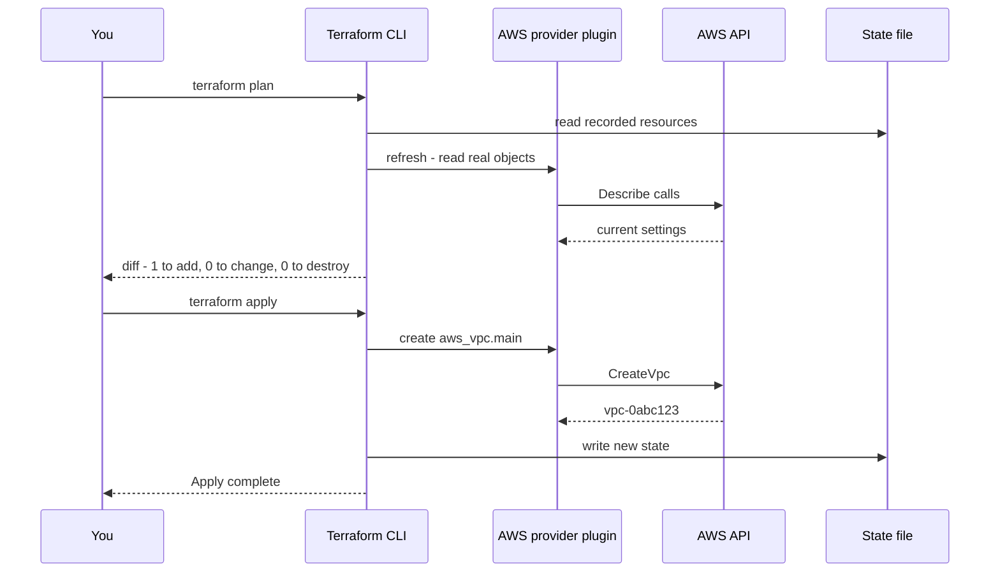
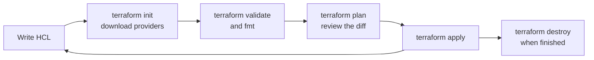

# L7.1 — Providers and Resources

> **Level 7: Terraform / Infrastructure as Code** · Topic 1 of 9 · ⏱ ~4 hours · Difficulty: Beginner

## 1. What it is

**Terraform** is a tool that turns text files into real infrastructure. You describe *what should exist* (a network, a
server, a DNS record, a GitHub repository) in a declarative language called **HCL** (HashiCorp Configuration Language),
and Terraform works out *how* to get there by calling cloud APIs. It remembers what it built in a **state** file, compares
that with your code and the real world, and shows you a **plan** before it changes anything.

Two building blocks do most of the work. A **provider** is a plugin that knows how to talk to one API (AWS, Azure,
Google Cloud, Kubernetes, Cloudflare, GitHub, even your local disk). A **resource** is one object that provider manages
(`aws_vpc`, `aws_instance`, `cloudflare_record`). You write resources; Terraform downloads providers; the providers make
the API calls. If this is your first contact with the idea of infrastructure as code, read
[Infrastructure as Code](../level-00-what-devops-is/03-infrastructure-as-code.md) first.

> **A note on names.** Terraform is developed by HashiCorp and has been under the Business Source License since 2023.
> **OpenTofu** is a community fork hosted by the Linux Foundation that keeps the same HCL language, providers and CLI
> workflow (the command is `tofu`). Everything in this level works with either tool unless a page says otherwise;
> where a recent feature differs we call it out.

## 2. Why it matters in DevOps

- **Reproducibility:** "click-ops" in a console cannot be reviewed, repeated or rolled back. A Terraform repo can rebuild
  an environment from scratch in minutes.
- **Review and audit:** infrastructure changes become pull requests. The `plan` output is the diff everyone approves.
- **Speed and safety:** `plan` shows exactly what will be created, changed or **destroyed** before you commit. Most
  "we deleted production" stories are a plan nobody read.
- **One workflow, many clouds:** the same `init / plan / apply` loop manages AWS, Cloudflare DNS, Datadog monitors and
  GitHub repositories.
- It is the foundation for everything later in this level: modules, state, CI/CD and drift detection.

## 3. Real-world system example

**The Terraform Registry and its providers.** The public Terraform Registry hosts thousands of providers. The AWS provider
(`hashicorp/aws`) is a large open-source Go project that maps AWS API calls to resources such as `aws_vpc` and
`aws_db_instance`. Vendors publish their own providers so customers can manage their products as code: Cloudflare maintains
an official provider for DNS, WAF rules and Workers, Datadog for monitors and dashboards, and the open-source
`integrations/github` provider lets organisations manage repositories, teams and branch-protection rules from a repo
instead of a settings page.

Large organisations commonly layer a pipeline on top (a plan on every pull request, an apply after merge — see
[L7.7](07-terraform-ci-cd.md)) so that nobody needs standing console access to production. AWS also has its own
native IaC service, CloudFormation; Terraform's advantage is a single language across many providers.

## 4. Diagram

How a single `terraform apply` turns code into API calls:



The core loop as a state machine:



## 5. How it works

### HCL in five minutes

HCL is made of **blocks** (a type, optional labels, a body in braces) and **arguments** (`name = expression`):

```hcl
resource "aws_s3_bucket" "logs" {     # block type "resource", labels: type + local name
  bucket = "shop-api-logs-example"    # argument
  tags = {                            # map value
    Team = "platform"
  }
}
```

- **Expressions** reference other things: `aws_s3_bucket.logs.id` (a resource attribute), `var.region` (input
  variable), `local.name` (computed value), `data.aws_caller_identity.me.account_id` (a data source).
- **Types:** string, number, bool, list, map, object. Strings interpolate with `"${var.env}-api"`.
- **Order does not matter** in the file. Terraform builds a dependency graph from the references (see
  [L7.5](05-data-sources-and-dependencies.md)).
- Files ending in `.tf` in one directory form a single configuration (the **root module**). Typical names:
  `versions.tf`, `main.tf`, `variables.tf`, `outputs.tf` — conventions only.

### The `terraform` block and providers

```hcl
terraform {
  required_version = ">= 1.9"          # which Terraform CLI versions may run this code

  required_providers {                 # where each provider comes from and which versions are allowed
    aws = {
      source  = "hashicorp/aws"        # registry address: namespace/type
      version = "~> 5.0"               # any 5.x, never 6.0
    }
  }
}

provider "aws" {
  region = "us-east-1"
  default_tags {                       # applied to every taggable resource
    tags = { Project = "shop-api", ManagedBy = "terraform" }
  }
}
```

- `terraform init` downloads the providers and records exact versions and checksums in **`.terraform.lock.hcl`**.
  **Commit the lock file** so everyone (and CI) uses identical provider builds.
- `~> 5.0` means "5.0 or newer but below 6.0". This level's examples use AWS provider 5.x. Version 6.x exists; if you move to
  it, run `plan` and read the provider's upgrade guide because some arguments were renamed or deprecated.
- **Credentials never go in `.tf` files.** The AWS provider reads the standard chain: environment variables
  (`AWS_ACCESS_KEY_ID`...), `AWS_PROFILE`, SSO, or an assumed role/OIDC identity in CI. See
  [IAM](../level-06-cloud-aws/07-iam.md).
- You can configure a provider more than once with `alias` (e.g. a second region) and pick it per resource with
  `provider = aws.west`.

### Resources

```hcl
resource "<TYPE>" "<LOCAL_NAME>" {
  argument = value
}
```

`aws_vpc.main` is the **address** of the resource: it is how you refer to it in code, in the plan and in the state.
Resources have **arguments** (what you set) and **attributes** (what you can read, including values only known after
creation like `id` or `arn`). Each resource type's documentation page lists both.

### The workflow commands

| Command | What it does |
|---------|--------------|
| `terraform init` | Downloads providers/modules, configures the backend. Run after any change to those. |
| `terraform fmt` | Rewrites files into canonical style. `-check` fails in CI if unformatted. |
| `terraform validate` | Checks syntax and internal consistency; makes no API calls. |
| `terraform plan` | Computes the diff between code, state and reality. Changes nothing. |
| `terraform plan -out=tfplan` | Saves the plan so `apply tfplan` executes exactly what was reviewed. |
| `terraform apply` | Executes the plan (asks for `yes` unless given a saved plan or `-auto-approve`). |
| `terraform destroy` | Plans and deletes everything in the state. Same as `apply -destroy`. |
| `terraform show` / `state list` | Inspect what Terraform currently believes exists. |

Plan symbols: `+` create, `-` destroy, `~` update in place, `-/+` **replace** (destroy then create — look for these!).

## 6. Step-by-step guide

**Prerequisites:** Terraform (or OpenTofu) installed. No cloud account needed for steps 1-6: we use the `local` and `random`
providers, which are free and harmless. Step 8 is an optional AWS step that can cost money; it ends with cleanup.

1. **Install and verify** (any one of these).
   ```bash
   # macOS
   brew install hashicorp/tap/terraform
   # Linux: follow the official apt/yum repository instructions at developer.hashicorp.com/terraform/install
   # No install at all - run it in Docker from your project folder:
   alias terraform='docker run --rm -it -v "$PWD":/work -w /work hashicorp/terraform:latest'
   terraform version
   ```
   Expect `Terraform v1.x.y` and your platform. (OpenTofu users: `tofu version`, then use `tofu` in place of `terraform`.)

2. **Create a project and write the configuration.**
   ```bash
   mkdir tf-hello && cd tf-hello
   ```
   `main.tf`:
   ```hcl
   terraform {
     required_version = ">= 1.9"
     required_providers {
       local  = { source = "hashicorp/local",  version = "~> 2.5" }
       random = { source = "hashicorp/random", version = "~> 3.6" }
     }
   }

   resource "random_pet" "name" {
     length = 2
   }

   resource "local_file" "greeting" {
     filename = "${path.module}/hello-${random_pet.name.id}.txt"
     content  = "Hello from Terraform, ${random_pet.name.id}!\n"
   }
   ```

3. **Initialise.**
   ```bash
   terraform init
   ```
   Look for `Terraform has been successfully initialized!` and a new `.terraform/` folder plus `.terraform.lock.hcl`.

4. **Format and validate.**
   ```bash
   terraform fmt
   terraform validate
   ```
   Expect `Success! The configuration is valid.`

5. **Plan.**
   ```bash
   terraform plan -out=tfplan
   ```
   Illustrative output (yours will differ in detail):
   ```text
   Terraform will perform the following actions:

     # local_file.greeting will be created
     + resource "local_file" "greeting" {
         + content  = (known after apply)
         + filename = (known after apply)
         ...
       }

     # random_pet.name will be created
     + resource "random_pet" "name" {
         + id     = (known after apply)
         + length = 2
       }

   Plan: 2 to add, 0 to change, 0 to destroy.
   ```
   Notice `(known after apply)`: the file name depends on the random pet, so Terraform orders them correctly by itself.

6. **Apply the saved plan, then inspect.**
   ```bash
   terraform apply tfplan
   ls hello-*.txt && cat hello-*.txt
   terraform state list
   terraform show
   ```
   You should see the file, `local_file.greeting` and `random_pet.name` in the state, and a new `terraform.tfstate` file.

7. **Change something and read the diff.** Edit the `content` string, then run `terraform plan`. The plan shows
   `~ content` (an update) or `-/+` (replace) for `local_file.greeting` and nothing for `random_pet`. Change `length = 3`
   and see how a replaced `random_pet` forces the file to be replaced too. Apply, then finish with:
   ```bash
   terraform destroy
   ```
   Type `yes`. The file disappears. Terraform's whole life cycle in one directory.

8. **Optional - first AWS resource (may cost pennies; do the cleanup).** Set a billing alarm first (see
   [CloudWatch](../level-06-cloud-aws/18-cloudwatch.md)), export credentials for a sandbox account, then:
   ```hcl
   provider "aws" { region = "us-east-1" }

   resource "aws_s3_bucket" "demo" {
     bucket_prefix = "shop-api-demo-"     # AWS appends a random suffix, so the name is globally unique
     force_destroy = true                 # lets destroy delete the bucket even if it holds objects
   }
   ```
   Add the `aws` provider to `required_providers`, run `terraform init && terraform apply`, confirm with
   `aws s3 ls`, then **`terraform destroy`**. An empty S3 bucket costs nothing, but build the habit of tearing down.

## 7. Real-world scenario

*(Illustrative.)* A startup's staging environment was created by hand over two years. When the engineer who built it left,
nobody could say why the load balancer idle timeout was 300 seconds or which security group rule opened port 5432 to the
world. A new engineer imports staging into Terraform, runs `terraform plan` and gets a long list of differences between
the code and reality. Working through the diff, the team discovers the open database port, closes it **in a pull request**,
and the plan on that PR shows exactly one security-group rule being removed. Three months later the same code builds a
production copy in 20 minutes. **Lesson:** the value of Terraform is less the first `apply` and more the permanent,
reviewable record of intent that every later change builds on.

## 8. Common mistakes and best practices

**Don't**

- Hard-code access keys in `.tf` files or commit `terraform.tfstate`, `*.tfvars` with secrets, or `.terraform/` to Git.
- Run `terraform apply -auto-approve` locally against shared environments, or skip reading the plan.
- Leave `version` constraints off providers; an unpinned `init` on a new laptop can pull a breaking major version.
- Use `-target` as a routine workflow. It skips the dependency graph and leaves code and state out of sync.
- Edit resources in the console "just this once" (this becomes drift; see [L7.9](09-drift-detection.md)).

**Do**

- Pin `required_version` and provider versions with `~>`, and commit `.terraform.lock.hcl`.
- Run `fmt`, `validate` and `plan` in every pull request.
- Use `default_tags` and a consistent naming scheme so every resource is traceable to its code.
- Read every `-/+` and `-` in a plan twice: those can delete data.
- Use `plan -out` + `apply <planfile>` in automation so what is approved is what is applied.

## 9. Tasks

- [ ] **T1 — Hello, Terraform** *(≈30 min, beginner)*
  - **Goal:** run the full init/plan/apply/destroy loop with free providers.
  - **Steps:**
    1. Follow steps 1-6 of the guide in a fresh folder.
    2. Run `terraform state list` and `terraform show`.
    3. Run `terraform destroy`.
  - **Done when:** the greeting file was created, listed in the state, and then removed by `destroy`.

- [ ] **T2 — Read a plan like a reviewer** *(≈30 min, beginner)*
  - **Goal:** distinguish update-in-place from replace.
  - **Steps:**
    1. Apply the config from T1 again.
    2. Change only the `content` of `local_file.greeting` and run `plan`; note the symbol.
    3. Change `random_pet.name` `length` and run `plan`; note which resources are replaced and why.
  - **Done when:** you can state, for both changes, whether each resource is `~` or `-/+` and what caused it.

- [ ] **T3 — Pin and lock** *(≈30 min, intermediate)*
  - **Goal:** make provider versions reproducible.
  - **Steps:**
    1. Look at `.terraform.lock.hcl` and find the `random` provider's version and `hashes`.
    2. Change the constraint to a range that excludes that version (for example `~> 3.0, < 3.5` if the locked version is newer) and run `terraform init`; read the error.
    3. Run `terraform init -upgrade` after fixing the constraint and watch the lock file change.
  - **Done when:** you can explain the difference between the constraint in `required_providers` and the pinned version in the lock file.

- [ ] **T4 — Break it and fix it** *(≈30 min, intermediate)*
  - **Goal:** recognise common errors quickly.
  - **Steps:**
    1. Misspell an argument (`filenme`), run `validate`, read the message, fix it.
    2. Reference a resource that does not exist (`random_pet.nme.id`) and fix it.
    3. Delete the generated file by hand, then run `plan`. Observe that Terraform notices and proposes to recreate it.
  - **Done when:** all three errors are fixed and a final `plan` reports `No changes` (after re-apply).

- [ ] **T5 — Your first cloud resource** *(≈45 min, intermediate; sandbox AWS account, billing alarm set)*
  - **Goal:** create and destroy a real AWS object with default tags.
  - **Steps:**
    1. Configure the `aws` provider with `region = "us-east-1"` and `default_tags`.
    2. Create an `aws_s3_bucket` with `bucket_prefix = "shop-api-"` and apply it.
    3. Confirm with `aws s3api get-bucket-tagging` that the default tags are present.
    4. `terraform destroy`.
  - **Done when:** the bucket showed the `Project` and `ManagedBy` tags, and `aws s3 ls` no longer lists it after destroy.

- [ ] **T6 — Prove it: teach the loop** *(≈30 min, advanced)*
  - **Goal:** explain Terraform's mental model without notes.
  - **Steps:**
    1. On a blank page, draw the relationship between code, state, plan and real infrastructure.
    2. Explain what `init`, `plan`, `apply` and `destroy` each read and write.
    3. Explain why the lock file is committed but the state file is not.
  - **Done when:** a colleague can recreate your diagram after listening to you.

## 10. Self-check questions

1. What is the difference between a provider and a resource?
2. What does the `~> 5.0` version constraint allow, and where is the exact chosen version recorded?
3. What does a `-/+` in a plan mean, and why is it dangerous for a database?
4. Why use `plan -out=tfplan` followed by `apply tfplan` in automation?
5. Why must credentials never appear in `.tf` files, and how should the AWS provider get them instead?

<details>
<summary>Answers</summary>

1. A provider is a plugin that talks to an API; a resource is one managed object of a type the provider defines.
2. Any 5.x version at or above 5.0 but below 6.0. The exact version and checksums are in `.terraform.lock.hcl`.
3. The resource will be destroyed and recreated. For a stateful resource that can mean data loss or downtime.
4. It guarantees that the reviewed plan is exactly what is executed, even if code or reality changed in between.
5. `.tf` files are committed and widely readable. Use environment variables, shared profiles/SSO or an assumed role (OIDC in CI).
</details>

## 11. Further reading

- Terraform documentation (developer.hashicorp.com/terraform) — Language, CLI and Tutorials sections.
- Terraform Registry (registry.terraform.io) — provider and resource reference pages, including the AWS provider docs.
- OpenTofu documentation (opentofu.org/docs) — if you prefer the community fork.
- *Terraform: Up & Running* by Yevgeniy Brikman — the standard book-length introduction.
- See also: [Infrastructure as Code](../level-00-what-devops-is/03-infrastructure-as-code.md).

<!-- nav -->
---
← Previous level: [Level 6 — Cloud (AWS)](../level-06-cloud-aws/README.md) · [Level 7 index](README.md) · Next: [Variables and Outputs](02-variables-and-outputs.md) →
