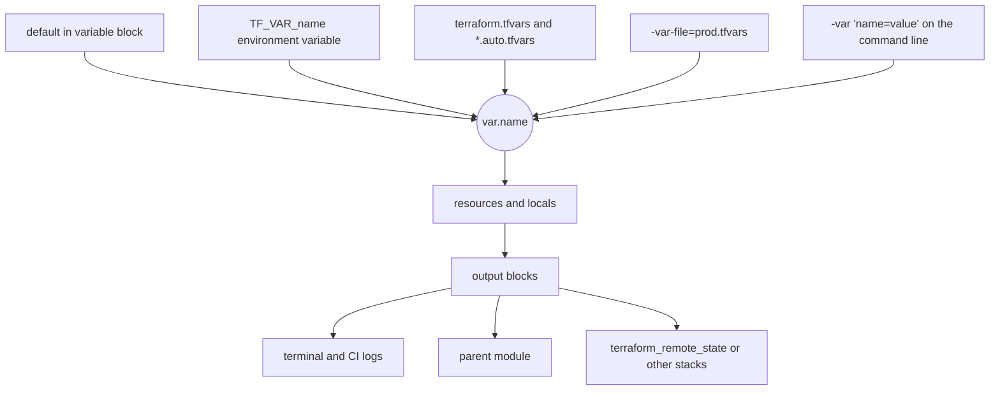

# L7.2 — Variables and Outputs

> **Level 7: Terraform / Infrastructure as Code** · Topic 2 of 9 · ⏱ ~4 hours · Difficulty: Beginner

## 1. What it is

A Terraform configuration is like a function. **Input variables** are its parameters, **local values** (`locals`) are its
temporary variables, and **outputs** are its return values. Variables let one piece of code build a small `dev` or a large
`prod` without copy-pasting; outputs hand values (a load-balancer DNS name, a database endpoint) to people, to other
Terraform configurations and to CI scripts.

Variables have **types** (`string`, `number`, `bool`, `list`, `map`, `object`...), optional **defaults**, and can be
**validated** so that bad input fails at `plan` time instead of after a 10-minute RDS creation. Values are supplied from
several places with a clear precedence order: command line, `*.tfvars` files, environment variables (`TF_VAR_name`),
then defaults.

## 2. Why it matters in DevOps

- **One codebase, many environments:** `dev`, `stage` and `prod` differ only in variable values (instance size, replica count).
- **Fail early:** validation turns "someone typed `t3.xxlarge`" or "CIDR overlaps" into a one-line error at `plan`.
- **Secrets hygiene:** marking a variable or output `sensitive` keeps passwords out of plan output and CI logs (but see the
  caveat below: it does **not** keep them out of state).
- **Interfaces between teams:** outputs are the contract between a network team's configuration and the application team that
  consumes the VPC ID.

## 3. Real-world system example

**Public Terraform modules on the registry.** The widely used community module `terraform-aws-modules/vpc/aws` exposes dozens
of typed input variables (`cidr`, `azs`, `private_subnets`, `enable_nat_gateway`, `single_nat_gateway`) and many outputs
(`vpc_id`, `private_subnets`, `nat_public_ips`). Teams call it with different values per environment — for example one NAT
gateway in dev for cost and one per Availability Zone in prod for resilience. The module's documented inputs and outputs *are*
its public API, and that is exactly the pattern you will build in [L7.3](03-modules.md) and use in the capstone.

## 4. Diagram

Where a variable's value comes from, lowest to highest precedence, and where outputs go:



## 5. How it works

### Input variables

```hcl
variable "environment" {
  description = "Deployment environment name."
  type        = string
  default     = "dev"

  validation {
    condition     = contains(["dev", "stage", "prod"], var.environment)
    error_message = "environment must be one of: dev, stage, prod."
  }
}

variable "instance_count" {
  type    = number
  default = 2
  validation {
    condition     = var.instance_count >= 1 && var.instance_count <= 10
    error_message = "instance_count must be between 1 and 10."
  }
}

variable "allowed_cidrs" {
  description = "Source ranges allowed to reach the ALB."
  type        = list(string)
  default     = ["0.0.0.0/0"]
  validation {
    condition     = alltrue([for c in var.allowed_cidrs : can(cidrnetmask(c))])
    error_message = "Every entry must be a valid IPv4 CIDR such as 203.0.113.0/24."
  }
}

variable "db" {
  description = "Database settings."
  type = object({
    instance_class = string
    storage_gb     = number
    multi_az       = optional(bool, false)   # optional attribute with a default
  })
}

variable "db_password" {
  type      = string
  sensitive = true      # redacted in plan/apply output
}
```

Type cheat sheet:

| Type | Example value | Notes |
|------|---------------|-------|
| `string`, `number`, `bool` | `"us-east-1"`, `3`, `true` | primitives |
| `list(string)` | `["a", "b"]` | ordered, index with `[0]` |
| `set(string)` | unordered, unique | what `for_each` wants |
| `map(string)` | `{ Team = "platform" }` | key/value, same value type |
| `object({...})` | `{ size = "t3.micro", count = 2 }` | fixed named attributes, mixed types |
| `any` | anything | avoid; it disables type checking |

A `validation` block can only reference the variable itself in older versions; Terraform 1.9 and later also allows
referencing other variables and data sources. Use `can()` to turn an error into `false`.

### Supplying values

Precedence, **highest wins**:

1. `-var "name=value"` and `-var-file=...` on the command line (later flags beat earlier ones)
2. `*.auto.tfvars` / `*.auto.tfvars.json` (alphabetical)
3. `terraform.tfvars` / `terraform.tfvars.json`
4. Environment variables `TF_VAR_name`
5. The variable's `default`

A `prod.tfvars` file is just assignments:

```hcl
environment    = "prod"
instance_count = 4
allowed_cidrs  = ["203.0.113.0/24"]
db = {
  instance_class = "db.t4g.medium"
  storage_gb     = 100
  multi_az       = true
}
```

If a required variable (no default) has no value, `plan` prompts interactively; in CI that hangs, so pass values explicitly
or run with `-input=false` so it fails fast.

### Locals

`locals` compute reusable values. They are not inputs; callers cannot override them.

```hcl
locals {
  name_prefix = "shop-api-${var.environment}"
  common_tags = {
    Project     = "shop-api"
    Environment = var.environment
  }
  is_prod = var.environment == "prod"
}

resource "aws_db_instance" "main" {
  identifier          = "${local.name_prefix}-pg"
  multi_az            = local.is_prod
  deletion_protection = local.is_prod
  # ...
}
```

### Outputs

```hcl
output "alb_dns_name" {
  description = "Public DNS name of the load balancer."
  value       = aws_lb.app.dns_name
}

output "db_endpoint" {
  value = aws_db_instance.main.endpoint
}

output "db_password" {
  value     = var.db_password
  sensitive = true        # shown as (sensitive value) in the terminal
}
```

- `terraform output` lists all outputs; `terraform output -raw alb_dns_name` prints one without quotes (great in scripts);
  `terraform output -json` is machine-readable. Sensitive outputs are hidden unless you ask for them by name or use `-json`.
- In a module, outputs are the only way to expose values to the caller: `module.network.vpc_id`.

> **Warning:** `sensitive = true` only hides values in the CLI. **The value is still stored in plain text in the state file**,
> so state must be encrypted and access-controlled ([L7.4](04-state-and-remote-backends.md)). Better still, avoid putting
> secrets in Terraform at all: let RDS generate and store the master password in Secrets Manager
> (`manage_master_user_password = true`), or read secrets from Vault/Secrets Manager at runtime.
> Terraform 1.10 and 1.11 added **ephemeral values** and **write-only arguments** for some resources, which keep secrets out of
> state entirely; check provider support before relying on them.

## 6. Step-by-step guide

**Prerequisites:** Terraform or OpenTofu installed. No cloud account needed (we use `random` and `local` providers).

1. **Create the project.**
   ```bash
   mkdir tf-vars && cd tf-vars
   ```
   `versions.tf`:
   ```hcl
   terraform {
     required_version = ">= 1.9"
     required_providers {
       random = { source = "hashicorp/random", version = "~> 3.6" }
       local  = { source = "hashicorp/local",  version = "~> 2.5" }
     }
   }
   ```

2. **Declare inputs with validation.** `variables.tf`:
   ```hcl
   variable "environment" {
     type    = string
     default = "dev"
     validation {
       condition     = contains(["dev", "stage", "prod"], var.environment)
       error_message = "environment must be dev, stage or prod."
     }
   }

   variable "replicas" {
     type    = number
     default = 1
     validation {
       condition     = var.replicas >= 1 && var.replicas <= 5
       error_message = "replicas must be 1-5."
     }
   }

   variable "api_token" {
     type      = string
     sensitive = true
   }

   variable "tags" {
     type    = map(string)
     default = {}
   }
   ```

3. **Use locals, resources and outputs.** `main.tf`:
   ```hcl
   locals {
     name = "shop-api-${var.environment}"
     tags = merge({ Project = "shop-api", Environment = var.environment }, var.tags)
   }

   resource "random_id" "suffix" {
     count       = var.replicas
     byte_length = 2
   }

   resource "local_file" "config" {
     filename = "${path.module}/${local.name}.json"
     content = jsonencode({
       name     = local.name
       replicas = [for r in random_id.suffix : "${local.name}-${r.hex}"]
       tags     = local.tags
     })
   }
   ```
   `outputs.tf`:
   ```hcl
   output "replica_names" {
     value = [for r in random_id.suffix : "${local.name}-${r.hex}"]
   }

   output "token_echo" {
     value     = var.api_token
     sensitive = true
   }
   ```

4. **See validation fail first.**
   ```bash
   terraform init
   terraform plan -var environment=qa -var api_token=x
   ```
   Expect an error containing `environment must be dev, stage or prod.` Nothing was created.

5. **Supply values three ways.**
   ```bash
   export TF_VAR_api_token="not-a-real-token"      # env var for the secret
   terraform apply -var replicas=2 -auto-approve    # command line for the rest
   ```
   Then create `prod.tfvars`:
   ```hcl
   environment = "prod"
   replicas    = 3
   tags        = { CostCenter = "1234" }
   ```
   Before the next apply, run `cat shop-api-dev.json`. Then run `terraform apply -var-file=prod.tfvars -auto-approve`
   and read the plan: the `dev` file is **replaced** by a `prod` file, because both runs share one state. That is a
   preview of why each environment needs its own state ([L7.6](06-reusable-environments.md)). `cat shop-api-prod.json` to see the result.

6. **Read outputs.**
   ```bash
   terraform output replica_names
   terraform output -json replica_names | python3 -c 'import sys,json; print(len(json.load(sys.stdin)))'
   terraform output token_echo          # prints the value because you asked by name
   terraform output                      # token_echo = <sensitive>
   ```

7. **Prove sensitive is not secret.**
   ```bash
   grep -n "not-a-real-token" terraform.tfstate
   ```
   The value is there in plain text. This is why the state backend in [L7.4](04-state-and-remote-backends.md) must be encrypted.

8. **Clean up.**
   ```bash
   terraform destroy -var-file=prod.tfvars -auto-approve
   ```

## 7. Real-world scenario

*(Illustrative.)* A team shares one Terraform config for staging and production using `environment.tfvars` files. A developer
runs `terraform apply` for staging but accidentally has `prod.tfvars` in the shell history; the plan shows
`db_instance_class: "db.t4g.medium" -> "db.t4g.micro"` on the production database, and the reviewer catches it. After the
near-miss the team adds validation (`instance_class` must be in an allow-list for each environment), makes `deletion_protection`
a function of `local.is_prod`, and stops running applies from laptops (see [L7.7](07-terraform-ci-cd.md)).
**Lesson:** variables multiply power; validation and review gates keep that power safe.

## 8. Common mistakes and best practices

**Don't**

- Put real secrets in `terraform.tfvars` that is committed, or in `default` values.
- Use `type = any` everywhere; you lose validation and get confusing errors deep in a resource.
- Assume `sensitive = true` protects the state file. It does not.
- Create dozens of variables for every argument. Group related settings in an `object` and expose only what must vary.
- Rely on interactive prompts in automation.

**Do**

- Give every variable a `description` and a `type`; add `validation` for allow-lists, ranges and formats.
- Keep per-environment values in `*.tfvars` files and secrets in environment variables or a secrets manager.
- Use `locals` for naming prefixes and tag maps so they are defined once.
- Give every output a `description`; mark sensitive ones `sensitive = true`.
- Run `terraform plan -input=false` in CI so missing variables fail instead of hanging.

## 9. Tasks

- [ ] **T1 — Build the vars project** *(≈45 min, beginner)*
  - **Goal:** declare typed variables and see two environments produced from one code base.
  - **Steps:**
    1. Follow the guide through step 5.
    2. Save a copy of the dev JSON (`cp shop-api-dev.json /tmp/dev.json`) before applying with `prod.tfvars`, then compare it with the prod file.
  - **Done when:** you have a dev and a prod JSON file with different replica counts and tags, and can explain why the second apply replaced the first file.

- [ ] **T2 — Prove the precedence order** *(≈30 min, intermediate)*
  - **Goal:** learn which value wins.
  - **Steps:**
    1. Set `replicas` as a default (1), in `terraform.tfvars` (2), in `TF_VAR_replicas` (3) and with `-var` (4).
    2. After each addition run `terraform plan` and look at the planned number of `random_id` resources.
    3. Write the order you observed.
  - **Done when:** your observed order matches the precedence list in section 5.

- [ ] **T3 — Add smarter validation** *(≈30 min, intermediate)*
  - **Goal:** reject bad input early.
  - **Steps:**
    1. Add a `cidr` variable and validate it with `can(cidrnetmask(var.cidr))`.
    2. Add a validation that `environment == "prod"` requires `replicas >= 2` (Terraform 1.9+ lets a validation reference another variable).
    3. Trigger each error on purpose.
  - **Done when:** both bad inputs fail at `plan` with your custom messages and good inputs pass.

- [ ] **T4 — Break it: leak a secret and fix it** *(≈30 min, intermediate)*
  - **Goal:** see exactly what `sensitive` does and does not do.
  - **Steps:**
    1. Run step 7 and find the token in `terraform.tfstate`.
    2. List, in writing, three places the state file might end up (laptop, backup, CI cache...) and who could read it.
    3. Change the design so the token is not stored in Terraform at all (for example, the app reads it from a secrets manager at runtime and Terraform only creates the empty secret).
  - **Done when:** you can show a `grep` of the state that no longer contains the token value.

- [ ] **T5 — Outputs for automation** *(≈30 min, intermediate)*
  - **Goal:** consume outputs from a script.
  - **Steps:**
    1. Write `deploy.sh` that calls `terraform output -json replica_names`, loops over the names with `python3` or `jq` and prints one line per replica.
    2. Make it fail clearly if the output does not exist.
  - **Done when:** the script prints one line per replica and exits non-zero when run in an empty directory.

- [ ] **T6 — Prove it: environment matrix** *(≈45 min, advanced)*
  - **Goal:** design the variable interface for a real stack without help.
  - **Steps:**
    1. For a `shop-api` stack (VPC CIDR, instance type, DB class, Multi-AZ, allowed CIDRs), write `variables.tf` with types and validations and `dev.tfvars` / `prod.tfvars`.
    2. Explain which values belong in `tfvars`, which in `locals`, which in env vars, and why.
  - **Done when:** `terraform validate` passes and `plan` with each tfvars file is accepted, while an invalid value is rejected.

## 10. Self-check questions

1. List the sources of variable values from highest to lowest precedence.
2. What is the difference between a variable and a local?
3. Does `sensitive = true` encrypt the value in state? What does it actually do?
4. Why is `type = object({...})` with `optional()` attributes better than many loose variables?
5. How do you pass a value to a module's child and read something back?

<details>
<summary>Answers</summary>

1. `-var`/`-var-file` (CLI), `*.auto.tfvars`, `terraform.tfvars`, `TF_VAR_*` environment variables, then the default.
2. A variable is an input the caller can set; a local is an internal computed value that cannot be overridden.
3. No. It only redacts the value in CLI output and plan diffs. The state still holds it in plain text.
4. One cohesive, typed structure with defaults for optional parts is easier to document, validate and keep stable than a sprawl of variables.
5. Pass it as an argument in the `module` block (`module "x" { cidr = "10.0.0.0/16" }`); read it via `module.x.<output_name>`, which must be declared as an `output` in the child.
</details>

## 11. Further reading

- Terraform documentation: *Language → Values and Variables* (input variables, outputs, local values) and *Functions*.
- *Terraform: Up & Running* by Yevgeniy Brikman — chapters on inputs, outputs and secrets.
- Next: [L7.3 Modules](03-modules.md). Related: [Secrets Manager](../level-06-cloud-aws/16-secrets-manager.md).

<!-- nav -->
---
← Previous: [Providers and Resources](01-providers-and-resources.md) · [Level 7 index](README.md) · Next: [Modules](03-modules.md) →
