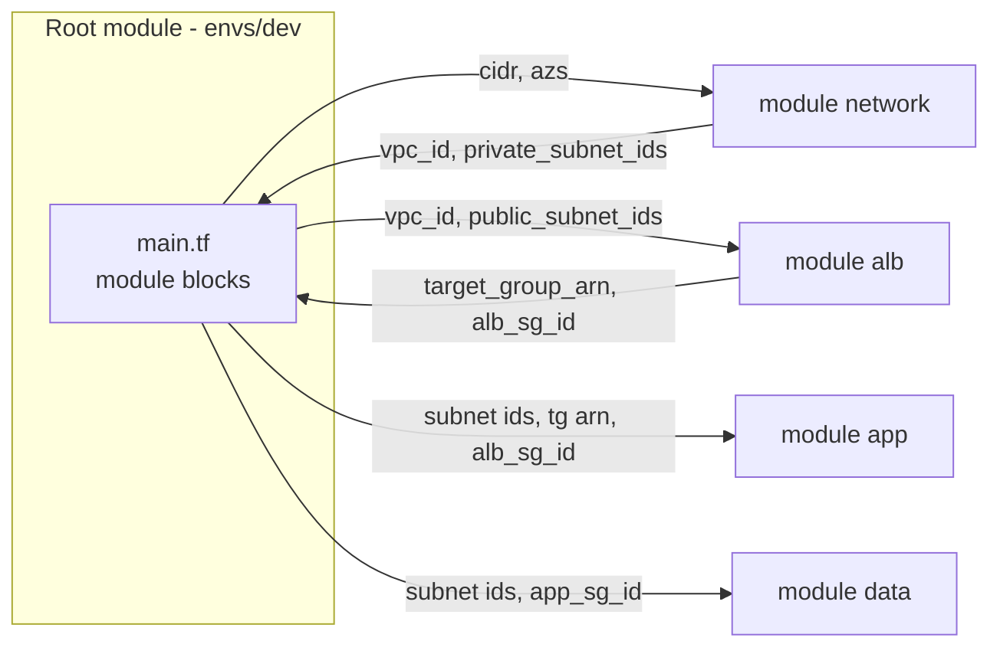

# L7.3 — Modules

> **Level 7: Terraform / Infrastructure as Code** · Topic 3 of 9 · ⏱ ~5 hours · Difficulty: Intermediate

## 1. What it is

A **module** is a directory of `.tf` files that you call from other Terraform code, exactly like a function or a library.
Every Terraform configuration is already a module: the directory where you run `terraform apply` is the **root module**.
When the root calls another directory (or a package from the registry or Git) with a `module` block, that is a **child
module**.

A good module hides a pile of low-level resources behind a small, typed interface. "Give me a VPC with these CIDR ranges"
might be 25 resources inside (VPC, subnets, route tables, internet gateway, NAT gateways, associations) but is one block
of 8 arguments for the caller. Modules are how you stop copy-pasting the same 300 lines into every environment.

## 2. Why it matters in DevOps

- **Consistency:** every environment's network or database is built the same way, so prod behaves like staging.
- **Leverage:** one fix to the module (say, turning on encryption) rolls out to every consumer on its next upgrade.
- **Cognitive load:** teams reason about "the `network` module", not 25 individual resources.
- **Governance:** platform teams publish approved modules (encrypted buckets, hardened databases) that app teams consume
  — a cornerstone of [platform engineering](../level-00-what-devops-is/13-platform-engineering.md).
- **Risk if misused:** a badly designed module (too generic, too many flags) is harder to understand than the raw resources, and
  an unpinned module version can change production unexpectedly.

## 3. Real-world system example

**The Terraform Registry's `terraform-aws-modules`.** The community project `terraform-aws-modules` publishes widely used
modules for VPCs, EKS clusters, RDS, security groups, ALBs and more. A team writes something like:

```hcl
module "vpc" {
  source  = "terraform-aws-modules/vpc/aws"
  version = "~> 5.0"
  # inputs ...
}
```

and gets a documented, versioned, tested interface; upgrading is a deliberate change of the `version` line reviewed in a
pull request. HashiCorp's registry also gives modules a standard layout and semantic versions, and many companies mirror
that model internally with a private registry or Git tags. Whether to use a big public module or write your own thin one is
a real trade-off; this topic teaches you to do both.

## 4. Diagram

How a root module composes child modules, and how data flows between them through outputs:



A child module never reads the parent's variables directly. Everything crosses the boundary as an input or an output.

## 5. How it works

### Anatomy of a module

```text
modules/network/
├── main.tf          # resources
├── variables.tf     # inputs (the interface)
├── outputs.tf       # outputs (the interface)
├── versions.tf      # required_providers (no provider blocks!)
└── README.md        # what it does, an example call
```

- **Providers are configured by the root**, not inside reusable modules. A child module declares which providers it
  needs under `required_providers` and inherits the configuration passed by the caller.
- Treat `variables.tf` and `outputs.tf` as a public API. Renaming a variable is a breaking change.

### Calling a module

```hcl
module "network" {
  source = "../../modules/network"   # local path; or a registry address / Git URL

  name     = "shop-api-dev"
  cidr     = "10.10.0.0/16"
  az_count = 2
}

resource "aws_security_group" "app" {
  vpc_id = module.network.vpc_id        # read the child's output
  # ...
}
```

Module `source` options:

| Source | Example | Versioning |
|--------|---------|------------|
| Local path | `"../modules/network"` | none - same repo, same commit |
| Terraform Registry | `"terraform-aws-modules/vpc/aws"` | `version = "~> 5.0"` |
| Git | `"git::https://example.com/org/tf-modules.git//network?ref=v1.4.2"` | pin to a tag or commit with `?ref=` |
| S3 / HTTP archive | `"https://example.com/network-1.4.2.zip"` | version in the file name |

`terraform init` downloads modules into `.terraform/modules/`. Re-run `init` after changing a `source` or `version`.

### Writing a good module

```hcl
# modules/network/variables.tf
variable "name"     { type = string }
variable "cidr"     { type = string }
variable "az_count" {
  type    = number
  default = 2
}

# modules/network/main.tf
data "aws_availability_zones" "available" { state = "available" }

locals {
  azs = slice(data.aws_availability_zones.available.names, 0, var.az_count)
}

resource "aws_vpc" "this" {
  cidr_block           = var.cidr
  enable_dns_hostnames = true
  tags                 = { Name = var.name }
}

resource "aws_subnet" "public" {
  count                   = var.az_count
  vpc_id                  = aws_vpc.this.id
  cidr_block              = cidrsubnet(var.cidr, 8, count.index)        # 10.10.0.0/24, 10.10.1.0/24
  availability_zone       = local.azs[count.index]
  map_public_ip_on_launch = true
  tags                    = { Name = "${var.name}-public-${count.index}" }
}

# modules/network/outputs.tf
output "vpc_id"            { value = aws_vpc.this.id }
output "public_subnet_ids" { value = aws_subnet.public[*].id }
```

(`cidrsubnet(prefix, newbits, netnum)` carves smaller blocks out of a larger one; the subnet maths is covered in
[IPv4, IPv6, CIDR and Subnets](../level-02-networking/03-ipv4-ipv6-cidr-subnets.md).)

### Module design guidelines

1. **Small, focused interface.** Expose what callers must decide; hard-code safe defaults for the rest.
2. **Opinionated defaults:** encryption on, public access off, deletion protection configurable.
3. **Outputs for everything a caller will need** (IDs, ARNs, endpoints, security group IDs).
4. **Composition over inheritance:** prefer a root that wires `network` + `app` + `data` together over one giant module that
   builds everything and takes 80 flags. Pass IDs between modules instead of nesting deeply.
5. **Versioning:** tag releases with semantic versions (`v1.4.2`); consumers pin them. Breaking interface change = new major.
6. **Document and example:** a README with a minimal `module` call, and an `examples/` folder you can `plan` against.
7. **Test:** `terraform validate`, `terraform test` (native test framework, `*.tftest.hcl`, Terraform 1.6+; OpenTofu has an
   equivalent), or Terratest.

### Refactoring into modules without recreating anything

If resources already exist at `aws_vpc.main` and you move them into `module.network`, their *address* changes, and Terraform
would plan to destroy and recreate. Use a `moved` block ([L7.4](04-state-and-remote-backends.md)):

```hcl
moved {
  from = aws_vpc.main
  to   = module.network.aws_vpc.this
}
```

## 6. Step-by-step guide

**Prerequisites:** Terraform or OpenTofu. We build a module with the free `random`/`local` providers so no cloud account is
needed; the capstone applies the same pattern to AWS.

1. **Layout.**
   ```bash
   mkdir -p tf-modules/modules/service tf-modules/envs/dev tf-modules/envs/prod
   cd tf-modules
   ```

2. **Write the child module** `modules/service/versions.tf`, `variables.tf`, `main.tf`, `outputs.tf`.
   ```hcl
   # modules/service/versions.tf
   terraform {
     required_providers {
       random = { source = "hashicorp/random", version = "~> 3.6" }
       local  = { source = "hashicorp/local",  version = "~> 2.5" }
     }
   }
   ```
   ```hcl
   # modules/service/variables.tf
   variable "name" {
     type = string
   }
   variable "replicas" {
     type    = number
     default = 1
     validation {
       condition     = var.replicas >= 1
       error_message = "replicas must be at least 1."
     }
   }
   variable "output_dir" {
     type = string
   }
   ```
   ```hcl
   # modules/service/main.tf
   resource "random_pet" "instance" {
     count  = var.replicas
     prefix = var.name
     length = 1
   }

   resource "local_file" "manifest" {
     filename = "${var.output_dir}/${var.name}.manifest"
     content  = join("\n", random_pet.instance[*].id)
   }
   ```
   ```hcl
   # modules/service/outputs.tf
   output "instance_names" {
     description = "Generated instance names."
     value       = random_pet.instance[*].id
   }
   output "manifest_path" {
     value = local_file.manifest.filename
   }
   ```

3. **Call it from two environments.** `envs/dev/main.tf`:
   ```hcl
   terraform {
     required_version = ">= 1.9"
   }

   module "api" {
     source     = "../../modules/service"
     name       = "shop-api"
     replicas   = 1
     output_dir = path.module
   }

   module "worker" {
     source     = "../../modules/service"   # same module, second instance
     name       = "shop-worker"
     replicas   = 2
     output_dir = path.module
   }

   output "api_instances"    { value = module.api.instance_names }
   output "worker_instances" { value = module.worker.instance_names }
   ```
   `envs/prod/main.tf` is the same with `replicas = 3` and `4`.

4. **Run it.**
   ```bash
   cd envs/dev
   terraform init
   terraform apply -auto-approve
   terraform output
   terraform state list
   ```
   `init` prints `Initializing modules...` and lists both module calls. The state addresses look like
   `module.api.random_pet.instance[0]` and `module.worker.random_pet.instance[1]`: the module path is part of the address.

5. **Change the module once, see it everywhere.** In `modules/service/main.tf` add a trailing newline to `content`
   (`"${join("\n", random_pet.instance[*].id)}\n"`), then run `terraform plan` in both `envs/dev` and `envs/prod`. Both show
   the manifest files updating from the single edit.

6. **Version a module with Git.** Put `modules/` in its own repository, commit, `git tag v1.0.0`, and change the call:
   ```hcl
   source = "git::https://github.com/YOUR-ORG/tf-modules.git//service?ref=v1.0.0"
   ```
   Run `terraform init -upgrade` and look in `.terraform/modules/`. Pinning to a tag means later commits cannot surprise you.

7. **Try a registry module** (read-only exploration). Browse `registry.terraform.io/modules/terraform-aws-modules/vpc/aws`,
   read its Inputs and Outputs tabs, and note how each maps to what you just wrote.

8. **Clean up.**
   ```bash
   terraform destroy -auto-approve   # run in envs/dev, then in envs/prod
   ```

## 7. Real-world scenario

*(Illustrative.)* Three teams each had their own copy of "the standard VPC" pasted into their repos. A security finding required
enabling VPC flow logs everywhere. The platform team would have had to open three pull requests, each with slightly different
code. Instead they extract a `network` module, tag it `v2.0.0` with flow logs enabled by default, and teams upgrade with a one-line
`version`/`ref` change. One team pinned nothing and picked up a breaking change during an unrelated apply, causing a surprise
subnet replacement. **Lesson:** modules give leverage in both directions. Pin versions, read the plan when you upgrade, and treat
the module interface like an API.

## 8. Common mistakes and best practices

**Don't**

- Put `provider` blocks inside reusable modules (it blocks `count`/`for_each` and removal of the module).
- Create "god modules" with dozens of boolean flags that toggle half the resources.
- Try to reach into a module's internals (`module.x.aws_vpc.this.id` does not work). Expose an output instead.
- Use unpinned Git `main` or registry modules without a `version`.
- Rename resources inside a published module without a `moved` block; every consumer would plan a destroy/create.

**Do**

- Pin module versions (`version = "~> 5.0"` or `?ref=v1.4.2`) and update them intentionally in their own PR.
- Keep modules small and composable; wire them together in the root.
- Use `moved` blocks to refactor safely.
- Include a README, typed variables with descriptions, outputs for every ID consumers need, and a tested example.
- Prefer a thin wrapper around a well-maintained public module only when it genuinely saves effort; own the code you depend on for critical paths.

## 9. Tasks

- [ ] **T1 — Build and call a module** *(≈45 min, beginner)*
  - **Goal:** create the `service` module and call it twice.
  - **Steps:**
    1. Follow steps 1-4 of the guide.
    2. Run `terraform state list` and identify the module path in the addresses.
  - **Done when:** `terraform output` shows instance names for both `api` and `worker` and the state shows `module.api.*` and `module.worker.*`.

- [ ] **T2 — Extend the interface** *(≈30 min, intermediate)*
  - **Goal:** add an input and an output without breaking existing callers.
  - **Steps:**
    1. Add an optional `tags` (`map(string)`, default `{}`) input written into the manifest as JSON.
    2. Add an output `instance_count`.
    3. Run `plan` in both envs; callers that do not set `tags` should still plan cleanly.
  - **Done when:** `dev` still plans with a single in-place change to the manifest content, and `prod` can pass tags.

- [ ] **T3 — Refactor with `moved`** *(≈45 min, intermediate)*
  - **Goal:** move a resource into a module without recreating it.
  - **Steps:**
    1. In a new folder, create `random_pet.solo` in the root and apply it. Note the pet name.
    2. Move it into a module `pets` (resource renamed to `this`) and add a `moved { from = random_pet.solo  to = module.pets.random_pet.this }` block.
    3. Run `plan`.
  - **Done when:** the plan shows `random_pet.solo has moved to module.pets.random_pet.this` with `0 to add, 0 to change, 0 to destroy`, and the pet name is unchanged after apply.

- [ ] **T4 — Break it: unpinned module upgrade** *(≈30 min, intermediate)*
  - **Goal:** feel why versions matter.
  - **Steps:**
    1. Put the module in a Git repo with tags `v1.0.0` and `v1.1.0`, where `v1.1.0` renames the `name` variable to `service_name`.
    2. Consume `v1.0.0`, then change `ref` to `v1.1.0` and run `plan`; read the error.
    3. Fix the call site and re-plan.
  - **Done when:** you can explain why that rename should have been a new major version (`v2.0.0`).

- [ ] **T5 — Write a test** *(≈45 min, advanced)*
  - **Goal:** test a module's behaviour automatically.
  - **Steps:**
    1. Create `modules/service/tests/basic.tftest.hcl` with a `run` block that sets `replicas = 3` and asserts `length(output.instance_names) == 3`.
    2. Add a second `run` with `replicas = 0` and `expect_failures = [var.replicas]`.
    3. Run `terraform test` from `modules/service`.
  - **Done when:** `terraform test` reports both runs as passing.

- [ ] **T6 — Prove it: design a `data` module** *(≈45 min, advanced)*
  - **Goal:** design a real module interface from scratch.
  - **Steps:**
    1. On paper, specify a module that creates an RDS PostgreSQL instance: its variables (with types and defaults), its outputs, and which resources it contains.
    2. Decide what is a variable versus a hard-coded safe default (encryption, backups, public access).
    3. Explain how the root would connect it to the `network` and `app` modules.
  - **Done when:** a teammate can implement the module from your interface description alone.

## 10. Self-check questions

1. What is the root module? How does a child module receive and return data?
2. Why should reusable modules not contain `provider` blocks?
3. How do you version a module from the registry and from Git?
4. What does a `moved` block do and when do you need it?
5. When is a thin module around three resources a bad idea?

<details>
<summary>Answers</summary>

1. The root module is the directory you run Terraform in. Children receive inputs through arguments in the `module` block and return data through `output` blocks.
2. Provider configuration belongs to the caller. Provider blocks in a child make it hard to reuse across regions/accounts and block `count`, `for_each` or removing the module.
3. Registry: `version = "~> 5.0"`. Git: a `?ref=<tag or commit>` suffix on the source URL.
4. It tells Terraform that an object has a new address (renamed or moved into a module) so it updates state instead of destroying and recreating it.
5. When it adds an interface to learn without hiding real complexity, or exposes every underlying argument as a variable anyway. Wrapping with no abstraction is overhead.
</details>

## 11. Further reading

- Terraform documentation: *Language → Modules* (module blocks, sources, composition, publishing) and *Testing*.
- Terraform Registry module pages, especially `terraform-aws-modules/vpc/aws`, as examples of interface design.
- *Terraform: Up & Running* by Yevgeniy Brikman — "How to Create Reusable Infrastructure with Terraform Modules".
- See also: [Infrastructure Templates](../level-18-platform-engineering/06-infrastructure-templates.md).

<!-- nav -->
---
← Previous: [Variables and Outputs](02-variables-and-outputs.md) · [Level 7 index](README.md) · Next: [State and Remote Backends](04-state-and-remote-backends.md) →
