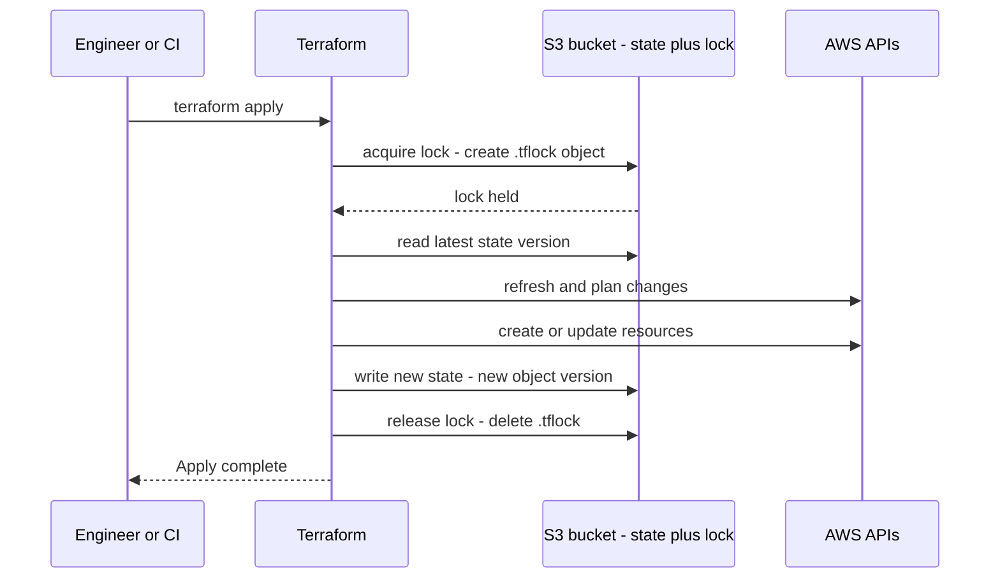
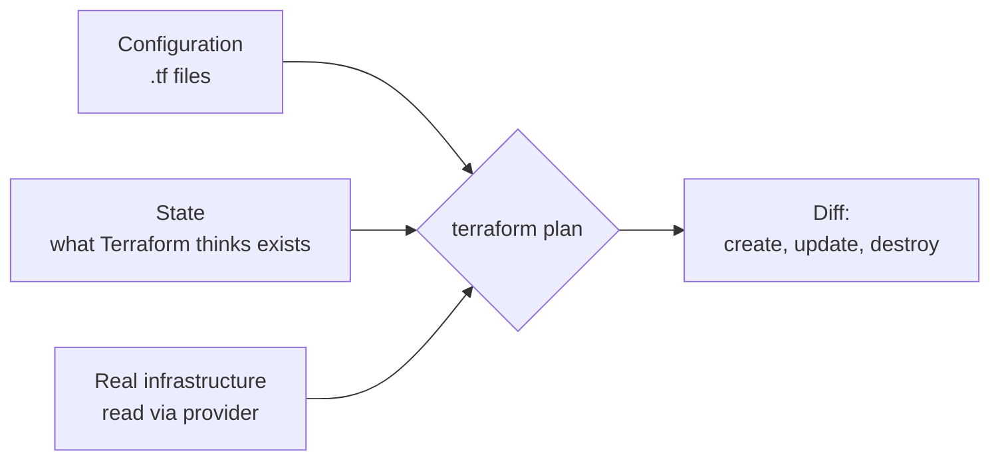

# L7.4 — State and Remote Backends

> **Level 7: Terraform / Infrastructure as Code** · Topic 4 of 9 · ⏱ ~5 hours · Difficulty: Intermediate

## 1. What it is

Terraform keeps a **state file** (JSON, `terraform.tfstate` by default) that maps every resource in your code to a real object
in the real world: `aws_vpc.main` → `vpc-0a1b2c3d4e5f67890`, together with every attribute the provider returned. On each
`plan`, Terraform reads the state, refreshes it from the cloud API, and compares it with your configuration to decide what to
create, change or delete. Without state, Terraform would have no idea which resources it owns.

By default the state lives in a file next to your code (the **local backend**). That is fine for a solo experiment and
dangerous for a team: it can be lost, overwritten by a colleague, or committed to Git with secrets inside. A **remote
backend** stores the state in shared, durable, access-controlled storage, such as an **S3 bucket** on AWS, and supports
**locking** so that two people cannot change the same state at once ([L7.8](08-state-locking.md)).

## 2. Why it matters in DevOps

- **State is the source of truth for ownership.** Lose it and Terraform will try to create everything again (duplicates and name
  collisions) or leave orphaned resources you pay for.
- **State contains secrets.** Database passwords, private keys and tokens appear in plain text. Whoever can read the state
  can often read your secrets, so it needs encryption, versioning and tight IAM.
- **Team workflows depend on it.** CI pipelines, drift detection and multiple engineers all need one shared, consistent state.
- **Refactoring needs it.** Renaming, moving into modules and adopting existing infrastructure are state operations
  (`moved`, `import`, `removed`).

## 3. Real-world system example

**S3 as a Terraform backend, and HCP Terraform.** The `s3` backend is one of the most common remote backends for AWS teams:
a versioned, encrypted S3 bucket holds one state object per stack (for example `prod/network/terraform.tfstate`). Until
recently locking required a companion DynamoDB table; recent Terraform releases can lock with a lock file in the same
bucket (`use_lockfile = true`, introduced in Terraform 1.10 and stable in 1.11; OpenTofu supports it too). HashiCorp's managed
service, **HCP Terraform** (formerly Terraform Cloud), and tools such as Spacelift, env0 and Atlantis are other ways to run
shared state and runs. The Terraform documentation itself warns that state may contain sensitive data and recommends
encrypting it at rest and restricting access.

## 4. Diagram

How a remote backend is used during a run:



State is the join between code and reality:



## 5. How it works

### What is in the state

```bash
terraform state list                      # every resource address
terraform state show aws_vpc.main         # its recorded attributes
terraform show -json | jq '.values'       # entire state as JSON
```

State records resource addresses, provider, dependencies, and all attribute values (including secrets, in plain text). Never
edit the JSON by hand; use the `terraform state` subcommands or `moved` / `import` / `removed` blocks.

### Configuring the S3 backend

```hcl
terraform {
  backend "s3" {
    bucket       = "shop-api-tfstate-123456789012"
    key          = "dev/network/terraform.tfstate"   # one object per stack
    region       = "us-east-1"
    encrypt      = true
    use_lockfile = true      # native S3 locking (Terraform 1.10+/1.11+, OpenTofu 1.10+)
  }
}
```

- Backend blocks **cannot use variables or locals**. Pass differing values with partial configuration at init time:
  `terraform init -backend-config=backend-dev.hcl`.
- **Native S3 locking** (`use_lockfile`) writes a `<key>.tflock` object using S3 conditional writes. The older approach, still
  supported but deprecated in current Terraform, is `dynamodb_table = "terraform-locks"` with a DynamoDB table keyed on
  `LockID`. Existing setups may use either or both while migrating. Details in [L7.8](08-state-locking.md).
- Authentication uses the normal AWS credential chain. In CI, assume a role via OIDC ([L7.7](07-terraform-ci-cd.md)).
- Changing backends: edit the block and run `terraform init -migrate-state` to copy the state across.

### Securing the state bucket

| Control | Why |
|---------|-----|
| **Block Public Access** on the bucket | State must never be public. |
| **Versioning** on | Recover from corruption or a bad apply by restoring a previous version. |
| **Encryption** (SSE-S3 by default, or SSE-KMS with your own key) | Protect at rest; KMS gives you key policy and audit ([KMS](../level-06-cloud-aws/15-kms.md)). |
| **Bucket policy / IAM least privilege** | Only the CI role and a few humans can read; only CI writes. Reading state is as sensitive as reading secrets. |
| **Separate bucket/account** for state | Blast-radius isolation; keep it out of the accounts Terraform manages. |
| **TLS-only policy** | Deny requests where `aws:SecureTransport` is false. |
| **CloudTrail data events** | Audit who read or wrote state ([CloudTrail](../level-06-cloud-aws/17-cloudtrail.md)). |
| **Lifecycle rule** expiring old noncurrent versions | Keep history without unbounded growth. |

Also: split state into several smaller stacks (network, data, app per environment) so a mistake or a lock affects less, and plans
are faster. Never commit `*.tfstate` or `*.tfstate.backup` to Git; add them to `.gitignore`.

### Changing state safely

| Need | Tool |
|------|------|
| Adopt an existing resource into Terraform | `import` block (Terraform 1.5+) or `terraform import ADDRESS ID` |
| Rename a resource / move into a module | `moved` block (1.1+), or `terraform state mv` |
| Stop managing a resource **without destroying it** | `removed` block with `lifecycle { destroy = false }` (1.7+), or `terraform state rm` |
| Inspect a resource | `terraform state show ADDRESS` |
| Re-read reality into state | `terraform apply -refresh-only` |

```hcl
# Adopt an existing bucket
import {
  to = aws_s3_bucket.legacy
  id = "shop-api-legacy-assets"           # the ID format is on the resource's docs page
}

# Rename without replacing
moved {
  from = aws_instance.web
  to   = aws_instance.app
}

# Stop managing, keep the real thing
removed {
  from = aws_instance.old_bastion
  lifecycle { destroy = false }
}
```

`terraform plan -generate-config-out=generated.tf` can write draft configuration for `import` blocks; review it, delete
computed or noisy arguments, and merge it into your code.

## 6. Step-by-step guide

**Prerequisites:** Terraform or OpenTofu (Terraform 1.11+ for stable `use_lockfile`), AWS CLI with sandbox credentials, a billing
alarm. S3 storage for a few KB costs a fraction of a cent; you can leave the bucket for later topics or delete it in the last step.

1. **Bootstrap the state bucket** (the chicken-and-egg step: the bucket must exist before Terraform can store state in it). We use the CLI once.
   ```bash
   ACCOUNT_ID=$(aws sts get-caller-identity --query Account --output text)
   BUCKET="shop-api-tfstate-${ACCOUNT_ID}"
   aws s3api create-bucket --bucket "$BUCKET" --region us-east-1
   aws s3api put-public-access-block --bucket "$BUCKET" \
     --public-access-block-configuration BlockPublicAcls=true,IgnorePublicAcls=true,BlockPublicPolicy=true,RestrictPublicBuckets=true
   aws s3api put-bucket-versioning --bucket "$BUCKET" --versioning-configuration Status=Enabled
   aws s3api put-bucket-encryption --bucket "$BUCKET" --server-side-encryption-configuration \
     '{"Rules":[{"ApplyServerSideEncryptionByDefault":{"SSEAlgorithm":"AES256"}}]}'
   echo "$BUCKET"
   ```
   For regions other than `us-east-1`, add `--create-bucket-configuration LocationConstraint=<region>`.

2. **Start with local state** so you can feel the migration. `main.tf`:
   ```hcl
   terraform {
     required_version = ">= 1.11"
     required_providers {
       aws = { source = "hashicorp/aws", version = "~> 5.0" }
     }
   }
   provider "aws" { region = "us-east-1" }

   resource "aws_ssm_parameter" "demo" {
     name  = "/shop-api/dev/demo"
     type  = "String"
     value = "hello"
   }
   ```
   ```bash
   terraform init && terraform apply -auto-approve
   ls terraform.tfstate          # local state exists
   ```

3. **Add the S3 backend and migrate.** Add to the `terraform` block:
   ```hcl
   backend "s3" {
     bucket       = "shop-api-tfstate-123456789012"   # your bucket name from step 1
     key          = "dev/demo/terraform.tfstate"
     region       = "us-east-1"
     encrypt      = true
     use_lockfile = true
   }
   ```
   ```bash
   terraform init -migrate-state      # answer "yes" to copy local state to S3
   aws s3 ls "s3://$BUCKET/dev/demo/" # you should see terraform.tfstate
   rm -f terraform.tfstate terraform.tfstate.backup
   terraform plan                     # "No changes" - the state is now remote
   ```

4. **Look at versioning and the lock.** Run `terraform apply` with a changed value (`value = "hello2"`), then:
   ```bash
   aws s3api list-object-versions --bucket "$BUCKET" --prefix dev/demo/terraform.tfstate --query 'Versions[].VersionId'
   ```
   Two or more versions exist. During an apply (add `-lock-timeout=0` and watch from a second terminal with `aws s3 ls`),
   a `terraform.tfstate.tflock` object appears briefly.

5. **Adopt an existing resource with `import`.** Create an unmanaged parameter by hand, then bring it under control:
   ```bash
   aws ssm put-parameter --name /shop-api/dev/manual --type String --value "created by hand"
   ```
   Add to code:
   ```hcl
   import {
     to = aws_ssm_parameter.manual
     id = "/shop-api/dev/manual"
   }
   resource "aws_ssm_parameter" "manual" {
     name  = "/shop-api/dev/manual"
     type  = "String"
     value = "created by hand"
   }
   ```
   `terraform plan` should say `1 to import`; `terraform apply` imports it. Remove the `import` block afterwards (it has done its job).

6. **Rename with `moved`.** Rename `aws_ssm_parameter.demo` to `aws_ssm_parameter.greeting` in the code and add:
   ```hcl
   moved {
     from = aws_ssm_parameter.demo
     to   = aws_ssm_parameter.greeting
   }
   ```
   `terraform plan` shows the resource has moved with `0 to destroy`. Without the `moved` block it would show a destroy plus a create.

7. **Inspect what is in the state.**
   ```bash
   terraform state list
   terraform state show aws_ssm_parameter.greeting | head -20
   ```
   Even if you had used a `SecureString`, the plaintext value would be visible in state: this is why access to the bucket matters.

8. **Clean up.**
   ```bash
   terraform destroy -auto-approve                   # removes the parameters
   aws ssm delete-parameter --name /shop-api/dev/manual 2>/dev/null || true
   # Keep the bucket for the next topics, or empty and delete it, including all object versions, when you are done with the level.
   ```

Illustrative output for step 3 (yours will be similar):

```text
Initializing the backend...
Do you want to copy existing state to the new backend?
  Enter a value: yes

Successfully configured the backend "s3"! Terraform will automatically
use this backend unless the backend configuration changes.
```

## 7. Real-world scenario

*(Illustrative.)* Two engineers each had a local `terraform.tfstate` for the same staging stack, because "the state file is in the
repo". One applied a change; the other's stale state then proposed to **recreate** the load balancer that already existed, and
applying it failed halfway with name collisions, leaving a half-built duplicate. Recovery took an afternoon of
`terraform import`. The team moved to an S3 backend with versioning, locking and a CI-only apply role, removed the state files from
Git history, and rotated the database password that had been sitting in the committed state. **Lesson:** shared state with locking
is not an optimisation; it is the thing that makes a team workflow safe.

## 8. Common mistakes and best practices

**Don't**

- Commit state files, or share them via chat, email or a shared drive.
- Hand-edit the JSON, or delete a state file to "fix" a problem (you orphan live infrastructure).
- Use `terraform state rm` or `-target` casually; they create code/state mismatches.
- Put every environment and layer into one giant state: slow plans, huge blast radius, long lock times.
- Give broad developer read access to the state bucket without realising it reveals secrets.

**Do**

- Use a remote backend from day one on any shared stack: S3 with versioning, encryption, Block Public Access and locking.
- Keep the state bucket in a separate, locked-down account where you can, and restrict writes to the pipeline role.
- Use `moved`, `import` and `removed` blocks so refactors are reviewed in a pull request, not run as ad hoc CLI commands.
- Split state by environment and by layer (network / data / app).
- Back up and test restoring a previous state version before you need it.

## 9. Tasks

- [ ] **T1 — Bootstrap a secure state bucket** *(≈30 min, beginner; AWS sandbox)*
  - **Goal:** create the bucket with versioning, encryption and Block Public Access.
  - **Steps:**
    1. Run step 1 of the guide.
    2. Verify with `aws s3api get-public-access-block`, `get-bucket-versioning` and `get-bucket-encryption`.
  - **Done when:** all three commands show the protections enabled.

- [ ] **T2 — Migrate local state to S3** *(≈30 min, intermediate)*
  - **Goal:** move a working stack to remote state with no resource changes.
  - **Steps:**
    1. Follow steps 2-3.
    2. Run `terraform plan`.
  - **Done when:** the plan says `No changes`, the state object exists in S3 and the local `terraform.tfstate` is gone.

- [ ] **T3 — Adopt and refactor** *(≈45 min, intermediate)*
  - **Goal:** use `import` and `moved` blocks.
  - **Steps:**
    1. Follow steps 5 and 6.
    2. Try `terraform plan -generate-config-out=generated.tf` for a second hand-made parameter, review the file and merge it.
  - **Done when:** the manual parameter is under Terraform's control, the rename shows 0 destroys, and both changes were done with blocks (no `terraform import` or `state mv` CLI commands).

- [ ] **T4 — Break it: corrupt and recover** *(≈45 min, advanced)*
  - **Goal:** recover state from S3 versioning.
  - **Steps:**
    1. Note the current state object version (`list-object-versions`).
    2. Overwrite the state with a bad copy: `echo '{}' | aws s3 cp - s3://$BUCKET/dev/demo/terraform.tfstate`. Run `terraform plan` and observe it wants to create everything again.
    3. Restore the previous version with `aws s3api copy-object --copy-source "$BUCKET/dev/demo/terraform.tfstate?versionId=<ID>" ...` (or `get-object --version-id` and `cp`).
    4. Run `terraform plan` again.
  - **Done when:** the plan returns to `No changes` after the restore.

- [ ] **T5 — Lock down the bucket** *(≈45 min, advanced)*
  - **Goal:** apply least privilege and TLS-only access.
  - **Steps:**
    1. Write a bucket policy that denies all requests with `"aws:SecureTransport": "false"`.
    2. Write an IAM policy for a `terraform-ci` role: `s3:ListBucket` on the bucket, `s3:GetObject`/`PutObject`/`DeleteObject` on `dev/*` (the lock file needs delete).
    3. Validate it with `aws iam simulate-principal-policy` or by assuming the role.
  - **Done when:** the role can run `terraform plan` for `dev/` but receives `AccessDenied` when reading `prod/`.

- [ ] **T6 — Prove it: explain the state** *(≈30 min, advanced)*
  - **Goal:** explain the state file to a teammate and defend your backend design.
  - **Steps:**
    1. Without notes, explain what state stores, why it holds secrets and what happens if two people apply with different states.
    2. List the controls on the state bucket and which threat each addresses.
  - **Done when:** you can answer "can I delete the state file?" and "who may read the bucket?" with specifics.

## 10. Self-check questions

1. What problem does state solve that the `.tf` files alone cannot?
2. Why are secrets visible in state even if a variable is `sensitive`?
3. Which controls make an S3 state bucket safe, and why is versioning important?
4. What is the difference between `moved`, `import` and `removed` blocks?
5. How do you configure a backend differently for dev and prod, given that backend blocks cannot use variables?

<details>
<summary>Answers</summary>

1. It maps each resource address to the real object ID and its attributes, so Terraform knows what it owns and what changed.
2. `sensitive` only masks CLI output. The state is a plain JSON record of all attribute values.
3. Block Public Access, encryption, least-privilege IAM and TLS-only policy, separate account, audit logging. Versioning lets you restore a previous state after corruption or a bad apply.
4. `moved` changes a resource's address without touching the real object. `import` brings an existing real object under management. `removed` stops managing a resource, optionally leaving the real object in place.
5. Use partial configuration: `terraform init -backend-config=backend-dev.hcl` (or per-environment directories with different backend blocks).
</details>

## 11. Further reading

- Terraform documentation: *State*, *Backends → s3*, and the *Import* and *Moved* sections of the language reference.
- AWS documentation: *S3 versioning* and *S3 Block Public Access*.
- *Terraform: Up & Running* by Yevgeniy Brikman — "How to Manage Terraform State".
- See also: [S3](../level-06-cloud-aws/08-s3.md) and [State Locking](08-state-locking.md).

<!-- nav -->
---
← Previous: [Modules](03-modules.md) · [Level 7 index](README.md) · Next: [Data Sources and Dependencies](05-data-sources-and-dependencies.md) →
