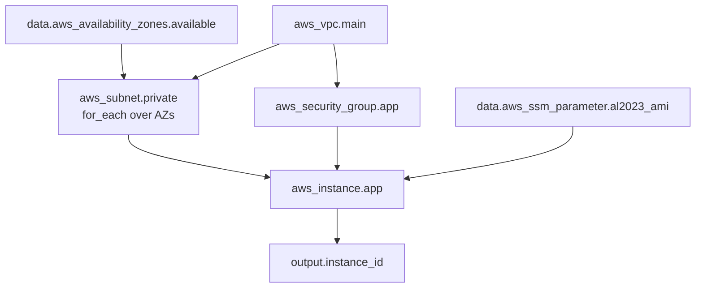
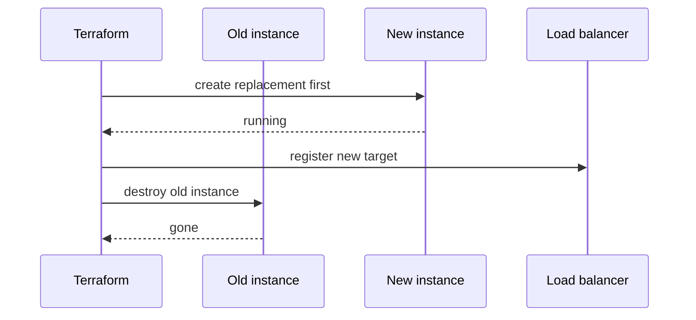

# L7.5 — Data Sources and Dependencies

> **Level 7: Terraform / Infrastructure as Code** · Topic 5 of 9 · ⏱ ~5 hours · Difficulty: Intermediate

## 1. What it is

A **data source** (a `data` block) lets Terraform *read* something that already exists and use its attributes in your code,
without managing it: "the latest Amazon Linux AMI", "the list of availability zones in this region", "the VPC somebody else
created", "the AWS account ID I am running in". A `resource` block says "make this exist"; a `data` block says "look this up".

A **dependency** is a statement that one object must exist before another. Terraform builds a **dependency graph** (a DAG, a
directed acyclic graph) of every resource, data source, module and output, then walks it: independent nodes are created in
parallel (10 at a time by default), dependent nodes wait. Most dependencies are **implicit** (you reference another object's
attribute, so Terraform infers the order). When the relationship is real but invisible in the code you add an **explicit**
`depends_on`. On top of this, `count` and `for_each` create several copies of a block, and the `lifecycle` block tunes how
Terraform replaces, protects and validates resources.

## 2. Why it matters in DevOps

- **No hard-coded IDs.** An AMI ID, subnet ID or account ID copied from the console breaks in the next region or account. Data
  sources keep the same code working in dev, stage and prod.
- **Ordering bugs are outage bugs.** A security group deleted before the instance that uses it, or an IAM policy attached after the
  app already started, produce flaky applies that "work on the second run".
- **`count` versus `for_each` decides whether a harmless edit destroys a database.** Removing the first item of a `count` list
  shifts every index after it and Terraform plans to replace them.
- **`lifecycle` is your safety net.** `prevent_destroy` on the production database, `create_before_destroy` for zero-downtime
  replacement and `ignore_changes` for fields an autoscaler owns are everyday senior-level tools.
- **Cross-stack reads** (the app stack reading the network stack) are how big estates stay split into small, fast states.

## 3. Real-world system example

**The `terraform-aws-modules` family and the AWS provider's own docs.** The widely used community modules for VPC, EC2, ALB and
RDS publish examples that look up the AMI through a data source (or the public SSM parameter that AWS maintains for the latest
Amazon Linux image) instead of pinning an ID, call `aws_availability_zones` to spread subnets across zones, and build IAM
policies with `aws_iam_policy_document` rather than hand-written JSON. Terraform itself documents the dependency graph as its core
execution model: a plan is a walk over the graph, and `terraform graph` prints it in DOT format. Multi-account setups commonly look up the
current account with `aws_caller_identity` (and the organisation with `aws_organizations_organization`) so one codebase can be
applied to many accounts.

## 4. Diagram

How Terraform turns your code into a graph and executes it in waves:



`aws_vpc.main`, the AZ lookup and the AMI lookup have no parents, so they run first and in parallel. The subnets and the security
group run next. The instance waits for all three of its inputs.

When a replacement must not cause downtime, `create_before_destroy` reverses the usual order:



## 5. How it works

### Data sources

```hcl
data "aws_caller_identity" "current" {}
data "aws_region" "current" {}

data "aws_availability_zones" "available" {
  state = "available"
}

# Latest Amazon Linux 2023 AMI via the public SSM parameter AWS maintains
data "aws_ssm_parameter" "al2023_ami" {
  name = "/aws/service/ami-amazon-linux-latest/al2023-ami-kernel-default-x86_64"
}

# Look up an existing VPC by tag (created by another team or another stack)
data "aws_vpc" "shared" {
  tags = { Name = "shared-network" }
}

# Build IAM JSON in HCL instead of a string
data "aws_iam_policy_document" "read_params" {
  statement {
    actions   = ["ssm:GetParameter", "ssm:GetParametersByPath"]
    resources = ["arn:aws:ssm:${data.aws_region.current.name}:${data.aws_caller_identity.current.account_id}:parameter/shop-api/*"]
  }
}
```

Reference them with the `data.` prefix: `data.aws_ssm_parameter.al2023_ami.value`. Rules worth knowing:

- Data sources are read during `plan` when their arguments are known; if an argument depends on something not yet created, the read
  is deferred to apply and the result shows as `(known after apply)`.
- A data source that matches nothing (or more than one object where one is expected) is an error. That is usually what you want:
  fail early.
- `aws_ami` with `most_recent = true` and a filter also works, but a moving "latest" means a plan next month may want to replace
  your instance. Decide deliberately: pin the AMI ID per environment for production, use "latest" for dev, and pair it with
  `lifecycle { ignore_changes = [ami] }` if you roll instances by another mechanism.
- **Cross-stack reads:** `terraform_remote_state` reads another stack's *outputs* from its state file. It needs read access to that
  whole state (which can contain secrets). A more decoupled alternative is to publish values to SSM Parameter Store or tag
  resources, and read them with ordinary data sources.

```hcl
data "terraform_remote_state" "network" {
  backend = "s3"
  config = {
    bucket = "shop-api-tfstate-123456789012"
    key    = "dev/network/terraform.tfstate"
    region = "us-east-1"
  }
}
# data.terraform_remote_state.network.outputs.private_subnet_ids
```

### Implicit versus explicit dependencies

| Kind | How | When |
|------|-----|------|
| **Implicit** | Reference an attribute: `subnet_id = aws_subnet.private["a"].id` | Almost always. Terraform orders for you. |
| **Explicit** | `depends_on = [aws_iam_role_policy.app]` | The dependency is real but not expressed by any attribute, e.g. an instance's boot script calls S3 and needs the policy attached first. |

Prefer implicit references. `depends_on` has a cost: Terraform treats everything in the target as possibly changed, which can make
data sources inside the dependent object defer to apply time and produce noisier plans. Use it sparingly and add a comment saying
*why*. It works on modules too: `depends_on = [module.network]`.

### `count` versus `for_each`

```hcl
# count: copies identified by index 0,1,2 - fragile
resource "aws_subnet" "bad" {
  count             = length(var.azs)
  availability_zone = var.azs[count.index]
  # ...
}

# for_each: copies identified by key - stable
resource "aws_subnet" "private" {
  for_each          = var.private_subnets          # map: az => cidr
  vpc_id            = aws_vpc.main.id
  availability_zone = each.key
  cidr_block        = each.value
}
```

| | `count` | `for_each` |
|---|---------|-----------|
| Identity | numeric index `[0]` | key `["us-east-1a"]` |
| Remove the first item | every later index shifts, so replacements | only that item is destroyed |
| Input | a number | a map or a set of strings (keys must be known at plan time) |
| Best for | on/off switch: `count = var.enabled ? 1 : 0` | any collection of similar things |

Convert a list to a set with `toset(var.names)`. For lists of objects build a map with a `for` expression:
`{ for s in var.services : s.name => s }`. Reference all copies with a splat or `values()`:
`[for s in aws_subnet.private : s.id]`.

### The `lifecycle` block

```hcl
resource "aws_db_instance" "main" {
  # ...
  lifecycle {
    prevent_destroy = true            # any plan that destroys this fails
  }
}

resource "aws_launch_template" "app" {
  lifecycle {
    create_before_destroy = true      # build the replacement first
  }
}

resource "aws_autoscaling_group" "app" {
  lifecycle {
    ignore_changes = [desired_capacity]   # autoscaling policies own this field
  }
}

resource "aws_instance" "app" {
  lifecycle {
    replace_triggered_by = [aws_launch_template.app.latest_version]
    precondition {
      condition     = data.aws_vpc.shared.enable_dns_hostnames
      error_message = "The shared VPC must have DNS hostnames enabled."
    }
    postcondition {
      condition     = self.public_ip == "" || self.public_ip == null
      error_message = "App instances must not have public IPs."
    }
  }
}
```

| Setting | Effect |
|---------|--------|
| `create_before_destroy` | Replacement is created, then the old one destroyed. Names must not collide (use `name_prefix`). |
| `prevent_destroy` | Plan errors if it would destroy the resource. Not a substitute for IAM or backups; `terraform destroy` fails too, and removing the block from code removes the protection. |
| `ignore_changes` | Terraform ignores differences in the listed attributes (tags added by other tools, autoscaled capacity). |
| `replace_triggered_by` | Replace this resource whenever the referenced resource or attribute changes. |
| `precondition` / `postcondition` | Custom checks before/after the resource is evaluated. Fail the run with a clear message. |

## 6. Step-by-step guide

**Prerequisites:** Terraform 1.11+ (or OpenTofu), AWS CLI with sandbox credentials, a billing alarm. Everything below uses free
or near-free objects (data sources, security groups, SSM parameters). No EC2 instances are created.

1. **Create the project.**
   ```bash
   mkdir -p tf-deps && cd tf-deps
   ```
   `versions.tf`:
   ```hcl
   terraform {
     required_version = ">= 1.11"
     required_providers {
       aws = { source = "hashicorp/aws", version = "~> 5.0" }
     }
   }
   provider "aws" { region = "us-east-1" }
   ```

2. **Read with data sources.** `main.tf`:
   ```hcl
   data "aws_caller_identity" "current" {}
   data "aws_availability_zones" "available" { state = "available" }
   data "aws_vpc" "default" { default = true }

   data "aws_ssm_parameter" "al2023_ami" {
     name = "/aws/service/ami-amazon-linux-latest/al2023-ami-kernel-default-x86_64"
   }

   output "account_id" { value = data.aws_caller_identity.current.account_id }
   output "azs"        { value = data.aws_availability_zones.available.names }
   output "ami_id"     { value = data.aws_ssm_parameter.al2023_ami.value, sensitive = true }
   ```
   ```bash
   terraform init && terraform apply -auto-approve
   terraform output azs
   terraform output -raw ami_id
   ```
   You should see your 12-digit account ID, a list such as `us-east-1a`, `us-east-1b`, and an `ami-...` ID. (`sensitive = true` is
   only to hide the long value in the apply summary; it is not a secret.)

3. **Fan out with `for_each` and watch the graph.** Append:
   ```hcl
   locals {
     services = { api = 3000, worker = 3001, metrics = 9100 }
   }

   resource "aws_security_group" "svc" {
     for_each    = local.services
     name_prefix = "shop-api-${each.key}-"
     description = "shop-api ${each.key}"
     vpc_id      = data.aws_vpc.default.id
     lifecycle { create_before_destroy = true }
   }

   resource "aws_vpc_security_group_ingress_rule" "svc" {
     for_each          = local.services
     security_group_id = aws_security_group.svc[each.key].id    # implicit dependency
     cidr_ipv4         = "10.0.0.0/16"
     ip_protocol       = "tcp"
     from_port         = each.value
     to_port           = each.value
   }
   ```
   ```bash
   terraform apply -auto-approve
   terraform state list | grep svc
   terraform graph | head -30        # DOT text; paste into a Graphviz viewer if you like
   ```
   The state shows `aws_security_group.svc["api"]`, `["worker"]`, `["metrics"]`, addressed by key.

4. **See why `for_each` is safer than `count`.** Delete the `api` entry from `local.services` and run `terraform plan`. Only the
   `api` group and its rule are planned for destruction; `worker` and `metrics` are untouched. Put `api` back.

5. **Add an explicit `depends_on`.** Create a parameter that must be written only after the rules exist:
   ```hcl
   resource "aws_ssm_parameter" "ready" {
     name  = "/shop-api/dev/network-ready"
     type  = "String"
     value = "true"
     depends_on = [aws_vpc_security_group_ingress_rule.svc]   # real ordering, no attribute links them
   }
   ```
   Run `terraform apply` and read the output: the parameter is created only after the ingress rules finish. Always add a comment
   explaining why a `depends_on` exists.

6. **Protect something with `prevent_destroy`.** Add `lifecycle { prevent_destroy = true }` to `aws_ssm_parameter.ready`, run
   `terraform apply`, then try `terraform destroy`. Expected failure (wording may differ slightly by version):
   ```text
   Error: Instance cannot be destroyed
   Resource aws_ssm_parameter.ready has lifecycle.prevent_destroy set, but the plan calls for it to be destroyed.
   ```
   Remove the `lifecycle` block (a deliberate code change reviewed in a PR is the point) and continue.

7. **Add a `postcondition`.** On `data "aws_vpc" "default"` add:
   ```hcl
   lifecycle {
     postcondition {
       condition     = self.enable_dns_support
       error_message = "VPC must have DNS support enabled."
     }
   }
   ```
   Re-run `terraform plan`; it passes. Change the condition to `!self.enable_dns_support` and the plan fails with your message.

8. **Clean up.**
   ```bash
   terraform destroy -auto-approve
   ```
   All resources here are free, but destroy anyway to leave the account tidy.

## 7. Real-world scenario

*(Illustrative.)* A team defined five private subnets with `count` over a list of CIDRs, and the RDS subnet group and several
instances referenced `aws_subnet.private[2]`. During a re-addressing project someone removed the *first* CIDR from the list. The
plan showed four subnets being replaced and the database subnet group being modified. The reviewer almost approved because the diff
"was just a removed line". Replacing subnets with live ENIs would have failed midway, and in the worst case dropped connectivity
to the database. The fix was to convert to `for_each` keyed by availability zone, using `moved` blocks
(`aws_subnet.private[0]` to `aws_subnet.private["us-east-1a"]`) so the refactor itself was a no-op plan, and to add
`prevent_destroy` to the database. **Lesson:** a plan that changes more than the diff suggests is a signal to stop, and key-based
addressing makes plans match human intent.

## 8. Common mistakes and best practices

**Don't**

- Paste AMI IDs, subnet IDs or account IDs into code; they differ per region and account.
- Use `count` over a list that can have items removed from the front or middle.
- Sprinkle `depends_on` everywhere to "make it work". It hides a missing reference and widens plans.
- Treat `prevent_destroy` as a backup; it only blocks Terraform and disappears when the line is deleted.
- Read another team's whole state with `terraform_remote_state` when two outputs would do (it exposes everything in that state).

**Do**

- Prefer attribute references (implicit dependencies) and use `depends_on` only with a comment explaining the hidden relationship.
- Use `for_each` with stable keys; use `count` only as a 0/1 switch.
- Protect stateful resources with `prevent_destroy`, deletion protection in the provider (`deletion_protection = true` on RDS) *and* backups.
- Use `create_before_destroy` plus `name_prefix` on resources that serve traffic and must be replaced without a gap.
- Use `precondition` / `postcondition` to turn silent assumptions ("this VPC has DNS enabled") into loud failures.
- Explore the graph with `terraform graph` when a plan's ordering surprises you.

## 9. Tasks

- [ ] **T1 — Replace hard-coded IDs with data sources** *(≈30 min, beginner)*
  - **Goal:** make a config region-independent.
  - **Steps:**
    1. Follow steps 1-2.
    2. Add an output that builds a string like `"<account>/<region>/<first AZ>"` from three data sources.
  - **Done when:** `terraform output` prints your real account ID, region and first AZ without any hard-coded value in the code.

- [ ] **T2 — Fan out with `for_each`** *(≈30 min, intermediate)*
  - **Goal:** create several similar resources with stable addresses.
  - **Steps:**
    1. Follow step 3.
    2. Add a fourth service `admin = 8080` to the map and apply.
  - **Done when:** `terraform state list` shows four security groups addressed by key and the plan only added the new one.

- [ ] **T3 — Compare `count` and `for_each`** *(≈30 min, intermediate)*
  - **Goal:** observe index shifting.
  - **Steps:**
    1. Create three `aws_ssm_parameter` resources with `count` over `["a","b","c"]`; apply.
    2. Remove `"a"` from the list and run `terraform plan`. Note what it wants to replace.
    3. Redo the experiment with `for_each = toset([...])`.
  - **Done when:** you can show that `count` plans changes to `b` and `c` while `for_each` plans only to destroy `a`.

- [ ] **T4 — Break it: an invisible dependency** *(≈45 min, advanced)*
  - **Goal:** hit an ordering failure and fix it with the right tool.
  - **Steps:**
    1. Using two `terraform_data` resources with `local-exec` provisioners, make the first write a parameter (`aws ssm put-parameter`) and the second read it (`aws ssm get-parameter`), with no attribute reference between them.
    2. Apply from scratch and observe the race or failure.
    3. Fix it, first by adding a real reference, then explain when `depends_on` would be the correct fix instead.
  - **Done when:** a clean `terraform apply` from an empty state succeeds twice in a row, and you can state in one sentence why you chose reference versus `depends_on`.

- [ ] **T5 — Lifecycle guards** *(≈45 min, advanced)*
  - **Goal:** use `prevent_destroy`, `ignore_changes` and a `postcondition`.
  - **Steps:**
    1. Do steps 6-7.
    2. Add `ignore_changes = [value]` to a parameter, edit its value in the console, and show that `terraform plan` reports no changes.
    3. Remove `ignore_changes` and show that the plan now wants to revert the value.
  - **Done when:** you have demonstrated all three guards (blocked destroy, a failing condition, ignored drift) with command output.

- [ ] **T6 — Prove it: read the graph** *(≈30 min, advanced)*
  - **Goal:** predict Terraform's order without running it.
  - **Steps:**
    1. Draw (on paper or as Mermaid) the dependency graph of your project from step 3 and 5.
    2. Predict which resources are created in parallel.
    3. Verify with `terraform graph` and the timestamps of `terraform apply` output.
  - **Done when:** your predicted order matches the apply output, and you can explain in two minutes where implicit and explicit dependencies came from.

## 10. Self-check questions

1. What is the difference between a `resource` and a `data` block?
2. Why is `for_each` usually safer than `count`?
3. When is `depends_on` the right tool, and what is its downside?
4. What does `create_before_destroy` do and what problem can it cause?
5. What are two ways to share values between separate Terraform stacks, and which is more decoupled?

<details>
<summary>Answers</summary>

1. A resource is created and managed by Terraform. A data source only reads an existing object (or computes a value) and never changes it.
2. `for_each` identifies instances by key, so removing or reordering items affects only those items. `count` uses numeric indexes, so removing an early item shifts and replaces the rest.
3. When a real ordering requirement exists that no attribute reference expresses (e.g. an IAM policy must be attached before a boot script runs). Downside: it widens what Terraform considers changed, defers data reads to apply time and can hide a missing reference.
4. It creates the replacement before destroying the old object, avoiding downtime. It can cause name collisions (unique names), temporary double cost and quota pressure, so use `name_prefix`.
5. `terraform_remote_state` (reads another stack's outputs but requires access to the entire state) or publishing values to SSM Parameter Store, tags or a service catalogue and reading them with data sources. The latter is more decoupled.
</details>

## 11. Further reading

- Terraform documentation: *Data Sources*, *Resource Behavior → Dependencies*, *Meta-Arguments (`count`, `for_each`, `depends_on`, `lifecycle`)* and the `terraform graph` command.
- AWS provider documentation: `aws_availability_zones`, `aws_ssm_parameter`, `aws_caller_identity`, `aws_iam_policy_document`.
- *Terraform: Up & Running* by Yevgeniy Brikman — chapters on loops and conditionals.
- See also: [State and Remote Backends](04-state-and-remote-backends.md), [Modules](03-modules.md) and [VPC and Subnets](../level-06-cloud-aws/04-vpc-and-subnets.md).

<!-- nav -->
---
← Previous: [State and Remote Backends](04-state-and-remote-backends.md) · [Level 7 index](README.md) · Next: [Reusable Environments](06-reusable-environments.md) →
