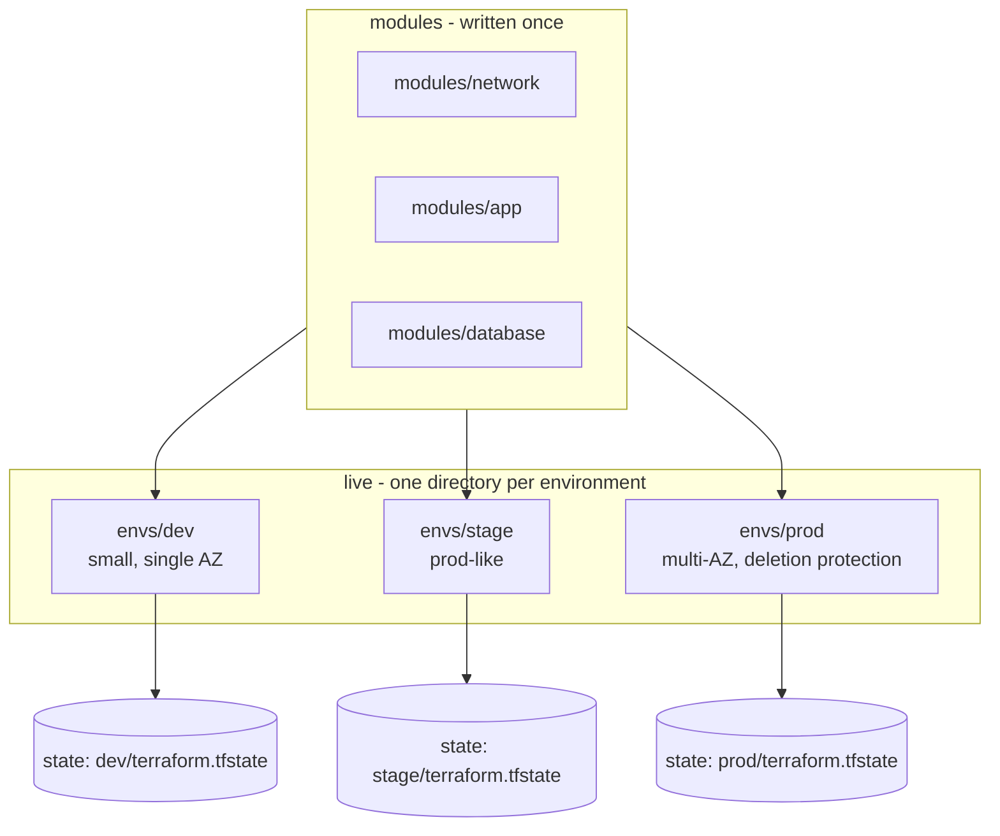
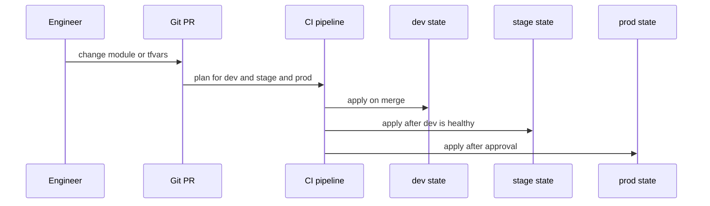

# L7.6 — Reusable Environments

> **Level 7: Terraform / Infrastructure as Code** · Topic 6 of 9 · ⏱ ~5 hours · Difficulty: Intermediate

## 1. What it is

Almost every product runs in several **environments**: `dev` (engineers experiment), `stage` (a production lookalike for final
tests) and `prod` (real users). A **reusable environment** setup means you write the infrastructure *once* and instantiate it
several times with different inputs (sizes, counts, CIDR ranges, domain names), instead of copy-pasting a folder and watching the
copies slowly diverge.

Terraform gives you three building blocks for this: **modules** (the reusable code, [L7.3](03-modules.md)), **separate state per
environment** (so a dev mistake cannot touch prod, [L7.4](04-state-and-remote-backends.md)), and **input variables** (the
differences, [L7.2](02-variables-and-outputs.md)). The design question is how to organise the folders and state around them:
one directory per environment, or **workspaces** (several states from one directory), plus helper tools such as **Terragrunt**
that remove repeated boilerplate.

## 2. Why it matters in DevOps

- **"Works in stage, breaks in prod"** is usually environment drift in code: someone fixed stage by hand-editing a copy. One module
  used by all environments keeps them structurally identical; only the inputs differ.
- **Blast radius.** A typo in dev must never be able to plan a change to the production database. Separate state, separate
  credentials and often separate AWS accounts make that impossible rather than merely unlikely.
- **Cost.** Dev can run a single `t3.micro` and a small database, prod runs Multi-AZ. The same code with different variables does
  both without a rewrite.
- **Speed of change.** Promoting a change `dev` then `stage` then `prod` is a review of one diff and a sequence of applies, not
  three hand-made edits.

## 3. Real-world system example

**Per-environment stacks in AWS-centric organisations, and Terragrunt.** AWS's own prescriptive guidance for multi-account setups
(the "AWS Well-Architected" multi-account strategy and Control Tower landing zones) recommends separating workloads into
different accounts, with production isolated from non-production. Terraform teams mirror that with one root module per
environment and one state per environment per layer. Gruntwork, the company behind **Terragrunt**, publishes a reference layout
(`infrastructure-live` and `infrastructure-modules` repositories) that separates reusable modules from the "live" per-environment
configuration, and Terragrunt itself exists to keep backend and provider blocks DRY across many such directories. Terraform's own
documentation notes that workspaces share one backend and configuration and are *not* a strong isolation boundary for
production-versus-development credentials, which is why many teams prefer directories (or accounts) for real environments.

## 4. Diagram

The recommended shape: modules are written once, environments are thin callers with their own state.



How a change is promoted:



## 5. How it works

### Option A: a directory per environment (recommended for real environments)

```text
infra/
  modules/
    network/   app/   database/
  envs/
    dev/
      backend.tf        # key = "dev/terraform.tfstate"
      main.tf           # module calls
      variables.tf
      dev.auto.tfvars   # the values that make dev different
    stage/
    prod/
```

Each `envs/<name>` is a **root module** with its own backend, its own `terraform init` and its own state. Differences are explicit
and reviewable: `diff -r envs/dev envs/prod` shows exactly how they differ. The cost is repetition of small wiring files.

### Option B: workspaces (one directory, many states)

```bash
terraform workspace new dev
terraform workspace new prod
terraform workspace select prod
terraform workspace show
```

```hcl
locals {
  settings = {
    dev  = { instance_type = "t3.micro", multi_az = false }
    prod = { instance_type = "t3.large", multi_az = true  }
  }
  env = local.settings[terraform.workspace]
}
```

With the S3 backend each workspace gets its own state object under `env:/<workspace>/<key>`. Workspaces are lightweight, but:
they share the same backend, the same provider credentials and the same code. It is easy to run `apply` while the wrong workspace is
selected (the prompt does not show it), and a per-environment difference that does not fit a lookup map is awkward. They suit
**ephemeral copies** of one stack (a per-PR preview environment, a feature test) better than long-lived prod versus dev.

> Do not confuse Terraform CLI workspaces with HCP Terraform "workspaces", which are separate units with their own variables,
> state and permissions and behave more like Option A.

| | Directories | Workspaces |
|---|-------------|------------|
| State isolation | separate backend keys, can be separate buckets/accounts | same backend, separate state objects |
| Credentials per env | easy: different role per directory/pipeline | hard: one provider config for all |
| Differences between envs | any code difference possible, visible in review | only what the lookup map or variables express |
| Risk of applying to wrong env | low (you are in a directory, CI is pinned per path) | higher (hidden CLI state) |
| Duplication | some boilerplate | minimal |
| Good for | dev / stage / prod | per-PR preview stacks, short-lived clones |

### DRY patterns

1. **Modules for logic, thin environment roots for wiring.** Roots contain only module calls and values.
2. **Shared `.tfvars` conventions:** `terraform apply -var-file=../common.tfvars -var-file=prod.tfvars` (later files win).
3. **Partial backend configuration:** a single `backend "s3" {}` block plus `terraform init -backend-config=backend-prod.hcl`
   to avoid repeating bucket names.
4. **Layered stacks:** `network` then `data` then `app` per environment; upper layers read lower ones through outputs
   ([L7.5](05-data-sources-and-dependencies.md)). Smaller states mean faster plans and smaller blast radius.
5. **Versioned module sources:** `source = "git::https://github.com/YOUR-ORG/tf-modules.git//app?ref=v1.4.0"` so prod can lag
   dev by a tag, giving you a real promotion path.
6. **Generated boilerplate:** a wrapper tool writes the backend and provider blocks for you (below).

### Terragrunt (mention)

**Terragrunt** is a thin open-source wrapper around Terraform (and OpenTofu) from Gruntwork. A `terragrunt.hcl` per environment
directory can `include` a root file that generates the `backend` and `provider` blocks, sets the state key from the directory
path, declares `dependency` blocks between stacks and runs one command across many stacks (`terragrunt run-all plan`, spelled `terragrunt run --all plan` in newer releases). It cuts boilerplate in
large estates. It is an extra tool to learn and to keep versions aligned; for a handful of environments plain directories plus
modules are enough. Newer Terraform features (`-var-file`, `.auto.tfvars`, `-backend-config`, stacks in HCP Terraform) cover part of
the same ground, so adopt Terragrunt for a concrete pain, not by default.

```hcl
# envs/prod/app/terragrunt.hcl  (illustrative)
include "root" {
  path = find_in_parent_folders()        # root.hcl generates backend + provider
}
terraform {
  source = "git::https://github.com/YOUR-ORG/tf-modules.git//app?ref=v1.4.0"
}
inputs = {
  instance_type = "t3.large"
  multi_az      = true
}
```

### Environment account strategy

Directories pair naturally with accounts: `dev`, `stage` and `prod` are separate AWS accounts, each with its own role that CI
assumes ([L7.7](07-terraform-ci-cd.md)). Even the state bucket can be per account. A developer's credentials for dev then cannot
touch prod at all. For a small project one account with a naming prefix (`shop-api-dev-...`) is acceptable but weaker.

## 6. Step-by-step guide

**Prerequisites:** Terraform 1.11+ (or OpenTofu). The example uses only the `local` and `random` providers, so it costs nothing
and needs no cloud account. The pattern is identical for AWS modules.

1. **Create the layout.**
   ```bash
   mkdir -p envs-demo/modules/app envs-demo/envs/dev envs-demo/envs/prod && cd envs-demo
   ```

2. **Write the reusable module** `modules/app/main.tf`:
   ```hcl
   terraform {
     required_providers {
       local = { source = "hashicorp/local", version = "~> 2.5" }
     }
   }

   variable "env"           { type = string }
   variable "instance_type" { type = string }
   variable "replicas" {
     type    = number
     default = 1
   }
   variable "multi_az" {
     type    = bool
     default = false
   }

   resource "local_file" "config" {
     filename = "${path.root}/rendered-${var.env}.txt"
     content  = <<-EOT
       env           = ${var.env}
       instance_type = ${var.instance_type}
       replicas      = ${var.replicas}
       multi_az      = ${var.multi_az}
     EOT
   }

   output "file" { value = local_file.config.filename }
   ```

3. **Create the dev root** `envs/dev/main.tf`:
   ```hcl
   terraform {
     required_version = ">= 1.11"
     # backend "s3" { ... key = "dev/terraform.tfstate" } would go here on AWS; local state keeps this demo free
   }

   module "app" {
     source        = "../../modules/app"
     env           = "dev"
     instance_type = "t3.micro"
   }

   output "file" { value = module.app.file }
   ```

4. **Create the prod root** `envs/prod/main.tf` with the same module and different inputs:
   ```hcl
   terraform {
     required_version = ">= 1.11"
   }

   module "app" {
     source        = "../../modules/app"
     env           = "prod"
     instance_type = "t3.large"
     replicas      = 3
     multi_az      = true
   }

   output "file" { value = module.app.file }
   ```

5. **Apply each environment independently.**
   ```bash
   (cd envs/dev  && terraform init -input=false && terraform apply -auto-approve)
   (cd envs/prod && terraform init -input=false && terraform apply -auto-approve)
   cat envs/dev/rendered-dev.txt envs/prod/rendered-prod.txt
   ls envs/dev/terraform.tfstate envs/prod/terraform.tfstate     # two independent states
   ```
   Output is similar to `instance_type = t3.micro` for dev and `replicas = 3` for prod.

6. **Prove the isolation.** Destroy dev only and confirm prod is unaffected:
   ```bash
   (cd envs/dev && terraform destroy -auto-approve)
   ls envs/prod/rendered-prod.txt
   ```

7. **Promote a module change.** Edit `modules/app/main.tf` (add a line `region = us-east-1` to the content), then run
   `terraform plan` in both directories. Both show one file to update: one module change, every environment reviewed.

8. **Try the workspace alternative** in a copy (`cp -r envs/dev ws-demo && cd ws-demo`): replace the hard-coded `env` with
   `terraform.workspace`, then:
   ```bash
   terraform workspace new qa
   terraform apply -auto-approve
   terraform workspace list
   ls terraform.tfstate.d/          # local backend keeps one directory per workspace
   ```
   Note how nothing in the shell prompt tells you which workspace you are in. That is the risk.

9. **Clean up.**
   ```bash
   (cd envs/prod && terraform destroy -auto-approve)
   cd .. && rm -rf envs-demo
   ```

## 7. Real-world scenario

*(Illustrative.)* A team kept stage and prod as two copies of one folder. A hotfix to the load-balancer idle timeout went into
prod during an incident and was never copied to stage. Three months later a stage load test showed no timeouts and prod fell over
under the same traffic shape, because the two had diverged in eleven small ways nobody had listed. The team extracted a `modules/app`
module, reduced each environment to ~30 lines of inputs, pinned prod to a module tag one release behind dev and stage, and added a
CI job that fails when `envs/stage` and `envs/prod` pass different *structural* arguments to a module. **Lesson:** environments should
differ only in values, never in structure, and the diff between them should fit on one screen.

## 8. Common mistakes and best practices

**Don't**

- Copy a whole environment folder and edit it; copies drift.
- Use CLI workspaces to separate prod from dev when they need different credentials or approval rules.
- Share one state (or one giant root module) across all environments and layers.
- Put environment-specific `if var.env == "prod"` branches all over a module; prefer explicit variables (`multi_az`, `deletion_protection`).
- Let dev have the ability to read or write the prod state bucket.

**Do**

- Keep modules generic and environment roots thin; the roots should read like configuration, not code.
- Give each environment its own state key (ideally its own account and bucket) and its own CI role.
- Pin module versions per environment to promote changes dev, stage, prod.
- Keep prod safety on by variable: `deletion_protection`, `prevent_destroy`, `multi_az`, backup retention.
- Use workspaces for short-lived copies (PR previews) and destroy them automatically.
- Adopt Terragrunt (or generation scripts) only when repeated backend/provider boilerplate becomes a real maintenance cost.

## 9. Tasks

- [ ] **T1 — Build two environments from one module** *(≈45 min, beginner)*
  - **Goal:** instantiate a module twice with different inputs.
  - **Steps:**
    1. Follow steps 1-5.
    2. Run `diff envs/dev/main.tf envs/prod/main.tf`.
  - **Done when:** both rendered files exist with different values and the diff shows only input differences.

- [ ] **T2 — Prove state isolation** *(≈20 min, beginner)*
  - **Goal:** show that environments cannot affect each other.
  - **Steps:**
    1. Follow step 6.
    2. Run `terraform state list` in each directory.
  - **Done when:** destroying dev leaves prod's file and state untouched.

- [ ] **T3 — Add a third environment** *(≈30 min, intermediate)*
  - **Goal:** measure how cheap a new environment is.
  - **Steps:**
    1. Create `envs/stage` with values between dev and prod.
    2. Add a new variable `log_level` to the module with a default and set it only in prod.
  - **Done when:** stage applies cleanly, and dev and stage needed no edits for the new variable.

- [ ] **T4 — Workspaces versus directories** *(≈45 min, intermediate)*
  - **Goal:** feel the trade-off.
  - **Steps:**
    1. Do step 8 and create two workspaces.
    2. Deliberately run `terraform destroy` while on the wrong workspace in a sandbox and note how easily it happens.
    3. Write three sentences on when you would pick each approach.
  - **Done when:** `terraform workspace list` shows your workspaces and your written comparison cites isolation, credentials and visibility.

- [ ] **T5 — Break it: configuration drift between copies** *(≈45 min, advanced)*
  - **Goal:** see why copy-paste fails and fix it.
  - **Steps:**
    1. Copy `envs/prod` to `envs/prod-copy`, change one argument in the copy only and apply both.
    2. Find the difference using only `diff -r`.
    3. Refactor so both call the module with a single shared `common.tfvars` plus a small environment file.
  - **Done when:** `diff -r` between environments shows only values, and a module change appears in the plan of every environment.

- [ ] **T6 — Prove it: design an environment strategy** *(≈45 min, advanced)*
  - **Goal:** defend a layout for `shop-api` (VPC, ALB, EC2, RDS, Redis).
  - **Steps:**
    1. Without notes, sketch the repository tree, state keys, AWS accounts and CI roles for dev, stage and prod.
    2. Explain what is shared (modules) and what differs (values), and how a module change is promoted.
    3. State one situation where you would add Terragrunt and one where you would not.
  - **Done when:** a teammate can read your sketch and answer "what stops a dev engineer from changing prod?" with a specific control.

## 10. Self-check questions

1. Why prefer directories over CLI workspaces for dev, stage and prod?
2. What should differ between environments and what must never differ?
3. How does a module version pin help you promote a change?
4. What problem does Terragrunt solve, and what does it cost you?
5. Where does each environment's state live and how is it protected?

<details>
<summary>Answers</summary>

1. Directories give separate backends, credentials and review paths, and the target environment is explicit in the path. Workspaces share one backend, one provider configuration and one code path, and the active workspace is hidden CLI state.
2. Values (sizes, counts, CIDRs, names, feature flags like `multi_az`) may differ. Structure (which resources exist and how they are wired) should not, otherwise stage stops predicting prod.
3. Prod can reference an older tag while dev and stage move to a newer one. After the new version proves itself you bump the prod pin in a reviewed PR.
4. It removes repeated backend/provider boilerplate, wires dependencies between stacks and runs many stacks at once. The cost is another tool, another configuration language layer and version alignment.
5. In its own state object (ideally its own bucket and account), with versioning, encryption and IAM so only that environment's CI role can write it.
</details>

## 11. Further reading

- Terraform documentation: *Workspaces*, *Backend configuration (partial configuration)* and *Input variables → variable definition files*.
- Terragrunt documentation (terragrunt.gruntwork.io): *Keep your Terraform code DRY* and the `run-all` command.
- AWS whitepaper: *Organizing Your AWS Environment Using Multiple Accounts*.
- *Terraform: Up & Running* by Yevgeniy Brikman — "How to Manage Multiple Environments".
- See also: [Modules](03-modules.md), [Variables and Outputs](02-variables-and-outputs.md) and [Immutable Infrastructure](../level-00-what-devops-is/05-immutable-infrastructure.md).

<!-- nav -->
---
← Previous: [Data Sources and Dependencies](05-data-sources-and-dependencies.md) · [Level 7 index](README.md) · Next: [Terraform CI/CD](07-terraform-ci-cd.md) →
