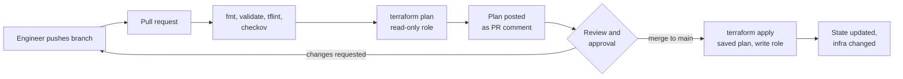
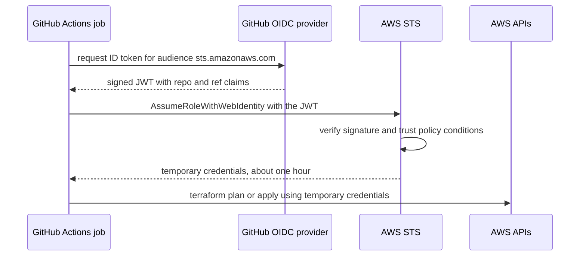

# L7.7 — Terraform CI/CD

> **Level 7: Terraform / Infrastructure as Code** · Topic 7 of 9 · ⏱ ~6 hours · Difficulty: Advanced

## 1. What it is

Terraform CI/CD (continuous integration and continuous delivery) means infrastructure changes travel through the same
pipeline as application code: a developer opens a **pull request (PR)**, automation formats, validates, lints, scans and runs
`terraform plan`, a human reviews the plan, and only after **merge** does a pipeline run `terraform apply` with the plan that was
reviewed. Nobody runs `apply` from a laptop against shared environments.

Two supporting ideas make this safe. First, the pipeline authenticates to AWS with **OIDC** (OpenID Connect), a short-lived,
federated identity issued per workflow run, instead of long-lived access keys stored as secrets. Second, **policy checks**
(static analysis with `tflint`, `checkov` or `trivy config`, and policy engines such as Open Policy Agent via `conftest`) block
dangerous changes (a public S3 bucket, an open security group) before they reach the cloud.

## 2. Why it matters in DevOps

- **Review the plan, not just the code.** The same diff can produce a harmless or a destructive plan depending on current state.
  Posting the plan on the PR makes the real effect reviewable.
- **Credentials.** A laptop with admin keys that can change prod is a breach waiting to happen. A pipeline role that only a
  protected branch can assume is auditable and revocable.
- **Consistency.** CI uses a pinned Terraform version and provider lock file, so "works on my machine" differences disappear.
- **Auditability.** Who changed the firewall, when, why and who approved it is answered by Git history plus run logs.
- **Compliance.** Policy-as-code runs the same rules on every change instead of relying on a reviewer remembering them
  ([DevSecOps](../level-00-what-devops-is/12-devsecops.md)).

## 3. Real-world system example

**Atlantis, HCP Terraform and GitHub Actions.** Three publicly documented patterns dominate. **Atlantis** (an open-source project) is a self-hosted service that listens to PR webhooks, runs `terraform plan` when you open or update a PR, comments the plan
on the PR, and applies when a reviewer comments `atlantis apply`. **HCP Terraform** (formerly Terraform Cloud) provides remote runs,
state, run tasks and Sentinel / OPA policy checks as a managed service, with VCS-driven speculative plans on PRs. Many teams
instead write the pipeline themselves in **GitHub Actions** using `hashicorp/setup-terraform`, and authenticate with GitHub's OIDC
provider: AWS documents trusting `token.actions.githubusercontent.com` and scoping the role to a repository and branch via the
token's `sub` claim. GitHub's own documentation describes this OIDC flow as the way to avoid storing long-lived cloud secrets.

## 4. Diagram

Pull request to production:



How the pipeline gets AWS credentials without a stored secret:



## 5. How it works

### Pipeline stages

| Stage | Command | Purpose | Fails when |
|-------|---------|---------|------------|
| Format | `terraform fmt -check -recursive` | consistent style | file is not formatted |
| Validate | `terraform init -backend=false && terraform validate` | syntax and type errors | invalid configuration |
| Lint | `tflint --init && tflint` | provider-aware mistakes (invalid instance type, deprecated syntax, unused variables) | rule violations |
| Security scan | `checkov -d .` or `trivy config .` | misconfigurations (public buckets, unencrypted volumes, `0.0.0.0/0` on SSH) | high-severity finding |
| Policy | `conftest test tfplan.json` | custom org rules on the *plan* (required tags, allowed regions) | rego `deny` |
| Plan | `terraform plan -out=tfplan` | what will change | any error; PR comment shows the diff |
| Apply | `terraform apply tfplan` | make the change | only on `main`, after approval |

Key rules:

- **Apply the plan you reviewed.** `terraform plan -out=tfplan` then `terraform apply tfplan` applies exactly that plan and errors if
  state has changed since. Plan files can contain secrets in plain text, so treat the artifact like state: short retention, private.
- **Lock the toolchain.** Pin `required_version`, commit `.terraform.lock.hcl`, and pin the Terraform version in CI.
- **Two roles.** A **plan role** with read-only access (and read/write on the state lock object only) for PR runs. An **apply role** with
  write permissions that only `main` (or a protected GitHub Environment) can assume. Untrusted forks never get either.
- **Approval gates.** Use GitHub Environments with required reviewers for `prod` ([Environments and Secrets](../level-03-git-and-github/12-environments-and-secrets.md)).
- **Concurrency.** One run per stack at a time (`concurrency:` in Actions plus state locking, [L7.8](08-state-locking.md)).
- **One pipeline per stack** (path filters): a change in `envs/dev` should not plan `envs/prod`.

### OIDC trust: the AWS side

The role trusts GitHub's OIDC provider and only tokens from your repository and branch (or environment):

```hcl
resource "aws_iam_openid_connect_provider" "github" {
  url            = "https://token.actions.githubusercontent.com"
  client_id_list = ["sts.amazonaws.com"]
  # AWS verifies GitHub's certificate chain itself; thumbprint_list is no longer required
}

data "aws_iam_policy_document" "trust" {
  statement {
    actions = ["sts:AssumeRoleWithWebIdentity"]
    principals {
      type        = "Federated"
      identifiers = [aws_iam_openid_connect_provider.github.arn]
    }
    condition {
      test     = "StringEquals"
      variable = "token.actions.githubusercontent.com:aud"
      values   = ["sts.amazonaws.com"]
    }
    condition {
      test     = "StringEquals"
      variable = "token.actions.githubusercontent.com:sub"
      values   = ["repo:YOUR-ORG/shop-api-infra:ref:refs/heads/main"]   # apply role: main only
    }
  }
}

resource "aws_iam_role" "terraform_apply" {
  name               = "terraform-apply-dev"
  assume_role_policy = data.aws_iam_policy_document.trust.json
  max_session_duration = 3600
}
```

For a plan role on PRs use `values = ["repo:YOUR-ORG/shop-api-infra:pull_request"]` with `StringLike`/`StringEquals` as appropriate. For
environments the subject is `repo:ORG/REPO:environment:prod`. **Never use a wildcard `sub`** such as `repo:*`: any repository on
GitHub could then assume your role.

### The workflow

```yaml
# .github/workflows/terraform.yml
name: terraform
on:
  pull_request:
    paths: ["infra/envs/dev/**", "infra/modules/**"]
  push:
    branches: [main]
    paths: ["infra/envs/dev/**", "infra/modules/**"]

permissions:
  id-token: write        # request the OIDC token
  contents: read
  pull-requests: write   # post the plan comment

concurrency:
  group: tf-dev
  cancel-in-progress: false   # never cancel a running apply

defaults:
  run:
    working-directory: infra/envs/dev

jobs:
  checks:
    runs-on: ubuntu-latest
    steps:
      - uses: actions/checkout@v4
      - uses: hashicorp/setup-terraform@v3
        with: { terraform_version: "1.11.4" }     # pin; use a version you have tested
      - run: terraform fmt -check -recursive
      - run: terraform init -backend=false && terraform validate
      - uses: terraform-linters/setup-tflint@v4
      - run: tflint --init && tflint --recursive
      - uses: bridgecrewio/checkov-action@v12
        with: { directory: infra, framework: terraform, soft_fail: false }

  plan:
    needs: checks
    if: github.event_name == 'pull_request'
    runs-on: ubuntu-latest
    steps:
      - uses: actions/checkout@v4
      - uses: hashicorp/setup-terraform@v3
        with: { terraform_version: "1.11.4" }
      - uses: aws-actions/configure-aws-credentials@v4
        with:
          role-to-assume: arn:aws:iam::123456789012:role/terraform-plan-dev
          aws-region: us-east-1
      - run: terraform init -input=false
      - run: terraform plan -input=false -lock-timeout=5m -out=tfplan
      - run: terraform show -no-color tfplan > plan.txt
      - uses: actions/github-script@v7
        with:
          script: |
            const fs = require('fs');
            const plan = fs.readFileSync('infra/envs/dev/plan.txt', 'utf8').slice(0, 60000);
            const fence = '`'.repeat(3);   // a markdown code fence
            github.rest.issues.createComment({
              owner: context.repo.owner, repo: context.repo.repo, issue_number: context.issue.number,
              body: '#### Terraform plan\n' + fence + '\n' + plan + '\n' + fence
            });

  apply:
    needs: checks
    if: github.event_name == 'push' && github.ref == 'refs/heads/main'
    runs-on: ubuntu-latest
    environment: dev          # add required reviewers on the prod environment
    steps:
      - uses: actions/checkout@v4
      - uses: hashicorp/setup-terraform@v3
        with: { terraform_version: "1.11.4" }
      - uses: aws-actions/configure-aws-credentials@v4
        with:
          role-to-assume: arn:aws:iam::123456789012:role/terraform-apply-dev
          aws-region: us-east-1
      - run: terraform init -input=false
      - run: terraform plan -input=false -lock-timeout=5m -out=tfplan
      - run: terraform apply -input=false tfplan
```

Notes: the apply job plans again on `main` (the merged code), then applies that fresh saved plan. A stricter design uploads the
PR plan as an artifact and applies it after merge, failing if state moved; that gives the strongest "applied what was reviewed"
guarantee but needs fast merges. Pin third-party actions to a full commit SHA in security-sensitive repositories, because tags
can move. (Action versions above are examples; check the current major versions.)

### Policy checks

- **tflint** understands the AWS provider (`tflint --init` installs the AWS ruleset from `.tflint.hcl`): it catches invalid
  instance types or deprecated arguments that `validate` cannot.
- **checkov** and **trivy config** scan the HCL (and plans) against hundreds of built-in rules (CIS-style: encryption on, no public
  access, logging enabled). Suppress a rule only with an inline comment and a reason, e.g. `#checkov:skip=CKV_AWS_18: access logs live in the central bucket`.
- **OPA / conftest** checks the JSON plan against your own rules:

```bash
terraform show -json tfplan > tfplan.json
conftest test tfplan.json --policy policy/
```

```rego
# policy/tags.rego
package main

deny contains msg if {
  some rc in input.resource_changes
  rc.type == "aws_instance"
  rc.change.actions[_] != "delete"
  not rc.change.after.tags.Owner
  msg := sprintf("%s must have an Owner tag", [rc.address])
}
```

Cost estimation (Infracost) and drift checks ([L7.9](09-drift-detection.md)) are common extra stages.

## 6. Step-by-step guide

**Prerequisites:** a GitHub repository you own, Terraform 1.11+, Docker or local installs of `tflint` and `checkov` for local
runs, and (for the OIDC part) an AWS sandbox account with billing alarm. The local tool steps cost nothing; the AWS OIDC role and
SSM parameter cost effectively nothing.

1. **Create the repo layout.**
   ```bash
   mkdir -p shop-api-infra/infra/envs/dev && cd shop-api-infra
   git init -q
   ```
   `infra/envs/dev/main.tf`:
   ```hcl
   terraform {
     required_version = ">= 1.11"
     required_providers {
       aws = { source = "hashicorp/aws", version = "~> 5.0" }
     }
   }
   provider "aws" { region = "us-east-1" }

   resource "aws_ssm_parameter" "greeting" {
     name  = "/shop-api/dev/greeting"
     type  = "String"
     value = "hello from CI"
     tags  = { Owner = "platform-team" }
   }
   ```
   Add a `backend "s3"` block using the bucket from [L7.4](04-state-and-remote-backends.md). CI needs remote state.

2. **Run the checks locally first.**
   ```bash
   cd infra/envs/dev
   terraform fmt -check -recursive
   terraform init -backend=false && terraform validate
   ```
   Expected: `Success! The configuration is valid.` If `fmt -check` prints a filename, run `terraform fmt` to fix it.

3. **Add linting and scanning.** Create `infra/envs/dev/.tflint.hcl`:
   ```hcl
   plugin "aws" {
     enabled = true
     version = "0.38.0"     # example; use the current ruleset release
     source  = "github.com/terraform-linters/tflint-ruleset-aws"
   }
   ```
   ```bash
   tflint --init && tflint
   pip install checkov && checkov -d . --framework terraform
   ```
   Checkov prints passed/failed check counts. Treat the output as similar to, not identical to, any example: rules change between releases.

4. **Create the AWS OIDC provider and roles** with the Terraform from section 5 (apply it once from your laptop in a separate
   `bootstrap/` directory; this is the only manual apply). Attach a read-only policy (`ReadOnlyAccess` plus S3 access to the state
   key) to the plan role and a narrowly scoped policy to the apply role. Note the role ARNs.

5. **Add the workflow** from section 5 at `.github/workflows/terraform.yml`, replacing the role ARNs, Terraform version and bucket.
   Commit and push to `main` to apply the initial state.

6. **Open a pull request** that changes the parameter value to `hello from a PR`. In the Actions tab expect `checks` and `plan` to
   run; the PR gets a comment ending with a summary similar to:
   ```text
   Plan: 0 to add, 1 to change, 0 to destroy.
   ```

7. **Merge and watch the apply.** After merging, the `apply` job runs and `aws ssm get-parameter --name /shop-api/dev/greeting --query Parameter.Value --output text`
   returns the new value.

8. **Protect `main`.** In repository settings require the `checks` and `plan` jobs to pass and at least one review before merge
   ([Protected Branches and Pull Requests](../level-03-git-and-github/08-protected-branches-and-pull-requests.md)).

9. **Clean up.** Run `terraform destroy` (from a protected, manually triggered workflow or your sandbox shell), delete the roles and OIDC
   provider if you no longer need them, and delete the repository if it was only for practice.

## 7. Real-world scenario

*(Illustrative.)* An engineer, debugging at 2 a.m., ran `terraform apply` from their laptop against prod with a stale branch
checked out. It "fixed" the incident and silently reverted two security-group rules added by a colleague the day before. The next
morning a scan showed SSH open to the internet. The team's response: remove standing credentials from laptops, move prod applies to a
pipeline whose role is assumable only from `main` via OIDC, require a reviewed plan on every PR, add `checkov` so a rule exposing
port 22 to `0.0.0.0/0` fails the build, and keep a documented, audited break-glass role for real emergencies. **Lesson:** the pipeline
is not bureaucracy; it is the only place where "what did we review" and "what did we apply" are guaranteed to be the same thing.

## 8. Common mistakes and best practices

**Don't**

- Store `AWS_ACCESS_KEY_ID` / `AWS_SECRET_ACCESS_KEY` as long-lived repository secrets when OIDC is available.
- Use a wildcard `sub` condition in the trust policy, or let pull requests from forks assume a write role.
- Use `-auto-approve` on a fresh plan that nobody saw; apply the saved, reviewed plan.
- Print plan output with secrets into public logs, or upload plan files as long-retention public artifacts.
- Give the PR plan role write permissions "to make it easier".
- Silence scanner findings globally; suppress individual checks with a comment and a reason.

**Do**

- Use two roles (plan = read-only, apply = write, `main`/environment only) with `max_session_duration` of an hour.
- Pin the Terraform version, provider versions and `.terraform.lock.hcl`; update them via Dependabot or Renovate PRs.
- Run `fmt`, `validate`, `tflint` and a security scanner on every PR; fail the build on high severity.
- Require manual approval (GitHub Environment reviewers) for `prod`; serialise runs per stack with `concurrency` and state locking.
- Keep a break-glass procedure that is logged and reviewed, and reconcile with a follow-up PR.
- Treat the pipeline's own code (workflow files, IAM roles) as protected: CODEOWNERS review for `.github/workflows/`.

## 9. Tasks

- [ ] **T1 — Local quality gates** *(≈30 min, beginner)*
  - **Goal:** run the same checks CI will run.
  - **Steps:**
    1. Follow steps 1-3.
    2. Introduce an unformatted file and an invalid reference; observe `fmt -check` and `validate` fail, then fix both.
  - **Done when:** `fmt -check`, `validate`, `tflint` and `checkov` all pass, and you have seen each fail once on purpose.

- [ ] **T2 — Plan on pull request** *(≈60 min, intermediate; AWS sandbox)*
  - **Goal:** automate the plan with a PR comment.
  - **Steps:**
    1. Complete steps 4-6 (OIDC provider, plan role, workflow).
    2. Open a PR changing one value.
  - **Done when:** the PR shows a green `plan` job and a comment with `Plan: 0 to add, 1 to change, 0 to destroy.`

- [ ] **T3 — Apply on merge with an approval gate** *(≈45 min, intermediate)*
  - **Goal:** only reviewed code reaches the cloud.
  - **Steps:**
    1. Finish steps 7-8.
    2. Create a GitHub Environment named `prod` with a required reviewer and point a second job at it.
  - **Done when:** merging triggers the dev apply automatically and the prod job waits for approval.

- [ ] **T4 — Break it: tighten and test the trust policy** *(≈45 min, advanced)*
  - **Goal:** prove OIDC scoping works.
  - **Steps:**
    1. Change the apply role's `sub` to a different branch name and re-run the apply job on `main`.
    2. Read the error (`Not authorized to perform sts:AssumeRoleWithWebIdentity`) in the job log.
    3. Restore the correct condition. Then try to run the plan job from a branch in the same repo with the apply role ARN and note it is denied.
  - **Done when:** you can show one job denied by the trust policy and one allowed, and explain the `sub` claim for each.

- [ ] **T5 — Policy as code** *(≈60 min, advanced)*
  - **Goal:** enforce an organisation rule on the plan.
  - **Steps:**
    1. Add the Rego rule requiring an `Owner` tag and run `conftest` against `tfplan.json`.
    2. Remove the tag and confirm the check fails; add a `checkov` custom or built-in check for an open SSH security group and trigger it.
    3. Wire both into the `checks` job.
  - **Done when:** a PR that removes the `Owner` tag or opens port 22 to the world fails CI with a clear message.

- [ ] **T6 — Prove it: design the pipeline** *(≈45 min, advanced)*
  - **Goal:** explain a safe infrastructure pipeline from memory.
  - **Steps:**
    1. Without notes, draw the PR-to-prod flow including the roles, the OIDC exchange, the saved plan and the approval gate.
    2. List what each stage protects against and what remains unprotected.
  - **Done when:** you can answer "what stops an engineer or a compromised fork from changing prod?" with specific controls.

## 10. Self-check questions

1. Why apply a saved plan rather than running `terraform apply -auto-approve`?
2. How does OIDC remove the need for stored AWS keys, and what makes it safe?
3. Why use separate plan and apply roles?
4. What do `tflint`, `checkov` and `conftest` each check that the others do not?
5. What happens if two pipeline runs target the same state at once?

<details>
<summary>Answers</summary>

1. A saved plan applies exactly what was reviewed and fails if state changed in the meantime. `-auto-approve` on a fresh plan can apply something nobody reviewed.
2. The workflow requests a short-lived signed token from GitHub; AWS STS verifies it against the trust policy (audience, repository, branch or environment) and returns temporary credentials. Nothing long-lived is stored, and the scope is controlled by the `sub` condition.
3. PRs from branches run untrusted code; they only need read access. Write access is limited to a role assumable only from `main` or a protected environment.
4. `tflint` finds provider-specific errors and deprecated usage. `checkov` or `trivy config` scan for security misconfigurations against built-in rules. `conftest` enforces your own custom rules on the plan JSON.
5. State locking makes the second run wait or fail with a lock error ([L7.8](08-state-locking.md)); `concurrency` groups in the CI system prevent it earlier.
</details>

## 11. Further reading

- Terraform documentation: *Running Terraform in automation* and the `terraform plan -out` / `apply` documentation.
- GitHub documentation: *Security hardening with OpenID Connect* and *Configuring OpenID Connect in Amazon Web Services*.
- Documentation of `aws-actions/configure-aws-credentials`, `hashicorp/setup-terraform`, TFLint, Checkov, Trivy (config scanning) and Conftest / Open Policy Agent.
- Atlantis documentation (runatlantis.io) for the PR-comment workflow.
- See also: [GitHub Actions for CI/CD](../level-05-cicd/02-github-actions-pipelines.md), [IAM](../level-06-cloud-aws/07-iam.md) and [Policy as Code](../level-18-platform-engineering/07-policy-as-code.md).

<!-- nav -->
---
← Previous: [Reusable Environments](06-reusable-environments.md) · [Level 7 index](README.md) · Next: [State Locking](08-state-locking.md) →
