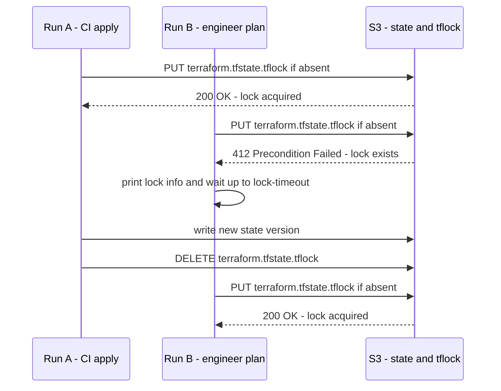
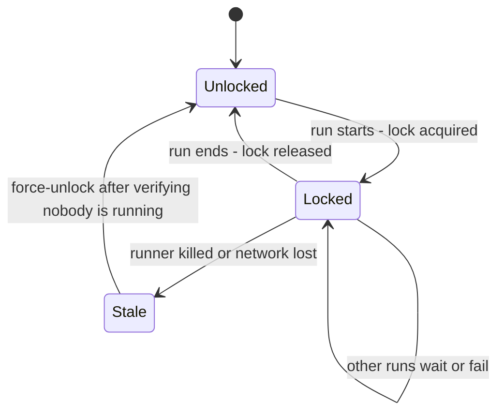

# L7.8 — State Locking

> **Level 7: Terraform / Infrastructure as Code** · Topic 8 of 9 · ⏱ ~4 hours · Difficulty: Advanced

## 1. What it is

**State locking** is the mechanism that stops two Terraform runs from modifying the same state at the same time. Before any
operation that could write state (`plan`, `apply`, `destroy`, `import`, `state mv`...), Terraform asks the backend for an
exclusive **lock**. If someone else holds it, Terraform waits (up to `-lock-timeout`) or fails with an error that names the holder.
When the run finishes, the lock is released.

Without locking, two concurrent applies each read the same old state, each make changes, and the second write overwrites the
first. The result is a state that no longer matches reality: orphaned resources, duplicate creates, or a state file that
corrupts. Locking is built into the backend you choose. With the `s3` backend there are two ways: the **native S3 lock file**
(`use_lockfile = true`, the current approach) and the older **DynamoDB table** (`dynamodb_table`).

## 2. Why it matters in DevOps

- **CI plus humans plus schedulers** all touch the same stack: the PR pipeline, the merge pipeline, the nightly drift check
  ([L7.9](09-drift-detection.md)) and an engineer debugging. Collisions are normal, not rare.
- **A stuck lock blocks every deploy** for that stack. Knowing when `force-unlock` is safe (and when it is data-corrupting) is
  an on-call skill.
- **Cost of a mistake is high.** `-lock=false` and careless `force-unlock` are among the few Terraform commands that can destroy
  the guarantees you rely on.
- **Platform choice.** Moving off DynamoDB removes a table, its IAM permissions and its capacity settings from every environment.

## 3. Real-world system example

**The S3 backend itself.** The documented `s3` backend originally required a DynamoDB table with a string partition key named
`LockID` for locking: Terraform wrote an item per state path with the holder's details. Following Amazon S3's introduction of
**conditional writes** (an `If-None-Match` header so an object is only created if it does not already exist), the backend gained
`use_lockfile`, which creates a `<state key>.tflock` object next to the state; this arrived as an experimental feature in
Terraform 1.10 and is stable in 1.11. The backend documentation now marks `dynamodb_table` as deprecated and expected to be
removed in a future minor version. OpenTofu implemented the same lock-file option. **HCP Terraform** (formerly Terraform Cloud)
sidesteps the problem by queueing runs per workspace, so only one run is active at a time.

## 4. Diagram

Two runs racing for the same state with native S3 locking:



Lock life cycle, including the failure path:



## 5. How it works

### Native S3 locking (current)

```hcl
terraform {
  backend "s3" {
    bucket       = "shop-api-tfstate-123456789012"
    key          = "prod/app/terraform.tfstate"
    region       = "us-east-1"
    encrypt      = true
    use_lockfile = true        # creates prod/app/terraform.tfstate.tflock
  }
}
```

- Needs Terraform 1.10+ (stable in 1.11+) or a recent OpenTofu, and an S3 endpoint that supports conditional writes (AWS S3 does;
  check S3-compatible stores before relying on it).
- The identity needs `s3:GetObject`, `s3:PutObject` and `s3:DeleteObject` on `<key>.tflock` in addition to the state object, and
  `s3:ListBucket` on the bucket.
- Enable bucket versioning as before; the lock object is small and short-lived.

### DynamoDB locking (older approach)

```hcl
backend "s3" {
  bucket         = "shop-api-tfstate-123456789012"
  key            = "prod/app/terraform.tfstate"
  region         = "us-east-1"
  dynamodb_table = "terraform-locks"     # deprecated in current Terraform
  encrypt        = true
}

resource "aws_dynamodb_table" "locks" {
  name         = "terraform-locks"
  billing_mode = "PAY_PER_REQUEST"
  hash_key     = "LockID"
  attribute {
    name = "LockID"
    type = "S"
  }
}
```

The identity needs `dynamodb:GetItem`, `PutItem` and `DeleteItem` on the table. You will still meet this in older repositories.

| | Native S3 (`use_lockfile`) | DynamoDB (`dynamodb_table`) |
|---|---------------------------|-----------------------------|
| Extra infrastructure | none | a table per account/region |
| Extra IAM | object permissions on `.tflock` | table permissions |
| Status | recommended | deprecated, still works |
| Min versions | Terraform 1.10 (experimental), 1.11 stable | all versions |
| Cost | negligible (a few S3 requests) | negligible, but one more resource to manage |

### Migrating from DynamoDB to native locking

1. Upgrade to Terraform 1.11+ everywhere that uses the stack (laptops, CI images, pre-commit hooks).
2. Set **both** `use_lockfile = true` and `dynamodb_table = "terraform-locks"` and run `terraform init -reconfigure`. Terraform acquires
   both locks, so old and new clients still exclude each other during the transition.
3. When every client is updated, remove `dynamodb_table`, run `terraform init -reconfigure` again, and finally destroy the table.

### Lock-related flags

| Flag | Meaning |
|------|---------|
| `-lock-timeout=5m` | Wait up to 5 minutes for a held lock instead of failing immediately. Use in CI. |
| `-lock=false` | Do not lock at all. Only for read-only experiments you fully understand; never for `apply`. |
| `terraform force-unlock <LOCK_ID>` | Remove a lock you are certain is stale. Does not touch state. |

### Reading a lock error

```text
Error: Error acquiring the state lock

Error message: operation error S3: PutObject, https response error StatusCode: 412 ...
Lock Info:
  ID:        6f0f2a64-0c3e-3c1a-8a2b-5f2d4f7c9b10
  Path:      shop-api-tfstate-123456789012/prod/app/terraform.tfstate
  Operation: OperationTypeApply
  Who:       runner@fv-az123-456
  Version:   1.11.4
  Created:   2026-03-02 09:14:07.123456789 +0000 UTC
  Info:
```

*(Illustrative; the exact wording depends on the backend and Terraform version.)* The useful fields are **Who** and **Created**: they
tell you whether the holder is a live CI job, a colleague's laptop or a process that died an hour ago.

### Stuck locks: a decision procedure

1. Read **Who** and **Operation** in the error. Is that run still going? Check the CI job list and ask the person.
2. If the job is running, **wait**. Do not unlock a live apply: two writers will corrupt state.
3. If the job was cancelled or the runner died, check for partial changes. The next `plan` shows what remains.
4. Unlock with the ID from the error: `terraform force-unlock 6f0f2a64-0c3e-3c1a-8a2b-5f2d4f7c9b10`. (With native S3 locks you could also delete the `.tflock` object; prefer `force-unlock`.)
5. Run `terraform plan` and reconcile. If a state write was interrupted, restore the previous state version from S3 versioning ([L7.4](04-state-and-remote-backends.md)).

### Concurrency in CI

Locking is the last line of defence; avoid contention earlier:

- GitHub Actions `concurrency: { group: tf-prod-app, cancel-in-progress: false }` queues runs per stack and never kills an
  in-flight apply.
- Prefer **small states** (network / data / app per environment) so unrelated changes never contend.
- Scheduled jobs (drift checks, [L7.9](09-drift-detection.md)) must still lock: use `-lock-timeout` and retry later if the lock is held. Never bypass it with `-lock=false`.
- Cancelling a CI job sends a signal; Terraform tries to release the lock on interrupt, but a hard kill leaves it behind, which is why
  `cancel-in-progress: false` matters for applies.

## 6. Step-by-step guide

**Prerequisites:** Terraform 1.11+ (or OpenTofu). Part A uses only the local backend and costs nothing. Part B uses the S3 bucket
from [L7.4](04-state-and-remote-backends.md) and costs a fraction of a cent.

### Part A: see locking locally

1. **Create a slow stack.**
   ```bash
   mkdir -p lock-demo && cd lock-demo
   ```
   `main.tf`:
   ```hcl
   terraform {
     required_version = ">= 1.11"
   }

   resource "terraform_data" "slow" {
     provisioner "local-exec" {
       command = "sleep 40"
     }
   }
   ```
   ```bash
   terraform init
   ```

2. **Start an apply in one terminal.**
   ```bash
   terraform apply -auto-approve
   ```

3. **In a second terminal, try to plan the same directory.**
   ```bash
   cd lock-demo && terraform plan
   ```
   You should see `Error: Error acquiring the state lock` with a `Lock Info` block (ID, Operation, Who). That is Terraform refusing
   to race the first run.

4. **Wait instead of failing.**
   ```bash
   terraform plan -lock-timeout=60s
   ```
   Run it during the first apply. It prints `Acquiring state lock. This may take a few moments...` and succeeds when the first run
   finishes.

### Part B: native S3 locking and a stuck lock

5. **Configure the backend.** In a new directory:
   ```hcl
   terraform {
     required_version = ">= 1.11"
     required_providers {
       aws = { source = "hashicorp/aws", version = "~> 5.0" }
     }
     backend "s3" {
       bucket       = "shop-api-tfstate-123456789012"   # your bucket from L7.4
       key          = "dev/lock-demo/terraform.tfstate"
       region       = "us-east-1"
       encrypt      = true
       use_lockfile = true
     }
   }
   provider "aws" { region = "us-east-1" }

   resource "aws_ssm_parameter" "demo" {
     name  = "/shop-api/dev/lock-demo"
     type  = "String"
     value = "v1"
   }

   resource "terraform_data" "slow" {
     triggers_replace = timestamp()      # forces a 40 second run every time
     provisioner "local-exec" {
       command = "sleep 40"
     }
   }
   ```
   ```bash
   export BUCKET=shop-api-tfstate-123456789012
   terraform init && terraform apply -auto-approve
   ```

6. **Watch the lock object appear.** Run `terraform apply -auto-approve` again. While it sleeps, in another terminal:
   ```bash
   aws s3 ls "s3://$BUCKET/dev/lock-demo/"
   ```
   You see `terraform.tfstate` and, only during the run, `terraform.tfstate.tflock`.

7. **Create a stuck lock.** Start the apply and kill it hard:
   ```bash
   terraform apply -auto-approve &
   sleep 8 && kill -9 %1
   terraform plan
   ```
   The plan fails with `Error acquiring the state lock` and shows the dead run's lock ID.

8. **Recover safely.** Confirm no run is active (`ps`, CI), then:
   ```bash
   terraform force-unlock <LOCK_ID_FROM_THE_ERROR>      # answer yes
   terraform plan
   ```
   The plan works again. Verify the `.tflock` object is gone with `aws s3 ls`.

9. **Clean up.**
   ```bash
   terraform destroy -auto-approve
   rm -rf lock-demo
   ```

## 7. Real-world scenario

*(Illustrative.)* A Friday-evening deploy hung when the CI runner was pre-empted mid-apply. Monday morning every pipeline for the
`prod/app` stack failed with a lock error from the weekend; the on-call engineer saw `Who: runner@...`, `Created: Friday 18:42` and
no matching running job. They checked S3 versioning to confirm the last state write was complete, ran `terraform plan` to see
two resources left unchanged, then `terraform force-unlock <ID>`, re-ran the pipeline and everything converged. Later the same quarter a
colleague "fixed" a different lock error with `-lock=false` while a drift job was running; the two writes collided and the state lost a
security group, which took an hour of `terraform import` to repair. **Lesson:** verify the holder first; unlock only dead locks, and
never switch locking off to get unblocked.

## 8. Common mistakes and best practices

**Don't**

- Use `-lock=false` for `apply` or `destroy`, ever.
- Run `force-unlock` without proving the owner is gone.
- Share one state and one lock across unrelated teams and layers: one long apply blocks everyone.
- Delete the lock object, table or state "to reset things" without checking what the run was doing.
- Cancel an in-flight apply in CI with hard kills (`cancel-in-progress: true` on apply jobs).

**Do**

- Enable locking from the first day: `use_lockfile = true` on new S3 backends; plan a migration for old DynamoDB tables.
- Add `-lock-timeout=5m` (or similar) to CI plans and applies so transient contention resolves itself.
- Serialise runs per stack with CI `concurrency` groups, and keep states small.
- Give the pipeline role permissions on the `.tflock` object (or the DynamoDB table) and test it.
- Document the stuck-lock runbook and keep S3 versioning on so an interrupted write can be rolled back.
- Alert when a lock is older than your longest normal apply.

## 9. Tasks

- [ ] **T1 — Provoke and read a lock error** *(≈30 min, beginner)*
  - **Goal:** see locking protect a state.
  - **Steps:**
    1. Do Part A steps 1-3.
    2. Copy the `Lock Info` block into your notes and label each field.
  - **Done when:** the second `plan` fails with a lock error and you can say who holds the lock and since when.

- [ ] **T2 — Wait with `-lock-timeout`** *(≈20 min, beginner)*
  - **Goal:** make contention self-healing.
  - **Steps:**
    1. Do Part A step 4.
    2. Repeat with `-lock-timeout=5s` and observe the failure after 5 seconds.
  - **Done when:** the long timeout succeeds after waiting and the short one fails, both with output you can show.

- [ ] **T3 — Native S3 lock in action** *(≈45 min, intermediate; AWS sandbox)*
  - **Goal:** observe the `.tflock` object.
  - **Steps:**
    1. Do Part B steps 5-6.
    2. Check the lock object's contents with `aws s3 cp s3://$BUCKET/dev/lock-demo/terraform.tfstate.tflock -` during the run.
  - **Done when:** you captured the lock object's JSON (ID, Who, Operation) while a run was active and showed it vanishes afterwards.

- [ ] **T4 — Break it: stuck lock and recovery** *(≈45 min, advanced)*
  - **Goal:** practise the decision procedure.
  - **Steps:**
    1. Do Part B steps 7-8.
    2. Write the checklist you followed before running `force-unlock`.
  - **Done when:** the stuck lock is cleared, `terraform plan` succeeds and your checklist has at least three verification steps.

- [ ] **T5 — Migrate from DynamoDB to native locking** *(≈60 min, advanced)*
  - **Goal:** perform the transition safely.
  - **Steps:**
    1. Create a stack that uses `dynamodb_table` locking (create the table with `PAY_PER_REQUEST`).
    2. Add `use_lockfile = true`, run `terraform init -reconfigure`, and confirm both a DynamoDB item and a `.tflock` object appear during a run.
    3. Remove `dynamodb_table`, `init -reconfigure`, and destroy the table.
  - **Done when:** a run now locks only through the `.tflock` object and the table no longer exists.

- [ ] **T6 — Prove it: concurrency design** *(≈45 min, advanced)*
  - **Goal:** design locking and queueing for a team.
  - **Steps:**
    1. Without notes, describe what happens when a PR plan, a merge apply and a nightly drift check start within the same minute for one stack.
    2. List the three layers that handle it (CI concurrency group, backend lock, `-lock-timeout`) and what each does.
    3. Write the on-call runbook for "state lock held for hours".
  - **Done when:** a teammate can follow your runbook and knows exactly when `force-unlock` is forbidden.

## 10. Self-check questions

1. What exactly does a state lock protect against?
2. How does native S3 locking work, and why did it become possible?
3. When is `terraform force-unlock` safe, and what does it actually change?
4. Why is `-lock=false` dangerous?
5. How do you migrate from DynamoDB locking to native S3 locking without a window where both old and new clients can run together?

<details>
<summary>Answers</summary>

1. Two concurrent operations reading the same state and overwriting each other's writes, which corrupts the mapping between code and real infrastructure.
2. Terraform creates a `<key>.tflock` object using an S3 conditional write (create only if absent), so only one client succeeds; it deletes the object when finished. S3 added conditional writes, so a separate DynamoDB table is no longer needed.
3. Only when you have verified the holder is dead (job cancelled, runner gone, laptop closed). It removes the lock record only; it does not modify or repair state.
4. It skips the exclusion entirely, so concurrent applies can overwrite each other's state and leave orphaned or duplicated resources.
5. Enable `use_lockfile = true` while keeping `dynamodb_table` so both locks are taken, update all clients to a supporting version, then remove `dynamodb_table` and delete the table.
</details>

## 11. Further reading

- Terraform documentation: *Backend type: s3* (locking, `use_lockfile`, deprecation of `dynamodb_table`), *State Locking* and the `force-unlock` command.
- AWS documentation: *Amazon S3 conditional writes*.
- OpenTofu documentation: *S3 backend* for its lock-file option.
- GitHub documentation: *Control the concurrency of workflows and jobs*.
- See also: [State and Remote Backends](04-state-and-remote-backends.md), [S3](../level-06-cloud-aws/08-s3.md) and [Terraform CI/CD](07-terraform-ci-cd.md).

<!-- nav -->
---
← Previous: [Terraform CI/CD](07-terraform-ci-cd.md) · [Level 7 index](README.md) · Next: [Drift Detection](09-drift-detection.md) →
