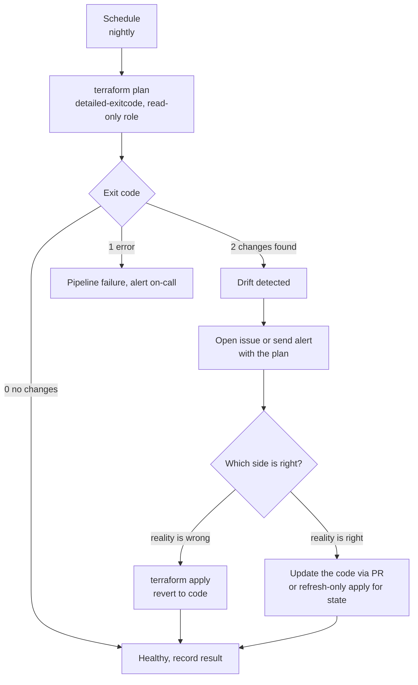
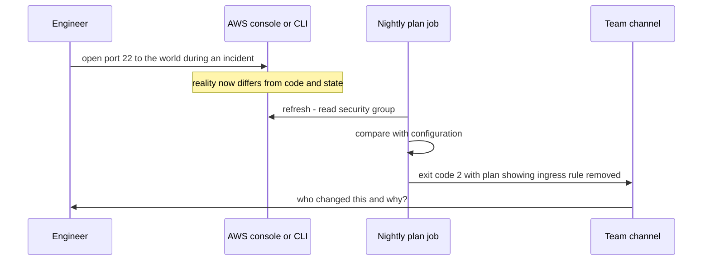

# L7.9 — Drift Detection

> **Level 7: Terraform / Infrastructure as Code** · Topic 9 of 9 · ⏱ ~4 hours · Difficulty: Advanced

## 1. What it is

**Drift** is any difference between what your Terraform code and state say exists and what actually exists in the cloud. It appears
when someone changes a resource outside Terraform: an engineer opens a port in the console during an incident, an autoscaler or
another tool edits a tag, a vendor agent modifies a setting, or a resource is deleted by hand. The code still says one thing; reality
says another.

**Drift detection** is the habit of finding those differences on purpose and early, instead of discovering them in the middle of the
next `apply`. Terraform already contains the mechanism: on every `plan` it *refreshes* (reads the real objects from the provider) and
compares them with your configuration. A scheduled, read-only plan whose result you act on is drift detection. **Reconciling**
drift means deciding, per difference, whether reality or the code is right, then making them match.

## 2. Why it matters in DevOps

- **Security.** The classic drift is "temporarily" opening SSH to `0.0.0.0/0` and forgetting. Code review never saw it, so only a
  scan of reality finds it.
- **Surprise applies.** The next unrelated PR plan suddenly proposes to revert a hotfix (maybe re-breaking production) or to
  destroy something a colleague created by hand.
- **Loss of trust in the repo.** If the code is not what runs, runbooks, audits and disaster recovery built on the code are wrong
  ([Disaster Recovery](../level-00-what-devops-is/09-disaster-recovery.md)).
- **Compliance.** Auditors want evidence that production matches approved configuration.

## 3. Real-world system example

**HCP Terraform health assessments, AWS CloudTrail and AWS Config.** HCP Terraform (formerly Terraform Cloud) offers *health
assessments* that run drift detection (a refresh-only style check) on a schedule for workspaces and report resources that no
longer match the configuration. Teams that run open-source Terraform build the same thing with a scheduled CI job around
`terraform plan -detailed-exitcode`, which Terraform documents for exactly this kind of automation. To find out *who* made a manual
change, AWS teams look in **CloudTrail** event history ([CloudTrail](../level-06-cloud-aws/17-cloudtrail.md)); **AWS Config** records
configuration changes per resource and can run rules (for example "security groups must not allow 0.0.0.0/0 on port 22") that
alert regardless of how the change was made. Kubernetes GitOps tools such as Argo CD apply the same idea continuously to cluster
objects ([Continuous Reconciliation](../level-17-gitops/03-continuous-reconciliation.md)).

## 4. Diagram

A scheduled drift check:



How drift is created and found:



## 5. How it works

### What Terraform compares

| Source | Meaning |
|--------|---------|
| **Configuration** | what you want |
| **State** | what Terraform last recorded |
| **Real infrastructure** | what the provider API returns during refresh |

`plan` refreshes state from reality first, then diffs configuration against the refreshed state. Changes made outside Terraform appear
in two forms in recent Terraform versions: a section titled **"Objects have changed outside of Terraform"** (the refresh found
differences) and then the normal list of actions needed to bring reality back to the configuration.

### Commands

```bash
# Is there any difference? Exit code: 0 = none, 1 = error, 2 = changes present
terraform plan -detailed-exitcode -lock-timeout=5m -input=false
echo $?

# Show only what changed in the real world, and do not propose config changes
terraform plan -refresh-only

# Accept reality into the state file (never changes infrastructure)
terraform apply -refresh-only
```

`-refresh-only` is the explicit, safe form of "refresh": it updates **state** to match reality and touches no infrastructure.
Use it when reality is right and you also will update the code to match, or for attributes the provider reports differently after a
provider upgrade. The old standalone `terraform refresh` command is deprecated in favour of it.

### Reconciling: decide which side wins

| Situation | Action |
|-----------|--------|
| Manual change was wrong or unauthorised | `terraform apply`: Terraform reverts reality to the code. Review the plan first. |
| Manual change was right (a hotfix that should stay) | Edit the code in a PR to include it, then `plan` until it says no changes. Optionally `apply -refresh-only` to record the observed values. |
| Resource was deleted by hand | `apply` recreates it (check data loss for stateful resources), or remove it from code with a PR. |
| Resource was created by hand and should be managed | Add it to code with an `import` block ([L7.4](04-state-and-remote-backends.md)). |
| Another system legitimately owns an attribute (autoscaler capacity, tags added by a cost tool) | `lifecycle { ignore_changes = [...] }` ([L7.5](05-data-sources-and-dependencies.md)) so it stops appearing as drift. |
| Provider returns a different but equivalent value after an upgrade | Pin the provider, read its changelog, and use `apply -refresh-only` to settle state. |

### Preventing drift

Detection is the safety net; prevention is cheaper:

- Remove write access to production from humans: changes go through the pipeline ([L7.7](07-terraform-ci-cd.md)). Keep a logged,
  time-boxed break-glass role.
- Use **AWS Config** or service control policies to block or alert on classes of manual change.
- Tag Terraform-managed resources (`ManagedBy = "terraform"`) so people know not to touch them.
- Use `default_tags` in the AWS provider so tags are consistent and the tags agent-tools add stand out.
- Prefer immutable replacement over in-place edits ([Immutable Infrastructure](../level-00-what-devops-is/05-immutable-infrastructure.md)).

### A scheduled drift job (GitHub Actions)

```yaml
# .github/workflows/drift.yml
name: drift-check
on:
  schedule:
    - cron: "17 5 * * *"      # daily, off the hour to avoid peak load
  workflow_dispatch: {}

permissions:
  id-token: write
  contents: read
  issues: write

jobs:
  drift:
    runs-on: ubuntu-latest
    defaults:
      run:
        working-directory: infra/envs/prod
    steps:
      - uses: actions/checkout@v4
      - uses: hashicorp/setup-terraform@v3
        with:
          terraform_version: "1.11.4"
          terraform_wrapper: false          # so the real exit code is visible
      - uses: aws-actions/configure-aws-credentials@v4
        with:
          role-to-assume: arn:aws:iam::123456789012:role/terraform-plan-prod   # read-only role
          aws-region: us-east-1
      - run: terraform init -input=false
      - id: plan
        run: |
          set +e
          terraform plan -detailed-exitcode -lock-timeout=5m -input=false -no-color > plan.txt
          echo "exitcode=$?" >> "$GITHUB_OUTPUT"
      - if: steps.plan.outputs.exitcode == '1'
        run: echo "Plan failed" && exit 1
      - if: steps.plan.outputs.exitcode == '2'
        uses: actions/github-script@v7
        with:
          script: |
            const fs = require('fs');
            const plan = fs.readFileSync('infra/envs/prod/plan.txt', 'utf8').slice(0, 60000);
            const fence = '`'.repeat(3);
            await github.rest.issues.create({
              owner: context.repo.owner, repo: context.repo.repo,
              title: 'Drift detected in prod',
              labels: ['drift'],
              body: 'Nightly plan found differences.\n\n' + fence + '\n' + plan + '\n' + fence
            });
```

Use a **read-only** role: detection never needs to write. Avoid opening a new issue every night: check for an existing open `drift`
issue first, or update it. Because the plan text may contain sensitive values, post it only to private repositories or post a summary.

## 6. Step-by-step guide

**Prerequisites:** Terraform 1.11+ (or OpenTofu), AWS CLI with sandbox credentials and the state bucket from
[L7.4](04-state-and-remote-backends.md). The resources (an SSM parameter and a security group) are free.

1. **Create a small managed stack.** `main.tf`:
   ```hcl
   terraform {
     required_version = ">= 1.11"
     required_providers {
       aws = { source = "hashicorp/aws", version = "~> 5.0" }
     }
     backend "s3" {
       bucket       = "shop-api-tfstate-123456789012"
       key          = "dev/drift-demo/terraform.tfstate"
       region       = "us-east-1"
       encrypt      = true
       use_lockfile = true
     }
   }

   provider "aws" {
     region = "us-east-1"
     default_tags {
       tags = { ManagedBy = "terraform", Project = "shop-api" }
     }
   }

   data "aws_vpc" "default" { default = true }

   resource "aws_security_group" "web" {
     name        = "shop-api-drift-demo"
     description = "Drift demo"
     vpc_id      = data.aws_vpc.default.id
   }

   resource "aws_vpc_security_group_ingress_rule" "https" {
     security_group_id = aws_security_group.web.id
     cidr_ipv4         = "10.0.0.0/16"
     ip_protocol       = "tcp"
     from_port         = 443
     to_port           = 443
   }

   resource "aws_ssm_parameter" "feature" {
     name  = "/shop-api/dev/feature-flag"
     type  = "String"
     value = "off"
   }

   output "sg_id" {
     value = aws_security_group.web.id
   }
   ```
   ```bash
   terraform init && terraform apply -auto-approve
   terraform plan -detailed-exitcode; echo "exit=$?"
   ```
   Expect `No changes.` and `exit=0`.

2. **Introduce drift by hand** (pretend to be the 2 a.m. engineer):
   ```bash
   SG=$(terraform output -raw sg_id)
   aws ec2 authorize-security-group-ingress --group-id "$SG" --protocol tcp --port 22 --cidr 0.0.0.0/0
   aws ssm put-parameter --name /shop-api/dev/feature-flag --type String --value on --overwrite
   aws ec2 create-tags --resources "$SG" --tags Key=Owner,Value=somebody-else
   ```

3. **Detect it.**
   ```bash
   terraform plan -detailed-exitcode; echo "exit=$?"
   ```
   The exit code is `2`. The output is similar to:
   ```text
   Note: Objects have changed outside of Terraform
   ...
     # aws_ssm_parameter.feature has changed
     ~ value = (sensitive value)
   ...
   Plan: 0 to add, 1 to change, 0 to destroy.
   ```
   Terraform reports the parameter (and, depending on provider version, the extra tag) that it will revert. Note the extra SSH rule is a separate
   `aws_vpc_security_group_ingress_rule` resource, so it is **not** managed and Terraform does not see it: that is the limit of plan-based
   detection. Section 8 covers how AWS Config closes the gap.

4. **See the refresh-only view.**
   ```bash
   terraform plan -refresh-only
   ```
   This lists only the real-world changes and proposes updating state, not infrastructure.

5. **Reconcile in the "reality is wrong" direction.**
   ```bash
   terraform apply -auto-approve
   aws ssm get-parameter --name /shop-api/dev/feature-flag --query Parameter.Value --output text   # off again
   ```
   Then remove the rogue SSH rule by hand (`aws ec2 revoke-security-group-ingress ...`) or by managing the whole group inline with
   `ingress` blocks, which makes unknown rules visible as drift.

6. **Reconcile in the "reality is right" direction.** Set the flag by hand again, decide the change should stay, change the code to
   `value = "on"` in a PR-like edit and run `terraform plan`. It says `No changes`. If you only wanted to record the observed value
   without editing code first, `terraform apply -refresh-only` updates state.

7. **Ignore an attribute owned by someone else.** Add `lifecycle { ignore_changes = [value] }` to the parameter, change the value by hand,
   and show `terraform plan` stays at `No changes`. Document why in a comment.

8. **Schedule it.** Add the drift workflow from section 5 to a repository (or run the plan command from cron in your sandbox).
   Trigger it manually with `workflow_dispatch` and confirm it opens an issue when exit code 2 occurs.

9. **Clean up.**
   ```bash
   terraform destroy -auto-approve
   aws ec2 revoke-security-group-ingress --group-id "$SG" --protocol tcp --port 22 --cidr 0.0.0.0/0 2>/dev/null || true
   ```

## 7. Real-world scenario

*(Illustrative.)* During an incident an engineer added an ingress rule to a production security group from their home IP, resolved
the issue and forgot. Two weeks later a routine PR changing an ALB timeout produced a plan that also removed an unrelated rule
because the group's rules were managed inline, which confused the reviewer. Investigation through CloudTrail showed the manual
`AuthorizeSecurityGroupIngress` call. The team introduced a nightly read-only plan job that opens an issue on exit code 2, added an
AWS Config rule for world-open management ports, removed standing console write access to prod, and agreed a rule: any manual
change during an incident gets a follow-up PR within 24 hours or is reverted by the next apply. **Lesson:** drift is inevitable
under pressure; the goal is to make it visible within a day and cheap to reconcile.

## 8. Common mistakes and best practices

**Don't**

- Run `terraform apply` on a drift plan without reading it: you may revert a deliberate hotfix, or recreate a deleted database empty.
- Assume `plan` sees everything. It only covers resources and attributes that Terraform manages; unmanaged resources and unmodelled
  settings are invisible to it.
- Hide noisy drift with blanket `ignore_changes = all`; ignore specific attributes with a reason.
- Give the drift job write credentials.
- Let drift issues pile up unread; a check nobody acts on is worse than none because it creates false confidence.

**Do**

- Run a scheduled, read-only `plan -detailed-exitcode` for every important stack and alert on exit code 2 (and 1).
- Decide explicitly per difference: revert, adopt in code, or ignore, and record why in the PR.
- Use `terraform apply -refresh-only` to adopt observed values into state, never hand-edit state.
- Complement Terraform with AWS Config rules and CloudTrail to catch unmanaged resources and answer "who changed it?".
- Tag managed resources with `default_tags`, and reduce the human write paths that create drift in the first place.
- Re-run the check after every reconciliation until the exit code is 0.

## 9. Tasks

- [ ] **T1 — Create and detect drift** *(≈45 min, beginner; AWS sandbox)*
  - **Goal:** produce a detectable difference and read the output.
  - **Steps:**
    1. Follow steps 1-3.
    2. Save the plan output and underline the "Objects have changed outside of Terraform" section.
  - **Done when:** `terraform plan -detailed-exitcode` returns `2` and you can name the changed attribute and its old and new values.

- [ ] **T2 — Refresh-only versus apply** *(≈30 min, intermediate)*
  - **Goal:** understand the two reconciliation directions.
  - **Steps:**
    1. Do step 4, then step 5 for one resource and step 6 for another.
    2. Explain in a sentence what `apply -refresh-only` changed and what it did not.
  - **Done when:** one resource is reverted to the code, one is adopted, and `plan` returns exit code 0.

- [ ] **T3 — Ignore attributes properly** *(≈30 min, intermediate)*
  - **Goal:** model an attribute owned by another system.
  - **Steps:**
    1. Do step 7.
    2. Then remove `ignore_changes` and show the drift reappears.
  - **Done when:** the plan is clean with `ignore_changes` and shows a diff without it.

- [ ] **T4 — Automate nightly detection** *(≈60 min, advanced)*
  - **Goal:** a scheduled job that alerts a human.
  - **Steps:**
    1. Add the drift workflow, with a read-only plan role (see [L7.7](07-terraform-ci-cd.md)).
    2. Create drift and trigger it with `workflow_dispatch`.
    3. Make it update an existing open issue rather than creating a duplicate.
  - **Done when:** a labelled issue with the plan appears once, and after reconciliation the next run closes it or leaves it untouched.

- [ ] **T5 — Break it: find the unmanaged change** *(≈45 min, advanced)*
  - **Goal:** discover what plan cannot see, and who did it.
  - **Steps:**
    1. Add the world-open SSH rule by hand (step 2) and confirm `plan` ignores it.
    2. Find the call in CloudTrail event history (`aws cloudtrail lookup-events --lookup-attributes AttributeKey=EventName,AttributeValue=AuthorizeSecurityGroupIngress`).
    3. Change the security group to declare its rules inline so the extra rule becomes visible, or add an AWS Config rule that flags it.
  - **Done when:** you can show the CloudTrail event with the caller identity and a mechanism that now flags the rule.

- [ ] **T6 — Prove it: write the drift policy** *(≈45 min, advanced)*
  - **Goal:** explain drift handling to a team.
  - **Steps:**
    1. Without notes, write a one-page policy: how often drift is checked, who gets alerted, how each kind of difference is resolved, and how break-glass changes are recorded.
    2. Walk a teammate through reconciling one real drift from this topic.
  - **Done when:** the teammate can answer "the nightly job found drift: what do I do first?" using only your page.

## 10. Self-check questions

1. What is drift and what are three common causes?
2. What do the exit codes 0, 1 and 2 of `terraform plan -detailed-exitcode` mean?
3. How does `terraform apply -refresh-only` differ from `terraform apply`?
4. Name two kinds of change that a Terraform plan cannot detect.
5. How do you decide whether to revert drift or adopt it?

<details>
<summary>Answers</summary>

1. A difference between declared configuration/state and the real infrastructure. Causes: console or CLI hotfixes, other tools or autoscalers editing resources, manual deletions, provider or API default changes.
2. 0: succeeded, no changes. 1: error. 2: succeeded, changes present.
3. `-refresh-only` updates only the state to match reality and changes no infrastructure. A normal apply changes infrastructure to match the configuration.
4. Resources not managed by Terraform at all (created by hand) and attributes the provider or configuration does not model, such as separately managed rules or settings in another tool.
5. Ask whether the manual change was authorised and intended. If yes, update the code through a PR; if no, apply to revert it. Either way, record the decision and re-check for a clean plan.
</details>

## 11. Further reading

- Terraform documentation: *`terraform plan`* (`-detailed-exitcode`, `-refresh-only`) and *Manage resource drift* tutorial.
- HCP Terraform documentation: *Health assessments* (drift detection).
- AWS documentation: *AWS Config* (managed rules, configuration history) and *CloudTrail event history*.
- *Terraform: Up & Running* by Yevgeniy Brikman — chapters on teamwork and automation.
- See also: [Infrastructure as Code](../level-00-what-devops-is/03-infrastructure-as-code.md), [Terraform CI/CD](07-terraform-ci-cd.md) and [State Locking](08-state-locking.md).

<!-- nav -->
---
← Previous: [State Locking](08-state-locking.md) · [Level 7 index](README.md) · Next: [Level capstone project](99-capstone-project.md) →
