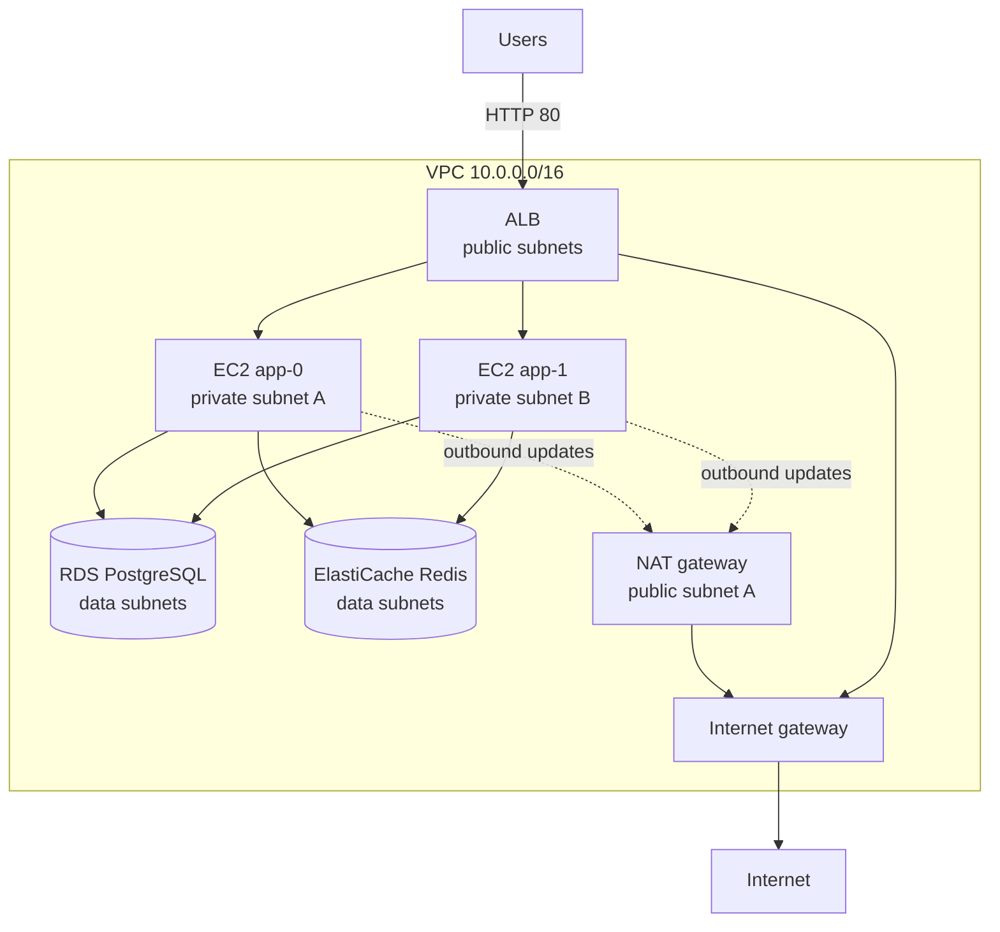
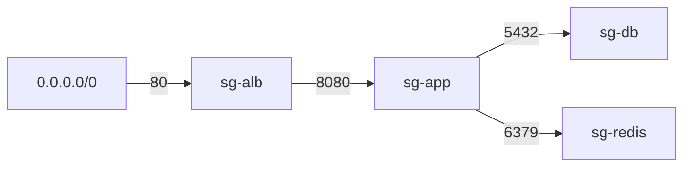

# L7 Capstone — shop-api on AWS with Terraform

> **Level 7: Terraform / Infrastructure as Code** · Capstone · ⏱ ~14 hours

## 1. Goal and outcome

Build a complete, reviewable, repeatable AWS environment for the `shop-api` sample app using only Terraform: a **VPC** with public,
private and data **subnets**, layered **security groups**, **EC2** application servers behind an **Application Load Balancer (ALB)**, a
**PostgreSQL RDS** database and a **Redis (ElastiCache)** cache. You then promote it to a second environment, put it behind a
pull-request pipeline, and practise the operational skills of the level: locking, drift detection and safe change.

When you finish you will have:

- one codebase (`modules/` plus thin `envs/dev` and `envs/prod` roots) that stands up the whole stack with `terraform apply` and removes it with `terraform destroy`;
- remote, locked, versioned state per environment;
- a CI workflow that plans on pull requests and applies on merge using OIDC (no stored AWS keys);
- a drift check that catches a manual change.

## 2. Architecture



Traffic is allowed only along the arrows, enforced by security groups that reference each other rather than CIDR ranges:



Repository layout (state per environment, modules written once):

```text
shop-api-infra/
  bootstrap/            # state bucket (one-off, CLI or its own tiny stack)
  modules/
    network/            # VPC, subnets, IGW, NAT, route tables
    data/               # RDS PostgreSQL + ElastiCache Redis
    app/                # IAM profile, ALB, target group, EC2 instances
  envs/
    dev/                # backend key dev/terraform.tfstate, small sizes
    prod/               # backend key prod/terraform.tfstate, bigger, protected
  .github/workflows/    # terraform.yml, drift.yml
```

## 3. Prerequisites and cost

- Terraform 1.11 or newer (OpenTofu 1.10+ also works for everything here), AWS CLI v2, `git`, a GitHub repository for the CI milestone.
- An **AWS sandbox account** (never production), a **billing alarm**, and credentials with permissions to create the resources above.
- Region `us-east-1`. Everything is tagged `Project = shop-api`.
- **This costs real money while it runs.** The NAT gateway, ALB, RDS instance, ElastiCache node and EC2 instances are all billed per hour; the
  whole dev stack is typically a few US dollars per day (check current regional pricing). Build, test and **destroy the same day**, and
  confirm teardown in section 7. Do not leave `prod` running.
- Free-tier eligibility varies by account age and region; do not assume the stack is free.

## 4. Build it step by step

### Milestone 0: remote, locked state (topics 4 and 8)

Create the state bucket once, as in [L7.4](04-state-and-remote-backends.md) (versioning, encryption, Block Public Access), then every root
uses it with native locking:

```hcl
# envs/dev/versions.tf
terraform {
  required_version = ">= 1.11"
  required_providers {
    aws = { source = "hashicorp/aws", version = "~> 5.0" }
  }
  backend "s3" {
    bucket       = "shop-api-tfstate-123456789012"   # replace with your bucket
    key          = "dev/terraform.tfstate"
    region       = "us-east-1"
    encrypt      = true
    use_lockfile = true          # native S3 locking; older setups used dynamodb_table
  }
}

provider "aws" {
  region = "us-east-1"
  default_tags {
    tags = { Project = "shop-api", Environment = "dev", ManagedBy = "terraform" }
  }
}
```

### Milestone 1: network module (topics 1, 2, 3, 5)

```hcl
# modules/network/variables.tf
variable "name"     { type = string }
variable "vpc_cidr" {
  type    = string
  default = "10.0.0.0/16"
}
variable "az_count" {
  type    = number
  default = 2
}

# modules/network/main.tf
data "aws_availability_zones" "available" { state = "available" }

locals {
  azs = slice(data.aws_availability_zones.available.names, 0, var.az_count)
  idx = { for i, az in local.azs : az => i }
}

resource "aws_vpc" "this" {
  cidr_block           = var.vpc_cidr
  enable_dns_support   = true
  enable_dns_hostnames = true
  tags                 = { Name = "${var.name}-vpc" }
}

resource "aws_internet_gateway" "this" {
  vpc_id = aws_vpc.this.id
}

resource "aws_subnet" "public" {
  for_each          = local.idx
  vpc_id            = aws_vpc.this.id
  availability_zone = each.key
  cidr_block        = cidrsubnet(var.vpc_cidr, 8, each.value)         # 10.0.0.0/24, 10.0.1.0/24
  tags              = { Name = "${var.name}-public-${each.key}" }
}

resource "aws_subnet" "private" {
  for_each          = local.idx
  vpc_id            = aws_vpc.this.id
  availability_zone = each.key
  cidr_block        = cidrsubnet(var.vpc_cidr, 8, each.value + 10)    # 10.0.10.0/24, ...
  tags              = { Name = "${var.name}-private-${each.key}" }
}

resource "aws_subnet" "data" {
  for_each          = local.idx
  vpc_id            = aws_vpc.this.id
  availability_zone = each.key
  cidr_block        = cidrsubnet(var.vpc_cidr, 8, each.value + 20)    # 10.0.20.0/24, ...
  tags              = { Name = "${var.name}-data-${each.key}" }
}

resource "aws_eip" "nat" {
  domain = "vpc"
}

resource "aws_nat_gateway" "this" {                  # one NAT to save cost; use one per AZ for real HA
  allocation_id = aws_eip.nat.id
  subnet_id     = values(aws_subnet.public)[0].id
  depends_on    = [aws_internet_gateway.this]        # explicit: NAT needs the IGW to exist first
}

resource "aws_route_table" "public" {
  vpc_id = aws_vpc.this.id
  route {
    cidr_block = "0.0.0.0/0"
    gateway_id = aws_internet_gateway.this.id
  }
}

resource "aws_route_table" "private" {
  vpc_id = aws_vpc.this.id
  route {
    cidr_block     = "0.0.0.0/0"
    nat_gateway_id = aws_nat_gateway.this.id
  }
}

resource "aws_route_table" "data" {                  # no default route: the data tier has no internet path
  vpc_id = aws_vpc.this.id
}

resource "aws_route_table_association" "public" {
  for_each       = aws_subnet.public
  subnet_id      = each.value.id
  route_table_id = aws_route_table.public.id
}

resource "aws_route_table_association" "private" {
  for_each       = aws_subnet.private
  subnet_id      = each.value.id
  route_table_id = aws_route_table.private.id
}

resource "aws_route_table_association" "data" {
  for_each       = aws_subnet.data
  subnet_id      = each.value.id
  route_table_id = aws_route_table.data.id
}

# modules/network/outputs.tf
output "vpc_id"             { value = aws_vpc.this.id }
output "public_subnet_ids"  { value = [for s in aws_subnet.public : s.id] }
output "private_subnet_ids" { value = [for s in aws_subnet.private : s.id] }
output "data_subnet_ids"    { value = [for s in aws_subnet.data : s.id] }
```

Call it from `envs/dev/main.tf` and run `terraform init && terraform plan`:

```hcl
module "network" {
  source = "../../modules/network"
  name   = "shop-api-dev"
}
```

Expected plan (similar to): `Plan: 19 to add, 0 to change, 0 to destroy.` (the exact count varies with `az_count`).

### Milestone 2: security groups (topics 1, 5)

```hcl
# envs/dev/security.tf
resource "aws_security_group" "alb" {
  name_prefix = "shop-api-dev-alb-"
  description = "Public ALB"
  vpc_id      = module.network.vpc_id
  lifecycle { create_before_destroy = true }
}

resource "aws_security_group" "app" {
  name_prefix = "shop-api-dev-app-"
  description = "App servers"
  vpc_id      = module.network.vpc_id
  lifecycle { create_before_destroy = true }
}

resource "aws_security_group" "db" {
  name_prefix = "shop-api-dev-db-"
  description = "PostgreSQL"
  vpc_id      = module.network.vpc_id
  lifecycle { create_before_destroy = true }
}

resource "aws_security_group" "redis" {
  name_prefix = "shop-api-dev-redis-"
  description = "Redis"
  vpc_id      = module.network.vpc_id
  lifecycle { create_before_destroy = true }
}

resource "aws_vpc_security_group_ingress_rule" "alb_http" {
  security_group_id = aws_security_group.alb.id
  cidr_ipv4         = "0.0.0.0/0"
  ip_protocol       = "tcp"
  from_port         = 80
  to_port           = 80
}

locals {
  # source SG => destination SG and port
  tiers = {
    app_from_alb    = { to = aws_security_group.app.id,   from = aws_security_group.alb.id, port = 8080 }
    db_from_app     = { to = aws_security_group.db.id,    from = aws_security_group.app.id, port = 5432 }
    redis_from_app  = { to = aws_security_group.redis.id, from = aws_security_group.app.id, port = 6379 }
  }
}

resource "aws_vpc_security_group_ingress_rule" "tier" {
  for_each                     = local.tiers
  security_group_id            = each.value.to
  referenced_security_group_id = each.value.from
  ip_protocol                  = "tcp"
  from_port                    = each.value.port
  to_port                      = each.value.port
}

resource "aws_vpc_security_group_egress_rule" "all" {
  for_each          = { alb = aws_security_group.alb.id, app = aws_security_group.app.id }
  security_group_id = each.value
  cidr_ipv4         = "0.0.0.0/0"
  ip_protocol       = "-1"
}
```

### Milestone 3: data tier, RDS and Redis (topics 1, 2, 3, 5)

```hcl
# modules/data/variables.tf
variable "name"                { type = string }
variable "subnet_ids"          { type = list(string) }
variable "db_sg_id"            { type = string }
variable "redis_sg_id"         { type = string }
variable "db_instance_class" {
  type    = string
  default = "db.t4g.micro"
}
variable "redis_node_type" {
  type    = string
  default = "cache.t4g.micro"
}
variable "multi_az" {
  type    = bool
  default = false
}
variable "deletion_protection" {
  type    = bool
  default = false
}

# modules/data/main.tf
resource "aws_db_subnet_group" "this" {
  name       = "${var.name}-db"
  subnet_ids = var.subnet_ids
}

resource "aws_db_instance" "this" {
  identifier                  = "${var.name}-pg"
  engine                      = "postgres"
  engine_version              = "16"
  instance_class              = var.db_instance_class
  allocated_storage           = 20
  storage_type                = "gp3"
  storage_encrypted           = true
  db_name                     = "shop"
  username                    = "shopadmin"
  manage_master_user_password = true          # AWS creates and rotates the secret in Secrets Manager: no password in code
  db_subnet_group_name        = aws_db_subnet_group.this.name
  vpc_security_group_ids      = [var.db_sg_id]
  publicly_accessible         = false
  multi_az                    = var.multi_az
  backup_retention_period     = 1
  deletion_protection         = var.deletion_protection
  skip_final_snapshot         = !var.deletion_protection
  final_snapshot_identifier   = var.deletion_protection ? "${var.name}-final" : null

  lifecycle {
    ignore_changes = [engine_version]         # AWS applies minor upgrades; avoid perpetual drift
  }
}

resource "aws_elasticache_subnet_group" "this" {
  name       = "${var.name}-redis"
  subnet_ids = var.subnet_ids
}

resource "aws_elasticache_replication_group" "this" {
  replication_group_id       = "${var.name}-redis"
  description                = "${var.name} cache"
  engine                     = "redis"
  engine_version             = "7.1"
  node_type                  = var.redis_node_type
  num_cache_clusters         = var.multi_az ? 2 : 1
  automatic_failover_enabled = var.multi_az
  multi_az_enabled           = var.multi_az
  subnet_group_name          = aws_elasticache_subnet_group.this.name
  security_group_ids         = [var.redis_sg_id]
  at_rest_encryption_enabled = true
  transit_encryption_enabled = true
  port                       = 6379
}

# modules/data/outputs.tf
output "db_endpoint" { value = aws_db_instance.this.address }
output "db_secret_arn" { value = aws_db_instance.this.master_user_secret[0].secret_arn }
output "redis_endpoint" { value = aws_elasticache_replication_group.this.primary_endpoint_address }
```

Wire it in `envs/dev/main.tf`:

```hcl
module "data" {
  source      = "../../modules/data"
  name        = "shop-api-dev"
  subnet_ids  = module.network.data_subnet_ids
  db_sg_id    = aws_security_group.db.id
  redis_sg_id = aws_security_group.redis.id
}
```

RDS and ElastiCache take roughly 5-15 minutes to create. (Redis is the default engine here; AWS also offers Valkey, a Redis-compatible
engine, in the same resource.)

### Milestone 4: compute and load balancer (topics 1, 3, 5)

```hcl
# modules/app/variables.tf  (abbreviated: name, vpc_id, public_subnet_ids, private_subnet_ids,
# alb_sg_id, app_sg_id, db_endpoint, redis_endpoint, instance_type, instance_count)

# modules/app/main.tf
data "aws_ssm_parameter" "ami" {
  name = "/aws/service/ami-amazon-linux-latest/al2023-ami-kernel-default-x86_64"
}

data "aws_iam_policy_document" "ec2_assume" {
  statement {
    actions = ["sts:AssumeRole"]
    principals {
      type        = "Service"
      identifiers = ["ec2.amazonaws.com"]
    }
  }
}

resource "aws_iam_role" "app" {
  name               = "${var.name}-app"
  assume_role_policy = data.aws_iam_policy_document.ec2_assume.json
}

resource "aws_iam_role_policy_attachment" "ssm" {        # Session Manager access instead of SSH
  role       = aws_iam_role.app.name
  policy_arn = "arn:aws:iam::aws:policy/AmazonSSMManagedInstanceCore"
}

resource "aws_iam_instance_profile" "app" {
  name = "${var.name}-app"
  role = aws_iam_role.app.name
}

locals {
  placements = { for i in range(var.instance_count) : tostring(i) => var.private_subnet_ids[i % length(var.private_subnet_ids)] }
  server_py  = <<-PY
    import json, socket
    from http.server import BaseHTTPRequestHandler, HTTPServer
    class H(BaseHTTPRequestHandler):
        def do_GET(self):
            body = json.dumps({"service": "shop-api", "host": socket.gethostname(),
                               "db": "${var.db_endpoint}", "cache": "${var.redis_endpoint}"}).encode()
            self.send_response(200)
            self.send_header("Content-Type", "application/json")
            self.end_headers()
            self.wfile.write(body)
    HTTPServer(("0.0.0.0", 8080), H).serve_forever()
  PY
}

resource "aws_instance" "app" {
  for_each               = local.placements
  ami                    = data.aws_ssm_parameter.ami.value
  instance_type          = var.instance_type
  subnet_id              = each.value
  vpc_security_group_ids = [var.app_sg_id]
  iam_instance_profile   = aws_iam_instance_profile.app.name

  metadata_options { http_tokens = "required" }        # IMDSv2 only
  root_block_device { encrypted = true }

  user_data_replace_on_change = true
  user_data = <<-EOT
    #!/bin/bash
    cat > /opt/server.py <<'PYEOF'
    ${indent(4, local.server_py)}
    PYEOF
    nohup python3 /opt/server.py >/var/log/shop-api.log 2>&1 &
  EOT

  tags = { Name = "${var.name}-app-${each.key}" }

  lifecycle {
    precondition {
      condition     = var.instance_count >= 1
      error_message = "instance_count must be at least 1."
    }
  }
}

resource "aws_lb" "this" {
  name               = "${var.name}-alb"
  load_balancer_type = "application"
  subnets            = var.public_subnet_ids
  security_groups    = [var.alb_sg_id]
}

resource "aws_lb_target_group" "app" {
  name     = "${var.name}-tg"
  port     = 8080
  protocol = "HTTP"
  vpc_id   = var.vpc_id
  health_check {
    path    = "/"
    matcher = "200"
  }
}

resource "aws_lb_target_group_attachment" "app" {
  for_each         = aws_instance.app
  target_group_arn = aws_lb_target_group.app.arn
  target_id        = each.value.id
}

resource "aws_lb_listener" "http" {
  load_balancer_arn = aws_lb.this.arn
  port              = 80
  protocol          = "HTTP"
  default_action {
    type             = "forward"
    target_group_arn = aws_lb_target_group.app.arn
  }
}

output "alb_dns_name" { value = aws_lb.this.dns_name }
```

The user data starts a tiny Python server as a stand-in for the Node.js `shop-api` image; it proves routing and shows the database and
cache endpoints the app would use. (ALB and target group names are limited to 32 characters. A production app would use HTTPS with an ACM
certificate and an auto scaling group, see [Auto Scaling](../level-06-cloud-aws/02-auto-scaling.md).)

Wire the module in `envs/dev/main.tf` and add outputs:

```hcl
module "app" {
  source             = "../../modules/app"
  name               = "shop-api-dev"
  vpc_id             = module.network.vpc_id
  public_subnet_ids  = module.network.public_subnet_ids
  private_subnet_ids = module.network.private_subnet_ids
  alb_sg_id          = aws_security_group.alb.id
  app_sg_id          = aws_security_group.app.id
  db_endpoint        = module.data.db_endpoint
  redis_endpoint     = module.data.redis_endpoint
  instance_type      = "t3.micro"
  instance_count     = 2
}

output "url" {
  value = "http://${module.app.alb_dns_name}"
}
```

```bash
cd envs/dev && terraform init && terraform apply
curl -s "$(terraform output -raw url)"       # repeat several times
```

Expected after a few minutes: JSON containing `"service": "shop-api"` and a `host` that changes between requests as the ALB spreads load
across the two instances.

### Milestone 5: a second environment (topic 6)

Copy `envs/dev` to `envs/prod`, change the backend key to `prod/terraform.tfstate`, the names to `shop-api-prod`, and the values:

| Setting | dev | prod |
|---------|-----|------|
| `vpc_cidr` | `10.0.0.0/16` | `10.1.0.0/16` |
| `instance_type` / `instance_count` | `t3.micro` / 2 | `t3.small` / 2 (spread over 2 AZs) |
| `multi_az` (RDS and Redis) | `false` | `true` |
| `deletion_protection` | `false` | `true` |

Run `terraform plan` in both directories. Do **not** apply `prod` unless you accept the extra cost and will destroy it right away
(`deletion_protection` must be set to `false` and applied before `destroy` works, see section 7).

### Milestone 6: pipeline with OIDC (topic 7)

Create the GitHub OIDC provider and plan/apply roles as in [L7.7](07-terraform-ci-cd.md), then add `.github/workflows/terraform.yml` with
`fmt`, `validate`, `tflint`, `checkov`, `plan` (PR comment) and `apply` (on `main`, `environment: dev`). Require reviews and status checks on
`main`.

### Milestone 7: operations drills (topics 8 and 9)

- **Locking:** start an apply, run a plan in a second terminal and read the lock error; then simulate a stuck lock and use `force-unlock` ([L7.8](08-state-locking.md)).
- **Drift:** change an instance tag and add an ingress rule by hand, then run `terraform plan -detailed-exitcode` and add `drift.yml` ([L7.9](09-drift-detection.md)).

## 5. Tasks

- [ ] **T1 — Remote state and a clean network** *(≈90 min, intermediate; Milestones 0-1; topics 4, 8, 1, 3)*
  - **Goal:** build the VPC layer with locked remote state.
  - **Steps:**
    1. Create the state bucket and the `envs/dev` root with the S3 backend and `use_lockfile = true`.
    2. Write and apply `modules/network`.
    3. Check `aws s3 ls s3://<bucket>/dev/` and `aws ec2 describe-subnets --filters Name=tag:Project,Values=shop-api --query 'Subnets[].CidrBlock'`.
  - **Done when:** six subnets (3 tiers x 2 AZs) exist, `terraform plan` shows `No changes`, and the state object is in S3.

- [ ] **T2 — Layered security groups** *(≈60 min, intermediate; Milestone 2; topics 1, 5)*
  - **Goal:** allow traffic only along ALB, app, database and cache paths.
  - **Steps:**
    1. Add `security.tf` and apply.
    2. List the rules with `aws ec2 describe-security-group-rules --filters Name=group-id,Values=<app-sg-id>`.
    3. Try to add a fifth rule with `for_each` (for example SSM or a metrics port) without copying a block.
  - **Done when:** the database and Redis groups have no CIDR-based rules, only references to the app group.

- [ ] **T3 — Data tier** *(≈90 min, advanced; Milestone 3; topics 2, 3, 5)*
  - **Goal:** private PostgreSQL and Redis with no secrets in code or state outputs.
  - **Steps:**
    1. Create `modules/data` and apply.
    2. Fetch the generated credentials with `aws secretsmanager get-secret-value --secret-id <db_secret_arn>`.
    3. Confirm `publicly_accessible` is false and that neither endpoint resolves to a public address from outside the VPC.
  - **Done when:** `terraform output db_endpoint redis_endpoint` shows private endpoints and no password appears in your `.tf` files.

- [ ] **T4 — Serve traffic through the ALB** *(≈90 min, intermediate; Milestone 4; topics 1, 3, 5)*
  - **Goal:** an end-to-end working request path.
  - **Steps:**
    1. Create `modules/app` and wire it in.
    2. `curl` the `url` output 10 times and note the changing `host`.
    3. Stop one instance (`aws ec2 stop-instances ...`) and watch the target group health with `aws elbv2 describe-target-health`.
  - **Done when:** the ALB keeps answering with 200 while one instance is stopped, and both hosts appear again after restart.

- [ ] **T5 — Promote to a second environment** *(≈60 min, intermediate; Milestone 5; topic 6)*
  - **Goal:** prove the code is reusable and states are isolated.
  - **Steps:**
    1. Create `envs/prod` with the differences from the table.
    2. Run `terraform plan` in `prod` and `diff -r envs/dev envs/prod`.
    3. Show that `terraform state list` in `dev` never contains prod addresses.
  - **Done when:** the plan for `prod` succeeds with different sizes and keys, and the `diff` shows only values.

- [ ] **T6 — Break it: concurrency and a stuck lock** *(≈45 min, advanced; Milestone 7; topic 8)*
  - **Goal:** recover safely from a lock.
  - **Steps:**
    1. Start `terraform apply` with a trivial change and run `terraform plan` in a second terminal.
    2. Kill the first run with `kill -9`, then clear the lock with `terraform force-unlock`.
    3. Run `terraform plan` to confirm state is consistent.
  - **Done when:** you captured the lock error, unlocked after verifying nobody was running, and the next plan is clean.

- [ ] **T7 — Detect and reconcile drift** *(≈60 min, advanced; Milestone 7; topic 9)*
  - **Goal:** find a manual change and resolve it deliberately.
  - **Steps:**
    1. Change the `Name` tag of one instance and the target group health-check path by hand in the console or CLI.
    2. Run `terraform plan -detailed-exitcode` and `terraform plan -refresh-only`.
    3. Revert one change with `apply` and adopt the other into code in a reviewed edit.
  - **Done when:** the exit code returns to `0` and you can explain for each change why you reverted or adopted it.

- [ ] **T8 — Prove it: PR to production, from memory** *(≈2 hours, advanced; Milestone 6; topics 5, 6, 7)*
  - **Goal:** operate the pipeline and explain it.
  - **Steps:**
    1. Without the guide, add a CloudWatch alarm (or a tag) via a pull request: confirm `fmt`, `validate`, `tflint`, `checkov` and `plan` pass and the plan comment appears.
    2. Merge, and watch `apply` assume the apply role through OIDC.
    3. Explain aloud: why no AWS keys are stored, how the plan role differs from the apply role, and where each of the nine topics appears in this project.
  - **Done when:** the change is live via the pipeline, and a teammate accepts your explanation of the OIDC flow and the state, lock and drift safeguards.

## 6. Verification checklist

- [ ] `terraform fmt -check -recursive` and `terraform validate` pass in every root.
- [ ] `terraform plan` shows `No changes` immediately after apply (`echo $?` is `0` with `-detailed-exitcode`).
- [ ] State for each environment lives in S3 at its own key, versioning is on, and `use_lockfile = true` is set.
- [ ] `curl http://<alb-dns>` returns JSON from at least two different hosts.
- [ ] From inside an instance (SSM Session Manager) `nc -zv <db_endpoint> 5432` succeeds and from your laptop it does not.
- [ ] No security group allows `0.0.0.0/0` except the ALB on port 80 (and egress).
- [ ] No password, key or token appears in `.tf` files, `terraform output`, or the repository (`git log -p | grep -i password` is empty).
- [ ] `checkov` and `tflint` pass, or every suppression has a written reason.
- [ ] A PR shows a plan comment and `apply` only runs from `main`.
- [ ] A deliberate manual change is detected by a drift check and resolved.

## 7. Teardown

This is the step that stops the billing. Do it the same day.

```bash
# prod only, if you created it: set deletion_protection = false in envs/prod/main.tf, then
cd envs/prod  && terraform apply && terraform destroy
cd ../dev     && terraform destroy
```

Destroy takes about 10-15 minutes (RDS and ElastiCache are slowest). Then verify nothing is left:

```bash
aws ec2 describe-instances --filters Name=tag:Project,Values=shop-api Name=instance-state-name,Values=running --query 'Reservations[].Instances[].InstanceId'
aws elbv2 describe-load-balancers --query 'LoadBalancers[].LoadBalancerName'
aws rds describe-db-instances --query 'DBInstances[].DBInstanceIdentifier'
aws elasticache describe-replication-groups --query 'ReplicationGroups[].ReplicationGroupId'
aws ec2 describe-nat-gateways --filter Name=state,Values=available --query 'NatGateways[].NatGatewayId'
aws ec2 describe-addresses --query 'Addresses[].PublicIp'
```

All should be empty. Also delete the OIDC roles and provider if they were only for this exercise, delete any final RDS snapshot you created,
and empty and delete the state bucket (including all object versions) when you finish the level. Check the Billing console the next day.

## 8. Stretch goals and what to learn next

- Replace `aws_instance` with a launch template and **auto scaling group**, and add HTTPS with ACM and a Route 53 record ([Route 53](../level-06-cloud-aws/12-route-53.md)).
- Swap the hand-written network module for `terraform-aws-modules/vpc/aws` and compare interfaces.
- Add `terraform test` cases for the modules ([L7.3](03-modules.md)) and an Infracost step to the PR comment.
- Store application config in SSM Parameter Store and read it from the instances with the instance profile.
- Add AWS Config rules and CloudTrail alerts for manual changes (see [Drift Detection](09-drift-detection.md)).
- Put prod in its own AWS account with its own state bucket and role.
- Next level: run the application on Kubernetes ([Level 8 — Kubernetes](../level-08-kubernetes/01-cluster-architecture.md)) and package it with Helm, then manage clusters and workloads declaratively with GitOps ([Level 17](../level-17-gitops/01-desired-state-management.md)).

<!-- nav -->
---
← Previous: [Drift Detection](09-drift-detection.md) · [Level 7 index](README.md) · Next level: [Level 8 — Kubernetes](../level-08-kubernetes/README.md) →
