# Level 7 — Terraform / Infrastructure as Code

> **Goal:** Define, version, review and safely change cloud infrastructure as code.

| | |
|---|---|
| **Recommended time** | 2-3 weeks |
| **Topics** | 9 |
| **Practice / capstone** | Create a complete AWS environment with Terraform: VPC, subnets, security groups, EC2, ALB, RDS and Redis. |

## Topics

| # | Topic | What you will learn |
|---|-------|---------------------|
| 1 | [Providers and Resources](01-providers-and-resources.md) | HCL, provider config, resource blocks, plan/apply/destroy workflow |
| 2 | [Variables and Outputs](02-variables-and-outputs.md) | input types, validation, tfvars, locals, sensitive outputs |
| 3 | [Modules](03-modules.md) | module structure, inputs/outputs, registry, versioning, composition |
| 4 | [State and Remote Backends](04-state-and-remote-backends.md) | what state is, S3 backend, security of state, import, moved blocks |
| 5 | [Data Sources and Dependencies](05-data-sources-and-dependencies.md) | data blocks, implicit/explicit depends_on, for_each/count, lifecycle |
| 6 | [Reusable Environments](06-reusable-environments.md) | dev/stage/prod layout, workspaces vs directories, DRY patterns, Terragrunt mention |
| 7 | [Terraform CI/CD](07-terraform-ci-cd.md) | plan on PR, apply on merge, OIDC, policy checks, tflint/checkov |
| 8 | [State Locking](08-state-locking.md) | DynamoDB/native S3 locking, stuck locks, force-unlock, concurrency |
| 9 | [Drift Detection](09-drift-detection.md) | manual changes, scheduled plan, detecting and reconciling drift |
| ★ | [Level capstone project](99-capstone-project.md) | Create a complete AWS environment with Terraform: VPC, subnets, security groups, EC2, ALB, RDS and Redis. |

## How to work through this level

1. Read each topic in order: *what it is → why it matters → real-world example → diagram → guide*.
2. Do **every task** in the topic's *Tasks* section and tick the box (`- [x]`) in your own fork or notes.
3. Answer the *Self-check questions* without looking, then reveal the answers.
4. Finish with the **capstone project**, which combines all topics of the level.
5. Move on only when you can do the capstone's *Prove it* task without the guide.

## Topic flow

```mermaid
flowchart LR
    T1["1. Providers and Resources"]
    T2["2. Variables and Outputs"]
    T3["3. Modules"]
    T4["4. State and Remote Backends"]
    T5["5. Data Sources and Dependencies"]
    T6["6. Reusable Environments"]
    T7["7. Terraform CI/CD"]
    T8["8. State Locking"]
    T9["9. Drift Detection"]
    CAP(["Capstone"])
    T1 --> T2 --> T3 --> T4 --> T5 --> T6 --> T7 --> T8 --> T9 --> CAP
```

---
← [Level 6 — Cloud (AWS)](../level-06-cloud-aws/README.md) · [Roadmap home](../README.md) · [Level 8 — Kubernetes](../level-08-kubernetes/README.md) →
