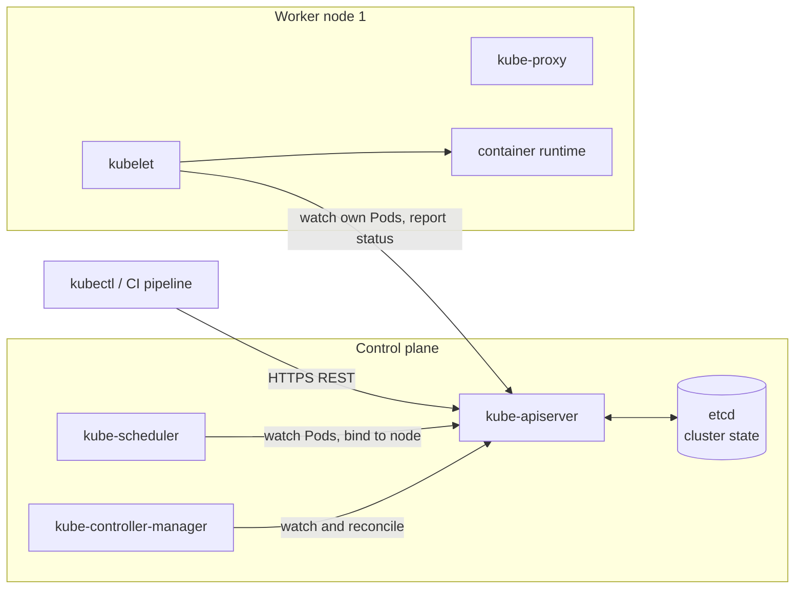
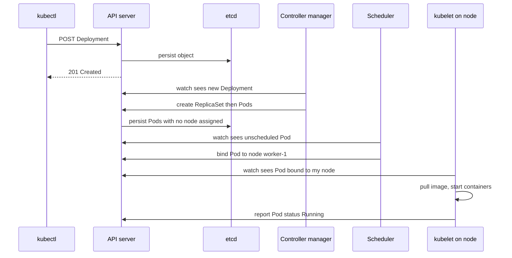

# L8.1 — Cluster, Nodes and Control Plane

> **Level 8: Kubernetes** · Topic 1 of 19 · ⏱ ~4 hours · Difficulty: Intermediate

## 1. What it is

**Kubernetes** (often written K8s) is an open-source system that runs containers across a group of machines and keeps
them in the state you asked for. You do not tell it "start this container on that server". You hand it a *desired state*
("run three copies of `shop-api:1.4.2`, reachable on port 80") and Kubernetes works continuously to make reality match,
restarting, rescheduling and replacing things when they drift.

A **cluster** is the set of machines (physical or virtual) Kubernetes manages. It has two halves. The **control plane**
is the brain: it stores the desired state, decides where Pods run and reacts to changes. The **worker nodes** are the
muscle: they run your containers. Everything is driven through one HTTP API, and `kubectl` is the command-line client for
that API. A **Pod** (the next topic) is the smallest thing Kubernetes schedules: one or more containers that share a network and storage.

## 2. Why it matters in DevOps

- **Every other Kubernetes topic builds on this one.** When a Pod stays `Pending`, a Deployment does not roll out, or a node
  goes `NotReady`, you debug by knowing which component is responsible.
- **Control plane outages are different from workload outages.** If the API server or etcd is down, your running Pods usually
  keep serving traffic, but you cannot deploy, scale or heal anything. Knowing that difference calms an incident.
- **Managed vs self-managed decisions.** EKS, GKE and AKS run the control plane for you; you still own the nodes, upgrades of
  workloads and everything you deploy. You cannot make good choices about that without the architecture in your head.
- **Security and cost.** The API server is the front door to your whole platform; etcd holds every Secret. Both are prime
  targets, and node sizing is most of your cloud bill (see [Resource Requests and Limits](14-resource-requests-and-limits.md)).

## 3. Real-world system example

**Kubernetes itself, as run by every major cloud.** Amazon EKS, Google GKE and Azure AKS all sell "managed Kubernetes": the
provider operates the API server, etcd and other control-plane components, while customers manage worker nodes (or use node
pools and serverless-style options). The component split in this topic is exactly what those services document.

**kubeadm and kind.** `kubeadm` is the official tool for bootstrapping a cluster; it creates the control-plane components as
*static Pods* managed directly by the kubelet. **kind** (Kubernetes IN Docker) is a Kubernetes sub-project that runs each
"node" as a Docker container, using kubeadm inside; the Kubernetes project itself uses it for testing. That is why kind is a
faithful free sandbox for everything in this level: the control plane you meet in kind is the same software you would meet
on a production cluster.

## 4. Diagram



What actually happens on `kubectl apply -f deployment.yaml`:



Notice that **no component talks to another directly**. Everything reads and writes through the API server, which is the
only component that touches etcd. This "watch the API, reconcile toward desired state" pattern is the heart of Kubernetes.

## 5. How it works

| Component | Where it runs | Job |
|-----------|---------------|-----|
| **kube-apiserver** | control plane | The only entry point. Authenticates, authorizes (RBAC), validates and persists objects; serves `watch` streams. Stateless, so you can run several behind a load balancer. |
| **etcd** | control plane | Distributed key-value store (Raft consensus) holding the entire cluster state. Back it up; run an odd number of members (3 or 5) for quorum. |
| **kube-scheduler** | control plane | Picks a node for every Pod that has none, based on resource requests, affinity, taints and more (see [Scheduling](13-scheduling.md)). |
| **kube-controller-manager** | control plane | Bundles many control loops: Deployment, ReplicaSet, Node, Job, EndpointSlice controllers and so on. Each compares desired vs actual and acts. |
| **cloud-controller-manager** | control plane (cloud clusters) | Talks to the cloud API: creates load balancers for `type: LoadBalancer` Services, manages node lifecycle. |
| **kubelet** | every node | The node agent. Watches Pods assigned to its node, asks the container runtime to run them, runs probes, reports status. |
| **container runtime** | every node | Runs containers through the Container Runtime Interface (CRI). `containerd` and CRI-O are common; Docker Engine is no longer used directly. |
| **kube-proxy** | every node | Programs iptables or IPVS rules so a Service's virtual IP reaches a healthy backend Pod (see [Services](04-services.md)). Some CNI plugins replace it. |
| **CNI plugin** | every node | Pod networking (Calico, Cilium, Flannel, the cloud VPC CNI). kind ships a simple default. |

Key ideas:

- **Declarative and level-triggered.** You store *what you want*. Controllers compare to *what exists* and keep fixing the
  difference forever, not just once.
- **Objects** have `apiVersion`, `kind`, `metadata` (name, namespace, labels) and `spec` (desired); the system fills in `status` (observed).
- **Labels and selectors** are the glue: a Service finds its Pods, a Deployment finds its ReplicaSet, by label match, not by name.
- **Namespaces** partition names and policies inside one cluster ([Namespaces](08-namespaces.md)).

Essential `kubectl` commands:

| Command | Purpose |
|---------|---------|
| `kubectl cluster-info` | Where the API server is |
| `kubectl get nodes -o wide` | Nodes, versions, IPs, runtime |
| `kubectl get pods -A` | Pods in all namespaces |
| `kubectl describe <kind> <name>` | Spec plus recent **Events** (first stop when debugging) |
| `kubectl apply -f file.yaml` | Create or update from a manifest |
| `kubectl explain pod.spec.containers` | Built-in field documentation |
| `kubectl api-resources` | Every kind this cluster knows, with short names |
| `kubectl config get-contexts` | Which cluster you are pointing at |

## 6. Step-by-step guide

**Prerequisites:** Docker (running), about 4 GB of free RAM, and these CLIs. Cost: free. Output below is illustrative;
exact versions and timings differ on your machine.

1. **Install kubectl and kind** (Linux/macOS; use your package manager or the official release pages).
   ```bash
   # macOS / Linux with Homebrew
   brew install kubectl kind
   # verify
   kubectl version --client
   kind version
   ```
   On Windows use `winget` or `choco`. The installation pages on kubernetes.io and kind.sigs.k8s.io list every option.

2. **Write a kind config** with one control-plane node and two workers. The port mappings and node label let you reach an
   Ingress controller on `localhost` later in this level ([Ingress](05-ingress.md)). Save as `kind-config.yaml`:
   ```yaml
   kind: Cluster
   apiVersion: kind.x-k8s.io/v1alpha4
   name: devops
   nodes:
     - role: control-plane
       kubeadmConfigPatches:
         - |
           kind: InitConfiguration
           nodeRegistration:
             kubeletExtraArgs:
               node-labels: "ingress-ready=true"
       extraPortMappings:
         - containerPort: 80
           hostPort: 80
           protocol: TCP
         - containerPort: 443
           hostPort: 443
           protocol: TCP
     - role: worker
     - role: worker
   ```
   This is the sandbox used by the rest of Level 8. If ports 80 or 443 are already in use on your laptop, change `hostPort` to 8080 and 8443.

3. **Create the cluster.**
   ```bash
   kind create cluster --config kind-config.yaml
   ```
   Illustrative output:
   ```text
   Creating cluster "devops" ...
    ✓ Ensuring node image (kindest/node:v1.xx.x) 🖼
    ✓ Preparing nodes 📦 📦 📦
    ✓ Writing configuration 📜
    ✓ Starting control-plane 🕹️
    ✓ Installing CNI 🔌
    ✓ Installing StorageClass 💾
    ✓ Joining worker nodes 🚜
   Set kubectl context to "kind-devops"
   ```

4. **Confirm you are talking to it.**
   ```bash
   kubectl config current-context
   kubectl cluster-info
   kubectl get nodes -o wide
   ```
   Expect context `kind-devops` and three nodes, all `Ready` after a minute:
   ```text
   NAME                   STATUS   ROLES           AGE   VERSION   INTERNAL-IP   CONTAINER-RUNTIME
   devops-control-plane   Ready    control-plane   90s   v1.xx.x   172.18.0.4    containerd://1.7.x
   devops-worker          Ready    <none>          70s   v1.xx.x   172.18.0.3    containerd://1.7.x
   devops-worker2         Ready    <none>          70s   v1.xx.x   172.18.0.2    containerd://1.7.x
   ```
   The node "machines" are Docker containers: `docker ps` shows `devops-control-plane`, `devops-worker`, `devops-worker2`.

5. **See the control plane as Pods.** On kubeadm-style clusters (including kind) the control plane runs as static Pods in the
   `kube-system` namespace.
   ```bash
   kubectl get pods -n kube-system -o wide
   ```
   You should see `kube-apiserver-...`, `etcd-...`, `kube-scheduler-...`, `kube-controller-manager-...` on the control-plane
   node, plus a `kube-proxy-...` and a CNI Pod on every node, and `coredns-...` for cluster DNS.

6. **Look at the static Pod manifests the kubelet watches** (they live inside the control-plane "node" container):
   ```bash
   docker exec devops-control-plane ls /etc/kubernetes/manifests
   ```
   Expect `etcd.yaml`, `kube-apiserver.yaml`, `kube-controller-manager.yaml`, `kube-scheduler.yaml`. The kubelet starts
   whatever YAML it finds here, which is how the control plane bootstraps itself before an API server exists.

7. **Watch the reconcile loop live.** In one terminal run `kubectl get pods -w`. In another:
   ```bash
   kubectl create deployment hello --image=nginx:1.27 --replicas=2
   kubectl get pods -o wide
   kubectl delete pod -l app=hello --wait=false
   ```
   The watch shows Pods being terminated and **replaced immediately**: the ReplicaSet controller saw actual (0) != desired (2) and acted.

8. **Read the events the scheduler and kubelet left behind.**
   ```bash
   kubectl describe pod -l app=hello | sed -n '/Events:/,$p'
   ```
   Look for `Scheduled` (scheduler), `Pulling`/`Pulled`/`Created`/`Started` (kubelet). This is how you attribute a failure to a component.

9. **Discover the API itself.**
   ```bash
   kubectl api-resources | head -15
   kubectl explain deployment.spec.strategy
   kubectl get --raw /readyz?verbose | head -20
   ```

10. **Clean up** (keep the cluster for the next topics, or delete everything).
    ```bash
    kubectl delete deployment hello
    # when you are completely done with the level:
    kind delete cluster --name devops
    ```

## 7. Real-world scenario

*Illustrative scenario.* On a Friday, a team's self-managed cluster loses one of its three control-plane VMs. Deployments from
CI start failing with `etcdserver: request timed out`. Meanwhile `shop-api` keeps serving customers; nothing user-facing is
down. The engineer runs `kubectl get nodes` (slow but works), then checks the etcd members and finds the lost VM was an etcd member:
the cluster still has quorum (2 of 3) but latency spiked while it re-elected a leader. They replace the VM, join a new member,
and verify a recent etcd snapshot exists. **Lesson:** the data plane (running Pods) is decoupled from the control plane; knowing which
side broke tells you whether customers are affected, and etcd quorum plus tested backups are the real safety net. Managed
services such as EKS, GKE and AKS exist partly to take this burden away.

## 8. Common mistakes and best practices

**Don't**

- Run a single control-plane node or a two-member etcd cluster in production (no quorum tolerance for one failure).
- Edit objects in the cluster by hand and forget it: the next `apply` or controller sync may overwrite or conflict.
- Assume `kubectl` is pointed at the right cluster. Applying "just a quick delete" to production from a stale context is a classic outage.
- Use a kind cluster for load or security conclusions: it is one machine pretending to be several.

**Do**

- Check `kubectl config current-context` before every destructive command (a shell prompt that shows it helps).
- Keep manifests in Git and `apply` them: the cluster is a cache of what is in version control.
- Start debugging with `kubectl describe` and read the Events section.
- Back up etcd (or use a managed control plane) and rehearse a restore.
- Upgrade one minor version at a time and read release notes for removed APIs.

## 9. Tasks

- [ ] **T1 — Build the sandbox cluster** *(≈30 min, beginner)*
  - **Goal:** have the three-node `devops` kind cluster used by the rest of Level 8.
  - **Steps:**
    1. Install `kubectl` and `kind`.
    2. Save the config from step 2 and run `kind create cluster --config kind-config.yaml`.
    3. Run `kubectl get nodes -o wide` and `docker ps`.
  - **Done when:** three nodes show `Ready` and `docker ps` shows three matching containers.

- [ ] **T2 — Map the components to Pods** *(≈30 min, beginner)*
  - **Goal:** locate every control-plane and node component in a live cluster.
  - **Steps:**
    1. Run `kubectl get pods -n kube-system -o wide`.
    2. For each of API server, etcd, scheduler, controller manager, kube-proxy and CoreDNS, write which node it runs on and how many replicas exist.
    3. Run `docker exec devops-control-plane ls /etc/kubernetes/manifests` and explain why four of them appear there.
  - **Done when:** you have a table of component, node and replica count, and one sentence on static Pods.

- [ ] **T3 — Trace a Deployment through the control plane** *(≈40 min, intermediate)*
  - **Goal:** attribute each event to the component that caused it.
  - **Steps:**
    1. Create a Deployment: `kubectl create deployment trace --image=nginx:1.27 --replicas=3`.
    2. Run `kubectl get events --sort-by=.lastTimestamp` and `kubectl describe pod -l app=trace`.
    3. Label each event line with its source: Deployment controller, ReplicaSet controller, scheduler or kubelet.
  - **Done when:** you can point to the exact event that proves the scheduler chose a node and the exact one that proves the kubelet pulled the image.

- [ ] **T4 — Break the control plane and observe** *(≈40 min, intermediate)*
  - **Goal:** prove that running workloads survive a control-plane outage.
  - **Steps:**
    1. Create `kubectl create deployment keep --image=nginx:1.27 --replicas=2` and note the Pod names.
    2. Stop the API server's container on the control-plane node: `docker exec devops-control-plane sh -c 'crictl stop $(crictl ps --name kube-apiserver -q)'`. The kubelet will restart it within seconds, so run `kubectl get pods` repeatedly and note any error.
    3. Wait for recovery and run `kubectl get pods` again.
  - **Done when:** you saw `kubectl` fail briefly while the Pods were never restarted (same names, `RESTARTS` unchanged), and you can explain why the kubelet brought the API server back.

- [ ] **T5 — Script a cluster smoke test** *(≈30 min, intermediate)*
  - **Goal:** automate "is my sandbox healthy?".
  - **Steps:**
    1. Write `smoke.sh` that checks `kubectl get nodes` shows only `Ready`, `kubectl get --raw /readyz` returns `ok`, and a throwaway Pod `kubectl run smoke --image=nginx:1.27 --restart=Never` reaches `Running` (use `kubectl wait --for=condition=Ready pod/smoke --timeout=60s`).
    2. Delete the Pod at the end and exit non-zero on any failure.
  - **Done when:** `./smoke.sh; echo $?` prints `0` on a healthy cluster and non-zero if you run it with `kind delete cluster` done first.

- [ ] **T6 — Prove it: explain the apply path** *(≈30 min, advanced)*
  - **Goal:** teach the architecture without notes.
  - **Steps:**
    1. Without this page, draw the sequence from `kubectl apply` of a Deployment to a running container, naming every component.
    2. State which component to inspect first for: Pod `Pending` with no node; Pod stuck `ContainerCreating`; `kubectl` timing out.
  - **Done when:** a colleague agrees your diagram and three answers are correct (scheduler / kubelet and runtime / API server and etcd).

## 10. Self-check questions

1. Which component is the only one that reads and writes etcd, and why does that matter?
2. A Pod is `Pending` and `kubectl describe` shows no events from the kubelet. Which component should you suspect?
3. What happens to running Pods if the control plane goes down for ten minutes?
4. What is the difference between the scheduler and the kubelet?
5. Why does kind use containers as nodes, and what is it not good for?

<details>
<summary>Answers</summary>

1. The API server. Centralizing access gives one place for authentication, authorization, validation and auditing, and lets every other component be a simple client that watches the API.
2. The scheduler (or a lack of schedulable nodes). The kubelet only acts after a Pod is bound to a node, so no kubelet events means it was never assigned.
3. They keep running; the kubelet and container runtime operate from the last known state. You cannot create, change or heal anything (no rescheduling after a node failure) until the control plane returns.
4. The scheduler decides *which node* a Pod goes on (it writes the node name). The kubelet on that node actually *runs* it and reports status.
5. It is fast, free and disposable, and runs real Kubernetes with kubeadm inside Docker. It is not good for performance testing, real multi-machine failure behaviour, or cloud-specific integrations such as real load balancers.
</details>

## 11. Further reading

- Kubernetes documentation, *Concepts > Cluster Architecture* and *Kubernetes Components* (kubernetes.io/docs).
- Kubernetes documentation, *kubectl Quick Reference* and *kubectl cheat sheet*.
- kind documentation, *Quick Start* and *Configuration* (kind.sigs.k8s.io).
- *Kubernetes: Up and Running* by Brendan Burns, Joe Beda, Kelsey Hightower and Lachlan Evenson.
- *Kubernetes the Hard Way* by Kelsey Hightower (builds a cluster by hand to expose every component).

<!-- nav -->
---
← Previous level: [Level 7 — Terraform / Infrastructure as Code](../level-07-terraform-iac/README.md) · [Level 8 index](README.md) · Next: [Pods](02-pods.md) →
