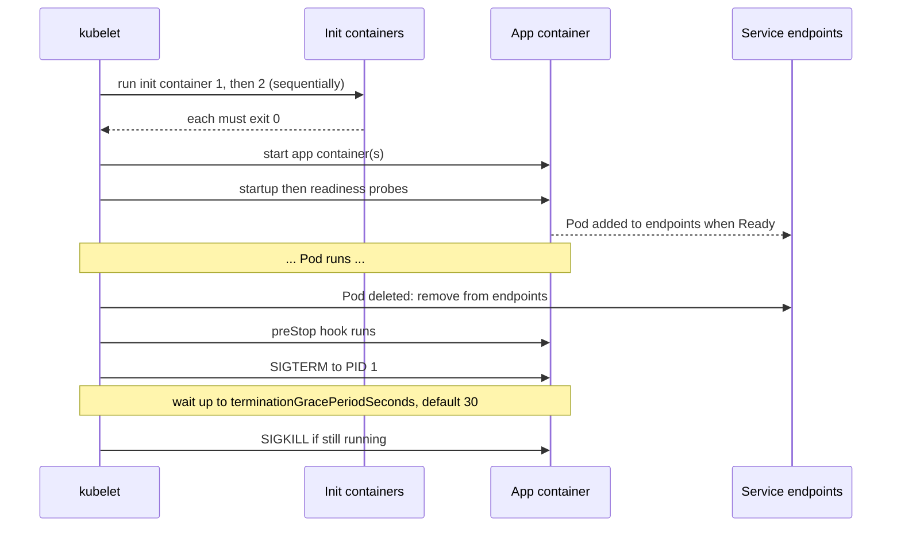
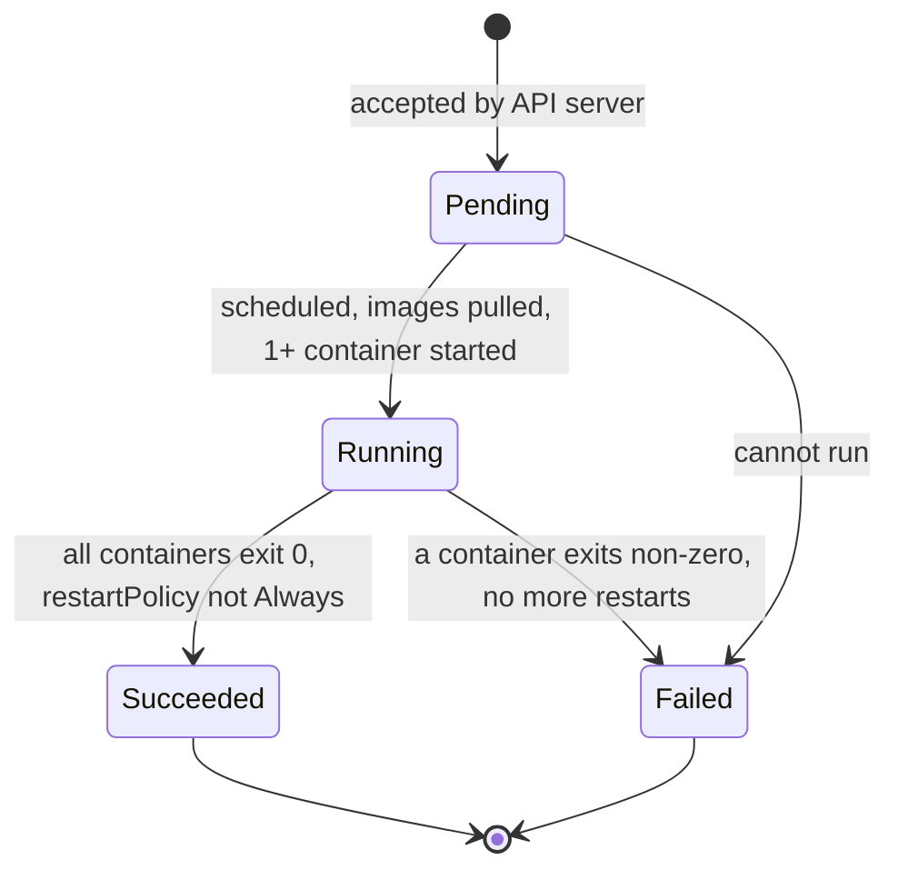

# L8.2 — Pods

> **Level 8: Kubernetes** · Topic 2 of 19 · ⏱ ~4 hours · Difficulty: Beginner

## 1. What it is

A **Pod** is the smallest deployable unit in Kubernetes: a group of one or more containers that are always scheduled onto
the **same node** and share the same network namespace (one IP address, one `localhost`) and, optionally, the same storage
volumes. Most Pods contain a single application container. Extra containers are added when they must live and die together
with the app: a log shipper, a proxy, or a setup step that has to finish first.

Pods are **ephemeral**. A Pod is never "repaired": if it dies or its node fails, a *controller* (such as a Deployment) creates a
brand-new Pod with a new name and a new IP. Because of this you almost never create bare Pods in production. You do, however,
read and debug them every day, so the Pod spec and Pod lifecycle are the most useful things to know cold.

## 2. Why it matters in DevOps

- **Every workload is Pods.** Deployments, StatefulSets, Jobs and DaemonSets only differ in how they create Pods; the Pod
  spec inside them is identical.
- **Most incidents are Pod-level:** `CrashLoopBackOff`, `ImagePullBackOff`, `OOMKilled`, `Pending`, `Evicted`. You need to
  read a Pod's status and events fluently.
- **Graceful shutdown decides whether deploys drop requests.** What happens between "Pod deleted" and "process killed" is
  specified by the Pod lifecycle, and getting it wrong causes 502 errors at every release.
- **Security posture lives in the Pod spec:** `securityContext`, service account, host namespaces and mounted volumes.

## 3. Real-world system example

**Service-mesh and logging sidecars.** Istio and Linkerd historically inject a proxy container into each application Pod
so all traffic flows through it on `localhost`, and Fluent Bit or Fluentd run as sidecars (or per-node agents) to ship logs.
Both rely on exactly the Pod guarantees covered here: shared network namespace and shared volumes between containers.

**Kubernetes' own control plane.** On kubeadm and kind clusters, `kube-apiserver`, `etcd` and the scheduler run as *static
Pods* defined by files in `/etc/kubernetes/manifests` (see [Cluster, Nodes and Control Plane](01-cluster-architecture.md)),
which is the Pod abstraction used to run the infrastructure of Kubernetes itself.

Kubernetes has also introduced a first-class **native sidecar** feature: an init container with `restartPolicy: Always` that
starts before the app and keeps running next to it. It is stable in current Kubernetes releases and fixes the old problem of
sidecars not being ordered against the main container, or keeping Jobs alive after they finish.

## 4. Diagram

Pod startup and shutdown:



Pod phases:



## 5. How it works

A minimal but realistic Pod for the `shop-api` running example (the image is a stand-in so the sample can run anywhere):

```yaml
apiVersion: v1
kind: Pod
metadata:
  name: shop-api
  labels:
    app: shop-api
    tier: backend
spec:
  restartPolicy: Always
  terminationGracePeriodSeconds: 30
  securityContext:
    runAsNonRoot: true
    runAsUser: 101          # the unprivileged user shipped in the nginx-unprivileged image
    seccompProfile:
      type: RuntimeDefault
  initContainers:
    - name: wait-for-db
      image: busybox:1.36
      command: ["sh", "-c", "until nc -z postgres 5432; do echo waiting for postgres; sleep 2; done"]
  containers:
    - name: app
      image: nginxinc/nginx-unprivileged:1.27   # stand-in for shop-api
      ports:
        - containerPort: 8080
      env:
        - name: NODE_ENV
          value: production
      resources:
        requests: { cpu: 100m, memory: 128Mi }
        limits:   { memory: 256Mi }
      securityContext:
        allowPrivilegeEscalation: false
        readOnlyRootFilesystem: false
        capabilities: { drop: ["ALL"] }
      lifecycle:
        preStop:
          exec:
            command: ["sleep", "5"]
```

Key concepts:

| Concept | What to know |
|---------|--------------|
| **Shared network** | All containers in a Pod share one IP and port space. Container A reaches container B at `localhost:<port>`. Two containers cannot bind the same port. |
| **Shared volumes** | Volumes declared under `spec.volumes` can be mounted by several containers. An `emptyDir` lives as long as the Pod and is the standard way for a sidecar to read an app's log files. |
| **Init containers** | Run one at a time, in order, to completion before any app container starts. Use for waiting on dependencies, running migrations safely, or fetching files. If one fails, the kubelet retries per `restartPolicy`. |
| **Native sidecar** | An entry in `initContainers` with `restartPolicy: Always`. It starts in order, keeps running for the whole Pod life and is shut down after the app containers. |
| **restartPolicy** | `Always` (default), `OnFailure`, `Never`. Applies to all containers; Jobs use `OnFailure` or `Never`. Restarts use exponential backoff (10s, 20s, ... up to 5 min), producing `CrashLoopBackOff`. |
| **Probes** | `startupProbe`, `readinessProbe`, `livenessProbe`: see [Liveness and Readiness Probes](15-liveness-and-readiness-probes.md). Readiness controls whether the Pod receives Service traffic. |
| **Resources** | `requests` are used for scheduling; `limits` are enforced at runtime. Exceeding a memory limit gets the container `OOMKilled`. See [Resource Requests and Limits](14-resource-requests-and-limits.md). |
| **Graceful termination** | On delete: Pod marked `Terminating`, removed from Service endpoints, `preStop` hook runs, `SIGTERM` sent to PID 1, `SIGKILL` after `terminationGracePeriodSeconds`. Your process must handle `SIGTERM`. |
| **Ephemeral containers** | A debugging container injected into a running Pod with `kubectl debug`, useful for images with no shell. |

Common Pod statuses and what they mean:

| Status | Usual cause | First command |
|--------|-------------|---------------|
| `Pending` | Not scheduled (no node fits, unbound PVC) or images still pulling | `kubectl describe pod` |
| `ContainerCreating` | Pulling image, mounting volumes, waiting for CNI | `kubectl describe pod` |
| `ImagePullBackOff` / `ErrImagePull` | Wrong image name or tag, private registry without credentials | `kubectl describe pod` |
| `CrashLoopBackOff` | Process exits repeatedly | `kubectl logs --previous` |
| `OOMKilled` (last state) | Memory limit exceeded | `kubectl describe pod`, raise limit or fix leak |
| `Init:0/1` | Init container still running or failing | `kubectl logs <pod> -c <init-name>` |
| `Completed` | Containers exited 0 (normal for Jobs) | n/a |

Do not create Pods directly in real clusters unless you are experimenting: use a [Deployment](03-deployments-and-replicasets.md)
so a failed Pod gets replaced. Pod networking is covered in [Services](04-services.md).

## 6. Step-by-step guide

**Prerequisites:** the `devops` kind cluster from [topic 1](01-cluster-architecture.md) (or any cluster). Cost: free.
Command output is illustrative.

1. **Run your first Pod imperatively, then read it back as YAML.**
   ```bash
   kubectl run web --image=nginx:1.27 --port=80
   kubectl get pod web -o wide
   kubectl get pod web -o yaml | head -40
   ```
   Note `status.podIP`, `spec.nodeName` and the fields Kubernetes defaulted (`restartPolicy`, `dnsPolicy`, a service-account token mount).

2. **Generate a manifest instead of writing from memory.** `--dry-run=client -o yaml` prints without creating.
   ```bash
   kubectl run web2 --image=nginx:1.27 --port=80 --dry-run=client -o yaml > web2.yaml
   ```

3. **Create a two-container Pod with a shared volume and an init container.** Save as `pod-sidecar.yaml`:
   ```yaml
   apiVersion: v1
   kind: Pod
   metadata:
     name: logs-demo
     labels:
       app: logs-demo
   spec:
     volumes:
       - name: logs
         emptyDir: {}
     initContainers:
       - name: seed
         image: busybox:1.36
         command: ["sh", "-c", "echo 'init finished' > /logs/init.txt"]
         volumeMounts:
           - name: logs
             mountPath: /logs
     containers:
       - name: writer
         image: busybox:1.36
         command: ["sh", "-c", "while true; do date >> /logs/app.log; sleep 2; done"]
         volumeMounts:
           - name: logs
             mountPath: /logs
       - name: reader
         image: busybox:1.36
         command: ["sh", "-c", "tail -F /logs/app.log"]
         volumeMounts:
           - name: logs
             mountPath: /logs
             readOnly: true
   ```
   ```bash
   kubectl apply -f pod-sidecar.yaml
   kubectl get pod logs-demo -w
   ```
   You should see `Init:0/1`, then `PodInitializing`, then `Running` with `READY 2/2`.

4. **Read each container's logs and exec into one.** With several containers you must name one with `-c`.
   ```bash
   kubectl logs logs-demo -c reader --tail=5
   kubectl exec -it logs-demo -c writer -- sh -c 'cat /logs/init.txt; wc -l /logs/app.log'
   ```
   The reader sees what the writer wrote because both mount the same `emptyDir`.

5. **Prove the shared network namespace.**
   ```bash
   kubectl run twin --image=nginx:1.27 --dry-run=client -o yaml > twin.yaml
   ```
   Edit `twin.yaml` to add a second container named `curl` (image `curlimages/curl:8.10.1`, `command: ["sleep","3600"]`), apply it, then:
   ```bash
   kubectl exec twin -c curl -- curl -s -o /dev/null -w "%{http_code}\n" http://localhost:80
   ```
   Expect `200`: the curl container reached nginx over `localhost` because they share a network namespace.

6. **Break a Pod and read the failure.** Wrong image tag:
   ```bash
   kubectl run broken --image=nginx:does-not-exist
   kubectl get pod broken
   kubectl describe pod broken | sed -n '/Events:/,$p'
   ```
   Expect `ErrImagePull` then `ImagePullBackOff`, with events such as `Failed to pull image ... not found`.

7. **Make a crashing container and use `--previous`.**
   ```bash
   kubectl run crash --image=busybox:1.36 -- sh -c 'echo starting; sleep 2; echo boom >&2; exit 1'
   kubectl get pod crash -w          # RESTARTS climbs, status CrashLoopBackOff
   kubectl logs crash --previous
   kubectl get pod crash -o jsonpath='{.status.containerStatuses[0].lastState.terminated}'
   ```
   The last command prints the exit code (`1`) and reason (`Error`).

8. **Debug a Pod that has no shell with an ephemeral container.**
   ```bash
   kubectl debug -it web --image=busybox:1.36 --target=web -- sh
   # inside: ps; wget -qO- localhost; exit
   ```
   `--target` shares the process namespace so you can see nginx's processes.

9. **Observe graceful shutdown.** Create a Pod whose process logs `SIGTERM`:
   ```bash
   kubectl run term --image=busybox:1.36 -- sh -c 'trap "echo got SIGTERM; exit 0" TERM; while true; do sleep 1; done'
   kubectl delete pod term &
   kubectl logs term -f
   ```
   You should see `got SIGTERM` within a second. Repeat with `command: ["sleep","3600"]` (no trap, since PID 1 ignores
   signals without a handler) and notice the delete takes the full 30 seconds until `SIGKILL`.

10. **Clean up.**
    ```bash
    kubectl delete pod web web2 logs-demo twin broken crash term --ignore-not-found
    ```

## 7. Real-world scenario

*Illustrative scenario.* After every release of `shop-api`, a handful of customers see `502 Bad Gateway` for a few seconds.
The team finds that at deploy time the old Pods receive `SIGTERM` and exit instantly, while the Ingress controller and
kube-proxy are still sending them requests for a moment because endpoint removal is propagated asynchronously. The fix has three
parts: handle `SIGTERM` by stopping accepting new connections but finishing in-flight requests, add a `preStop` hook of `sleep 5`
so the Pod keeps serving while the endpoint removal propagates, and raise `terminationGracePeriodSeconds` to 45 to cover the longest
request. The 502s disappear. **Lesson:** the Pod lifecycle is a contract between your app and the platform; graceful shutdown is
part of the application's responsibility, not a Kubernetes setting you can skip.

## 8. Common mistakes and best practices

**Don't**

- Run bare Pods for anything that must survive a node failure; nothing will recreate them.
- Use the `latest` tag (or no tag): it breaks reproducibility and hides what is deployed.
- Run as root, or leave privilege escalation enabled, when the app doesn't need it.
- Put a shell wrapper as PID 1 (`sh -c "node server.js"`) that swallows `SIGTERM`; use `exec` or call the binary directly.
- Rely on a Pod's IP or name: both change on every recreation.

**Do**

- Set `resources.requests`, memory `limits`, a non-root `securityContext` and explicit image tags (ideally digests) on every container.
- Use init containers for ordered setup, and native sidecars (init container with `restartPolicy: Always`) for long-running helpers.
- Add readiness probes so traffic only reaches Pods that can serve it.
- Log to stdout/stderr so `kubectl logs` and log collectors work.
- Learn the loop: `get`, `describe` (events), `logs` (`--previous`), `exec`, `debug`.

## 9. Tasks

- [ ] **T1 — Create, inspect and delete a Pod** *(≈20 min, beginner)*
  - **Goal:** read a Pod's spec and status.
  - **Steps:**
    1. Create `kubectl run web --image=nginx:1.27 --port=80`.
    2. Record its IP, node and QoS class: `kubectl get pod web -o jsonpath='{.status.podIP} {.spec.nodeName} {.status.qosClass}'`.
    3. Delete it and create it again; compare IPs.
  - **Done when:** you have shown that the replacement Pod got a different IP and can name the QoS class (`BestEffort`) and why.

- [ ] **T2 — Write the sidecar Pod by hand** *(≈40 min, beginner)*
  - **Goal:** use a shared `emptyDir` between two containers and an init container.
  - **Steps:**
    1. Without copying, write a manifest where an init container writes `ready` to `/data/status`, one container appends timestamps to `/data/app.log`, and another tails it.
    2. Validate with `kubectl apply --dry-run=server -f file.yaml`, then apply.
  - **Done when:** `kubectl logs <pod> -c <reader>` streams timestamps and `READY` shows `2/2`.

- [ ] **T3 — Diagnose three broken Pods** *(≈45 min, intermediate)*
  - **Goal:** map symptoms to causes using only kubectl.
  - **Steps:**
    1. Create Pods with: a nonexistent image tag; a command that exits 1; a `busybox:1.36` container with a `20Mi` memory limit running `sh -c 'tail /dev/zero'` (it buffers a line that never ends, so memory grows until the kernel kills it).
    2. For each, use `describe` and `logs --previous` to find the cause (`ErrImagePull`, exit code 1, `OOMKilled` with exit code 137).
    3. Fix each and make it `Running`.
  - **Done when:** you can state, for each Pod, the status, the field in `kubectl describe` that proved the cause, and the fix.

- [ ] **T4 — Make `shop-api` shut down gracefully** *(≈45 min, intermediate)*
  - **Goal:** prove `SIGTERM` handling and the effect of `preStop`.
  - **Steps:**
    1. Run a Pod with `sh -c 'trap "echo draining; sleep 3; echo bye; exit 0" TERM; while true; do sleep 1; done'` and `terminationGracePeriodSeconds: 10`.
    2. Time `kubectl delete pod <name>` (`time` prefix) and read the logs while it terminates.
    3. Remove the trap, set `command: ["sleep","3600"]`, and time the delete again.
  - **Done when:** the first delete takes about 3 seconds with `draining` and `bye` logged, and the second takes about the full grace period.

- [ ] **T5 — Debug a distroless-style Pod** *(≈30 min, advanced)*
  - **Goal:** use an ephemeral container.
  - **Steps:**
    1. Run `kubectl run noshell --image=registry.k8s.io/pause:3.9` (a container with no shell).
    2. Show `kubectl exec` failing, then attach with `kubectl debug -it noshell --image=busybox:1.36 --target=noshell -- sh`.
    3. From inside, run `ip addr` and `ps`.
  - **Done when:** you have a shell in the Pod's network namespace and can show its IP matches `kubectl get pod -o wide`.

- [ ] **T6 — Prove it: lifecycle from memory** *(≈30 min, advanced)*
  - **Goal:** explain Pod startup and shutdown without notes.
  - **Steps:**
    1. Draw the sequence from "Pod created" to "Ready" (scheduler, image pull, init containers, probes, endpoints) and from "delete" to "gone" (endpoints removal, preStop, SIGTERM, SIGKILL).
    2. Explain why a rolling deploy can drop requests even with a healthy readiness probe.
  - **Done when:** your diagram names every step in order and you can explain the endpoint-propagation race.

## 10. Self-check questions

1. Why do containers in the same Pod reach each other on `localhost`?
2. What is the difference between an init container and a sidecar?
3. A container shows `CrashLoopBackOff`. What are your first two commands?
4. What does exit code 137 usually mean?
5. Why shouldn't you create bare Pods for a production service?
6. What happens between `kubectl delete pod` and the container actually stopping?

<details>
<summary>Answers</summary>

1. They share one network namespace (set up by the Pod's infrastructure/pause sandbox), so they have the same IP and loopback interface.
2. Init containers run sequentially to completion before app containers start. A sidecar runs alongside the app for the whole lifetime (a native sidecar is an init container with `restartPolicy: Always`).
3. `kubectl describe pod <pod>` (events, last state, exit code) and `kubectl logs <pod> --previous` (output of the crashed instance).
4. 128 + 9: the process was killed by `SIGKILL`, commonly by the OOM killer (look for `OOMKilled`) or after the grace period expired.
5. Nothing recreates a bare Pod if its node dies or it is deleted; controllers such as Deployments provide self-healing, scaling and rollouts.
6. The Pod is marked `Terminating` and removed from Service endpoints, the `preStop` hook runs, `SIGTERM` is sent to PID 1, and after `terminationGracePeriodSeconds` any remaining process gets `SIGKILL`.
</details>

## 11. Further reading

- Kubernetes documentation, *Concepts > Workloads > Pods*, including *Pod Lifecycle*, *Init Containers* and *Sidecar Containers*.
- Kubernetes documentation, *Debug Running Pods* and *Debug Pods* in the Tasks section.
- Kubernetes documentation, *Configure a Security Context for a Pod or Container*.
- *Kubernetes Patterns* by Bilgin Ibryam and Roland Huss (sidecar, init container and related patterns).
- See also [Docker containers and their lifecycle](../level-04-docker/03-containers.md) for the container concepts underneath a Pod.

<!-- nav -->
---
← Previous: [Cluster, Nodes and Control Plane](01-cluster-architecture.md) · [Level 8 index](README.md) · Next: [Deployments and ReplicaSets](03-deployments-and-replicasets.md) →
