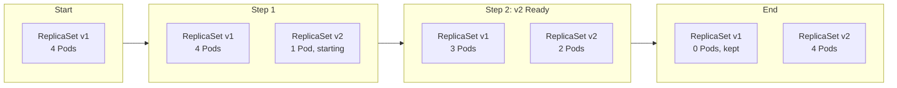
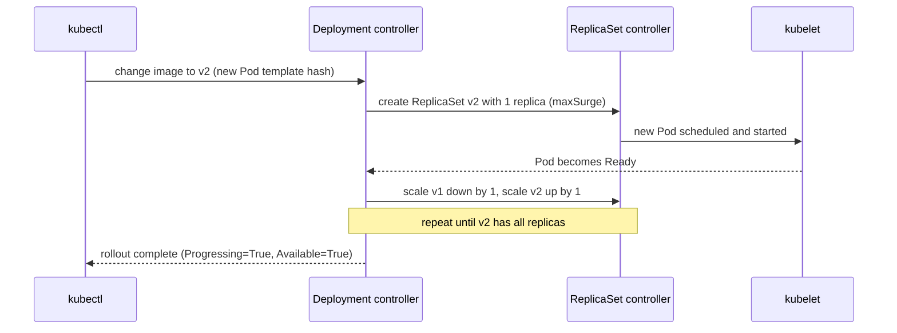

# L8.3 — Deployments and ReplicaSets

> **Level 8: Kubernetes** · Topic 3 of 19 · ⏱ ~4 hours · Difficulty: Beginner

## 1. What it is

A **ReplicaSet** keeps a specified number of identical Pods running: if one disappears, it creates another; if there are too
many, it deletes some. A **Deployment** sits one level above and manages *ReplicaSets* for you. When you change the Pod template
(for example a new image tag), the Deployment creates a **new ReplicaSet** and gradually moves Pods from the old one to the new
one. That gradual move is a **rolling update**, and because the old ReplicaSet is kept (scaled to zero), you can move back with a **rollback**.

In day-to-day work you only write Deployments. The hierarchy is `Deployment -> ReplicaSet -> Pods`, linked by labels and
by `ownerReferences`, and understanding it explains almost every rollout behaviour you will see.

## 2. Why it matters in DevOps

- **Deploying is mostly this.** Every release of a stateless service such as `shop-api` is a Deployment update; your CI/CD
  pipeline ends in `kubectl apply`, `helm upgrade` or a GitOps sync that changes a Deployment ([Rolling Deployments](../level-05-cicd/10-rolling-deployments.md)).
- **Zero-downtime depends on correct settings.** `maxSurge`, `maxUnavailable`, readiness probes and `minReadySeconds`
  decide whether a deploy is invisible to users or causes errors ([Zero-downtime Deployments](../level-05-cicd/08-zero-downtime-deployments.md)).
- **Fast recovery.** `kubectl rollout undo` is the quickest rollback you have; knowing its limits (it only reverts the Pod
  template, not config or data) matters at 3 a.m. ([Rollback](../level-05-cicd/07-rollback.md)).
- **Capacity and availability:** replica count is your first availability lever (see [High Availability and Scalability](../level-00-what-devops-is/08-high-availability-and-scalability.md)).

## 3. Real-world system example

**Kubernetes' own documentation and ecosystem treat the Deployment as the default workload.** Argo CD and Flux, the two most
used GitOps tools, show deployment health by watching Deployment rollout status; Helm charts for nearly every popular
application (ingress-nginx, Prometheus Operator components, cert-manager) render a Deployment for the stateless parts.
Argo Rollouts, a CNCF-hosted project, provides a `Rollout` resource that replaces Deployment with canary and blue/green
strategies, and it deliberately mirrors the Deployment spec so teams can migrate by changing `kind`. The built-in strategies
described below are intentionally simple (`RollingUpdate` and `Recreate`); anything fancier such as traffic-weighted canary is
built on top by these tools or by a service mesh.

## 4. Diagram

A rolling update with `replicas: 4`, `maxSurge: 1`, `maxUnavailable: 0`:



Who does what:



## 5. How it works

A complete `shop-api` Deployment (image is a stand-in; swap in your own):

```yaml
apiVersion: apps/v1
kind: Deployment
metadata:
  name: shop-api
  labels:
    app: shop-api
spec:
  replicas: 3
  revisionHistoryLimit: 5
  progressDeadlineSeconds: 120
  minReadySeconds: 5
  selector:
    matchLabels:
      app: shop-api            # must match the template labels; immutable after creation
  strategy:
    type: RollingUpdate
    rollingUpdate:
      maxSurge: 1              # up to 1 extra Pod above replicas during the update
      maxUnavailable: 0        # never go below desired capacity
  template:
    metadata:
      labels:
        app: shop-api
    spec:
      containers:
        - name: app
          image: nginx:1.26    # stand-in for shop-api:1.4.2
          ports:
            - containerPort: 80
          readinessProbe:
            httpGet:
              path: /
              port: 80
            periodSeconds: 3
          resources:
            requests: { cpu: 50m, memory: 64Mi }
            limits:   { memory: 128Mi }
```

| Field | Meaning |
|-------|---------|
| `replicas` | Desired Pod count. Omit it if an autoscaler ([HPA](16-horizontal-pod-autoscaling.md)) owns the count, otherwise every `apply` resets it. |
| `selector` | Which Pods this Deployment owns. Immutable. Two Deployments with overlapping selectors fight each other. |
| `template` | The Pod spec. **Only a change here triggers a rollout** (not a change to `replicas`). |
| `strategy.type` | `RollingUpdate` (default) replaces gradually. `Recreate` kills all old Pods first, then starts new ones (downtime, but no two versions at once). |
| `maxSurge` | Extra Pods allowed during a rollout (number or percentage, default 25%). |
| `maxUnavailable` | Pods allowed to be unavailable during a rollout (default 25%). |
| `minReadySeconds` | A new Pod must be Ready this long before counting as available. Slows the rollout, catches immediate crashes. |
| `progressDeadlineSeconds` | After this long without progress the rollout is marked failed (condition `Progressing=False`, reason `ProgressDeadlineExceeded`). Kubernetes does **not** roll back automatically. |
| `revisionHistoryLimit` | How many old ReplicaSets are kept for rollback (default 10). |

Rollout commands:

| Command | Purpose |
|---------|---------|
| `kubectl rollout status deploy/shop-api` | Block until the rollout finishes or fails (use in CI) |
| `kubectl rollout history deploy/shop-api` | List revisions |
| `kubectl rollout undo deploy/shop-api` | Go back one revision (`--to-revision=N` for a specific one) |
| `kubectl rollout pause` / `resume` | Batch several edits into one rollout |
| `kubectl rollout restart deploy/shop-api` | New rollout with the same spec (re-reads ConfigMaps, replaces Pods) |
| `kubectl scale deploy/shop-api --replicas=5` | Imperative scale (prefer editing Git) |
| `kubectl set image deploy/shop-api app=nginx:1.27` | Imperative image change |

How the pieces fit: the Deployment computes a hash of the Pod template and puts it in the ReplicaSet name and in the Pods'
`pod-template-hash` label. Same template means same ReplicaSet; a new template means a new ReplicaSet. The Pods of all ReplicaSets
carry your `app` label, which is why a Service ([Services](04-services.md)) selecting `app: shop-api` sends traffic to old and new Pods
alike during a rollout, and why readiness probes ([Liveness and Readiness Probes](15-liveness-and-readiness-probes.md)) are essential: they stop traffic reaching a new Pod before it can serve.

## 6. Step-by-step guide

**Prerequisites:** the `devops` kind cluster ([topic 1](01-cluster-architecture.md)). Cost: free. Output is illustrative.

1. **Save the Deployment above as `deploy.yaml` and apply it.**
   ```bash
   kubectl apply -f deploy.yaml
   kubectl rollout status deploy/shop-api
   kubectl get deploy,rs,pods -l app=shop-api
   ```
   Illustrative output:
   ```text
   NAME                       READY   UP-TO-DATE   AVAILABLE   AGE
   deployment.apps/shop-api   3/3     3            3           25s

   NAME                                  DESIRED   CURRENT   READY   AGE
   replicaset.apps/shop-api-6d9f7c5b8d   3         3         3       25s

   NAME                            READY   STATUS    RESTARTS   AGE
   pod/shop-api-6d9f7c5b8d-4x7tq   1/1     Running   0          25s
   ```
   Notice the naming: `<deployment>-<template-hash>-<random>`.

2. **Prove the self-healing ReplicaSet.**
   ```bash
   kubectl delete pod -l app=shop-api --field-selector=status.phase=Running --wait=false
   kubectl get pods -l app=shop-api
   ```
   Replacement Pods appear at once with new random suffixes; the desired count is still 3.

3. **Scale declaratively.** Edit `replicas: 5` in `deploy.yaml` and re-apply (the GitOps way), then scale back with the
   imperative shortcut to see both:
   ```bash
   kubectl apply -f deploy.yaml
   kubectl scale deploy/shop-api --replicas=3
   ```
   The imperative change is overwritten by the next `apply` of a file that says 5, which is why Git must stay the source of truth.

4. **Roll out a new version and watch it.** Record why with an annotation (this feeds `rollout history`).
   ```bash
   kubectl annotate deploy/shop-api kubernetes.io/change-cause="upgrade nginx 1.26 to 1.27" --overwrite
   kubectl set image deploy/shop-api app=nginx:1.27
   kubectl rollout status deploy/shop-api
   kubectl get rs -l app=shop-api
   ```
   Two ReplicaSets now exist: the new one with 3 Pods, the old one with 0 (kept for rollback).

5. **Read the history and roll back.**
   ```bash
   kubectl rollout history deploy/shop-api
   kubectl rollout undo deploy/shop-api
   kubectl rollout status deploy/shop-api
   kubectl get deploy shop-api -o jsonpath='{.spec.template.spec.containers[0].image}{"\n"}'
   ```
   The image is back to `nginx:1.26`. The history now shows the old revision re-numbered as the newest.

6. **Break a rollout and watch it stall (a failure that does not take you down).**
   ```bash
   kubectl set image deploy/shop-api app=nginx:1.99-does-not-exist
   kubectl rollout status deploy/shop-api --timeout=60s
   kubectl get pods -l app=shop-api
   ```
   Because `maxUnavailable: 0`, one new Pod is stuck in `ImagePullBackOff` but **all three old Pods keep serving**. After
   `progressDeadlineSeconds` the status reports `ProgressDeadlineExceeded`. Recover with:
   ```bash
   kubectl rollout undo deploy/shop-api
   ```

7. **Compare with `Recreate`.** Change `strategy` to `type: Recreate` (remove the `rollingUpdate` block), apply, trigger a change
   (`kubectl set image deploy/shop-api app=nginx:1.27`) and run `kubectl get pods -w`. All old Pods terminate before any new Pod
   starts: a short outage, but never two versions running at once (useful when a schema change forbids it).

8. **Pause, batch changes, resume.**
   ```bash
   kubectl rollout pause deploy/shop-api
   kubectl set image deploy/shop-api app=nginx:1.27
   kubectl set resources deploy/shop-api -c app --limits=memory=192Mi
   kubectl rollout resume deploy/shop-api
   ```
   A single rollout results instead of two.

9. **Clean up.**
   ```bash
   kubectl delete deploy shop-api
   ```

## 7. Real-world scenario

*Illustrative scenario.* A team ships `shop-api` v2 on a Friday afternoon. Their pipeline runs `kubectl apply` and exits
successfully, but nobody checks the rollout. The new image crashes on start because of a missing environment variable.
Because the Deployment uses `maxUnavailable: 0` and a readiness probe, the new Pods never become Ready, the old Pods keep
serving, and customers see nothing. Two hours later a dashboard alert for "Deployment replicas unavailable" fires. The on-call
engineer runs `kubectl rollout status` (shows `Waiting for ... 1 old replicas are pending termination`), `kubectl describe` and
`kubectl logs` on the new Pod, sees the config error, and runs `kubectl rollout undo`. The pipeline is then changed to end with
`kubectl rollout status deploy/shop-api --timeout=180s` so a stuck rollout fails the build immediately.
**Lesson:** Kubernetes protects users from a bad rollout but does not tell you about it; your pipeline must wait and verify.

## 8. Common mistakes and best practices

**Don't**

- Edit a ReplicaSet or its Pods directly; the Deployment will revert you.
- Use `latest` tags: an identical template means no rollout, and `rollout undo` cannot tell versions apart.
- Hard-code `replicas` when an HPA manages the Deployment.
- Change `selector` or labels on a live Deployment (immutable; you will have to recreate it).
- Treat `rollout undo` as a database rollback; it only restores the Pod template.

**Do**

- Always define a readiness probe, `maxUnavailable: 0` (or small) and `minReadySeconds` for user-facing services.
- Pin image tags to a version or digest and record `kubernetes.io/change-cause` or use your Git SHA in labels.
- End deploy pipelines with `kubectl rollout status --timeout=...` and alert on `ProgressDeadlineExceeded`.
- Keep `revisionHistoryLimit` small (5-10) to avoid hundreds of empty ReplicaSets.
- Run at least 2-3 replicas (spread across nodes, see [Scheduling](13-scheduling.md)) for anything that needs availability.

## 9. Tasks

- [ ] **T1 — Deploy and scale `shop-api`** *(≈30 min, beginner)*
  - **Goal:** create a Deployment and see the three-layer hierarchy.
  - **Steps:**
    1. Apply the Deployment from section 5.
    2. Run `kubectl get deploy,rs,pods -l app=shop-api` and `kubectl get pod <name> -o jsonpath='{.metadata.ownerReferences[0].kind}'`.
    3. Change `replicas` to 5 in the file and re-apply.
  - **Done when:** 5 Pods are `Running`, the owner of a Pod is a `ReplicaSet`, and you can name the ReplicaSet's owner.

- [ ] **T2 — Roll out, inspect, roll back** *(≈40 min, beginner)*
  - **Goal:** perform a controlled version change and recover.
  - **Steps:**
    1. Annotate a change cause, then update to `nginx:1.27` with `kubectl set image`.
    2. Run `kubectl rollout history deploy/shop-api` and `kubectl rollout history deploy/shop-api --revision=2`.
    3. Undo, then undo again to `--to-revision=` the second revision.
  - **Done when:** the history shows your change-cause text and the live image matches the revision you targeted.

- [ ] **T3 — Tune the strategy and time it** *(≈45 min, intermediate)*
  - **Goal:** see how `maxSurge` and `maxUnavailable` change rollout shape.
  - **Steps:**
    1. Set `replicas: 6`, `maxSurge: 3`, `maxUnavailable: 0`, add `minReadySeconds: 10`, and watch `kubectl get pods -w` during an image change.
    2. Repeat with `maxSurge: 0`, `maxUnavailable: 2`.
    3. Record the maximum number of simultaneous Pods and the minimum number of Ready Pods for each run.
  - **Done when:** you have a two-row table (surge setting vs peak Pods vs minimum Ready) that matches the formulas in section 5.

- [ ] **T4 — Break it: a stuck rollout** *(≈40 min, intermediate)*
  - **Goal:** prove a failed rollout does not cause an outage when configured safely.
  - **Steps:**
    1. Run a tight loop in another terminal: `kubectl run curl --rm -it --image=curlimages/curl:8.10.1 --restart=Never -- sh -c 'while true; do curl -s -o /dev/null -w "%{http_code} " http://shop-api; sleep 0.5; done'` (create a Service first as in [topic 4](04-services.md), or run `kubectl port-forward deploy/shop-api 8080:80` and curl `localhost:8080`).
    2. Set a bad image tag, wait for `ProgressDeadlineExceeded`, then `rollout undo`.
  - **Done when:** the loop printed only `200` throughout and `kubectl rollout status` reported the deadline being exceeded before you undid it.

- [ ] **T5 — Automate a safe deploy script** *(≈45 min, advanced)*
  - **Goal:** make rollback automatic in a pipeline step.
  - **Steps:**
    1. Write `deploy.sh <image>` that runs `kubectl set image`, then `kubectl rollout status --timeout=90s`.
    2. If the status command fails, run `kubectl rollout undo`, print the last 20 lines of logs from the failing Pod and exit 1.
    3. Test with a good tag and a bad tag.
  - **Done when:** the good tag exits 0 and the bad tag exits 1 with the cluster back on the previous image.

- [ ] **T6 — Prove it: explain a rollout** *(≈30 min, advanced)*
  - **Goal:** teach rolling updates from scratch.
  - **Steps:**
    1. On a whiteboard or in writing, show the Pod and ReplicaSet counts at each step of a 4-replica rollout with `maxSurge: 1, maxUnavailable: 0`, and again with `maxSurge: 25%, maxUnavailable: 25%`.
    2. Explain why a missing readiness probe makes a rollout dangerous.
  - **Done when:** a peer confirms the counts, including rounding (surge rounds up, unavailable rounds down), and the readiness-probe explanation.

## 10. Self-check questions

1. What exact change causes a Deployment to create a new ReplicaSet?
2. During a rolling update, can old and new Pods receive traffic at the same time? Why does that matter for database changes?
3. Does `kubectl rollout undo` roll back a ConfigMap change? Why or why not?
4. A rollout hangs at "1 old replicas are pending termination". What are the likely causes?
5. When would you choose `Recreate` over `RollingUpdate`?
6. Why must you not set `replicas` in the manifest when an HPA is in use?

<details>
<summary>Answers</summary>

1. A change to `spec.template` (labels, containers, image, env, etc.). Changing only `replicas` scales the existing ReplicaSet.
2. Yes: both versions are Ready behind the same Service during the rollout, so schema and API changes must be backward-compatible (expand/contract migrations).
3. No. It restores only the previous Pod template. A ConfigMap referenced by name is a separate object; roll back config separately (or version its name, see [ConfigMaps](06-configmaps.md)).
4. New Pods are not becoming Ready (crash, bad probe, image pull error, insufficient resources), or `maxUnavailable: 0` prevents removing old Pods until new ones are available.
5. When two versions must never run together (incompatible schema or a singleton that cannot be duplicated) and a short downtime is acceptable.
6. Each `apply` would reset the replica count to the manifest value, fighting the autoscaler.
</details>

## 11. Further reading

- Kubernetes documentation, *Concepts > Workloads > Workload Management > Deployments* and *ReplicaSet*.
- Kubernetes documentation, *Performing a Rolling Update* tutorial.
- Argo Rollouts documentation, for canary and blue/green built on the same ideas (see also [Canary Deployments](../level-05-cicd/12-canary-deployments.md) and [Blue/Green Deployments](../level-05-cicd/11-blue-green-deployments.md)).
- *Kubernetes in Action* by Marko Luksa, chapters on Deployments.

<!-- nav -->
---
← Previous: [Pods](02-pods.md) · [Level 8 index](README.md) · Next: [Services](04-services.md) →
