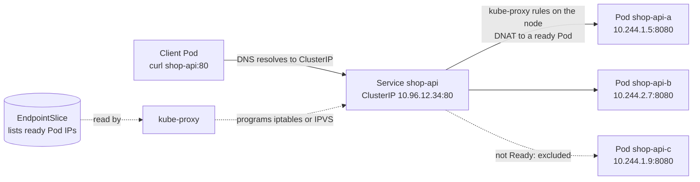
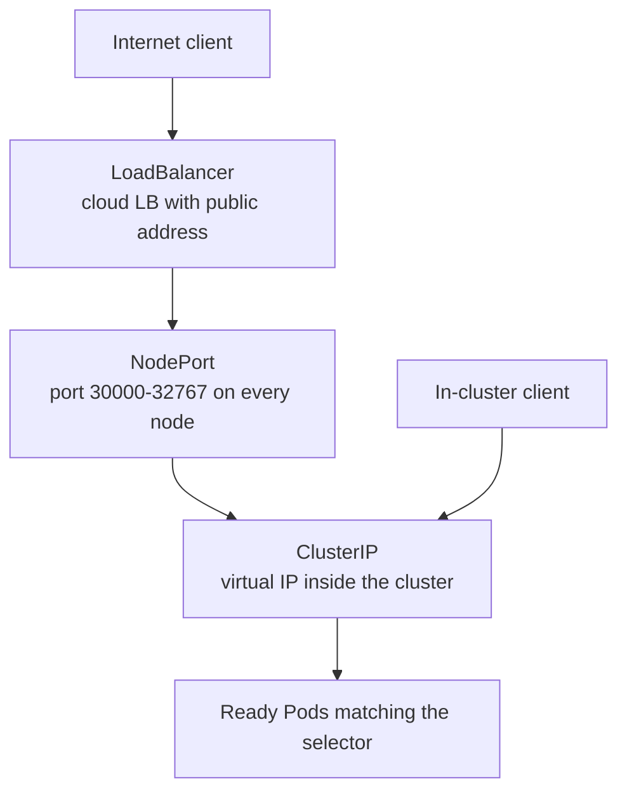

# L8.4 — Services

> **Level 8: Kubernetes** · Topic 4 of 19 · ⏱ ~4 hours · Difficulty: Intermediate

## 1. What it is

Pods are ephemeral: every replacement has a new IP address. A **Service** gives a group of Pods one **stable virtual IP and DNS
name** and spreads traffic across whichever of those Pods are currently healthy. Clients talk to `shop-api` (or
`shop-api.default.svc.cluster.local`) and never need to know which Pods exist.

A Service finds its Pods with a **label selector**, not by name. Kubernetes continuously turns "all Ready Pods matching the
selector" into a list of addresses, stored in **EndpointSlice** objects (the older `Endpoints` object still exists but is
deprecated). On every node, **kube-proxy** programs the kernel (iptables, IPVS or nftables rules) so a connection to the
Service IP is rewritten to one of those Pod IPs. There is no proxy process in the data path for the common modes: it is
kernel-level destination NAT.

## 2. Why it matters in DevOps

- **Service-to-service communication** in Kubernetes is Services plus DNS. `shop-api` reaches PostgreSQL at `postgres:5432`
  because of a Service ([Service Discovery](17-service-discovery.md)).
- **"It works with `kubectl port-forward` but not in the cluster"** is almost always a selector, port or readiness problem in a Service.
- **Exposing apps** to the outside (NodePort, LoadBalancer, then [Ingress](05-ingress.md)) is a core task, and a cloud LoadBalancer
  Service creates a billable resource.
- **Zero-downtime deploys** rely on a Service only routing to Ready Pods ([Deployments](03-deployments-and-replicasets.md)).

## 3. Real-world system example

**Cloud load balancers behind `type: LoadBalancer`.** On AWS, a Service of type `LoadBalancer` makes the cloud controller (or the
AWS Load Balancer Controller) provision a Network Load Balancer or Classic Load Balancer in your VPC, with health checks and
target registrations managed automatically; GKE and AKS do the equivalent. Because each such Service costs a cloud load balancer,
most companies put many HTTP services behind one Ingress controller instead.

**CoreDNS** itself is exposed through a ClusterIP Service named `kube-dns` in `kube-system`; every Pod's `/etc/resolv.conf` points
at that Service's IP, which is how `shop-api` resolves `postgres`. And the `kubernetes` Service in the `default` namespace is the
in-cluster address of the API server, used by controllers and operators.

## 4. Diagram



The three exposure types are layers, each building on the previous:



## 5. How it works

```yaml
apiVersion: v1
kind: Service
metadata:
  name: shop-api
spec:
  type: ClusterIP            # default
  selector:
    app: shop-api            # matches Pod labels, not the Deployment name
  ports:
    - name: http
      port: 80               # port the Service listens on
      targetPort: http       # container port (number or the port's name)
      protocol: TCP
```

| Type | What you get | Typical use |
|------|--------------|-------------|
| **ClusterIP** (default) | Virtual IP reachable only inside the cluster, plus DNS name | Databases, internal APIs, anything behind an Ingress |
| **NodePort** | ClusterIP plus a port (default range 30000-32767) opened on every node | Quick tests, on-prem setups with an external load balancer in front |
| **LoadBalancer** | NodePort plus an external load balancer from the cloud provider (or MetalLB on bare metal) | Exposing a TCP/UDP service directly to the internet |
| **ExternalName** | A DNS CNAME to an external hostname; no proxying | Pointing `db` at `mydb.example.com` (RDS, SaaS) |
| **Headless** (`clusterIP: None`) | No virtual IP; DNS returns the Pod IPs directly | StatefulSets and clients that need to pick individual Pods ([StatefulSets](10-statefulsets.md)) |

Details that cause real bugs:

- **Selector vs labels.** The Service selector must match the *Pod template labels*. A typo gives a Service with **zero endpoints**
  and every request fails with "connection refused" or times out.
- **`port` vs `targetPort` vs `nodePort`.** `port` is what clients use, `targetPort` is where the container listens, `nodePort` is
  the external node port. Using named ports (`targetPort: http`) lets you change container ports without touching the Service.
- **Readiness gates membership.** A Pod that is not Ready is removed from the EndpointSlice, so it receives no new connections.
  This is how rolling updates stay safe, and also why a failing readiness probe makes a Service "disappear".
- **Session affinity** (`sessionAffinity: ClientIP`) pins a client IP to one Pod; the default is effectively random per connection.
  Load balancing happens **per connection**, so long-lived gRPC or HTTP/2 connections stick to one Pod unless you use an L7 proxy or mesh.
- **`externalTrafficPolicy: Local`** on NodePort/LoadBalancer preserves the client source IP and avoids an extra hop, but only nodes
  running a backend Pod pass health checks.
- **Dual-stack and IP families** are configurable (`ipFamilies`), but most clusters are IPv4-only by default.
- **`kubectl get endpoints`** still works but the API is deprecated; prefer `kubectl get endpointslices`.

DNS names: `<service>.<namespace>.svc.cluster.local`, shortened to `<service>` inside the same namespace and `<service>.<namespace>` across namespaces. See [Namespaces](08-namespaces.md).

For the network fundamentals behind this (NAT, ports, L4 load balancing) see [Routing, NAT, Ports and Firewalls](../level-02-networking/04-routing-nat-ports-firewalls.md)
and [L4 versus L7 Load Balancing](../level-02-networking/09-l4-vs-l7-load-balancing.md).

## 6. Step-by-step guide

**Prerequisites:** the `devops` kind cluster ([topic 1](01-cluster-architecture.md)). Cost: free (kind). On a cloud cluster
`type: LoadBalancer` **creates a billable load balancer**; delete it when done. Output is illustrative.

1. **Deploy the backend.** A 3-replica Deployment (nginx as a `shop-api` stand-in) with a named port:
   ```yaml
   # backend.yaml
   apiVersion: apps/v1
   kind: Deployment
   metadata:
     name: shop-api
   spec:
     replicas: 3
     selector:
       matchLabels:
         app: shop-api
     template:
       metadata:
         labels:
           app: shop-api
       spec:
         containers:
           - name: app
             image: nginx:1.27
             ports:
               - name: http
                 containerPort: 80
             readinessProbe:
               httpGet: { path: /, port: http }
               periodSeconds: 3
   ```
   ```bash
   kubectl apply -f backend.yaml
   kubectl rollout status deploy/shop-api
   ```

2. **Create a ClusterIP Service** (the manifest in section 5) and inspect it.
   ```bash
   kubectl apply -f service.yaml
   kubectl get svc shop-api
   kubectl get endpointslices -l kubernetes.io/service-name=shop-api
   kubectl describe svc shop-api
   ```
   `describe` shows `Selector: app=shop-api` and `Endpoints:` with three Pod IPs. The same IPs appear in `kubectl get pods -o wide`.

3. **Call it from inside the cluster by DNS name.**
   ```bash
   kubectl run tmp --rm -it --image=curlimages/curl:8.10.1 --restart=Never -- curl -s -o /dev/null -w "%{http_code}\n" http://shop-api
   ```
   Expect `200`. Try the long name `http://shop-api.default.svc.cluster.local` too.

4. **See that traffic is spread over Pods.** Give each Pod a distinguishable page, then loop:
   ```bash
   for p in $(kubectl get pods -l app=shop-api -o name); do
     kubectl exec "$p" -- sh -c 'echo "hello from $HOSTNAME" > /usr/share/nginx/html/index.html'
   done
   kubectl run tmp --rm -it --image=curlimages/curl:8.10.1 --restart=Never -- sh -c 'for i in $(seq 1 9); do curl -s http://shop-api; done'
   ```
   You should see a mix of the three Pod names.

5. **Reach it from your laptop.** `port-forward` goes through the API server, not through the Service's data path, but is the
   easiest check:
   ```bash
   kubectl port-forward svc/shop-api 8080:80
   curl -s http://localhost:8080
   ```

6. **Expose it as a NodePort.** Replace `type: ClusterIP` with `type: NodePort` and add `nodePort: 30080` under the port, then apply.
   In kind the nodes are containers, so test from inside one:
   ```bash
   kubectl get svc shop-api
   docker exec devops-worker curl -s http://localhost:30080
   ```
   Expect the `hello from ...` text. To reach NodePorts from your laptop, kind needs an `extraPortMappings` entry for that port at cluster creation.

7. **Try `type: LoadBalancer`.** On kind the external address stays `<pending>` because no cloud controller exists:
   ```bash
   kubectl patch svc shop-api -p '{"spec":{"type":"LoadBalancer"}}'
   kubectl get svc shop-api
   ```
   `EXTERNAL-IP` shows `<pending>`. The kind project's `cloud-provider-kind` or MetalLB can provide addresses locally; on AWS/GCP/Azure
   you would get a real load balancer (and a bill). Set it back: `kubectl patch svc shop-api -p '{"spec":{"type":"ClusterIP"}}'`.

8. **Break it: wrong selector.** Change the Service selector to `app: shop-apii`, apply, and look:
   ```bash
   kubectl describe svc shop-api | grep -E 'Selector|Endpoints'
   kubectl run tmp --rm -it --image=curlimages/curl:8.10.1 --restart=Never -- curl -sv --max-time 3 http://shop-api
   ```
   `Endpoints:` is empty and the request times out or is refused. Fix the selector and re-apply.

9. **Break it: readiness.** Make one Pod unready by removing its index page's route: `kubectl exec <pod> -- rm /usr/share/nginx/html/index.html`
   (the probe path `/` now returns 403/404), then `kubectl get endpointslices -o yaml | grep -c ready` or `kubectl get pods`. The Pod
   shows `0/1`, and its IP drops out of the endpoints while it stays running.

10. **Clean up.**
    ```bash
    kubectl delete svc shop-api && kubectl delete deploy shop-api
    ```

## 7. Real-world scenario

*Illustrative scenario.* After a refactor, the platform team renames the label `app: shop-api` to
`app.kubernetes.io/name: shop-api` in the Deployment template to follow the recommended label convention, but forgets the Service.
The Deployment rolls out cleanly (the Pods are healthy) yet the storefront starts returning `503` from the Ingress. The
on-call engineer checks Pods (all Ready), then `kubectl get endpointslices -l kubernetes.io/service-name=shop-api` and sees an
**empty** endpoint list. `kubectl describe svc` shows the old selector. They update the Service selector and traffic recovers within seconds.
The team adds a CI check that renders manifests and fails when a Service selector matches no Pod template.
**Lesson:** "healthy Pods, broken traffic" means check the Service's endpoints first; the selector is a string-match contract.

## 8. Common mistakes and best practices

**Don't**

- Point clients at Pod IPs or hard-code ClusterIPs; use DNS names.
- Create one `type: LoadBalancer` per microservice on a cloud: each is a billable resource with its own public IP.
- Assume Services balance by request. They balance by connection, so one long-lived connection pins to one Pod.
- Forget that `NodePort` opens a port on every node; restrict it with cloud security groups.
- Select Pods with labels that other workloads also carry, accidentally adding foreign Pods as endpoints.

**Do**

- Use named ports and keep the selector identical to the Pod template labels (put the check in CI).
- Use ClusterIP for everything internal, and one Ingress controller or Gateway for HTTP from outside ([Ingress](05-ingress.md)).
- Debug in order: Service exists, selector matches Pods, Pods Ready, EndpointSlice populated, `targetPort` correct, NetworkPolicy ([NetworkPolicies](19-networkpolicies.md)) not blocking.
- Set `externalTrafficPolicy: Local` when you need the client source IP.
- Use headless Services for stateful, per-Pod addressing.

## 9. Tasks

- [ ] **T1 — Expose a Deployment internally** *(≈30 min, beginner)*
  - **Goal:** create a ClusterIP Service and call it by name.
  - **Steps:**
    1. Apply the backend Deployment and Service from this topic.
    2. From a temporary curl Pod, request `http://shop-api` and the fully qualified name.
    3. Run `kubectl get endpointslices -l kubernetes.io/service-name=shop-api -o wide`.
  - **Done when:** both names return HTTP 200 and the endpoint IPs equal the Pod IPs from `kubectl get pods -o wide`.

- [ ] **T2 — Watch endpoints follow Pods** *(≈30 min, beginner)*
  - **Goal:** prove the Service updates automatically.
  - **Steps:**
    1. In one terminal run `kubectl get endpointslices -l kubernetes.io/service-name=shop-api -w`... or `watch kubectl describe svc shop-api`.
    2. In another, scale the Deployment from 3 to 1 to 5, and delete a Pod.
  - **Done when:** the endpoint list shrinks and grows to match, and a deleted Pod's IP is replaced by its successor's.

- [ ] **T3 — NodePort and the three ports** *(≈40 min, intermediate)*
  - **Goal:** distinguish `port`, `targetPort` and `nodePort`.
  - **Steps:**
    1. Change the Service to `NodePort` with `port: 8080`, `targetPort: http`, `nodePort: 30080`.
    2. Reach it three ways: from a Pod to `shop-api:8080`, from a node via `localhost:30080` (`docker exec`), and via the ClusterIP and port.
    3. Change the container port to 8081 in the Deployment (named `http`) without editing the Service, and show it still works if nginx listens there (or explain why it breaks).
  - **Done when:** you can state which port each of the three tests used and why the named-port change did or did not need a Service edit.

- [ ] **T4 — Break and fix: zero endpoints** *(≈40 min, intermediate)*
  - **Goal:** diagnose an empty Service quickly.
  - **Steps:**
    1. Introduce each fault in turn: selector typo, wrong `targetPort` (e.g. 9999), Pods failing readiness.
    2. For each, record `kubectl describe svc`, the EndpointSlice content and the client error.
    3. Fix each.
  - **Done when:** you have a three-row table of fault, what the endpoints looked like, client symptom (refused vs timeout vs 503) and fix.

- [ ] **T5 — ExternalName and a headless Service** *(≈40 min, advanced)*
  - **Goal:** see DNS-only Services.
  - **Steps:**
    1. Create an `ExternalName` Service `payments` pointing at `example.com`; run `nslookup payments` from a Pod and note the CNAME.
    2. Create a headless Service (`clusterIP: None`) for `shop-api`; run `nslookup shop-api-headless` and compare with the normal Service's single IP.
  - **Done when:** the ExternalName lookup returns a CNAME, and the headless lookup returns one A record per Ready Pod.

- [ ] **T6 — Prove it: trace a request** *(≈30 min, advanced)*
  - **Goal:** explain how `curl shop-api` reaches a container.
  - **Steps:**
    1. Without notes, write the chain: DNS (CoreDNS) -> ClusterIP -> kube-proxy NAT rules -> Pod IP -> container port, naming which objects hold each piece of data.
    2. Show the kube-proxy rules for your Service on a node: `docker exec devops-worker sh -c 'iptables-save | grep shop-api'` (nodes run iptables mode in kind by default; output differs if your setup uses nftables or IPVS).
  - **Done when:** your written chain is correct and you found at least one `KUBE-SVC-`/`KUBE-SEP-` rule (or the equivalent for your proxy mode) that references your Service.

## 10. Self-check questions

1. How does a Service know which Pods to send traffic to?
2. A Service has no endpoints but all Pods are `Running`. Name three possible causes.
3. What is the difference between `port`, `targetPort` and `nodePort`?
4. Why is `type: LoadBalancer` per microservice usually a bad idea?
5. What does a headless Service return from DNS, and when do you need one?
6. Are requests or connections load balanced?

<details>
<summary>Answers</summary>

1. By label selector; matching Ready Pods are recorded in EndpointSlices and kube-proxy turns them into NAT rules.
2. Selector does not match the Pod labels; Pods are Running but not Ready (readiness probe failing); namespace mismatch (Service and Pods in different namespaces).
3. `port` is the Service's own port, `targetPort` is the container port traffic is sent to, `nodePort` is the port opened on every node for external access.
4. Each one creates a separate billable cloud load balancer and public IP; one shared Ingress or Gateway is cheaper and easier to manage.
5. It returns the individual Pod IPs (A records) instead of one virtual IP. Needed when clients must address specific Pods, as with StatefulSets and databases.
6. Connections (for TCP). Long-lived connections stay on one backend, so HTTP/2 and gRPC need L7 balancing.
</details>

## 11. Further reading

- Kubernetes documentation, *Concepts > Services, Load Balancing, and Networking > Service*, *EndpointSlices* and *DNS for Services and Pods*.
- Kubernetes documentation, *Debug Services* (a step-by-step troubleshooting guide).
- kind documentation, *LoadBalancer* and *Ingress* guides.
- *Kubernetes Networking* chapters in *Kubernetes in Action* (Marko Luksa) and *Networking and Kubernetes* by James Strong and Vallery Lancey.

<!-- nav -->
---
← Previous: [Deployments and ReplicaSets](03-deployments-and-replicasets.md) · [Level 8 index](README.md) · Next: [Ingress](05-ingress.md) →
