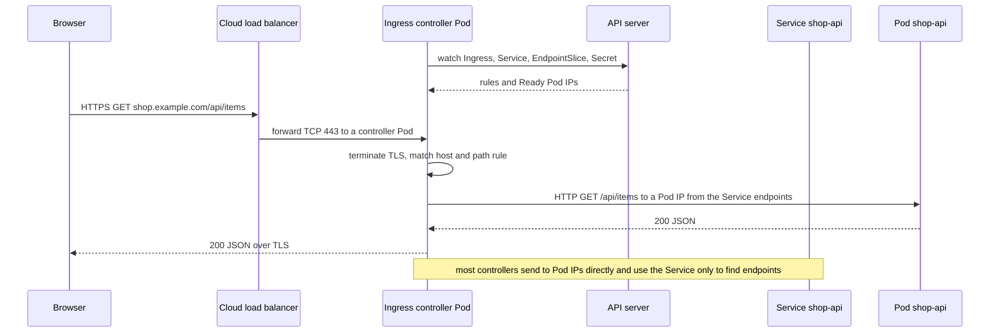
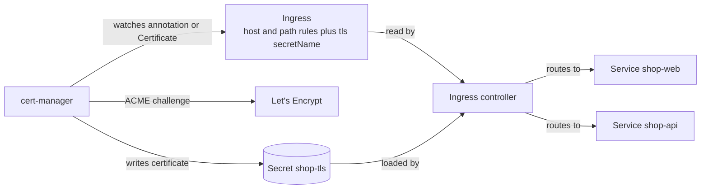

# L8.5 — Ingress

> **Level 8: Kubernetes** · Topic 5 of 19 · ⏱ ~4 hours · Difficulty: Intermediate

## 1. What it is

An **Ingress** is a Kubernetes object that describes how HTTP and HTTPS requests from outside the cluster should be routed to
Services inside it: "requests for `shop.example.com/api` go to Service `shop-api`, requests for `shop.example.com/` go to Service
`shop-web`, and terminate TLS with this certificate". It is a routing **rule**, nothing more. By itself an Ingress does nothing.

The rules are carried out by an **Ingress controller**: a normal workload (usually a Deployment of NGINX, Envoy, HAProxy or Traefik
Pods) that watches Ingress objects through the API server and reconfigures itself to match. The controller is the reverse proxy
([Reverse Proxies and Load Balancers](../level-02-networking/08-reverse-proxies-and-load-balancers.md)); the Ingress is its
configuration, expressed in the Kubernetes API. An `ingressClassName` field on the Ingress selects which controller owns it, so
several controllers can coexist.

> **Status note.** The Ingress API (`networking.k8s.io/v1`) is stable and widely used, but it is frozen: new routing features
> are going into the **Gateway API** (`gateway.networking.k8s.io`), its successor. Also, the community **ingress-nginx** controller
> announced its retirement in November 2025, with best-effort maintenance only until March 2026. Existing installs keep working,
> but for new production clusters pick a maintained controller or a Gateway API implementation. The concepts in this topic
> (host and path routing, TLS termination, controller plus rules) transfer unchanged.

## 2. Why it matters in DevOps

- **Cost.** A `type: LoadBalancer` Service per app creates one billable cloud load balancer each. One Ingress controller behind a
  single load balancer can serve dozens of hostnames ([Services](04-services.md)).
- **TLS in one place.** Certificates, redirects from HTTP to HTTPS and security headers are configured at the edge instead of in every app.
- **A top source of 404/502/503 incidents.** "Default backend 404", "502 Bad Gateway" and "503 Service Temporarily Unavailable" at the
  edge map to specific, learnable causes: wrong host or path, a Service with no endpoints, a wrong port, or an unready Pod.
- **Deployment strategy hook.** Canary, blue/green and header-based routing are frequently implemented by the controller
  ([Deployment Strategies](../level-00-what-devops-is/07-deployment-strategies.md)).
- **Security surface.** The Ingress controller is the one component directly reachable from the internet. Its version, its
  configuration permissions and who may create Ingress objects all matter.

## 3. Real-world system example

**Kubernetes' own ecosystem of controllers.** The Kubernetes project maintains the Ingress API but ships no controller; instead
many exist: NGINX-based controllers (the community ingress-nginx, and a separate one from F5 NGINX), **Traefik**, **HAProxy Ingress**,
**Envoy**-based ones such as Contour and Emissary, and cloud-integrated ones. On AWS, the **AWS Load Balancer Controller** turns an
Ingress into an **Application Load Balancer** (ALB) outside the cluster, with targets registered per Pod; GKE and Azure AKS similarly have
native controllers that provision managed L7 load balancers. This is the same Ingress YAML with a different `ingressClassName` and
different annotations, which is exactly why annotations are the portability trap (section 8).

**cert-manager** (a CNCF project) is the standard way to get TLS certificates onto Ingresses: it requests certificates from
**Let's Encrypt** (via the ACME protocol) or an internal CA, stores them as Secrets, and renews them before they expire, driven by
an annotation or a `Certificate` resource.

## 4. Diagram



How the pieces relate, and how cert-manager fits in:



## 5. How it works

A complete Ingress for `shop-api`:

```yaml
apiVersion: networking.k8s.io/v1
kind: Ingress
metadata:
  name: shop
spec:
  ingressClassName: nginx          # which controller handles this Ingress
  tls:
    - hosts: [shop.example.com]
      secretName: shop-tls         # Secret of type kubernetes.io/tls with tls.crt and tls.key
  rules:
    - host: shop.example.com
      http:
        paths:
          - path: /api
            pathType: Prefix
            backend:
              service:
                name: shop-api
                port:
                  number: 80
          - path: /
            pathType: Prefix
            backend:
              service:
                name: shop-web
                port:
                  number: 80
```

| Concept | Meaning |
|---------|---------|
| **IngressClass** | A cluster-scoped object naming a controller (`spec.controller`). Pods of that controller only act on Ingresses whose `ingressClassName` matches. One class may be marked default. |
| **Host rule** | Matches the HTTP `Host` header (or TLS SNI). Omit `host` to match every host. A leading wildcard such as `*.example.com` matches exactly one DNS label. |
| **Path rule** | `pathType: Exact` matches the exact path. `Prefix` matches by `/`-separated path segments (`/api` matches `/api` and `/api/items` but not `/apiary`). `ImplementationSpecific` leaves matching to the controller. |
| **Precedence** | When several paths match, the longest match wins; Exact beats Prefix. |
| **Default backend** | Where unmatched requests go. Without one, most controllers return their own 404 page. |
| **TLS termination** | The controller holds the certificate from the `tls.secretName` Secret, decrypts, and talks plain HTTP to Pods. Re-encryption or passthrough are controller-specific options. |
| **Annotations** | Controller-specific settings (rewrites, timeouts, body size, auth). Powerful but **not portable** between controllers. |

How TLS is automated with **cert-manager** (installed separately, usually with Helm or its release manifest):

1. You create a `ClusterIssuer` describing a CA, for example Let's Encrypt (`server: https://acme-v02.api.letsencrypt.org/directory`)
   with an HTTP-01 solver that uses your Ingress class.
2. You annotate the Ingress with `cert-manager.io/cluster-issuer: letsencrypt-prod` and list `tls` hosts and `secretName`.
3. cert-manager creates a `Certificate`, completes the ACME challenge (it temporarily adds a route for
   `/.well-known/acme-challenge/...`), stores the issued certificate in the Secret and renews it ahead of expiry (by default
   once a third of its lifetime remains, which is about 30 days for a 90-day Let's Encrypt certificate). Let's Encrypt's staging server (`acme-staging-v02`) is for testing so you do not hit rate limits.
4. Let's Encrypt validates **public** DNS names, so on a laptop kind cluster use cert-manager's `selfSigned` issuer or a private
   CA instead; wildcard certificates need the DNS-01 challenge.

Limits of Ingress that push people to the Gateway API: it covers only HTTP(S); anything beyond host and path (header matching,
weights, redirects, TCP/UDP) lives in non-portable annotations; and one object serves both platform and application teams.
Gateway API separates a `GatewayClass` and `Gateway` (owned by the platform team) from `HTTPRoute` objects (owned by app teams).
See also [Services](04-services.md), [L4 versus L7 Load Balancing](../level-02-networking/09-l4-vs-l7-load-balancing.md) and
[TLS](../level-12-advanced-networking/04-tls.md).

## 6. Step-by-step guide

**Prerequisites:** the three-node `devops` kind cluster from [topic 1](01-cluster-architecture.md), created with the
`ingress-ready=true` label and ports 80/443 mapped to your machine, plus `kubectl` and `openssl`. Cost: free. Output below is illustrative.

> The lab installs **ingress-nginx** because it ships an official kind manifest and is the simplest way to see an Ingress working
> locally. It is retired (see the status note), so treat it as a learning tool, not a production recommendation. Everything you
> write (the Ingress objects) works with any other controller by changing `ingressClassName`.

1. **Install the controller** (pinned release for kind):
   ```bash
   kubectl apply -f https://raw.githubusercontent.com/kubernetes/ingress-nginx/controller-v1.12.0/deploy/static/provider/kind/deploy.yaml
   kubectl wait --namespace ingress-nginx --for=condition=ready pod \
     --selector=app.kubernetes.io/component=controller --timeout=120s
   ```
   Expect `pod/ingress-nginx-controller-... condition met`. Also run `kubectl get ingressclass`; you should see a class named `nginx`.
   The kind variant schedules the controller on the node labelled `ingress-ready=true` and uses host ports 80/443.

2. **Deploy two backends** that answer differently:
   ```yaml
   # apps.yaml
   apiVersion: apps/v1
   kind: Deployment
   metadata:
     name: shop-api
   spec:
     replicas: 2
     selector:
       matchLabels: { app: shop-api }
     template:
       metadata:
         labels: { app: shop-api }
       spec:
         containers:
           - name: app
             image: hashicorp/http-echo:1.0
             args: ["-listen=:8080", "-text=hello from shop-api"]
             ports:
               - name: http
                 containerPort: 8080
   ---
   apiVersion: v1
   kind: Service
   metadata:
     name: shop-api
   spec:
     selector: { app: shop-api }
     ports:
       - port: 80
         targetPort: http
   ---
   apiVersion: apps/v1
   kind: Deployment
   metadata:
     name: shop-web
   spec:
     replicas: 2
     selector:
       matchLabels: { app: shop-web }
     template:
       metadata:
         labels: { app: shop-web }
       spec:
         containers:
           - name: app
             image: hashicorp/http-echo:1.0
             args: ["-listen=:8080", "-text=hello from shop-web"]
             ports:
               - name: http
                 containerPort: 8080
   ---
   apiVersion: v1
   kind: Service
   metadata:
     name: shop-web
   spec:
     selector: { app: shop-web }
     ports:
       - port: 80
         targetPort: http
   ```
   ```bash
   kubectl apply -f apps.yaml
   kubectl rollout status deploy/shop-api && kubectl rollout status deploy/shop-web
   ```

3. **Create host and path routing** (HTTP only first). Save as `ingress.yaml`:
   ```yaml
   apiVersion: networking.k8s.io/v1
   kind: Ingress
   metadata:
     name: shop
   spec:
     ingressClassName: nginx
     rules:
       - host: shop.example.com
         http:
           paths:
             - path: /api
               pathType: Prefix
               backend:
                 service:
                   name: shop-api
                   port:
                     number: 80
             - path: /
               pathType: Prefix
               backend:
                 service:
                   name: shop-web
                   port:
                     number: 80
   ```
   ```bash
   kubectl apply -f ingress.yaml
   kubectl get ingress shop
   kubectl describe ingress shop
   ```
   `describe` lists the rules and, under `Backends`, the Pod IPs behind each Service. The `ADDRESS` column may take a few seconds or stay `localhost`/empty on kind.

4. **Test routing without touching DNS.** Send the `Host` header yourself, or use `curl --resolve`:
   ```bash
   curl -s -H "Host: shop.example.com" http://localhost/api
   curl -s -H "Host: shop.example.com" http://localhost/
   curl -s -i -H "Host: other.example.com" http://localhost/ | head -1
   ```
   Expect `hello from shop-api`, `hello from shop-web`, and `HTTP/1.1 404 Not Found` (no rule for that host, so the controller's default backend answers).
   If port 80 was remapped to 8080 in your kind config, use `http://localhost:8080`.

5. **Add TLS with a self-signed certificate** (a real cluster would use cert-manager here):
   ```bash
   openssl req -x509 -nodes -newkey rsa:2048 -days 30 -keyout tls.key -out tls.crt \
     -subj "/CN=shop.example.com" -addext "subjectAltName=DNS:shop.example.com"
   kubectl create secret tls shop-tls --cert=tls.crt --key=tls.key
   ```
   Add this block under `spec:` of the Ingress (next to `rules:`), then apply:
   ```yaml
   tls:
     - hosts: [shop.example.com]
       secretName: shop-tls
   ```
   ```bash
   kubectl apply -f ingress.yaml
   curl -s --cacert tls.crt --resolve shop.example.com:443:127.0.0.1 https://shop.example.com/api
   curl -sI http://localhost -H "Host: shop.example.com" | head -3
   ```
   The HTTPS call prints `hello from shop-api`, verified against your own certificate. The plain-HTTP request now returns a
   `308 Permanent Redirect` to HTTPS, which is ingress-nginx's default once TLS is configured for a host.

6. **Inspect what the controller generated.** The Ingress was translated into proxy configuration:
   ```bash
   kubectl -n ingress-nginx exec deploy/ingress-nginx-controller -- grep -n "server_name shop.example.com" /etc/nginx/nginx.conf
   kubectl -n ingress-nginx logs deploy/ingress-nginx-controller --tail=5
   ```
   You see a `server` block for your host and access-log lines with the upstream Pod IP and status.

7. **Break it: wrong Service port.** Change the `/api` backend port number to `8080` (the Service listens on 80), apply, and request `/api`:
   ```bash
   curl -s -i -H "Host: shop.example.com" http://localhost/api -k | head -1
   kubectl -n ingress-nginx logs deploy/ingress-nginx-controller --tail=3
   ```
   The controller reports a missing Service port and returns `503`. Restore `80`.

8. **Break it: no endpoints.** Scale `shop-api` to zero: `kubectl scale deploy/shop-api --replicas=0`. Request `/api`: you get
   `503 Service Temporarily Unavailable`. Scale back to 2 and it recovers without touching the Ingress.

9. **Clean up.**
   ```bash
   kubectl delete ingress shop && kubectl delete secret shop-tls
   kubectl delete -f apps.yaml
   rm -f tls.key tls.crt
   ```
   Leave the controller installed for later topics, or remove it with `kubectl delete ns ingress-nginx` plus the manifest.

**Optional (needs a public cluster and a real domain, may cost money for the cluster):** install cert-manager from its
documented release manifest, create a Let's Encrypt **staging** `ClusterIssuer`, add `cert-manager.io/cluster-issuer: <name>` to
the Ingress, and watch `kubectl get certificate -w` until `READY=True`.

## 7. Real-world scenario

*Illustrative scenario.* The `shop-api` team launches a new `/checkout` route behind a shared Ingress. After the deploy, ten
percent of requests to `https://shop.example.com/checkout` return `502 Bad Gateway`, but only for large payloads. The on-call
engineer checks the application: Pods are Ready and logs show nothing. The controller log shows `upstream sent too big header`
for some responses and `client intended to send too large body` on others. The controller's default request body limit (1 MB in
ingress-nginx) rejects uploads of product images, and a large session cookie overflows the proxy's header buffer. They raise
the limits with per-Ingress annotations for `/checkout`, and move the settings into a documented values file.
Later the team discovers that the staging cluster, running a different controller, ignores those annotations entirely.
**Lesson:** errors generated at the edge are in the controller's logs, not the app's; and annotations tie your manifests to one controller,
so record them and test on the same controller you run in production.

## 8. Common mistakes and best practices

**Don't**

- Create an Ingress and expect it to work without a controller or with the wrong `ingressClassName`; check `kubectl get ingressclass`.
- Point two teams' Ingresses at the same host and path; the behaviour is controller-specific and often surprising.
- Rely on controller annotations as a portable API, or let every namespace's users create arbitrary annotations (some allow
  injecting raw proxy config; that is a security risk in multi-tenant clusters).
- Terminate TLS with certificates committed to Git or copied by hand; they expire silently and take the site down.
- Put the Ingress controller's Service on `NodePort` in production without a load balancer and firewall in front.
- Start a new platform on a retired or unmaintained controller; check project health before adopting.

**Do**

- Run the controller with 2+ replicas, spread across nodes and zones, with resource requests ([Resource Requests and Limits](14-resource-requests-and-limits.md)).
- Automate certificates with cert-manager, test with the Let's Encrypt staging endpoint, and alert on certificates nearing expiry.
- Debug in order: DNS resolves to the load balancer, request reaches the controller (its logs), Host and path match a rule, the
  backend Service has endpoints ([Services](04-services.md)), the Pod answers on that port.
- Keep Ingress objects in the same namespace as their backend Services (an Ingress can only reference Services in its own namespace).
- Evaluate the Gateway API for new work, especially where platform and app teams need separate ownership.
- Restrict direct Pod access with NetworkPolicies so only the controller can reach app Pods ([NetworkPolicies](19-networkpolicies.md)).

## 9. Tasks

- [ ] **T1 — Route two paths through one Ingress** *(≈45 min, beginner)*
  - **Goal:** serve two Services from one host with path routing.
  - **Steps:**
    1. Install the controller and apply `apps.yaml` and `ingress.yaml` from this topic.
    2. Request `/api` and `/` with `curl -H "Host: shop.example.com"`.
    3. Run `kubectl describe ingress shop`.
  - **Done when:** `/api` returns `hello from shop-api`, `/` returns `hello from shop-web`, and `describe` shows both backends with Pod IPs.

- [ ] **T2 — Add a second host** *(≈30 min, beginner)*
  - **Goal:** use name-based virtual hosting.
  - **Steps:**
    1. Add a rule for `admin.example.com` routing `/` to a new Service of your choice (another `http-echo` Deployment).
    2. Test with the `Host` header and with `curl --resolve admin.example.com:80:127.0.0.1 http://admin.example.com/`.
    3. Request an unknown host.
  - **Done when:** the three hosts return three different responses and the unknown host returns the controller's 404.

- [ ] **T3 — Terminate TLS** *(≈45 min, intermediate)*
  - **Goal:** serve HTTPS from a Secret.
  - **Steps:**
    1. Create a self-signed certificate and `kubernetes.io/tls` Secret as in step 5.
    2. Reference it in `spec.tls` and verify with `curl --cacert ... --resolve ...`.
    3. Run `openssl s_client -connect localhost:443 -servername shop.example.com </dev/null 2>/dev/null | openssl x509 -noout -subject -dates`.
  - **Done when:** the subject shows `CN=shop.example.com`, HTTPS returns the app response, and HTTP redirects to HTTPS.

- [ ] **T4 — Break and fix: three edge errors** *(≈50 min, intermediate)*
  - **Goal:** map edge status codes to causes.
  - **Steps:**
    1. Produce a 404 (wrong host), a 503 (zero replicas), and a 503 or 502 (wrong Service port).
    2. For each, capture the response status, the controller log line and the output of `kubectl get endpointslices -l kubernetes.io/service-name=<svc>`.
    3. Fix each and verify `200`.
  - **Done when:** you have a three-row table of symptom, log evidence, cause and fix, and all three requests return `200` afterwards.

- [ ] **T5 — Plan certificate automation** *(≈60 min, advanced)*
  - **Goal:** configure cert-manager on a cluster where it can work.
  - **Steps:**
    1. Install cert-manager following its documentation; create a `selfSigned` `ClusterIssuer`.
    2. Remove the manual Secret, add the `cert-manager.io/cluster-issuer` annotation to the Ingress, and watch `kubectl get certificate,certificaterequest`.
    3. Delete the Secret and observe it being reissued.
  - **Done when:** `kubectl get certificate` shows `READY True`, the Secret exists without you creating it, and you can explain which part Let's Encrypt would replace on a public cluster.

- [ ] **T6 — Prove it: explain a request end to end** *(≈30 min, advanced)*
  - **Goal:** narrate `https://shop.example.com/api/items` from browser to container.
  - **Steps:**
    1. Without notes, write the chain: DNS, load balancer, controller Pod, TLS termination, host and path match, Service endpoints, Pod.
    2. Name the Kubernetes object that holds each decision (Ingress, IngressClass, Secret, EndpointSlice).
    3. Demonstrate it live by tailing the controller log while sending one request, and point to your request in the log.
  - **Done when:** your chain is correct, and you can say what you would check first for each of 404, 502, 503 and a certificate warning.

## 10. Self-check questions

1. What is the difference between an Ingress and an Ingress controller?
2. Why is one Ingress controller usually cheaper than a `LoadBalancer` Service per app?
3. Does `path: /api` with `pathType: Prefix` match `/apiary`? What decides between two matching paths?
4. Where does the TLS certificate for an Ingress live, and who renews it?
5. A request returns 404 from the controller, and another returns 503. What does each tell you?
6. Why are Ingress annotations a portability and security concern, and what is replacing the Ingress API?

<details>
<summary>Answers</summary>

1. The Ingress is only a set of routing rules stored in the API. The controller is a running proxy that watches those rules and carries them out. Without a controller (and a matching class) an Ingress does nothing.
2. Each `LoadBalancer` Service creates its own billable cloud load balancer and public IP. An Ingress controller sits behind one load balancer and routes many hosts and paths by HTTP rules.
3. No. `Prefix` matches whole path segments, so `/api` matches `/api` and `/api/...` but not `/apiary`. The longest matching path wins, and `Exact` beats `Prefix`.
4. In a Secret of type `kubernetes.io/tls` named by `spec.tls[].secretName`, in the Ingress's namespace. cert-manager (or a person) creates and renews it; the controller reloads it.
5. 404 means the controller answered but found no rule for that host and path (or no default backend). 503 means a rule matched but the backend Service has no Ready endpoints or an invalid port. 502 means the connection to a Pod failed or the Pod sent a bad response.
6. Annotations are controller-specific, so manifests do not move between controllers, and permissive ones can inject raw proxy configuration. The Gateway API (Gateway, HTTPRoute) is the successor with typed, portable fields and role separation.
</details>

## 11. Further reading

- Kubernetes documentation, *Concepts > Services, Load Balancing, and Networking > Ingress*, *Ingress Controllers* and *Gateway API*.
- Kubernetes blog, *Ingress NGINX Retirement: What You Need to Know* (November 2025).
- cert-manager documentation, *Securing Ingress Resources* and *ACME issuers*.
- Gateway API documentation (gateway-api.sigs.k8s.io), *Migrating from Ingress*.
- kind documentation, *Ingress* guide.

<!-- nav -->
---
← Previous: [Services](04-services.md) · [Level 8 index](README.md) · Next: [ConfigMaps](06-configmaps.md) →
