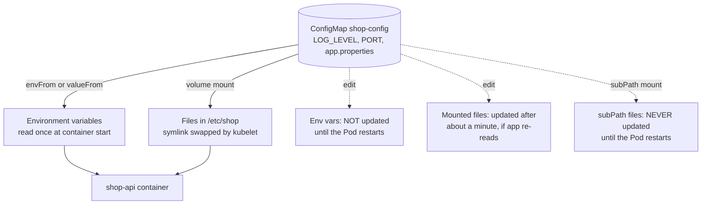

# L8.6 — ConfigMaps

> **Level 8: Kubernetes** · Topic 6 of 19 · ⏱ ~3 hours · Difficulty: Beginner

## 1. What it is

A **ConfigMap** is a Kubernetes object that stores non-confidential configuration as key-value pairs, so the same container
image can run unchanged in dev, staging and production. A key can hold a short value (`LOG_LEVEL: info`) or a whole file
(`nginx.conf`, `app.properties`). This is the Kubernetes version of the twelve-factor rule "store config in the environment":
the image contains code, the cluster contains configuration.

Pods consume a ConfigMap in three ways: as **environment variables**, as **files in a mounted volume**, or by having the
application read it through the API (rare). A ConfigMap is limited to about 1 MiB in total because it lives in etcd
([Cluster, Nodes and Control Plane](01-cluster-architecture.md)). Anything confidential (passwords, tokens, private keys)
belongs in a [Secret](07-secrets.md), not here.

## 2. Why it matters in DevOps

- **One image, many environments.** Rebuilding an image to change a log level or a URL breaks the "build once, deploy many"
  principle of [CI/CD](../level-00-what-devops-is/02-ci-cd.md) and [Immutable Infrastructure](../level-00-what-devops-is/05-immutable-infrastructure.md).
- **The classic surprise:** you edit a ConfigMap and nothing changes in the running app. Whether and when a change reaches a
  Pod depends on how it is consumed (env var versus volume), and that confuses almost every newcomer.
- **Config is code.** ConfigMaps belong in Git, reviewed like application changes. A one-character typo in a mounted
  `nginx.conf` can take down every Pod at the next restart.
- **Blast radius.** A ConfigMap shared by 40 Deployments changes behaviour for all of them at once. Immutable, versioned ConfigMaps limit that.

## 3. Real-world system example

**Kubernetes' own components and add-ons use ConfigMaps for their configuration.** CoreDNS reads its `Corefile` from a ConfigMap
named `coredns` in `kube-system`, and kubeadm stores the cluster configuration in the `kubeadm-config` ConfigMap there. You can
inspect the CoreDNS one on any cluster. Prometheus installations on Kubernetes commonly keep scrape and alerting rules in
ConfigMaps (the Prometheus Operator generates them), and the NGINX ingress controller used ConfigMaps for global proxy settings.

**Helm and Kustomize** (later levels) lean on a related pattern: `configMapGenerator` in Kustomize appends a hash of the content
to the ConfigMap name, so changing the data changes the name and therefore triggers a rolling update of every Deployment that
references it. That solves the "rollout on change" problem described below.

## 4. Diagram



## 5. How it works

Create a ConfigMap declaratively:

```yaml
apiVersion: v1
kind: ConfigMap
metadata:
  name: shop-config
data:
  LOG_LEVEL: info                  # simple key-value
  PORT: "8080"                     # values are always strings: quote numbers and booleans
  app.properties: |                # a whole file as one key
    feature.checkout=true
    cache.ttl=60
```

Consume it in a Pod template:

```yaml
spec:
  containers:
    - name: app
      image: nginx:1.27
      env:
        - name: LOG_LEVEL          # one key, renamed
          valueFrom:
            configMapKeyRef:
              name: shop-config
              key: LOG_LEVEL
      envFrom:
        - configMapRef:            # every key becomes an env var
            name: shop-config
      volumeMounts:
        - name: config
          mountPath: /etc/shop
          readOnly: true
  volumes:
    - name: config
      configMap:
        name: shop-config
        items:                     # optional: choose keys and file names
          - key: app.properties
            path: app.properties
```

| Aspect | Environment variable | Mounted volume |
|--------|---------------------|----------------|
| Best for | Simple scalars, 12-factor apps | Whole files, config the app re-reads |
| Updates on edit | **No.** Fixed at container start | **Yes**, eventually (kubelet sync period plus cache delay, typically within a minute or two) |
| Update with `subPath` | n/a | **No.** `subPath` mounts never receive updates |
| App must | Be restarted | Watch or re-read the file |
| Limits | Name rules (valid env names), visible in `kubectl describe` and `/proc` | Key names become file names |

Other facts worth knowing:

- **`binaryData`** holds binary content (base64 encoded); `data` holds UTF-8 text.
- **Optional references.** `optional: true` lets a Pod start when the ConfigMap or key is missing. By default a missing ConfigMap
  leaves the Pod stuck in `ContainerCreating` or `CreateContainerConfigError`, which is a useful loud failure.
- **Immutable ConfigMaps.** Setting `immutable: true` makes the data read-only (you must delete and recreate to change it). It
  protects against accidental edits and lets the kubelet stop watching it, which reduces load on the API server in big clusters.
- **Rollout on change.** Kubernetes does *not* restart Pods when a ConfigMap changes. Common solutions:
  1. `kubectl rollout restart deploy/shop-api` (manual, simple).
  2. Put a hash of the ConfigMap in a Pod template annotation (Helm: `checksum/config: {{ include ... | sha256sum }}`), so any change edits the template and triggers a rolling update.
  3. Create **versioned immutable ConfigMaps** (`shop-config-v7`, or Kustomize's generated hash suffix) and point the Deployment at the new name; rolling back is changing the name back ([Deployments and ReplicaSets](03-deployments-and-replicasets.md)).
  4. Run a sidecar or use an app that reloads on file change (for example by watching the file or handling `SIGHUP`).
- **Creating from files:** `kubectl create configmap shop-config --from-file=app.properties --from-literal=LOG_LEVEL=info --dry-run=client -o yaml` generates the YAML for Git.
- **Namespaced:** a Pod can only reference ConfigMaps in its own namespace ([Namespaces](08-namespaces.md)).

## 6. Step-by-step guide

**Prerequisites:** the `devops` kind cluster ([topic 1](01-cluster-architecture.md)). Cost: free. Outputs are illustrative.

1. **Create the ConfigMap** from literals and a file:
   ```bash
   cat > app.properties <<'EOF'
   feature.checkout=true
   cache.ttl=60
   EOF
   kubectl create configmap shop-config --from-literal=LOG_LEVEL=info --from-literal=PORT=8080 --from-file=app.properties
   kubectl get configmap shop-config -o yaml
   ```
   You see `data:` with three keys; the file's name became a key.

2. **Consume it as both env vars and a file.** Save and apply:
   ```yaml
   # config-demo.yaml
   apiVersion: apps/v1
   kind: Deployment
   metadata:
     name: config-demo
   spec:
     replicas: 1
     selector:
       matchLabels: { app: config-demo }
     template:
       metadata:
         labels: { app: config-demo }
       spec:
         containers:
           - name: app
             image: busybox:1.36
             command: ["sh", "-c", "while true; do echo \"LOG_LEVEL=$LOG_LEVEL\"; cat /etc/shop/app.properties; sleep 30; done"]
             envFrom:
               - configMapRef:
                   name: shop-config
             volumeMounts:
               - name: config
                 mountPath: /etc/shop
         volumes:
           - name: config
             configMap:
               name: shop-config
   ```
   ```bash
   kubectl apply -f config-demo.yaml
   kubectl rollout status deploy/config-demo
   kubectl logs deploy/config-demo
   ```
   Expect `LOG_LEVEL=info` followed by the two properties.

3. **Edit the ConfigMap and watch what updates.**
   ```bash
   kubectl patch configmap shop-config --type merge -p '{"data":{"LOG_LEVEL":"debug","app.properties":"feature.checkout=false\ncache.ttl=120\n"}}'
   sleep 90
   kubectl exec deploy/config-demo -- sh -c 'echo "env: $LOG_LEVEL"; cat /etc/shop/app.properties'
   ```
   Typically the file shows the new values (after up to a minute or two) while `env:` still prints `info`. That is the central lesson of this topic.

4. **Trigger a rollout.** Restart so the env var is re-read:
   ```bash
   kubectl rollout restart deploy/config-demo
   kubectl rollout status deploy/config-demo
   kubectl exec deploy/config-demo -- sh -c 'echo "env: $LOG_LEVEL"'
   ```
   Now it prints `debug`.

5. **Make it automatic with a content hash.** Add a Pod template annotation derived from the config, then change the config:
   ```bash
   HASH=$(kubectl get configmap shop-config -o yaml | sha256sum | cut -c1-12)
   kubectl patch deploy config-demo -p "{\"spec\":{\"template\":{\"metadata\":{\"annotations\":{\"checksum/config\":\"$HASH\"}}}}}"
   kubectl rollout status deploy/config-demo
   ```
   Re-run the two lines after each config change and the Deployment rolls. (Helm and Kustomize do this for you.)

6. **Make a versioned immutable ConfigMap.**
   ```bash
   kubectl create configmap shop-config-v1 --from-literal=LOG_LEVEL=warn --dry-run=client -o yaml \
     | sed '/^data:/i immutable: true' | kubectl apply -f -
   kubectl patch configmap shop-config-v1 --type merge -p '{"data":{"LOG_LEVEL":"error"}}'
   ```
   The patch is rejected with an error like `field is immutable when 'immutable' is set`. To change it you create `shop-config-v2` and switch the Deployment to it.

7. **Break it: missing ConfigMap.** Change `name: shop-config` in the Deployment's `envFrom` to `shop-confg`, apply, and run:
   ```bash
   kubectl get pods -l app=config-demo
   kubectl describe pod -l app=config-demo | grep -A3 -i 'warning\|state:'
   ```
   The new Pod shows `CreateContainerConfigError` with `configmap "shop-confg" not found`, while the old Pod keeps running, because the rolling update never gets a Ready replacement. Fix the name.

8. **Clean up.**
   ```bash
   kubectl delete deploy config-demo
   kubectl delete configmap shop-config shop-config-v1
   rm -f app.properties
   ```

## 7. Real-world scenario

*Illustrative scenario.* A team enables a new rate-limit setting for `shop-api` by editing the ConfigMap `shop-config` in production.
Nothing happens, so an engineer assumes the edit was lost and applies it again, then "fixes" it by deleting a few Pods. Those
Pods restart with the new env var, the others keep the old value, and for an hour half the fleet limits at 100 requests a minute
and half at 1000. Customers see inconsistent `429` responses depending on which Pod they hit. The incident review finds that
the value was an environment variable (read only at start) and that Pods had been restarted ad hoc. The fix: the Helm chart now adds a
`checksum/config` annotation so every config change triggers a normal rolling update, and production ConfigMaps are versioned and immutable.
**Lesson:** config changes need the same controlled rollout as code changes, and mixed versions are a symptom of manual restarts.

## 8. Common mistakes and best practices

**Don't**

- Store passwords, tokens or private keys in a ConfigMap; they are not protected beyond normal RBAC and appear in plain text ([Secrets](07-secrets.md)).
- Expect env vars to update when a ConfigMap changes.
- Mount a single file with `subPath` and expect live updates.
- Edit production ConfigMaps by hand with `kubectl edit`; Git and the deploy tool then disagree.
- Forget to quote numbers and booleans in `data` (values must be strings).
- Put huge files (near the 1 MiB limit) in a ConfigMap.

**Do**

- Keep ConfigMaps in Git, one per concern, and review changes like code.
- Use versioned, `immutable: true` ConfigMaps (or a content-hash annotation) so config changes roll out and roll back like Deployments.
- Use `envFrom` for twelve-factor style settings and volumes for files; mount read-only.
- Validate config in CI (for example `nginx -t` on a rendered `nginx.conf`) before it reaches the cluster.
- Let missing ConfigMaps fail loudly (do not set `optional: true` unless a default really is safe).

## 9. Tasks

- [ ] **T1 — Inject config two ways** *(≈30 min, beginner)*
  - **Goal:** consume one ConfigMap as env vars and as a file.
  - **Steps:**
    1. Create `shop-config` and the `config-demo` Deployment from this topic.
    2. Read both forms with `kubectl logs` and `kubectl exec`.
  - **Done when:** the logs show `LOG_LEVEL=info` and the contents of `app.properties`.

- [ ] **T2 — Observe the update asymmetry** *(≈30 min, beginner)*
  - **Goal:** prove which consumption method updates live.
  - **Steps:**
    1. Patch the ConfigMap values.
    2. After 90 seconds read the env var and the mounted file in the same Pod.
    3. Repeat with a second container that mounts the file using `subPath`.
  - **Done when:** you have a three-row table (env var, volume, subPath) of "updated: yes/no" matching your observations.

- [ ] **T3 — Roll out on change** *(≈45 min, intermediate)*
  - **Goal:** make a config edit restart Pods automatically.
  - **Steps:**
    1. Add a `checksum/config` annotation to the Pod template as in step 5.
    2. Change a ConfigMap value, recompute the hash, patch it.
    3. Watch `kubectl rollout status` and `kubectl get rs`.
  - **Done when:** a new ReplicaSet appears, and new Pods show the new env value.

- [ ] **T4 — Versioned immutable config with rollback** *(≈45 min, intermediate)*
  - **Goal:** change and roll back config via names.
  - **Steps:**
    1. Create `shop-config-v1` and `shop-config-v2` with `immutable: true` and different `LOG_LEVEL`.
    2. Point the Deployment at v2 and then run `kubectl rollout undo`.
    3. Try to edit v1 in place.
  - **Done when:** the undo returns Pods to v1 values and the in-place edit is rejected.

- [ ] **T5 — Break and fix: missing key** *(≈30 min, intermediate)*
  - **Goal:** recognise config-related Pod errors.
  - **Steps:**
    1. Reference a non-existent key with `configMapKeyRef` and apply.
    2. Capture `kubectl get pods` and the event text; fix it. Repeat with a missing ConfigMap name.
  - **Done when:** you can state the error status for each case (`CreateContainerConfigError`) and the event message that names the missing object or key.

- [ ] **T6 — Prove it: explain it to a teammate** *(≈25 min, advanced)*
  - **Goal:** answer "I changed the ConfigMap, why is nothing different?"
  - **Steps:**
    1. Without notes, list the four ways to make config changes take effect and the trade-offs of each.
    2. Demonstrate two of them live on a fresh Deployment.
  - **Done when:** both demos show the new value in the running container, and your explanation covers env var, volume, `subPath` and immutability.

## 10. Self-check questions

1. What belongs in a ConfigMap and what does not?
2. After editing a ConfigMap, which consumption methods see the change without a restart?
3. Why do `subPath` mounts not update?
4. What does `immutable: true` buy you?
5. Give two ways to roll out Pods automatically when a ConfigMap changes.
6. A Pod is stuck in `CreateContainerConfigError`. What do you check first?

<details>
<summary>Answers</summary>

1. Non-confidential settings: flags, URLs, feature toggles, config files. Passwords, tokens and keys belong in Secrets (and ideally an external secret store).
2. Only volume mounts (without `subPath`), after the kubelet syncs, typically within a minute or two, and the application must re-read the file. Env vars never update in a running container.
3. A `subPath` mount bind-mounts a single path directly, so the kubelet's atomic symlink swap that updates normal volumes does not apply to it.
4. Protection against accidental or unreviewed changes, and less load on the API server because the kubelet does not need to watch it. Changes require a new ConfigMap name, which enables clean rollbacks.
5. A content-hash annotation in the Pod template (Helm checksum or a script), versioned/hashed ConfigMap names (Kustomize generator), or `kubectl rollout restart` as a manual step.
6. `kubectl describe pod` events: usually a referenced ConfigMap or key does not exist (or is in another namespace).
</details>

## 11. Further reading

- Kubernetes documentation, *Concepts > Configuration > ConfigMaps* and *Tasks > Configure Pods and Containers > Configure a Pod to Use a ConfigMap*.
- *The Twelve-Factor App*, factor III "Config" (12factor.net).
- Kustomize documentation, *configMapGenerator*; Helm documentation, *Chart Tips and Tricks* (automatic rolling on config change).

<!-- nav -->
---
← Previous: [Ingress](05-ingress.md) · [Level 8 index](README.md) · Next: [Secrets](07-secrets.md) →
