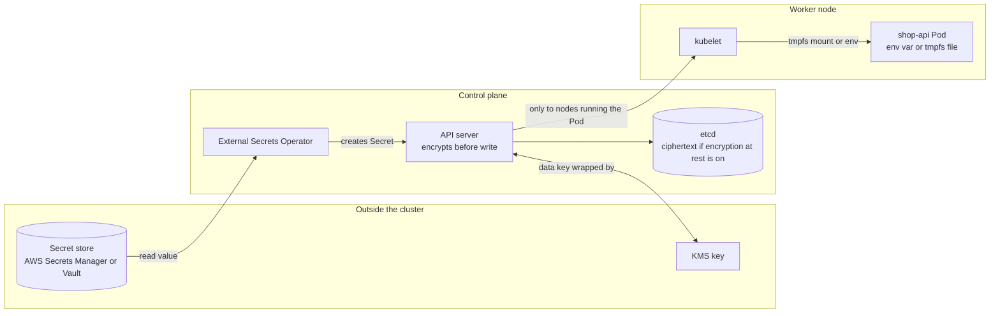

# L8.7 — Secrets

> **Level 8: Kubernetes** · Topic 7 of 19 · ⏱ ~4 hours · Difficulty: Intermediate

## 1. What it is

A **Secret** is a Kubernetes object for small pieces of sensitive data: database passwords, API tokens, TLS private keys, image
registry credentials. It looks almost exactly like a [ConfigMap](06-configmaps.md) (key-value data, consumed as env vars or
mounted files), but Kubernetes treats it with extra care: Secret values are not printed by `kubectl describe`, the kubelet keeps
mounted Secrets in memory-backed storage (tmpfs) on the node, Secrets are only sent to nodes that run a Pod needing them, and
you can apply separate [RBAC](18-rbac.md) rules and encryption to them.

The most important fact in this topic: **a Secret is base64-encoded, not encrypted.** Base64 is a reversible text encoding
(`echo cGFzc3dvcmQ= | base64 -d` prints `password`). Anyone who can `get` a Secret through the API, read etcd, or read a backup of
etcd can read every value. Real protection comes from RBAC, encryption at rest, and often from keeping the real secret outside
the cluster entirely (external secret stores).

## 2. Why it matters in DevOps

- **Leaked credentials are a top breach cause.** A Secret committed to Git as plain YAML is a leaked secret
  (see [Secrets Scanning](../level-11-security-devsecops/11-secrets-scanning.md) and [Secrets Management and Encryption](../level-11-security-devsecops/04-secrets-management-and-encryption.md)).
- **"We use Secrets, so we are secure" is false.** Without RBAC limits and encryption at rest, a node compromise, an overly broad
  `get secrets` permission or a stolen etcd snapshot exposes everything.
- **GitOps needs a plan.** Declarative deployments want everything in Git, but plain Secrets must not be there. Teams pick sealed,
  encrypted or externally-referenced Secrets ([Secrets and Environment Variables](../level-05-cicd/05-secrets-and-environment-variables.md)).
- **Rotation.** A secret you cannot rotate without downtime or a redeploy is a liability the day an employee leaves or a key leaks.

## 3. Real-world system example

**Encryption at rest on managed Kubernetes.** The Kubernetes API server can encrypt Secret objects before writing them to etcd
using an `EncryptionConfiguration`, and can delegate key handling to an external **KMS provider**. Managed services build on this:
for example, Amazon EKS supports envelope encryption of Kubernetes Secrets with an AWS KMS key you control, and GKE offers
application-layer secrets encryption with Cloud KMS ([KMS](../level-06-cloud-aws/15-kms.md)). In envelope encryption, each
Secret is encrypted with a data key, and that data key is itself encrypted by the KMS key, so the master key never leaves the KMS.

**External Secrets Operator** (a CNCF project) and the **Secrets Store CSI Driver** keep the source of truth in AWS Secrets Manager,
HashiCorp Vault, Google Secret Manager or Azure Key Vault and sync or mount values into the cluster at runtime
([Secrets Manager](../level-06-cloud-aws/16-secrets-manager.md)). **Sealed Secrets** (Bitnami) and **SOPS** take a different approach: they
encrypt the Secret so the ciphertext is safe to commit to Git and only the cluster (or a key holder) can decrypt it.

## 4. Diagram



## 5. How it works

```yaml
apiVersion: v1
kind: Secret
metadata:
  name: shop-db
type: Opaque
stringData:                  # write plain text; the API stores it base64-encoded under data
  DB_USER: shop
  DB_PASSWORD: change-me-not-a-real-password
```

| Type | Purpose | Required keys |
|------|---------|---------------|
| `Opaque` (default) | Arbitrary user data | none |
| `kubernetes.io/tls` | TLS certificate for Ingress or apps ([Ingress](05-ingress.md)) | `tls.crt`, `tls.key` |
| `kubernetes.io/dockerconfigjson` | Image pull credentials, used via `imagePullSecrets` | `.dockerconfigjson` |
| `kubernetes.io/basic-auth` | Username and password | `username` or `password` |
| `kubernetes.io/ssh-auth` | SSH private key | `ssh-privatekey` |
| `kubernetes.io/service-account-token` | Long-lived ServiceAccount token (legacy; prefer short-lived projected tokens) | set by Kubernetes |
| `bootstrap.kubernetes.io/token` | Node bootstrap tokens | set by Kubernetes |

**Consuming a Secret** is the same as a ConfigMap:

```yaml
env:
  - name: DB_PASSWORD
    valueFrom:
      secretKeyRef:
        name: shop-db
        key: DB_PASSWORD
volumeMounts:
  - name: db
    mountPath: /etc/secrets/db
    readOnly: true
volumes:
  - name: db
    secret:
      secretName: shop-db
      defaultMode: 0400          # file permissions
```

Env var versus file: environment variables are easy but leak into crash dumps, `docker inspect`-style tools, child processes and logs that dump
the environment. Mounted files can be rotated live (volume mounts without `subPath` refresh, like ConfigMaps), are visible only to
processes that can read the file, and are generally preferred.

**Where Secrets are exposed, and the defences**

| Exposure | Defence |
|----------|---------|
| Anyone with RBAC `get`/`list`/`watch` on Secrets (note `list` returns the values) | Least-privilege Roles, no wildcard `*` on `secrets`, per-namespace scoping ([RBAC](18-rbac.md)) |
| etcd data and etcd backups | **Encryption at rest** (`EncryptionConfiguration`, KMS provider), encrypted backups, restricted etcd access |
| Anyone who can create a Pod in the namespace (they can mount any Secret there) | Namespace boundaries, admission policies, Pod Security Standards |
| Node compromise | tmpfs mounts, limit Secrets to the Pods that need them, short-lived credentials |
| Git history | Never commit plain Secrets; use Sealed Secrets, SOPS or external references |
| Logs and `kubectl get -o yaml` output | Do not log env; treat `kubectl get secret -o yaml` output as sensitive |

**Encryption at rest** is configured on the API server with a file like this (you do this on self-managed control planes; managed
services expose it as a cluster option):

```yaml
apiVersion: apiserver.config.k8s.io/v1
kind: EncryptionConfiguration
resources:
  - resources: ["secrets"]
    providers:
      - aescbc:
          keys:
            - name: key1
              secret: <BASE64_32_BYTE_KEY>   # placeholder
      - identity: {}                         # lets the API server still read data stored before encryption
```

The first provider is used for writes, and all listed providers can read. After enabling it, existing Secrets stay plaintext until
rewritten: `kubectl get secrets -A -o json | kubectl replace -f -`. Locally generated keys in a file on the control-plane node are
only a small improvement; a **KMS provider** (`kms` v2) keeps the key in an external service and is the recommended production setup.

**External secrets** options in short:

- **External Secrets Operator:** an `ExternalSecret` object says "create Secret `shop-db` from `prod/shop/db` in AWS Secrets Manager, refresh hourly". The value still ends up as a Kubernetes Secret.
- **Secrets Store CSI Driver:** mounts the external value as a volume and can optionally sync it into a Secret; the value need not exist as a Secret object.
- **Sealed Secrets / SOPS:** encrypted files in Git, decrypted in-cluster or by the deployment tool.
- **Workload identity / IAM roles for service accounts:** the best secret is no secret; let Pods authenticate to cloud services with short-lived federated credentials instead of stored keys.

## 6. Step-by-step guide

**Prerequisites:** the `devops` kind cluster ([topic 1](01-cluster-architecture.md)). Cost: free. All credentials here are fake. Outputs are illustrative.

1. **Create a Secret and see that it is only encoded.**
   ```bash
   kubectl create secret generic shop-db \
     --from-literal=DB_USER=shop --from-literal=DB_PASSWORD='s3cr3t-demo-only'
   kubectl get secret shop-db -o yaml
   kubectl get secret shop-db -o jsonpath='{.data.DB_PASSWORD}' | base64 -d; echo
   ```
   The YAML shows `DB_PASSWORD: czNjcjN0LWRlbW8tb25seQ==` and the last command prints the original. `kubectl describe secret shop-db` shows only key names and sizes.

2. **Mount it as files and as an env var.**
   ```yaml
   # secret-demo.yaml
   apiVersion: v1
   kind: Pod
   metadata:
     name: secret-demo
   spec:
     containers:
       - name: app
         image: busybox:1.36
         command: ["sh", "-c", "sleep 3600"]
         env:
           - name: DB_USER
             valueFrom:
               secretKeyRef:
                 name: shop-db
                 key: DB_USER
         volumeMounts:
           - name: db
             mountPath: /etc/secrets/db
             readOnly: true
     volumes:
       - name: db
         secret:
           secretName: shop-db
           defaultMode: 0400
   ```
   ```bash
   kubectl apply -f secret-demo.yaml
   kubectl wait --for=condition=Ready pod/secret-demo --timeout=60s
   kubectl exec secret-demo -- sh -c 'echo "user=$DB_USER"; ls -l /etc/secrets/db; cat /etc/secrets/db/DB_PASSWORD; echo; mount | grep secrets'
   ```
   You see the user, two read-only files with mode `0400` (shown as `-r--------`), the password, and a `tmpfs` mount line.

3. **Prove rotation reaches the mounted file but not the env var.**
   ```bash
   kubectl patch secret shop-db -p '{"stringData":{"DB_PASSWORD":"rotated-demo-only","DB_USER":"shop2"}}'
   sleep 90
   kubectl exec secret-demo -- sh -c 'echo "env user=$DB_USER"; cat /etc/secrets/db/DB_USER; echo'
   ```
   The file shows `shop2` (after the kubelet refresh) and the env var still shows `shop`.

4. **Show how easy it is to read a Secret with the wrong permission.** Create a ServiceAccount allowed to list Secrets and use it:
   ```bash
   kubectl create serviceaccount snoop
   kubectl create role secret-reader --verb=get,list --resource=secrets
   kubectl create rolebinding snoop-reads --role=secret-reader --serviceaccount=default:snoop
   kubectl auth can-i list secrets --as=system:serviceaccount:default:snoop
   kubectl get secrets -o yaml --as=system:serviceaccount:default:snoop | grep DB_PASSWORD
   ```
   `can-i` prints `yes` and the encoded password is shown. `list` alone discloses values. Remove it: `kubectl delete rolebinding snoop-reads`, then `kubectl auth can-i list secrets --as=system:serviceaccount:default:snoop` prints `no`.

5. **Look at (not change) encryption at rest in kind.** The control-plane node is a container; check the API server flags:
   ```bash
   docker exec devops-control-plane grep -c encryption-provider-config /etc/kubernetes/manifests/kube-apiserver.yaml
   ```
   Output `0` means encryption at rest is not enabled by default in kind: Secrets are base64 plaintext in etcd. You can read one
   straight from etcd to prove it:
   ```bash
   docker exec devops-control-plane sh -c 'ETCDCTL_API=3 etcdctl --endpoints=https://127.0.0.1:2379 \
     --cacert=/etc/kubernetes/pki/etcd/ca.crt --cert=/etc/kubernetes/pki/etcd/server.crt --key=/etc/kubernetes/pki/etcd/server.key \
     get /registry/secrets/default/shop-db' | strings | grep -i demo
   ```
   If `etcdctl` is not present in the node image, skip this step; the point is that an unencrypted etcd stores the value readable.
   In a production cluster you would turn encryption on (self-managed: `EncryptionConfiguration`; EKS/GKE/AKS: the KMS option at cluster creation).

6. **Image pull and TLS Secret types.**
   ```bash
   kubectl create secret docker-registry regcred --docker-server=registry.example.com \
     --docker-username=demo --docker-password='<YOUR_TOKEN>' --docker-email=demo@example.com
   kubectl get secret regcred -o jsonpath='{.type}'; echo
   ```
   Prints `kubernetes.io/dockerconfigjson`. Pods use it with `spec.imagePullSecrets: [{name: regcred}]`.

7. **Make a Secret safe for Git (concept demo with SOPS or Sealed Secrets).** Install `sops` and `age` from their project pages, then:
   ```bash
   age-keygen -o age.key
   kubectl create secret generic shop-db --from-literal=DB_PASSWORD=demo --dry-run=client -o yaml > secret.yaml
   sops --encrypt --age "$(grep -o 'age1.*' age.key)" --encrypted-regex '^(data|stringData)$' secret.yaml > secret.enc.yaml
   cat secret.enc.yaml | head -20
   ```
   The values under `data` are replaced by `ENC[AES256_GCM,...]`, while keys and metadata stay readable, so the file is reviewable and committable. Decrypt with `SOPS_AGE_KEY_FILE=age.key sops --decrypt secret.enc.yaml | kubectl apply -f -`.

8. **Clean up.**
   ```bash
   kubectl delete pod secret-demo
   kubectl delete secret shop-db regcred
   kubectl delete serviceaccount snoop
   kubectl delete role secret-reader
   kubectl delete rolebinding snoop-reads --ignore-not-found
   rm -f age.key secret.yaml secret.enc.yaml
   ```

## 7. Real-world scenario

*Illustrative scenario.* A developer debugging a failing job runs `kubectl get secret shop-db -o yaml` and pastes the output
into a public GitHub issue, thinking the long string "looks encrypted". A scanner bot finds the base64 value within minutes and
the database is accessed from an unknown IP. The on-call engineer rotates the password in the database and in AWS Secrets Manager;
because the team uses External Secrets Operator with a one-hour refresh, the new value reaches the cluster, and mounted files update
without a restart. The app re-reads `/etc/secrets/db/DB_PASSWORD` on connection errors, so no restart is needed. The review leads to three changes: engineers lose `get/list secrets` in
production (a break-glass role with audit logging replaces it), a secret scanner is added to pull requests, and the team documents
that base64 is encoding, not encryption.
**Lesson:** design for rotation first, restrict who can read Secrets, and never treat encoding as protection.

## 8. Common mistakes and best practices

**Don't**

- Commit Secret manifests with real values to Git, or put them in Helm `values.yaml` in plaintext.
- Give `get`, `list` or `watch` on Secrets cluster-wide to developers, CI roles or monitoring tools.
- Bake credentials into images or pass them as command-line arguments (visible in `ps` and in Pod specs).
- Assume the default setup encrypts etcd; verify it (many self-managed clusters and kind do not).
- Share one Secret between unrelated apps so that rotation breaks both.

**Do**

- Enable **encryption at rest** with a KMS provider and encrypt etcd backups.
- Apply least-privilege RBAC and remember that anyone who can create Pods in a namespace can read its Secrets ([RBAC](18-rbac.md), [Namespaces](08-namespaces.md)).
- Prefer mounted files (`defaultMode: 0400`) over env vars, and have the app re-read them for rotation.
- Keep the source of truth in a real secret manager and sync it with External Secrets Operator or the CSI driver; or encrypt with SOPS/Sealed Secrets for GitOps.
- Prefer short-lived, federated credentials (cloud workload identity) over long-lived keys.
- Set `immutable: true` for Secrets that should never change, and scan repos and images for leaked secrets ([Secrets Scanning](../level-11-security-devsecops/11-secrets-scanning.md)).

## 9. Tasks

- [ ] **T1 — Create and decode a Secret** *(≈20 min, beginner)*
  - **Goal:** see exactly what "base64 is not encryption" means.
  - **Steps:**
    1. Create `shop-db` with `kubectl create secret generic`.
    2. Print it with `-o yaml` and decode one value with `base64 -d`.
    3. Run `kubectl describe secret shop-db`.
  - **Done when:** you decoded the original password and can state what `describe` hides.

- [ ] **T2 — Env var versus mounted file** *(≈40 min, beginner)*
  - **Goal:** compare delivery methods and rotation behaviour.
  - **Steps:**
    1. Mount the Secret both ways in one Pod (step 2).
    2. Patch the Secret and wait 90 seconds.
    3. Compare the env var and the file.
  - **Done when:** the file shows the new value, the env var the old one, and `mount` shows the Secret on `tmpfs`.

- [ ] **T3 — Over-broad RBAC** *(≈40 min, intermediate)*
  - **Goal:** demonstrate how `list` leaks values and how to fix it.
  - **Steps:**
    1. Create a ServiceAccount with a Role allowing `list` on Secrets and use `--as` to read the password.
    2. Narrow the Role with `resourceNames: [shop-db]` and `get` only; test with `kubectl auth can-i`.
    3. Delete the binding.
  - **Done when:** `can-i list secrets` is `no` after the change while `can-i get secret/shop-db` is `yes`.

- [ ] **T4 — Image pull Secret** *(≈40 min, intermediate)*
  - **Goal:** use a `dockerconfigjson` Secret.
  - **Steps:**
    1. Create a `docker-registry` Secret with fake credentials and reference it in a Pod with `imagePullSecrets` using an image from a registry that does not exist.
    2. Observe `kubectl describe pod` events.
    3. Fix by removing the bad image reference.
  - **Done when:** you can distinguish `ErrImagePull` caused by credentials from one caused by a missing image, using the event text.

- [ ] **T5 — Git-safe Secrets** *(≈60 min, advanced)*
  - **Goal:** commit a Secret you could safely publish.
  - **Steps:**
    1. Encrypt a Secret manifest with SOPS and age (step 7), or install Sealed Secrets and use `kubeseal`.
    2. Commit the encrypted file to a scratch repo and show the diff when you rotate one value.
    3. Decrypt and apply it to the cluster.
  - **Done when:** the repo contains no plaintext value, `kubectl get secret` in the cluster shows the right data, and `git diff` shows only ciphertext changes.

- [ ] **T6 — Prove it: threat model a Secret** *(≈40 min, advanced)*
  - **Goal:** list every place a Secret is readable and your control for each.
  - **Steps:**
    1. Without notes, draw the path from your secret store to the container: store, operator, API server, etcd, kubelet, tmpfs, process.
    2. Under each hop write who can read it and the control (RBAC, encryption at rest, node isolation, rotation).
    3. Demonstrate the etcd plaintext check from step 5 (or explain what it shows) and say what you would enable in production.
  - **Done when:** your diagram has at least five hops with a control for each, and you can explain why base64 gives no protection.

## 10. Self-check questions

1. Is a Kubernetes Secret encrypted by default? What exactly protects it?
2. How do you enable encryption at rest, and why is a KMS provider better than a key in a file?
3. Why does `list` permission on Secrets matter?
4. Env var or mounted file for a database password? Why?
5. How can you keep Secrets in a GitOps repo safely?
6. Name three Secret types and what each is for.

<details>
<summary>Answers</summary>

1. No. Values are base64-encoded in the API and, by default, stored unencrypted in etcd. Protection comes from RBAC, optional encryption at rest, node-level isolation (tmpfs, only sent to nodes that need them) and good operational practice.
2. Configure the API server with an `EncryptionConfiguration` for `secrets` (or tick the KMS/encryption option on a managed service), then rewrite existing Secrets. A KMS provider keeps the master key outside the cluster in an HSM-backed service with its own audit and access control, so stealing etcd or the control-plane disk does not yield the key.
3. `list` (and `watch`) returns full objects including the data, so it discloses every value just like `get`.
4. A mounted file: it can be restricted by permissions, is tmpfs-backed, updates on rotation, and avoids leaking via environment dumps. Env vars are simpler but fixed at start and easier to leak.
5. Encrypt before committing (SOPS, Sealed Secrets) or commit only references to an external store (External Secrets Operator, CSI driver) so no plaintext ever reaches Git.
6. `Opaque` for arbitrary data, `kubernetes.io/tls` for certificate and key (Ingress), `kubernetes.io/dockerconfigjson` for registry credentials; also basic-auth, ssh-auth and service-account-token.
</details>

## 11. Further reading

- Kubernetes documentation, *Concepts > Configuration > Secrets*, *Good practices for Kubernetes Secrets* and *Encrypting Confidential Data at Rest*.
- External Secrets Operator, Secrets Store CSI Driver, Sealed Secrets and SOPS project documentation.
- Amazon EKS and GKE documentation on envelope encryption of Kubernetes Secrets with KMS.
- *Kubernetes Security and Observability* (Brendan Creane, Amit Gupta) and the CIS Kubernetes Benchmark.

<!-- nav -->
---
← Previous: [ConfigMaps](06-configmaps.md) · [Level 8 index](README.md) · Next: [Namespaces](08-namespaces.md) →
