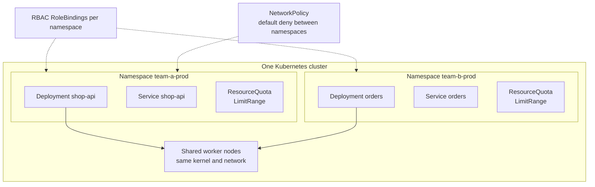
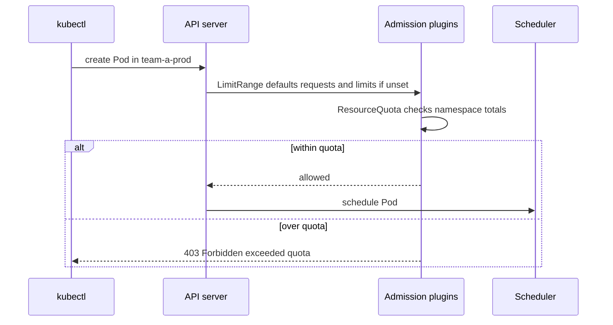

# L8.8 — Namespaces

> **Level 8: Kubernetes** · Topic 8 of 19 · ⏱ ~3 hours · Difficulty: Intermediate

## 1. What it is

A **namespace** is a named partition inside one Kubernetes cluster. Most objects (Pods, Deployments, Services, ConfigMaps,
Secrets, PersistentVolumeClaims) live in exactly one namespace, and their names only need to be unique *within* it. So `shop-api`
can exist in `staging` and in `production` at the same time without conflict. Cluster-wide objects, such as Nodes, PersistentVolumes,
StorageClasses and the Namespace objects themselves, belong to no namespace.

Namespaces are a **scoping and policy boundary**, not a security boundary on their own. They give you a unit to attach
[RBAC](18-rbac.md) rules, resource quotas, default limits and [NetworkPolicies](19-networkpolicies.md) to. By themselves they do not stop
Pods in different namespaces from talking to each other, and they all share the same nodes and kernel.

A fresh cluster has four: `default`, `kube-system` (Kubernetes' own components), `kube-public` (readable by everyone, rarely used)
and `kube-node-lease` (node heartbeats).

## 2. Why it matters in DevOps

- **Environments and teams share clusters.** Running one cluster per team or per environment is expensive. Namespaces let many
  teams and environments share nodes while keeping names, permissions and budgets separate.
- **Noisy neighbours.** Without quotas, one team's runaway Deployment can consume all cluster CPU or Pod slots and starve
  everyone else. `ResourceQuota` and `LimitRange` are the fix.
- **Wrong-namespace mistakes cause outages.** "I applied it to `default` by accident", or deleting a namespace and everything in it,
  is a classic production accident.
- **Cost allocation.** Namespace labels are the common key for splitting a cluster bill by team ([FinOps](../level-20-cost-optimization/01-finops.md)).

## 3. Real-world system example

**Kubernetes itself** keeps its control-plane add-ons (CoreDNS, kube-proxy, the metrics components) in `kube-system`, and
managed platforms such as GKE and EKS put their own agents in namespaces of their own so that your workloads and the platform's do not
collide. **Large organisations** commonly map a namespace to a team or to a service-environment pair (`payments-prod`,
`payments-staging`), apply quotas to each, and use tooling such as Argo CD or Flux to deploy into them. The Kubernetes project
documents two flavours of multi-tenancy: soft multi-tenancy (trusted teams within one organisation, namespaces plus quotas, RBAC
and NetworkPolicies) and hard multi-tenancy (untrusted tenants, which typically needs separate clusters or virtualised control
planes, sandboxed runtimes and stronger isolation). Projects such as **vcluster** and **Capsule** and **Hierarchical Namespaces** exist to make the first
case easier.

## 4. Diagram



Who enforces what when a Pod is created in a namespace with a quota:



## 5. How it works

```yaml
apiVersion: v1
kind: Namespace
metadata:
  name: team-a-prod
  labels:
    team: a
    env: prod
    pod-security.kubernetes.io/enforce: baseline   # Pod Security Standards, enforced by the built-in admission controller
```

**Scope and naming**

- `kubectl get pods -n team-a-prod` selects a namespace; `-A` or `--all-namespaces` shows all. Without `-n`, kubectl uses the namespace in your current context (initially `default`).
  Set it with `kubectl config set-context --current --namespace=team-a-prod`.
- DNS: a Service `orders` in `team-b-prod` is `orders.team-b-prod.svc.cluster.local`. From `team-a-prod` the short name `orders` does **not** resolve; use `orders.team-b-prod` ([Services](04-services.md), [Service Discovery](17-service-discovery.md)).
- List what is and is not namespaced: `kubectl api-resources --namespaced=true` and `--namespaced=false`.
- Deleting a namespace deletes **everything inside it**. A namespace stuck in `Terminating` usually has a finalizer or an unavailable API (for example a broken webhook).

**ResourceQuota** caps the aggregate resources and object counts in a namespace:

```yaml
apiVersion: v1
kind: ResourceQuota
metadata:
  name: compute
  namespace: team-a-prod
spec:
  hard:
    requests.cpu: "4"
    requests.memory: 8Gi
    limits.cpu: "8"
    limits.memory: 16Gi
    pods: "30"
    services.loadbalancers: "1"      # limits billable cloud load balancers
    persistentvolumeclaims: "10"
    requests.storage: 100Gi
```

Once a quota covers `requests.cpu` or `limits.memory`, every new Pod in that namespace **must declare** those values (or get them from a
LimitRange), otherwise the API server rejects it. Requests and limits are explained in [Resource Requests and Limits](14-resource-requests-and-limits.md).

**LimitRange** sets per-object defaults and bounds in a namespace:

```yaml
apiVersion: v1
kind: LimitRange
metadata:
  name: defaults
  namespace: team-a-prod
spec:
  limits:
    - type: Container
      default:            # limits applied when a container sets none
        cpu: 500m
        memory: 512Mi
      defaultRequest:     # requests applied when a container sets none
        cpu: 100m
        memory: 128Mi
      max:
        cpu: "2"
        memory: 2Gi
      min:
        cpu: 50m
        memory: 64Mi
```

| Tool | Level it works at | What it prevents |
|------|-------------------|------------------|
| **ResourceQuota** | Whole namespace | One team using more than its share of CPU, memory, storage, objects |
| **LimitRange** | Each Pod/container/PVC | Containers with no limits or absurd sizes; supplies defaults |
| **RBAC** (Role, RoleBinding) | Namespace | Users and services acting outside their area |
| **NetworkPolicy** | Pods in a namespace | Cross-namespace traffic (default is allow-all) |
| **Pod Security Admission** | Namespace label | Privileged Pods, host mounts, running as root |

**Multi-tenancy patterns, most to least isolated:**

1. **Cluster per tenant** (strongest isolation, highest cost and operations load).
2. **Virtual clusters** (a control plane per tenant on shared nodes, e.g. vcluster).
3. **Namespace per tenant** with quota, RBAC, NetworkPolicies, Pod Security and, for sensitive tenants, dedicated node pools (taints and tolerations, see [Scheduling](13-scheduling.md)).
4. **Shared namespace** (only for one trusted team).

Namespaces do not isolate the kernel, nodes, cluster-scoped resources or the DNS and API server load, so untrusted tenants
need more than namespaces.

## 6. Step-by-step guide

**Prerequisites:** the `devops` kind cluster ([topic 1](01-cluster-architecture.md)). Cost: free. Outputs are illustrative.

1. **Explore what exists.**
   ```bash
   kubectl get namespaces
   kubectl get pods -A | head -20
   kubectl api-resources --namespaced=false | head -15
   ```
   You see the four default namespaces plus `ingress-nginx` and `local-path-storage` if you did the earlier topics. Nodes and
   PersistentVolumes appear in the non-namespaced list.

2. **Create two namespaces and deploy the same name in both.**
   ```bash
   kubectl create namespace team-a-prod
   kubectl create namespace team-b-prod
   kubectl create deployment shop-api --image=nginx:1.27 --replicas=1 -n team-a-prod
   kubectl create deployment shop-api --image=nginx:1.27 --replicas=1 -n team-b-prod
   kubectl expose deployment shop-api --port=80 -n team-b-prod
   kubectl get deploy -A | grep shop-api
   ```
   Two Deployments with the same name coexist.

3. **Cross-namespace DNS.** From `team-a-prod`, call the Service in `team-b-prod`:
   ```bash
   kubectl run tmp -n team-a-prod --rm -it --restart=Never --image=curlimages/curl:8.10.1 -- sh -c \
     'curl -s -o /dev/null -w "short name: %{http_code}\n" --max-time 3 http://shop-api; curl -s -o /dev/null -w "qualified: %{http_code}\n" --max-time 3 http://shop-api.team-b-prod'
   ```
   `short name` fails (the name `shop-api` has no Service in `team-a-prod`, so curl reports `000`), while `qualified` returns `200`.
   By default namespaces do **not** block this traffic; you need a NetworkPolicy ([NetworkPolicies](19-networkpolicies.md)).

4. **Set your default namespace** to avoid typing `-n` and avoid "oops, `default`" mistakes:
   ```bash
   kubectl config set-context --current --namespace=team-a-prod
   kubectl config view --minify | grep namespace
   ```

5. **Apply a ResourceQuota and watch it enforce.**
   ```bash
   kubectl apply -f - <<'EOF'
   apiVersion: v1
   kind: ResourceQuota
   metadata:
     name: compute
     namespace: team-a-prod
   spec:
     hard:
       requests.cpu: "500m"
       requests.memory: 512Mi
       limits.cpu: "1"
       limits.memory: 1Gi
       pods: "4"
   EOF
   kubectl describe quota compute -n team-a-prod
   kubectl scale deploy/shop-api -n team-a-prod --replicas=3
   kubectl get pods -n team-a-prod
   kubectl describe replicaset -n team-a-prod | grep -i -A2 'forbidden\|quota'
   ```
   The existing Pod keeps running (it was admitted before the quota), but scaling up is refused: the ReplicaSet events say
   `pods "..." is forbidden: failed quota: compute: must specify limits.cpu,limits.memory,requests.cpu,requests.memory`.

6. **Add a LimitRange so unset values get defaults.**
   ```bash
   kubectl apply -f - <<'EOF'
   apiVersion: v1
   kind: LimitRange
   metadata:
     name: defaults
     namespace: team-a-prod
   spec:
     limits:
       - type: Container
         default:
           cpu: 200m
           memory: 256Mi
         defaultRequest:
           cpu: 100m
           memory: 128Mi
   EOF
   kubectl rollout restart deploy/shop-api -n team-a-prod
   kubectl get pods -n team-a-prod
   kubectl describe quota compute -n team-a-prod
   ```
   New Pods now get default requests and limits automatically and are admitted. `describe quota` shows `Used` versus `Hard`. With 3 replicas at
   `100m` each, usage is `300m` of `500m` (during the rollout it can briefly show more Pods than replicas).

7. **Exceed the quota deliberately.** `kubectl scale deploy/shop-api -n team-a-prod --replicas=6` and then
   `kubectl get deploy shop-api -n team-a-prod`: `READY` stalls below 6, since `requests.cpu` allows only five 100m Pods and `pods` allows four. Read the event
   to see which dimension was hit first. Scale back to 2.

8. **Break it: delete a namespace.**
   ```bash
   kubectl delete namespace team-b-prod
   kubectl get all -n team-b-prod
   ```
   Everything inside (Deployment, Service, Pods) is gone: `No resources found`. This is why production namespaces need RBAC that does not allow deleting them.

9. **Clean up.**
   ```bash
   kubectl delete namespace team-a-prod
   kubectl config set-context --current --namespace=default
   ```

## 7. Real-world scenario

*Illustrative scenario.* Three product teams share a staging cluster with no quotas. A load test by the `orders` team creates 400
Pods with no resource requests; the scheduler packs them onto the nodes, memory runs out, the kernel OOM-kills other teams'
containers, and the `shop-api` staging environment goes down during a release rehearsal. The platform team restores service by
deleting the load-test Deployment, then introduces a namespace per team with a `ResourceQuota` (CPU, memory, Pod count and a
limit of zero `LoadBalancer` Services), a `LimitRange` supplying defaults so developers do not need to know the numbers, and a
default-deny NetworkPolicy. Pod Security labels block privileged Pods. The next load test hits the team's quota and fails
with a `403` instead of taking others down.
**Lesson:** in a shared cluster, fairness is something you configure; namespaces are where you attach it.

## 8. Common mistakes and best practices

**Don't**

- Run everything in `default`; it has no meaningful boundaries and invites accidents.
- Treat namespaces as a security boundary for untrusted tenants; they share nodes, kernel and (by default) the network.
- Set a ResourceQuota on CPU or memory without a LimitRange; developers then see confusing "must specify requests" errors.
- Give users `delete namespace` rights in production, or give them cluster-admin "just for now".
- Create namespaces by hand with no labels; you lose cost and ownership tracking.

**Do**

- Create namespaces from code (Git, Terraform, GitOps) with labels for owner, environment and cost centre ([Infrastructure as Code](../level-00-what-devops-is/03-infrastructure-as-code.md)).
- Attach, per namespace: ResourceQuota, LimitRange, RoleBindings, a default-deny NetworkPolicy and Pod Security labels.
- Choose a clear scheme: `<team>-<env>` or one namespace per service-environment, and use it consistently.
- Set the namespace in your kubectl context or use a tool like `kubens`, and show it in your shell prompt.
- Use separate clusters (or virtual clusters) for environments with different risk, such as production versus everything else.
- Alert on quota usage nearing the hard limit.

## 9. Tasks

- [ ] **T1 — Same name, two namespaces** *(≈25 min, beginner)*
  - **Goal:** show namespace scoping of names.
  - **Steps:**
    1. Create `team-a-prod` and `team-b-prod` and a `shop-api` Deployment in each.
    2. Run `kubectl get deploy -A`.
    3. Run `kubectl api-resources --namespaced=false`.
  - **Done when:** both Deployments appear under different namespaces, and you can name three cluster-scoped resources.

- [ ] **T2 — Cross-namespace service call** *(≈30 min, beginner)*
  - **Goal:** use fully qualified DNS names.
  - **Steps:**
    1. Expose the `team-b-prod` Deployment as a Service.
    2. From a temporary Pod in `team-a-prod`, try `shop-api` and `shop-api.team-b-prod`.
  - **Done when:** the short name fails, the qualified name returns 200, and you can explain why.

- [ ] **T3 — Enforce a quota** *(≈45 min, intermediate)*
  - **Goal:** see a ResourceQuota reject work.
  - **Steps:**
    1. Apply the quota from step 5 to `team-a-prod`.
    2. Try to create a Pod with no resources, then one with requests and limits within the quota, then one beyond it.
    3. Read `kubectl describe quota` and the error messages.
  - **Done when:** you have three outcomes recorded (rejected for missing values, admitted, rejected for exceeding) with the message text.

- [ ] **T4 — LimitRange defaults and bounds** *(≈40 min, intermediate)*
  - **Goal:** make the quota usable.
  - **Steps:**
    1. Add the LimitRange with `default`, `defaultRequest`, `min` and `max`.
    2. Create a Pod with no resources and inspect its spec with `kubectl get pod -o yaml | grep -A6 resources`.
    3. Create a Pod requesting more than `max`.
  - **Done when:** the first Pod shows injected defaults and the second is rejected with a message naming the maximum.

- [ ] **T5 — Break and fix: stuck namespace and wrong context** *(≈45 min, advanced)*
  - **Goal:** recover from two common namespace accidents.
  - **Steps:**
    1. Apply a manifest without `-n` while your context is `default` and find the objects with `kubectl get all -A | grep <name>`; move them to the right namespace.
    2. Read `kubectl get ns <name> -o yaml` for a namespace in `Terminating` (create one with a finalizer on a ConfigMap and delete the namespace) and identify what is blocking it, then remove the finalizer on that object.
  - **Done when:** the misplaced objects are in the right namespace, the stuck namespace is gone, and you can explain what a finalizer is.

- [ ] **T6 — Prove it: design a tenancy model** *(≈40 min, advanced)*
  - **Goal:** present a defensible multi-tenant layout for `shop-api` and two other teams on one cluster.
  - **Steps:**
    1. Without notes, write the namespaces, quotas, LimitRange values, RBAC groups and NetworkPolicy stance you would apply.
    2. Implement the namespace, quota, LimitRange and a RoleBinding for one team in kind.
    3. State what namespaces do NOT isolate, and at what point you would choose separate clusters.
  - **Done when:** the manifests apply cleanly, `kubectl auth can-i` proves the team can act only in its namespace, and your written limits-of-isolation list includes kernel, nodes and cluster-scoped resources.

## 10. Self-check questions

1. Name three resources that are not namespaced.
2. Why is a namespace not a security boundary by itself?
3. What is the difference between a ResourceQuota and a LimitRange?
4. A teammate's Pod is rejected with "must specify limits.memory". What happened and what fixes it?
5. How does a Pod in namespace A reach a Service in namespace B?
6. When do you need separate clusters instead of namespaces?

<details>
<summary>Answers</summary>

1. Nodes, PersistentVolumes, StorageClasses, Namespaces, ClusterRoles (and CRDs).
2. Pods in all namespaces share nodes and kernel, and by default can reach each other over the network; cluster-scoped objects and the API server are shared. You must add RBAC, NetworkPolicies, Pod Security and quotas to get isolation.
3. A ResourceQuota caps the total consumption and object counts for the whole namespace. A LimitRange sets defaults and min/max for individual containers, Pods or PVCs.
4. The namespace has a ResourceQuota on memory limits, so every container must declare limits. Set them in the manifest or add a LimitRange with defaults.
5. By its qualified DNS name, `<service>.<namespace>` (or the full `.svc.cluster.local` name). Network policy may restrict it.
6. When tenants are untrusted or have regulatory separation, need different cluster versions or CRDs, or when the blast radius of a cluster-level failure is unacceptable. Production versus non-production is a common split.
</details>

## 11. Further reading

- Kubernetes documentation, *Concepts > Overview > Working with Kubernetes Objects > Namespaces*, *Resource Quotas*, *Limit Ranges* and *Multi-tenancy*.
- Kubernetes documentation, *Pod Security Admission* and *Pod Security Standards*.
- Project documentation for vcluster, Capsule and the Hierarchical Namespace Controller.

<!-- nav -->
---
← Previous: [Secrets](07-secrets.md) · [Level 8 index](README.md) · Next: [Volumes, PersistentVolumes and PersistentVolumeClaims](09-volumes-pv-pvc.md) →
