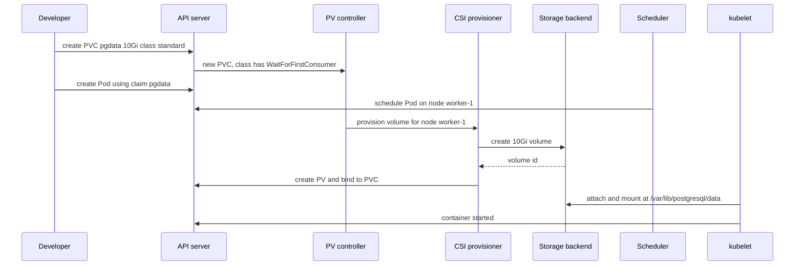
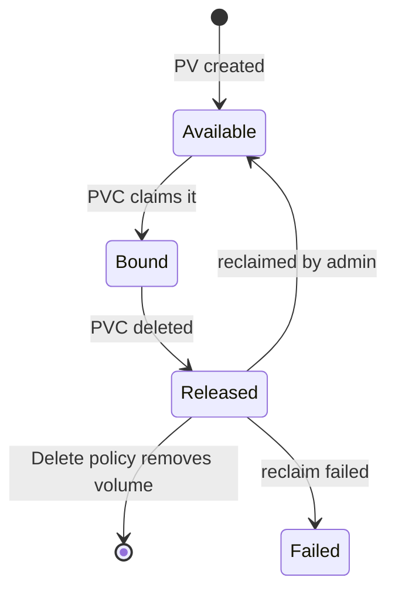

# L8.9 — Volumes, PersistentVolumes and PersistentVolumeClaims

> **Level 8: Kubernetes** · Topic 9 of 19 · ⏱ ~4 hours · Difficulty: Intermediate

## 1. What it is

A container's filesystem disappears when the container restarts. Kubernetes solves this with **volumes**: directories that are
attached to a Pod and mounted into its containers. Simple volume types live and die with the Pod (`emptyDir`, ConfigMap and
Secret volumes). For data that must outlive any Pod, such as the PostgreSQL data directory of `shop-api`, Kubernetes separates
two roles:

- A **PersistentVolume (PV)** is a piece of storage in the cluster: an AWS EBS volume, an NFS export, a local disk. PVs are
  cluster-scoped, like Nodes.
- A **PersistentVolumeClaim (PVC)** is a request for storage by a user: "I need 10 GiB, read-write, from the `standard` class".
  PVCs are namespaced. Kubernetes **binds** a PVC to a suitable PV, and the Pod mounts the *claim*, never the PV directly.

Almost nobody creates PVs by hand any more. A **StorageClass** describes a kind of storage ("fast SSD", "cheap HDD") and the
provisioner that makes it; when a PVC names a class, the provisioner creates the PV automatically. This is **dynamic provisioning**.
The Kubernetes plumbing for talking to storage systems is the **Container Storage Interface (CSI)**.

## 2. Why it matters in DevOps

- **Data loss is the one outage you cannot roll back.** Misunderstanding reclaim policy or deleting a PVC can destroy a database ([Disaster Recovery](../level-00-what-devops-is/09-disaster-recovery.md)).
- **Pods stuck in `Pending` with "unbound PersistentVolumeClaim"** is among the most common beginner failures, and zone-related volume problems are a classic cloud outage.
- **Cost.** Dynamically provisioned cloud volumes are billed while they exist, even if the Pod is gone ([EBS and EFS](../level-06-cloud-aws/09-ebs-and-efs.md)).
- **Stateful apps.** Databases and queues need stable storage, usually together with a [StatefulSet](10-statefulsets.md). Whether to run a database on Kubernetes at all is a separate decision (see [RDS and Aurora](../level-06-cloud-aws/10-rds-and-aurora.md)).

## 3. Real-world system example

**Amazon EKS with the EBS CSI driver.** On EKS, a PVC with a StorageClass whose provisioner is `ebs.csi.aws.com` makes the driver
call the EC2 API to create an **EBS volume** and attach it to the node where the Pod runs. EBS volumes live in a single
Availability Zone and attach to one instance at a time, so the Pod can only be scheduled in that zone: this is why
`volumeBindingMode: WaitForFirstConsumer` exists (create the volume only after the scheduler picks a node). For shared
read-write access across nodes, teams use **EFS** through the EFS CSI driver, which supports `ReadWriteMany`. GKE (Persistent Disk CSI) and
AKS (Azure Disk and Azure Files) follow the same model. In the open-source world, **Rook/Ceph** and **Longhorn** provide cluster-native storage
behind the same PVC interface, and **local-path-provisioner** is what kind and k3s use for dev clusters.

## 4. Diagram



The lifecycle of a PV:



## 5. How it works

```yaml
apiVersion: v1
kind: PersistentVolumeClaim
metadata:
  name: pgdata
spec:
  accessModes: [ReadWriteOnce]
  storageClassName: standard      # omit to use the default class; "" disables dynamic provisioning
  resources:
    requests:
      storage: 10Gi
---
apiVersion: v1
kind: Pod
metadata:
  name: postgres
spec:
  containers:
    - name: postgres
      image: postgres:16
      env:
        - name: POSTGRES_PASSWORD
          value: demo-only-password
        - name: PGDATA
          value: /var/lib/postgresql/data/pgdata   # subdirectory avoids the lost+found problem on some volumes
      volumeMounts:
        - name: data
          mountPath: /var/lib/postgresql/data
  volumes:
    - name: data
      persistentVolumeClaim:
        claimName: pgdata
```

**Volume types you meet first**

| Type | Lifetime | Typical use |
|------|----------|-------------|
| `emptyDir` | Pod (optionally memory-backed) | Scratch space, sidecar sharing, caches |
| `configMap`, `secret`, `projected`, `downwardAPI` | Pod | Config, credentials ([ConfigMaps](06-configmaps.md), [Secrets](07-secrets.md)) |
| `hostPath` | Node | Node agents ([DaemonSets](11-daemonsets.md)); a security risk for apps |
| `persistentVolumeClaim` | Independent of Pod | Databases, uploads, any durable data |
| Ephemeral CSI / generic ephemeral volumes | Pod | Per-Pod scratch with storage-class features |

**Access modes** (what the *volume* supports, not a guarantee the app is safe with it):

| Mode | Meaning | Examples |
|------|---------|----------|
| `ReadWriteOnce` (RWO) | Read-write by **one node** (several Pods on that node may share) | EBS, GCE PD, Azure Disk, local-path |
| `ReadOnlyMany` (ROX) | Read-only by many nodes | NFS, CephFS, EFS |
| `ReadWriteMany` (RWX) | Read-write by many nodes | NFS, EFS, CephFS, Azure Files |
| `ReadWriteOncePod` (RWOP) | Read-write by exactly **one Pod** in the cluster (stable since v1.29) | CSI drivers that support it |

**StorageClass** fields that matter:

```yaml
apiVersion: storage.k8s.io/v1
kind: StorageClass
metadata:
  name: fast-ssd
provisioner: ebs.csi.aws.com              # the CSI driver
parameters:
  type: gp3
reclaimPolicy: Retain                     # Delete (default for dynamic) or Retain
volumeBindingMode: WaitForFirstConsumer   # Immediate or WaitForFirstConsumer
allowVolumeExpansion: true                # lets you grow a PVC later
```

(This example is for AWS EKS with the driver installed; kind uses `rancher.io/local-path` instead.)

**Reclaim policy** decides what happens to the PV and its data when the PVC is deleted:

- **Delete:** the PV *and the underlying storage* are removed. This is the default for dynamically provisioned volumes, which makes
  `kubectl delete pvc` destructive.
- **Retain:** the PV moves to `Released` with its data intact; an administrator must clean it and make it reusable (or recover the data) manually.
- (`Recycle` is deprecated and removed from most provisioners.)

**Binding:** a PVC matches a PV by capacity (PV must be at least as large), access modes, StorageClass and optional selector.
**Expansion:** edit the PVC's `requests.storage` upward if the class has `allowVolumeExpansion: true` (shrinking is not supported).
**Snapshots:** `VolumeSnapshot` objects (CSI) take point-in-time copies for backups and clones ([Snapshots](../level-15-disaster-recovery/03-snapshots.md)).
**Mounts:** the kubelet and CSI node plugin attach the volume to the node, format it if new, and mount it into the container.
`fsGroup` in `securityContext` makes the mount writable by a non-root group ([Non-root Containers](../level-04-docker/11-non-root-containers.md)).

For the container-level equivalent of this, see [Volumes and Bind Mounts](../level-04-docker/05-volumes.md).

## 6. Step-by-step guide

**Prerequisites:** the `devops` kind cluster ([topic 1](01-cluster-architecture.md)). kind ships a default StorageClass called
`standard` (provisioner `rancher.io/local-path`) that stores data in a directory on the node. Cost: free. Outputs are illustrative.

1. **Inspect the storage setup.**
   ```bash
   kubectl get storageclass
   kubectl get pv,pvc -A
   ```
   You see `standard (default)` with `RECLAIMPOLICY Delete` and `VOLUMEBINDINGMODE WaitForFirstConsumer`. There are no PVs yet.

2. **Create a PVC and notice it stays Pending.**
   ```bash
   cat <<'EOF' | kubectl apply -f -
   apiVersion: v1
   kind: PersistentVolumeClaim
   metadata:
     name: pgdata
   spec:
     accessModes: [ReadWriteOnce]
     resources:
       requests:
         storage: 1Gi
   EOF
   kubectl get pvc pgdata
   ```
   `STATUS Pending`. With `WaitForFirstConsumer`, nothing is provisioned until a Pod uses the claim (`kubectl describe pvc pgdata` says `waiting for first consumer`).

3. **Run PostgreSQL on the claim.**
   ```bash
   cat <<'EOF' | kubectl apply -f -
   apiVersion: v1
   kind: Pod
   metadata:
     name: postgres
   spec:
     containers:
       - name: postgres
         image: postgres:16
         env:
           - name: POSTGRES_PASSWORD
             value: demo-only-password
           - name: PGDATA
             value: /var/lib/postgresql/data/pgdata
         volumeMounts:
           - name: data
             mountPath: /var/lib/postgresql/data
     volumes:
       - name: data
         persistentVolumeClaim:
           claimName: pgdata
   EOF
   kubectl wait --for=condition=Ready pod/postgres --timeout=120s
   kubectl get pvc,pv
   ```
   The PVC is `Bound` and a `pvc-<uuid>` PV exists with `RECLAIM POLICY Delete`.

4. **Write data.**
   ```bash
   kubectl exec postgres -- psql -U postgres -c "CREATE TABLE orders(id serial primary key, item text); INSERT INTO orders(item) VALUES ('keyboard'),('monitor');"
   kubectl exec postgres -- psql -U postgres -t -c "SELECT count(*) FROM orders;"
   ```
   Prints `2`.

5. **Prove persistence: delete the Pod, keep the claim.**
   ```bash
   kubectl delete pod postgres
   kubectl get pvc pgdata        # still Bound
   # re-create the same Pod (re-run the Pod manifest from step 3), then:
   kubectl wait --for=condition=Ready pod/postgres --timeout=120s
   kubectl exec postgres -- psql -U postgres -t -c "SELECT count(*) FROM orders;"
   ```
   Still `2`: the data lived on the volume, not in the container. Compare: the same experiment with `emptyDir` would show an empty database.

6. **Find the data on the node.** Local-path stores it under the provisioner's directory on whichever node ran the Pod:
   ```bash
   kubectl get pv -o jsonpath='{.items[0].spec.hostPath.path}{"\n"}{.items[0].spec.nodeAffinity.required.nodeSelectorTerms[0].matchExpressions[0].values[0]}{"\n"}'
   ```
   You get a path like `/var/local-path-provisioner/pvc-...` and the node name. A local PV is pinned to that node: if that node dies the data is gone. Real clusters use network-attached volumes instead.

7. **Grow the volume.** Check whether the class allows expansion, then try:
   ```bash
   kubectl get storageclass standard -o jsonpath='{.allowVolumeExpansion}{"\n"}'
   kubectl patch pvc pgdata -p '{"spec":{"resources":{"requests":{"storage":"2Gi"}}}}'
   ```
   On kind's default class, expansion is not supported and the API rejects the patch with a message that the PVC is not resizable. On EBS/GCE/Azure classes with `allowVolumeExpansion: true` it works, often online.

8. **Understand reclaim policy: delete the claim.**
   ```bash
   kubectl delete pod postgres
   kubectl get pv                 # note the PV name
   kubectl delete pvc pgdata
   kubectl get pv                 # gone: reclaimPolicy Delete removed the storage too
   ```
   Now change the PV's policy *before* deleting a claim (do this on a fresh PVC and Pod): `kubectl patch pv <name> -p '{"spec":{"persistentVolumeReclaimPolicy":"Retain"}}'`,
   delete the PVC, and see the PV remain in `Released` with the data still on the node.

9. **Clean up.**
   ```bash
   kubectl delete pod postgres --ignore-not-found
   kubectl delete pvc pgdata --ignore-not-found
   kubectl delete pv --all   # only on this throwaway cluster; removes any Released PV object
   ```
   A Released local-path PV's directory may remain on the node container until you delete the cluster (`kind delete cluster --name devops` removes everything).

## 7. Real-world scenario

*Illustrative scenario.* A team runs PostgreSQL for a staging environment on Kubernetes with the cloud default StorageClass
(reclaim policy `Delete`). During a cleanup, an engineer runs `kubectl delete namespace shop-staging` to remove "everything for
the old branch". The namespace contains the PVC, which is deleted, and the provisioner then deletes the underlying cloud volume. The
snapshot schedule was never set up, so the staging database and the data that QA had prepared for a release test are gone.
The postmortem changes three things: the StorageClass used for databases is a copy with `reclaimPolicy: Retain`, a
`VolumeSnapshot` schedule is added for any PVC labelled `backup=true`, and namespace deletion in shared clusters is restricted by RBAC.
**Lesson:** know the reclaim policy of every StorageClass you use, and treat PVC deletion as a data-destroying operation.

## 8. Common mistakes and best practices

**Don't**

- Use `hostPath` for application data (ties the Pod to a node, bypasses isolation).
- Assume a PVC survives namespace or StatefulSet deletion with the default `Delete` policy.
- Mount an RWO volume in Pods spread across nodes (the second Pod will hang in `ContainerCreating` with a multi-attach error).
- Run a production database on a cluster without tested backups and restores ([Backups](../level-15-disaster-recovery/01-backups.md)).
- Pick `Immediate` binding for zonal volumes without topology awareness (volume created in a zone with no suitable node).

**Do**

- Use dynamic provisioning with explicit StorageClasses; set `WaitForFirstConsumer` for zonal storage.
- Use `Retain` (or snapshots plus backups) for data you cannot recreate; label and monitor PVCs.
- Enable `allowVolumeExpansion` so you can grow instead of migrate.
- Set `fsGroup` or an init step so non-root containers can write ([Pods](02-pods.md)).
- Use StatefulSets with `volumeClaimTemplates` for per-replica storage ([StatefulSets](10-statefulsets.md)).
- Watch volume usage (`kubelet_volume_stats_*` metrics) and alert before disks fill.

## 9. Tasks

- [ ] **T1 — Persist a database across Pod deletion** *(≈40 min, beginner)*
  - **Goal:** prove data outlives the Pod.
  - **Steps:**
    1. Create the PVC and PostgreSQL Pod from this topic and insert two rows.
    2. Delete and recreate the Pod.
    3. Query the table again.
  - **Done when:** the count is still `2` after the Pod is replaced, and `kubectl get pvc` shows `Bound` throughout.

- [ ] **T2 — Watch binding happen** *(≈30 min, beginner)*
  - **Goal:** see `WaitForFirstConsumer` in action.
  - **Steps:**
    1. Create a PVC and note it is `Pending` with `kubectl describe pvc`.
    2. Create a Pod using it; run `kubectl get pvc,pv -w` in another terminal.
  - **Done when:** the PVC changes to `Bound` only after the Pod is scheduled, and you can name the node the PV is pinned to.

- [ ] **T3 — Compare emptyDir and PVC** *(≈35 min, intermediate)*
  - **Goal:** feel the lifetimes.
  - **Steps:**
    1. Run two busybox Pods that append a timestamp to `/data/log` (one volume is `emptyDir`, one is a PVC) and then exit with an error after 20 seconds (`sh -c 'date >> /data/log; sleep 20; exit 1'`), so the kubelet restarts the container.
    2. After at least one container restart, check `/data/log` while the container is running, then delete and recreate each Pod.
    3. Read the files after each step.
  - **Done when:** you can show a table: emptyDir survives a container restart but not Pod deletion; the PVC survives both.

- [ ] **T4 — Retain versus Delete** *(≈45 min, intermediate)*
  - **Goal:** control what happens to data when a claim is deleted.
  - **Steps:**
    1. Create two PVCs. Patch one PV to `Retain`.
    2. Delete both PVCs and compare `kubectl get pv`.
    3. Create a StorageClass copy named `retained` with `reclaimPolicy: Retain` (provisioner `rancher.io/local-path`) and use it for a new claim.
  - **Done when:** one PV disappears and one stays `Released`, and the new claim's PV shows `RECLAIM POLICY Retain`.

- [ ] **T5 — Break and fix: unbound claim and multi-attach** *(≈50 min, advanced)*
  - **Goal:** diagnose the two most common storage failures.
  - **Steps:**
    1. Create a PVC with `storageClassName: does-not-exist` and a Pod using it; read `kubectl describe pvc` and the Pod events; fix the class.
    2. Create an RWO PVC and two Pods that mount it, forced onto different nodes with `nodeSelector` or anti-affinity; observe the second Pod.
  - **Done when:** you have the exact event text for each failure and the fix, and the Pods run after fixing.

- [ ] **T6 — Prove it: explain PV, PVC and StorageClass** *(≈30 min, advanced)*
  - **Goal:** narrate how a database claim becomes a mounted disk.
  - **Steps:**
    1. Without notes, draw the flow from PVC to StorageClass, provisioner, PV, node attach and container mount.
    2. State the access mode, binding mode and reclaim policy you would pick for a PostgreSQL volume on AWS and why.
    3. Show the live objects in kind with `kubectl get sc,pvc,pv -o wide`.
  - **Done when:** your drawing matches the live objects and you can state what `kubectl delete pvc` does under each reclaim policy.

## 10. Self-check questions

1. What is the difference between a PV, a PVC and a StorageClass?
2. What does `WaitForFirstConsumer` solve?
3. What is the difference between `ReadWriteOnce` and `ReadWriteOncePod`?
4. A database PVC was deleted and the data is gone. What setting explains it and how do you prevent a repeat?
5. Why will two Pods on different nodes fail to mount the same EBS-backed PVC?
6. Can you shrink a PVC?

<details>
<summary>Answers</summary>

1. A PV is a piece of actual storage (cluster-scoped). A PVC is a namespaced request for storage that gets bound to a PV. A StorageClass describes a kind of storage and the provisioner that creates PVs on demand.
2. It delays volume creation until the scheduler has chosen a node, so a zonal volume (like EBS) is created in a zone where the Pod can actually run.
3. RWO allows read-write mounting from a single node (several Pods on it). RWOP restricts it to exactly one Pod across the cluster.
4. The StorageClass reclaim policy `Delete` removed the PV and underlying volume with the claim. Use `Retain` for important data, take snapshots and backups, and restrict deletion permissions.
5. EBS is zonal and attaches to one instance at a time (RWO), so the second Pod hits a multi-attach or zone error. Use RWX storage like EFS if multi-node sharing is needed.
6. No. Volumes can be expanded only (if `allowVolumeExpansion` is true); shrinking requires creating a smaller volume and migrating data.
</details>

## 11. Further reading

- Kubernetes documentation, *Concepts > Storage*: *Volumes*, *Persistent Volumes*, *Storage Classes*, *Volume Snapshots* and *Dynamic Volume Provisioning*.
- Kubernetes CSI documentation (kubernetes-csi.github.io) and the Amazon EBS CSI driver and EFS CSI driver documentation.
- *Kubernetes Patterns* (Bilgin Ibryam, Roland Huss), the *Stateful Service* pattern.

<!-- nav -->
---
← Previous: [Namespaces](08-namespaces.md) · [Level 8 index](README.md) · Next: [StatefulSets](10-statefulsets.md) →
