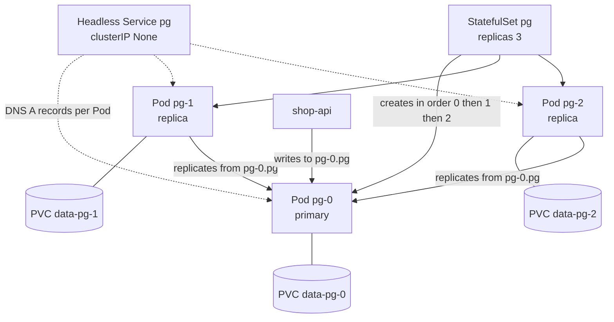
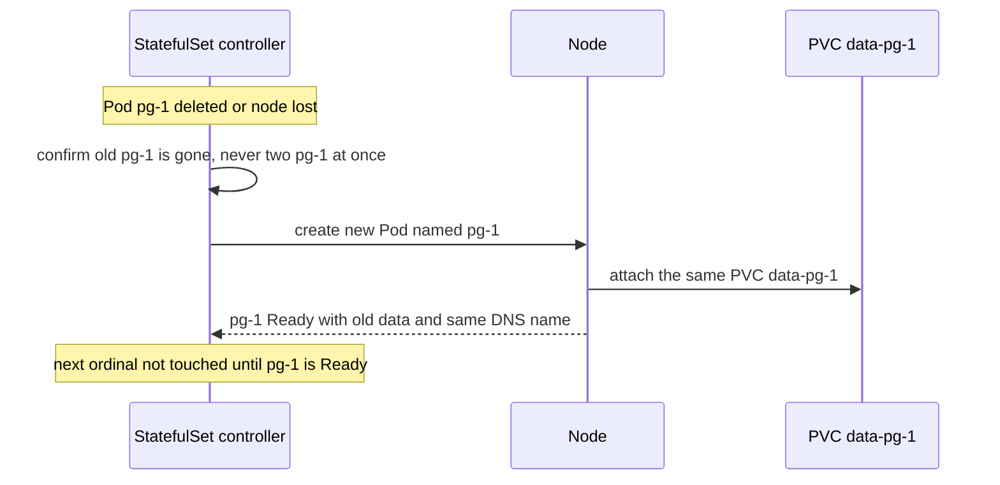

# L8.10 — StatefulSets

> **Level 8: Kubernetes** · Topic 10 of 19 · ⏱ ~4 hours · Difficulty: Advanced

## 1. What it is

A **StatefulSet** is a workload controller for applications that need what a [Deployment](03-deployments-and-replicasets.md)
deliberately does not provide: **stable identity and stable storage**. Pods in a Deployment are interchangeable cattle with random names
(`shop-api-7d9f8-x2k4q`) and share whatever volume the template defines. Pods in a StatefulSet are individually named pets:

- **Stable network identity:** Pods are called `<set>-0`, `<set>-1`, `<set>-2`, and keep that name and a stable DNS entry across
  restarts and rescheduling.
- **Stable storage:** each Pod gets its own PersistentVolumeClaim from `volumeClaimTemplates` (`data-pg-0`, `data-pg-1`, ...), and a
  replacement Pod with the same ordinal re-attaches the same volume ([Volumes, PV and PVC](09-volumes-pv-pvc.md)).
- **Ordered operations:** Pods are created in order (0, then 1, then 2), and scaled down and updated in reverse, one at a time by default.

It works together with a **headless Service** (`clusterIP: None`) that gives every Pod its own DNS name, such as
`pg-0.pg.default.svc.cluster.local`, so members of a database cluster can find each other by name.

## 2. Why it matters in DevOps

- **Databases, queues and consensus systems** (PostgreSQL, MySQL, Redis, Kafka, ZooKeeper, etcd, Elasticsearch) need to know *who they
  are* and keep their data between restarts. Running them as a Deployment causes split brain or data loss.
- **A StatefulSet does not make an application highly available by itself.** It provides identity and storage; replication,
  failover and backups are the application's (or an operator's) job. Many teams therefore use managed databases for the primary
  data store ([RDS and Aurora](../level-06-cloud-aws/10-rds-and-aurora.md)).
- **Different failure semantics.** A StatefulSet will not start a replacement Pod until it is sure the old one is gone (at-most-one
  semantics). A node that goes `NotReady` can leave a StatefulSet Pod unavailable for a long time. You must understand this to be on call for one.
- **Data is never deleted automatically** when you scale down or delete a StatefulSet (by default), which protects data but also
  leaves cost behind.

## 3. Real-world system example

**Databases and brokers on Kubernetes.** The Zalando Postgres Operator and the Prometheus Operator create StatefulSets
underneath, because each replica needs its own disk and a predictable name. Some other operators (CloudNativePG for PostgreSQL,
Strimzi for Apache Kafka) manage Pods and PVCs directly instead, but they provide the same guarantees of stable names and per-member
storage, which shows what the StatefulSet pattern is for. A Kafka broker, for example, has a numeric broker ID tied to its on-disk log directory; if broker 1 comes back
as a different identity, partitions would be misassigned. The StatefulSet ordinal and per-Pod PVC guarantee that `kafka-1`
is always broker 1 with its own data. **etcd** and **ZooKeeper** clusters use the stable DNS names (`etcd-0.etcd`, ...) to build
their member lists. Prometheus itself runs as a StatefulSet in most Kubernetes deployments so each replica keeps its time-series
data ([Prometheus and PromQL](../level-10-observability/02-prometheus-and-promql.md)). The Kubernetes project documents a
StatefulSet-based tutorial for running replicated MySQL.

## 4. Diagram



What happens when `pg-1` is deleted or its node fails:



## 5. How it works

```yaml
apiVersion: v1
kind: Service
metadata:
  name: pg
spec:
  clusterIP: None            # headless: DNS returns Pod IPs, one name per Pod
  selector:
    app: pg
  ports:
    - name: pg
      port: 5432
---
apiVersion: apps/v1
kind: StatefulSet
metadata:
  name: pg
spec:
  serviceName: pg            # must name the governing headless Service
  replicas: 3
  selector:
    matchLabels:
      app: pg
  podManagementPolicy: OrderedReady     # or Parallel
  updateStrategy:
    type: RollingUpdate
    rollingUpdate:
      partition: 0                      # only Pods with ordinal >= partition are updated
  persistentVolumeClaimRetentionPolicy: # stable since v1.32
    whenDeleted: Retain
    whenScaled: Retain
  template:
    metadata:
      labels:
        app: pg
    spec:
      containers:
        - name: postgres
          image: postgres:16
          ports:
            - name: pg
              containerPort: 5432
          env:
            - name: POSTGRES_PASSWORD
              value: demo-only-password
            - name: PGDATA
              value: /var/lib/postgresql/data/pgdata
          volumeMounts:
            - name: data
              mountPath: /var/lib/postgresql/data
  volumeClaimTemplates:
    - metadata:
        name: data
      spec:
        accessModes: [ReadWriteOnce]
        resources:
          requests:
            storage: 1Gi
```

| Property | Deployment | StatefulSet |
|----------|-----------|-------------|
| Pod names | Random suffix | `name-0`, `name-1`, ... fixed |
| Storage | Shared template volume or none | Own PVC per Pod from `volumeClaimTemplates` |
| DNS | Service load-balances to anyone | Headless Service gives `pod.service.ns.svc` per Pod |
| Start/stop order | All at once | Ordered (default), reverse on scale down |
| Replacement | New random Pod | Same name and same PVC, never two at once |
| Rolling update | Surge and unavailable counts | One Pod at a time from highest ordinal down, waits for Ready |
| Typical use | Stateless web APIs | Databases, brokers, consensus clusters |

Key behaviours:

- **Identity.** Pod `pg-1` has hostname `pg-1` and DNS `pg-1.pg.<namespace>.svc.cluster.local`. Ordinals start at 0 by default (`spec.ordinals.start` can change this).
- **Pod management.** `OrderedReady` waits for each Pod to be Running and Ready before creating the next, and blocks scale-down/updates if a Pod is unhealthy. `Parallel` launches or terminates all Pods at once, useful when the application handles ordering itself.
- **Updates.** `RollingUpdate` replaces Pods from the highest ordinal to 0, waiting for each to be Ready. `partition: N` holds back all Pods with an ordinal below `N`, giving a canary: set `partition: 2` of 3 replicas to update only `pg-2`, test, then lower to 0. The `OnDelete` strategy updates a Pod only when you delete it, for manual control.
- **Storage lifecycle.** PVCs are **not** deleted when you scale down or delete the StatefulSet unless `persistentVolumeClaimRetentionPolicy` says `Delete`. Scale back up and `pg-2` finds `data-pg-2` again. Clean-up of old PVCs is manual by default.
- **`volumeClaimTemplates` are immutable.** You cannot change the storage size by editing the template; expand each PVC individually (if the StorageClass allows) and recreate the StatefulSet with `--cascade=orphan` to keep Pods running.
- **Node failure.** If a node becomes unreachable, the controller will not start `pg-1` elsewhere until the old Pod is confirmed terminated (the node returns, the Node object is deleted, or the Pod is force-deleted). Force-deleting a Pod that might still be running risks two instances writing the same data, so only do it when you are sure the node is dead.
- **Readiness matters more.** With ordered rollouts, a readiness probe that is too lax lets the controller move on to the next Pod too soon; too strict stalls the rollout ([Liveness and Readiness Probes](15-liveness-and-readiness-probes.md)).
- **Replication is your job.** Pod `pg-0` is not automatically a primary. An init script, sidecar or operator configures roles. See [Stateful Workloads](../level-16-advanced-kubernetes/08-stateful-workloads.md) and [Operators](../level-16-advanced-kubernetes/04-operators.md) for the production approach.

## 6. Step-by-step guide

**Prerequisites:** the `devops` kind cluster ([topic 1](01-cluster-architecture.md)) with its default `standard` StorageClass
([topic 9](09-volumes-pv-pvc.md)). Cost: free. The three replicas are independent PostgreSQL servers (no replication is configured; this
lab is about identity, storage and ordering). Outputs are illustrative.

1. **Create the headless Service and StatefulSet** using the manifest from section 5. Save it as `pg.yaml`, then:
   ```bash
   kubectl apply -f pg.yaml
   kubectl get pods -l app=pg -w
   ```
   Watch Pods appear **one at a time**: `pg-0` becomes `Running` and Ready before `pg-1` is created, then `pg-2`. Press Ctrl-C when all three are `1/1 Running`.

2. **Inspect the identity and storage.**
   ```bash
   kubectl get statefulset pg
   kubectl get pvc -l app=pg
   kubectl get pods -l app=pg -o wide
   ```
   Pods are `pg-0`, `pg-1`, `pg-2`. PVCs are `data-pg-0`, `data-pg-1`, `data-pg-2`, each `Bound` to its own PV. (The PVCs inherit the Pod template labels in recent Kubernetes versions; if `-l app=pg` shows none on your version, run `kubectl get pvc`.)

3. **See the per-Pod DNS names.**
   ```bash
   kubectl run dns --rm -it --restart=Never --image=busybox:1.36 -- nslookup pg
   kubectl run dns --rm -it --restart=Never --image=busybox:1.36 -- nslookup pg-1.pg
   ```
   The first returns three A records (one per Ready Pod). The second returns exactly the IP of `pg-1`. Compare with a normal ClusterIP Service, which returns one virtual IP.

4. **Write distinct data into each Pod.**
   ```bash
   for i in 0 1 2; do
     kubectl exec pg-$i -- psql -U postgres -c "CREATE TABLE who(name text); INSERT INTO who VALUES ('I am pg-$i');"
   done
   kubectl exec pg-1 -- psql -U postgres -t -c "SELECT * FROM who;"
   ```
   Prints `I am pg-1`. Each Pod has independent storage.

5. **Prove identity survives deletion.**
   ```bash
   kubectl get pod pg-1 -o wide
   kubectl delete pod pg-1
   kubectl wait --for=condition=Ready pod/pg-1 --timeout=120s
   kubectl get pod pg-1 -o wide
   kubectl exec pg-1 -- psql -U postgres -t -c "SELECT * FROM who;"
   ```
   The replacement is again named `pg-1` (the IP may differ, the DNS name does not) and the data `I am pg-1` is still there, because it re-attached `data-pg-1`.

6. **Scale down and up.** Order is reversed on the way down, and storage is kept:
   ```bash
   kubectl scale statefulset pg --replicas=1
   kubectl get pods -l app=pg
   kubectl get pvc
   kubectl scale statefulset pg --replicas=3
   kubectl wait --for=condition=Ready pod/pg-2 --timeout=180s
   kubectl exec pg-2 -- psql -U postgres -t -c "SELECT * FROM who;"
   ```
   `pg-2` is removed first, then `pg-1`. All three PVCs remain, and the new `pg-2` still has `I am pg-2`.

7. **Do a canary update with `partition`.**
   ```bash
   kubectl patch statefulset pg -p '{"spec":{"updateStrategy":{"type":"RollingUpdate","rollingUpdate":{"partition":2}}}}'
   kubectl set image statefulset/pg postgres=postgres:16.4
   kubectl rollout status statefulset/pg --timeout=180s
   kubectl get pods -l app=pg -o custom-columns=NAME:.metadata.name,IMAGE:.spec.containers[0].image
   ```
   Only `pg-2` runs the new image; `pg-0` and `pg-1` stay on `postgres:16`. (`rollout status` may report "waiting for partitioned roll out to finish", which is expected.)
   Then roll the rest: `kubectl patch statefulset pg -p '{"spec":{"updateStrategy":{"rollingUpdate":{"partition":0}}}}'` and watch the order `pg-1`, then `pg-0`. If `postgres:16.4` is not available to you, choose any other existing tag such as `postgres:16.3`.

8. **Break it: a Pod that cannot become Ready blocks the rollout.**
   ```bash
   kubectl set image statefulset/pg postgres=postgres:does-not-exist
   kubectl get pods -l app=pg
   kubectl describe pod -l app=pg | grep -i -A2 'failed\|back-off' | head
   ```
   The highest-ordinal Pod gets `ErrImagePull`/`ImagePullBackOff`, and the controller **does not touch the other Pods**: ordered rollout limits the blast radius. Fix it with `kubectl rollout undo statefulset/pg` or by setting a valid image; because the Pod is not Ready you may need to delete it so the controller recreates it from the fixed template.

9. **Clean up, including the data.** Deleting the StatefulSet does not delete the PVCs:
   ```bash
   kubectl delete statefulset pg
   kubectl get pvc
   kubectl delete pvc -l app=pg
   kubectl delete pvc data-pg-0 data-pg-1 data-pg-2 --ignore-not-found
   kubectl delete service pg
   ```

## 7. Real-world scenario

*Illustrative scenario.* The `shop-api` team runs a three-member Kafka-style cluster on Kubernetes as a StatefulSet with
`podManagementPolicy: OrderedReady`. A cloud provider retires the VM hosting `events-1` unexpectedly; the node goes `NotReady` and
the Pod enters `Unknown`/`Terminating`. Unlike a Deployment, no replacement appears for 20 minutes, the partitions led by that broker
are under-replicated and alerts fire. The on-call engineer checks that the instance is truly gone in the cloud console, deletes
the stale Node object, and the controller recreates `events-1` on a healthy node where it re-attaches its EBS volume and rejoins the
cluster with its old broker identity. The postmortem adds a runbook step "verify the node is gone before forcing anything", a PodDisruptionBudget so voluntary drains cannot take down two brokers at once,
and spread constraints so brokers live in different zones ([Scheduling](13-scheduling.md)).
**Lesson:** StatefulSets trade availability for safety. They will wait rather than risk two Pods writing to the same data.

## 8. Common mistakes and best practices

**Don't**

- Use a StatefulSet for a stateless app, or a Deployment for a database.
- Assume StatefulSet equals HA. Without replication and failover logic, three replicas are three unrelated databases.
- Force-delete a Pod (`--force --grace-period=0`) just because it is stuck; you may create two writers on one volume.
- Forget that PVCs outlive the StatefulSet: the storage keeps billing, and old data can be reattached unexpectedly by a recreated set with the same name.
- Rely on Pod IPs; they change. Use the stable DNS names.
- Put a database in a cluster with no backups and no tested restore ([Backups](../level-15-disaster-recovery/01-backups.md)).

**Do**

- Create the headless Service first and set `serviceName` correctly.
- Add accurate readiness probes so ordered rollouts only advance when each member is truly healthy.
- Use `partition` for canary updates, and `OnDelete` when upgrades need human steps (like failing over a primary first).
- Add a PodDisruptionBudget and anti-affinity or topology spread so a node drain or zone loss cannot take a quorum down.
- Decide the PVC retention policy deliberately (`Retain` for data you cannot recreate).
- Prefer a mature operator or a managed service for production databases ([Operators](../level-16-advanced-kubernetes/04-operators.md), [Stateful Workloads](../level-16-advanced-kubernetes/08-stateful-workloads.md)).

## 9. Tasks

- [ ] **T1 — Deploy and observe ordered start** *(≈40 min, beginner)*
  - **Goal:** see ordinals, PVCs and ordering.
  - **Steps:**
    1. Apply `pg.yaml` and run `kubectl get pods -l app=pg -w`.
    2. Run `kubectl get pvc` and `kubectl get statefulset pg`.
  - **Done when:** you saw `pg-0`, `pg-1`, `pg-2` created one after another and three distinct Bound PVCs exist.

- [ ] **T2 — Stable DNS per Pod** *(≈30 min, beginner)*
  - **Goal:** use per-Pod names from the headless Service.
  - **Steps:**
    1. From a temporary Pod run `nslookup pg` and `nslookup pg-0.pg`.
    2. Delete `pg-0`, wait for it to return, and look up the name again.
  - **Done when:** `pg` returns three A records, `pg-0.pg` resolves to a single IP, and the name still resolves after the Pod is recreated (the IP may change).

- [ ] **T3 — Prove storage follows the ordinal** *(≈40 min, intermediate)*
  - **Goal:** show data tied to identity, not to a Pod object.
  - **Steps:**
    1. Insert a unique row into each member.
    2. Delete all three Pods at once: `kubectl delete pod -l app=pg`.
    3. After they return, read the rows back.
  - **Done when:** each Pod returns its own original row.

- [ ] **T4 — Canary update with partition** *(≈45 min, intermediate)*
  - **Goal:** update one replica first.
  - **Steps:**
    1. Set `partition: 2` and change the image tag.
    2. Show which Pods run which image.
    3. Lower the partition to 0 and note the order of replacement.
  - **Done when:** a table of Pod versus image proves only `pg-2` changed first, and the rest updated from the highest ordinal down.

- [ ] **T5 — Break and fix: a bad image and a stuck volume** *(≈50 min, advanced)*
  - **Goal:** troubleshoot two StatefulSet-specific failures.
  - **Steps:**
    1. Roll out a non-existent image tag; record which Pods were affected, then fix it.
    2. Delete a PVC while its Pod is running (`kubectl delete pvc data-pg-0`); observe `Terminating` (the `kubernetes.io/pvc-protection` finalizer holds it), then delete the Pod so the claim finishes deleting, and see what happens to the recreated Pod.
  - **Done when:** you can explain, from events and `kubectl get pvc`, why the rollout stopped at one Pod and what protected the in-use PVC.

- [ ] **T6 — Prove it: choose the right controller** *(≈30 min, advanced)*
  - **Goal:** justify StatefulSet versus Deployment versus a managed database for `shop-api`'s PostgreSQL.
  - **Steps:**
    1. Without notes, list what a StatefulSet guarantees and what it does not (replication, backups, failover).
    2. Demonstrate the guarantees in kind: stable name, same PVC after deletion, ordered scale-down.
    3. Write a short recommendation for production (operator or managed service) with reasons.
  - **Done when:** your demo shows all three guarantees and your recommendation names the responsibilities you would otherwise own.

## 10. Self-check questions

1. What three things does a StatefulSet give you that a Deployment does not?
2. Why does a StatefulSet need a headless Service?
3. What happens to PVCs when you scale a StatefulSet down or delete it?
4. How does `partition` help with upgrades?
5. A node dies and a StatefulSet Pod stays `Terminating` for a long time. Why, and what is the risk of force-deleting it?
6. Does a three-replica PostgreSQL StatefulSet give you a replicated database?

<details>
<summary>Answers</summary>

1. Stable, unique Pod names and DNS; a dedicated persistent volume per Pod that follows the ordinal; ordered creation, scaling and rolling updates.
2. The headless Service (`clusterIP: None`) publishes a DNS record per Pod (`pod-0.service...`), so members and clients can address specific Pods instead of a load-balanced virtual IP.
3. By default they are kept (the retention policy is `Retain`), so data survives and is reattached on scale-up; you must delete them manually, or set `persistentVolumeClaimRetentionPolicy` to `Delete`.
4. With `RollingUpdate.partition: N`, only Pods with ordinals greater than or equal to N get the new template, so you can update and test one replica before releasing the rest.
5. The controller guarantees at most one Pod per identity, so it waits until the old Pod is confirmed gone. Force-deleting while the node may still be running risks two Pods writing to the same volume and corrupting data.
6. No. The three Pods are independent servers until you configure replication (init scripts, sidecars or an operator).
</details>

## 11. Further reading

- Kubernetes documentation, *Concepts > Workloads > Controllers > StatefulSets*, and the tutorials *StatefulSet Basics* and *Run a Replicated Stateful Application*.
- Kubernetes documentation, *Tasks > Run Applications > Force Delete StatefulSet Pods*.
- Zalando Postgres Operator, CloudNativePG, Strimzi and Prometheus Operator documentation, as examples of operators built on StatefulSets or similar primitives.
- *Kubernetes Patterns* (Bilgin Ibryam, Roland Huss) and *Kubernetes in Action* (Marko Luksa), chapters on StatefulSets.

<!-- nav -->
---
← Previous: [Volumes, PersistentVolumes and PersistentVolumeClaims](09-volumes-pv-pvc.md) · [Level 8 index](README.md) · Next: [DaemonSets](11-daemonsets.md) →
