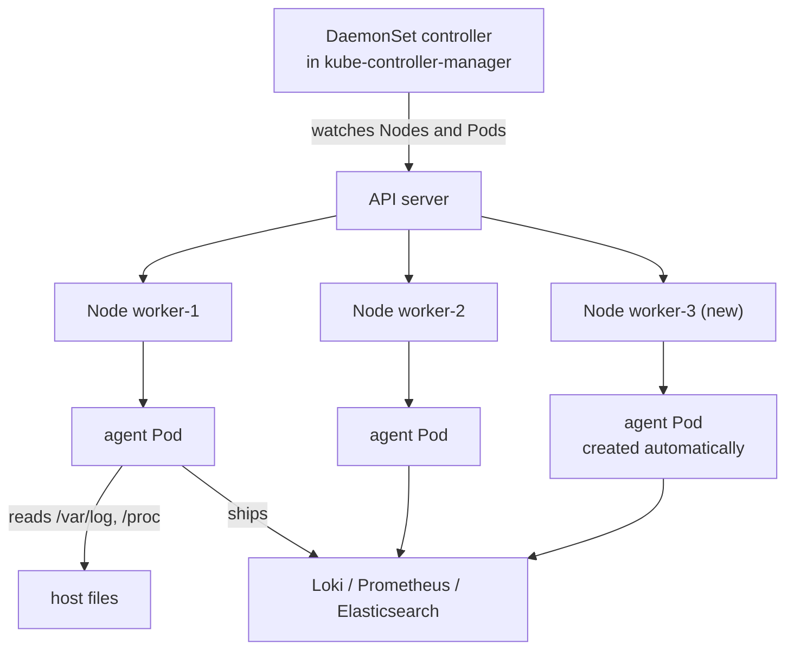
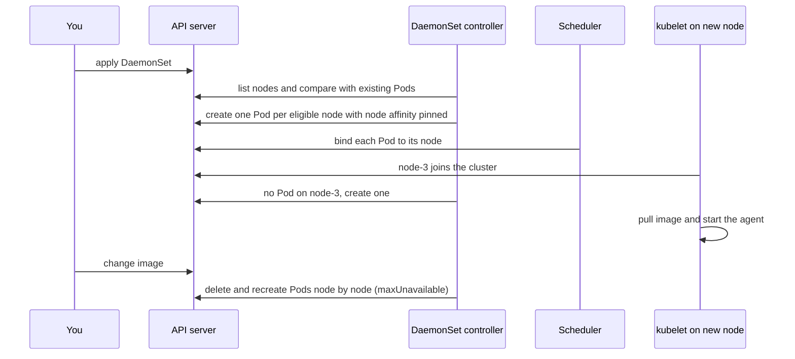

# L8.11 — DaemonSets

> **Level 8: Kubernetes** · Topic 11 of 19 · ⏱ ~3 hours · Difficulty: Intermediate

## 1. What it is

A **DaemonSet** is a Kubernetes workload controller that makes sure **one copy of a Pod runs on every node** (or on
every node that matches a filter). Add a node to the cluster and the DaemonSet controller starts a Pod on it
automatically; remove the node and that Pod is garbage-collected. You never say "3 replicas" — the *number of nodes*
decides how many Pods exist.

Where a Deployment answers "keep N copies of my app running somewhere", a DaemonSet answers "keep one copy of this
helper running *on each machine*". That makes it the right tool for **per-node agents**: log shippers that read the
node's log files, metrics exporters that read the node's `/proc` and `/sys`, networking components (the CNI plugin,
`kube-proxy`), storage drivers and security sensors. The word comes from Unix *daemon* (a background service, see
[Daemons and systemd](../level-01-linux-fundamentals/09-daemons-and-systemd.md)) — a DaemonSet is "a daemon per node, managed by Kubernetes".

## 2. Why it matters in DevOps

- **Observability depends on it.** If the log shipper or node exporter is missing on one node, that node is a blind spot — and
  it is usually the node that is misbehaving.
- **Cluster plumbing is DaemonSets.** On most clusters the CNI (Container Network Interface) plugin and `kube-proxy` are
  DaemonSets. A bad rollout of one breaks pod networking on every node, so you must know how to update them safely.
- **Cost and capacity:** a DaemonSet Pod consumes CPU and memory on *every* node. A 200 MiB agent on 100 nodes is 20 GiB of RAM you
  pay for. Requests and limits on agents matter ([Resource Requests and Limits](14-resource-requests-and-limits.md)).
- **Scheduling surprises:** agents must run on tainted nodes (control plane, GPU, spot) or you silently lose coverage —
  see [Scheduling](13-scheduling.md).

## 3. Real-world system example

**The Kubernetes control plane add-ons themselves.** On a cluster built with `kubeadm`, `kube-proxy` runs as a DaemonSet in the
`kube-system` namespace, and CNI plugins such as Calico, Cilium and Flannel are shipped as DaemonSets too. Run
`kubectl get ds -n kube-system` on almost any cluster and you will see them.

**Monitoring and logging stacks.** The Prometheus project's `node_exporter` is conventionally deployed as a DaemonSet (the
`kube-prometheus-stack` Helm chart does this), exposing each node's CPU, memory, disk and network metrics on port 9100.
Log collectors such as **Fluent Bit** and **Fluentd** (both CNCF projects) are commonly deployed as DaemonSets that mount the
node's `/var/log` and read the container log files the container runtime writes there. Commercial agents (for example the
Datadog Agent) document the same DaemonSet pattern. The shape is always the same: one privileged-ish Pod per node reads
host-level data and forwards it somewhere central.

## 4. Diagram



What happens when a node joins and the DaemonSet is rolled out:



## 5. How it works

**Scheduling.** Since Kubernetes 1.12 the DaemonSet controller creates one Pod per eligible node and gives each a *node affinity*
that pins it to that exact node; the normal scheduler then binds it. Because of that, DaemonSet Pods obey the same rules as other
Pods: taints, `nodeSelector`, resource fit.

**Which nodes are eligible?**

| Mechanism | Effect |
|-----------|--------|
| No selector | every schedulable node, **except** nodes with taints the Pod does not tolerate |
| `spec.template.spec.nodeSelector` / `nodeAffinity` | only nodes with matching labels (for example `disktype=ssd`, `gpu=true`) |
| `tolerations` | lets the Pod run on tainted nodes, such as the control plane (`node-role.kubernetes.io/control-plane:NoSchedule`) |
| built-in tolerations | the controller automatically adds tolerations for `not-ready`, `unreachable`, `disk-pressure`, `memory-pressure`, `pid-pressure`, `unschedulable` (and `network-unavailable` for `hostNetwork` Pods) so agents survive a sick node |

**Update strategies** (`spec.updateStrategy.type`):

| Type | Behaviour |
|------|-----------|
| `RollingUpdate` (default) | replaces Pods node by node; `maxUnavailable` (default 1, accepts a number or a percentage such as `10%`) limits how many nodes lack the agent at once; `maxSurge` (stable since 1.25) can start the new Pod before the old one stops, but then `maxUnavailable` must be 0 and Pods that bind a `hostPort` or the host network port will conflict, so agents like the node exporter keep `maxSurge` at its default of 0 |
| `OnDelete` | the controller updates a Pod only after you delete it — useful for risky components such as the CNI where you want to drain node by node yourself |

**Talking to the host.** Agents typically need host access, so you will see:

- `hostPath` volumes (`/var/log`, `/proc`, `/sys`, `/var/run/containerd/containerd.sock`) — read-only wherever possible;
- `hostNetwork: true` so the agent binds the node's IP (node exporter on `:9100`) — this makes it reachable at `<node-ip>:9100`;
- `hostPID: true` for process-level visibility;
- a **ServiceAccount + RBAC** if the agent calls the API server (a log shipper that enriches records with pod labels needs `get/list/watch` on pods; see [RBAC](18-rbac.md)).

These are powerful permissions; treat every DaemonSet as a high-value target and keep its image pinned and minimal.

**Reaching the Pods.** Use a headless Service or scrape by node IP. To send traffic to the agent *on the same node* (for example
apps sending traces to a local collector) expose it with `hostPort` or use the Downward API to pass `status.hostIP` as an env var.

## 6. Step-by-step guide

**Prerequisites:** Docker, [`kind`](https://kind.sigs.k8s.io/) and `kubectl` installed. Cost: free (runs locally, about 2 GB RAM for three nodes).
Manifests below use `apps/v1`, the current stable API for DaemonSets. Command output shown is *illustrative* — names, ages and
IPs will differ on your machine.

1. **Create a 3-node lab cluster** (one control plane, two workers).
   ```bash
   cat > kind-lab.yaml <<'EOF'
   kind: Cluster
   apiVersion: kind.x-k8s.io/v1alpha4
   nodes:
     - role: control-plane
     - role: worker
     - role: worker
   EOF
   kind create cluster --name lab --config kind-lab.yaml
   kubectl get nodes
   ```
   Expect three nodes in `Ready` state: `lab-control-plane`, `lab-worker`, `lab-worker2`.

2. **Look at DaemonSets that already exist.**
   ```bash
   kubectl get ds -n kube-system
   ```
   Illustrative output: `kindnet` (the CNI that kind installs) and `kube-proxy`, each with `DESIRED 3 CURRENT 3 READY 3`.

3. **Deploy a node-metrics agent.** Save as `node-exporter.yaml`:
   ```yaml
   apiVersion: v1
   kind: Namespace
   metadata:
     name: monitoring
   ---
   apiVersion: apps/v1
   kind: DaemonSet
   metadata:
     name: node-exporter
     namespace: monitoring
     labels:
       app.kubernetes.io/name: node-exporter
   spec:
     selector:
       matchLabels:
         app.kubernetes.io/name: node-exporter
     updateStrategy:
       type: RollingUpdate
       rollingUpdate:
         maxUnavailable: 1
     template:
       metadata:
         labels:
           app.kubernetes.io/name: node-exporter
       spec:
         hostNetwork: true
         hostPID: true
         tolerations:
           - key: node-role.kubernetes.io/control-plane
             operator: Exists
             effect: NoSchedule
         containers:
           - name: node-exporter
             image: quay.io/prometheus/node-exporter:v1.8.2
             args:
               - --path.procfs=/host/proc
               - --path.sysfs=/host/sys
               - --web.listen-address=:9100
             ports:
               - name: metrics
                 containerPort: 9100
             resources:
               requests:
                 cpu: 25m
                 memory: 32Mi
               limits:
                 memory: 64Mi
             volumeMounts:
               - name: proc
                 mountPath: /host/proc
                 readOnly: true
               - name: sys
                 mountPath: /host/sys
                 readOnly: true
         volumes:
           - name: proc
             hostPath:
               path: /proc
           - name: sys
             hostPath:
               path: /sys
   ```
   ```bash
   kubectl apply -f node-exporter.yaml
   kubectl -n monitoring get ds,pods -o wide
   ```
   Expect `DESIRED 3 CURRENT 3 READY 3` and three Pods, one per node, each with the node's IP (because of `hostNetwork`).
   The control-plane node only gets a Pod because of the toleration — remove it later in task T3 and watch the count drop to 2.

4. **Read real metrics from the node.**
   ```bash
   kubectl -n monitoring port-forward ds/node-exporter 9100:9100 &
   curl -s localhost:9100/metrics | grep -E '^node_(load1|memory_MemAvailable_bytes) '
   kill %1
   ```
   You should see `node_load1` and `node_memory_MemAvailable_bytes` lines. This is exactly what Prometheus would scrape.

5. **Add a node and watch the DaemonSet react.** kind cannot add nodes to a running cluster, so simulate it by labelling:
   change the Pod template to `nodeSelector: {monitoring: "true"}` (add it under `spec.template.spec`), re-apply, and observe
   `DESIRED 0`. Then label nodes one by one:
   ```bash
   kubectl label node lab-worker monitoring=true
   kubectl -n monitoring get ds node-exporter -w
   ```
   The `DESIRED` and `READY` counts rise as each node gets labelled — the controller reacts to node changes, not just to YAML changes.

6. **Roll out a new version safely.**
   ```bash
   kubectl -n monitoring set image ds/node-exporter node-exporter=quay.io/prometheus/node-exporter:v1.8.1
   kubectl -n monitoring rollout status ds/node-exporter
   kubectl -n monitoring rollout history ds/node-exporter
   kubectl -n monitoring rollout undo ds/node-exporter
   ```
   `rollout status` waits node by node; `undo` returns to the previous revision.

7. **Clean up.**
   ```bash
   kubectl delete namespace monitoring
   kind delete cluster --name lab
   ```

## 7. Real-world scenario

*Illustrative scenario.* The `shop-api` team notices a gap in the logging dashboard: no logs at all from the `payments` workloads for
twenty minutes during an incident. The on-call engineer runs `kubectl get ds -n logging` and sees `DESIRED 12, READY 11`. The
missing node is a recently added **tainted node pool** (`dedicated=payments:NoSchedule`) — the log-shipper DaemonSet had no matching
toleration, so its Pod was never created there, and the cluster autoscaler quietly added the pool after the DaemonSet was written.
The fix is a one-line toleration (`operator: Exists`, which tolerates any taint) in the DaemonSet and a rollout; coverage returned within minutes.
**Lesson:** per-node agents should tolerate every taint you use, and an alert on `kube_daemonset_status_number_misscheduled` /
`desired != ready` turns a silent blind spot into a page.

## 8. Common mistakes and best practices

**Don't**

- Forget tolerations for control-plane, GPU, spot or dedicated pools — you lose logs and metrics from exactly the nodes you care about.
- Run agents without resource requests and limits; one runaway log shipper can starve the node's real workloads.
- Mount the whole host filesystem read-write "to make it work". Mount only the paths needed, `readOnly: true`.
- Roll out a CNI or storage-driver DaemonSet with the default `maxUnavailable` on a production cluster without a canary node first.
- Use a DaemonSet when you just need "N replicas anywhere" — that is a Deployment ([Deployments and ReplicaSets](03-deployments-and-replicasets.md)).

**Do**

- Pin image tags (never `latest`) and keep `updateStrategy: RollingUpdate` with a sensible `maxUnavailable` (a percentage scales with cluster size).
- Give every agent a `priorityClassName` such as `system-node-critical` where appropriate, so it is the last Pod evicted under pressure.
- Add liveness and readiness probes ([Liveness and Readiness Probes](15-liveness-and-readiness-probes.md)).
- Alert when `DESIRED != READY` for any DaemonSet.
- Use a dedicated ServiceAccount with least-privilege RBAC.

## 9. Tasks

- [ ] **T1 — Find the DaemonSets in your cluster** *(≈15 min, beginner)*
  - **Goal:** recognise the DaemonSets that make a cluster work.
  - **Steps:**
    1. Create the kind cluster from step 1.
    2. Run `kubectl get ds -A -o wide`.
    3. For `kube-proxy`, run `kubectl -n kube-system describe ds kube-proxy` and note the node selector, tolerations and update strategy.
  - **Done when:** you can state what each DaemonSet in `kube-system` does and why it must run on every node.

- [ ] **T2 — Deploy the node exporter and read a metric** *(≈30 min, beginner)*
  - **Goal:** run a per-node agent and prove it sees the host.
  - **Steps:**
    1. Apply `node-exporter.yaml` from step 3.
    2. Port-forward one Pod and `curl localhost:9100/metrics`.
    3. Compare `node_memory_MemTotal_bytes` with `grep MemTotal /proc/meminfo` run inside the kind node (`docker exec lab-worker grep MemTotal /proc/meminfo`).
  - **Done when:** both numbers match, proving the Pod reads the node's `/proc`, not its own.

- [ ] **T3 — Control where it runs** *(≈30 min, intermediate)*
  - **Goal:** use tolerations and node selectors to shape DaemonSet placement.
  - **Steps:**
    1. Remove the control-plane toleration and re-apply; confirm `DESIRED` drops from 3 to 2.
    2. Add `nodeSelector: {monitoring: "true"}` and label only `lab-worker`; confirm exactly one Pod exists.
    3. Remove the label from the node and watch the Pod disappear.
  - **Done when:** `kubectl get pods -n monitoring -o wide` shows Pods only on nodes that match your rules, at each step.

- [ ] **T4 — Build a log tailer** *(≈45 min, intermediate)*
  - **Goal:** write a DaemonSet that reads host log files, the way Fluent Bit does.
  - **Steps:**
    1. Write a DaemonSet using image `busybox:1.36` with `command: ["sh","-c","tail -F /host/var/log/containers/*.log"]`.
    2. Mount the host `/var/log` read-only at `/host/var/log` (`hostPath`).
    3. Run `kubectl logs ds/<name>` and find lines from `kube-proxy` or `coredns`.
  - **Done when:** the DaemonSet Pod prints log lines produced by *other* Pods on the same node.

- [ ] **T5 — Break and fix a rollout** *(≈30 min, advanced)*
  - **Goal:** practise the rollout and rollback safety net.
  - **Steps:**
    1. Set the image to a tag that does not exist (`node-exporter:v0.0.0`).
    2. Observe with `kubectl rollout status` and `kubectl get pods`; with `maxUnavailable: 1` only one node is affected.
    3. Run `kubectl rollout undo` and confirm all three Pods return to `Running`.
  - **Done when:** `READY` returns to `3` and you can explain why only one node was hurt.

- [ ] **T6 — Prove it: explain DaemonSet vs Deployment** *(≈30 min, advanced)*
  - **Goal:** teach the difference without notes.
  - **Steps:**
    1. Without the guide, write a DaemonSet for a log shipper that runs on every node including tainted ones, with requests and limits.
    2. In five sentences, explain how its Pod count is decided and what happens when a node joins.
  - **Done when:** the manifest applies cleanly (`kubectl apply --dry-run=server -f`) and a teammate can follow your explanation.

## 10. Self-check questions

1. How many Pods does a DaemonSet create, and what decides that number?
2. Why does a DaemonSet Pod still get scheduled on a node with `disk-pressure`?
3. What does `OnDelete` do and when would you choose it over `RollingUpdate`?
4. Your log shipper is missing on the GPU nodes. What are the two most likely causes?
5. Why do per-node agents so often use `hostPath` volumes and `hostNetwork`, and what is the risk?

<details>
<summary>Answers</summary>

1. One per eligible node. Eligibility is decided by node selectors/affinity, taints and tolerations; there is no `replicas` field.
2. The DaemonSet controller automatically adds tolerations for node-condition taints (not-ready, unreachable, disk/memory/pid pressure, unschedulable) so agents keep running on unhealthy nodes.
3. The controller replaces a Pod only after you delete it manually. Choose it for sensitive components (CNI, storage drivers) where you want to roll out node by node under your own control.
4. A taint on the GPU pool that the DaemonSet does not tolerate, or a `nodeSelector`/affinity that does not match the GPU nodes' labels. (Also check resource requests that do not fit.)
5. The agent must observe the host (logs, `/proc`, node IP). The risk is that a compromised agent gets host-level access, so mount read-only, minimise privileges and pin images.
</details>

## 11. Further reading

- Kubernetes documentation — *Workloads → DaemonSet* (kubernetes.io/docs), including the update strategy and "how daemon pods are scheduled" sections.
- Prometheus documentation — *node_exporter* guide.
- Fluent Bit documentation — *Kubernetes* installation and filter pages.
- See also: [Scheduling](13-scheduling.md) for taints and tolerations, and [Pods](02-pods.md) for the Pod fundamentals a DaemonSet wraps.

<!-- nav -->
---
← Previous: [StatefulSets](10-statefulsets.md) · [Level 8 index](README.md) · Next: [Jobs and CronJobs](12-jobs-and-cronjobs.md) →
