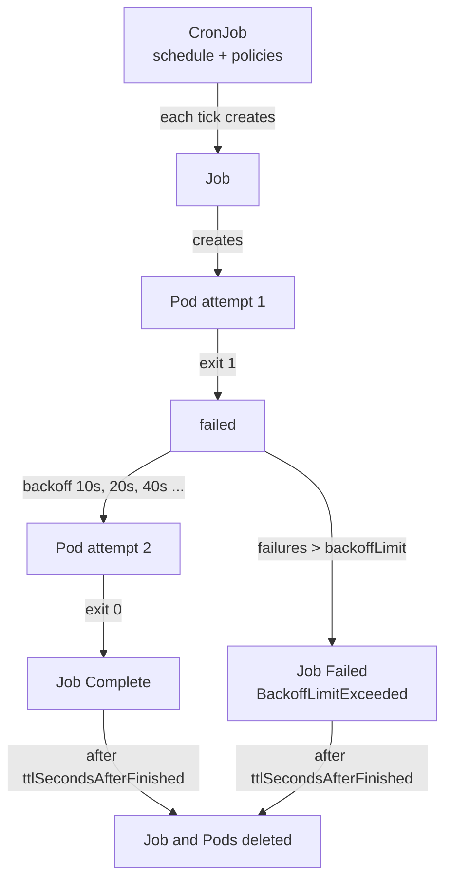
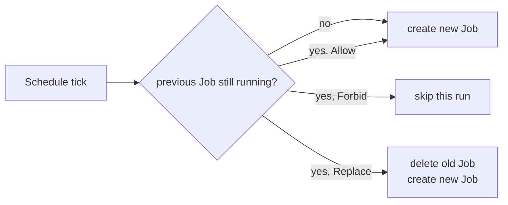

# L8.12 — Jobs and CronJobs

> **Level 8: Kubernetes** · Topic 12 of 19 · ⏱ ~3 hours · Difficulty: Intermediate

## 1. What it is

A **Job** runs Pods **to completion**. Where a Deployment keeps Pods running forever and restarts them whenever they exit, a Job
creates one or more Pods, waits for them to exit successfully (exit code 0), retries them if they fail, and then stops. It is
Kubernetes' tool for **batch work**: database migrations, backups, report generation, data imports, one-off maintenance scripts.

A **CronJob** is a Job factory on a schedule. At each tick of a cron expression (the same five-field syntax as Linux `cron`,
see [Daemons and systemd](../level-01-linux-fundamentals/09-daemons-and-systemd.md) for the background) it creates a new Job from a template. CronJobs
add the policies that matter when schedules and reality disagree: what to do if the previous run is still going
(`concurrencyPolicy`), how late a run may start (`startingDeadlineSeconds`), and how much history to keep.

## 2. Why it matters in DevOps

- **Migrations and backups are Jobs.** If a nightly `pg_dump` silently stops running, you find out when you need the restore.
- **Retries are built in, and dangerous.** A buggy Job with a high `backoffLimit` can hammer a database or send 6 duplicate emails.
  Jobs must be **idempotent** (safe to run twice).
- **Finished Jobs pile up.** Without a TTL (time to live) or history limits, thousands of completed Pods and Job objects bloat
  etcd and make `kubectl get pods` unusable.
- **Overlapping runs cause outages.** A 2-hour report scheduled every hour with `concurrencyPolicy: Allow` will eventually eat the cluster.

## 3. Real-world system example

**Helm and Argo CD hooks.** Both tools run database migrations as Kubernetes Jobs: Helm via `pre-upgrade`/`post-install` hook
annotations, Argo CD via `PreSync` resource hooks. The deployment waits for the Job to succeed before the new application version
rolls out — the pattern described in [Database Migrations in Pipelines](../level-05-cicd/09-database-migrations.md).

**Platform maintenance.** Teams commonly run CronJobs for database backups to object storage, certificate and token rotation,
cache warm-ups, and cleaning up stale data. Kubernetes' own documentation uses a CronJob as the canonical "run on a schedule" example.
Larger batch systems (for example data pipelines on Kubernetes) build on Jobs, usually with Indexed Jobs for parallel work-splitting.

## 4. Diagram



How `concurrencyPolicy` decides when the next tick fires while a Job is still running:



## 5. How it works

**Job fields you will use constantly**

| Field | Meaning |
|-------|---------|
| `spec.template.spec.restartPolicy` | **Must be `Never` or `OnFailure`** (never `Always`). `Never` creates a new Pod per retry (keeps logs of each attempt); `OnFailure` restarts the container inside the same Pod |
| `backoffLimit` | retries before the Job is marked Failed (default **6**). Delay between retries grows exponentially (10 s, 20 s, 40 s ... capped at 6 minutes) |
| `activeDeadlineSeconds` | hard wall-clock limit for the whole Job; when exceeded, running Pods are killed and the Job fails with `DeadlineExceeded` |
| `completions` / `parallelism` | run the work N times in total, K at a time. Default 1 and 1 |
| `completionMode: Indexed` | each Pod gets a stable index (env `JOB_COMPLETION_INDEX`) so Pod 0..N-1 can process different shards |
| `ttlSecondsAfterFinished` | delete the Job (and its Pods) this many seconds after it finishes. Stable since 1.23. `0` deletes immediately |
| `podFailurePolicy` | rules that treat specific exit codes as "do not retry" or "ignore" (stable since 1.31) |
| `suspend` | create the Job paused; useful for queues and controllers |

**CronJob fields**

| Field | Meaning |
|-------|---------|
| `schedule` | cron expression, e.g. `"0 2 * * *"` = 02:00 daily. Supports `@hourly`, `@daily` aliases |
| `timeZone` | IANA zone such as `"Etc/UTC"` or `"America/New_York"` (stable since 1.27). Without it the schedule uses the time zone of the kube-controller-manager, usually UTC |
| `concurrencyPolicy` | `Allow` (default), `Forbid` (skip a run if the previous is still going), `Replace` (cancel the old one) |
| `startingDeadlineSeconds` | if a run could not start on time (controller down, cluster busy), skip it if it is more than this many seconds late |
| `successfulJobsHistoryLimit` / `failedJobsHistoryLimit` | finished Jobs to keep (defaults 3 and 1) |
| `suspend` | pause the schedule without deleting the CronJob |

Gotchas worth knowing:

- A CronJob can in principle create a Job **zero, one or (rarely) two times** per tick, so the work must tolerate duplicates and misses.
- If 100 or more ticks are missed (for example the controller was down), the CronJob stops scheduling and reports an error until you fix `startingDeadlineSeconds` or recreate it.
- Pod logs are the only record of what a Job did. Once the Job is garbage-collected by TTL, its logs are gone from the cluster; ship logs off-cluster ([Log Aggregation with Loki](../level-10-observability/06-loki-log-aggregation.md)).

## 6. Step-by-step guide

**Prerequisites:** a kind cluster (create one with `kind create cluster --name lab` if you do not have one) and `kubectl`. Cost: free.
All manifests use `batch/v1`. Output shown is *illustrative*.

1. **Run a one-shot Job.** Save as `hello-job.yaml`:
   ```yaml
   apiVersion: batch/v1
   kind: Job
   metadata:
     name: hello
   spec:
     backoffLimit: 2
     ttlSecondsAfterFinished: 300
     template:
       spec:
         restartPolicy: Never
         containers:
           - name: hello
             image: busybox:1.36
             command: ["sh", "-c", "echo shop-api report generated at $(date -u) && sleep 3"]
   ```
   ```bash
   kubectl apply -f hello-job.yaml
   kubectl wait --for=condition=complete job/hello --timeout=60s
   kubectl logs job/hello
   kubectl get job hello
   ```
   Expect `COMPLETIONS 1/1` and a log line with the timestamp. Five minutes later the Job vanishes thanks to the TTL.

2. **Watch retries and `backoffLimit` in action.** Save as `failing-job.yaml`:
   ```yaml
   apiVersion: batch/v1
   kind: Job
   metadata:
     name: always-fails
   spec:
     backoffLimit: 2
     template:
       spec:
         restartPolicy: Never
         containers:
           - name: fail
             image: busybox:1.36
             command: ["sh", "-c", "echo trying; exit 1"]
   ```
   ```bash
   kubectl apply -f failing-job.yaml
   kubectl get pods -l job-name=always-fails -w
   ```
   Illustrative output: three Pods (`always-fails-xxxxx`) go to `Error` over roughly 30 to 60 seconds. Then:
   ```bash
   kubectl describe job always-fails | grep -A3 -i conditions
   ```
   You should see a `Failed` condition with reason `BackoffLimitExceeded`. With `backoffLimit: 2` you get the first attempt plus 2 retries.

3. **Run parallel work.** Save as `parallel-job.yaml` — 6 tasks, 2 at a time, each Pod knows its index:
   ```yaml
   apiVersion: batch/v1
   kind: Job
   metadata:
     name: shard-import
   spec:
     completions: 6
     parallelism: 2
     completionMode: Indexed
     ttlSecondsAfterFinished: 120
     template:
       spec:
         restartPolicy: Never
         containers:
           - name: worker
             image: busybox:1.36
             command: ["sh", "-c", "echo importing shard $JOB_COMPLETION_INDEX of 6; sleep 5"]
   ```
   ```bash
   kubectl apply -f parallel-job.yaml
   kubectl get pods -l job-name=shard-import -w
   ```
   Never more than two Pods run at once; indexes 0-5 each run exactly once.

4. **Schedule it with a CronJob.** A nightly database backup shaped like the `shop-api` one (the `pg_dump` details are in
   [Backups and Point-in-Time Recovery](../level-13-databases-distributed-systems/05-backups-and-pitr.md); here we use a harmless stand-in). Save as `backup-cronjob.yaml`:
   ```yaml
   apiVersion: batch/v1
   kind: CronJob
   metadata:
     name: shop-db-backup
   spec:
     schedule: "*/1 * * * *"          # every minute for the lab; use "0 2 * * *" in real life
     timeZone: "Etc/UTC"
     concurrencyPolicy: Forbid
     startingDeadlineSeconds: 60
     successfulJobsHistoryLimit: 3
     failedJobsHistoryLimit: 1
     jobTemplate:
       spec:
         backoffLimit: 1
         activeDeadlineSeconds: 120
         ttlSecondsAfterFinished: 600
         template:
           spec:
             restartPolicy: Never
             containers:
               - name: backup
                 image: busybox:1.36
                 command: ["sh", "-c", "echo pretend pg_dump shop at $(date -u); sleep 90; echo done"]
   ```
   ```bash
   kubectl apply -f backup-cronjob.yaml
   kubectl get cronjob shop-db-backup
   kubectl get jobs -w
   ```
   The `sleep 90` makes each run outlast the one-minute schedule. Because of `Forbid` you will see Jobs created only every other
   minute; the skipped ticks show up as events (`kubectl describe cronjob shop-db-backup`, look for `JobAlreadyActive`).

5. **Trigger a CronJob by hand, then pause it.**
   ```bash
   kubectl create job --from=cronjob/shop-db-backup manual-backup-1
   kubectl patch cronjob shop-db-backup -p '{"spec":{"suspend":true}}'
   kubectl get cronjob shop-db-backup
   ```
   `SUSPEND` becomes `True` and no new Jobs appear. The manual run is how you test a CronJob without waiting for the clock.

6. **Clean up.**
   ```bash
   kubectl delete cronjob shop-db-backup
   kubectl delete job hello always-fails shard-import manual-backup-1 --ignore-not-found
   ```

## 7. Real-world scenario

*Illustrative scenario.* A team's hourly "sync prices" CronJob normally takes 5 minutes. After a supplier API slowdown it takes 80
minutes. With the default `concurrencyPolicy: Allow` a new Job starts every hour, each holding database connections and
retrying on timeouts. Within a few hours there are 4 overlapping runs, the Postgres connection pool is exhausted, and `shop-api` starts returning 500s.
The engineer sees `kubectl get jobs` showing many active Jobs, suspends the CronJob (`suspend: true`) to stop the bleeding, deletes
the stuck Jobs, and later sets `concurrencyPolicy: Forbid`, `activeDeadlineSeconds: 1800` and an alert when no Job has succeeded for 3 hours.
**Lesson:** a schedule is a promise to start work, not to finish it; always bound concurrency and runtime, and alert on *absence* of success.

## 8. Common mistakes and best practices

**Don't**

- Set `restartPolicy: Always` (rejected) or forget `restartPolicy` entirely — Jobs require `Never` or `OnFailure`.
- Leave `backoffLimit` at 6 for work that has side effects (emails, payments) without making it idempotent.
- Schedule heavy CronJobs at `0 * * * *` along with everyone else; stagger the minute to avoid a thundering herd.
- Rely on `kubectl logs` for history: with TTL cleanup the logs vanish.
- Run a CronJob without thinking about time zones and daylight saving time; prefer UTC with an explicit `timeZone`.

**Do**

- Set `ttlSecondsAfterFinished`, `activeDeadlineSeconds` and history limits on every Job.
- Choose `concurrencyPolicy: Forbid` for anything stateful, `Replace` for "only the latest run matters" jobs.
- Make Job code idempotent and use `podFailurePolicy` to stop retrying on non-retryable exit codes.
- Set resource requests and limits ([Resource Requests and Limits](14-resource-requests-and-limits.md)) so batch work cannot starve `shop-api`.
- Monitor "time since last successful run" rather than only "last run failed".

## 9. Tasks

- [ ] **T1 — Run and inspect a Job** *(≈20 min, beginner)*
  - **Goal:** see the lifecycle of a Job and its Pod.
  - **Steps:**
    1. Apply `hello-job.yaml`.
    2. Run `kubectl get job,pod -l job-name=hello` and `kubectl logs job/hello`.
    3. Wait 5 minutes and confirm the TTL deleted both.
  - **Done when:** you saw `1/1` completions, read the log line, and the Job disappeared on its own.

- [ ] **T2 — Make retries visible** *(≈30 min, beginner)*
  - **Goal:** understand `backoffLimit` and exponential backoff.
  - **Steps:**
    1. Apply `failing-job.yaml` and time how long between Pod creations (`kubectl get pods -l job-name=always-fails -w`).
    2. Change `backoffLimit` to 0, delete and re-apply the Job.
    3. Compare the number of Pods created each time.
  - **Done when:** with `backoffLimit: 2` you counted 3 Pods, with `0` exactly 1, and you can explain the gap between them.

- [ ] **T3 — Process shards in parallel** *(≈30 min, intermediate)*
  - **Goal:** use `completions`, `parallelism` and Indexed mode.
  - **Steps:**
    1. Apply `parallel-job.yaml`.
    2. Collect each Pod's log (`for p in $(kubectl get pods -l job-name=shard-import -o name); do kubectl logs $p; done`).
    3. Change `parallelism` to 3 and `completions` to 9, re-apply as a new Job.
  - **Done when:** the output lists shard indexes 0-8 exactly once and you never see more than 3 Pods `Running` at a time.

- [ ] **T4 — Prove concurrencyPolicy** *(≈45 min, intermediate)*
  - **Goal:** compare `Allow`, `Forbid` and `Replace` on an overlapping schedule.
  - **Steps:**
    1. Run `backup-cronjob.yaml` (with `Forbid`) for 5 minutes and count the Jobs created.
    2. Change `concurrencyPolicy` to `Allow` and count again over 5 minutes.
    3. Change to `Replace` and observe what happens to the older Job's Pod.
  - **Done when:** you have a three-row table (policy, Jobs created, Jobs running at peak) that matches the documented behaviour.

- [ ] **T5 — Break it: a CronJob that never runs** *(≈30 min, advanced)*
  - **Goal:** diagnose a silent schedule failure.
  - **Steps:**
    1. Set `schedule: "0 25 * * *"` (invalid) and observe the API server error, then fix it.
    2. Set `suspend: true` and explain why no Jobs appear; set it back.
    3. Point the image at a tag that does not exist and watch the Pod sit in `ImagePullBackOff` while, with `Forbid`, later ticks are skipped until `activeDeadlineSeconds` kills the Job.
  - **Done when:** you can list three different reasons a CronJob "does nothing" (invalid schedule, suspended, previous run stuck) and how `kubectl describe cronjob` and its events reveal each.

- [ ] **T6 — Prove it: a safe nightly backup** *(≈45 min, advanced)*
  - **Goal:** design a production-grade CronJob without the guide.
  - **Steps:**
    1. Write a CronJob for a `pg_dump` of `shop-api`: `02:30 UTC` daily, `Forbid`, `activeDeadlineSeconds`, TTL, history limits, resource requests, credentials from a Secret ([Secrets](07-secrets.md)).
    2. Validate with `kubectl apply --dry-run=server -f` and trigger it once with `kubectl create job --from=cronjob/...`.
    3. Write three sentences on how you would alert if the backup silently stopped.
  - **Done when:** the manual run completes and your alert idea is based on "time since last success".

## 10. Self-check questions

1. Why can a Job's Pod not use `restartPolicy: Always`?
2. A Job shows `BackoffLimitExceeded`. What happened and where do you look?
3. What is the difference between `Forbid` and `Replace`?
4. How do you stop completed Jobs from accumulating?
5. Why must scheduled work be idempotent?

<details>
<summary>Answers</summary>

1. `Always` would restart the container forever after a successful exit, so the Job could never complete. Only `Never` or `OnFailure` are allowed.
2. The Pods failed more times than `backoffLimit` allows. Look at `kubectl describe job`, the Pod list (`-l job-name=<name>`) and `kubectl logs` of the failed Pods (they are kept with `restartPolicy: Never`).
3. `Forbid` skips the new run while the old one is active; `Replace` cancels the old Job and starts the new one.
4. `ttlSecondsAfterFinished` on the Job and `successfulJobsHistoryLimit`/`failedJobsHistoryLimit` on the CronJob.
5. Retries, duplicate CronJob runs and manual re-runs can all execute the same work more than once, so repeating it must not cause harm.
</details>

## 11. Further reading

- Kubernetes documentation — *Workloads → Jobs* and *CronJob* (kubernetes.io/docs), including "Job patterns" and "Pod failure policy".
- Kubernetes documentation — *Automatic cleanup for finished Jobs* (TTL controller).
- See also: [Pods](02-pods.md) for restart policies, and [Deployments and ReplicaSets](03-deployments-and-replicasets.md) for the long-running counterpart.

<!-- nav -->
---
← Previous: [DaemonSets](11-daemonsets.md) · [Level 8 index](README.md) · Next: [Scheduling](13-scheduling.md) →
