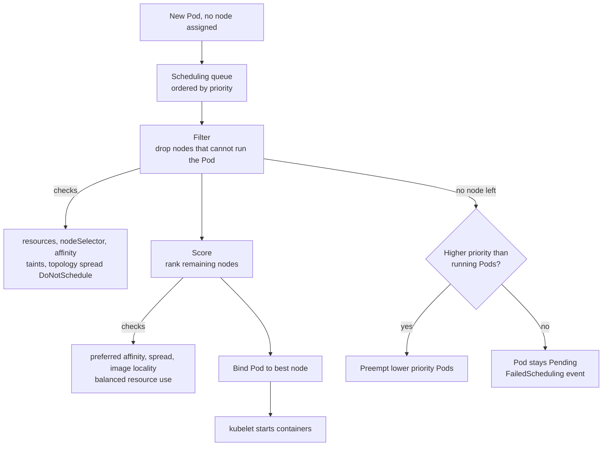
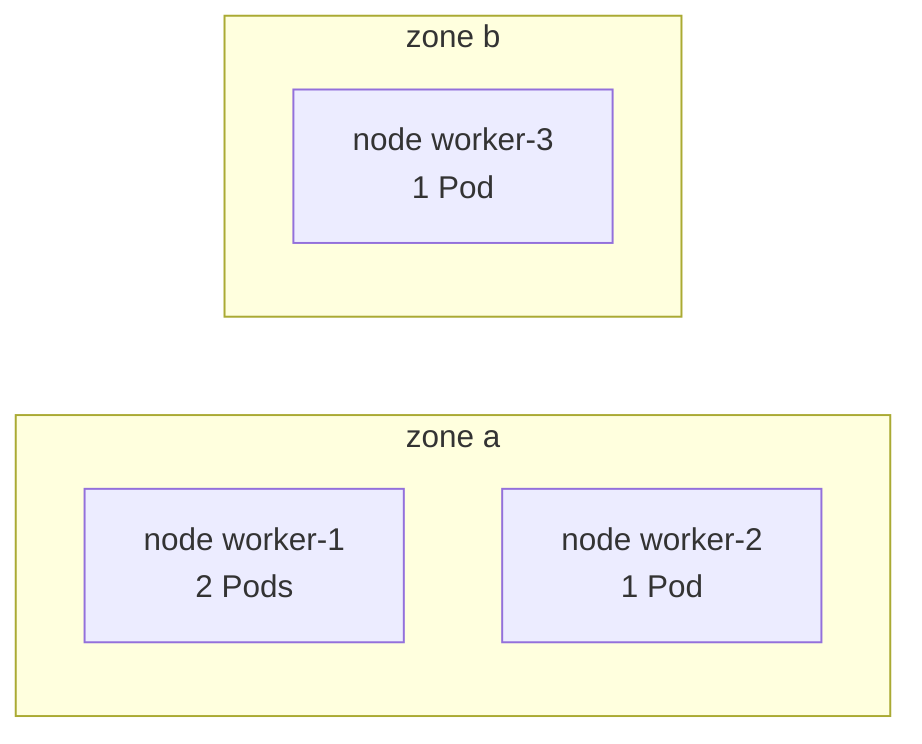

# L8.13 — Scheduling

> **Level 8: Kubernetes** · Topic 13 of 19 · ⏱ ~4 hours · Difficulty: Intermediate

## 1. What it is

**Scheduling** is the decision "which node should run this Pod?". A new Pod is created with no node assigned (`spec.nodeName`
is empty). The **kube-scheduler**, a control-plane component, watches for such Pods, picks the best node and writes the
decision back to the API server ("binding"); the **kubelet** on that node then starts the containers. A Pod is only ever scheduled once —
the scheduler does not move running Pods around.

You influence the decision with a small toolbox: **`nodeSelector`** and **node affinity** (run on nodes with these labels),
**pod affinity and anti-affinity** (run near, or away from, other Pods), **taints and tolerations** (nodes repel Pods unless
the Pod opts in), **topology spread constraints** (spread replicas evenly across zones or nodes) and **priority** (who wins
when the cluster is full). Resource requests ([Resource Requests and Limits](14-resource-requests-and-limits.md)) are the other half:
the scheduler only places a Pod on a node with enough unreserved CPU and memory.

## 2. Why it matters in DevOps

- **High availability:** if all 3 replicas of `shop-api` land on one node (or one availability zone) a single failure takes the service down.
  Spread rules turn "3 replicas" into real redundancy ([High Availability and Scalability](../level-00-what-devops-is/08-high-availability-and-scalability.md)).
- **Cost and isolation:** GPU, spot and high-memory nodes are expensive; taints keep ordinary workloads off them.
- **Pending Pods are a classic 3 a.m. page.** "0/5 nodes are available: 2 Insufficient memory, 3 node(s) had untolerated taint" is the scheduler telling you exactly why. You must be able to read it.
- **Noisy neighbours and data locality:** pin the cache next to the API, keep the batch jobs away from the database.

## 3. Real-world system example

**Kubernetes itself and managed clusters.** On kubeadm clusters the control-plane nodes carry the taint
`node-role.kubernetes.io/control-plane:NoSchedule`, which is why your application Pods never land there but `kube-proxy`
and the CNI DaemonSet (which tolerate it) do. Managed services such as EKS, GKE and AKS label nodes with
`topology.kubernetes.io/zone` and `kubernetes.io/hostname`; these well-known labels are what topology spread constraints and
anti-affinity use to spread replicas across zones in a region such as `us-east-1`. Cluster autoscalers and Karpenter react to Pods that
are `Unschedulable`, so scheduling constraints directly decide which nodes get created ([Auto Scaling](../level-06-cloud-aws/02-auto-scaling.md)). The default
scheduler also supports `PriorityClass`: Kubernetes ships `system-cluster-critical` and `system-node-critical` so core add-ons
can preempt ordinary workloads.

## 4. Diagram



Spreading 3 replicas over 3 nodes in 2 zones with `maxSkew: 1`:



## 5. How it works

**Step 1 — Filter, step 2 — Score.** The scheduler removes nodes that *cannot* run the Pod (not enough CPU/memory requests,
untolerated taints, failing `nodeSelector`, required affinity, `DoNotSchedule` spread), then ranks the survivors by *preference*
(preferred affinity, spreading, balanced utilisation) and binds to the highest score. If nothing survives, the Pod stays `Pending`.

| Tool | Type | Use it for |
|------|------|-----------|
| `nodeSelector` | hard, simple equality | "only on nodes labelled `disktype=ssd`" |
| `nodeAffinity` `requiredDuringSchedulingIgnoredDuringExecution` | hard, rich operators (`In`, `NotIn`, `Exists`, `Gt`, `Lt`) | same as nodeSelector with set logic |
| `nodeAffinity` `preferredDuringScheduling...` | soft, weighted 1-100 | "prefer SSD nodes but accept any" |
| `podAffinity` | hard or soft | co-locate API Pods with their Redis cache for low latency |
| `podAntiAffinity` | hard or soft | "never two `shop-api` Pods on the same node" (`topologyKey: kubernetes.io/hostname`) |
| **taint** (on node) + **toleration** (on Pod) | repel | reserve nodes: `NoSchedule` (don't place), `PreferNoSchedule` (try not to), `NoExecute` (also evict running Pods) |
| `topologySpreadConstraints` | hard or soft | even spread across zones/nodes; `maxSkew` is the permitted difference between the fullest and emptiest domain |
| `priorityClassName` | ordering and preemption | critical services outrank batch work |
| `nodeName` | bypass the scheduler | debugging only |

The phrase `IgnoredDuringExecution` means: if node labels change *after* the Pod is running, the Pod is not evicted. Only
`NoExecute` taints evict running Pods.

**Taints versus affinity.** A taint says "stay away unless you are explicitly allowed" — it does *not* attract the allowed Pod
anywhere in particular. To *dedicate* a node pool to a workload, combine both: taint the nodes **and** add a matching
`nodeSelector`/affinity plus toleration on the workload.

**Topology spread constraints** (GA since 1.19) are usually better than anti-affinity for replica spreading, because anti-affinity
is all-or-nothing (the 4th replica cannot place on 3 nodes) while spread constraints tolerate a bounded skew:

```yaml
topologySpreadConstraints:
  - maxSkew: 1
    topologyKey: topology.kubernetes.io/zone
    whenUnsatisfiable: DoNotSchedule   # or ScheduleAnyway for a soft rule
    labelSelector:
      matchLabels:
        app: shop-api
```

**Priority and preemption.** A `PriorityClass` maps a name to an integer (`value`). When a high-priority Pod cannot fit, the
scheduler may evict ("preempt") lower-priority Pods to make room. `preemptionPolicy: Never` gives a class priority in the queue
without evicting anything. Pods with no class get priority 0.

## 6. Step-by-step guide

**Prerequisites:** Docker, `kind`, `kubectl`. Cost: free. Output is *illustrative*.

1. **Create a cluster with 3 workers and label them with fake zones.**
   ```bash
   cat > kind-sched.yaml <<'EOF'
   kind: Cluster
   apiVersion: kind.x-k8s.io/v1alpha4
   nodes:
     - role: control-plane
     - role: worker
     - role: worker
     - role: worker
   EOF
   kind create cluster --name sched --config kind-sched.yaml
   kubectl label node sched-worker  topology.kubernetes.io/zone=us-east-1a disktype=ssd
   kubectl label node sched-worker2 topology.kubernetes.io/zone=us-east-1a
   kubectl label node sched-worker3 topology.kubernetes.io/zone=us-east-1b
   kubectl get nodes -L topology.kubernetes.io/zone,disktype
   ```
   You should see the three workers with their zone and (for one) `disktype=ssd`. The control-plane node already has its `NoSchedule` taint: `kubectl describe node sched-control-plane | grep Taints`.

2. **Use `nodeSelector` and read a scheduling failure.**
   ```bash
   kubectl run ssd-pod --image=nginx:1.27 --overrides='{"spec":{"nodeSelector":{"disktype":"ssd"}}}'
   kubectl get pod ssd-pod -o wide          # lands on sched-worker
   kubectl run nvme-pod --image=nginx:1.27 --overrides='{"spec":{"nodeSelector":{"disktype":"nvme"}}}'
   kubectl describe pod nvme-pod | tail -5
   ```
   `nvme-pod` stays `Pending`; the event reads similar to `0/4 nodes are available: 1 node(s) had untolerated taint {node-role.kubernetes.io/control-plane: }, 3 node(s) didn't match Pod's node affinity/selector.` Read the counts — they add up to the number of nodes.

3. **Spread a Deployment across zones and nodes.** Save as `shop-api-spread.yaml`:
   ```yaml
   apiVersion: apps/v1
   kind: Deployment
   metadata:
     name: shop-api
   spec:
     replicas: 4
     selector:
       matchLabels:
         app: shop-api
     template:
       metadata:
         labels:
           app: shop-api
       spec:
         topologySpreadConstraints:
           - maxSkew: 1
             topologyKey: topology.kubernetes.io/zone
             whenUnsatisfiable: DoNotSchedule
             labelSelector:
               matchLabels:
                 app: shop-api
           - maxSkew: 1
             topologyKey: kubernetes.io/hostname
             whenUnsatisfiable: ScheduleAnyway
             labelSelector:
               matchLabels:
                 app: shop-api
         containers:
           - name: api
             image: nginx:1.27
             resources:
               requests:
                 cpu: 50m
                 memory: 32Mi
   ```
   ```bash
   kubectl apply -f shop-api-spread.yaml
   kubectl get pods -l app=shop-api -o wide
   ```
   With two nodes in zone a and one in zone b, expect 2 Pods in each zone (the zone rule has `maxSkew: 1`), so typically the zone b node holds 2 Pods and each zone a node holds 1.

4. **Reserve a node with a taint and a toleration.**
   ```bash
   kubectl taint node sched-worker3 dedicated=batch:NoSchedule
   kubectl delete pod -l app=shop-api          # Deployment recreates them
   kubectl get pods -l app=shop-api -o wide
   ```
   Now no `shop-api` Pod can use `sched-worker3`. Taints are ignored when the scheduler counts Pods per zone (the default), so zone b still counts as an
   empty domain and the hard zone constraint leaves most replicas `Pending`. That is the interaction between constraints made visible — read the event with `kubectl describe pod`. Then run a batch Pod that tolerates the taint (save as `batch-tolerant.yaml`):
   ```yaml
   apiVersion: v1
   kind: Pod
   metadata:
     name: batch-tolerant
   spec:
     tolerations:
       - key: dedicated
         operator: Equal
         value: batch
         effect: NoSchedule
     nodeSelector:
       kubernetes.io/hostname: sched-worker3
     containers:
       - name: sleep
         image: busybox:1.36
         command: ["sleep", "3600"]
   ```
   ```bash
   kubectl apply -f batch-tolerant.yaml
   kubectl get pod batch-tolerant -o wide        # on sched-worker3
   ```
   The nodeSelector *attracts* it, the toleration *permits* it — you need both for a dedicated pool.

5. **Add priority and watch preemption.** Save as `priorityclasses.yaml`:
   ```yaml
   apiVersion: scheduling.k8s.io/v1
   kind: PriorityClass
   metadata:
     name: shop-critical
   value: 100000
   globalDefault: false
   description: "User-facing shop-api Pods"
   ---
   apiVersion: scheduling.k8s.io/v1
   kind: PriorityClass
   metadata:
     name: batch-low
   value: 100
   preemptionPolicy: Never
   description: "Batch work that may be preempted"
   ```
   ```bash
   kubectl apply -f priorityclasses.yaml
   kubectl get priorityclass
   ```
   Add `priorityClassName: shop-critical` to the `shop-api` Pod template and `batch-low` to a filler Deployment that requests most of the cluster's free CPU;
   when `shop-api` cannot fit it evicts filler Pods (`kubectl get events --sort-by=.lastTimestamp | grep -i preempt`).

6. **Clean up.**
   ```bash
   kind delete cluster --name sched
   ```

## 7. Real-world scenario

*Illustrative scenario.* A Friday-evening alert: `shop-api` p99 latency is spiking and one availability zone reports a network issue.
Checking Pod placement with `kubectl get pods -l app=shop-api -o wide` shows all 6 replicas on nodes in `us-east-1a` — the Deployment had no spread rules and
the scheduler had simply preferred the least-loaded nodes, which happened to all be in one zone. The zone degradation took the whole API down.
After recovery the team added a `topologySpreadConstraint` on `topology.kubernetes.io/zone` (`maxSkew: 1`, `DoNotSchedule`) plus a soft hostname spread, and a
PodDisruptionBudget so node upgrades keep at least 4 replicas. **Lesson:** "replicas: 6" is not high availability until the scheduler is told to spread them.

## 8. Common mistakes and best practices

**Don't**

- Use required `podAntiAffinity` per hostname with more replicas than nodes — the extra Pods stay `Pending` forever.
- Taint nodes without adding tolerations to the DaemonSets (logging, monitoring) that must run there ([DaemonSets](11-daemonsets.md)).
- Expect labels or taints changed later to move running Pods. Only `NoExecute` evicts; otherwise you must restart the Pods.
- Use `nodeName` in application manifests — it bypasses scheduling checks.
- Give everything high priority; preemption then evicts unpredictably.

**Do**

- Always set resource requests; the scheduler places on *requests*, not on real usage.
- Spread critical Deployments across zones with `topologySpreadConstraints`, and add a PodDisruptionBudget.
- Use well-known labels (`topology.kubernetes.io/zone`, `kubernetes.io/hostname`, `node.kubernetes.io/instance-type`) instead of inventing your own.
- Read `kubectl describe pod` events first for any Pending Pod.
- Reserve special nodes with taint + toleration + selector together.

## 9. Tasks

- [ ] **T1 — Read a Pending Pod** *(≈20 min, beginner)*
  - **Goal:** turn a scheduler message into a diagnosis.
  - **Steps:**
    1. Create the cluster from step 1.
    2. Create `nvme-pod` from step 2.
    3. Run `kubectl describe pod nvme-pod` and write down how many nodes failed each filter.
  - **Done when:** the numbers sum to the node count and you can name the fix (label a node or change the selector).

- [ ] **T2 — Prefer, don't require** *(≈30 min, intermediate)*
  - **Goal:** use soft node affinity.
  - **Steps:**
    1. Write a Pod with `preferredDuringSchedulingIgnoredDuringExecution` weight 80 for `disktype=ssd`.
    2. Create 5 copies (as a Deployment) and check how many land on the SSD node.
    3. Switch the rule to `required` and request more CPU than that node has; observe the Pending Pods.
  - **Done when:** you can show a case where `preferred` still schedules and `required` leaves Pods Pending.

- [ ] **T3 — Spread across zones** *(≈30 min, intermediate)*
  - **Goal:** make replicas zone-aware.
  - **Steps:**
    1. Apply `shop-api-spread.yaml` with 4 replicas.
    2. Scale to 6, then 7 and note placement with `kubectl get pods -o wide`.
    3. Change `whenUnsatisfiable` to `ScheduleAnyway` and compare after cordoning `sched-worker3` (`kubectl cordon sched-worker3`) and restarting the Deployment.
  - **Done when:** with `DoNotSchedule` some Pods go Pending once the skew would be exceeded and with `ScheduleAnyway` all run.

- [ ] **T4 — Dedicate a node pool** *(≈30 min, intermediate)*
  - **Goal:** combine taints, tolerations and selectors.
  - **Steps:**
    1. Taint `sched-worker3` with `dedicated=batch:NoSchedule` and label it `pool=batch`.
    2. Create a Job-like Deployment with toleration and `nodeSelector: {pool: batch}`.
    3. Verify `shop-api` Pods never land there.
  - **Done when:** batch Pods run only on `sched-worker3` and `shop-api` Pods never do.

- [ ] **T5 — Break it with NoExecute** *(≈30 min, advanced)*
  - **Goal:** see eviction in action.
  - **Steps:**
    1. Run a 3-replica Deployment without tolerations.
    2. Taint the node hosting a Pod with `maintenance=true:NoExecute`.
    3. Watch the Pod get evicted and rescheduled; then add `tolerationSeconds: 60` to a Pod and repeat.
  - **Done when:** the unprotected Pod moves immediately and the tolerating Pod survives for ~60 s before eviction.

- [ ] **T6 — Prove it: priority under pressure** *(≈45 min, advanced)*
  - **Goal:** demonstrate preemption deliberately.
  - **Steps:**
    1. Without the guide, fill the workers with low-priority Pods requesting CPU until new Pods go Pending.
    2. Create a high-priority Pod that needs the space.
    3. Capture the events showing which Pods were preempted and explain the sequence in writing.
  - **Done when:** `kubectl get events` shows `Preempted` for low-priority Pods and your write-up explains filter, preempt, then bind.

## 10. Self-check questions

1. What does the scheduler base its resource decisions on: real usage or requests?
2. Taints and node affinity both influence placement. What is the difference in direction?
3. Why is `topologySpreadConstraints` usually better than required `podAntiAffinity` for spreading 6 replicas over 3 zones?
4. A Pod is `Pending` with "Insufficient cpu" but `kubectl top nodes` shows idle CPUs. Why?
5. What does the `IgnoredDuringExecution` suffix mean?

<details>
<summary>Answers</summary>

1. Requests (the sum of requests of Pods already assigned, versus the node's allocatable capacity), not live usage.
2. Taints *repel* (the node pushes Pods away unless tolerated). Affinity and selectors *attract or restrict* (the Pod chooses nodes). Dedicating nodes needs both.
3. Anti-affinity is binary (never two on the same domain), so a 4th Pod in a 3-zone cluster cannot place; spread constraints allow a bounded imbalance (`maxSkew`).
4. Nodes can be fully *reserved* by requests while real usage is low (over-requested workloads). Fix by right-sizing requests.
5. Rules are only evaluated when scheduling; if labels change later, an already-running Pod is not evicted.
</details>

## 11. Further reading

- Kubernetes documentation — *Scheduling, Preemption and Eviction* (kubernetes.io/docs): node selection, taints and tolerations, Pod topology spread constraints, Pod priority and preemption.
- Kubernetes documentation — *Well-Known Labels, Annotations and Taints*.
- See also: [Pods](02-pods.md), [Cluster, Nodes and Control Plane](01-cluster-architecture.md) and [Namespaces](08-namespaces.md) (resource quotas also constrain scheduling).

<!-- nav -->
---
← Previous: [Jobs and CronJobs](12-jobs-and-cronjobs.md) · [Level 8 index](README.md) · Next: [Resource Requests and Limits](14-resource-requests-and-limits.md) →
