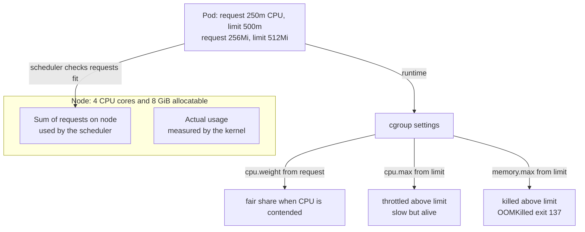
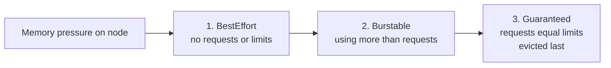

# L8.14 — Resource Requests and Limits

> **Level 8: Kubernetes** · Topic 14 of 19 · ⏱ ~4 hours · Difficulty: Intermediate

## 1. What it is

Every container can declare two numbers for CPU and for memory:

- a **request** — the amount the container is *guaranteed*. The scheduler uses it to decide which node has room, and the kernel uses it to share CPU fairly when the node is busy.
- a **limit** — the *maximum* the container may use. Exceeding the memory limit gets the process killed; exceeding the CPU limit gets it **throttled** (slowed down).

CPU is measured in cores or **millicores** (`500m` = half a core). Memory is measured in bytes with binary suffixes (`256Mi`, `1Gi`).
Under the hood Kubernetes translates these into Linux **cgroups** (control groups, the kernel feature behind containers — see
[How Docker Works Internally](../level-04-docker/01-docker-internals.md)): requests become CPU weights, limits become hard caps.
The combination of requests and limits also assigns each Pod a **Quality of Service (QoS) class** that decides who gets evicted first when a node runs out of memory.

## 2. Why it matters in DevOps

- **`OOMKilled` and CrashLoopBackOff** are the most common production symptoms of wrong memory limits.
- **Latency mysteries:** an API with a CPU limit far below its burst needs is throttled even when the node is idle, producing p99 spikes that no log explains.
- **Cost:** requests are what you *reserve and pay for*. Inflated requests leave nodes 20% utilised; too-small requests cause overcommit and noisy neighbours. This is the core of [Rightsizing](../level-20-cost-optimization/05-rightsizing.md).
- **Autoscaling depends on it:** the HPA computes utilisation as a percentage *of the request* ([Horizontal Pod Autoscaling](16-horizontal-pod-autoscaling.md)); no request means no CPU-based autoscaling.
- **Stability:** a single Pod with no limits that leaks memory can push a node into memory pressure and trigger evictions of neighbours.

## 3. Real-world system example

**Kubernetes' own scheduler and kubelet** are the reference implementation: nodes advertise `allocatable` resources (capacity minus
what is reserved for the OS and kubelet via `--kube-reserved`/`--system-reserved`), the scheduler subtracts the *sum of requests*,
and the kubelet's eviction manager uses QoS classes under pressure. Managed offerings build on this: **GKE Autopilot** bills by Pod
resource requests, so rightsizing requests is literally the cost lever; Karpenter and the Cluster Autoscaler size nodes from pending Pods' requests.
The **Vertical Pod Autoscaler** (a Kubernetes autoscaling project) watches real usage and recommends request values, and tools such
as **Goldilocks** (Fairwinds, open source) present those recommendations per namespace.

## 4. Diagram



QoS class and eviction order when the node runs low on memory:



## 5. How it works

**QoS classes** are computed automatically and visible in `kubectl describe pod` (`QoS Class:`):

| Class | Rule | Behaviour |
|-------|------|-----------|
| **Guaranteed** | every container has CPU and memory requests **equal to** limits | lowest `oom_score_adj` (-997), killed last, never throttled below its limit by neighbours |
| **Burstable** | at least one request or limit set, but not Guaranteed | can burst above requests; evicted before Guaranteed; kernel OOM score scales with how little memory it requested |
| **BestEffort** | no requests or limits at all | first to be evicted or OOM-killed |

**CPU is compressible, memory is not.**

| | CPU | Memory |
|-|-----|--------|
| Over request, under limit | allowed if the node has spare cycles | allowed, but the Pod is first in line for eviction when the node is short |
| Over limit | **throttled**: the kernel's CFS (Completely Fair Scheduler) bandwidth controller lets the container run for `limit x 100 ms` of CPU time per 100 ms period, then pauses it until the next period | **OOM-killed**: the kernel kills the container's main process (exit code 137 = 128 + SIGKILL 9), `kubectl describe` shows `Reason: OOMKilled` |
| Signal | `container_cpu_cfs_throttled_periods_total` / `container_cpu_cfs_periods_total` (cAdvisor metrics) | `kubectl get pod` restarts; `Last State: Terminated, Reason: OOMKilled` |

Because throttling is evaluated every 100 ms, a multi-threaded app with `limit: 1` can burn its whole quota in the first 20 ms
on 5 threads and sit idle for 80 ms, hurting latency even though *average* CPU looks low. Many teams therefore set CPU **requests**
but leave CPU **limits** unset (or generous) for latency-sensitive services, while always setting **memory limits**, ideally equal to
the memory request so memory cannot be overcommitted. Both are defensible; know the trade-off and choose deliberately.

Other things to know:

- **JVM/Node.js runtimes** should be told the limit: Node's default heap is based on available memory (use `--max-old-space-size` or `NODE_OPTIONS` about 75% of the limit), and modern JVMs read the cgroup limit by default.
- **`LimitRange`** sets per-namespace defaults and min/max per container; **`ResourceQuota`** caps the total a namespace may request ([Namespaces](08-namespaces.md)).
- **Ephemeral storage** also has requests and limits (`ephemeral-storage`); exceeding the limit evicts the Pod.
- Sidecars count: effective Pod request = sum of container requests (plus the larger of the init containers' needs).

## 6. Step-by-step guide

**Prerequisites:** a kind cluster (`kind create cluster --name lab`) and `kubectl`. Cost: free. Outputs are *illustrative*. kind nodes run on a
cgroup v2 host in most current setups; the cgroup file names below are for v2.

1. **Create Pods in each QoS class.** Save as `qos.yaml`:
   ```yaml
   apiVersion: v1
   kind: Pod
   metadata:
     name: qos-guaranteed
   spec:
     containers:
       - name: app
         image: nginx:1.27
         resources:
           requests: {cpu: 100m, memory: 128Mi}
           limits:   {cpu: 100m, memory: 128Mi}
   ---
   apiVersion: v1
   kind: Pod
   metadata:
     name: qos-burstable
   spec:
     containers:
       - name: app
         image: nginx:1.27
         resources:
           requests: {cpu: 50m, memory: 64Mi}
           limits:   {memory: 256Mi}
   ---
   apiVersion: v1
   kind: Pod
   metadata:
     name: qos-besteffort
   spec:
     containers:
       - name: app
         image: nginx:1.27
   ```
   ```bash
   kubectl apply -f qos.yaml
   kubectl get pods -o custom-columns=NAME:.metadata.name,QOS:.status.qosClass
   ```
   Expect `Guaranteed`, `Burstable` and `BestEffort` respectively.

2. **Trigger an OOMKill.** The container allocates 200 MiB under a 64 MiB limit:
   ```bash
   cat > oom.yaml <<'EOF'
   apiVersion: v1
   kind: Pod
   metadata:
     name: oom-demo
   spec:
     restartPolicy: Always
     containers:
       - name: hog
         image: python:3.12-alpine
         command: ["python", "-c", "x = b'x' * (200 * 1024 * 1024); import time; time.sleep(3600)"]
         resources:
           requests: {memory: 32Mi}
           limits:   {memory: 64Mi}
   EOF
   kubectl apply -f oom.yaml
   kubectl get pod oom-demo -w
   ```
   Illustrative output: `OOMKilled`, then `CrashLoopBackOff` with a growing `RESTARTS` count. Confirm the reason and exit code:
   ```bash
   kubectl get pod oom-demo -o jsonpath='{.status.containerStatuses[0].lastState.terminated}{"\n"}'
   ```
   You should see `"exitCode":137` and `"reason":"OOMKilled"`. Fix it by raising the limit above 256Mi and re-applying (delete the Pod first).

3. **Observe CPU throttling.** A busy loop with a 100m limit:
   ```bash
   cat > cpu.yaml <<'EOF'
   apiVersion: v1
   kind: Pod
   metadata:
     name: cpu-demo
   spec:
     containers:
       - name: burn
         image: busybox:1.36
         command: ["sh", "-c", "while true; do :; done"]
         resources:
           requests: {cpu: 100m}
           limits:   {cpu: 100m}
   EOF
   kubectl apply -f cpu.yaml
   sleep 20
   kubectl exec cpu-demo -- cat /sys/fs/cgroup/cpu.max /sys/fs/cgroup/cpu.stat
   ```
   `cpu.max` reads `10000 100000` (10 ms of CPU per 100 ms period = 100m). In `cpu.stat`, `nr_throttled` and `throttled_usec` are large and growing: the
   container wanted 100% of a core and the kernel paused it 90% of the time. With cgroup v1 the same data lives in `cpu.cfs_quota_us` and `cpu.stat`.

4. **Inspect node capacity versus requests.**
   ```bash
   kubectl describe node lab-control-plane | sed -n '/Allocated resources/,/Events/p'
   ```
   You see `Requests` and `Limits` as totals and percentages of allocatable. This is the number the scheduler compares against — not live usage.

5. **Set namespace guard-rails.** Save as `limits.yaml`:
   ```yaml
   apiVersion: v1
   kind: LimitRange
   metadata:
     name: defaults
   spec:
     limits:
       - type: Container
         defaultRequest: {cpu: 100m, memory: 128Mi}
         default:        {cpu: 500m, memory: 256Mi}
         max:            {memory: 1Gi}
   ---
   apiVersion: v1
   kind: ResourceQuota
   metadata:
     name: team-quota
   spec:
     hard:
       requests.cpu: "2"
       requests.memory: 2Gi
       limits.memory: 4Gi
   ```
   ```bash
   kubectl create namespace demo
   kubectl apply -n demo -f limits.yaml
   kubectl run quota-test -n demo --image=nginx:1.27
   kubectl get pod quota-test -n demo -o jsonpath='{.spec.containers[0].resources}{"\n"}'
   ```
   The Pod you created without any resources received the LimitRange defaults. Use `kubectl describe quota -n demo` to see usage against the quota.

6. **Right-size from data.** With metrics-server installed (see [Horizontal Pod Autoscaling](16-horizontal-pod-autoscaling.md)) run
   `kubectl top pod --containers`. A practical method: observe a week of real usage in Prometheus, set the **memory request/limit** near the p99 plus 20-30% headroom,
   and the **CPU request** near the p90-p95 of usage.

7. **Clean up.**
   ```bash
   kubectl delete -f qos.yaml -f oom.yaml -f cpu.yaml --ignore-not-found
   kubectl delete namespace demo
   ```

## 7. Real-world scenario

*Illustrative scenario.* After a release, `shop-api` Pods begin restarting every few minutes during the morning peak. `kubectl get pods`
shows `RESTARTS 14` and `kubectl describe pod` shows `Last State: Terminated, Reason: OOMKilled, Exit Code: 137`. The memory limit was `256Mi`, a
number copied from a template. Grafana shows memory climbing in a sawtooth up to 256 MiB and being reset by each kill. The new release
added an in-process cache of product data. The on-call engineer first raises the limit to `512Mi` to stop the bleeding, then (with the team) caps
the cache size, sets Node's `--max-old-space-size=384`, and adds an alert on `container_memory_working_set_bytes / limit > 0.85`.
**Lesson:** OOMKilled is a symptom of a sizing decision; read the exit code, graph the working set, change one variable at a time.

## 8. Common mistakes and best practices

**Don't**

- Ship Pods with no requests (BestEffort) to production; they are the first evicted and the scheduler cannot place them sensibly.
- Set memory request far below the limit on everything: the cluster becomes overcommitted and a traffic spike on several Pods triggers node-wide OOM.
- Set tiny CPU limits "to be safe" on latency-sensitive services.
- Confuse `1000m` with `1000Mi`, or `m` (milli) with `M` (megabyte): `memory: 500m` is half a byte.
- Copy requests/limits from another app without measuring.

**Do**

- Set memory requests and limits (often equal) and CPU requests for every container.
- Measure before tuning: `kubectl top`, Prometheus `container_cpu_usage_seconds_total` and `container_memory_working_set_bytes`, and the throttling ratio.
- Use `LimitRange` and `ResourceQuota` per namespace to enforce defaults.
- Make the runtime aware of its limit (Node `--max-old-space-size`, JVM container support).
- Review requests quarterly; consider VPA in recommendation mode ([HPA, VPA and Cluster Autoscaler](../level-16-advanced-kubernetes/07-hpa-vpa-cluster-autoscaler.md)).

## 9. Tasks

- [ ] **T1 — Classify three Pods** *(≈20 min, beginner)*
  - **Goal:** predict and verify QoS classes.
  - **Steps:**
    1. Without running anything, write the QoS class you expect for each Pod in `qos.yaml`.
    2. Apply and check with `kubectl get pods -o custom-columns=NAME:.metadata.name,QOS:.status.qosClass`.
    3. Change `qos-burstable` so it becomes Guaranteed.
  - **Done when:** your predictions match and the edited Pod reports `Guaranteed`.

- [ ] **T2 — Cause and read an OOMKill** *(≈30 min, beginner)*
  - **Goal:** recognise the signature of a memory-limit kill.
  - **Steps:**
    1. Apply `oom.yaml`.
    2. Extract the exit code and reason with `kubectl get pod oom-demo -o jsonpath=...`.
    3. Find the same information in `kubectl describe pod oom-demo`.
  - **Done when:** you can point to `Exit Code: 137` and `Reason: OOMKilled` and explain what 137 means.

- [ ] **T3 — Measure throttling** *(≈30 min, intermediate)*
  - **Goal:** see CPU throttling in kernel counters.
  - **Steps:**
    1. Apply `cpu.yaml` and read `cpu.stat` twice, 30 s apart.
    2. Compute the throttled fraction: delta `nr_throttled` / delta `nr_periods`.
    3. Raise the limit to `500m`, redeploy, and measure again.
  - **Done when:** the ratio is near 90% with a 100m limit on a busy loop and drops sharply with a higher limit.

- [ ] **T4 — Fit and misfit on the scheduler** *(≈30 min, intermediate)*
  - **Goal:** understand that requests drive placement.
  - **Steps:**
    1. Find a worker's allocatable CPU: `kubectl describe node lab-worker | grep -A6 Allocatable`.
    2. Create a Pod requesting more CPU than that.
    3. Read the `FailedScheduling` event (`Insufficient cpu`), then lower the request until it schedules.
  - **Done when:** the Pod is Running and you can state the node's allocatable CPU versus your request.

- [ ] **T5 — Enforce defaults with a LimitRange** *(≈30 min, advanced)*
  - **Goal:** make a namespace safe by default.
  - **Steps:**
    1. Apply `limits.yaml` in namespace `demo`.
    2. Try to create a Pod with `limits.memory: 2Gi` and read the rejection.
    3. Create Pods until the ResourceQuota blocks you and read `kubectl describe quota`.
  - **Done when:** you have seen both a LimitRange rejection and a quota rejection and can explain the difference.

- [ ] **T6 — Prove it: right-size shop-api** *(≈60 min, advanced)*
  - **Goal:** pick requests and limits from evidence.
  - **Steps:**
    1. Deploy a sample app (or `shop-api` from the [capstone](99-capstone-project.md)) and generate load with `kubectl run load --image=busybox:1.36 -- sh -c 'while true; do wget -q -O- http://shop-api; done'`.
    2. Record CPU and memory with `kubectl top pod` at idle and under load.
    3. Choose requests and limits, state your reasoning in five lines, and explain which QoS class you chose and why.
  - **Done when:** the app runs under load with no OOMKills and measurable throttling below your chosen threshold, and your reasoning cites measurements.

## 10. Self-check questions

1. What are the three QoS classes and which is evicted first under memory pressure?
2. Why does exceeding a CPU limit not kill the container but exceeding a memory limit does?
3. A container exits with code 137. What are the two most likely explanations?
4. Why might an app with low average CPU still be slow when a CPU limit is set?
5. What does the scheduler compare a Pod's requests against?

<details>
<summary>Answers</summary>

1. Guaranteed, Burstable, BestEffort. BestEffort is evicted first, Guaranteed last.
2. CPU is compressible: the kernel can pause the process and resume it later. Memory is not: once allocated it cannot be taken back without killing the process.
3. The container was OOM-killed for exceeding its memory limit (`OOMKilled`), or something sent it SIGKILL (for example the kubelet after a failed liveness probe and grace period, or a manual kill). 137 = 128 + 9.
4. CFS throttling works in 100 ms periods; bursty or multi-threaded work can exhaust its quota early in each period and wait, which raises latency even if the average is low.
5. The node's allocatable capacity minus the sum of requests of Pods already placed there — not the node's real usage.
</details>

## 11. Further reading

- Kubernetes documentation — *Configuration → Resource Management for Pods and Containers* and *Pod Quality of Service Classes*.
- Kubernetes documentation — *Node-pressure Eviction*.
- Linux kernel documentation — *CFS Bandwidth Control* and *cgroup v2* (`man 7 cgroups`).
- See also: [Pods](02-pods.md) and [Scheduling](13-scheduling.md).

<!-- nav -->
---
← Previous: [Scheduling](13-scheduling.md) · [Level 8 index](README.md) · Next: [Liveness and Readiness Probes](15-liveness-and-readiness-probes.md) →
