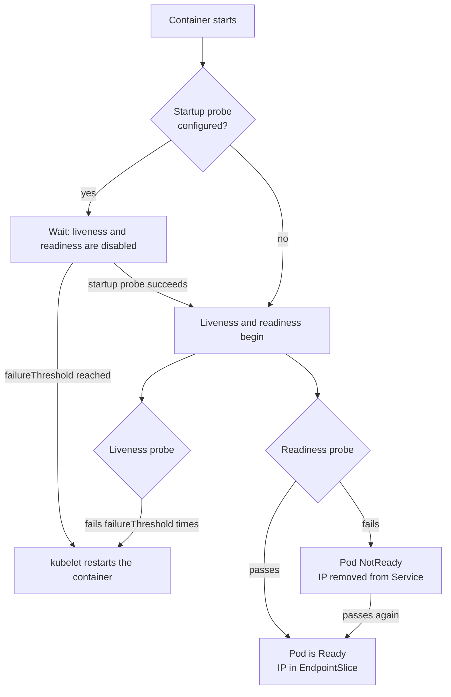
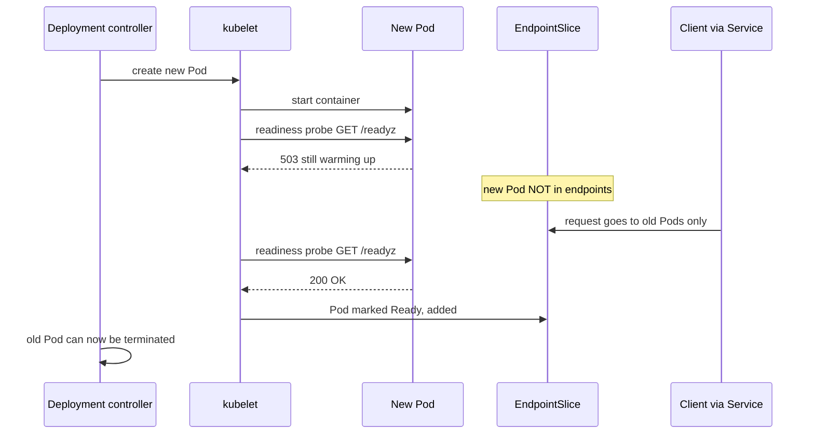

# L8.15 — Liveness and Readiness Probes

> **Level 8: Kubernetes** · Topic 15 of 19 · ⏱ ~4 hours · Difficulty: Intermediate

## 1. What it is

A container that is *running* is not necessarily *working*. The process may be deadlocked, still warming a cache, or unable to reach its
database. Kubernetes cannot see inside your application, so it asks. A **probe** is a periodic check that the **kubelet** (the node agent that
runs Pods) performs against a container: an HTTP request, a TCP connection, a command executed inside the container, or a gRPC call.

There are three probe types, and each answers a different question and triggers a different action:

- **Startup probe** — "Has the application finished booting?" While it has not succeeded, the other two probes are held off. If it never succeeds, the container is restarted.
- **Liveness probe** — "Is the process stuck beyond recovery?" If it fails, the kubelet **restarts the container**.
- **Readiness probe** — "Can this Pod serve traffic right now?" If it fails, the Pod is **removed from Service endpoints** (no restart). It is added back when the probe passes again.

## 2. Why it matters in DevOps

- **Zero-downtime rollouts depend on readiness.** A [Deployment](03-deployments-and-replicasets.md) only proceeds when new Pods become Ready; without a readiness probe, Kubernetes sends traffic to a Pod the moment the process starts, and users see `502`/`503` during every release.
- **Wrong liveness probes cause outages.** The classic self-inflicted incident: a liveness probe that checks the database, the database slows down, every Pod fails liveness, all of them restart at once, and a slow dependency becomes a full outage.
- **They are the contract with autoscaling and load balancing.** The HPA ([Horizontal Pod Autoscaling](16-horizontal-pod-autoscaling.md)) counts new Pods that are not yet Ready specially, and Services/Ingress route only to Ready endpoints.
- **They shorten incidents.** A deadlocked Pod that is restarted automatically at 03:00 never pages anyone; a Pod that restarts forever because of a bad probe pages everyone.

## 3. Real-world system example

**Kubernetes itself and its ecosystem use these probes everywhere.** The Kubernetes control plane components expose `/livez` and `/readyz` endpoints
on the API server (the older `/healthz` is deprecated in favour of them), and kubeadm-built clusters configure the static Pods of the API server, scheduler and controller manager with
startup, liveness and readiness probes against those endpoints. The NGINX Ingress Controller and CoreDNS ship with probes in their official manifests
(CoreDNS exposes `/health` for liveness and `/ready` for readiness through its plugins). Cloud load balancers integrate the same signal: on GKE and EKS with the AWS Load Balancer Controller
you can wire target health to Pod readiness (Pod readiness gates), so a new Pod receives traffic only once the load balancer also considers it healthy. Public Kubernetes
postmortems from many companies repeatedly name misconfigured probes as a contributing factor, which is why the guidance in the official docs is conservative about liveness.

## 4. Diagram

Who acts on which probe:



The sequence during a rolling update, and why readiness protects users:



## 5. How it works

**Probe mechanisms** (exactly one per probe):

| Mechanism | Success means | Typical use |
|-----------|---------------|-------------|
| `httpGet` | status code 200-399 | web apps and APIs: `/healthz`, `/readyz` |
| `tcpSocket` | the TCP connection opens | databases, Redis, anything without an HTTP endpoint |
| `exec` | the command exits 0 | `pg_isready`, `redis-cli ping`, checking a file |
| `grpc` | gRPC health checking protocol returns `SERVING` | gRPC services (stable since Kubernetes 1.27) |

**Tuning fields** (defaults in brackets):

| Field | Meaning |
|-------|---------|
| `initialDelaySeconds` [0] | wait before the first check (prefer a startup probe instead) |
| `periodSeconds` [10] | how often to probe |
| `timeoutSeconds` [1] | how long to wait for one answer before counting a failure |
| `successThreshold` [1] | consecutive successes to flip to healthy (must be 1 for liveness and startup) |
| `failureThreshold` [3] | consecutive failures to act (restart or mark NotReady) |
| `terminationGracePeriodSeconds` | optional per-probe override of how long a probe-killed container gets to shut down |

**The arithmetic you must be able to do:** time-to-detect = `failureThreshold x periodSeconds` (plus `timeoutSeconds` for the last attempt).
A startup probe with `periodSeconds: 5` and `failureThreshold: 30` allows the app **150 s** to boot, and costs nothing afterwards because liveness only starts when it succeeds.

**Design rules that avoid outages:**

1. **Readiness checks "can I serve a request?"** — it may include dependencies the request path truly needs (for `shop-api`: PostgreSQL reachable). If the dependency fails, the Pod stops receiving traffic; that is the correct, non-destructive reaction.
2. **Liveness checks "is this process broken in a way only a restart fixes?"** — keep it shallow: the event loop answers HTTP. Never include databases, caches or other services; restarting your API does not fix PostgreSQL.
3. **Use a startup probe for slow starters** (large JVM apps, migrations, cache warm-up) instead of a large `initialDelaySeconds` on liveness.
4. **Make probe endpoints cheap and unauthenticated**, served on the same event loop as real traffic (so a stuck loop is detected) but not through the authentication middleware.
5. **A Pod can be Ready and still be one failure from restart**; they are independent signals. Watch `kubectl get pods` `READY` and `RESTARTS` together.
6. Probes run per container; a Pod is Ready only when all its containers are ready (and any `readinessGates` are true).
7. During termination the Pod is removed from endpoints regardless of the readiness result; handle `SIGTERM` gracefully (see [Pods](02-pods.md)).

A reference shape for `shop-api`:

```yaml
startupProbe:
  httpGet: {path: /healthz, port: http}
  periodSeconds: 3
  failureThreshold: 20        # up to 60 s to boot
livenessProbe:
  httpGet: {path: /healthz, port: http}   # process-only check
  periodSeconds: 10
  timeoutSeconds: 2
  failureThreshold: 3         # ~30 s of being stuck before a restart
readinessProbe:
  httpGet: {path: /readyz, port: http}    # includes PostgreSQL (Redis is only a cache)
  periodSeconds: 5
  timeoutSeconds: 2
  failureThreshold: 2         # leave rotation after ~10 s
```

## 6. Step-by-step guide

**Prerequisites:** a kind cluster (`kind create cluster --name lab`) and `kubectl`. Cost: free. Outputs are *illustrative*.
We use `exec` probes on a file so you can flip health by hand; the same logic applies to HTTP probes.

1. **A Pod that is Ready only when a file exists.** Save as `probe-demo.yaml`:
   ```yaml
   apiVersion: v1
   kind: Pod
   metadata:
     name: probe-demo
     labels:
       app: probe-demo
   spec:
     containers:
       - name: app
         image: busybox:1.36
         command: ["sh", "-c", "sleep 15; touch /tmp/ready; touch /tmp/alive; sleep 3600"]
         startupProbe:
           exec: {command: ["cat", "/tmp/ready"]}
           periodSeconds: 2
           failureThreshold: 20
         readinessProbe:
           exec: {command: ["cat", "/tmp/ready"]}
           periodSeconds: 3
           failureThreshold: 1
         livenessProbe:
           exec: {command: ["cat", "/tmp/alive"]}
           periodSeconds: 3
           failureThreshold: 2
   ---
   apiVersion: v1
   kind: Service
   metadata:
     name: probe-demo
   spec:
     selector:
       app: probe-demo
     ports:
       - port: 80
         targetPort: 8080
   ```
   ```bash
   kubectl apply -f probe-demo.yaml
   kubectl get pod probe-demo -w
   ```
   Illustrative output: `0/1 Running` for about 15 seconds (the startup probe is failing, the app is "booting"), then `1/1 Running`.

2. **See readiness control the Service.**
   ```bash
   kubectl get endpointslices -l kubernetes.io/service-name=probe-demo
   ```
   While the Pod is `0/1`, the EndpointSlice has no ready addresses (the Pod IP appears under `notReady` conditions only in `-o yaml`); once `1/1`, the Pod IP is listed.

3. **Fail readiness without a restart.**
   ```bash
   kubectl exec probe-demo -- rm /tmp/ready
   kubectl get pod probe-demo
   kubectl get endpointslices -l kubernetes.io/service-name=probe-demo -o jsonpath='{.items[0].endpoints[*].conditions.ready}{"\n"}'
   ```
   `READY` drops to `0/1` within a few seconds, `RESTARTS` stays `0`, and the endpoint is not ready. Restore it with `kubectl exec probe-demo -- touch /tmp/ready` and the Pod returns to rotation.

4. **Fail liveness and watch the restart.**
   ```bash
   kubectl exec probe-demo -- rm /tmp/alive
   kubectl get pod probe-demo -w
   kubectl describe pod probe-demo | sed -n '/Events/,$p'
   ```
   After about 6 seconds (2 failures x 3 s) you will see events similar to `Liveness probe failed: cat: can't open '/tmp/alive'` followed by `Container app failed liveness probe, will be restarted`.
   `RESTARTS` becomes `1`, and the new container goes through the startup phase again (files are gone, since a restart gives a fresh container filesystem).

5. **Read the probe configuration back.**
   ```bash
   kubectl get pod probe-demo -o jsonpath='{.spec.containers[0].livenessProbe}{"\n"}'
   kubectl describe pod probe-demo | grep -E 'Liveness|Readiness|Startup'
   ```
   `describe` prints the effective values including defaults such as `timeout=1s` and `#success=1`.

6. **Break it the realistic way: an HTTP probe on the wrong port.**
   ```bash
   cat > bad-probe.yaml <<'EOF'
   apiVersion: apps/v1
   kind: Deployment
   metadata:
     name: bad-probe
   spec:
     replicas: 2
     selector:
       matchLabels: {app: bad-probe}
     template:
       metadata:
         labels: {app: bad-probe}
       spec:
         containers:
           - name: web
             image: nginx:1.27
             ports: [{containerPort: 80}]
             readinessProbe:
               httpGet: {path: /, port: 8080}   # nothing listens on 8080
               periodSeconds: 3
   EOF
   kubectl apply -f bad-probe.yaml
   kubectl rollout status deploy/bad-probe --timeout=30s
   kubectl describe pod -l app=bad-probe | grep -A3 'Readiness probe failed' | head
   ```
   The rollout never completes; events show `Readiness probe failed: Get "http://10.244.x.x:8080/": dial tcp ...: connect: connection refused`.
   Fix it with `kubectl patch deploy bad-probe --type=json -p='[{"op":"replace","path":"/spec/template/spec/containers/0/readinessProbe/httpGet/port","value":80}]'` and the rollout finishes.

7. **Clean up.**
   ```bash
   kubectl delete -f probe-demo.yaml -f bad-probe.yaml --ignore-not-found
   ```

## 7. Real-world scenario

*Illustrative scenario.* `shop-api` has a liveness probe on `/health`, a handler that runs `SELECT 1` against PostgreSQL with a 1-second timeout.
During a routine maintenance window the database fails over and answers slowly for 40 seconds. Every `shop-api` Pod fails liveness three times in a row and is
restarted — all ten at about the same moment. Restarting Node.js Pods each open a pool of connections to a database that is just recovering, which slows it further,
and the API is down for several minutes instead of seconds. The on-call engineer sees `RESTARTS` climbing across the whole Deployment and Pod events full of `Liveness probe failed`.
The fix has three parts: liveness becomes `/healthz` (event loop only), the database check moves to the **readiness** probe (so Pods drop out of rotation during the
failover and return automatically, without restarting), and a startup probe replaces a 90-second `initialDelaySeconds`.
**Lesson:** liveness is for "restart fixes it"; dependency health belongs in readiness, and even there it should degrade gracefully.

## 8. Common mistakes and best practices

**Don't**

- Point liveness at a database, cache or downstream API: you convert a dependency blip into a restart storm.
- Use the same endpoint and thresholds for liveness and readiness without thinking.
- Use aggressive values (`timeoutSeconds: 1`, `failureThreshold: 1`) on a busy Node.js app: a GC pause or CPU throttling ([Resource Requests and Limits](14-resource-requests-and-limits.md)) makes a healthy Pod fail.
- Add a long `initialDelaySeconds` to liveness instead of a startup probe; it delays detection for the Pod's whole life.
- Skip readiness entirely: rollouts will drop requests.
- Probe an authenticated route, or one that does expensive work.

**Do**

- Always define a readiness probe for anything behind a Service; add liveness only if you can name a failure that a restart fixes.
- Give slow starters a startup probe sized to the worst-case boot time with a margin.
- Make probe handlers fast (single-digit milliseconds) and log failures with the reason.
- Combine with graceful shutdown (`preStop`, `SIGTERM` handling) and a `PodDisruptionBudget` so voluntary disruptions also respect readiness.
- Alert on `kube_pod_container_status_restarts_total` increases and on Pods that stay NotReady (kube-state-metrics).

## 9. Tasks

- [ ] **T1 — Watch the three probes** *(≈30 min, beginner)*
  - **Goal:** see startup, readiness and liveness each do their own job.
  - **Steps:**
    1. Apply `probe-demo.yaml` and watch it with `kubectl get pod probe-demo -w`.
    2. Remove `/tmp/ready`, then `/tmp/alive`, one at a time, restoring readiness in between.
    3. Note, for each action, whether `READY` changed and whether `RESTARTS` changed.
  - **Done when:** you have a table showing that readiness failure changes `READY` only and liveness failure increments `RESTARTS`.

- [ ] **T2 — Compute the numbers** *(≈20 min, beginner)*
  - **Goal:** predict detection times.
  - **Steps:**
    1. For the `shop-api` reference probes in section 5, calculate the maximum boot time allowed, the time to leave rotation and the time to be restarted when stuck.
    2. Verify one of them by timing the events in `probe-demo` (`kubectl get events --sort-by=.lastTimestamp`).
  - **Done when:** your predictions are within a few seconds of the observed event timestamps.

- [ ] **T3 — Add an HTTP readiness probe to a rollout** *(≈40 min, intermediate)*
  - **Goal:** prove readiness gates a rolling update.
  - **Steps:**
    1. Deploy `nginx:1.27` with 3 replicas and a readiness probe on `/`.
    2. Update the image to a tag that does not exist, then to `nginx:1.27-alpine` with a readiness path `/nope`.
    3. Watch `kubectl rollout status` and the old ReplicaSet staying at full capacity (`kubectl get rs`).
  - **Done when:** you can show that the old Pods keep serving while the new ones are NotReady, and explain which Deployment settings (`maxUnavailable`, `maxSurge`) made that safe.

- [ ] **T4 — Break and fix a liveness restart storm** *(≈45 min, advanced)*
  - **Goal:** reproduce the dependency-in-liveness anti-pattern.
  - **Steps:**
    1. Run 3 replicas whose liveness probe is an `exec` that checks for a file `/shared/db-up` (stand-in for the database) that you create and delete via `kubectl exec`.
    2. Delete the file in all Pods and watch them restart together.
    3. Move that check to the readiness probe and repeat.
  - **Done when:** in the first run all Pods restart, in the second they only go NotReady, and `RESTARTS` stays at 0.

- [ ] **T5 — Add a startup probe** *(≈30 min, intermediate)*
  - **Goal:** protect a slow-starting app without hurting steady-state detection.
  - **Steps:**
    1. Run a container that sleeps 40 s before creating its health file, with a liveness probe only (period 5, threshold 3) and watch it get killed in a loop.
    2. Add a startup probe with `periodSeconds: 5`, `failureThreshold: 20`.
    3. Confirm the container now stabilises and that liveness detection afterwards is still fast.
  - **Done when:** the Pod reaches `1/1 Running` with `RESTARTS 0` and you can explain why.

- [ ] **T6 — Prove it: probe design review for shop-api** *(≈45 min, advanced)*
  - **Goal:** design probes from first principles.
  - **Steps:**
    1. Without this page, write the three probes for `shop-api` (which paths, which dependencies, which thresholds) and justify each number in one sentence.
    2. Apply them in the [capstone](99-capstone-project.md) Deployment, then stop PostgreSQL (`kubectl scale statefulset postgres --replicas=0`) and record what happens to `READY`, `RESTARTS` and the Service.
  - **Done when:** Pods go NotReady without restarting during the database outage, recover on their own when it returns, and you can explain it in under two minutes.

## 10. Self-check questions

1. What does Kubernetes do when a liveness probe fails? When a readiness probe fails?
2. Why should a liveness probe not check the database?
3. What is the startup probe for, and how does it interact with the other two?
4. A Pod shows `0/1 Running` and `RESTARTS 0` for ten minutes. Which probe is the likely culprit and where do you look?
5. How long does a probe with `periodSeconds: 10`, `failureThreshold: 3` take to act?

<details>
<summary>Answers</summary>

1. Liveness failure: the kubelet kills and restarts the container (subject to `restartPolicy`). Readiness failure: the Pod stays running but its IP is removed from the Service endpoints until the probe passes again.
2. Restarting the app does not fix a database problem and simultaneous restarts amplify the incident. Put dependency checks in readiness, if anywhere.
3. It gates the others: until it succeeds, liveness and readiness do not run; if it exhausts its failures, the container is restarted. It lets slow apps boot without a long liveness delay.
4. The readiness probe is failing (the Pod is running but not Ready). `kubectl describe pod` shows `Readiness probe failed: ...` events; check the path, port, and whether the app really answers.
5. About 30 seconds (3 x 10 s), plus up to the timeout of the last attempt.
</details>

## 11. Further reading

- Kubernetes documentation — *Tasks → Configure Pods and Containers → Configure Liveness, Readiness and Startup Probes*.
- Kubernetes documentation — *Concepts → Workloads → Pod Lifecycle* (container probes and Pod conditions).
- Kubernetes documentation — *API server health endpoints* (`/livez`, `/readyz`).
- See also: [Health Checks in Docker](../level-04-docker/12-health-checks.md), [Zero-downtime Deployments](../level-05-cicd/08-zero-downtime-deployments.md) and [Services](04-services.md).

<!-- nav -->
---
← Previous: [Resource Requests and Limits](14-resource-requests-and-limits.md) · [Level 8 index](README.md) · Next: [Horizontal Pod Autoscaling](16-horizontal-pod-autoscaling.md) →
