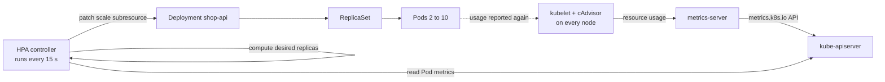
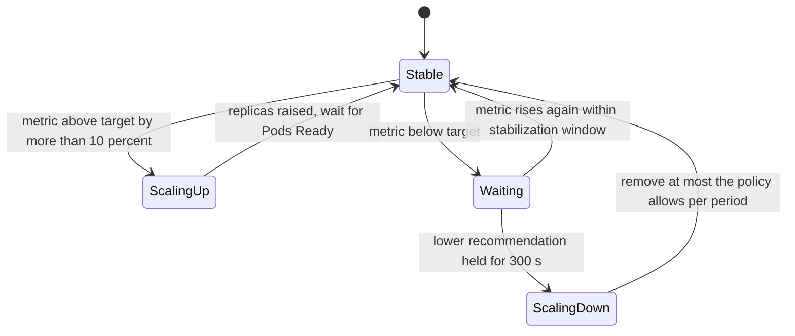

# L8.16 — Horizontal Pod Autoscaling

> **Level 8: Kubernetes** · Topic 16 of 19 · ⏱ ~4 hours · Difficulty: Intermediate

## 1. What it is

The **Horizontal Pod Autoscaler (HPA)** automatically changes the number of replicas of a workload (usually a Deployment) based on observed load.
"Horizontal" means *more copies* rather than *bigger copies* (that would be vertical scaling, the job of the Vertical Pod Autoscaler).
It is a control loop inside the Kubernetes controller manager: every 15 seconds by default it reads a metric, compares it with your target,
and edits the `replicas` field of the target's `scale` subresource.

The metric usually comes from **metrics-server**, a small add-on that collects CPU and memory usage from every kubelet and serves it through the
Kubernetes Metrics API (`metrics.k8s.io`). That is what powers `kubectl top` and CPU/memory-based autoscaling. For anything else (requests per second,
queue depth) you plug in a custom or external metrics adapter, introduced in section 5.

## 2. Why it matters in DevOps

- **Traffic is spiky.** A fixed replica count is either wasteful at night or too small during a campaign. Autoscaling pays for what the load needs ([Autoscaling for Cost](../level-20-cost-optimization/04-autoscaling-for-cost.md)).
- **It depends on everything else you configured:** CPU utilisation is a percentage of the **request** ([Resource Requests and Limits](14-resource-requests-and-limits.md)); new Pods only help once they are **Ready** ([Liveness and Readiness Probes](15-liveness-and-readiness-probes.md)); and new replicas need node capacity (the Cluster Autoscaler or Karpenter adds nodes).
- **Misconfigured HPAs cause flapping** (scale up, down, up) and thundering herds against databases; understanding the algorithm and `behavior` is the difference between smooth scaling and an incident.
- **It is part of high availability:** a Deployment with `minReplicas: 2` survives a node loss and an HPA tops it up under stress ([High Availability and Scalability](../level-00-what-devops-is/08-high-availability-and-scalability.md)).

## 3. Real-world system example

**Kubernetes' own documentation walk-through, and large public platforms.** The upstream HPA walk-through scales the `hpa-example` PHP/Apache image on CPU and is the
canonical reference. In production, cloud providers expose the same API: GKE and EKS run the HPA controller in the managed control plane, and add node autoscaling
(GKE Cluster Autoscaler or Autopilot, AWS Cluster Autoscaler or Karpenter) so replica growth is backed by capacity. For event-driven workloads the CNCF project **KEDA**
(Kubernetes Event-driven Autoscaling) builds on the HPA to scale on queue length (Kafka, RabbitMQ, SQS) and can scale to zero. Teams that already run Prometheus commonly use
**prometheus-adapter** to expose application metrics such as requests per second to the HPA through the custom metrics API.

## 4. Diagram



Scale-up and scale-down are deliberately asymmetric (react fast to load, slowly to silence):



## 5. How it works

**The algorithm.** Once per sync period the controller computes:

```text
desiredReplicas = ceil( currentReplicas x ( currentMetricValue / desiredMetricValue ) )
```

Example: 4 replicas, average CPU is 90% of request, target 60% -> `ceil(4 x 90/60) = ceil(6) = 6`. If the ratio is within a **tolerance** of 0.1 of 1.0 (default) nothing happens,
which prevents jitter. Details that matter:

- Utilisation is `usage / request` averaged over the Pods. A container **without a CPU request** cannot be scaled on utilisation (the HPA reports `<unknown>`).
- Pods that are not yet Ready, or are newly started, are handled conservatively (missing metrics are assumed 0% when scaling up and 100% when scaling down) so a rollout does not trigger runaway scaling.
- Result is clamped to `[minReplicas, maxReplicas]`. With several metrics the HPA computes each and takes the **largest** answer.
- The HPA fights a manually edited `replicas`. When using an HPA, **omit `spec.replicas` from the Deployment manifest** in Git, otherwise every `kubectl apply` resets the count.

**API version.** Use `autoscaling/v2` (stable since Kubernetes 1.23). `autoscaling/v1` supports only CPU and has no `behavior`.

**`behavior`** tunes the speed of change independently for up and down:

| Field | Meaning | Defaults |
|-------|---------|----------|
| `scaleUp.stabilizationWindowSeconds` | use the lowest recommendation seen in this window before scaling up | 0 (react at once) |
| `scaleDown.stabilizationWindowSeconds` | use the highest recommendation seen in this window before scaling down | 300 s |
| `policies` | limits per `periodSeconds`: `type: Pods` (absolute) or `type: Percent` | scale-up: max of +4 Pods or +100% per 15 s; scale-down: 100% per 15 s (but the 300 s window dominates) |
| `selectPolicy` | `Max` (default), `Min` or `Disabled` when several policies exist | `Max` |

**Metric types in `autoscaling/v2`:**

| Type | Source | Example |
|------|--------|---------|
| `Resource` | metrics-server | CPU `averageUtilization: 60` or memory |
| `ContainerResource` | metrics-server | scale on one container, ignoring sidecars |
| `Pods` | custom metrics API | `http_requests_per_second` averaged per Pod |
| `Object` | custom metrics API | requests per second on an Ingress |
| `External` | external metrics API | SQS queue length, Pub/Sub backlog |

**Custom metrics intro.** The custom and external metrics APIs are interfaces that an adapter implements: **prometheus-adapter** translates PromQL into them; **KEDA** installs its own
adapter and creates the HPA for you from a `ScaledObject`. Good scaling signals correlate with work waiting to be done (queue depth, in-flight requests, RPS per Pod) rather than
lagging indicators such as p99 latency. See [Prometheus and PromQL](../level-10-observability/02-prometheus-and-promql.md) for the metric side, and
[HPA, VPA and Cluster Autoscaler](../level-16-advanced-kubernetes/07-hpa-vpa-cluster-autoscaler.md) for the next step.

**Limits to remember:** HPA cannot scale a Deployment below 1 (scale-to-zero needs KEDA or the alpha HPAScaleToZero feature), it does not add nodes, and scaling a stateful dependency (the PostgreSQL behind your API)
is out of scope: more API replicas can overwhelm a database that was sized for fewer connections.

## 6. Step-by-step guide

**Prerequisites:** a kind cluster (`kind create cluster --name lab`) and `kubectl`. Cost: free. Output is *illustrative*; numbers will differ on your machine.

1. **Install metrics-server.** Official manifest from the metrics-server project:
   ```bash
   kubectl apply -f https://github.com/kubernetes-sigs/metrics-server/releases/latest/download/components.yaml
   ```
   kind's kubelets use self-signed certificates, so for this **local lab only** tell metrics-server not to verify them:
   ```bash
   kubectl patch -n kube-system deployment metrics-server --type=json \
     -p='[{"op":"add","path":"/spec/template/spec/containers/0/args/-","value":"--kubelet-insecure-tls"}]'
   kubectl rollout status -n kube-system deploy/metrics-server
   ```
   Never disable certificate verification on a real cluster; managed clusters ship a working metrics pipeline.

2. **Confirm the Metrics API works** (it can take about a minute):
   ```bash
   kubectl top nodes
   kubectl top pods -A | head
   ```
   Expect CPU in millicores and memory in `Mi`. `error: Metrics API not available` means metrics-server is not Ready yet or cannot reach the kubelets: check `kubectl logs -n kube-system deploy/metrics-server`.

3. **Deploy a CPU-hungry sample app with a CPU request.** Save as `hpa-demo.yaml`:
   ```yaml
   apiVersion: apps/v1
   kind: Deployment
   metadata:
     name: php-apache
   spec:
     # no replicas: field, the HPA owns the count
     selector:
       matchLabels: {app: php-apache}
     template:
       metadata:
         labels: {app: php-apache}
       spec:
         containers:
           - name: php-apache
             image: registry.k8s.io/hpa-example
             ports: [{containerPort: 80}]
             resources:
               requests: {cpu: 200m, memory: 64Mi}
               limits:   {cpu: 500m, memory: 128Mi}
   ---
   apiVersion: v1
   kind: Service
   metadata:
     name: php-apache
   spec:
     selector: {app: php-apache}
     ports: [{port: 80}]
   ---
   apiVersion: autoscaling/v2
   kind: HorizontalPodAutoscaler
   metadata:
     name: php-apache
   spec:
     scaleTargetRef:
       apiVersion: apps/v1
       kind: Deployment
       name: php-apache
     minReplicas: 1
     maxReplicas: 6
     metrics:
       - type: Resource
         resource:
           name: cpu
           target:
             type: Utilization
             averageUtilization: 50
     behavior:
       scaleDown:
         stabilizationWindowSeconds: 60     # shortened for the lab; default is 300
       scaleUp:
         policies:
           - {type: Pods, value: 2, periodSeconds: 15}
   ```
   ```bash
   kubectl apply -f hpa-demo.yaml
   kubectl get hpa php-apache
   ```
   Illustrative: `TARGETS cpu: 0%/50%`, `REPLICAS 1`. If you see `<unknown>/50%`, wait a minute; if it persists, check the Pod has a CPU request and metrics-server is healthy.

4. **Generate load** in a second terminal:
   ```bash
   kubectl run load --image=busybox:1.36 --restart=Never -- /bin/sh -c "while true; do wget -q -O- http://php-apache; done"
   ```

5. **Watch the algorithm work:**
   ```bash
   kubectl get hpa php-apache -w
   ```
   Illustrative: `cpu: 250%/50%` with 1 replica; the HPA computes `ceil(1 x 250/50) = 5`, but your `scaleUp` policy allows only +2 per 15 s, so you see `REPLICAS` go 1 -> 3 -> 5. Utilisation then settles near or below 50%.
   Read the controller's reasoning:
   ```bash
   kubectl describe hpa php-apache | sed -n '/Metrics/,$p'
   ```
   Events like `SuccessfulRescale  New size: 3; reason: cpu resource utilization (percentage of request) above target`.

6. **Stop the load and watch scale-down:**
   ```bash
   kubectl delete pod load
   kubectl get hpa php-apache -w
   ```
   Utilisation drops to 0% right away, but replicas stay for the 60 s stabilization window and then fall back toward 1. In production the default 300 s window prevents flapping.

7. **Try a memory or multi-metric HPA** by adding a second entry under `metrics:`:
   ```yaml
       - type: Resource
         resource:
           name: memory
           target: {type: AverageValue, averageValue: 100Mi}
   ```
   With several metrics the HPA takes the highest replica count any of them demands. Note that memory is a poor scaling signal for most apps: it rarely falls after load drops.

8. **Clean up.**
   ```bash
   kubectl delete -f hpa-demo.yaml
   kubectl delete pod load --ignore-not-found
   ```
   Leave metrics-server installed if you continue with the [capstone](99-capstone-project.md).

## 7. Real-world scenario

*Illustrative scenario.* A flash sale starts at 12:00 and `shop-api` latency climbs. The HPA is configured with `minReplicas: 2`, `maxReplicas: 10`, CPU target 70%.
At 12:00:30 `kubectl get hpa` shows `cpu: 180%/70%` and `REPLICAS 2` — and only five minutes later, 8 replicas. Investigation shows two causes: the container image takes
45 s to pass readiness (no startup tuning, a cold cache), and new Pods were pending for 90 s because the node pool had no free CPU. The team pre-warms with `minReplicas: 6` for the sale window,
shrinks start time (smaller image, lazy cache), adds a `scaleUp` policy of +100% per 30 s, enables the node autoscaler with headroom, and caps `maxReplicas` at what PostgreSQL's `max_connections` allows through a pooler.
**Lesson:** autoscaling is a pipeline — metrics delay, algorithm, image pull, scheduling, readiness — and the slowest stage sets your reaction time.

## 8. Common mistakes and best practices

**Don't**

- Create a CPU-utilisation HPA for Pods with no CPU requests.
- Leave `spec.replicas` in the Deployment manifest when an HPA manages it.
- Set `maxReplicas` without checking downstream capacity (database connections, rate limits, licence counts).
- Scale on memory for runtimes that never release it (Node.js, JVM) or on latency alone.
- Set the target near 100%: there is no headroom while new Pods start. 50-70% is common for CPU.

**Do**

- Set `minReplicas >= 2` for production services and spread them across zones ([Scheduling](13-scheduling.md)).
- Use `autoscaling/v2` with explicit `behavior` and keep the default conservative scale-down.
- Make Pods start fast and report readiness accurately.
- Load-test to find a sensible target before choosing numbers.
- Alert when the HPA is pinned at `maxReplicas` for a long period (`kube_horizontalpodautoscaler_status_current_replicas` equal to the maximum in kube-state-metrics).

## 9. Tasks

- [ ] **T1 — Get metrics flowing** *(≈30 min, beginner)*
  - **Goal:** install and verify metrics-server.
  - **Steps:**
    1. Apply the metrics-server manifest and the kind patch from step 1.
    2. Run `kubectl top nodes` and `kubectl top pods -A`.
    3. Find the same data through the raw API: `kubectl get --raw /apis/metrics.k8s.io/v1beta1/nodes`.
  - **Done when:** `kubectl top nodes` prints CPU and memory for every node.

- [ ] **T2 — Scale on CPU** *(≈30 min, beginner)*
  - **Goal:** watch a full scale-up and scale-down cycle.
  - **Steps:**
    1. Apply `hpa-demo.yaml` and start the load generator.
    2. Record `kubectl get hpa -w` until replicas stop growing.
    3. Delete the load generator and wait for scale-down.
  - **Done when:** you captured a timeline of replicas versus CPU and it returns to `minReplicas`.

- [ ] **T3 — Do the maths** *(≈20 min, intermediate)*
  - **Goal:** predict the HPA's decisions.
  - **Steps:**
    1. For 3 replicas at 120% utilisation with target 60%, compute the desired count; repeat for 8 replicas at 33% with target 60%.
    2. Explain what the `behavior` policies would do to each result.
    3. Check your first prediction against a real run by lowering the target.
  - **Done when:** both calculations are correct (6 and 5) and your explanation includes the tolerance and the stabilization window.

- [ ] **T4 — Tune behaviour** *(≈45 min, intermediate)*
  - **Goal:** control the speed of scaling.
  - **Steps:**
    1. Remove the `scaleUp` policy, repeat the load test and note how fast replicas jump.
    2. Set `scaleUp` to +1 Pod per 60 s and repeat.
    3. Set `scaleDown.stabilizationWindowSeconds: 300` and measure the delay after load stops.
  - **Done when:** you can show three timelines and say which fits a flash-sale workload.

- [ ] **T5 — Break it: no CPU request** *(≈30 min, advanced)*
  - **Goal:** recognise the `<unknown>` failure mode.
  - **Steps:**
    1. Remove `requests.cpu` from the Deployment and re-apply.
    2. Read `kubectl describe hpa` and find the `FailedGetResourceMetric` or `missing request for cpu` condition.
    3. Restore the request.
  - **Done when:** you can state the exact condition text and why utilisation cannot be computed without a request.

- [ ] **T6 — Prove it: autoscale shop-api** *(≈60 min, advanced)*
  - **Goal:** autoscale the capstone API from evidence.
  - **Steps:**
    1. Deploy `shop-api` from the [capstone](99-capstone-project.md) and write its HPA (min 2, max 6, 60% CPU).
    2. Load it and capture a replicas-vs-CPU timeline.
    3. Explain in five lines what limits your scale-up speed in this cluster.
  - **Done when:** the Deployment scales above `minReplicas` under load, returns afterwards, and your explanation names metrics delay, readiness and node capacity.

## 10. Self-check questions

1. What formula does the HPA use to compute the desired replica count?
2. Why does a CPU-based HPA show `<unknown>`, and what are the three most likely causes?
3. Why is scale-down slower than scale-up by default?
4. What happens if you leave `replicas: 3` in a Deployment manifest that is managed by an HPA and run `kubectl apply` on every deploy?
5. When would you use KEDA or a custom metric instead of CPU?

<details>
<summary>Answers</summary>

1. `desiredReplicas = ceil(currentReplicas x currentMetricValue / desiredMetricValue)`, ignored if the ratio is within the 10% tolerance and clamped to min and max.
2. metrics-server is missing or not Ready; the Pods have no CPU request; the Pods have just started and no samples exist yet.
3. To avoid flapping: the scale-down stabilization window (300 s default) picks the highest recent recommendation, since removing capacity too early risks another scale-up and cold starts.
4. Each apply resets the replica count to 3, fighting the HPA and causing sudden capacity changes. Omit `replicas` in the manifest.
5. When load is not CPU-bound or CPU lags the real signal: queue consumers (queue depth), request-driven services (RPS per Pod), or scale-to-zero needs.
</details>

## 11. Further reading

- Kubernetes documentation — *Horizontal Pod Autoscaling* and the *HorizontalPodAutoscaler Walkthrough*.
- Kubernetes documentation — *Resource metrics pipeline* (metrics-server) and the *autoscaling/v2 API reference*.
- KEDA project documentation (keda.sh) and the prometheus-adapter project README.
- See also: [Deployments and ReplicaSets](03-deployments-and-replicasets.md) and [Rightsizing](../level-20-cost-optimization/05-rightsizing.md).

<!-- nav -->
---
← Previous: [Liveness and Readiness Probes](15-liveness-and-readiness-probes.md) · [Level 8 index](README.md) · Next: [Service Discovery](17-service-discovery.md) →
