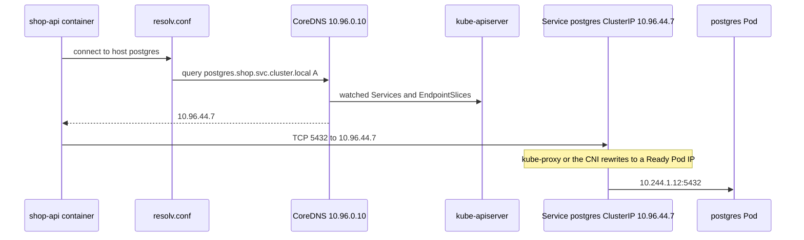
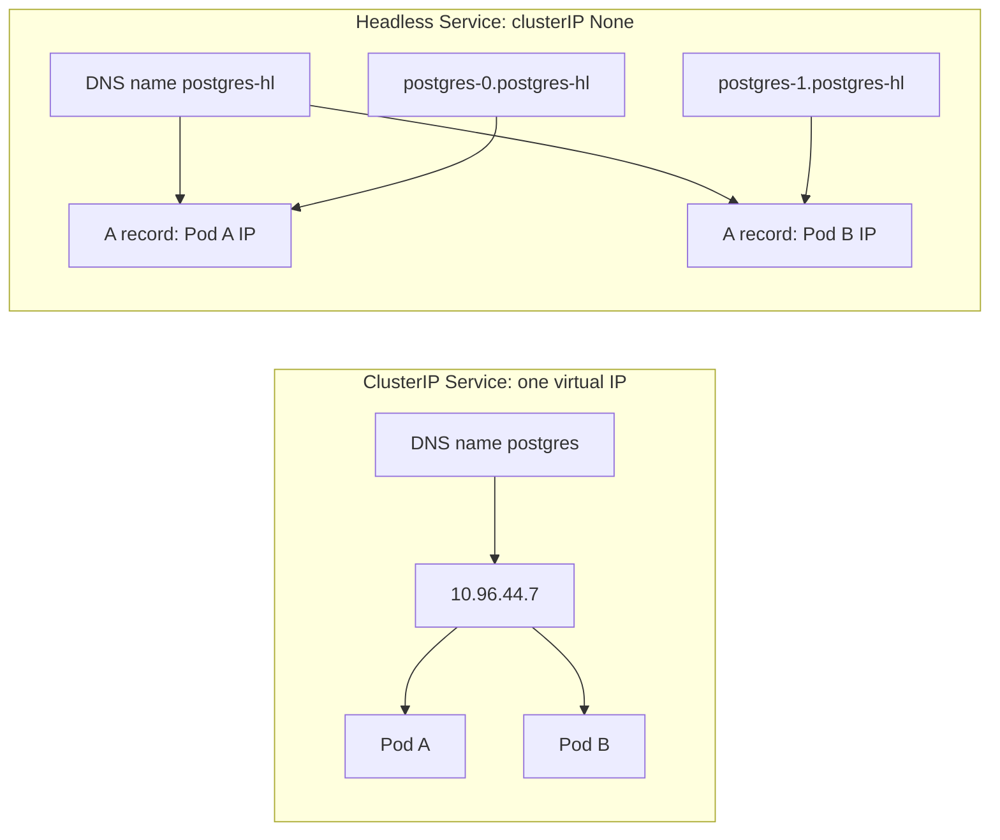

# L8.17 — Service Discovery

> **Level 8: Kubernetes** · Topic 17 of 19 · ⏱ ~4 hours · Difficulty: Intermediate

## 1. What it is

Pods are born and die constantly and every new Pod gets a new IP address. If `shop-api` had to know the IP of PostgreSQL, it would break at the first reschedule.
**Service discovery** is how one workload finds another by a *stable name* instead. In Kubernetes there are two built-in mechanisms:

1. **DNS (Domain Name System).** A cluster add-on called **CoreDNS** runs as a Deployment in `kube-system` and answers queries for names such as `postgres.shop.svc.cluster.local`. Every Pod is automatically configured to use it. This is the mechanism you should use.
2. **Environment variables.** When a Pod starts, the kubelet injects variables like `POSTGRES_SERVICE_HOST` and `POSTGRES_SERVICE_PORT` for each Service that already existed in the namespace. This is a legacy mechanism with an ordering catch.

The names point to a [Service](04-services.md): a stable virtual IP (ClusterIP) in front of a changing set of Pods. A special variant, the **headless Service** (`clusterIP: None`), has no virtual IP; DNS returns the Pod IPs directly, which is how StatefulSets give each replica its own name.

## 2. Why it matters in DevOps

- **Every connection string in your manifests is a service-discovery decision.** `DATABASE_HOST=postgres` works only because of CoreDNS and the namespace search path.
- **DNS is the number-one hidden dependency.** When CoreDNS is overloaded or blocked by a NetworkPolicy, applications fail with `ENOTFOUND` or `getaddrinfo EAI_AGAIN` while Pods look healthy.
- **Cross-namespace and multi-environment setups** (dev, staging, prod in different namespaces) rely on the fully qualified name form.
- **Performance:** the default `ndots:5` setting multiplies DNS queries for external hostnames and is a frequent cause of slow outbound calls and CoreDNS load.
- **Stateful systems** (PostgreSQL replicas, Kafka, Redis clusters) need stable per-Pod identities, which only headless Services plus StatefulSets provide ([StatefulSets](10-statefulsets.md)).

## 3. Real-world system example

**CoreDNS in every modern cluster.** CoreDNS is a CNCF graduated project and has been the default cluster DNS in kubeadm and most distributions (including kind, EKS, GKE and AKS) for years. Its behaviour is defined by a **Corefile** stored in a ConfigMap
named `coredns` in `kube-system`: the `kubernetes` plugin answers `cluster.local` names from the API server's Services and EndpointSlices, the `forward` plugin sends everything else to the node's upstream resolvers, and the `cache` plugin
reduces load. Large clusters often add **NodeLocal DNSCache**, a Kubernetes add-on that runs a DNS cache on every node to cut latency and conntrack pressure. Public Kubernetes documentation also describes how
database operators and Kafka distributions rely on headless Services so that each broker or replica has a stable DNS name such as `kafka-0.kafka-headless.prod.svc.cluster.local`.

## 4. Diagram



Normal versus headless Service:



## 5. How it works

**DNS names you must know** (cluster domain is `cluster.local` by default):

| Name | Resolves to |
|------|-------------|
| `<service>.<namespace>.svc.cluster.local` | the Service ClusterIP (headless: the set of Ready Pod IPs) |
| `<service>.<namespace>` or `<service>` | same, via the search path (short forms) |
| `<pod-name>.<headless-svc>.<namespace>.svc.cluster.local` | one specific StatefulSet Pod (needs `serviceName` set on the StatefulSet) |
| `_<port-name>._<proto>.<service>.<namespace>.svc.cluster.local` | an **SRV** record: port number and target host |
| `10-244-1-12.<namespace>.pod.cluster.local` | a Pod by its dashed IP (rarely useful) |
| ExternalName Service | a `CNAME` to an outside hostname (for example a managed database) |

**The search path.** Kubernetes writes `/etc/resolv.conf` into every Pod, similar to:

```text
search shop.svc.cluster.local svc.cluster.local cluster.local
nameserver 10.96.0.10
options ndots:5
```

`ndots:5` means "a name with fewer than 5 dots is tried with each search suffix first". So `postgres` expands to `postgres.shop.svc.cluster.local` (found first), and
`api.stripe.com` (2 dots) is tried as `api.stripe.com.shop.svc.cluster.local`, `...svc.cluster.local`, `...cluster.local` — three wasted NXDOMAIN answers — before the real lookup. Fixes: end external names with a trailing dot
(`api.stripe.com.`), or set `dnsConfig.options: [{name: ndots, value: "2"}]` on latency-sensitive Pods, or use NodeLocal DNSCache.
A short name only works within the **same namespace**; cross-namespace needs at least `service.namespace`.

**Environment variables.** For a Service `postgres` exposing port 5432 the kubelet injects `POSTGRES_SERVICE_HOST=10.96.44.7`, `POSTGRES_SERVICE_PORT=5432`, plus Docker-links-style `POSTGRES_PORT_5432_TCP_ADDR` and so on
(names are upper-cased with dashes turned into underscores). The catch: variables are set **only at Pod creation**, so a Service created *after* the Pod is invisible to it, and they cause a variable explosion in namespaces with many Services.
You can turn them off with `enableServiceLinks: false` in the Pod spec, which is a common hardening choice. Prefer DNS.

**Headless Services.** With `clusterIP: None`: no virtual IP and no kube-proxy load balancing; the DNS answer is the list of Ready Pod IPs (clients choose, or round-robin by DNS order).
With a StatefulSet each Pod also gets `pod-N.service...`. Setting `publishNotReadyAddresses: true` includes Pods that are not Ready yet, which clustered databases need for peer discovery during bootstrap.
Headless Services without a selector are allowed too; you then create the EndpointSlices yourself.

**CoreDNS operations.** Config lives in `kubectl -n kube-system get cm coredns -o yaml`; logs are in Pods labelled `k8s-app=kube-dns` (the label is still `kube-dns` for compatibility). Custom stub domains
(for example forwarding `corp.example.com` to an internal DNS server) are added as extra server blocks in the Corefile. Pods can opt out of cluster DNS with `dnsPolicy: Default` (use the node's resolver) or define everything with `dnsPolicy: None` and `dnsConfig`.

## 6. Step-by-step guide

**Prerequisites:** a kind cluster (`kind create cluster --name lab`) and `kubectl`. Cost: free. Outputs are *illustrative*.

1. **Look at CoreDNS itself.**
   ```bash
   kubectl -n kube-system get deploy,pods -l k8s-app=kube-dns
   kubectl -n kube-system get svc kube-dns
   kubectl -n kube-system get cm coredns -o jsonpath='{.data.Corefile}'
   ```
   You should see two CoreDNS Pods (kind default), a Service named `kube-dns` with a ClusterIP such as `10.96.0.10`, and a Corefile containing the `kubernetes cluster.local` and `forward . /etc/resolv.conf` lines.

2. **Create two namespaces, a backend and a debug Pod.**
   ```bash
   kubectl create namespace shop
   kubectl create namespace other
   kubectl -n shop create deployment web --image=nginx:1.27 --replicas=2
   kubectl -n shop expose deployment web --port=80
   kubectl run dns-debug -n shop --image=busybox:1.36 --restart=Never -- sleep 3600
   kubectl wait -n shop --for=condition=Ready pod/dns-debug --timeout=60s
   ```

3. **Resolve by short, namespaced and fully qualified names.**
   ```bash
   kubectl exec -n shop dns-debug -- nslookup web
   kubectl exec -n shop dns-debug -- nslookup web.shop
   kubectl exec -n shop dns-debug -- nslookup web.shop.svc.cluster.local
   kubectl exec -n shop dns-debug -- cat /etc/resolv.conf
   ```
   All three return the Service ClusterIP (similar to `10.96.120.5`). `resolv.conf` shows the `search` line and `ndots:5`.

4. **Show that short names stop at the namespace boundary.**
   ```bash
   kubectl run dns-other -n other --image=busybox:1.36 --restart=Never -- sleep 3600
   kubectl wait -n other --for=condition=Ready pod/dns-other --timeout=60s
   kubectl exec -n other dns-other -- nslookup web                  # fails: NXDOMAIN
   kubectl exec -n other dns-other -- nslookup web.shop             # works
   ```

5. **Call the service by name.**
   ```bash
   kubectl exec -n shop dns-debug -- wget -q -O- http://web | head -4
   ```
   You get the nginx welcome page HTML.

6. **Inspect environment-variable discovery.** The debug Pod was created *after* the Service, so it has the variables:
   ```bash
   kubectl exec -n shop dns-debug -- env | grep -i '^WEB_'
   ```
   Illustrative: `WEB_SERVICE_HOST=10.96.120.5`, `WEB_SERVICE_PORT=80`. Now create a second Service and observe the ordering catch:
   ```bash
   kubectl -n shop create deployment late --image=nginx:1.27
   kubectl -n shop expose deployment late --port=80
   kubectl exec -n shop dns-debug -- env | grep -i '^LATE_' || echo "no LATE_ variables in an already-running Pod"
   kubectl exec -n shop dns-debug -- nslookup late     # DNS still works immediately
   ```

7. **Headless Service with a StatefulSet.**
   ```bash
   cat > headless.yaml <<'EOF'
   apiVersion: v1
   kind: Service
   metadata:
     name: db-hl
     namespace: shop
   spec:
     clusterIP: None
     selector: {app: db}
     ports:
       - {name: tcp, port: 5432}
   ---
   apiVersion: apps/v1
   kind: StatefulSet
   metadata:
     name: db
     namespace: shop
   spec:
     serviceName: db-hl
     replicas: 2
     selector:
       matchLabels: {app: db}
     template:
       metadata:
         labels: {app: db}
       spec:
         containers:
           - name: app
             image: nginx:1.27      # stand-in for a database
             ports: [{containerPort: 5432, name: tcp}]
   EOF
   kubectl apply -f headless.yaml
   kubectl -n shop rollout status statefulset/db
   kubectl exec -n shop dns-debug -- nslookup db-hl
   kubectl exec -n shop dns-debug -- nslookup db-0.db-hl
   ```
   `nslookup db-hl` returns **two A records** (the Pod IPs) rather than one ClusterIP; `db-0.db-hl` returns only the first Pod's IP. (The nginx stand-in listens on port 80, so we only test DNS here.)

8. **See an SRV record and an ExternalName.**
   ```bash
   kubectl exec -n shop dns-debug -- nslookup -type=SRV _tcp._tcp.db-hl.shop.svc.cluster.local
   kubectl -n shop create service externalname ext-example --external-name=example.com
   kubectl exec -n shop dns-debug -- nslookup ext-example
   ```
   The second lookup shows a CNAME to `example.com` (outbound DNS must work from the node).

9. **Break DNS and diagnose it.** Scale CoreDNS to zero and watch lookups fail, then restore:
   ```bash
   kubectl -n kube-system scale deploy/coredns --replicas=0
   kubectl exec -n shop dns-debug -- nslookup web      # times out: connection timed out; no servers could be reached
   kubectl exec -n shop dns-debug -- wget -q -O- http://$(kubectl -n shop get svc web -o jsonpath='{.spec.clusterIP}')  | head -2   # IP still works
   kubectl -n kube-system scale deploy/coredns --replicas=2
   ```
   The IP call proves the Service itself is healthy: only name resolution broke. Ready-to-run triage: can it resolve? -> is CoreDNS running? -> is port 53 reachable (NetworkPolicy, see [NetworkPolicies](19-networkpolicies.md))? -> does the Service have endpoints (`kubectl get endpointslices`)?

10. **Clean up.**
    ```bash
    kubectl delete namespace shop other
    ```

## 7. Real-world scenario

*Illustrative scenario.* After a security review adds a default-deny egress NetworkPolicy to the `shop` namespace, `shop-api` immediately starts logging
`getaddrinfo EAI_AGAIN postgres` and its readiness probe fails; the Pods stay Running. The on-call engineer execs into a Pod: `nslookup postgres` times out, while
`wget http://10.96.44.7:5432` is also blocked, so it is not purely DNS. Comparing with a Pod in another namespace shows DNS works there.
The cause is plain: the new policy allowed egress to Postgres but forgot **UDP and TCP 53 to CoreDNS in `kube-system`**. They add an egress rule selecting the `kube-system` namespace and `k8s-app: kube-dns` Pods on port 53, and traffic recovers in seconds.
**Lesson:** DNS is a dependency of every other dependency; any network restriction must include it, and the first diagnostic step is always "can this Pod resolve names?"

## 8. Common mistakes and best practices

**Don't**

- Hard-code Pod IPs or even ClusterIPs in configs; use names.
- Rely on `*_SERVICE_HOST` variables; creation order will bite you.
- Use short names across namespaces (`postgres` from `other` does not resolve).
- Forget the `serviceName` on a StatefulSet and the headless Service it needs; per-Pod DNS names will not exist.
- Ignore `ndots:5` when your service calls many external APIs.

**Do**

- Use `service` within a namespace and `service.namespace` (or the full `.svc.cluster.local` name) across namespaces.
- Put hostnames in ConfigMaps ([ConfigMaps](06-configmaps.md)) so each environment can differ.
- Set `enableServiceLinks: false` for Pods that do not need the variables.
- Monitor CoreDNS (the `coredns_dns_requests_total` and `coredns_dns_responses_total` metrics) and run at least two replicas, spread across nodes.
- Allow DNS explicitly in every egress policy.
- Keep a debug Pod image with `nslookup`/`dig` handy (`busybox`, or a netshoot-style image).

## 9. Tasks

- [ ] **T1 — Inspect cluster DNS** *(≈20 min, beginner)*
  - **Goal:** find the pieces of service discovery.
  - **Steps:**
    1. Print the `kube-dns` Service, the CoreDNS Pods and the Corefile.
    2. Read a Pod's `/etc/resolv.conf` and identify nameserver, search domains and `ndots`.
    3. Confirm that the nameserver IP equals the `kube-dns` ClusterIP.
  - **Done when:** you can say which line in the Corefile answers `cluster.local` and which forwards everything else.

- [ ] **T2 — Resolve every form of a name** *(≈30 min, beginner)*
  - **Goal:** understand short versus qualified names.
  - **Steps:**
    1. Do step 3 and 4 of the guide.
    2. Predict, then test, which of `web`, `web.shop`, `web.shop.svc`, `web.shop.svc.cluster.local` resolve from the `other` namespace.
  - **Done when:** your predictions match and you can explain the search path expansion.

- [ ] **T3 — Headless and StatefulSet DNS** *(≈40 min, intermediate)*
  - **Goal:** observe per-Pod names.
  - **Steps:**
    1. Apply `headless.yaml`, scale the StatefulSet to 3 and look up `db-hl` and `db-2.db-hl`.
    2. Delete `db-1` and compare its IP before and after (the name stays, the IP can change).
  - **Done when:** `nslookup db-hl` lists three addresses and `db-1.db-hl` resolves to the new IP after recreation.

- [ ] **T4 — Measure the ndots cost** *(≈40 min, intermediate)*
  - **Goal:** see the extra queries for external names.
  - **Steps:**
    1. Enable CoreDNS query logging by adding the `log` plugin to the Corefile (`kubectl -n kube-system edit cm coredns`) and restart CoreDNS.
    2. From the debug Pod run `nslookup example.com` and `nslookup example.com.`; read the CoreDNS logs for each.
    3. Remove the `log` line again.
  - **Done when:** you can show the extra `example.com.shop.svc.cluster.local` style queries for the first command and their absence for the second.

- [ ] **T5 — Break DNS with a policy and fix it** *(≈45 min, advanced)*
  - **Goal:** reproduce the scenario in section 7.
  - **Steps:**
    1. Install a CNI that enforces policies (see [NetworkPolicies](19-networkpolicies.md)).
    2. Apply a default-deny egress policy to namespace `shop` and show that `nslookup web` fails.
    3. Add an egress rule allowing UDP/TCP 53 to CoreDNS and confirm recovery.
  - **Done when:** lookups fail under the deny policy and succeed after the DNS allow rule, with the YAML saved.

- [ ] **T6 — Prove it: wire shop-api to its dependencies** *(≈45 min, advanced)*
  - **Goal:** use names correctly end to end.
  - **Steps:**
    1. In the [capstone](99-capstone-project.md), set `shop-api`'s `DATABASE_HOST` to the PostgreSQL Service name and `REDIS_HOST` to the Redis Service name via ConfigMap.
    2. From a Pod in another namespace, resolve both with their qualified names.
    3. Explain in writing what would break if the API ran in another namespace and used the short names.
  - **Done when:** `shop-api` is Ready, the cross-namespace lookups work with qualified names, and your explanation covers the search path.

## 10. Self-check questions

1. What is the full DNS name of a Service called `postgres` in namespace `shop`?
2. Why does `nslookup web` work in namespace `shop` but not in `other`?
3. What does a headless Service return for a DNS lookup, and why do StatefulSets need one?
4. Why are Service environment variables unreliable?
5. A Pod can reach `http://10.96.120.5` but not `http://web`. Where do you look?

<details>
<summary>Answers</summary>

1. `postgres.shop.svc.cluster.local` (assuming the default cluster domain).
2. The Pod's resolver search path contains only its own namespace (`<ns>.svc.cluster.local`, `svc.cluster.local`, `cluster.local`), so a short name resolves only within the same namespace. Use `web.shop` from elsewhere.
3. The A records of all Ready Pod IPs instead of one virtual IP. A StatefulSet's `serviceName` points at it, which creates the stable `pod-N.service` names.
4. They are injected only at Pod start, so Services created later are missing, and they clutter the environment in busy namespaces. DNS is dynamic.
5. Name resolution: check CoreDNS Pods and logs, the Pod's `/etc/resolv.conf`, the `kube-dns` Service and Endpoints, and any NetworkPolicy blocking port 53.
</details>

## 11. Further reading

- Kubernetes documentation — *DNS for Services and Pods* and *Debugging DNS Resolution*.
- Kubernetes documentation — *Customizing DNS Service* and *Using NodeLocal DNSCache*.
- CoreDNS documentation (coredns.io) — the `kubernetes`, `forward` and `cache` plugins.
- See also: [Services](04-services.md), [StatefulSets](10-statefulsets.md), [DNS Resolution](../level-02-networking/05-dns-resolution.md) and [Docker Networks](../level-04-docker/06-networks.md).

<!-- nav -->
---
← Previous: [Horizontal Pod Autoscaling](16-horizontal-pod-autoscaling.md) · [Level 8 index](README.md) · Next: [RBAC](18-rbac.md) →
