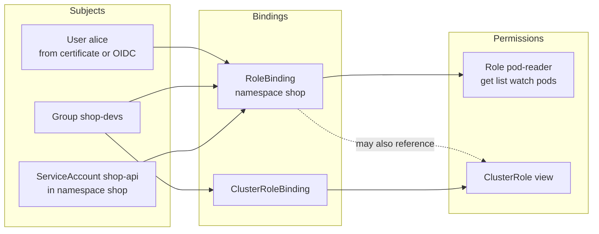
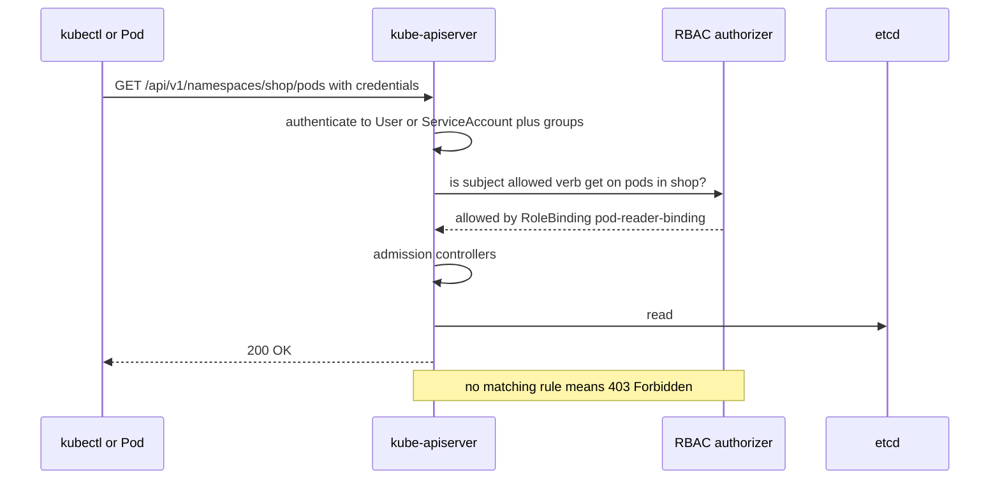

# L8.18 — RBAC

> **Level 8: Kubernetes** · Topic 18 of 19 · ⏱ ~4 hours · Difficulty: Intermediate

## 1. What it is

**Role-Based Access Control (RBAC)** decides *who may do what* against the Kubernetes API. Every request to the API server (from `kubectl`, a CI job, a controller, or a Pod using
the in-cluster client) goes through three gates: **authentication** (who are you?), **authorization** (are you allowed?), and **admission** (is the request acceptable?). RBAC is the standard authorization module.

RBAC is built from four objects:

- **Role** — a set of permissions *inside one namespace*: "may `get`, `list`, `watch` `pods`".
- **ClusterRole** — the same, but for cluster-wide resources (Nodes, PersistentVolumes), for non-resource URLs (`/healthz`), or as a reusable template that can be granted in any namespace.
- **RoleBinding** — grants a Role (or ClusterRole) to *subjects* within one namespace.
- **ClusterRoleBinding** — grants a ClusterRole to subjects across the **whole cluster**.

A **subject** is a *User* or *Group* (Kubernetes has no User object; identities come from certificates, OIDC tokens or the cloud provider) or a **ServiceAccount**: an identity for a Pod, a namespaced object created and managed inside the cluster.
RBAC is **additive and deny-by-default**: there are no deny rules; you only add allows.

## 2. Why it matters in DevOps

- **Blast radius.** A compromised Pod with a powerful ServiceAccount token can read Secrets, create Pods and take over the cluster. Least privilege here is a top security control ([Least-privilege IAM](../level-11-security-devsecops/02-least-privilege-iam.md) applies the same idea in the cloud).
- **Daily friction.** `Error from server (Forbidden): pods is forbidden: User "x" cannot list resource "pods" in API group "" in the namespace "shop"` is a message you will debug weekly.
- **CI/CD access.** Pipelines should deploy with a ServiceAccount or federated identity that can only touch the namespaces it owns, never `cluster-admin`.
- **Compliance and audit.** "Who can read Secrets in production?" must be answerable with `kubectl` queries, not guesses.
- **Multi-tenancy.** Namespaces ([Namespaces](08-namespaces.md)) combined with RoleBindings are the basic isolation boundary between teams.

## 3. Real-world system example

**Kubernetes' own components and popular add-ons.** Kubernetes ships default ClusterRoles (`cluster-admin`, `admin`, `edit`, `view`) and binds its own components to narrowly scoped `system:` roles, for example `system:kube-scheduler` and `system:node`.
Ingress controllers, Prometheus and cert-manager each document a dedicated ServiceAccount plus a Role or ClusterRole that grants only the verbs on the objects they watch (the Prometheus Kubernetes service discovery needs `get`, `list`, `watch` on pods, services and endpoints).
Managed clouds map their own identity to RBAC groups: on **GKE** IAM roles and RBAC are combined, on **EKS** the `aws-auth` ConfigMap or the newer access entries map IAM principals to Kubernetes groups, and on **AKS** Microsoft Entra ID groups are bound with RoleBindings.
The Kubernetes project documents ways RBAC is commonly over-granted (wildcards, `escalate`/`bind`, access to `secrets`, `pods/exec`, and `create pods` as an indirect path to a node), which is why audit tools such as `kubectl-who-can` and `rbac-tool` exist.

## 4. Diagram



What the API server does with a request:



## 5. How it works

**Rules** have three parts: `apiGroups` (`""` is the core group; `apps`, `batch`, `networking.k8s.io`...), `resources` (`pods`, `deployments`, subresources like `pods/log`, `pods/exec`), and `verbs`:

| Verb | HTTP | Meaning |
|------|------|---------|
| `get` / `list` / `watch` | GET | read one / many / stream changes (note: `list` and `watch` on `secrets` reveal their contents) |
| `create` / `update` / `patch` / `delete` / `deletecollection` | POST / PUT / PATCH / DELETE | write |
| `escalate`, `bind`, `impersonate` | — | special verbs that allow privilege escalation; grant almost never |

An example Role and RoleBinding (Role objects are permanent; use `resourceNames` to limit to specific objects):

```yaml
apiVersion: rbac.authorization.k8s.io/v1
kind: Role
metadata:
  name: pod-reader
  namespace: shop
rules:
  - apiGroups: [""]
    resources: ["pods", "pods/log"]
    verbs: ["get", "list", "watch"]
---
apiVersion: rbac.authorization.k8s.io/v1
kind: RoleBinding
metadata:
  name: pod-reader-binding
  namespace: shop
subjects:
  - kind: ServiceAccount
    name: shop-api
    namespace: shop
roleRef:                    # immutable once created
  apiGroup: rbac.authorization.k8s.io
  kind: Role
  name: pod-reader
```

**Key rules of behaviour**

- A **ClusterRole bound with a RoleBinding** grants its permissions only inside that namespace. This is how the built-in `view` or `edit` ClusterRoles are reused per team.
- A **ClusterRoleBinding** to a namespaced resource type grants it in *every* namespace, including ones created tomorrow.
- `roleRef` cannot be changed; delete and recreate the binding.
- Kubernetes prevents **privilege escalation**: you cannot create a Role granting permissions you do not hold yourself (unless you have `escalate`/`bind`).
- **ServiceAccounts** are namespaced. Each namespace has a `default` ServiceAccount; Pods that do not name one use it. Since Kubernetes 1.24 tokens are no longer auto-created as long-lived Secrets: Pods receive a short-lived, audience-bound **projected token**
  mounted at `/var/run/secrets/kubernetes.io/serviceaccount/`, and you mint tokens on demand with `kubectl create token <sa>`.
- Set `automountServiceAccountToken: false` on ServiceAccounts or Pods that never call the API (most application Pods, including `shop-api`).
- ServiceAccount usernames look like `system:serviceaccount:<namespace>:<name>` and belong to the groups `system:serviceaccounts` and `system:serviceaccounts:<namespace>`.

**Testing and auditing commands**

| Command | Purpose |
|---------|---------|
| `kubectl auth can-i list pods -n shop` | can I do this? Prints `yes` or `no` |
| `kubectl auth can-i get secrets -n shop --as=system:serviceaccount:shop:shop-api` | impersonate a ServiceAccount (needs the `impersonate` verb, which cluster admins have) |
| `kubectl auth can-i --list -n shop --as=...` | everything the subject may do in the namespace |
| `kubectl auth whoami` | the identity and groups the API server sees for your credentials |
| `kubectl get rolebindings,clusterrolebindings -A -o wide` | who is bound where |
| `kubectl describe clusterrole view` | the rules of a role |
| `kubectl create role/rolebinding ... --dry-run=client -o yaml` | generate manifests quickly |

Human users: Kubernetes does not store them. In practice you use OIDC (for example your company SSO) and bind **Groups** rather than individual users, so access follows team membership.
RBAC in depth (aggregated ClusterRoles, auditing, escalation paths) continues in [RBAC in Depth](../level-16-advanced-kubernetes/01-rbac-in-depth.md).

## 6. Step-by-step guide

**Prerequisites:** a kind cluster (`kind create cluster --name lab`) and `kubectl`. kind enables RBAC by default and your admin kubeconfig is `cluster-admin`. Cost: free. Outputs are *illustrative*.

1. **Know who you are.**
   ```bash
   kubectl auth whoami
   kubectl auth can-i '*' '*'
   ```
   On kind you are `kubernetes-admin` in group `system:masters`, and the second command prints `yes`.

2. **Create a namespace, a ServiceAccount and something to look at.**
   ```bash
   kubectl create namespace shop
   kubectl create serviceaccount shop-api -n shop
   kubectl create deployment web -n shop --image=nginx:1.27
   kubectl create secret generic db-pass -n shop --from-literal=password=not-a-real-password
   ```

3. **Prove the new identity has nothing yet** (deny by default):
   ```bash
   SA=system:serviceaccount:shop:shop-api
   kubectl auth can-i list pods -n shop --as=$SA            # no
   kubectl auth can-i --list -n shop --as=$SA | head
   ```
   You only see a few baseline entries such as `selfsubjectreviews` and discovery URLs.

4. **Grant read access to Pods only.** Save the Role and RoleBinding from section 5 as `rbac.yaml` and apply:
   ```bash
   kubectl apply -f rbac.yaml
   kubectl auth can-i list pods -n shop --as=$SA            # yes
   kubectl auth can-i list pods/log -n shop --as=$SA        # yes (get/list on pods/log)
   kubectl auth can-i delete pods -n shop --as=$SA          # no
   kubectl auth can-i get secrets -n shop --as=$SA          # no
   kubectl auth can-i list pods -n default --as=$SA         # no: a Role is namespaced
   ```

5. **Use the permissions from inside a Pod** the way real software does. This Pod calls the API with its mounted token:
   ```bash
   cat > api-client.yaml <<'EOF'
   apiVersion: v1
   kind: Pod
   metadata:
     name: api-client
     namespace: shop
   spec:
     serviceAccountName: shop-api
     containers:
       - name: curl
         image: curlimages/curl:8.10.1
         command: ["sleep", "3600"]
   EOF
   kubectl apply -f api-client.yaml
   kubectl wait -n shop --for=condition=Ready pod/api-client --timeout=60s
   kubectl exec -n shop api-client -- sh -c '
     TOKEN=$(cat /var/run/secrets/kubernetes.io/serviceaccount/token)
     CA=/var/run/secrets/kubernetes.io/serviceaccount/ca.crt
     curl -s --cacert $CA -H "Authorization: Bearer $TOKEN" \
       https://kubernetes.default.svc/api/v1/namespaces/shop/pods | head -c 300; echo
     echo ---
     curl -s --cacert $CA -H "Authorization: Bearer $TOKEN" \
       https://kubernetes.default.svc/api/v1/namespaces/shop/secrets | head -c 400; echo'
   ```
   The first call returns a `PodList` JSON document; the second returns a `Status` object with `"reason": "Forbidden"` and a message like `secrets is forbidden: User "system:serviceaccount:shop:shop-api" cannot list resource "secrets"`.

6. **Reuse a ClusterRole in one namespace.** The built-in `view` ClusterRole, bound only to `shop`:
   ```bash
   kubectl create rolebinding shop-viewers -n shop --clusterrole=view --group=shop-devs
   kubectl auth can-i list deployments -n shop --as=alice --as-group=shop-devs     # yes
   kubectl auth can-i list deployments -n default --as=alice --as-group=shop-devs  # no
   kubectl auth can-i get secrets -n shop --as=alice --as-group=shop-devs          # no: view excludes Secrets
   ```

7. **Mint a short-lived token and use it from your laptop.** Build a separate kubeconfig context so the token is the only credential (a kubeconfig entry that also holds a client certificate would win):
   ```bash
   TOKEN=$(kubectl create token shop-api -n shop --duration=10m)
   CLUSTER=$(kubectl config view --minify -o jsonpath='{.contexts[0].context.cluster}')
   kubectl config set-credentials sa-shop-api --token="$TOKEN"
   kubectl config set-context sa-shop-api --cluster="$CLUSTER" --user=sa-shop-api --namespace=shop
   kubectl --context=sa-shop-api get pods
   kubectl --context=sa-shop-api get nodes
   kubectl --context=sa-shop-api auth whoami
   ```
   The first command lists the Pods; the second fails with `Forbidden` because `nodes` is cluster-scoped and the ServiceAccount has no ClusterRole; `whoami` shows `system:serviceaccount:shop:shop-api`. The token expires after 10 minutes.

8. **Find over-privilege.**
   ```bash
   kubectl get clusterrolebindings -o wide | grep -E 'cluster-admin|system:masters'
   kubectl get rolebindings,clusterrolebindings -A -o jsonpath='{range .items[?(@.subjects)]}{.kind}{" "}{.metadata.name}{" -> "}{.roleRef.name}{"\n"}{end}' | head -20
   ```
   Review any binding that points to `cluster-admin` and ask who needs it.

9. **Clean up.**
   ```bash
   kubectl delete namespace shop
   kubectl config delete-context sa-shop-api
   kubectl config delete-user sa-shop-api
   ```

## 7. Real-world scenario

*Illustrative scenario.* A team gives its GitHub Actions deployer ServiceAccount a ClusterRoleBinding to `cluster-admin` "to get unblocked". Months later a build dependency is compromised and exfiltrates the pipeline's kubeconfig.
The attacker lists Secrets in every namespace and reads the production database password. In the post-incident review, `kubectl auth can-i --list --as=system:serviceaccount:ci:deployer` shows full wildcard access. The remediation:
a per-environment Role in the `shop` namespace allowing `get`, `list`, `patch`, `update` on `deployments` and `get`, `list`, `watch` on `pods` and `replicasets`, no access to Secrets, short-lived credentials via OIDC federation
instead of a stored token, and a weekly report of bindings to `cluster-admin`.
**Lesson:** start with no permissions and add what `kubectl auth can-i` and the `Forbidden` messages tell you is needed; wildcards are debt.

## 8. Common mistakes and best practices

**Don't**

- Bind `cluster-admin` to CI systems, applications or whole groups for convenience.
- Use `*` in `verbs`, `resources` or `apiGroups` in application roles.
- Give application Pods the `default` ServiceAccount with extra permissions; every Pod in the namespace would inherit them.
- Grant `get`/`list`/`watch` on `secrets` broadly: `list` returns values. Also beware of `pods/exec`, `create pods` and `impersonate`.
- Create long-lived ServiceAccount token Secrets by hand when `kubectl create token` or projected tokens will do.

**Do**

- Create one ServiceAccount per workload and set `automountServiceAccountToken: false` unless it needs the API.
- Prefer Roles and RoleBindings in a namespace over ClusterRoles/ClusterRoleBindings.
- Bind Groups from your identity provider, not individual users.
- Verify every grant with `kubectl auth can-i` (and `--list`) as part of the change, and store RBAC YAML in Git.
- Review bindings regularly and audit with tools (`kubectl-who-can`, `rbac-tool`, `kubectl get ... -o yaml`).

## 9. Tasks

- [ ] **T1 — Who am I and what can I do?** *(≈20 min, beginner)*
  - **Goal:** use the identity and permission-check commands.
  - **Steps:**
    1. Run `kubectl auth whoami`.
    2. Run `kubectl auth can-i --list -n kube-system`.
    3. Impersonate the `default` ServiceAccount of a new namespace and compare the lists.
  - **Done when:** you can explain why the two lists differ.

- [ ] **T2 — Grant read-only Pod access** *(≈30 min, beginner)*
  - **Goal:** build and test your first Role and RoleBinding.
  - **Steps:**
    1. Apply the `pod-reader` Role and RoleBinding for ServiceAccount `shop-api`.
    2. Run the five `can-i` checks from step 4.
    3. Run the in-Pod `curl` from step 5 and capture one 200 and one 403 response.
  - **Done when:** `pods` are listable, `secrets` return Forbidden, and the 403 message names the ServiceAccount.

- [ ] **T3 — Cluster-wide versus namespaced** *(≈30 min, intermediate)*
  - **Goal:** understand the scope of bindings.
  - **Steps:**
    1. Bind `view` to the ServiceAccount with a RoleBinding in `shop`, test in `shop` and `default`.
    2. Replace it with a ClusterRoleBinding and test again.
    3. Create a new namespace and test there.
  - **Done when:** you can show that the RoleBinding is limited to `shop` and the ClusterRoleBinding applies to a namespace created after the binding.

- [ ] **T4 — Least privilege for a deployer** *(≈45 min, intermediate)*
  - **Goal:** write the narrow role for a CI deployer.
  - **Steps:**
    1. Create ServiceAccount `deployer` in `shop` with a Role allowing `get`, `list`, `patch`, `update` on `deployments` and read on `pods`, `replicasets`.
    2. Using a token for `deployer` in a separate context as in step 7, run `kubectl set image deployment/web web=nginx:1.27-alpine` and `kubectl get secrets`.
    3. Add only what is missing for `kubectl rollout status` to work.
  - **Done when:** the image update succeeds, `get secrets` is Forbidden, and your final Role has no wildcards.

- [ ] **T5 — Break it: a missing verb** *(≈30 min, advanced)*
  - **Goal:** debug a Forbidden error methodically.
  - **Steps:**
    1. Remove `watch` from `pod-reader` and run `kubectl --context=sa-shop-api get pods -n shop -w`.
    2. Read the error message to identify subject, verb, resource and namespace.
    3. Fix the Role using only the information in that message.
  - **Done when:** the watch works again and you can describe the four parts of the error.

- [ ] **T6 — Prove it: audit a namespace** *(≈45 min, advanced)*
  - **Goal:** answer "who can read Secrets in this namespace?" from the cluster.
  - **Steps:**
    1. In the [capstone](99-capstone-project.md) cluster, list every RoleBinding and ClusterRoleBinding that could apply to namespace `shop`.
    2. Using `can-i` with impersonation, test each ServiceAccount and the groups for `get secrets`.
    3. Write a five-line summary and remove one unnecessary grant.
  - **Done when:** your list matches `kubectl auth can-i` results and you changed at least one binding with before/after evidence.

## 10. Self-check questions

1. What is the difference between a Role and a ClusterRole, and between a RoleBinding and a ClusterRoleBinding?
2. What happens when a ClusterRole is bound with a RoleBinding?
3. Why does Kubernetes have no deny rules, and what does that imply for designing roles?
4. How do you check what a ServiceAccount can do without logging in as it?
5. Why is `list` on `secrets` dangerous even without `get`?

<details>
<summary>Answers</summary>

1. Role: namespaced permissions; ClusterRole: cluster-scoped resources/non-resource URLs or a reusable template. RoleBinding grants within one namespace; ClusterRoleBinding grants cluster-wide.
2. The permissions apply only inside the RoleBinding's namespace.
3. RBAC is purely additive: absence of a rule means denied. Start from nothing and add the minimum; you cannot subtract from a broad grant, so avoid broad grants.
4. `kubectl auth can-i <verb> <resource> -n <ns> --as=system:serviceaccount:<ns>:<name>` (and `--list`), which requires impersonation rights (admins have them).
5. A list response contains the full objects including their data, so `list` (and `watch`) leaks the secret values just like `get`.
</details>

## 11. Further reading

- Kubernetes documentation — *Using RBAC Authorization*, *Managing Service Accounts* and *Controlling Access to the Kubernetes API*.
- Kubernetes documentation — *RBAC Good Practices*.
- Kubernetes documentation — *Authenticating* (OIDC, certificates, ServiceAccount tokens).
- See also: [Namespaces](08-namespaces.md), [Secrets](07-secrets.md) and [Authentication and Authorization](../level-11-security-devsecops/06-authentication-and-authorization.md).

<!-- nav -->
---
← Previous: [Service Discovery](17-service-discovery.md) · [Level 8 index](README.md) · Next: [NetworkPolicies](19-networkpolicies.md) →
