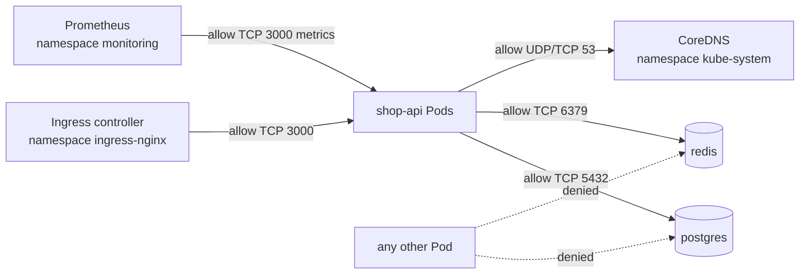
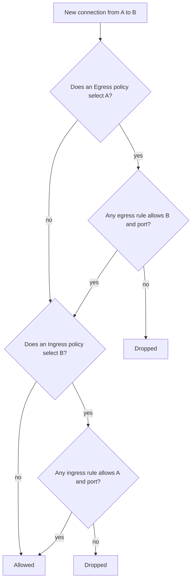

# L8.19 — NetworkPolicies

> **Level 8: Kubernetes** · Topic 19 of 19 · ⏱ ~5 hours · Difficulty: Advanced

## 1. What it is

By default **every Pod in a Kubernetes cluster can talk to every other Pod**, in any namespace, on any port. The cluster network is flat and open.
A **NetworkPolicy** is a namespaced Kubernetes object that restricts this: it selects a group of Pods and lists which **ingress** (incoming) and **egress** (outgoing) connections are allowed for them, by peer Pod labels, namespace labels, IP ranges (CIDR) and ports.
Think of it as a firewall rule set written in terms of labels instead of IP addresses (compare [Security Groups and NACLs](../level-06-cloud-aws/06-security-groups-and-nacls.md)).

Two facts define everything else:

1. **A Pod is unrestricted until some policy selects it** for a direction. Once at least one policy selects a Pod for `Ingress`, only traffic allowed by the union of such policies reaches it (same for `Egress`). That is why the standard pattern is a *default-deny* policy plus explicit allows.
2. **NetworkPolicy is only an API.** The rules are enforced by your **CNI (Container Network Interface) plugin**. If the CNI does not implement policies, you can create NetworkPolicy objects successfully and **nothing is enforced**, with no warning.

## 2. Why it matters in DevOps

- **Lateral movement.** Without policies, one compromised Pod (an RCE in a web app) can reach the database, the Redis cache, the metrics endpoints and the cloud metadata service of every other workload.
- **Compliance.** PCI DSS and similar frameworks expect segmentation between cardholder data and everything else; NetworkPolicies are how you show it in Kubernetes.
- **Safe multi-tenancy.** Namespaces alone ([Namespaces](08-namespaces.md)) do not isolate network traffic; policies do.
- **Predictability.** A written allow-list is living documentation of which service may call which.
- **Outages.** Adding a default-deny without allowing DNS, ingress-controller traffic or monitoring is a classic way to take down production in seconds ([Service Discovery](17-service-discovery.md)).

## 3. Real-world system example

**Calico, Cilium and the cloud CNIs.** Calico (Tigera) and Cilium (CNCF graduated project) are the most widely deployed policy-enforcing CNIs; both implement the standard Kubernetes API and add their own richer policy CRDs (global policies, L7 and DNS-aware rules, identity-based enforcement in Cilium using eBPF).
Managed offerings document how to turn on enforcement: **GKE** offers Dataplane V2 (based on Cilium) or Calico-based network policy, **EKS** supports policy enforcement in the Amazon VPC CNI (network policy support was added in 2023) as well as Calico and Cilium, and **AKS** supports Azure network policies, Calico and Cilium.
The Kubernetes documentation itself shows default-deny policies as the recommended baseline, and the CNCF-hosted community "network policy recipes" collections demonstrate the common patterns used below.
Regulated companies commonly pair namespace-per-team with a default-deny policy applied by an admission policy or GitOps template so every new namespace starts closed.

## 4. Diagram

How the `shop` namespace looks after you apply the policies in this topic:



How a packet decision is made (stateful: reply traffic for an allowed connection is always allowed):



## 5. How it works

**Anatomy of a policy**

```yaml
apiVersion: networking.k8s.io/v1
kind: NetworkPolicy
metadata:
  name: allow-api-to-postgres
  namespace: shop
spec:
  podSelector:                     # WHICH Pods this policy protects (empty {} = all Pods in the namespace)
    matchLabels: {app: postgres}
  policyTypes: [Ingress]           # which directions it governs
  ingress:
    - from:                        # allowed sources (OR across list items)
        - podSelector:
            matchLabels: {app: shop-api}
      ports:
        - {protocol: TCP, port: 5432}
```

**Peer selectors**

| Selector | Matches | Note |
|----------|---------|------|
| `podSelector` | Pods in the **policy's own namespace** with those labels | alone, it never crosses namespaces |
| `namespaceSelector` | all Pods in namespaces with matching labels | built-in label `kubernetes.io/metadata.name: <ns>` is set automatically on every namespace |
| `namespaceSelector` + `podSelector` **in the same list item** | Pods with those labels **in** those namespaces (AND) | the most common mistake is getting this wrong |
| `ipBlock` | an IP range with optional `except` | for traffic outside the cluster (databases, internet); Pod IPs are not matched reliably, use selectors for in-cluster peers |

```yaml
# AND: Pods labelled app=prometheus that are in the namespace "monitoring"
- from:
    - namespaceSelector: {matchLabels: {kubernetes.io/metadata.name: monitoring}}
      podSelector:       {matchLabels: {app: prometheus}}
# OR: any Pod in "monitoring", PLUS Pods labelled app=prometheus in this namespace   (note the extra dash)
- from:
    - namespaceSelector: {matchLabels: {kubernetes.io/metadata.name: monitoring}}
    - podSelector:       {matchLabels: {app: prometheus}}
```

**Rules of the model**

- **Additive.** There are no deny rules. Policies are unioned; you cannot "subtract" with another policy. (Calico and Cilium CRDs add explicit deny, but those are not portable.)
- **Both ends matter.** A connection needs egress allowed at the source (if the source is selected by an egress policy) **and** ingress allowed at the destination (if selected by an ingress policy).
- **`policyTypes`** defaults to `Ingress` always, plus `Egress` only when the policy has an `egress:` section. State it explicitly (`[Ingress]`, `[Egress]` or both) so the intent is obvious, and so a default-deny of egress is not forgotten.
- **Empty rules matter:** `ingress: [{}]` (one empty rule) allows everything; a policy with `policyTypes: [Ingress]` and no `ingress` field denies all ingress.
- **Ports** accept numbers or named container ports and a range via `endPort`. Omitting `ports` allows all ports for that peer.
- **L3/L4 only.** NetworkPolicy knows IPs, ports and TCP/UDP/SCTP; it cannot filter HTTP paths or hostnames (use a service mesh or a CNI's L7 extensions, see [NetworkPolicies in Depth](../level-16-advanced-kubernetes/02-networkpolicies-in-depth.md)).
- **Node traffic.** Most CNIs always allow the node to reach local Pods (so kubelet probes work). Pods using `hostNetwork: true` are generally not covered. Check your CNI documentation.
- **Egress to the control plane and DNS must be explicit** once you deny egress: allow port 53 (UDP and TCP) to CoreDNS and any API server access your Pods need.

**CNI support**

| CNI | Enforces NetworkPolicy? |
|-----|--------------------------|
| Calico | yes |
| Cilium | yes (and more) |
| Antrea, kube-router | yes |
| Weave Net | yes, but check its maintenance status before choosing it for a new cluster |
| Amazon VPC CNI | yes, when network policy support is enabled (otherwise no) |
| Flannel | **no** (needs pairing with another component, for example Canal = Flannel + Calico) |
| kind default (kindnet) | newer releases include a policy controller; older ones did not. Never assume: test as in section 6 |

## 6. Step-by-step guide

**Prerequisites:** Docker, `kind`, `kubectl`. Cost: free. We create a **new** cluster with Calico as the CNI so enforcement is certain.
Outputs are *illustrative*. Pod CIDR below matches Calico's default manifest.

1. **Create a kind cluster without the default CNI.** Save as `kind-calico.yaml`:
   ```yaml
   kind: Cluster
   apiVersion: kind.x-k8s.io/v1alpha4
   networking:
     disableDefaultCNI: true
     podSubnet: 192.168.0.0/16
   nodes:
     - role: control-plane
     - role: worker
   ```
   ```bash
   kind create cluster --name netpol --config kind-calico.yaml
   kubectl get nodes          # NotReady until a CNI is installed
   ```

2. **Install Calico** (pinned to a release; check the Calico docs for a newer version):
   ```bash
   kubectl apply -f https://raw.githubusercontent.com/projectcalico/calico/v3.28.0/manifests/calico.yaml
   kubectl -n kube-system rollout status daemonset/calico-node --timeout=180s
   kubectl get nodes          # now Ready
   ```

3. **Create a tiny three-tier app and prove everything is open.**
   ```bash
   kubectl create namespace shop
   kubectl -n shop run postgres --image=nginx:1.27 --labels=app=postgres --port=80   # stand-in listening on 80
   kubectl -n shop run api      --image=nginx:1.27 --labels=app=shop-api --port=80
   kubectl -n shop run intruder --image=busybox:1.36 --labels=app=intruder -- sleep 3600
   kubectl -n shop expose pod postgres --port=80 --name=postgres
   kubectl -n shop wait --for=condition=Ready pod --all --timeout=90s
   kubectl -n shop exec intruder -- wget -T 3 -q -O- http://postgres | head -3
   ```
   The intruder reads the "database". This is the default: open.

4. **Apply default deny for ingress and egress** (blocks all traffic in the namespace, including DNS):
   ```bash
   cat > 00-default-deny.yaml <<'EOF'
   apiVersion: networking.k8s.io/v1
   kind: NetworkPolicy
   metadata:
     name: default-deny-all
     namespace: shop
   spec:
     podSelector: {}
     policyTypes: [Ingress, Egress]
   EOF
   kubectl apply -f 00-default-deny.yaml
   kubectl -n shop exec intruder -- wget -T 3 -q -O- http://postgres      # now fails
   ```
   Expect `wget: bad address 'postgres'` (DNS is blocked) or a timeout. Everything is closed.

5. **Allow DNS egress for all Pods:**
   ```bash
   cat > 01-allow-dns.yaml <<'EOF'
   apiVersion: networking.k8s.io/v1
   kind: NetworkPolicy
   metadata:
     name: allow-dns-egress
     namespace: shop
   spec:
     podSelector: {}
     policyTypes: [Egress]
     egress:
       - to:
           - namespaceSelector:
               matchLabels: {kubernetes.io/metadata.name: kube-system}
             podSelector:
               matchLabels: {k8s-app: kube-dns}
         ports:
           - {protocol: UDP, port: 53}
           - {protocol: TCP, port: 53}
   EOF
   kubectl apply -f 01-allow-dns.yaml
   kubectl -n shop exec intruder -- nslookup postgres        # resolves now
   kubectl -n shop exec intruder -- wget -T 3 -q -O- http://postgres   # still times out: no route to the destination
   ```
   DNS works but the connection is still blocked, which proves the deny is doing its job.

6. **Allow only `shop-api` to reach postgres** (both ends need a rule, since egress is also denied):
   ```bash
   cat > 02-api-to-postgres.yaml <<'EOF'
   apiVersion: networking.k8s.io/v1
   kind: NetworkPolicy
   metadata:
     name: api-egress-to-postgres
     namespace: shop
   spec:
     podSelector: {matchLabels: {app: shop-api}}
     policyTypes: [Egress]
     egress:
       - to: [{podSelector: {matchLabels: {app: postgres}}}]
         ports: [{protocol: TCP, port: 80}]
   ---
   apiVersion: networking.k8s.io/v1
   kind: NetworkPolicy
   metadata:
     name: postgres-ingress-from-api
     namespace: shop
   spec:
     podSelector: {matchLabels: {app: postgres}}
     policyTypes: [Ingress]
     ingress:
       - from: [{podSelector: {matchLabels: {app: shop-api}}}]
         ports: [{protocol: TCP, port: 80}]
   EOF
   kubectl apply -f 02-api-to-postgres.yaml
   kubectl -n shop exec api -- wget -T 3 -q -O- http://postgres | head -3      # works
   kubectl -n shop exec intruder -- wget -T 3 -q -O- http://postgres           # blocked (timeout)
   ```
   (In the real capstone the port is 5432; here the nginx stand-in listens on 80.)

7. **Cross-namespace rule (AND vs OR).** Allow a monitoring namespace to reach the API:
   ```bash
   kubectl create namespace monitoring
   kubectl label namespace monitoring team=observability
   kubectl -n monitoring run prom --image=busybox:1.36 --labels=app=prometheus -- sleep 3600
   cat > 03-monitoring.yaml <<'EOF'
   apiVersion: networking.k8s.io/v1
   kind: NetworkPolicy
   metadata:
     name: api-ingress-from-monitoring
     namespace: shop
   spec:
     podSelector: {matchLabels: {app: shop-api}}
     policyTypes: [Ingress]
     ingress:
       - from:
           - namespaceSelector: {matchLabels: {kubernetes.io/metadata.name: monitoring}}
             podSelector: {matchLabels: {app: prometheus}}
         ports: [{protocol: TCP, port: 80}]
   EOF
   kubectl apply -f 03-monitoring.yaml
   kubectl -n monitoring wait --for=condition=Ready pod/prom --timeout=60s
   API_IP=$(kubectl -n shop get pod api -o jsonpath='{.status.podIP}')
   kubectl -n monitoring exec prom -- wget -T 3 -q -O- http://$API_IP | head -3   # allowed ingress at the API
   ```
   The Pod in `monitoring` is not itself restricted (no policy selects it), so only the destination rule matters.

8. **Test systematically.** Build a small matrix instead of eyeballing:
   ```bash
   for src in api intruder; do
     for dst in postgres; do
       if kubectl -n shop exec $src -- wget -T 3 -q -O /dev/null http://$dst 2>/dev/null; then r=ALLOWED; else r=BLOCKED; fi
       echo "$src -> $dst : $r"
     done
   done
   ```
   Expect `api -> postgres : ALLOWED` and `intruder -> postgres : BLOCKED`. In CI you can run the same loop (or a tool such as `netassert` or Cilium's connectivity tests) against a preview cluster.
   Inspect what is in force with `kubectl get netpol -n shop` and `kubectl describe netpol postgres-ingress-from-api -n shop`.

9. **Clean up.**
   ```bash
   kind delete cluster --name netpol
   ```

## 7. Real-world scenario

*Illustrative scenario.* A penetration test of `shop-api` finds a server-side request forgery bug: an attacker can make the API fetch arbitrary URLs. From inside the cluster the tester reaches
PostgreSQL on 5432, Redis on 6379 (no password) and the Prometheus admin API in another namespace. The remediation PR adds a default-deny policy to the `shop` namespace, followed by allow rules: ingress to `shop-api`
from the ingress controller only, `shop-api` egress to Postgres, Redis, CoreDNS and a specific external CIDR for the payment provider, and ingress to Postgres and Redis only from `shop-api`.
The first rollout, however, breaks readiness checks: the readiness probe fails because the policy for the Pods forgot the ingress path for the **Ingress controller** namespace, and a CronJob that talked to Postgres is blocked.
They find both from the `Connection timed out` log lines, test with the matrix script, fix the rules and add the matrix to CI. A repeat of the SSRF test now only reaches the API's allowed destinations.
**Lesson:** default-deny works, but ship it with a connectivity test matrix and an inventory of every legitimate flow (including jobs, probes, DNS and the ingress controller).

## 8. Common mistakes and best practices

**Don't**

- Assume policies are enforced; verify your CNI with a negative test.
- Apply default-deny egress without DNS, or default-deny ingress without allowing the ingress controller and monitoring.
- Confuse the AND form (one list item with both selectors) with the OR form (two list items).
- Use `ipBlock` for Pod-to-Pod rules; Pod IPs change.
- Forget the other end: with egress denied you need the source's egress rule and the destination's ingress rule.
- Treat NetworkPolicy as authentication or as an L7 firewall.

**Do**

- Start every namespace with a default-deny and add narrow allows, stored in Git next to the workload manifests.
- Label consistently (`app`, `tier`, `component`) so selectors are stable.
- Allow DNS explicitly and keep a reusable "allow-dns-egress" policy.
- Test with a source/destination matrix, positive and negative, in CI.
- Use `kubernetes.io/metadata.name` to select namespaces by name.
- Prefer a CNI with observability (Calico, Cilium Hubble) so dropped flows are visible during rollout.

## 9. Tasks

- [ ] **T1 — Prove your CNI enforces policy** *(≈30 min, beginner)*
  - **Goal:** never trust an unenforced policy again.
  - **Steps:**
    1. Create the kind cluster with Calico (steps 1-2), or test your existing cluster.
    2. Run steps 3-4 and confirm the intruder is blocked after default-deny.
    3. Delete the `default-deny-all` policy and confirm access returns.
  - **Done when:** you have output showing access before, blocked during and restored after.

- [ ] **T2 — Default deny with DNS** *(≈30 min, beginner)*
  - **Goal:** build the standard baseline.
  - **Steps:**
    1. Apply `00-default-deny.yaml` and `01-allow-dns.yaml`.
    2. Show `nslookup postgres` succeeds while `wget http://postgres` times out.
  - **Done when:** DNS works and connections are still blocked.

- [ ] **T3 — Allow one path** *(≈40 min, intermediate)*
  - **Goal:** write ingress and egress rules for a pair of Pods.
  - **Steps:**
    1. Apply `02-api-to-postgres.yaml`.
    2. Remove the egress policy and observe what fails; restore it and remove the ingress policy and observe again.
    3. Write a one-sentence explanation of why both are needed.
  - **Done when:** the connection works only when both policies exist and you can explain it.

- [ ] **T4 — AND versus OR** *(≈40 min, intermediate)*
  - **Goal:** feel the difference of one dash.
  - **Steps:**
    1. Create another Pod labelled `app=prometheus` in the `shop` namespace and a Pod with another label in `monitoring`.
    2. Test access to the API with the AND version of the policy (step 7), then edit to the OR version.
    3. Record which of the four sources can connect in each version.
  - **Done when:** you have a 2x4 result table that matches the semantics in section 5.

- [ ] **T5 — Break and fix: the missing DNS rule** *(≈30 min, advanced)*
  - **Goal:** diagnose a network-policy outage quickly.
  - **Steps:**
    1. Delete `allow-dns-egress` while keeping the others.
    2. From `api`, run `nslookup postgres` and `wget http://<postgres Pod IP>` and compare.
    3. State the symptom, the commands that separate "DNS blocked" from "connection blocked" and restore the policy.
  - **Done when:** you can show that the IP works but the name does not (or vice versa for a blocked path) and fixed it.

- [ ] **T6 — Prove it: lock down shop-api** *(≈90 min, advanced)*
  - **Goal:** segment the whole capstone application.
  - **Steps:**
    1. In the [capstone](99-capstone-project.md) cluster (with a policy-enforcing CNI), apply the default-deny and the allow policies from milestone 8.
    2. Write the source/destination test matrix as a script, including at least three expected-BLOCKED cases.
    3. Explain why the ingress controller, DNS and Prometheus needed their own rules.
  - **Done when:** the matrix passes (allowed flows work, blocked flows time out), the application still serves traffic through the Ingress, and you can walk a colleague through the policy set.

## 10. Self-check questions

1. What happens to a Pod that no NetworkPolicy selects?
2. You create a NetworkPolicy on a Flannel-only cluster. What is enforced?
3. What is the difference between one `from` item containing both `namespaceSelector` and `podSelector`, and two separate items?
4. After applying a default-deny egress policy, name two things that stop working at once.
5. Why do you need both an egress rule on the client and an ingress rule on the server when both directions are denied?

<details>
<summary>Answers</summary>

1. It accepts and sends all traffic, since non-selected Pods are unrestricted.
2. Nothing; the API accepts the object but the CNI has no policy engine. Add a policy-capable CNI such as Calico or Cilium.
3. One item with both selectors is an AND (Pods with that label in matching namespaces). Two items are an OR (any Pod in the matching namespaces, or Pods with the label in the policy's own namespace).
4. DNS resolution and every outbound connection, including to the API server, databases, and external HTTPS; readiness probes of dependencies may also fail.
5. A connection must be permitted at both ends: the source's egress and the destination's ingress. Reply packets of an allowed connection are allowed automatically.
</details>

## 11. Further reading

- Kubernetes documentation — *Network Policies* (concepts) and *Declare Network Policy* (task).
- Calico documentation (docs.tigera.io) and Cilium documentation (docs.cilium.io) — policy guides.
- Kubernetes Network Policy Recipes (community collection on GitHub).
- See also: [Services](04-services.md), [Ingress](05-ingress.md) and [Routing, NAT, Ports and Firewalls](../level-02-networking/04-routing-nat-ports-firewalls.md).

<!-- nav -->
---
← Previous: [RBAC](18-rbac.md) · [Level 8 index](README.md) · Next: [Level capstone project](99-capstone-project.md) →
