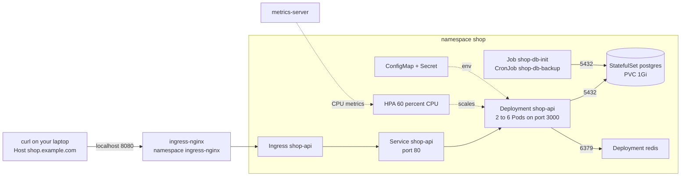
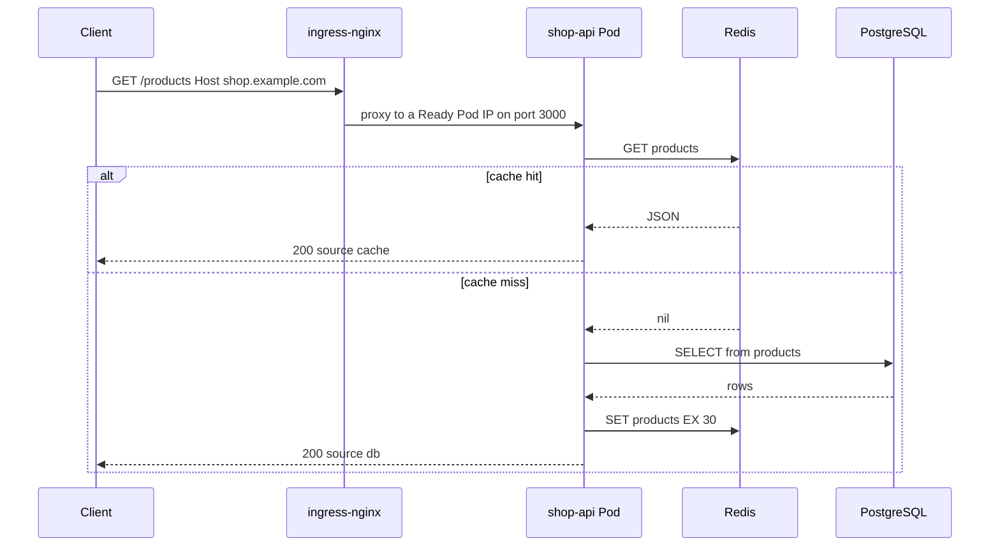
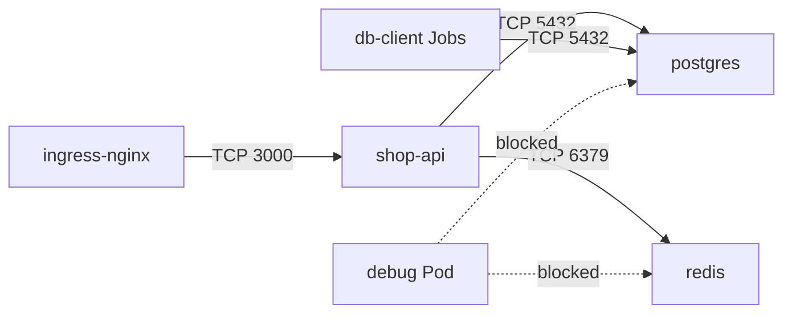

# L8 Capstone — shop-api on Kubernetes

> **Level 8: Kubernetes** · Capstone · ⏱ ~8 hours

## 1. Goal and outcome

Move the `shop-api` application (a Node.js API backed by PostgreSQL and Redis) from "runs on my laptop with Docker Compose" to a **local kind cluster**, the way a real team would run it:
declarative manifests, health probes, autoscaling, least-privilege access and a default-deny network. You write every manifest yourself (they are all in this page) and you prove each property with a command.

You finish with a repository folder `shop-k8s/` and a cluster where:

- `curl -H 'Host: shop.example.com' http://localhost:8080/products` returns product data through an **Ingress**, first from PostgreSQL then from Redis.
- PostgreSQL runs as a **StatefulSet** with a persistent volume, Redis as a **Deployment**, schema/seed data comes from a **Job**, nightly dumps from a **CronJob**.
- The API has **ConfigMap/Secret** configuration, **requests and limits**, **startup/liveness/readiness probes**, spread across nodes, an **HPA** (2-6 replicas) and a PodDisruptionBudget.
- A CI-style deployer ServiceAccount can update Deployments but cannot read Secrets (**RBAC**), and **NetworkPolicies** allow only the intended flows.

| Level 8 topic | Where it is exercised |
|---------------|-----------------------|
| 01 Cluster architecture | M1: inspect control plane and nodes; T1 |
| 02 Pods | M4, M9: probes, security context, debug Pods |
| 03 Deployments and ReplicaSets | M4, M9: rolling update and rollback |
| 04 Services | M3-M4: `postgres`, `redis`, `shop-api` Services |
| 05 Ingress | M5 |
| 06 ConfigMaps | M2 |
| 07 Secrets | M2 |
| 08 Namespaces | M2: namespace `shop`, quotas, Pod Security label |
| 09 Volumes, PV, PVC | M3: Postgres data and backup PVCs |
| 10 StatefulSets | M3: `postgres` |
| 11 DaemonSets | M1: Calico and kube-proxy; T1 |
| 12 Jobs and CronJobs | M3: seed Job and backup CronJob |
| 13 Scheduling | M4: topology spread; T3 |
| 14 Requests and limits | M3-M4, M2 quota |
| 15 Probes | M4, M9 drills |
| 16 HPA | M6 |
| 17 Service discovery | M2-M3: DNS names in the ConfigMap |
| 18 RBAC | M7 |
| 19 NetworkPolicies | M8 |

## 2. Architecture



One request, with the cache-aside pattern the API implements:



NetworkPolicy design (milestone 8) — only the arrows below are allowed, plus DNS:



## 3. Prerequisites and cost

- **Tools:** Docker, [kind](https://kind.sigs.k8s.io), `kubectl`, `curl`, `openssl`. About 4 CPU cores and 8 GB RAM free for a three-node cluster.
- **Knowledge:** the 19 topics of this level, [Docker images](../level-04-docker/02-images-and-layers.md) and [Dockerfiles](../level-04-docker/07-dockerfile.md).
- **Cost:** free. Everything runs locally. Downloads: a few hundred MB of images.
- **Notes:** ports 8080 and 8443 on your machine must be free. All command output in this page is *illustrative*; names, IPs and timings will differ.
  The lab uses ingress-nginx because it has an official kind manifest; that project is retired (see [Ingress](05-ingress.md)), so treat it as a local learning tool. Your Ingress objects work with any maintained controller by changing `ingressClassName`.

Create the working folder:

```bash
mkdir -p shop-k8s/app shop-k8s/k8s && cd shop-k8s
```

## 4. Build it step by step

### Milestone 1 — Cluster, CNI, ingress controller and metrics (topics 01, 11)

The default kind CNI may not enforce NetworkPolicies, so we disable it and install Calico, which does. Save as `kind-shop.yaml`:

```yaml
kind: Cluster
apiVersion: kind.x-k8s.io/v1alpha4
networking:
  disableDefaultCNI: true
  podSubnet: 192.168.0.0/16
nodes:
  - role: control-plane
    kubeadmConfigPatches:
      - |
        kind: InitConfiguration
        nodeRegistration:
          kubeletExtraArgs:
            node-labels: "ingress-ready=true"
    extraPortMappings:
      - {containerPort: 80, hostPort: 8080, protocol: TCP}
      - {containerPort: 443, hostPort: 8443, protocol: TCP}
  - role: worker
  - role: worker
```

```bash
kind create cluster --name shop --config kind-shop.yaml
kubectl apply -f https://raw.githubusercontent.com/projectcalico/calico/v3.28.0/manifests/calico.yaml
kubectl -n kube-system rollout status daemonset/calico-node --timeout=240s
kubectl wait --for=condition=Ready nodes --all --timeout=240s

# ingress controller (kind flavour) and metrics-server
kubectl apply -f https://raw.githubusercontent.com/kubernetes/ingress-nginx/controller-v1.12.0/deploy/static/provider/kind/deploy.yaml
kubectl wait -n ingress-nginx --for=condition=ready pod -l app.kubernetes.io/component=controller --timeout=180s
kubectl apply -f https://github.com/kubernetes-sigs/metrics-server/releases/latest/download/components.yaml
kubectl patch -n kube-system deployment metrics-server --type=json \
  -p='[{"op":"add","path":"/spec/template/spec/containers/0/args/-","value":"--kubelet-insecure-tls"}]'   # kind lab only
```

Look around (topic 01 and 11): which components run as Pods, and which are DaemonSets?

```bash
kubectl get nodes -o wide
kubectl -n kube-system get pods -o wide
kubectl get daemonsets -A
```

Illustrative: control-plane Pods (`kube-apiserver`, `etcd`, `kube-scheduler`, `kube-controller-manager`) run on the control-plane node; `calico-node` and `kube-proxy` are DaemonSets with one Pod per node. The `--kubelet-insecure-tls` flag is acceptable only because kind kubelets use self-signed certificates.

### Milestone 2 — Namespace, quota, configuration and secrets (topics 06, 07, 08, 14, 17)

Save as `k8s/00-namespace.yaml`. The label enables the **Pod Security Standards** `baseline` profile (the replacement for the removed PodSecurityPolicy); the quota and LimitRange give every container sane defaults:

```yaml
apiVersion: v1
kind: Namespace
metadata:
  name: shop
  labels:
    pod-security.kubernetes.io/enforce: baseline
---
apiVersion: v1
kind: LimitRange
metadata:
  name: defaults
  namespace: shop
spec:
  limits:
    - type: Container
      defaultRequest: {cpu: 50m, memory: 64Mi}
      default: {memory: 256Mi}
---
apiVersion: v1
kind: ResourceQuota
metadata:
  name: shop-quota
  namespace: shop
spec:
  hard:
    requests.cpu: "3"
    requests.memory: 3Gi
    limits.memory: 6Gi
    persistentvolumeclaims: "4"
```

Save as `k8s/10-config.yaml`. Note that hostnames are the **Service names** (DNS service discovery), so the same ConfigMap works in any cluster:

```yaml
apiVersion: v1
kind: ConfigMap
metadata:
  name: shop-api-config
  namespace: shop
data:
  PORT: "3000"
  DATABASE_HOST: postgres
  DATABASE_PORT: "5432"
  DATABASE_NAME: shop
  DATABASE_USER: shop
  REDIS_HOST: redis
  REDIS_PORT: "6379"
```

The password is **not** committed to Git; generate it into a Secret:

```bash
kubectl apply -f k8s/00-namespace.yaml -f k8s/10-config.yaml
kubectl -n shop create secret generic shop-secrets \
  --from-literal=DATABASE_PASSWORD="$(openssl rand -hex 16)"
kubectl -n shop get configmap,secret,resourcequota,limitrange
```

A Secret is only base64-encoded, not encrypted, unless you enable encryption at rest or use an external secret manager (see [Secrets](07-secrets.md) and [Secrets Management and Encryption](../level-11-security-devsecops/04-secrets-management-and-encryption.md)).

### Milestone 3 — Data tier: PostgreSQL, Redis, seed Job, backup CronJob (topics 04, 09, 10, 12)

Save as `k8s/20-postgres.yaml`. The headless Service gives the StatefulSet a stable DNS name (`postgres-0.postgres`) and makes `postgres` resolve to the Pod:

```yaml
apiVersion: v1
kind: Service
metadata:
  name: postgres
  namespace: shop
  labels: {app: postgres}
spec:
  clusterIP: None
  selector: {app: postgres}
  ports:
    - {name: pg, port: 5432, targetPort: pg}
---
apiVersion: apps/v1
kind: StatefulSet
metadata:
  name: postgres
  namespace: shop
spec:
  serviceName: postgres
  replicas: 1
  selector:
    matchLabels: {app: postgres}
  template:
    metadata:
      labels: {app: postgres}
    spec:
      terminationGracePeriodSeconds: 60
      containers:
        - name: postgres
          image: postgres:16
          ports:
            - {name: pg, containerPort: 5432}
          env:
            - name: POSTGRES_DB
              valueFrom: {configMapKeyRef: {name: shop-api-config, key: DATABASE_NAME}}
            - name: POSTGRES_USER
              valueFrom: {configMapKeyRef: {name: shop-api-config, key: DATABASE_USER}}
            - name: POSTGRES_PASSWORD
              valueFrom: {secretKeyRef: {name: shop-secrets, key: DATABASE_PASSWORD}}
            - name: PGDATA
              value: /var/lib/postgresql/data/pgdata
          volumeMounts:
            - {name: data, mountPath: /var/lib/postgresql/data}
          resources:
            requests: {cpu: 100m, memory: 256Mi}
            limits: {memory: 512Mi}
          startupProbe:
            exec: {command: ["pg_isready", "-U", "shop", "-d", "shop", "-h", "127.0.0.1"]}
            periodSeconds: 5
            failureThreshold: 24
          readinessProbe:
            exec: {command: ["pg_isready", "-U", "shop", "-d", "shop", "-h", "127.0.0.1"]}
            periodSeconds: 5
            timeoutSeconds: 3
          livenessProbe:
            exec: {command: ["pg_isready", "-U", "shop", "-d", "shop", "-h", "127.0.0.1"]}
            periodSeconds: 20
            timeoutSeconds: 5
            failureThreshold: 3
  volumeClaimTemplates:
    - metadata:
        name: data
      spec:
        accessModes: ["ReadWriteOnce"]
        resources:
          requests: {storage: 1Gi}
```

Save as `k8s/21-redis.yaml` (a cache only: no persistence, bounded memory):

```yaml
apiVersion: apps/v1
kind: Deployment
metadata:
  name: redis
  namespace: shop
spec:
  replicas: 1
  selector:
    matchLabels: {app: redis}
  template:
    metadata:
      labels: {app: redis}
    spec:
      containers:
        - name: redis
          image: redis:7-alpine
          args: ["--save", "", "--appendonly", "no", "--maxmemory", "64mb", "--maxmemory-policy", "allkeys-lru"]
          ports:
            - {name: redis, containerPort: 6379}
          resources:
            requests: {cpu: 50m, memory: 96Mi}
            limits: {memory: 128Mi}
          readinessProbe:
            exec: {command: ["redis-cli", "ping"]}
            periodSeconds: 5
          livenessProbe:
            tcpSocket: {port: redis}
            periodSeconds: 10
---
apiVersion: v1
kind: Service
metadata:
  name: redis
  namespace: shop
spec:
  selector: {app: redis}
  ports:
    - {name: redis, port: 6379, targetPort: redis}
```

Save as `k8s/22-db-jobs.yaml`. The Job creates the schema and seed rows idempotently; the CronJob dumps the database every night at 02:00 UTC to its own PVC. Both carry the label `role: db-client`, which the NetworkPolicy in milestone 8 uses:

```yaml
apiVersion: batch/v1
kind: Job
metadata:
  name: shop-db-init
  namespace: shop
spec:
  backoffLimit: 4
  ttlSecondsAfterFinished: 3600
  template:
    metadata:
      labels: {app: shop-db-init, role: db-client}
    spec:
      restartPolicy: OnFailure
      containers:
        - name: psql
          image: postgres:16
          env:
            - {name: PGHOST, value: postgres}
            - {name: PGUSER, value: shop}
            - {name: PGDATABASE, value: shop}
            - name: PGPASSWORD
              valueFrom: {secretKeyRef: {name: shop-secrets, key: DATABASE_PASSWORD}}
          command: ["sh", "-c"]
          args:
            - |
              until pg_isready -q; do echo "waiting for postgres"; sleep 2; done
              psql -v ON_ERROR_STOP=1 <<'SQL'
              CREATE TABLE IF NOT EXISTS products (
                id SERIAL PRIMARY KEY,
                name TEXT NOT NULL,
                price_cents INTEGER NOT NULL
              );
              INSERT INTO products (name, price_cents)
              SELECT v.name, v.price_cents
              FROM (VALUES ('Keyboard', 4999), ('Mouse', 1999), ('Monitor', 18999)) AS v(name, price_cents)
              WHERE NOT EXISTS (SELECT 1 FROM products);
              SQL
          resources:
            requests: {cpu: 50m, memory: 64Mi}
            limits: {memory: 128Mi}
---
apiVersion: v1
kind: PersistentVolumeClaim
metadata:
  name: shop-backups
  namespace: shop
spec:
  accessModes: ["ReadWriteOnce"]
  resources:
    requests: {storage: 500Mi}
---
apiVersion: batch/v1
kind: CronJob
metadata:
  name: shop-db-backup
  namespace: shop
spec:
  schedule: "0 2 * * *"
  timeZone: "Etc/UTC"
  concurrencyPolicy: Forbid
  successfulJobsHistoryLimit: 3
  failedJobsHistoryLimit: 3
  jobTemplate:
    spec:
      backoffLimit: 2
      template:
        metadata:
          labels: {app: shop-db-backup, role: db-client}
        spec:
          restartPolicy: Never
          containers:
            - name: pg-dump
              image: postgres:16
              env:
                - {name: PGHOST, value: postgres}
                - {name: PGUSER, value: shop}
                - {name: PGDATABASE, value: shop}
                - name: PGPASSWORD
                  valueFrom: {secretKeyRef: {name: shop-secrets, key: DATABASE_PASSWORD}}
              command: ["sh", "-c", "pg_dump | gzip > /backups/shop-$(date +%Y%m%d-%H%M%S).sql.gz && ls -l /backups"]
              volumeMounts:
                - {name: backups, mountPath: /backups}
              resources:
                requests: {cpu: 50m, memory: 64Mi}
                limits: {memory: 128Mi}
          volumes:
            - name: backups
              persistentVolumeClaim: {claimName: shop-backups}
```

Apply and verify:

```bash
kubectl apply -f k8s/20-postgres.yaml -f k8s/21-redis.yaml -f k8s/22-db-jobs.yaml
kubectl -n shop rollout status statefulset/postgres --timeout=180s
kubectl -n shop rollout status deployment/redis --timeout=120s
kubectl -n shop wait --for=condition=complete job/shop-db-init --timeout=180s
kubectl -n shop exec postgres-0 -- psql -U shop -d shop -c 'SELECT * FROM products;'
kubectl -n shop get pvc,pods,svc
```

Expect three product rows, a `Bound` PVC `data-postgres-0` (kind's default `standard` StorageClass), and a `Completed` Job Pod. Trigger the backup now instead of waiting until 02:00:

```bash
kubectl -n shop create job --from=cronjob/shop-db-backup backup-now
kubectl -n shop wait --for=condition=complete job/backup-now --timeout=120s
kubectl -n shop logs job/backup-now
```

### Milestone 4 — The API: image, Deployment, Service, probes, resources (topics 02, 03, 04, 13, 14, 15)

Create the application. `app/package.json`:

```json
{
  "name": "shop-api",
  "version": "1.0.0",
  "private": true,
  "main": "server.js",
  "scripts": { "start": "node server.js" },
  "dependencies": {
    "pg": "^8.13.0",
    "redis": "^4.7.0"
  }
}
```

`app/server.js` (note the two health endpoints: `/healthz` is a process-only liveness check, `/readyz` needs PostgreSQL but treats Redis as optional; `/burn` is a lab helper that spins the CPU for the HPA task):

```javascript
'use strict';
const http = require('http');
const os = require('os');
const { Pool } = require('pg');
const { createClient } = require('redis');

const PORT = Number(process.env.PORT || 3000);
const log = (level, msg, extra = {}) =>
  console.log(JSON.stringify({ ts: new Date().toISOString(), level, msg, ...extra }));

const pool = new Pool({
  host: process.env.DATABASE_HOST || 'postgres',
  port: Number(process.env.DATABASE_PORT || 5432),
  database: process.env.DATABASE_NAME || 'shop',
  user: process.env.DATABASE_USER || 'shop',
  password: process.env.DATABASE_PASSWORD,
  max: 5,
  connectionTimeoutMillis: 2000,
});
pool.on('error', (err) => log('error', 'pg pool error', { err: err.message }));

const redis = createClient({
  disableOfflineQueue: true, // fail fast when Redis is down instead of queueing commands
  socket: {
    host: process.env.REDIS_HOST || 'redis',
    port: Number(process.env.REDIS_PORT || 6379),
    connectTimeout: 2000,
  },
});
redis.on('error', (err) => log('error', 'redis error', { err: err.message }));
redis.connect().catch(() => {}); // keeps retrying in the background; never crash the process

const withTimeout = (p, ms) =>
  Promise.race([p, new Promise((_, rej) => setTimeout(() => rej(new Error('timeout')), ms))]);

const send = (res, code, body) => {
  res.writeHead(code, { 'Content-Type': 'application/json' });
  res.end(JSON.stringify(body));
};

let shuttingDown = false;

const server = http.createServer(async (req, res) => {
  const url = new URL(req.url, 'http://localhost');
  try {
    if (url.pathname === '/healthz') {
      // liveness: the event loop answers. No dependency checks on purpose.
      return send(res, 200, { status: 'ok' });
    }
    if (url.pathname === '/readyz') {
      // readiness: can this Pod serve real requests? PostgreSQL is required.
      // Redis is only a cache, so its state is reported but does not gate traffic.
      if (shuttingDown) return send(res, 503, { status: 'shutting-down' });
      const cache = await withTimeout(redis.ping(), 1000).then(() => 'up', () => 'down');
      try {
        await withTimeout(pool.query('SELECT 1'), 1500);
        return send(res, 200, { status: 'ready', cache });
      } catch (err) {
        return send(res, 503, { status: 'not-ready', reason: err.message, cache });
      }
    }
    if (url.pathname === '/products') {
      // cache-aside: Redis first, PostgreSQL on a miss, 30 s TTL
      const cached = await withTimeout(redis.get('products'), 1500).catch(() => null);
      if (cached) return send(res, 200, { source: 'cache', pod: os.hostname(), items: JSON.parse(cached) });
      const { rows } = await withTimeout(pool.query('SELECT id, name, price_cents FROM products ORDER BY id'), 3000);
      redis.set('products', JSON.stringify(rows), { EX: 30 }).catch(() => {});
      return send(res, 200, { source: 'db', pod: os.hostname(), items: rows });
    }
    if (url.pathname === '/burn') {
      // lab helper for the HPA task: busy-loop for up to 500 ms
      const ms = Math.min(Number(url.searchParams.get('ms') || 100), 500);
      const end = Date.now() + ms;
      while (Date.now() < end) { /* spin */ }
      return send(res, 200, { burned_ms: ms, pod: os.hostname() });
    }
    return send(res, 404, { error: 'not found' });
  } catch (err) {
    log('error', 'request failed', { path: url.pathname, err: err.message });
    return send(res, 500, { error: 'internal error' });
  }
});

server.listen(PORT, () => log('info', 'shop-api listening', { port: PORT }));

process.on('SIGTERM', () => {
  log('info', 'SIGTERM received, draining');
  shuttingDown = true;
  server.close(async () => {
    await pool.end().catch(() => {});
    await redis.quit().catch(() => {});
    process.exit(0);
  });
  setTimeout(() => process.exit(1), 20000).unref();
});
```

`app/Dockerfile` (non-root, production dependencies only; see [Dockerfile](../level-04-docker/07-dockerfile.md) and [Non-root Containers](../level-04-docker/11-non-root-containers.md)):

```dockerfile
FROM node:22-alpine
ENV NODE_ENV=production
WORKDIR /app
COPY package.json ./
RUN npm install --omit=dev && npm cache clean --force
COPY server.js ./
USER node
EXPOSE 3000
CMD ["node", "server.js"]
```

Build the image and load it into the cluster nodes (kind cannot see your local Docker images otherwise):

```bash
docker build -t shop-api:1.0.0 app/
kind load docker-image shop-api:1.0.0 --name shop
```

Save as `k8s/30-shop-api.yaml`. Points to notice: no `replicas` field (the HPA owns the count); memory request and limit set, CPU request only (see [Resource Requests and Limits](14-resource-requests-and-limits.md)); three probes with different jobs; Pods spread over nodes; hardened security context; a dedicated ServiceAccount that does not mount an API token:

```yaml
apiVersion: v1
kind: ServiceAccount
metadata:
  name: shop-api
  namespace: shop
automountServiceAccountToken: false
---
apiVersion: apps/v1
kind: Deployment
metadata:
  name: shop-api
  namespace: shop
  labels: {app: shop-api}
spec:
  # replicas is intentionally omitted: the HPA in milestone 6 controls it
  revisionHistoryLimit: 5
  strategy:
    type: RollingUpdate
    rollingUpdate: {maxSurge: 1, maxUnavailable: 0}
  selector:
    matchLabels: {app: shop-api}
  template:
    metadata:
      labels: {app: shop-api}
    spec:
      serviceAccountName: shop-api
      terminationGracePeriodSeconds: 30
      securityContext:
        runAsNonRoot: true
        runAsUser: 1000
        seccompProfile: {type: RuntimeDefault}
      topologySpreadConstraints:
        - maxSkew: 1
          topologyKey: kubernetes.io/hostname
          whenUnsatisfiable: ScheduleAnyway
          labelSelector:
            matchLabels: {app: shop-api}
      containers:
        - name: api
          image: shop-api:1.0.0
          imagePullPolicy: IfNotPresent
          ports:
            - {name: http, containerPort: 3000}
          envFrom:
            - configMapRef: {name: shop-api-config}
          env:
            - name: DATABASE_PASSWORD
              valueFrom: {secretKeyRef: {name: shop-secrets, key: DATABASE_PASSWORD}}
            - name: NODE_OPTIONS
              value: "--max-old-space-size=192"
          resources:
            requests: {cpu: 100m, memory: 128Mi}
            limits: {memory: 256Mi}
          startupProbe:
            httpGet: {path: /healthz, port: http}
            periodSeconds: 3
            failureThreshold: 20
          livenessProbe:
            httpGet: {path: /healthz, port: http}
            periodSeconds: 10
            timeoutSeconds: 2
            failureThreshold: 3
          readinessProbe:
            httpGet: {path: /readyz, port: http}
            periodSeconds: 5
            timeoutSeconds: 2
            failureThreshold: 2
          lifecycle:
            preStop:
              exec: {command: ["sleep", "5"]}
          securityContext:
            allowPrivilegeEscalation: false
            readOnlyRootFilesystem: true
            capabilities: {drop: ["ALL"]}
          volumeMounts:
            - {name: tmp, mountPath: /tmp}
      volumes:
        - name: tmp
          emptyDir: {}
---
apiVersion: v1
kind: Service
metadata:
  name: shop-api
  namespace: shop
spec:
  selector: {app: shop-api}
  ports:
    - {name: http, port: 80, targetPort: http}
---
apiVersion: policy/v1
kind: PodDisruptionBudget
metadata:
  name: shop-api
  namespace: shop
spec:
  minAvailable: 1
  selector:
    matchLabels: {app: shop-api}
```

```bash
kubectl apply -f k8s/30-shop-api.yaml
kubectl -n shop rollout status deployment/shop-api --timeout=180s
kubectl -n shop get pods -l app=shop-api -o wide
kubectl -n shop port-forward svc/shop-api 8081:80 &      # leave running; stop later with: kill %1
sleep 2
curl -s localhost:8081/readyz; echo
curl -s localhost:8081/products | head -c 200; echo       # source: db
curl -s localhost:8081/products | head -c 200; echo       # source: cache
kill %1
```

Illustrative first lines: `{"status":"ready","cache":"up"}` then `{"source":"db","pod":"shop-api-6c8f9b7d5-x2k9q","items":[...]}` and, within 30 seconds, `"source":"cache"`.
Check the probes and the spread: `kubectl -n shop describe pod -l app=shop-api | grep -E 'Liveness|Readiness|Startup|Node:'` and the QoS class `kubectl -n shop get pod -l app=shop-api -o custom-columns=NAME:.metadata.name,NODE:.spec.nodeName,QOS:.status.qosClass` (expect `Burstable`).

### Milestone 5 — Ingress (topics 04, 05)

Save as `k8s/40-ingress.yaml`:

```yaml
apiVersion: networking.k8s.io/v1
kind: Ingress
metadata:
  name: shop-api
  namespace: shop
spec:
  ingressClassName: nginx
  rules:
    - host: shop.example.com
      http:
        paths:
          - path: /
            pathType: Prefix
            backend:
              service:
                name: shop-api
                port: {number: 80}
```

```bash
kubectl apply -f k8s/40-ingress.yaml
kubectl -n shop get ingress shop-api
curl -s -H 'Host: shop.example.com' http://localhost:8080/products | head -c 200; echo
```

Because `example.com` is not yours, we send the Host header by hand; add `127.0.0.1 shop.example.com` to `/etc/hosts` if you prefer a browser. If you get `503` or `404` from nginx, walk the chain: Ingress -> Service -> EndpointSlice -> Ready Pods (`kubectl -n shop get endpointslices`).

### Milestone 6 — Autoscaling (topics 14, 16)

Save as `k8s/50-hpa.yaml`:

```yaml
apiVersion: autoscaling/v2
kind: HorizontalPodAutoscaler
metadata:
  name: shop-api
  namespace: shop
spec:
  scaleTargetRef:
    apiVersion: apps/v1
    kind: Deployment
    name: shop-api
  minReplicas: 2
  maxReplicas: 6
  metrics:
    - type: Resource
      resource:
        name: cpu
        target:
          type: Utilization
          averageUtilization: 60
  behavior:
    scaleUp:
      policies:
        - {type: Pods, value: 2, periodSeconds: 30}
    scaleDown:
      stabilizationWindowSeconds: 120
```

```bash
kubectl apply -f k8s/50-hpa.yaml
kubectl -n shop get hpa shop-api            # TARGETS may show <unknown> for ~1 minute
```

Generate load through the Ingress from your laptop (each request burns about 200 ms of CPU) and watch in a second terminal:

```bash
seq 1 100000 | xargs -P 8 -I{} curl -s -o /dev/null -H 'Host: shop.example.com' 'http://localhost:8080/burn?ms=200' &
kubectl -n shop get hpa shop-api -w
```

Illustrative: `cpu: 310%/60%` and `REPLICAS` rising 2 -> 4 -> 6. Stop the load with `kill %1` (press Ctrl-C first if the watch is in the foreground of the same shell) and watch the replicas fall back toward 2 after the 120 s stabilization window.

### Milestone 7 — RBAC (topic 18)

Save as `k8s/60-rbac.yaml`. A `deployer` identity (think GitHub Actions) may roll out Deployments in `shop` and read Pods, but nothing else; the `shop-devs` group gets read-only access via the built-in `view` ClusterRole bound **only in this namespace**:

```yaml
apiVersion: v1
kind: ServiceAccount
metadata:
  name: deployer
  namespace: shop
automountServiceAccountToken: false
---
apiVersion: rbac.authorization.k8s.io/v1
kind: Role
metadata:
  name: deployer
  namespace: shop
rules:
  - apiGroups: ["apps"]
    resources: ["deployments"]
    verbs: ["get", "list", "watch", "patch", "update"]
  - apiGroups: ["apps"]
    resources: ["replicasets"]
    verbs: ["get", "list", "watch"]
  - apiGroups: [""]
    resources: ["pods"]
    verbs: ["get", "list", "watch"]
  - apiGroups: [""]
    resources: ["pods/log"]
    verbs: ["get"]
---
apiVersion: rbac.authorization.k8s.io/v1
kind: RoleBinding
metadata:
  name: deployer
  namespace: shop
subjects:
  - {kind: ServiceAccount, name: deployer, namespace: shop}
roleRef:
  apiGroup: rbac.authorization.k8s.io
  kind: Role
  name: deployer
---
apiVersion: rbac.authorization.k8s.io/v1
kind: RoleBinding
metadata:
  name: shop-devs-view
  namespace: shop
subjects:
  - {kind: Group, name: shop-devs, apiGroup: rbac.authorization.k8s.io}
roleRef:
  apiGroup: rbac.authorization.k8s.io
  kind: ClusterRole
  name: view
```

```bash
kubectl apply -f k8s/60-rbac.yaml
D=system:serviceaccount:shop:deployer
kubectl auth can-i patch deployments -n shop --as=$D          # yes
kubectl auth can-i get secrets -n shop --as=$D                # no
kubectl auth can-i delete pods -n shop --as=$D                # no
kubectl auth can-i patch deployments -n default --as=$D       # no
kubectl auth can-i list pods -n shop --as=alice --as-group=shop-devs     # yes
kubectl auth can-i get secrets -n shop --as=alice --as-group=shop-devs   # no
kubectl auth can-i --list -n shop --as=system:serviceaccount:shop:shop-api   # the app itself: nothing useful
```

### Milestone 8 — NetworkPolicies (topics 17, 19)

Save as `k8s/70-networkpolicies.yaml`. First the baseline (deny everything, then allow DNS), then one policy per real flow. Both ends of each flow need a rule because egress is also denied:

```yaml
apiVersion: networking.k8s.io/v1
kind: NetworkPolicy
metadata:
  name: default-deny-all
  namespace: shop
spec:
  podSelector: {}
  policyTypes: [Ingress, Egress]
---
apiVersion: networking.k8s.io/v1
kind: NetworkPolicy
metadata:
  name: allow-dns-egress
  namespace: shop
spec:
  podSelector: {}
  policyTypes: [Egress]
  egress:
    - to:
        - namespaceSelector:
            matchLabels: {kubernetes.io/metadata.name: kube-system}
          podSelector:
            matchLabels: {k8s-app: kube-dns}
      ports:
        - {protocol: UDP, port: 53}
        - {protocol: TCP, port: 53}
---
apiVersion: networking.k8s.io/v1
kind: NetworkPolicy
metadata:
  name: shop-api
  namespace: shop
spec:
  podSelector:
    matchLabels: {app: shop-api}
  policyTypes: [Ingress, Egress]
  ingress:
    - from:
        - namespaceSelector:
            matchLabels: {kubernetes.io/metadata.name: ingress-nginx}
      ports:
        - {protocol: TCP, port: 3000}
  egress:
    - to:
        - podSelector:
            matchLabels: {app: postgres}
      ports:
        - {protocol: TCP, port: 5432}
    - to:
        - podSelector:
            matchLabels: {app: redis}
      ports:
        - {protocol: TCP, port: 6379}
---
apiVersion: networking.k8s.io/v1
kind: NetworkPolicy
metadata:
  name: postgres
  namespace: shop
spec:
  podSelector:
    matchLabels: {app: postgres}
  policyTypes: [Ingress]
  ingress:
    - from:
        - podSelector:
            matchLabels: {app: shop-api}
        - podSelector:
            matchLabels: {role: db-client}
      ports:
        - {protocol: TCP, port: 5432}
---
apiVersion: networking.k8s.io/v1
kind: NetworkPolicy
metadata:
  name: redis
  namespace: shop
spec:
  podSelector:
    matchLabels: {app: redis}
  policyTypes: [Ingress]
  ingress:
    - from:
        - podSelector:
            matchLabels: {app: shop-api}
      ports:
        - {protocol: TCP, port: 6379}
---
apiVersion: networking.k8s.io/v1
kind: NetworkPolicy
metadata:
  name: db-client
  namespace: shop
spec:
  podSelector:
    matchLabels: {role: db-client}
  policyTypes: [Egress]
  egress:
    - to:
        - podSelector:
            matchLabels: {app: postgres}
      ports:
        - {protocol: TCP, port: 5432}
```

Apply it, then prove it. A busy-box `debug` Pod with no allowing rule is the "attacker":

```bash
kubectl apply -f k8s/70-networkpolicies.yaml
kubectl -n shop run debug --image=busybox:1.36 --labels=app=debug -- sleep 3600
kubectl -n shop wait --for=condition=Ready pod/debug --timeout=60s

# expected BLOCKED: the debug Pod cannot reach the data tier
kubectl -n shop exec debug -- nc -z -w 3 postgres 5432 && echo OPEN || echo BLOCKED
kubectl -n shop exec debug -- nc -z -w 3 redis 6379 && echo OPEN || echo BLOCKED

# expected ALLOWED: the API can (a node one-liner, because the image has no nc)
kubectl -n shop exec deploy/shop-api -- node -e "require('net').connect(5432,'postgres').on('connect',()=>{console.log('OPEN');process.exit(0)}).on('error',e=>{console.log(e.code);process.exit(1)}).setTimeout(3000,()=>{console.log('BLOCKED');process.exit(1)})"

# the whole application must still work through the Ingress
curl -s -H 'Host: shop.example.com' http://localhost:8080/readyz; echo
kubectl -n shop get pods
```

Calico lets the kubelet reach Pods on its own node, so probes keep working; if your Pods go `NotReady` after applying the policies, check the probes first, then which rule is missing. DNS works for the debug Pod too (`kubectl -n shop exec debug -- nslookup postgres`), but the TCP connection is blocked.

### Milestone 9 — Operate it: rollout, failure drills, cleanup (topics 03, 15, 16)

A zero-downtime rollout while traffic flows (a 300-request loop runs in the background while the restart happens):

```bash
(for i in $(seq 1 300); do curl -s -o /dev/null -w '%{http_code}\n' -H 'Host: shop.example.com' http://localhost:8080/products; sleep 0.2; done | sort | uniq -c) &
kubectl -n shop rollout restart deployment/shop-api
kubectl -n shop rollout status deployment/shop-api
wait
```

Expect only `200` lines counted. If you see `502`/`503`, revisit the readiness probe, `maxUnavailable: 0`, and the `preStop` sleep.
Rollback is `kubectl -n shop rollout undo deployment/shop-api`. Failure drills are part of the tasks below.

## 5. Tasks

- [ ] **T1 — Stand up the platform** *(≈60 min, intermediate)* — *topics 01, 11, 19*
  - **Goal:** a three-node kind cluster with Calico, ingress-nginx and metrics-server.
  - **Steps:**
    1. Do Milestone 1.
    2. List which kube-system workloads are DaemonSets and which Pods run on the control-plane node only.
    3. Explain in two sentences why `disableDefaultCNI` was needed for the NetworkPolicy milestone.
  - **Done when:** `kubectl get nodes` shows three Ready nodes, `kubectl top nodes` prints metrics, and your DaemonSet list includes `calico-node` and `kube-proxy`.

- [ ] **T2 — Configuration, data tier and jobs** *(≈90 min, intermediate)* — *topics 06, 07, 08, 09, 10, 12, 17*
  - **Goal:** PostgreSQL with persistent storage, Redis, seed data, and a working backup.
  - **Steps:**
    1. Do Milestones 2 and 3.
    2. Delete `postgres-0` (`kubectl -n shop delete pod postgres-0`), wait for it to return, and query the products again.
    3. Resolve `postgres-0.postgres.shop.svc.cluster.local` from a temporary Pod.
    4. Run the backup Job by hand and find the file on the PVC.
  - **Done when:** the three rows survive the Pod deletion, the DNS name resolves, and `backup-now` logs a `shop-*.sql.gz` file.

- [ ] **T3 — Deploy the API behind an Ingress** *(≈90 min, intermediate)* — *topics 02, 03, 04, 05, 13, 14, 15*
  - **Goal:** the API serving through the Ingress, with correct probes and placement.
  - **Steps:**
    1. Do Milestones 4 and 5.
    2. Show the Pods spread over at least two nodes and their QoS class.
    3. Fetch `/products` twice and show `source: db` then `source: cache`.
  - **Done when:** the Ingress URL returns product JSON, `kubectl describe` shows all three probes, and the Pods run on more than one node.

- [ ] **T4 — Autoscale under load** *(≈45 min, intermediate)* — *topics 14, 16*
  - **Goal:** watch the HPA scale out and back.
  - **Steps:**
    1. Do Milestone 6 and capture `kubectl get hpa -w` while the load runs.
    2. Compute from the output what replica count the formula predicts for one sample line and compare with reality.
    3. Stop the load and record how long scale-down takes.
  - **Done when:** `REPLICAS` rises above 2, returns to 2 after the load stops, and your notes show one formula calculation.

- [ ] **T5 — Least-privilege access** *(≈45 min, advanced)* — *topics 07, 08, 18*
  - **Goal:** a deployer that can roll out but not read Secrets.
  - **Steps:**
    1. Do Milestone 7.
    2. Create a token (`kubectl -n shop create token deployer --duration=10m`), put it in a separate kubeconfig context (see [RBAC](18-rbac.md) step 7) and run `kubectl set image deployment/shop-api api=shop-api:1.0.0` and `kubectl get secrets`.
    3. Add the one missing permission, if any, for `kubectl rollout status` to work.
  - **Done when:** the image update succeeds, `get secrets` returns Forbidden, and the Role contains no wildcards.

- [ ] **T6 — Default-deny network** *(≈75 min, advanced)* — *topics 17, 19*
  - **Goal:** only the intended flows work.
  - **Steps:**
    1. Do Milestone 8.
    2. Script the test matrix (debug to postgres, debug to redis, api to postgres, api to redis, ingress to api) with expected results and run it.
    3. Delete the `allow-dns-egress` policy, observe `shop-api` readiness and a fresh `nslookup`, then restore it.
  - **Done when:** the matrix prints exactly the expected ALLOWED/BLOCKED values and you can show the effect of the missing DNS rule.

- [ ] **T7 — Break it and fix it (failure drills)** *(≈90 min, advanced)* — *topics 03, 10, 14, 15*
  - **Goal:** practise reading symptoms.
  - **Steps:**
    1. **Redis outage:** `kubectl -n shop scale deployment/redis --replicas=0`. Confirm `/products` still works (`source: db`) and the API Pods stay Ready with `RESTARTS 0`. Restore Redis.
    2. **Database outage:** `kubectl -n shop scale statefulset/postgres --replicas=0`. Confirm the Pods turn NotReady (readiness) but do **not** restart (liveness), and that the Ingress returns 503. Restore it and watch recovery.
    3. **Bad release:** `kubectl -n shop set image deployment/shop-api api=shop-api:does-not-exist`. Show that old Pods keep serving, diagnose with `kubectl describe pod` (`ErrImagePull`/`ImagePullBackOff`), and roll back with `rollout undo`.
    4. **OOM:** lower the memory limit to `48Mi`, watch `OOMKilled` in `kubectl describe pod`, and restore it.
  - **Done when:** for each drill you wrote down the symptom, the command that revealed the cause, and the fix, and the system returned to green.

- [ ] **T8 — Prove it: rebuild from Git in one go** *(≈90 min, advanced)* — *all topics*
  - **Goal:** show the whole system is reproducible and that you understand it.
  - **Steps:**
    1. Without this page open, delete the cluster, recreate it, and redeploy using only your `shop-k8s/` folder. Write a `deploy.sh` that runs the milestones in order and waits for each rollout.
    2. Explain out loud (or in writing) the path of one request from your terminal to PostgreSQL and back, naming the Ingress, Service, EndpointSlice, probe and NetworkPolicy involved at each hop.
    3. Pick three Level 8 topics and say what would break in this system if that topic were ignored.
  - **Done when:** `deploy.sh` brings up a working `/products` endpoint from an empty machine, the verification checklist below passes, and your explanation covers all hops.

## 6. Verification checklist

Run these and tick them off:

- [ ] `kubectl get nodes` shows 3 Ready nodes; `kubectl get ds -A` lists `calico-node` and `kube-proxy`.
- [ ] `kubectl -n shop get pods` shows `postgres-0`, `redis`, and at least two `shop-api` Pods all `Running` and `1/1`; the seed Job shows `Completed`.
- [ ] `kubectl -n shop get pvc` shows `data-postgres-0` and `shop-backups` as `Bound`; deleting `postgres-0` keeps the data.
- [ ] `curl -H 'Host: shop.example.com' http://localhost:8080/products` returns JSON; a second call within 30 s reports `"source":"cache"`.
- [ ] `kubectl -n shop describe deploy shop-api` shows startup, liveness and readiness probes, requests and limits, and the topology spread constraint.
- [ ] `kubectl -n shop get hpa` shows a numeric target (not `<unknown>`) and the replica count changed under load.
- [ ] `kubectl auth can-i get secrets -n shop --as=system:serviceaccount:shop:deployer` prints `no`; `patch deployments` prints `yes`.
- [ ] The NetworkPolicy matrix: debug-to-postgres and debug-to-redis BLOCKED, api-to-postgres and api-to-redis ALLOWED, the Ingress still works.
- [ ] A rolling restart under a request loop produced only `200` responses.
- [ ] A Redis outage leaves the API Ready; a PostgreSQL outage makes it NotReady without restarts.

## 7. Teardown

Everything is local, so teardown is one command (this also deletes the data volumes):

```bash
kind delete cluster --name shop
docker rmi shop-api:1.0.0
```

If you edited `/etc/hosts`, remove the `shop.example.com` line. Nothing here creates cloud resources or costs money.

## 8. Stretch goals and what to learn next

- **Package it:** turn `k8s/` into a Helm chart with values per environment: [Charts](../level-09-helm/01-charts.md) and [Packaging Applications for Kubernetes](../level-09-helm/06-packaging-applications.md) (Level 9 is the natural next step).
- **Observe it:** install Prometheus and Grafana, add a `/metrics` endpoint, alert on restarts and NotReady Pods: [Prometheus and PromQL](../level-10-observability/02-prometheus-and-promql.md).
- **Harden it:** run PostgreSQL and Redis non-root, move to the `restricted` Pod Security profile, add TLS to the Ingress, and use an external secrets manager: [Pod Security](../level-16-advanced-kubernetes/03-pod-security.md).
- **Scale smarter:** replace CPU with a requests-per-second metric, add the Vertical Pod Autoscaler in recommendation mode: [HPA, VPA and Cluster Autoscaler](../level-16-advanced-kubernetes/07-hpa-vpa-cluster-autoscaler.md).
- **Deliver it with GitOps:** let Argo CD or Flux apply this folder from Git: [Argo CD and Flux](../level-17-gitops/02-argo-cd-and-flux.md).
- **Run a real database properly:** compare this StatefulSet with an operator or a managed service: [Stateful Workloads](../level-16-advanced-kubernetes/08-stateful-workloads.md).
- **Gateway API:** replace the Ingress with a Gateway and HTTPRoute (see the status note in [Ingress](05-ingress.md)).

<!-- nav -->
---
← Previous: [NetworkPolicies](19-networkpolicies.md) · [Level 8 index](README.md) · Next level: [Level 9 — Helm](../level-09-helm/README.md) →
