# Level 8 — Kubernetes

> **Goal:** Run and troubleshoot applications on Kubernetes with confidence (do this only after Linux, networking, Docker and cloud).

| | |
|---|---|
| **Recommended time** | 6-10 weeks |
| **Topics** | 19 |
| **Practice / capstone** | Move a Node.js API + PostgreSQL + Redis app to a local kind/minikube cluster with Deployments, Services, Ingress, config, probes, HPA, RBAC and NetworkPolicies. |

## Topics

| # | Topic | What you will learn |
|---|-------|---------------------|
| 1 | [Cluster, Nodes and Control Plane](01-cluster-architecture.md) | API server, etcd, scheduler, controller manager, kubelet, kube-proxy, kubectl, kind setup |
| 2 | [Pods](02-pods.md) | pod spec, multi-container pods, init containers, lifecycle, debugging |
| 3 | [Deployments and ReplicaSets](03-deployments-and-replicasets.md) | declarative scaling, rollouts, rollbacks, strategies |
| 4 | [Services](04-services.md) | ClusterIP, NodePort, LoadBalancer, selectors, Endpoints |
| 5 | [Ingress](05-ingress.md) | ingress controllers, host/path routing, TLS, cert-manager mention |
| 6 | [ConfigMaps](06-configmaps.md) | env vs volume mounts, immutable config, rollout on change |
| 7 | [Secrets](07-secrets.md) | types, base64 is not encryption, encryption at rest, external secrets |
| 8 | [Namespaces](08-namespaces.md) | isolation, quotas, LimitRange, multi-tenancy |
| 9 | [Volumes, PersistentVolumes and PersistentVolumeClaims](09-volumes-pv-pvc.md) | StorageClass, dynamic provisioning, access modes, reclaim policy |
| 10 | [StatefulSets](10-statefulsets.md) | stable identity, ordered rollout, headless service, volumeClaimTemplates |
| 11 | [DaemonSets](11-daemonsets.md) | per-node agents, log shippers, node exporters |
| 12 | [Jobs and CronJobs](12-jobs-and-cronjobs.md) | batch, backoffLimit, concurrencyPolicy, TTL |
| 13 | [Scheduling](13-scheduling.md) | nodeSelector, affinity, taints/tolerations, topology spread, priority |
| 14 | [Resource Requests and Limits](14-resource-requests-and-limits.md) | QoS classes, CPU throttling, OOMKilled, right-sizing |
| 15 | [Liveness and Readiness Probes](15-liveness-and-readiness-probes.md) | startup/liveness/readiness, probe tuning, common outage causes |
| 16 | [Horizontal Pod Autoscaling](16-horizontal-pod-autoscaling.md) | metrics-server, HPA algorithm, behavior, custom metrics intro |
| 17 | [Service Discovery](17-service-discovery.md) | CoreDNS, service DNS names, env vars, headless services |
| 18 | [RBAC](18-rbac.md) | Role, ClusterRole, bindings, ServiceAccounts, kubectl auth can-i |
| 19 | [NetworkPolicies](19-networkpolicies.md) | default deny, allow rules, CNI support, testing |
| ★ | [Level capstone project](99-capstone-project.md) | Move a Node.js API + PostgreSQL + Redis app to a local kind/minikube cluster with Deployments, Services, Ingress, config, probes, HPA, RBAC and NetworkPolicies. |

## How to work through this level

1. Read each topic in order: *what it is → why it matters → real-world example → diagram → guide*.
2. Do **every task** in the topic's *Tasks* section and tick the box (`- [x]`) in your own fork or notes.
3. Answer the *Self-check questions* without looking, then reveal the answers.
4. Finish with the **capstone project**, which combines all topics of the level.
5. Move on only when you can do the capstone's *Prove it* task without the guide.

## Topic flow

```mermaid
flowchart LR
    T1["1. Cluster, Nodes and Control Plane"]
    T2["2. Pods"]
    T3["3. Deployments and ReplicaSets"]
    T4["4. Services"]
    T5["5. Ingress"]
    T6["6. ConfigMaps"]
    T7["7. Secrets"]
    T8["8. Namespaces"]
    T9["9. Volumes, PersistentVolumes and PersistentVolumeClaims"]
    T10["10. StatefulSets"]
    T11["11. DaemonSets"]
    T12["12. Jobs and CronJobs"]
    T13["13. Scheduling"]
    T14["14. Resource Requests and Limits"]
    T15["15. Liveness and Readiness Probes"]
    T16["16. Horizontal Pod Autoscaling"]
    T17["17. Service Discovery"]
    T18["18. RBAC"]
    T19["19. NetworkPolicies"]
    CAP(["Capstone"])
    T1 --> T2 --> T3 --> T4 --> T5 --> T6 --> T7 --> T8 --> T9 --> T10 --> T11 --> T12 --> T13 --> T14 --> T15 --> T16 --> T17 --> T18 --> T19 --> CAP
```

---
← [Level 7 — Terraform / Infrastructure as Code](../level-07-terraform-iac/README.md) · [Roadmap home](../README.md) · [Level 9 — Helm](../level-09-helm/README.md) →
