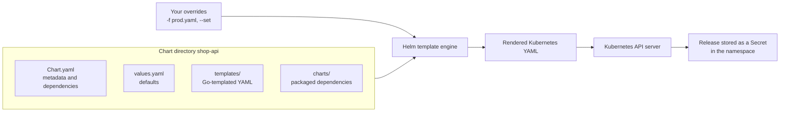
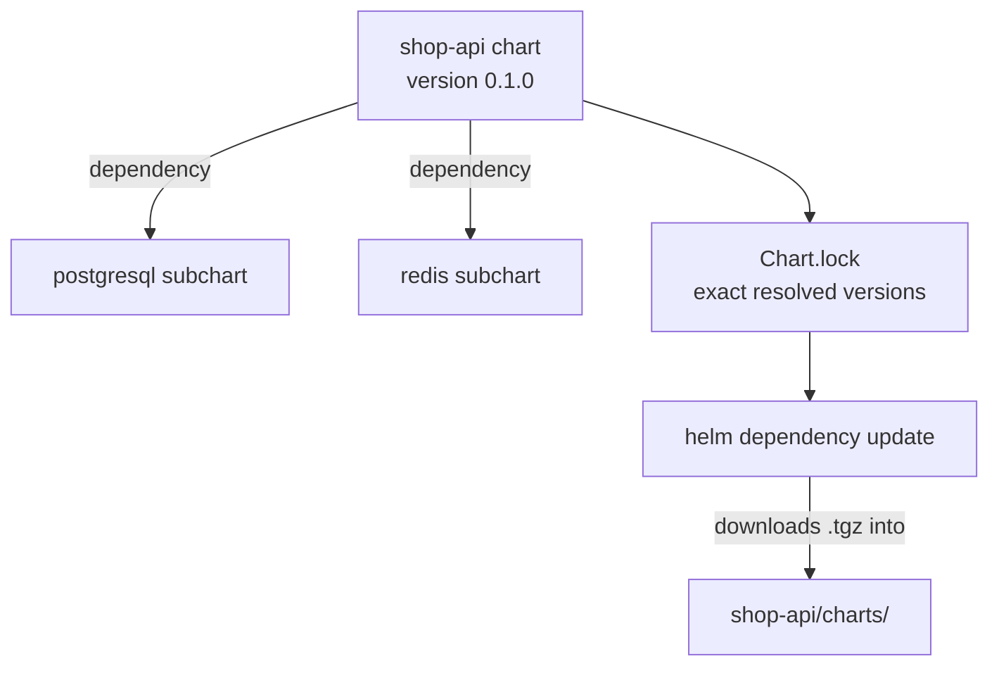

# L9.1 — Charts

> **Level 9: Helm** · Topic 1 of 6 · ⏱ ~4 hours · Difficulty: Beginner

## 1. What it is

**Helm** is the package manager for Kubernetes. A **chart** is Helm's package: a folder (or a `.tgz` archive of it) containing
templated Kubernetes manifests, a file of default settings (`values.yaml`) and metadata (`Chart.yaml`). Where `kubectl apply -f`
sends raw YAML, Helm renders the chart's templates with your settings into YAML, sends it to the cluster, and records the result as a
**release** (a named, versioned installation of a chart) so you can upgrade or roll it back later ([L9.4](04-releases.md)).

This topic is about the chart itself: what files it has, what `Chart.yaml` says, how `helm create` scaffolds a chart, and how a chart
depends on other charts. This level uses **Helm 3** only (Helm 2 and its in-cluster Tiller component were retired years ago; Helm 3 talks
to the Kubernetes API directly using your kubeconfig permissions).

## 2. Why it matters in DevOps

- **One application is many objects.** `shop-api` needs a Deployment, Service, Ingress, ConfigMap, ServiceAccount and maybe an
  HorizontalPodAutoscaler. A chart ships them as one unit with one version.
- **Same package, many environments.** The identical chart runs in dev, stage and prod; only the values differ
  ([L9.2](02-values.md)). That removes copy-pasted YAML directories.
- **Reuse instead of rewrite.** Databases, ingress controllers, monitoring stacks and certificate managers are installed from
  community charts rather than hand-written manifests.
- **Versioned, shareable artifacts.** A chart has a version, can be stored in a registry ([L9.5](05-repositories.md)) and is what your
  CD tool deploys.

## 3. Real-world system example

**The Kubernetes ecosystem installs itself with Helm.** Helm is a graduated project of the Cloud Native Computing Foundation (CNCF).
Widely used cluster components publish official Helm charts: **cert-manager**, **kube-prometheus-stack** (the Prometheus operator,
Prometheus, Alertmanager and Grafana together, from the prometheus-community charts) and the **Argo CD** chart are installed this way
on many clusters. **Artifact Hub** is the public search site for charts, and GitOps tools such as **Argo CD** and **Flux** render Helm
charts natively, so the chart you write for local testing is the same artifact your GitOps pipeline deploys
([GitOps](../level-17-gitops/02-argo-cd-and-flux.md)). Application teams typically keep one chart per service, versioned alongside the
service code.

## 4. Diagram

What is inside a chart and how it becomes cluster objects:



Dependency resolution:



## 5. How it works

### Chart layout

```text
shop-api/
  Chart.yaml          # required: name, version, appVersion, dependencies
  values.yaml         # default configuration values
  values.schema.json  # optional: JSON Schema to validate values (L9.2)
  .helmignore         # files to leave out of the package
  templates/
    deployment.yaml
    service.yaml
    ingress.yaml
    configmap.yaml
    serviceaccount.yaml
    hpa.yaml
    _helpers.tpl      # named templates (no output on their own)
    NOTES.txt         # message printed after install
    tests/
      test-connection.yaml
  charts/             # dependencies (unpacked or .tgz) live here
  crds/               # optional: CustomResourceDefinitions installed first, never templated
```

### Chart.yaml

```yaml
apiVersion: v2                 # v2 = Helm 3 charts
name: shop-api
description: Node.js API for the shop-api sample application
type: application             # or "library": reusable templates only, cannot be installed
version: 0.1.0                 # the CHART version (SemVer 2), bump on any chart change
appVersion: "1.4.2"            # the version of the APP being deployed (informational string)
kubeVersion: ">=1.27.0-0"      # optional: refuse to install on older clusters
keywords: [shop, api, nodejs]
maintainers:
  - name: Platform Team
    email: platform@example.com
dependencies:
  - name: postgresql
    version: "15.x.x"
    repository: "oci://registry-1.docker.io/bitnamicharts"
    condition: postgresql.enabled
  - name: redis
    version: "19.x.x"
    repository: "oci://registry-1.docker.io/bitnamicharts"
    condition: redis.enabled
```

| Field | Notes |
|-------|-------|
| `version` | Chart version. Must be SemVer 2. Change it whenever templates or defaults change. Registries identify a chart by name plus this version. |
| `appVersion` | Version of the software inside. Often used as the default image tag. Independent of `version`. Quote it so YAML keeps it a string. |
| `type` | `application` (installable) or `library` (provides helpers other charts `include`). |
| `dependencies` | Other charts this chart needs. Supports `condition` (on/off by a value), `tags`, `alias`, `import-values`. |
| `kubeVersion` | SemVer constraint checked at install time. |

*(The Bitnami repository above is an example of a remote OCI dependency. Bitnami's public catalog and image policy changed in 2025,
so check the current status before depending on it in production. Many teams use a managed database such as Amazon RDS for production
and a simple chart-managed container only for development.)*

### Dependencies

```bash
helm dependency update shop-api   # resolve ranges, download .tgz files into charts/, write Chart.lock
helm dependency build shop-api    # re-download exactly what Chart.lock says (use in CI for reproducibility)
helm dependency list shop-api
```

- Subchart values live under a key named after the subchart: `postgresql.auth.database`. Parent values override subchart defaults.
- `Chart.lock` records exact versions and a digest. Commit it; use `helm dependency build` in CI.
- `condition: postgresql.enabled` lets one switch turn a dependency on or off.
- Dependencies can come from `file://../common` (local path), `https://` repositories, or `oci://` registries.

### Useful commands

| Command | Purpose |
|---------|---------|
| `helm create NAME` | Scaffold a working starter chart (an nginx example). |
| `helm lint CHART` | Static checks for chart structure and template errors. |
| `helm template RELEASE CHART` | Render locally and print YAML; touches no cluster. |
| `helm package CHART` | Build `NAME-VERSION.tgz`. |
| `helm show chart\|values\|readme CHART` | Inspect a chart you did not write. |
| `helm pull CHART --untar` | Download and unpack a chart to read it. |

## 6. Step-by-step guide

**Prerequisites:** Helm 3 (`helm version`), and for the install step a local Kubernetes cluster: Docker plus
[kind](https://kind.sigs.k8s.io/) and `kubectl`. Everything is free and local.

1. **Check your tools and create a throwaway cluster.**
   ```bash
   helm version --short
   kind create cluster --name helm-lab
   kubectl get nodes
   ```
   `helm version` prints a `v3.x.x` version. `kubectl get nodes` shows one node `Ready`.

2. **Scaffold a chart.**
   ```bash
   helm create shop-api
   find shop-api -type f | sort
   ```
   Expect files similar to `shop-api/Chart.yaml`, `values.yaml`, `templates/deployment.yaml`, `service.yaml`, `ingress.yaml`,
   `serviceaccount.yaml`, `hpa.yaml`, `_helpers.tpl`, `NOTES.txt` and `templates/tests/test-connection.yaml` (the exact list depends on the Helm version).

3. **Read the metadata and edit it.**
   ```bash
   cat shop-api/Chart.yaml
   ```
   Change `description` to `Node.js API for the shop-api sample application` and keep `version: 0.1.0`, `appVersion: "1.16.0"` for now.

4. **Lint and render without a cluster.**
   ```bash
   helm lint shop-api
   helm template my-shop shop-api | head -40
   ```
   Lint ends with `1 chart(s) linted, 0 chart(s) failed`. The rendered YAML starts with a ServiceAccount, Service and Deployment whose
   names begin with `my-shop-shop-api` (release name plus chart name).

5. **Install it into the cluster.**
   ```bash
   helm install my-shop shop-api
   helm list
   kubectl get deploy,svc,pods
   ```
   `helm list` shows `my-shop` with `STATUS deployed` and `REVISION 1`. Pods become `Running` after the nginx image is pulled.

6. **Inspect what Helm stored.**
   ```bash
   helm get manifest my-shop | head -20
   kubectl get secrets -l owner=helm
   ```
   The release record is a Secret named like `sh.helm.release.v1.my-shop.v1`. That is where Helm 3 keeps release history.

7. **Add a local dependency.** Create a tiny library-style subchart and depend on it:
   ```bash
   helm create common-config && rm -rf common-config/templates/* common-config/values.yaml
   printf 'greeting: hello from subchart\n' > common-config/values.yaml
   cat > common-config/templates/configmap.yaml <<'EOF'
   apiVersion: v1
   kind: ConfigMap
   metadata:
     name: {{ .Release.Name }}-greeting
   data:
     greeting: {{ .Values.greeting | quote }}
   EOF
   ```
   Add to `shop-api/Chart.yaml`:
   ```yaml
   dependencies:
     - name: common-config
       version: 0.1.0
       repository: "file://../common-config"
   ```
   ```bash
   helm dependency update shop-api
   ls shop-api/charts shop-api/Chart.lock
   helm upgrade my-shop shop-api
   kubectl get configmap my-shop-greeting -o jsonpath='{.data.greeting}'
   ```
   You should see `hello from subchart`, and `helm list` now shows `REVISION 2`.

8. **Package it.**
   ```bash
   helm package shop-api
   ls shop-api-0.1.0.tgz
   ```

9. **Clean up.**
   ```bash
   helm uninstall my-shop
   kind delete cluster --name helm-lab
   ```

## 7. Real-world scenario

*(Illustrative.)* A team deployed `shop-api` with six hand-maintained YAML files per environment. When the health-check path changed,
someone updated dev and stage and forgot the production copy; the production Service kept probing the old path, pods were marked
unready and a rollout stalled halfway. The team moved to one chart: the probe path became a single template line with a value in
`values.yaml`, `helm lint` and `helm template` ran in CI, and each environment differed only by a short values file. The next probe change was
a one-line change in one place, reviewed once. **Lesson:** a chart turns "N copies that must stay in sync" into "one source plus
small, visible differences".

## 8. Common mistakes and best practices

**Don't**

- Confuse `version` with `appVersion`: bumping the app does not replace bumping the chart when templates changed.
- Commit rendered output instead of the chart, or edit files inside `charts/` by hand (they are overwritten by `helm dependency update`).
- Use floating dependency ranges in production without committing `Chart.lock`.
- Put secrets in `values.yaml` in Git.
- Pull in a huge third-party chart for a tiny need; you inherit its upgrades and CVEs.

**Do**

- Start from `helm create`, then delete what you do not need.
- Keep chart `version` in SemVer and bump it on every chart change; set `appVersion` to the image version you deploy.
- Run `helm lint` and `helm template` in CI for every change ([L9.6](06-packaging-applications.md)).
- Commit `Chart.lock` and use `helm dependency build` in pipelines.
- Read third-party charts (`helm show values`, `helm pull --untar`) before installing them.
- Use `kubeVersion` to fail fast on unsupported clusters.

## 9. Tasks

- [ ] **T1 — Scaffold and explore a chart** *(≈30 min, beginner)*
  - **Goal:** know what each file in a chart is for.
  - **Steps:**
    1. Run `helm create shop-api` and list the files.
    2. Write one sentence per file in your notes.
    3. Run `helm lint shop-api`.
  - **Done when:** lint passes and your notes explain `Chart.yaml`, `values.yaml`, `templates/`, `_helpers.tpl` and `NOTES.txt`.

- [ ] **T2 — Render before you install** *(≈30 min, beginner)*
  - **Goal:** use `helm template` as your "what will this do" tool.
  - **Steps:**
    1. Run `helm template my-shop shop-api > rendered.yaml`.
    2. List the object kinds: `grep '^kind:' rendered.yaml`.
    3. Change the `replicaCount` default in `values.yaml` to `2` and re-render.
  - **Done when:** `rendered.yaml` shows `replicas: 2` and you can name every object that would be created.

- [ ] **T3 — Install, inspect and uninstall** *(≈30 min, beginner)*
  - **Goal:** see a release lifecycle on a real cluster.
  - **Steps:**
    1. Create a kind cluster and `helm install my-shop shop-api`.
    2. Run `helm list`, `helm status my-shop`, `helm get manifest my-shop` and `kubectl get secrets -l owner=helm`.
    3. `helm uninstall my-shop`.
  - **Done when:** you saw the release Secret appear on install and disappear on uninstall.

- [ ] **T4 — Add a dependency** *(≈45 min, intermediate)*
  - **Goal:** compose charts.
  - **Steps:**
    1. Follow step 7 to add the `common-config` subchart.
    2. Override the subchart value from the parent: in `shop-api/values.yaml` add `common-config: { greeting: hi from parent }` and upgrade.
    3. Add `condition: common-config.enabled` and switch the dependency off with `--set common-config.enabled=false`.
  - **Done when:** the ConfigMap shows the parent's value, then disappears when the dependency is disabled.

- [ ] **T5 — Break it: bad Chart.yaml** *(≈30 min, intermediate)*
  - **Goal:** learn the failure messages.
  - **Steps:**
    1. Set `version: one` (not SemVer) and run `helm lint`.
    2. Delete `Chart.lock` and `charts/`, and run `helm dependency build shop-api`, then `helm dependency update shop-api`.
    3. Set `kubeVersion: ">=2.0.0"` and try `helm install`.
  - **Done when:** you triggered and fixed all three failures and can say what each message means.

- [ ] **T6 — Prove it: build a minimal chart from scratch** *(≈45 min, advanced)*
  - **Goal:** show you understand charts without the scaffold.
  - **Steps:**
    1. In a new folder, hand-write `Chart.yaml`, `values.yaml` and one template that creates a ConfigMap and a Deployment running `nginx:1.27`.
    2. Lint, render, install, then `helm package` it.
  - **Done when:** the pod runs, `helm list` shows your release, and you can explain the difference between `version`, `appVersion` and the release revision.

## 10. Self-check questions

1. What is the difference between a chart, a release and a repository?
2. What do `version` and `appVersion` mean and which one do registries use?
3. Where does Helm 3 store release information?
4. What do `helm dependency update` and `helm dependency build` do, and when do you use each?
5. Why does `helm template` matter before `helm install`?

<details>
<summary>Answers</summary>

1. A chart is the package; a release is one named installation of a chart in a cluster (with a revision history); a repository (or OCI registry) is where charts are published.
2. `version` is the chart's own SemVer version, `appVersion` is the version of the application it deploys. Registries identify charts by name plus `version`.
3. As Secrets (by default) in the release's namespace, named like `sh.helm.release.v1.<release>.v<revision>`.
4. `update` resolves version ranges, downloads the dependencies and rewrites `Chart.lock`. `build` downloads exactly what `Chart.lock` specifies, so use it in CI for reproducible builds.
5. It renders the YAML locally with no side effects, so you can review and lint exactly what would be sent to the cluster.
</details>

## 11. Further reading

- Helm documentation (helm.sh/docs): *Charts*, *Chart Template Developer's Guide* and the `helm create`, `helm lint`, `helm package` and `helm dependency` command pages.
- Artifact Hub (artifacthub.io) for discovering and reading real charts.
- *Learning Helm* by Matt Butcher, Matt Farina and Josh Dolitsky (O'Reilly).
- See also: [Pods](../level-08-kubernetes/02-pods.md), [Deployments and ReplicaSets](../level-08-kubernetes/03-deployments-and-replicasets.md) and [Infrastructure as Code](../level-00-what-devops-is/03-infrastructure-as-code.md).

<!-- nav -->
---
← Previous level: [Level 8 — Kubernetes](../level-08-kubernetes/README.md) · [Level 9 index](README.md) · Next: [Values](02-values.md) →
