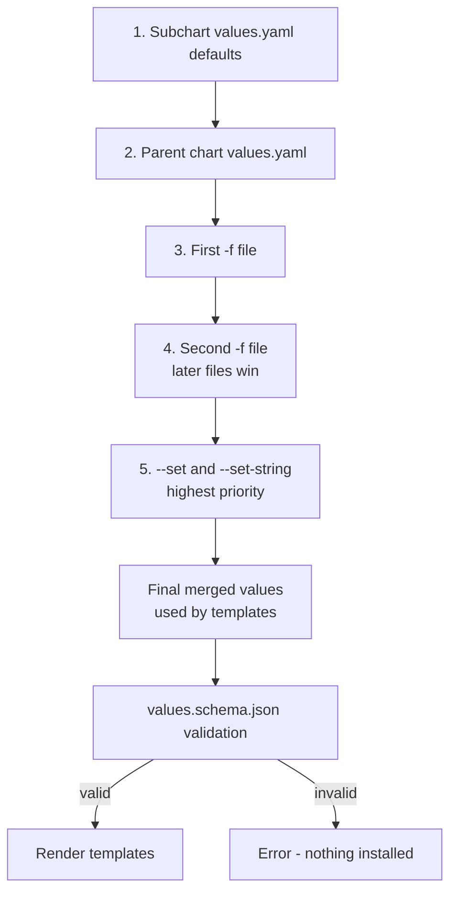
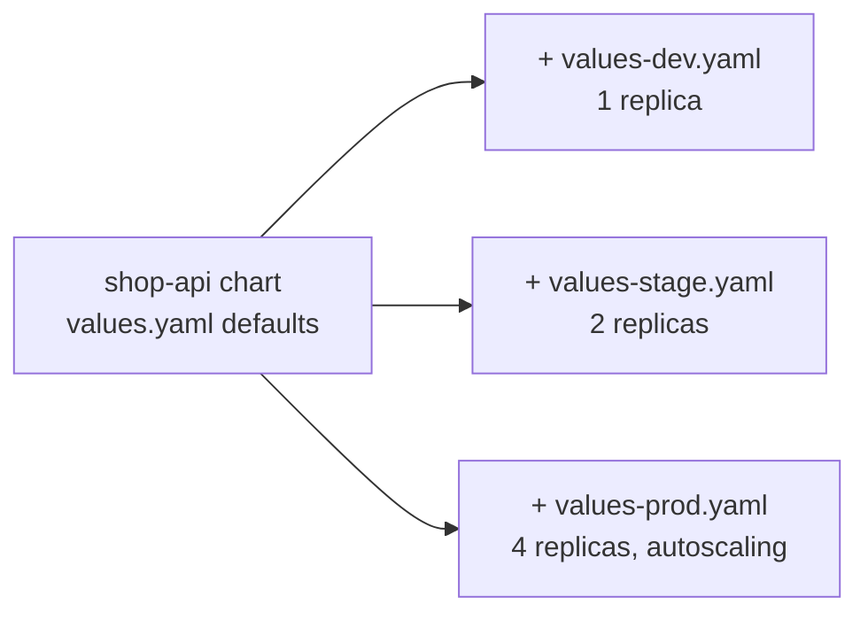

# L9.2 — Values

> **Level 9: Helm** · Topic 2 of 6 · ⏱ ~4 hours · Difficulty: Beginner

## 1. What it is

**Values** are the settings you feed into a chart's templates. The chart ships defaults in `values.yaml`; the person installing the
chart overrides what they need with their own files (`-f prod.yaml`) or individual flags (`--set image.tag=1.4.2`). Inside a template you
read a value as `{{ .Values.image.tag }}`. The chart author decides what is configurable; the installer decides what the settings are
for this environment.

Values are the contract between the chart author and the chart user. A good `values.yaml` is documented, has safe defaults, and is
backed by a **values schema** (`values.schema.json`) that rejects wrong types or missing required settings *before* anything is sent to
the cluster.

## 2. Why it matters in DevOps

- **Per-environment configuration without forking the chart.** Dev runs 1 replica with small limits, prod runs 4 with an
  autoscaler: the same templates, two short values files.
- **Precedence mistakes cause incidents.** If you do not know which of five sources wins, a stale `--set` or an old `-f` file can
  silently change production.
- **Typos are silent by default.** `replicas: 3` under the wrong key is just ignored. Schemas and `helm template` review turn silent
  mistakes into errors.
- **Secrets hygiene.** Values files end up in Git and in the release record; knowing what belongs there (and what must not) matters
  ([Secrets](../level-08-kubernetes/07-secrets.md)).

## 3. Real-world system example

**Community charts show the pattern at scale.** The `kube-prometheus-stack` chart exposes hundreds of values with extensive comments
in its `values.yaml`, and most users install it with a small override file of their own (a handful of keys: retention, storage,
ingress hosts). The **Argo CD** and **ingress** charts follow the same style: nested keys per component (`server.replicas`,
`controller.resources`) and a `global:` section for settings shared by subcharts. Many chart repositories add a `values.schema.json`
so a bad value fails at `helm install` rather than at runtime. GitOps tools such as Argo CD and Flux let you store per-environment
values files in Git or inline values on the `Application` / `HelmRelease` object, which is the same mechanism as `-f` ([GitOps](../level-17-gitops/04-environment-promotion.md)).

## 4. Diagram

Value precedence, lowest to highest (later sources override earlier ones):



Per-environment files on top of one chart:



## 5. How it works

### A well-formed values.yaml

```yaml
# -- Number of pods. Ignored when autoscaling.enabled is true.
replicaCount: 2

image:
  repository: ghcr.io/example/shop-api
  tag: ""                 # defaults to Chart.appVersion when empty
  pullPolicy: IfNotPresent

service:
  type: ClusterIP
  port: 80
  targetPort: 3000

ingress:
  enabled: false
  className: nginx
  host: shop.example.com
  tls: false

resources:
  requests: { cpu: 100m, memory: 128Mi }
  limits:   { memory: 256Mi }

env:
  LOG_LEVEL: info
  NODE_ENV: production

autoscaling:
  enabled: false
  minReplicas: 2
  maxReplicas: 6
  targetCPUUtilizationPercentage: 70
```

Conventions: camelCase keys, nested maps grouped by concern, **flat or shallow where possible**, a comment on every key, and empty/zero
defaults for things the installer must supply.

### Overriding values

```bash
helm install shop shop-api -f values-dev.yaml                       # a file
helm install shop shop-api -f values.yaml -f values-prod.yaml       # later file wins, maps merge deeply
helm install shop shop-api --set replicaCount=3                     # one value
helm install shop shop-api --set image.tag=1.4.2 --set env.LOG_LEVEL=debug
helm install shop shop-api --set-string image.tag=1234              # force a string (not number 1234)
helm install shop shop-api --set 'ingress.hosts={a.example.com,b.example.com}'   # list
helm install shop shop-api --set-file config.cert=./ca.pem          # value from a file
helm install shop shop-api --set-json 'resources={"limits":{"memory":"512Mi"}}'
```

| Behaviour | Detail |
|-----------|--------|
| Merge | Maps merge key by key; **lists are replaced whole**, not merged. |
| Types | `--set x=true` is a boolean, `--set x=1234` a number. Use `--set-string` when a value must stay a string (image tags, IDs). |
| Dots and commas | Escape in `--set`: `--set 'podAnnotations.example\.com/owner=team'`. Prefer a values file for anything complex. |
| `null` | `--set key=null` removes a default key. |
| Reuse on upgrade | `helm upgrade` **resets** values to the chart defaults plus what you pass, unless you add `--reuse-values` (reuse last release's values) or `--reset-then-reuse-values` (Helm 3.14+: chart's new defaults, then last values, then your new ones). Passing the same `-f` files every time is the clearest approach. |
| Inspect | `helm get values RELEASE` (your overrides), `helm get values RELEASE --all` (merged), `helm show values CHART` (chart defaults). |

### Subchart and global values

```yaml
# parent values.yaml
postgresql:           # key matches the dependency name
  enabled: true
  auth:
    database: shop
global:
  imagePullSecrets: [regcred]     # visible to every subchart as .Values.global
```

### Schema validation

Put a JSON Schema (Helm supports draft-07) at `values.schema.json` in the chart root. Helm validates the final merged values on
`install`, `upgrade`, `lint` and `template`:

```json
{
  "$schema": "https://json-schema.org/draft-07/schema#",
  "type": "object",
  "required": ["image", "service"],
  "properties": {
    "replicaCount": { "type": "integer", "minimum": 1, "maximum": 20 },
    "image": {
      "type": "object",
      "required": ["repository"],
      "properties": {
        "repository": { "type": "string", "minLength": 1 },
        "tag": { "type": "string" },
        "pullPolicy": { "enum": ["Always", "IfNotPresent", "Never"] }
      }
    },
    "service": {
      "type": "object",
      "properties": {
        "port": { "type": "integer", "minimum": 1, "maximum": 65535 }
      }
    },
    "ingress": {
      "type": "object",
      "properties": { "enabled": { "type": "boolean" } }
    }
  }
}
```

Use `"additionalProperties": false` on objects where a typo should be an error (it also blocks unknown keys, so use it with care on
charts with subcharts). In templates, `required "message" .Values.x` and `fail "message"` give targeted errors for rules a schema
cannot express ([L9.3](03-templates.md)).

### What belongs in values

| Put in values | Do not put in values (in Git) |
|---------------|-------------------------------|
| Image repository and tag, replica counts, resource requests and limits | Passwords, API keys, tokens, private keys |
| Hostnames, feature flags, log levels | Anything unique to one person's laptop |
| References to Secrets by **name** (`existingSecret: shop-db`) | The secret contents themselves |

Pass secrets through Kubernetes Secrets created by an external mechanism (sealed/encrypted secrets, External Secrets, a cloud secret
manager) and let the chart reference them by name. Remember `helm get values` and the release Secret expose whatever you set.

## 6. Step-by-step guide

**Prerequisites:** Helm 3, and the `shop-api` chart from [L9.1](01-charts.md) (or `helm create shop-api`). `helm template` needs no
cluster; the install steps use a kind cluster (`kind create cluster --name helm-lab`).

1. **Look at the chart defaults.**
   ```bash
   helm show values shop-api | head -30
   ```
   You see `replicaCount: 1`, `image.repository: nginx` and so on from the scaffold.

2. **Override with `--set` and see the effect.**
   ```bash
   helm template my-shop shop-api --set replicaCount=3 | grep -n 'replicas'
   ```
   Expected: `replicas: 3`.

3. **Create per-environment files.**
   ```yaml
   # values-dev.yaml
   replicaCount: 1
   env:
     LOG_LEVEL: debug
   ```
   ```yaml
   # values-prod.yaml
   replicaCount: 4
   env:
     LOG_LEVEL: warn
   resources:
     requests: { cpu: 250m, memory: 256Mi }
     limits:   { memory: 512Mi }
   autoscaling:
     enabled: true
     minReplicas: 4
     maxReplicas: 10
   ```
   ```bash
   helm template my-shop shop-api -f values-dev.yaml  | grep -E 'replicas|LOG_LEVEL'
   helm template my-shop shop-api -f values-prod.yaml | grep -E 'replicas|LOG_LEVEL|kind: HorizontalPodAutoscaler'
   ```
   (You wire `env` into the Deployment in [L9.3](03-templates.md); until then the `LOG_LEVEL` grep may show nothing.)

4. **Test precedence.**
   ```bash
   helm template my-shop shop-api -f values-dev.yaml -f values-prod.yaml --set replicaCount=9 | grep replicas
   ```
   The `--set` wins (`replicas: 9`). Swap the order of the `-f` files and re-run to see that the later file wins when you drop `--set`.

5. **Add a schema.** Save the JSON above as `shop-api/values.schema.json`, then:
   ```bash
   helm lint shop-api --set replicaCount=0
   helm template my-shop shop-api --set image.pullPolicy=Sometimes
   ```
   Both fail with messages similar to `replicaCount: Must be greater than or equal to 1` and
   `image.pullPolicy: image.pullPolicy must be one of the following: "Always", "IfNotPresent", "Never"`. The exact wording differs by Helm version.

6. **Install with a values file and inspect.**
   ```bash
   helm install my-shop shop-api -f values-dev.yaml
   helm get values my-shop
   helm get values my-shop --all | head -20
   ```
   `helm get values` shows only your overrides; `--all` shows the merged result.

7. **See the `upgrade` reset trap.**
   ```bash
   helm upgrade my-shop shop-api --set image.tag=1.27-alpine
   helm get values my-shop
   ```
   The earlier `-f values-dev.yaml` overrides are gone: `upgrade` started from chart defaults. Repeat with `-f values-dev.yaml --set image.tag=1.27-alpine`,
   or use `--reset-then-reuse-values`, and compare.

8. **Clean up.**
   ```bash
   helm uninstall my-shop
   kind delete cluster --name helm-lab
   ```

## 7. Real-world scenario

*(Illustrative.)* A Friday hotfix raised memory limits on production with `helm upgrade shop shop-api --set resources.limits.memory=1Gi`
and no `-f` files. The upgrade silently reset everything else to chart defaults: 1 replica instead of 4, `LOG_LEVEL=debug`, autoscaling off.
Latency climbed within minutes. The on-call engineer ran `helm history` and `helm get values`, saw the dropped overrides and ran
`helm rollback`, then re-applied the change with both values files. Afterwards the team made CI the only thing that runs `helm upgrade`,
always with the same `-f values.yaml -f values-prod.yaml` pair, and added a schema with `replicaCount` at least 1 plus a CI check that
renders the prod values and fails if `replicas` is below 3. **Lesson:** make the full set of values explicit in files under version control, never rely on remembered flags.

## 8. Common mistakes and best practices

**Don't**

- Put real secrets in `values.yaml` or in `--set` flags in shell history.
- Rely on `--reuse-values` as your configuration management; its behaviour with changed chart defaults surprises people.
- Expect lists to merge: overriding one item replaces the whole list.
- Deep-nest values five levels down; they are painful to override.
- Let `image.tag` default to `latest`.

**Do**

- Keep a documented `values.yaml` with safe defaults and one small `values-<env>.yaml` per environment in Git.
- Always pass the same set of `-f` files in CI, in the same order.
- Add `values.schema.json` and run `helm lint --strict` in CI.
- Use `--set-string` for tags and IDs that look like numbers.
- Use `helm get values RELEASE --all` and `helm template` to review the effective configuration.
- Reference secrets by name and keep their contents out of the chart.

## 9. Tasks

- [ ] **T1 — Override three ways** *(≈30 min, beginner)*
  - **Goal:** change one setting through `--set`, a file and a second file.
  - **Steps:**
    1. Render with `--set replicaCount=3`.
    2. Render with `-f values-dev.yaml`.
    3. Render with `-f values-dev.yaml -f values-prod.yaml`.
  - **Done when:** you can show the `replicas` line for each case and say which source won.

- [ ] **T2 — Prove precedence** *(≈30 min, intermediate)*
  - **Goal:** know the order by experiment.
  - **Steps:**
    1. Set `replicaCount` to a different number in `values.yaml`, `values-dev.yaml`, `values-prod.yaml` and `--set`.
    2. Render with every combination of two or three of them and record the result.
  - **Done when:** your table matches section 4 for all combinations.

- [ ] **T3 — Environment files** *(≈45 min, intermediate)*
  - **Goal:** model dev, stage and prod.
  - **Steps:**
    1. Create `values-dev.yaml`, `values-stage.yaml` and `values-prod.yaml` that differ in replicas, log level, resources and ingress host.
    2. Use `diff` to show they differ only in values.
  - **Done when:** `helm template` renders all three environments cleanly and the diffs are under ~15 lines each.

- [ ] **T4 — Schema guard rails** *(≈45 min, intermediate)*
  - **Goal:** make bad input fail early.
  - **Steps:**
    1. Add `values.schema.json` with required `image.repository`, integer `replicaCount` (1-20) and a `pullPolicy` enum.
    2. Trigger each violation with `helm lint` or `helm template`.
    3. Add a `required` call in a template for `ingress.host` when `ingress.enabled` is true and prove it fails when empty.
  - **Done when:** each violation produces a clear error and a valid configuration passes.

- [ ] **T5 — Break it: the upgrade reset** *(≈45 min, advanced; kind)*
  - **Goal:** reproduce and prevent the value-reset trap.
  - **Steps:**
    1. Install with `-f values-prod.yaml`, then run `helm upgrade` with only `--set image.tag=...`.
    2. Show with `helm get values` which overrides were lost.
    3. Fix it three ways: re-pass the files, `--reuse-values`, and `--reset-then-reuse-values`. Note when they differ.
  - **Done when:** you can explain each option in a sentence and recommend one for CI.

- [ ] **T6 — Prove it: explain a values file** *(≈30 min, advanced)*
  - **Goal:** review a values change like a senior engineer.
  - **Steps:**
    1. Pick `helm show values` of a public chart of your choice and a plausible override file for production.
    2. Without notes, explain which keys you change, why, which are secrets that should be references, and how you validate them.
  - **Done when:** a teammate can reproduce your override file and the `helm template` output matches what you described.

## 10. Self-check questions

1. List the sources of values from lowest to highest precedence.
2. Why can `helm upgrade --set x=y` unexpectedly change other settings?
3. How are lists treated when two values files both set the same list?
4. What does `values.schema.json` give you that `helm template` alone does not?
5. Why use `--set-string` for an image tag like `1234`?

<details>
<summary>Answers</summary>

1. Subchart defaults, parent chart `values.yaml`, `-f` files in the order given (later wins), then `--set` / `--set-string` / `--set-file` / `--set-json`.
2. `upgrade` rebuilds values from chart defaults plus the flags you pass in this command; overrides from the previous release are dropped unless you pass them again or use `--reuse-values` / `--reset-then-reuse-values`.
3. The whole list is replaced by the later source; lists are not merged item by item.
4. It validates types, ranges, enums and required keys on every install, upgrade, lint and template, so wrong values fail before reaching the cluster.
5. `--set` converts `1234` to a number, which may render without quotes or lose formatting; `--set-string` keeps it a string.
</details>

## 11. Further reading

- Helm documentation: *Values Files*, *Using Helm* (the `--set` rules and `helm upgrade` flags) and *Chart Best Practices → Values*.
- JSON Schema documentation (json-schema.org), draft-07.
- *Learning Helm* by Butcher, Farina and Dolitsky — chapters on values.
- See also: [ConfigMaps](../level-08-kubernetes/06-configmaps.md), [Charts](01-charts.md) and [Variables and Outputs in Terraform](../level-07-terraform-iac/02-variables-and-outputs.md) for the same idea in another tool.

<!-- nav -->
---
← Previous: [Charts](01-charts.md) · [Level 9 index](README.md) · Next: [Templates](03-templates.md) →
