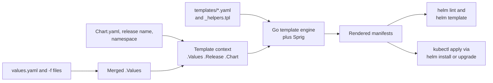
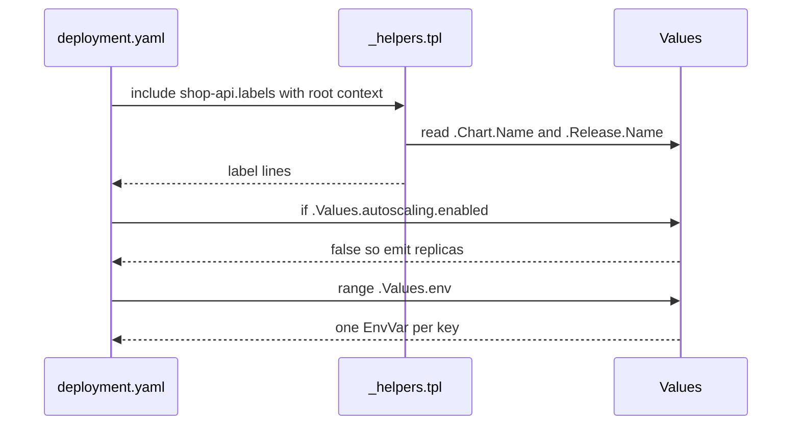

# L9.3 — Templates

> **Level 9: Helm** · Topic 3 of 6 · ⏱ ~5 hours · Difficulty: Intermediate

## 1. What it is

A Helm **template** is a Kubernetes YAML file with holes in it. The holes are written in the **Go template language** (the `text/template`
package from Go, extended with the Sprig function library) between double curly braces, for example `{{ .Values.image.tag }}`. When you
run `helm install` or `helm template`, Helm fills the holes using your values and chart metadata, producing plain Kubernetes YAML.

Templates can do more than substitute: they can make parts of a file **conditional** (`if`), **repeat** blocks (`range`), define reusable
snippets called **named templates** or **helpers** (`define` in `_helpers.tpl`, used with `include`), and even render a string stored in a
value as a template (`tpl`). The art of chart writing is using just enough of this to be flexible without producing templates nobody can read.

## 2. Why it matters in DevOps

- **Most chart bugs are template bugs:** wrong indentation, a missing quote, a value that is `nil`, an `if` that drops a whole object.
  The skill is knowing how to render, diff and debug templates locally.
- **Rollouts depend on small details.** Without a checksum annotation, changing a ConfigMap does not restart pods, so the "deployed" change
  is not actually live.
- **Reuse prevents drift.** Labels and selectors must match exactly across a Deployment, Service and HPA; a helper guarantees they do.
- **Security and policy.** Templates are where you enforce safe defaults (non-root, resource limits, no `latest` tag) for every team using
  the chart ([Pods](../level-08-kubernetes/02-pods.md)).

## 3. Real-world system example

**The scaffold and the big community charts.** `helm create` produces a chart whose `_helpers.tpl` defines `shop-api.name`,
`shop-api.fullname`, `shop-api.labels`, `shop-api.selectorLabels` and `shop-api.serviceAccountName`, and whose Deployment uses
`{{- include "shop-api.labels" . | nindent 4 }}`. This is the same convention used by most public charts, such as those in the
prometheus-community and Argo projects, so once you can read one you can read the others. Library charts (type `library`) go further:
organisations publish a single chart that only provides helpers for labels, probes and security context so that every service chart
renders consistent objects. **Argo CD** and **Flux** both run the same Helm rendering engine against your chart and values, which is
why `helm template` locally is a faithful preview of what GitOps will apply ([GitOps](../level-17-gitops/02-argo-cd-and-flux.md)).

## 4. Diagram

From chart to applied objects, and where each tool fits:



How a template with a helper and a conditional resolves:



## 5. How it works

### The objects available in every template

| Object | Contains | Example |
|--------|----------|---------|
| `.Values` | merged values | `.Values.image.repository` |
| `.Release` | `.Name`, `.Namespace`, `.Revision`, `.IsInstall`, `.IsUpgrade`, `.Service` | `{{ .Release.Name }}` |
| `.Chart` | contents of `Chart.yaml` | `.Chart.Name`, `.Chart.Version`, `.Chart.AppVersion` |
| `.Capabilities` | cluster version and API versions | `.Capabilities.APIVersions.Has "autoscaling/v2"` |
| `.Template` | current template info | `.Template.BasePath`, `.Template.Name` |
| `.Files` | non-template files in the chart | `.Files.Get "config/app.conf"` |

### Syntax you will use daily

```yaml
# pipelines: value | function | function
image: "{{ .Values.image.repository }}:{{ .Values.image.tag | default .Chart.AppVersion }}"

# quoting and required values
host: {{ required "ingress.host is required when ingress is enabled" .Values.ingress.host | quote }}

# conditionals - the whole block disappears when false
{{- if .Values.autoscaling.enabled }}
apiVersion: autoscaling/v2
kind: HorizontalPodAutoscaler
...
{{- end }}

# loops - map: range $key, $value
env:
  {{- range $name, $value := .Values.env }}
  - name: {{ $name }}
    value: {{ $value | quote }}
  {{- end }}

# loops - list
hosts:
  {{- range .Values.ingress.hosts }}
  - {{ . | quote }}
  {{- end }}

# dump a nested structure as YAML with the right indentation
resources:
  {{- toYaml .Values.resources | nindent 2 }}

# with: changes the dot ( . ) to the value; use $ to reach the root
{{- with .Values.nodeSelector }}
nodeSelector:
  {{- toYaml . | nindent 2 }}
{{- end }}
```

**Whitespace control:** `{{-` trims whitespace (including the newline) before the tag, `-}}` trims after. Most formatting bugs are a missing
or extra `-`. **Indentation:** `nindent N` adds a newline then indents every line by N spaces; `indent N` does not add the newline. Use
`toYaml ... | nindent N` for maps and lists.

**Useful functions:** `default`, `required`, `quote`, `squote`, `upper`, `lower`, `trunc 63`, `trimSuffix "-"`, `replace`, `printf`, `toYaml`,
`toJson`, `b64enc`, `sha256sum`, `include`, `tpl`, `lookup` (read live cluster objects; returns empty during `helm template`), `fail`,
`hasKey`, `dict`, `list`, `ternary`, `semverCompare`.

### Named templates and helpers

Files starting with `_` produce no output; they only define named templates:

```yaml
{{/* templates/_helpers.tpl */}}
{{- define "shop-api.fullname" -}}
{{- printf "%s-%s" .Release.Name .Chart.Name | trunc 63 | trimSuffix "-" -}}
{{- end }}

{{- define "shop-api.selectorLabels" -}}
app.kubernetes.io/name: {{ .Chart.Name }}
app.kubernetes.io/instance: {{ .Release.Name }}
{{- end }}

{{- define "shop-api.labels" -}}
{{ include "shop-api.selectorLabels" . }}
app.kubernetes.io/version: {{ .Chart.AppVersion | quote }}
app.kubernetes.io/managed-by: {{ .Release.Service }}
helm.sh/chart: {{ printf "%s-%s" .Chart.Name .Chart.Version }}
{{- end }}
```

Use them with **`include`**, not `template`, because `include` returns a string you can pipe:

```yaml
metadata:
  name: {{ include "shop-api.fullname" . }}
  labels:
    {{- include "shop-api.labels" . | nindent 4 }}
```

Named templates are global across the chart *and its subcharts*, so prefix names with the chart name (`shop-api.`) to avoid collisions.

### `tpl`: templates inside values

By default a value like `{{ .Release.Name }}` written in `values.yaml` stays literal. `tpl` renders a string as a template:

```yaml
# values.yaml
config:
  apiUrl: "http://{{ .Release.Name }}-api.{{ .Release.Namespace }}.svc.cluster.local"
```
```yaml
# templates/configmap.yaml
data:
  API_URL: {{ tpl .Values.config.apiUrl . | quote }}
```

Use it sparingly; it makes values harder to reason about and opens the door to confusing escaping.

### Rolling pods when config changes

A ConfigMap change does not alter the pod template, so Kubernetes does not roll the Deployment. Add a checksum annotation so it does:

```yaml
spec:
  template:
    metadata:
      annotations:
        checksum/config: {{ include (print $.Template.BasePath "/configmap.yaml") . | sha256sum }}
```

### Debugging templates

| Command | Use |
|---------|-----|
| `helm lint CHART --strict` | Fast syntax and structure checks. |
| `helm template REL CHART --debug` | Render and show where a failure occurs. |
| `helm template REL CHART --show-only templates/deployment.yaml` | Render one file. |
| `helm template REL CHART -s templates/hpa.yaml --set autoscaling.enabled=true` | Test a conditional branch. |
| `helm install REL CHART --dry-run=server` | Render and have the API server validate (needs a cluster). `--dry-run=client` renders only (Helm 3.13+). |
| `helm get manifest REL` | See exactly what a release applied. |
| `kubectl diff -f -` | Compare rendered output with the live cluster: `helm template ... | kubectl diff -f -`. |

## 6. Step-by-step guide

**Prerequisites:** Helm 3 and the `shop-api` chart. `helm template` is enough for most steps; steps 7-8 use a kind cluster.
We will replace parts of the scaffold with our own simplified templates so every line is understood.

1. **Start a clean chart.**
   ```bash
   helm create shop-api && cd shop-api
   rm -rf templates/tests
   rm -f templates/*.yaml templates/NOTES.txt        # we write our own; keep _helpers.tpl for now
   ```
   The scaffold templates reference values we are about to remove (`serviceAccount`, `ingress.hosts`...), so we delete them rather than
   leave them to fail.

2. **Replace `templates/_helpers.tpl`** entirely with the three `define` blocks from section 5 (plus `shop-api.name`):
   ```yaml
   {{- define "shop-api.name" -}}
   {{- .Chart.Name | trunc 63 | trimSuffix "-" -}}
   {{- end }}
   ```

3. **Replace `values.yaml`** with:
   ```yaml
   replicaCount: 2
   image:
     repository: nginx
     tag: ""
   service:
     port: 80
     targetPort: 80
   env:
     LOG_LEVEL: info
     NODE_ENV: production
   ingress:
     enabled: false
     className: nginx
     host: shop.example.com
   resources:
     requests: { cpu: 50m, memory: 64Mi }
     limits: { memory: 128Mi }
   autoscaling:
     enabled: false
     minReplicas: 2
     maxReplicas: 5
     cpu: 70
   ```

4. **Write the ConfigMap** `templates/configmap.yaml`:
   ```yaml
   apiVersion: v1
   kind: ConfigMap
   metadata:
     name: {{ include "shop-api.fullname" . }}
     labels:
       {{- include "shop-api.labels" . | nindent 4 }}
   data:
     {{- range $name, $value := .Values.env }}
     {{ $name }}: {{ $value | quote }}
     {{- end }}
   ```

5. **Write the Deployment** `templates/deployment.yaml`:
   ```yaml
   apiVersion: apps/v1
   kind: Deployment
   metadata:
     name: {{ include "shop-api.fullname" . }}
     labels:
       {{- include "shop-api.labels" . | nindent 4 }}
   spec:
     {{- if not .Values.autoscaling.enabled }}
     replicas: {{ .Values.replicaCount }}
     {{- end }}
     selector:
       matchLabels:
         {{- include "shop-api.selectorLabels" . | nindent 6 }}
     template:
       metadata:
         labels:
           {{- include "shop-api.selectorLabels" . | nindent 8 }}
         annotations:
           checksum/config: {{ include (print $.Template.BasePath "/configmap.yaml") . | sha256sum }}
       spec:
         containers:
           - name: {{ .Chart.Name }}
             image: "{{ .Values.image.repository }}:{{ .Values.image.tag | default .Chart.AppVersion }}"
             ports:
               - name: http
                 containerPort: {{ .Values.service.targetPort }}
             envFrom:
               - configMapRef:
                   name: {{ include "shop-api.fullname" . }}
             resources:
               {{- toYaml .Values.resources | nindent 12 }}
   ```
   Set `appVersion: "1.27"` in `Chart.yaml` so the default tag `nginx:1.27` exists.

6. **Write the Service, a conditional Ingress and a conditional HPA.** `templates/service.yaml`:
   ```yaml
   apiVersion: v1
   kind: Service
   metadata:
     name: {{ include "shop-api.fullname" . }}
     labels:
       {{- include "shop-api.labels" . | nindent 4 }}
   spec:
     selector:
       {{- include "shop-api.selectorLabels" . | nindent 4 }}
     ports:
       - port: {{ .Values.service.port }}
         targetPort: http
   ```
   `templates/ingress.yaml`:
   ```yaml
   {{- if .Values.ingress.enabled }}
   apiVersion: networking.k8s.io/v1
   kind: Ingress
   metadata:
     name: {{ include "shop-api.fullname" . }}
   spec:
     ingressClassName: {{ .Values.ingress.className }}
     rules:
       - host: {{ required "ingress.host is required" .Values.ingress.host | quote }}
         http:
           paths:
             - path: /
               pathType: Prefix
               backend:
                 service:
                   name: {{ include "shop-api.fullname" . }}
                   port:
                     number: {{ .Values.service.port }}
   {{- end }}
   ```
   `templates/hpa.yaml`:
   ```yaml
   {{- if .Values.autoscaling.enabled }}
   apiVersion: autoscaling/v2
   kind: HorizontalPodAutoscaler
   metadata:
     name: {{ include "shop-api.fullname" . }}
   spec:
     scaleTargetRef:
       apiVersion: apps/v1
       kind: Deployment
       name: {{ include "shop-api.fullname" . }}
     minReplicas: {{ .Values.autoscaling.minReplicas }}
     maxReplicas: {{ .Values.autoscaling.maxReplicas }}
     metrics:
       - type: Resource
         resource:
           name: cpu
           target:
             type: Utilization
             averageUtilization: {{ .Values.autoscaling.cpu }}
   {{- end }}
   ```

7. **Render each branch.**
   ```bash
   cd ..
   helm lint shop-api --strict
   helm template shop shop-api | grep '^kind:'                                   # ConfigMap, Deployment, Service
   helm template shop shop-api --set ingress.enabled=true | grep '^kind:'        # + Ingress
   helm template shop shop-api --set autoscaling.enabled=true | grep -E '^kind:|replicas'  # + HPA, no replicas line
   helm template shop shop-api --set ingress.enabled=true --set ingress.host= 2>&1 | tail -3
   ```
   The last command fails with `ingress.host is required`. The output of the third shows the HPA and no `replicas:` in the Deployment,
   which is correct: the HPA owns the replica count.

8. **Install and prove the checksum rollout.**
   ```bash
   kind create cluster --name helm-lab
   helm install shop shop-api && kubectl rollout status deploy/shop-shop-api
   kubectl get pods -l app.kubernetes.io/instance=shop
   helm upgrade shop shop-api --set env.LOG_LEVEL=debug
   kubectl get pods -l app.kubernetes.io/instance=shop     # new pod names - the config change rolled the pods
   ```
   Now remove the `checksum/config` annotation and upgrade once (the pods roll because the template changed), then upgrade again with another `LOG_LEVEL` and notice the pods are **not** replaced.
   (Pods here read config at start; that is why a restart is needed.)

9. **Clean up.**
   ```bash
   helm uninstall shop && kind delete cluster --name helm-lab
   ```

## 7. Real-world scenario

*(Illustrative.)* A chart's Service selected pods with `app: shop-api` while the Deployment labelled them with `app.kubernetes.io/name`,
because two engineers had edited the two files by hand. After an upgrade the Service had no endpoints, health checks failed and the
load balancer returned 503s. `kubectl get endpoints` showed `<none>`. The fix was a shared `selectorLabels` helper used by Deployment,
Service and HPA, plus a CI step that renders the chart and runs `kubeconform` and a small script asserting the Service selector matches the
pod template labels. **Lesson:** anything that must be identical in two places belongs in one named template.

## 8. Common mistakes and best practices

**Don't**

- Forget `nindent` after `toYaml`, or count indentation by eye; use `nindent` and verify with `helm template`.
- Use `template` when you need to pipe the result; use `include`.
- Reference `.Values.a.b.c` when `a` may be absent, without `default` or `with`: it fails with "nil pointer evaluating".
- Inside `range` or `with`, use `.Values` (the dot has changed); use `$.Values` for root.
- Put secrets in ConfigMaps or print them in `NOTES.txt`.
- Build giant templates with deep logic; if it needs a flowchart, make a helper or simplify the values.

**Do**

- Define labels and names once in `_helpers.tpl`, prefixed with the chart name.
- Use `required` for values that have no sensible default, with a message that says how to fix it.
- Add a checksum annotation for ConfigMaps and Secrets that pods read at startup.
- Pin `apiVersion` correctly (`networking.k8s.io/v1` for Ingress, `autoscaling/v2` for HPA), or gate on `.Capabilities`.
- Render every conditional branch in CI (`helm template` with several values files) and validate with `kubeconform`.
- Use `{{- /* comment */ -}}` for template comments; they do not reach the output.

## 9. Tasks

- [ ] **T1 — Build the helpers and a Deployment** *(≈60 min, beginner)*
  - **Goal:** replace hard-coded names and labels with helpers.
  - **Steps:**
    1. Follow steps 1-5.
    2. Render with `helm template shop shop-api` and check the labels on the Deployment and pod template.
  - **Done when:** the rendered Deployment and Service use identical selector labels from one helper.

- [ ] **T2 — Conditionals** *(≈45 min, beginner)*
  - **Goal:** create objects only when asked.
  - **Steps:**
    1. Add the Ingress and HPA templates (step 6).
    2. Render with each flag on and off and list the kinds.
  - **Done when:** `ingress.enabled=false` renders no Ingress, `autoscaling.enabled=true` renders an HPA and removes `replicas`.

- [ ] **T3 — Loops** *(≈45 min, intermediate)*
  - **Goal:** generate repeated blocks from values.
  - **Steps:**
    1. Change `ingress.host` to a list `ingress.hosts` and render one rule per host with `range`.
    2. Add `extraEnv` (a list of `name`/`value` objects) rendered into the container with `toYaml`.
  - **Done when:** two hosts produce two rules and `extraEnv` appears in the container spec with correct indentation.

- [ ] **T4 — Break it: indentation and nil errors** *(≈45 min, intermediate)*
  - **Goal:** recognise common render failures.
  - **Steps:**
    1. Remove the `nindent` from the `resources` block; run `helm template` and read the error.
    2. Reference `.Values.database.host` when `database` is not defined; read the nil-pointer error, then fix with `default` or `hasKey`.
    3. Run `helm template --debug` and see how it shows the failing line.
  - **Done when:** you fixed both errors and can explain each message.

- [ ] **T5 — Config-triggered rollouts** *(≈45 min, advanced; kind)*
  - **Goal:** prove the checksum pattern.
  - **Steps:**
    1. Do step 8 with and without the annotation.
    2. Compare `kubectl get pods` before and after each upgrade.
  - **Done when:** pods are replaced only when the annotation is present, and you can explain why.

- [ ] **T6 — Prove it: add a feature from memory** *(≈60 min, advanced)*
  - **Goal:** extend a chart safely without the guide.
  - **Steps:**
    1. Add an optional `PodDisruptionBudget` template controlled by `podDisruptionBudget.enabled` and `minAvailable`, using the shared helpers.
    2. Add schema rules, render both branches, run `helm lint --strict`, and `kubectl apply --dry-run=server` against kind.
    3. Explain each directive you used.
  - **Done when:** the PDB renders only when enabled, validates on the API server and you can explain `include`, `nindent` and `required` aloud.

## 10. Self-check questions

1. What is the difference between `include` and `template`?
2. Why do you need `$` inside a `range` block?
3. What does `{{- ... -}}` do?
4. Why add a `checksum/config` annotation to a Deployment?
5. When would you use `tpl`, and what is its downside?

<details>
<summary>Answers</summary>

1. `template` writes the named template's output directly and cannot be piped; `include` returns the output as a string so you can pipe it into `nindent`, `sha256sum` and so on.
2. Inside `range` and `with`, `.` becomes the current item, so `$` (the root context) is how you still reach `.Values`, `.Release` and helper arguments.
3. It trims whitespace including newlines on the left (`{{-`) and right (`-}}`), so control tags do not leave blank lines or break indentation.
4. Pods do not restart when a ConfigMap they mounted or read at startup changes; the checksum changes the pod template, which triggers a rolling update.
5. To render a string from values (for example a URL containing the release name) as a template. The downside is harder-to-read values, escaping surprises and hidden dependencies on the template context.
</details>

## 11. Further reading

- Helm documentation: *Chart Template Developer's Guide*, *Template Functions and Pipelines*, *Named Templates* and *Debugging Templates*.
- Go `text/template` package documentation and the Sprig function reference.
- Kubeconform (validate rendered manifests) and `helm-unittest` plugin documentation.
- See also: [Services](../level-08-kubernetes/04-services.md), [Ingress](../level-08-kubernetes/05-ingress.md), [Horizontal Pod Autoscaling](../level-08-kubernetes/16-horizontal-pod-autoscaling.md) and [Values](02-values.md).

<!-- nav -->
---
← Previous: [Values](02-values.md) · [Level 9 index](README.md) · Next: [Releases](04-releases.md) →
