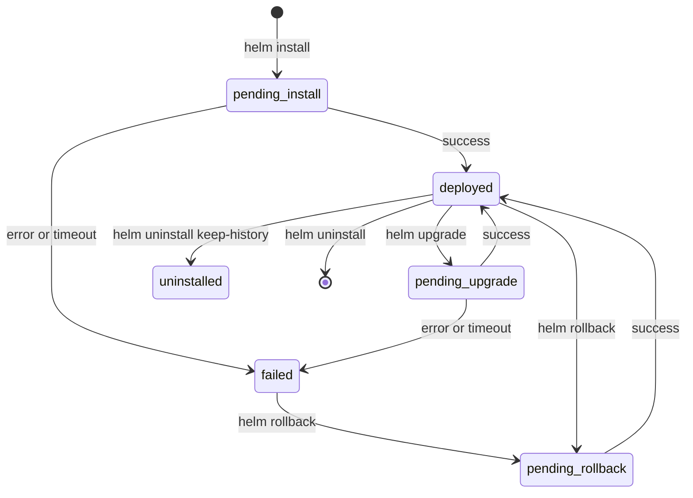
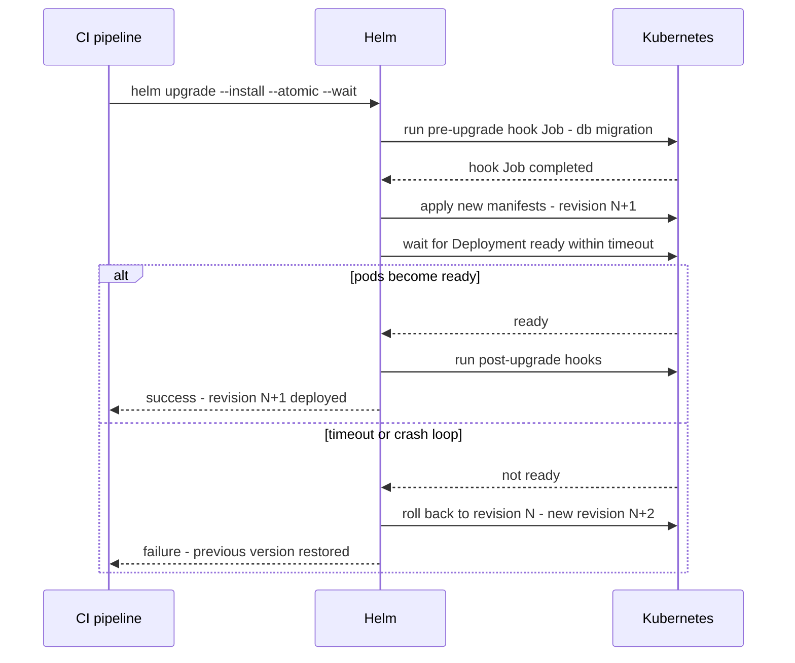

# L9.4 — Releases

> **Level 9: Helm** · Topic 4 of 6 · ⏱ ~5 hours · Difficulty: Intermediate

## 1. What it is

A **release** is one installed instance of a chart in a cluster, with a name and a numbered history. `helm install shop ./shop-api`
creates release `shop` at **revision 1**. Each `helm upgrade` creates the next revision, `helm rollback` creates a new revision that
copies an older one, and `helm uninstall` removes the release. Helm 3 stores every revision as a Secret in the release's namespace
(`sh.helm.release.v1.shop.v3`), containing the chart, the merged values and the rendered manifest. That record is what makes upgrades,
diffs and rollbacks possible.

Releases are scoped to a **namespace**: you can have a release called `shop` in `dev` and another in `prod` ([Namespaces](../level-08-kubernetes/08-namespaces.md)).
Around the lifecycle there are two safety features: **hooks** (Jobs and other objects run at specific points, such as a database migration before an
upgrade) and flags like **`--atomic`** and **`--wait`** that make Helm verify the rollout and undo it automatically if it fails.

## 2. Why it matters in DevOps

- **Releases are your deployment unit.** "What is running in prod, and what changed?" is answered by `helm list` and `helm history`.
- **Rollback in seconds.** A bad deploy is reverted with one command, if you understand what a rollback does and does not restore
  (it does not roll back database data or external resources).
- **A "successful" upgrade is not a healthy one.** Without `--wait`, Helm returns as soon as the API server accepts the objects, even if the
  pods crash-loop. CI that treats that as success ships broken releases.
- **Stuck releases.** A failed upgrade can leave a release in `pending-upgrade` or `failed`, blocking the next one. Operators must know how to recover.
- **Migrations and one-off tasks** need hooks to run in the right order ([Database Migrations](../level-05-cicd/09-database-migrations.md)).

## 3. Real-world system example

**Helm-driven deployments in CI/CD and GitOps.** Many teams run `helm upgrade --install --atomic --wait --timeout 5m` from a pipeline
(`upgrade --install` makes the same command work for the first and later deploys). GitOps controllers do the same underneath: Argo CD
renders charts and applies them with its own sync logic, while Flux's **helm-controller** runs Helm install/upgrade/rollback actions from a
`HelmRelease` object and supports automatic remediation (retries and rollback on failure), which maps directly to `--atomic`. Public
community charts ship Helm **test hooks** (`helm.sh/hook: test`) so `helm test` can smoke-test a deployed release. The cert-manager and
Argo CD charts use hooks and CRD handling carefully because CRDs and hooks have special lifecycle rules in Helm.

## 4. Diagram

Release lifecycle and revisions:



What `helm upgrade --atomic --wait` does, with hooks:



## 5. How it works

### Core commands

```bash
helm install shop ./shop-api -n shop --create-namespace -f values-prod.yaml
helm upgrade shop ./shop-api -n shop -f values-prod.yaml
helm upgrade --install shop ./shop-api -n shop -f values-prod.yaml --atomic --wait --timeout 5m   # idempotent deploy
helm list -n shop                      # releases (add -A for all namespaces, --failed, --pending)
helm status shop -n shop
helm history shop -n shop
helm rollback shop 2 -n shop           # go back to revision 2's config (creates a new revision)
helm uninstall shop -n shop            # add --keep-history to keep the record
helm get values shop -n shop           # user-supplied values; --all for merged; --revision N for an older one
helm get manifest shop -n shop         # the rendered YAML that was applied
helm get all shop -n shop              # everything: notes, hooks, manifest, values
helm test shop -n shop                 # run test hooks
```

### Important flags

| Flag | Effect |
|------|--------|
| `--wait` | Wait until Pods, Services, PVCs and so on are ready (Deployments, StatefulSets, DaemonSets, Jobs) before marking the release deployed. |
| `--timeout 5m` | How long to wait (default 5 minutes) for `--wait` and hooks. |
| `--atomic` | Implies `--wait`; if the install/upgrade fails, an upgrade is rolled back and a failed install is removed. |
| `--create-namespace` | Create the target namespace if missing. |
| `--dry-run=client\|server` | Render (and with `server`, validate against the API) without installing. |
| `--history-max N` | Keep only the last N revisions (default 10) so Secrets do not pile up. |
| `--cleanup-on-fail` | Delete resources created in a failed upgrade. |
| `--force` | Recreate resources via delete/create. Rarely appropriate. |
| `--take-ownership` | Adopt existing objects that lack Helm ownership metadata (recent Helm 3 releases; check `helm upgrade --help`). |

### What rollback does and does not do

`helm rollback RELEASE N` re-applies revision N's chart and values as a **new revision**. History after rollback: `1 superseded`, `2 superseded`,
`3 failed`, `4 deployed (Rollback to 2)`. It restores Kubernetes objects Helm manages. It does **not** restore:

- data in databases or volumes, or external resources (buckets, DNS) changed by the app or a hook;
- objects Helm does not own (created outside the chart);
- anything a `pre-upgrade` migration already changed. Make migrations backward compatible so the old version still works ([Rollback](../level-05-cicd/07-rollback.md)).

Helm uses a three-way strategic merge (previous manifest, live state, new manifest), so manual `kubectl edit` changes to managed fields can be
overwritten or, in some cases, preserved; avoid editing Helm-managed objects by hand.

### Hooks

Hooks are normal manifests in `templates/` with an annotation that tells Helm when to run them. Helm creates them, waits for them to complete
(for Jobs and Pods) and does **not** track them as part of the release afterward.

```yaml
apiVersion: batch/v1
kind: Job
metadata:
  name: {{ include "shop-api.fullname" . }}-migrate
  annotations:
    "helm.sh/hook": pre-install,pre-upgrade
    "helm.sh/hook-weight": "-5"                       # lower runs first
    "helm.sh/hook-delete-policy": before-hook-creation,hook-succeeded
spec:
  backoffLimit: 0
  template:
    spec:
      restartPolicy: Never
      containers:
        - name: migrate
          image: "{{ .Values.image.repository }}:{{ .Values.image.tag | default .Chart.AppVersion }}"
          command: ["npm", "run", "migrate"]
```

| Hook | When |
|------|------|
| `pre-install`, `post-install` | before / after objects are created on install |
| `pre-upgrade`, `post-upgrade` | before / after objects are updated on upgrade |
| `pre-rollback`, `post-rollback` | around rollback |
| `pre-delete`, `post-delete` | around uninstall |
| `test` | run by `helm test` |

Delete policies: `before-hook-creation` (default; remove the old hook object before creating a new one), `hook-succeeded`, `hook-failed`.
A failing `pre-upgrade` hook fails the upgrade before the new pods start. Keep hooks idempotent and short; a Job that never finishes blocks
the release until the timeout.

### Recovering a stuck release

| Symptom | Cause | Fix |
|---------|-------|-----|
| `another operation (install/upgrade/rollback) is in progress` | A previous run was interrupted and left status `pending-*` | Check `helm history`. If nothing is actually running: `helm rollback RELEASE <last good revision>`; as a last resort delete the pending release Secret (`kubectl delete secret sh.helm.release.v1.shop.vN`) after confirming. |
| Release `failed` and cannot upgrade because of existing resources | Resources exist without Helm ownership annotations | Adopt with `--take-ownership` (recent Helm 3 releases) or add the `meta.helm.sh/release-name` annotation and `app.kubernetes.io/managed-by: Helm` label, or delete the objects. |
| `UPGRADE FAILED: ... timed out waiting for the condition` | Pods not ready within `--timeout` | `kubectl describe` the Pods, fix the cause, upgrade again (`--atomic` would have rolled back already). |

## 6. Step-by-step guide

**Prerequisites:** Helm 3, Docker, kind and kubectl. The `shop-api` chart from [L9.3](03-templates.md) (nginx-based). All local and free.

1. **Create the cluster and install.**
   ```bash
   kind create cluster --name helm-lab
   helm install shop shop-api -n shop --create-namespace --wait
   helm list -n shop
   ```
   `helm list` shows `shop`, `REVISION 1`, `STATUS deployed`, and the chart `shop-api-0.1.0`.

2. **Upgrade and read the history.**
   ```bash
   helm upgrade shop shop-api -n shop --set replicaCount=3 --set image.tag=1.27-alpine --wait
   helm history shop -n shop
   ```
   Output similar to:
   ```text
   REVISION  STATUS      CHART           APP VERSION  DESCRIPTION
   1         superseded  shop-api-0.1.0  1.27         Install complete
   2         deployed    shop-api-0.1.0  1.27         Upgrade complete
   ```

3. **Break an upgrade, deliberately.** Use an image tag that does not exist:
   ```bash
   helm upgrade shop shop-api -n shop --set image.tag=does-not-exist --wait --timeout 60s
   ```
   After about a minute: `Error: UPGRADE FAILED: context deadline exceeded`. Look:
   ```bash
   helm history shop -n shop          # revision 3 is "failed"
   kubectl get pods -n shop           # ErrImagePull / ImagePullBackOff on the new pod; old pods still serving
   ```
   The old ReplicaSet kept serving because Kubernetes rolling updates never removed the healthy pods.

4. **Roll back.**
   ```bash
   helm rollback shop 2 -n shop --wait
   helm history shop -n shop          # revision 4: "Rollback to 2", status deployed
   kubectl get pods -n shop
   ```

5. **Let Helm do it automatically with `--atomic`.**
   ```bash
   helm upgrade shop shop-api -n shop --set image.tag=does-not-exist --atomic --timeout 60s
   helm history shop -n shop
   ```
   The command fails but ends with the previous version running; history shows the failed revision followed by an automatic rollback revision.

6. **Add a hook.** Create `shop-api/templates/hook-job.yaml`:
   ```yaml
   apiVersion: batch/v1
   kind: Job
   metadata:
     name: {{ include "shop-api.fullname" . }}-pre-upgrade
     annotations:
       "helm.sh/hook": pre-upgrade
       "helm.sh/hook-delete-policy": before-hook-creation,hook-succeeded
   spec:
     backoffLimit: 0
     template:
       spec:
         restartPolicy: Never
         containers:
           - name: task
             image: busybox:1.36
             command: ["sh", "-c", "echo running migration && sleep 5"]
   ```
   ```bash
   helm upgrade shop shop-api -n shop --wait &
   sleep 3 && kubectl get jobs,pods -n shop
   wait
   ```
   During the upgrade a `shop-shop-api-pre-upgrade` Job runs first; when it succeeds Helm removes it and applies the Deployment changes. Change the
   command to `exit 1` and re-run the upgrade to see a failing hook abort the release with `pre-upgrade hooks failed`.

7. **Add a test hook and run it.** `shop-api/templates/tests/test-connection.yaml`:
   ```yaml
   apiVersion: v1
   kind: Pod
   metadata:
     name: {{ include "shop-api.fullname" . }}-test
     annotations:
       "helm.sh/hook": test
   spec:
     restartPolicy: Never
     containers:
       - name: curl
         image: busybox:1.36
         command: ["wget", "-qO-", "http://{{ include "shop-api.fullname" . }}:{{ .Values.service.port }}"]
   ```
   ```bash
   helm upgrade shop shop-api -n shop --wait
   helm test shop -n shop
   ```
   Expect `Phase: Succeeded` for the test Pod.

8. **Uninstall, keeping history.**
   ```bash
   helm uninstall shop -n shop --keep-history
   helm list -n shop --uninstalled
   helm rollback shop 4 -n shop        # an uninstalled release can be brought back
   ```

9. **Clean up.**
   ```bash
   helm uninstall shop -n shop; kind delete cluster --name helm-lab
   ```

## 7. Real-world scenario

*(Illustrative.)* A Friday-afternoon release added a new required environment variable. The pipeline ran a plain `helm upgrade` without `--wait`, reported
green, and the team left. The new pods crash-looped on startup, but Kubernetes kept the old pods because the rolling update never made the new ones
ready, so capacity quietly dropped as nodes were replaced overnight. Monday's investigation used `helm history` (revision 9 `deployed`, no hint of failure),
then `kubectl rollout status` (stuck). The fix was `helm rollback`, followed by changing the pipeline to `helm upgrade --install --atomic --wait --timeout 5m`
and adding a `helm test` smoke test. **Lesson:** "the API accepted it" is not "it is healthy"; make the tool wait for readiness and undo on failure.

## 8. Common mistakes and best practices

**Don't**

- Treat a returned `helm upgrade` as proof the app is healthy. Always use `--wait` (or `--atomic`) in automation.
- Assume `helm rollback` undoes database migrations or external changes.
- Use `--force` or delete the release Secret casually; you lose history and can orphan objects.
- Edit Helm-managed objects with `kubectl edit` in production; the next upgrade may revert or conflict.
- Run slow or non-idempotent work in hooks, or forget `hook-delete-policy` (old Jobs pile up or collide by name).
- Install the same release name in the wrong namespace by omitting `-n`.

**Do**

- Use `helm upgrade --install --atomic --wait --timeout 5m -n NAMESPACE` as the single deploy command.
- Pass the same values files each time and review with `helm template`/`helm diff` (plugin) before production upgrades.
- Keep `--history-max` modest (10 is the default) and rely on Git for the long history.
- Make migrations backward compatible so a Helm rollback leaves a working system.
- Add a test hook and run `helm test` after deploys.
- Record the chart version and values in the deployment log (`helm get all`) when you ship.

## 9. Tasks

- [ ] **T1 — Release lifecycle** *(≈30 min, beginner)*
  - **Goal:** install, upgrade and inspect revisions.
  - **Steps:**
    1. Do steps 1-2 on a kind cluster.
    2. Run `helm get values shop -n shop --revision 1` and `--revision 2`.
  - **Done when:** `helm history` shows two revisions and you can show the value difference between them.

- [ ] **T2 — Failed upgrade and manual rollback** *(≈45 min, intermediate)*
  - **Goal:** experience a failure and recover.
  - **Steps:**
    1. Do steps 3-4.
    2. Record what the pods looked like during the failure.
  - **Done when:** the service works again and `helm history` shows the rollback revision with its description.

- [ ] **T3 — `--atomic` in CI style** *(≈30 min, intermediate)*
  - **Goal:** automatic undo.
  - **Steps:**
    1. Do step 5.
    2. Write the exact deploy command your pipeline would use, with timeout and namespace.
  - **Done when:** a bad upgrade leaves the old version running with no manual action.

- [ ] **T4 — Pre-upgrade hook** *(≈45 min, intermediate)*
  - **Goal:** run a task before the new version.
  - **Steps:**
    1. Do step 6 with a succeeding and a failing hook.
    2. Add `hook-weight` to a second hook to control the order.
  - **Done when:** a failing hook stops the upgrade before any Deployment change, and a succeeding one runs first and is cleaned up.

- [ ] **T5 — Break it: stuck pending release** *(≈45 min, advanced)*
  - **Goal:** recover from `pending-upgrade`.
  - **Steps:**
    1. Start `helm upgrade ... --wait` with a bad image and interrupt it with Ctrl+C.
    2. Observe the next `helm upgrade` complain that another operation is in progress (`helm list --pending`).
    3. Recover with `helm rollback` to the last good revision (and describe the Secret-deletion last resort).
  - **Done when:** the release is `deployed` again and you can explain what caused the pending state.

- [ ] **T6 — Prove it: write the deployment runbook** *(≈45 min, advanced)*
  - **Goal:** operate releases confidently.
  - **Steps:**
    1. Without notes, write the deploy command, the verification commands (`helm status`, `kubectl rollout status`, `helm test`) and the rollback commands for `shop-api`.
    2. State what a rollback will not fix and how you would mitigate that.
  - **Done when:** a teammate can deploy and roll back using only your runbook on the kind cluster.

## 10. Self-check questions

1. What exactly is stored in a Helm 3 release and where?
2. What does `--atomic` do, and what does it imply?
3. What does `helm rollback` create and what does it not restore?
4. Why use `helm upgrade --install` in pipelines?
5. What is a hook, and what happens if a `pre-upgrade` hook fails?

<details>
<summary>Answers</summary>

1. For each revision: the chart, the merged values and the rendered manifest, stored as a Secret named `sh.helm.release.v1.<name>.v<N>` in the release namespace.
2. If install/upgrade fails or times out, Helm automatically rolls back an upgrade (or removes a failed install). It implies `--wait`, so Helm waits for readiness within `--timeout`.
3. A new revision that reapplies an older revision's chart and values. It does not restore data, external resources or objects not owned by the release, nor undo migrations.
4. One idempotent command works for the first deploy and all later ones, so pipelines need no "does the release exist" branch.
5. A hook is a manifest annotated with `helm.sh/hook` that Helm runs at a lifecycle point (for example migrations). A failing `pre-upgrade` hook aborts the upgrade before the new manifests are applied.
</details>

## 11. Further reading

- Helm documentation: *Using Helm*, *Chart Hooks*, `helm upgrade`, `helm rollback` and `helm history` command pages.
- Flux documentation: *HelmRelease* remediation, and Argo CD documentation on Helm support, to see how GitOps tools map to these actions.
- helm-diff plugin documentation for previewing upgrades.
- See also: [Rollback](../level-05-cicd/07-rollback.md), [Rolling Deployments](../level-05-cicd/10-rolling-deployments.md) and [Deployments and ReplicaSets](../level-08-kubernetes/03-deployments-and-replicasets.md).

<!-- nav -->
---
← Previous: [Templates](03-templates.md) · [Level 9 index](README.md) · Next: [Repositories](05-repositories.md) →
