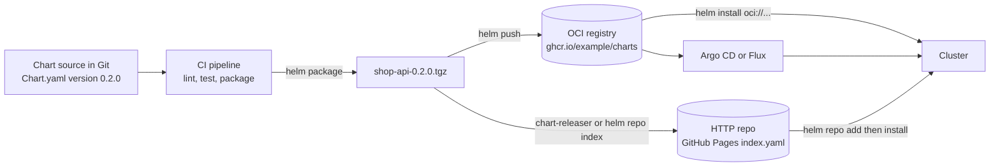
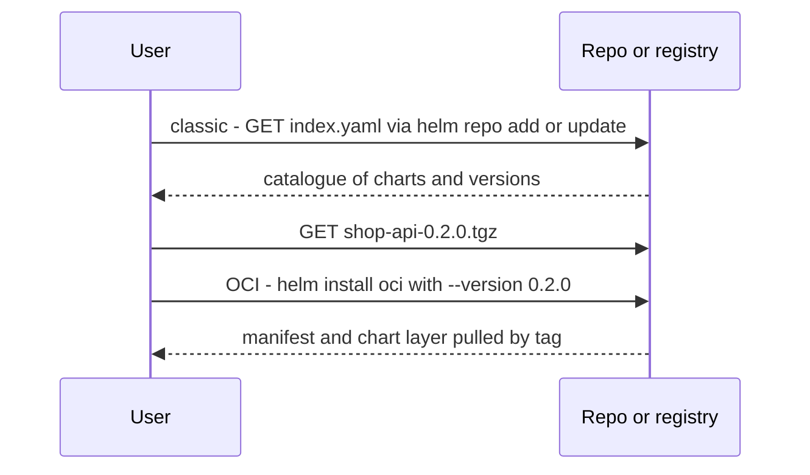

# L9.5 — Repositories

> **Level 9: Helm** · Topic 5 of 6 · ⏱ ~4 hours · Difficulty: Intermediate

## 1. What it is

Charts are packaged as `.tgz` files, and a **chart repository** is simply somewhere those files are published and discoverable.
Helm supports two kinds:

1. **Classic HTTP chart repositories**: any web server that serves an `index.yaml` (a catalogue listing every chart version, its digest and its
   download URL) plus the `.tgz` files. GitHub Pages, S3 behind CloudFront, an Nginx directory or ChartMuseum all work. You use them with
   `helm repo add`.
2. **OCI registries**: the same container registries that store Docker images (GitHub Container Registry, Amazon ECR, Docker Hub, Harbor,
   Google Artifact Registry, Azure Container Registry) can also store charts as OCI artifacts. You use them with `helm push`, `helm pull` and
   `oci://` URLs, with no `index.yaml` and no `helm repo add`.

New projects generally publish charts to an OCI registry because they reuse the registry, authentication and access control they already operate for images
([Registries](../level-04-docker/04-registries.md)).

## 2. Why it matters in DevOps

- **A chart nobody can fetch is not deployed.** CI builds the chart; clusters, GitOps controllers and colleagues pull it from a repository.
- **Immutability and provenance.** A released chart version must never change. Registries, digests and signatures give you reproducible
  deployments and a supply-chain trail ([DevSecOps](../level-00-what-devops-is/12-devsecops.md)).
- **Dependencies are fetched from repositories.** Every `helm dependency update` and every third-party install depends on repository availability,
  authenticity and licensing.
- **Access control.** Internal charts often embed company conventions and should not be public; registries give you private repositories and tokens.

## 3. Real-world system example

**Public and private chart distribution.** **Artifact Hub** (a CNCF project) is the public search index for charts from many publishers. The
prometheus-community project publishes its charts (including `kube-prometheus-stack`) as a classic repository on GitHub Pages at
`https://prometheus-community.github.io/helm-charts`; the Argo project, Jetstack (cert-manager) and others publish similar repositories.
GitHub Pages hosting is commonly automated with the open-source **chart-releaser** tool and its GitHub Action, which packages charts, creates
GitHub Releases and updates `index.yaml`. Since Helm added OCI support (generally available from Helm 3.8), many publishers and enterprises also
push charts to registries such as GHCR, ECR, Harbor and Artifact Registry. Argo CD and Flux can both pull charts from HTTP repositories and
from OCI registries, so the same artifact feeds your GitOps pipeline ([GitOps](../level-17-gitops/02-argo-cd-and-flux.md)).

## 4. Diagram

Publishing and consuming a chart:



Classic repository versus OCI, step by step:



## 5. How it works

### Classic repositories

```bash
helm repo add prometheus-community https://prometheus-community.github.io/helm-charts
helm repo update                                      # refresh the local cache of every repo's index.yaml
helm repo list
helm search repo prometheus-community/kube-prometheus-stack            # latest version
helm search repo prometheus-community/kube-prometheus-stack --versions | head
helm show values prometheus-community/kube-prometheus-stack | less
helm install mon prometheus-community/kube-prometheus-stack --version <VERSION> -n monitoring --create-namespace
helm repo remove prometheus-community
helm search hub nginx                                  # search Artifact Hub (needs internet)
```

`helm search repo` searches only repos you have added. `helm search hub` queries Artifact Hub. Always pass `--version` in automation to pin the chart.

An `index.yaml` looks like this (abbreviated):

```yaml
apiVersion: v1
entries:
  shop-api:
    - apiVersion: v2
      name: shop-api
      version: 0.2.0
      appVersion: "1.5.0"
      created: "2026-02-01T10:00:00Z"
      digest: <sha256 of the package>
      urls:
        - https://example.github.io/charts/shop-api-0.2.0.tgz
    - apiVersion: v2
      name: shop-api
      version: 0.1.0
      urls:
        - https://example.github.io/charts/shop-api-0.1.0.tgz
generated: "2026-02-01T10:00:00Z"
```

Publish to a static host: `helm package`, copy the `.tgz` next to `index.yaml`, run `helm repo index . --url https://example.github.io/charts --merge index.yaml`
(`--merge` keeps older versions), and upload.

### OCI registries

```bash
helm registry login ghcr.io -u <GITHUB_USER>                    # prompts for a token: <YOUR_TOKEN>
helm package shop-api                                           # -> shop-api-0.2.0.tgz
helm push shop-api-0.2.0.tgz oci://ghcr.io/example/charts       # chart name and version come from Chart.yaml
helm show chart oci://ghcr.io/example/charts/shop-api --version 0.2.0
helm pull oci://ghcr.io/example/charts/shop-api --version 0.2.0 --untar
helm install shop oci://ghcr.io/example/charts/shop-api --version 0.2.0 -n shop
helm registry logout ghcr.io
```

Differences to remember:

| | Classic HTTP repo | OCI registry |
|---|-------------------|--------------|
| Discovery | `helm repo add`, `helm search repo` | no catalogue; you need the full `oci://` path (use the registry UI or Artifact Hub) |
| Addressing | `repo/chart --version X` | `oci://host/path/chart --version X` |
| Auth | HTTP basic or none (`--username/--password` on `repo add`) | `helm registry login`; same tokens as `docker login` |
| Index | `index.yaml` you generate and host | none; the registry is the index |
| Dependencies in `Chart.yaml` | `repository: https://...` | `repository: oci://host/path` (path excludes the chart name) |
| Immutability | up to your hosting | enforce with registry tag-immutability settings |

Chart tags in an OCI registry are the chart `version`; SemVer `+` is converted to `_` in the tag.

### Integrity and signing

- `helm package --sign --key NAME --keyring ~/.gnupg/secring.gpg` creates a `.prov` provenance file; `helm verify chart.tgz` and
  `helm install --verify` check it against a public key.
- For OCI charts, many teams sign the artifact by digest with a container-signing tool such as Sigstore **cosign** and verify in CI or with an admission
  policy ([Image Scanning and Container Security](../level-04-docker/14-image-scanning-and-container-security.md)).
- Pin by version, and for the strictest reproducibility by digest (`@sha256:...` for OCI).

### Hosting options

| Option | Good for | Notes |
|--------|----------|-------|
| GitHub Pages plus chart-releaser | open-source or small teams | free; public by default |
| OCI on GHCR / ECR / Artifact Registry / Harbor | most private and company use | reuses image auth; supports private repos and retention policies |
| ChartMuseum | self-hosted classic repo with an API | extra service to operate |
| S3 or object store plus a static index | simple internal repo | you manage `index.yaml` and auth |

## 6. Step-by-step guide

**Prerequisites:** Helm 3 (3.13 or newer recommended for `--plain-http`), Docker, and the `shop-api` chart from the previous topics. Everything is
local and free; step 1 only reads public repository metadata.

1. **Use a public classic repository (read-only).**
   ```bash
   helm repo add prometheus-community https://prometheus-community.github.io/helm-charts
   helm repo update
   helm search repo prometheus-community/ | head
   helm show chart prometheus-community/kube-prometheus-stack | head -20
   ```
   You see a table of charts with `CHART VERSION` and `APP VERSION`. Nothing is installed.

2. **Package your chart and build your own classic repository.**
   ```bash
   helm package shop-api -d repo/
   helm repo index repo/ --url http://localhost:8080
   cat repo/index.yaml
   (cd repo && python3 -m http.server 8080 &)
   ```
   `index.yaml` lists `shop-api` version `0.1.0` with a digest and URL.

3. **Consume it like a real repository.**
   ```bash
   helm repo add local-shop http://localhost:8080
   helm repo update
   helm search repo local-shop/
   helm show values local-shop/shop-api | head
   ```

4. **Publish a new version.** Bump `version` to `0.2.0` in `Chart.yaml`, then:
   ```bash
   helm package shop-api -d repo/
   helm repo index repo/ --url http://localhost:8080 --merge repo/index.yaml
   helm repo update
   helm search repo local-shop/shop-api --versions
   ```
   Both `0.2.0` and `0.1.0` are listed. Never overwrite an existing version: bump it.

5. **Run a local OCI registry and push to it.**
   ```bash
   docker run -d --name registry -p 5000:5000 registry:2
   helm push repo/shop-api-0.2.0.tgz oci://localhost:5000/charts --plain-http
   helm show chart oci://localhost:5000/charts/shop-api --version 0.2.0 --plain-http | head -5
   curl -s localhost:5000/v2/charts/shop-api/tags/list
   ```
   The last command prints tags similar to `{"name":"charts/shop-api","tags":["0.2.0"]}`.

6. **Install from the OCI registry.**
   ```bash
   kind create cluster --name helm-lab
   helm install shop oci://localhost:5000/charts/shop-api --version 0.2.0 --plain-http --wait
   helm list
   ```
   (Use `--plain-http` only for a local test registry; real registries use TLS.)

7. **Use an OCI chart as a dependency.** In another chart's `Chart.yaml`:
   ```yaml
   dependencies:
     - name: shop-api
       version: 0.2.0
       repository: oci://localhost:5000/charts
   ```
   `helm dependency update` downloads it into `charts/` (add `--plain-http` for the local registry in recent Helm versions).

8. **Automate publishing (CI sketch).**
   ```yaml
   # .github/workflows/chart-release.yml (excerpt)
   on:
     push:
       tags: ["chart-v*"]
   permissions:
     contents: read
     packages: write
   jobs:
     publish:
       runs-on: ubuntu-latest
       steps:
         - uses: actions/checkout@v4
         - uses: azure/setup-helm@v4
         - run: helm lint shop-api --strict
         - run: helm package shop-api
         - run: echo "${{ secrets.GITHUB_TOKEN }}" | helm registry login ghcr.io -u "${{ github.actor }}" --password-stdin
         - run: helm push shop-api-*.tgz oci://ghcr.io/${{ github.repository_owner }}/charts
   ```
   Check the current major versions of the actions you use.

9. **Clean up.**
   ```bash
   helm uninstall shop; kind delete cluster --name helm-lab
   docker rm -f registry; pkill -f "http.server 8080"; rm -rf repo
   helm repo remove local-shop prometheus-community
   ```

## 7. Real-world scenario

*(Illustrative.)* A team published charts to a GitHub Pages repository and, to "fix a typo", re-uploaded `shop-api-1.3.0.tgz` with changed contents
without bumping the version. Clusters that had already cached 1.3.0 kept the old chart, while new clusters pulled the new one. The two environments
differed under the same version number, and the digest in `index.yaml` no longer matched cached copies, producing confusing verification failures. The team moved to an OCI registry with
tag immutability enabled, made CI the only publisher (triggered by a chart version change), and referenced charts by exact version in GitOps manifests.
**Lesson:** a version is a promise; the repository should make it impossible to break that promise.

## 8. Common mistakes and best practices

**Don't**

- Overwrite or re-publish an existing chart version.
- Install third-party charts without pinning `--version` and reading the values and templates.
- Commit registry tokens, or leave `helm registry login` credentials on shared CI runners.
- Depend on a public repository's availability for production scaling events; mirror critical charts into your own registry.
- Forget `helm repo update`, then wonder why a new version is not found.

**Do**

- Publish charts from CI only, on a version bump, after `helm lint` and tests ([L9.6](06-packaging-applications.md)).
- Prefer OCI registries for private charts; enable tag immutability and retention rules.
- Pin chart versions (and digests where possible) in pipelines and GitOps definitions.
- Sign and verify charts for sensitive environments.
- Keep chart versions and image versions separate but traceable (`appVersion`, release notes).
- Mirror upstream charts you depend on into an internal registry.

## 9. Tasks

- [ ] **T1 — Explore a public repository** *(≈30 min, beginner)*
  - **Goal:** discover and inspect third-party charts safely.
  - **Steps:**
    1. Add the prometheus-community repository and run `helm repo update`.
    2. Use `helm search repo --versions` and `helm show values` on one chart.
    3. Use `helm pull --untar` and read its `Chart.yaml` and `templates/`.
  - **Done when:** you can say which versions exist, what its main values are and what Kubernetes objects it would create (`helm template`).

- [ ] **T2 — Publish a classic repository** *(≈45 min, intermediate)*
  - **Goal:** create and consume your own repo.
  - **Steps:**
    1. Do steps 2-4 to publish versions 0.1.0 and 0.2.0.
    2. Install version 0.1.0 specifically with `--version 0.1.0`.
  - **Done when:** `helm search repo local-shop/shop-api --versions` lists both and the pinned install runs the older chart.

- [ ] **T3 — Push to an OCI registry** *(≈45 min, intermediate)*
  - **Goal:** use OCI instead of `index.yaml`.
  - **Steps:**
    1. Run a local `registry:2` and push the chart (step 5).
    2. List tags with `curl` and pull the chart with `helm pull --untar`.
    3. Install from `oci://`.
  - **Done when:** the release runs from the OCI chart and the tag list shows your version.

- [ ] **T4 — Automate with CI** *(≈60 min, advanced)*
  - **Goal:** publish only on a version bump.
  - **Steps:**
    1. Adapt step 8 in a GitHub repository, pushing to GHCR (token: `<YOUR_TOKEN>` via `GITHUB_TOKEN`).
    2. Make the job fail if the chart `version` already exists in the registry (for example `helm show chart oci://... --version X` succeeding).
  - **Done when:** pushing a new chart version publishes it and re-running with the same version fails.

- [ ] **T5 — Break it: mutable versions and signatures** *(≈45 min, advanced)*
  - **Goal:** see why immutability matters.
  - **Steps:**
    1. In your classic repo, change a template without bumping the version, repackage and overwrite; observe `helm repo update` and the digest in `index.yaml`.
    2. Generate a GPG key, run `helm package --sign`, then `helm verify` before and after tampering with the `.tgz`.
  - **Done when:** you can show the digest mismatch and a failing `helm verify` for the tampered file.

- [ ] **T6 — Prove it: choose a distribution strategy** *(≈30 min, advanced)*
  - **Goal:** defend a design.
  - **Steps:**
    1. Without notes, decide for `shop-api` (internal charts on AWS, GitOps-deployed) between GitHub Pages, ChartMuseum and ECR/GHCR OCI.
    2. Explain auth, immutability, signing, mirroring of third-party charts and how Argo CD or Flux consumes it.
  - **Done when:** a teammate can implement your choice from your notes.

## 10. Self-check questions

1. What is `index.yaml` and who creates it?
2. How do you consume a chart from an OCI registry, and what is different from a classic repo?
3. Why must a published chart version be immutable?
4. How do you pin and verify a third-party chart?
5. What is the difference between `helm search repo` and `helm search hub`?

<details>
<summary>Answers</summary>

1. The catalogue of a classic chart repository listing chart versions, digests and URLs. You generate it with `helm repo index` (or tools such as chart-releaser) when publishing.
2. Use the full `oci://host/path/chart` URL with `--version`, after `helm registry login` if private. There is no `helm repo add` and no `index.yaml`; the registry stores charts as OCI artifacts.
3. Clients, caches and GitOps tools assume a version never changes; overwriting breaks reproducibility, digests and rollbacks.
4. Pass an exact `--version` (or a digest for OCI), read the chart contents, and check provenance (`helm install --verify`, `helm verify`) or a cosign signature.
5. `helm search repo` searches repositories you added locally; `helm search hub` queries Artifact Hub for public charts.
</details>

## 11. Further reading

- Helm documentation: *Chart Repository Guide*, *Use OCI-based registries* and *Helm Provenance and Integrity*.
- Artifact Hub documentation (artifacthub.io) and the chart-releaser project documentation.
- Documentation of your registry (GHCR, Amazon ECR, Harbor) on Helm/OCI artifacts.
- See also: [Registries](../level-04-docker/04-registries.md), [Artifacts](../level-05-cicd/06-artifacts.md) and [Charts](01-charts.md).

<!-- nav -->
---
← Previous: [Releases](04-releases.md) · [Level 9 index](README.md) · Next: [Packaging Applications for Kubernetes](06-packaging-applications.md) →
