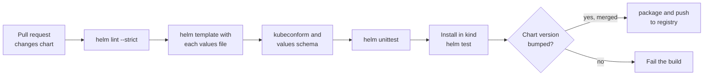
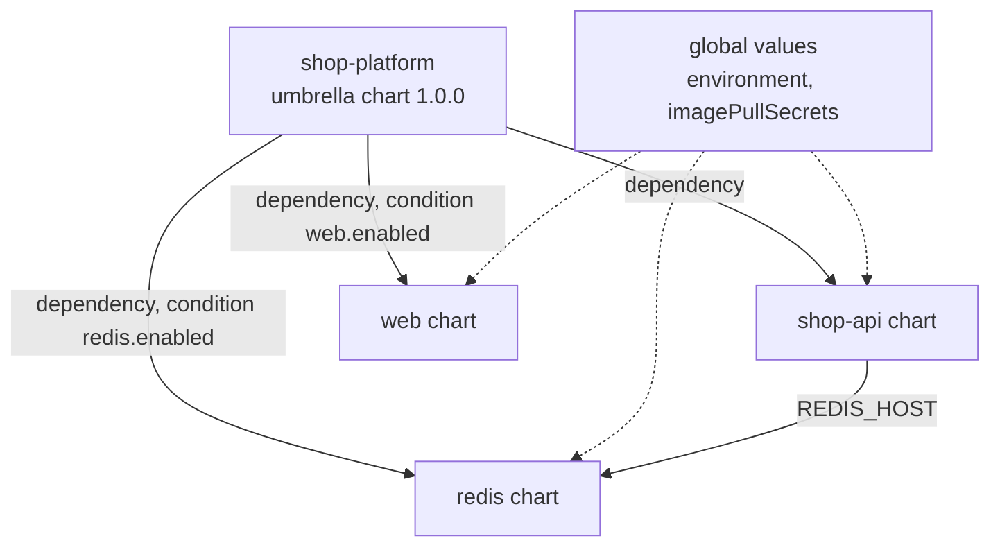

# L9.6 — Packaging Applications for Kubernetes

> **Level 9: Helm** · Topic 6 of 6 · ⏱ ~6 hours · Difficulty: Advanced

## 1. What it is

Packaging an application means turning "some YAML that worked on my cluster" into a **versioned, tested, configurable, reusable chart** that other
people and pipelines can install without reading the templates. It combines everything in this level: a chart structure ([L9.1](01-charts.md)),
a clean values interface with a schema ([L9.2](02-values.md)), disciplined templates ([L9.3](03-templates.md)), a safe release process
([L9.4](04-releases.md)) and publication ([L9.5](05-repositories.md)).

Three practices turn a chart into a product: **quality gates** (lint, render, schema validation, unit tests and install tests in CI),
**versioning** (SemVer for the chart, a separate `appVersion` for the app, and a changelog) and **composition** (an **umbrella chart** that installs
several charts, for example the API, a worker and Redis, as one unit).

## 2. Why it matters in DevOps

- **A chart is an API for operators.** Breaking its values or labels breaks every environment that uses it, so changes need review and tests
  like any other API.
- **Untested charts fail in production.** A conditional that drops the Service when a flag is off, or a probe path typo, is only found at
  deploy time unless CI renders and installs the chart.
- **Version discipline enables rollback and promotion.** Dev can run chart `0.5.0` while prod runs `0.4.2`, and GitOps tools reference exact versions
  ([Environment Promotion](../level-17-gitops/04-environment-promotion.md)).
- **Composition has trade-offs.** An umbrella chart simplifies "install the whole stack", but couples release cycles; knowing when not to use one avoids
  slow, risky deployments.

## 3. Real-world system example

**Community charts as reference implementations.** The prometheus-community `kube-prometheus-stack` chart is an umbrella chart: it declares
dependencies on other charts (kube-state-metrics, node-exporter and Grafana among them) with `condition` flags so that each can be switched off, and
exposes a `global` section for shared settings. The Helm project's own **chart-testing** tool (`ct`) is what many chart repositories use in CI to
lint changed charts, check that the version was bumped and install them into a kind cluster on pull requests; this is how the community charts are
checked before release. The **helm-unittest** plugin and **kubeconform** (a Kubernetes manifest validator) are common additions. In company settings,
platform teams publish a shared "service" chart or a library chart that all microservice teams reuse with only a values file, which is the packaging side
of a golden path ([Golden Paths](../level-18-platform-engineering/04-golden-paths.md)).

## 4. Diagram

A chart's CI pipeline from pull request to published artifact:



An umbrella chart and its subcharts:



## 5. How it works

### What a production-ready application chart contains

| Concern | Implementation in the chart |
|---------|----------------------------|
| Workload | `Deployment` with `strategy` (RollingUpdate with `maxUnavailable: 0`), `replicas` from values, pinned image tag |
| Health | `readinessProbe`, `livenessProbe` (and `startupProbe` for slow starts) configurable from values ([Probes](../level-08-kubernetes/15-liveness-and-readiness-probes.md)) |
| Resources | `requests` and `limits` required by default ([Resource Requests and Limits](../level-08-kubernetes/14-resource-requests-and-limits.md)) |
| Security | `securityContext`: `runAsNonRoot`, `readOnlyRootFilesystem`, drop capabilities; dedicated `ServiceAccount` ([Non-root Containers](../level-04-docker/11-non-root-containers.md)) |
| Config and secrets | `ConfigMap` from values, secrets **referenced by name** (`existingSecret`), checksum annotation |
| Exposure | `Service`, optional `Ingress` (`networking.k8s.io/v1`) with TLS ([Ingress](../level-08-kubernetes/05-ingress.md)) |
| Resilience | optional `HorizontalPodAutoscaler`, `PodDisruptionBudget`, `topologySpreadConstraints` |
| Operations | migration hook ([L9.4](04-releases.md)), `NOTES.txt` with how to reach the app, test hook |
| Interface | `values.yaml` with comments, `values.schema.json`, `README.md`, `Chart.yaml` metadata |

### Quality gates

| Tool | What it checks | Command |
|------|----------------|---------|
| `helm lint --strict` | structure, template syntax, schema | `helm lint shop-api --strict -f values-prod.yaml` |
| `helm template` | the rendered YAML for every values file and flag combination | `helm template x shop-api -f values-prod.yaml` |
| `kubeconform` | rendered manifests match the Kubernetes API schemas (the older `kubeval` is no longer maintained) | `helm template x shop-api \| kubeconform -strict -summary` |
| `helm-unittest` | assertions on rendered output | `helm unittest shop-api` |
| `ct lint` (chart-testing) | lint plus version-bump and maintainers checks on changed charts | `ct lint --charts shop-api` |
| `ct install` / `helm install --wait` + `helm test` | the chart actually deploys and passes its tests | in a kind cluster |
| `kubectl apply --dry-run=server` | the API server (and admission policies) accept the manifests | `helm template ... \| kubectl apply --dry-run=server -f -` |
| Security scanners (for example Trivy config, Checkov, `kube-linter`) | insecure settings in rendered YAML | on rendered output |

A unit test with helm-unittest (`shop-api/tests/deployment_test.yaml`):

```yaml
suite: deployment
templates:
  - templates/deployment.yaml
tests:
  - it: uses the replica count from values
    set:
      replicaCount: 3
    asserts:
      - equal:
          path: spec.replicas
          value: 3
  - it: omits replicas when autoscaling is enabled
    set:
      autoscaling.enabled: true
    asserts:
      - notExists:
          path: spec.replicas
  - it: runs as non-root
    asserts:
      - equal:
          path: spec.template.spec.securityContext.runAsNonRoot
          value: true
```

### Versioning rules

- **Chart `version`** (SemVer 2): bump the **patch** for template fixes, the **minor** for backward-compatible features (a new optional value), the
  **major** for breaking changes (renamed values, changed selectors, removed features). Selector labels are immutable on a Deployment, so changing them is
  a breaking change.
- **`appVersion`**: the application release. Often set from CI: `helm package shop-api --version 0.5.0 --app-version 1.8.3`. Do not tie the two together:
  an app rebuild with no chart change needs no chart bump, while a chart fix with the same app does.
- Keep a `CHANGELOG.md` (or use `artifacthub.io/changes` annotations in `Chart.yaml`) listing value changes and upgrade notes.
- Document upgrade notes for breaking changes in `README.md` and `NOTES.txt`.
- Never publish the same version twice ([L9.5](05-repositories.md)).

### Umbrella charts

An **umbrella chart** is a chart whose main job is to depend on other charts:

```yaml
# shop-platform/Chart.yaml
apiVersion: v2
name: shop-platform
version: 1.0.0
type: application
dependencies:
  - name: shop-api
    version: 0.5.0
    repository: file://../shop-api
  - name: redis-lite
    version: 0.1.0
    repository: file://../redis-lite
    alias: redis                 # values are then under the "redis" key
    condition: redis.enabled     # conditions use the alias path
  - name: web
    version: 0.2.0
    repository: oci://ghcr.io/example/charts
    condition: web.enabled
```

```yaml
# shop-platform/values.yaml
global:
  environment: dev
shop-api:
  replicaCount: 2
  env:
    REDIS_HOST: shop-redis        # points at the Service the redis subchart creates
redis:
  enabled: true
web:
  enabled: false
```

- Subcharts see their own values under their name (or alias) and `global.*` everywhere. Subcharts cannot read the parent's values directly; share data
  through `global` or `import-values`.
- `condition` and `tags` switch dependencies on and off per environment.
- One release means one revision history and one atomic rollback for everything, which is both the benefit and the trap: a change to one
  subchart redeploys the whole release, and a slow subchart delays the rest.
- **Use an umbrella chart for** tightly coupled, versioned-together bundles (a platform stack, an app plus its private cache). **Prefer separate releases** (managed by Argo CD
  ApplicationSets, Flux or Helmfile) for independently deployed services. Production databases are usually better as a managed service (RDS) or a
  dedicated operator than a subchart.

## 6. Step-by-step guide

**Prerequisites:** Helm 3, Docker, kind and kubectl; optional tools `kubeconform` and the helm-unittest plugin. Everything is local and free.
We build on the `shop-api` chart from [L9.3](03-templates.md) (nginx stands in for the Node.js app).

1. **Harden the Deployment template.** In `shop-api/templates/deployment.yaml` extend the container and pod spec:
   ```yaml
       spec:
         serviceAccountName: {{ include "shop-api.fullname" . }}
         securityContext:
           {{- toYaml .Values.podSecurityContext | nindent 8 }}
         containers:
           - name: {{ .Chart.Name }}
             image: "{{ .Values.image.repository }}:{{ .Values.image.tag | default .Chart.AppVersion }}"
             securityContext:
               {{- toYaml .Values.securityContext | nindent 14 }}
             readinessProbe:
               httpGet: { path: {{ .Values.probes.path | quote }}, port: http }
               periodSeconds: 5
             livenessProbe:
               httpGet: { path: {{ .Values.probes.path | quote }}, port: http }
               initialDelaySeconds: 10
               periodSeconds: 10
   ```
   Add to `values.yaml`:
   ```yaml
   probes:
     path: /
   podSecurityContext:
     runAsNonRoot: true
     runAsUser: 101
     seccompProfile: { type: RuntimeDefault }
   securityContext:
     allowPrivilegeEscalation: false
     readOnlyRootFilesystem: false   # nginx needs writable cache dirs; mount emptyDirs and set true for a real Node.js app
     capabilities: { drop: [ALL] }
   image:
     repository: nginxinc/nginx-unprivileged
     tag: ""
   service:
     port: 80
     targetPort: 8080
   ```
   Set `appVersion: "1.27"` so the image is `nginxinc/nginx-unprivileged:1.27`. Create `templates/serviceaccount.yaml` with a minimal ServiceAccount named
   `{{ include "shop-api.fullname" . }}`.

2. **Lint strictly and render every values file.**
   ```bash
   helm lint shop-api --strict
   for f in values-dev.yaml values-prod.yaml; do helm template shop shop-api -f "$f" > /dev/null && echo "$f ok"; done
   ```
   Expect `1 chart(s) linted, 0 chart(s) failed` and `ok` twice.

3. **Validate against the Kubernetes schemas.**
   ```bash
   helm template shop shop-api -f values-prod.yaml | kubeconform -strict -summary
   ```
   Output similar to `Summary: 5 resources found parsing stdin - Valid: 5, Invalid: 0, Errors: 0, Skipped: 0`. Without kubeconform use
   `kind create cluster --name helm-lab` and `helm template ... | kubectl apply --dry-run=server -f -`.

4. **Add unit tests.**
   ```bash
   helm plugin install https://github.com/helm-unittest/helm-unittest
   mkdir -p shop-api/tests    # put the test file from section 5 here
   helm unittest shop-api
   ```
   Expect `Test Suites: 1 passed` and `Tests: 3 passed`. Break a test on purpose (change `value: 3` to `4`) and watch it fail with a diff.

5. **Test an install.**
   ```bash
   kind create cluster --name helm-lab
   helm install shop shop-api --wait --timeout 3m
   helm test shop
   ```
   `helm test` runs the test hook from [L9.4](04-releases.md) and reports `Phase: Succeeded`.

6. **Version and package.**
   ```bash
   # In Chart.yaml: bump version 0.1.0 -> 0.2.0 (a new optional value was added)
   helm package shop-api --version 0.2.0 --app-version 1.27.0
   helm show chart shop-api-0.2.0.tgz | grep -E 'version|appVersion'
   ```

7. **Build the umbrella chart.** Create a tiny Redis chart for local use:
   ```bash
   helm create redis-lite && rm -rf redis-lite/templates/* && rm redis-lite/values.yaml
   cat > redis-lite/values.yaml <<'EOF'
   enabled: true
   image: redis:7-alpine
   EOF
   cat > redis-lite/templates/redis.yaml <<'EOF'
   apiVersion: apps/v1
   kind: Deployment
   metadata:
     name: {{ .Release.Name }}-redis
   spec:
     replicas: 1
     selector:
       matchLabels: { app: {{ .Release.Name }}-redis }
     template:
       metadata:
         labels: { app: {{ .Release.Name }}-redis }
       spec:
         containers:
           - name: redis
             image: {{ .Values.image }}
             ports: [{ containerPort: 6379 }]
   ---
   apiVersion: v1
   kind: Service
   metadata:
     name: {{ .Release.Name }}-redis
   spec:
     selector: { app: {{ .Release.Name }}-redis }
     ports: [{ port: 6379 }]
   EOF
   ```
   Then create `shop-platform/Chart.yaml` and `values.yaml` as in section 5 (use only the `shop-api` and `redis-lite` dependencies, both `file://`), and:
   ```bash
   helm dependency update shop-platform
   helm lint shop-platform
   helm install shop shop-platform --wait
   kubectl get deploy,svc
   ```
   You should see the `shop-api` objects and `shop-redis` from one release (`helm list` shows a single release `shop`).

8. **Toggle a component per environment.**
   ```bash
   helm upgrade shop shop-platform --set redis.enabled=false --wait
   kubectl get deploy
   ```
   The Redis Deployment disappears because the `condition` is false.

9. **Clean up.**
   ```bash
   helm uninstall shop; kind delete cluster --name helm-lab
   ```

## 7. Real-world scenario

*(Illustrative.)* A platform team published a shared `service` chart used by 30 microservices. A well-meaning refactor renamed `image.tag` to
`image.version` and changed the selector labels in the same release, with a patch version bump. The next day, every team that bumped to the "patch" upgrade
saw `field is immutable` errors on their Deployments, and two teams that overrode `image.tag` silently deployed the default image. The team reverted,
re-released the refactor as version 2.0.0 with a migration guide, added `values.schema.json` with `additionalProperties: false` to catch removed keys, and
added a CI job that renders every consuming service's values against the new chart before release. **Lesson:** a shared chart is an API; version it with
SemVer and test it against its consumers.

## 8. Common mistakes and best practices

**Don't**

- Rename values or change selector labels in a patch/minor release.
- Ship a chart with no resource requests, probes or security context, or with `latest` as the default tag.
- Test only the default values: conditionals and per-environment files are where bugs live.
- Put a stateful production database in an umbrella chart "because it is convenient".
- Let the umbrella chart grow into a monolith where every service redeploys together.
- Copy-paste a chart per service; use a shared library or a shared service chart.

**Do**

- Gate every chart change in CI with `lint --strict`, render-all-values, `kubeconform`, unit tests and a kind install plus `helm test`.
- Enforce a version bump when files in the chart change (`ct lint` can do this).
- Document each value, ship a schema and keep a changelog with upgrade notes.
- Reference secrets by name; never template secret values from Git.
- Use `global` and `import-values` sparingly and document them.
- Prefer independent releases for independently deployed services; use umbrella charts for bundles that truly version together.

## 9. Tasks

- [ ] **T1 — Harden the chart** *(≈60 min, intermediate)*
  - **Goal:** probes, security context and a service account, all from values.
  - **Steps:**
    1. Follow step 1.
    2. Run `helm template` and confirm the new fields appear.
    3. Run `kubectl apply --dry-run=server` against a kind cluster.
  - **Done when:** the API server accepts the manifests and the pod runs as a non-root user (`kubectl exec ... -- id` shows a non-zero UID).

- [ ] **T2 — Build a quality-gate script** *(≈60 min, intermediate)*
  - **Goal:** one command that checks the chart.
  - **Steps:**
    1. Write `scripts/check-chart.sh` that runs `helm lint --strict`, renders every `values-*.yaml`, pipes to `kubeconform`, and runs `helm unittest`.
    2. Introduce a bug (a wrong indentation or a typo in `apiVersion`) and show the script fails.
  - **Done when:** the script exits 0 on a good chart and non-zero with a clear message on three different injected bugs.

- [ ] **T3 — Unit-test conditionals** *(≈45 min, intermediate)*
  - **Goal:** cover every branch.
  - **Steps:**
    1. Write helm-unittest tests for Ingress on/off, HPA on/off and a failing `required` (`ingress.host` empty).
    2. Use `failedTemplate` assertions for the error case.
  - **Done when:** `helm unittest shop-api` passes with at least 6 tests including one expected failure.

- [ ] **T4 — SemVer in practice** *(≈45 min, advanced)*
  - **Goal:** classify changes correctly.
  - **Steps:**
    1. List five hypothetical changes (new optional value, renamed value, fixed template typo, changed selector label, bumped default image).
    2. Decide patch, minor or major for each and write the changelog entry and upgrade note.
    3. Implement one in the chart and package with the right `--version`.
  - **Done when:** each change has a justified version bump and the packaged chart reports the version you chose.

- [ ] **T5 — Umbrella chart with toggles** *(≈60 min, advanced; kind)*
  - **Goal:** compose and switch components.
  - **Steps:**
    1. Do steps 7-8.
    2. Add a `values-dev.yaml` (Redis on, 1 replica) and `values-prod.yaml` (Redis off because it uses a managed cache, 3 replicas, ingress on) for the umbrella.
    3. Pass `global.environment` into a label in the `shop-api` template.
  - **Done when:** both environments render cleanly and `kubectl get deploy` differs as expected.

- [ ] **T6 — Prove it: break and fix a release** *(≈60 min, advanced)*
  - **Goal:** show the whole level working together.
  - **Steps:**
    1. Without the guide, introduce a bad change (for example a wrong probe path) and show CI-style checks or `helm test` catch it before production.
    2. Upgrade with the bad change using `--atomic`, show it rolls back, then fix, bump the version and publish to a local OCI registry.
    3. Explain the full path from commit to running release.
  - **Done when:** the bad version never reaches `deployed`, the fixed chart version is in the registry, and your explanation covers values, templates, release, repository and versioning.

## 10. Self-check questions

1. Which checks should run on every pull request that changes a chart?
2. How do `version` and `appVersion` relate, and when do you bump each?
3. When is an umbrella chart a good idea and when is it not?
4. Why are selector label changes a breaking change?
5. How do subcharts get configuration from the parent chart?

<details>
<summary>Answers</summary>

1. `helm lint --strict`, rendering with all values files, manifest validation (kubeconform or server dry run), unit tests, a version-bump check and an install plus `helm test` in a throwaway cluster.
2. `version` is the chart's SemVer and changes whenever the chart's files change; `appVersion` is the packaged app version and changes when you ship a new app release. They move independently.
3. Good for tightly coupled things versioned and deployed together (a platform stack, app plus private cache). Not for independently deployed services or production databases: it couples release cycles and enlarges the blast radius.
4. A Deployment's selector is immutable; changing it makes upgrades fail or forces recreation, so it breaks every consumer and needs a major version and migration notes.
5. Through the subchart's key (or alias) in the parent's values, and through `global` values; `import-values` can also pull values from a subchart up to the parent.
</details>

## 11. Further reading

- Helm documentation: *Chart Best Practices*, *Subcharts and Global Values*, *Chart Tests* and *Library Charts*.
- chart-testing (`ct`), helm-unittest and kubeconform project documentation.
- Semantic Versioning specification (semver.org) and Artifact Hub's guide to chart annotations.
- *Learning Helm* by Butcher, Farina and Dolitsky.
- See also: [Semantic Versioning and Releases](../level-03-git-and-github/10-semantic-versioning-and-releases.md), [Automated Testing](../level-05-cicd/03-automated-testing.md) and [Argo CD and Flux](../level-17-gitops/02-argo-cd-and-flux.md).

<!-- nav -->
---
← Previous: [Repositories](05-repositories.md) · [Level 9 index](README.md) · Next: [Level capstone project](99-capstone-project.md) →
