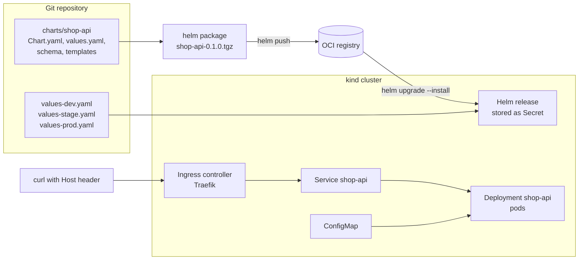
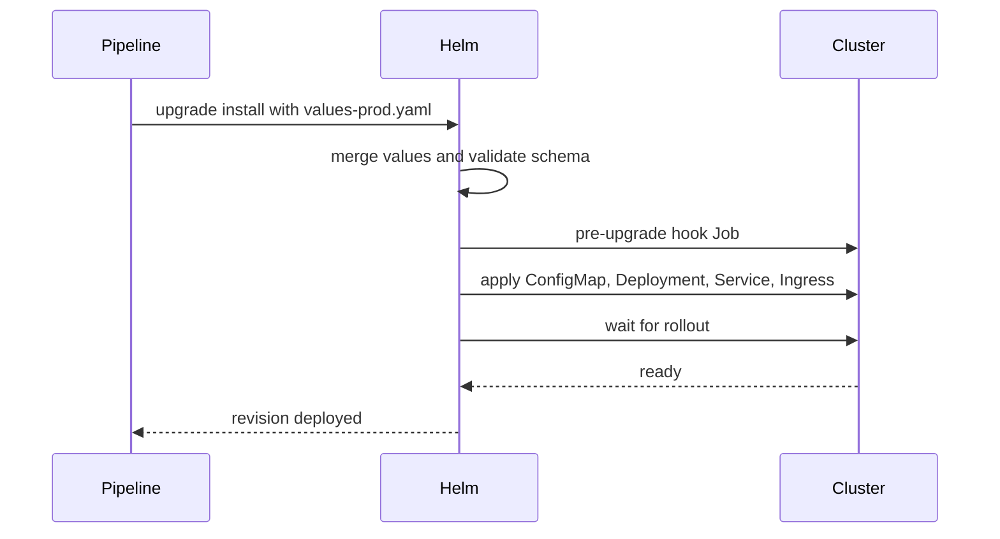

# L9 Capstone — A production-ready Helm chart for shop-api

> **Level 9: Helm** · Capstone · ⏱ ~8 hours

## 1. Goal and outcome

Package the `shop-api` sample service as a single, tested, versioned **Helm 3 chart** containing a Deployment, Service, Ingress and
configuration (ConfigMap and environment settings), with **per-environment values** for `dev`, `stage` and `prod`. You will install it into a local
Kubernetes cluster behind a real ingress controller, upgrade it, break it and roll it back, publish it to an OCI registry, and put quality
gates around it.

When you finish you will have:

- a `shop-api` chart with a documented `values.yaml`, a `values.schema.json` and three small environment files;
- templates that use shared helpers, conditionals, loops, a config checksum and a pre-upgrade hook;
- a working request path `curl -H "Host: ..." -> ingress -> Service -> pods` on a kind cluster;
- a chart published at an exact version to an OCI registry and installed from there;
- a CI-style check script (lint, render all environments, validate, unit test, install and test).

## 2. Architecture



What one `helm upgrade --install --atomic` does with this chart:



## 3. Prerequisites and cost

- Docker, [kind](https://kind.sigs.k8s.io/), `kubectl` and **Helm 3**. Optional: `kubeconform` and the `helm-unittest` plugin.
- About 4 GB of free RAM for a one-node kind cluster plus the ingress controller.
- **Cost: none.** Everything runs locally; no cloud account is needed. If you later push to GHCR or ECR, use a throwaway registry and delete it afterwards.
- No real credentials. The example registry is `localhost:5000` and the domain is `shop.example.com` (resolved with a `Host` header, not DNS).

## 4. Build it step by step

### Milestone 1: scaffold the chart (topic 1)

```bash
mkdir shop-api-helm && cd shop-api-helm
mkdir charts && helm create charts/shop-api
rm -rf charts/shop-api/templates/tests
rm -f charts/shop-api/templates/*.yaml charts/shop-api/templates/NOTES.txt   # we write our own; keep _helpers.tpl for now
```

`charts/shop-api/Chart.yaml`:

```yaml
apiVersion: v2
name: shop-api
description: Node.js API for the shop-api sample application
type: application
version: 0.1.0
appVersion: "1.27"           # nginx stands in for the Node.js image so the lab runs anywhere
kubeVersion: ">=1.27.0-0"
maintainers:
  - name: Platform Team
```

Replace `templates/_helpers.tpl` with the `name`, `fullname`, `selectorLabels` and `labels` helpers from [L9.3](03-templates.md).

### Milestone 2: values, schema and environment files (topic 2)

`charts/shop-api/values.yaml` (every key commented in your real version):

```yaml
replicaCount: 2
image:
  repository: nginxinc/nginx-unprivileged
  tag: ""                    # defaults to Chart.appVersion
  pullPolicy: IfNotPresent
service:
  port: 80
  targetPort: 8080
env:                         # becomes the ConfigMap
  NODE_ENV: production
  LOG_LEVEL: info
ingress:
  enabled: false
  className: traefik
  hosts: []                  # list of host names
  tls: false
resources:
  requests: { cpu: 50m, memory: 64Mi }
  limits: { memory: 128Mi }
autoscaling:
  enabled: false
  minReplicas: 2
  maxReplicas: 5
  cpu: 70
podDisruptionBudget:
  enabled: false
  minAvailable: 1
probes:
  path: /
securityContext:
  allowPrivilegeEscalation: false
  capabilities: { drop: [ALL] }
podSecurityContext:
  runAsNonRoot: true
  runAsUser: 101
  seccompProfile: { type: RuntimeDefault }
```

`charts/shop-api/values.schema.json` (extend it with the rules you need):

```json
{
  "$schema": "https://json-schema.org/draft-07/schema#",
  "type": "object",
  "required": ["image", "service"],
  "properties": {
    "replicaCount": { "type": "integer", "minimum": 1, "maximum": 20 },
    "image": {
      "type": "object",
      "required": ["repository"],
      "properties": { "pullPolicy": { "enum": ["Always", "IfNotPresent", "Never"] } }
    },
    "ingress": {
      "type": "object",
      "properties": { "hosts": { "type": "array", "items": { "type": "string" } } }
    }
  }
}
```

Environment files in the repository root (small, only differences):

```yaml
# values-dev.yaml
replicaCount: 1
env: { LOG_LEVEL: debug, NODE_ENV: development }
ingress:
  enabled: true
  hosts: [dev.shop.example.com]
```
```yaml
# values-stage.yaml
replicaCount: 2
ingress:
  enabled: true
  hosts: [stage.shop.example.com]
podDisruptionBudget: { enabled: true }
```
```yaml
# values-prod.yaml
env: { LOG_LEVEL: warn }
resources:
  requests: { cpu: 250m, memory: 256Mi }
  limits: { memory: 512Mi }
autoscaling: { enabled: true, minReplicas: 4, maxReplicas: 10, cpu: 70 }
ingress:
  enabled: true
  hosts: [shop.example.com, www.shop.example.com]
podDisruptionBudget: { enabled: true, minAvailable: 2 }
```

Check the merge: `helm template shop charts/shop-api -f values-prod.yaml | head -40`. Remember lists are replaced, not merged.

### Milestone 3: templates (topic 3)

Create these files in `charts/shop-api/templates/`, reusing the patterns from [L9.3](03-templates.md) and [L9.6](06-packaging-applications.md):

| File | Key points |
|------|-----------|
| `serviceaccount.yaml` | name from `shop-api.fullname`, standard labels |
| `configmap.yaml` | `range $k, $v := .Values.env` producing quoted entries |
| `deployment.yaml` | `replicas` only when `autoscaling.enabled` is false; image `repository:tag \| default .Chart.AppVersion`; `envFrom` ConfigMap; probes from `.Values.probes.path`; `securityContext` blocks via `toYaml \| nindent`; `checksum/config` annotation |
| `service.yaml` | selector from `shop-api.selectorLabels`; `targetPort: http` |
| `ingress.yaml` | `{{- if .Values.ingress.enabled }}`; `range .Values.ingress.hosts` creating one rule per host; `ingressClassName`; `required` when enabled with no hosts |
| `hpa.yaml` | `autoscaling/v2`, only when enabled |
| `pdb.yaml` | `policy/v1`, only when enabled |
| `NOTES.txt` | prints the URL(s) from `.Values.ingress.hosts` |

The ingress rule loop looks like this:

```yaml
{{- if .Values.ingress.enabled }}
{{- if not .Values.ingress.hosts }}{{ fail "ingress.hosts must not be empty when ingress.enabled is true" }}{{ end }}
apiVersion: networking.k8s.io/v1
kind: Ingress
metadata:
  name: {{ include "shop-api.fullname" . }}
  labels:
    {{- include "shop-api.labels" . | nindent 4 }}
spec:
  ingressClassName: {{ .Values.ingress.className }}
  rules:
    {{- range .Values.ingress.hosts }}
    - host: {{ . | quote }}
      http:
        paths:
          - path: /
            pathType: Prefix
            backend:
              service:
                name: {{ include "shop-api.fullname" $ }}
                port:
                  number: {{ $.Values.service.port }}
    {{- end }}
{{- end }}
```

Render every environment and list kinds:

```bash
for e in dev stage prod; do echo "== $e"; helm template shop charts/shop-api -f values-$e.yaml | grep '^kind:' | sort | uniq -c; done
```

Expect, for example, no HPA or PDB in `dev` and both in `prod`, and `replicas` absent from the `prod` Deployment.

### Milestone 4: run it on Kubernetes (topic 4)

```bash
kind create cluster --name helm-capstone
helm repo add traefik https://traefik.github.io/charts && helm repo update
helm install traefik traefik/traefik -n traefik --create-namespace --set service.type=ClusterIP --wait
kubectl get ingressclass                       # expect "traefik"

helm upgrade --install shop-dev charts/shop-api -n dev --create-namespace \
  -f values-dev.yaml --atomic --wait --timeout 3m
kubectl -n traefik port-forward svc/traefik 8080:80 &
curl -s -H "Host: dev.shop.example.com" http://localhost:8080/ | head -5
```

Expect an nginx welcome page (standing in for the API). Then drill the release lifecycle:

```bash
helm upgrade --install shop-dev charts/shop-api -n dev -f values-dev.yaml --set image.tag=does-not-exist --atomic --timeout 60s   # fails and rolls back
helm history shop-dev -n dev
helm upgrade --install shop-dev charts/shop-api -n dev -f values-dev.yaml --set env.LOG_LEVEL=trace --wait   # checksum rolls the pods
helm rollback shop-dev 1 -n dev --wait
```

Add a `pre-upgrade` hook Job (see [L9.4](04-releases.md)) that prints "running migration", and a `helm.sh/hook: test` Pod that `wget`s the Service. Run `helm test shop-dev -n dev`.
Install `prod` into its own namespace the same way (`-f values-prod.yaml`) and compare `kubectl get hpa,pdb,ingress -n prod`.

### Milestone 5: package and publish (topic 5)

```bash
helm package charts/shop-api -d dist/
docker run -d --name registry -p 5000:5000 registry:2
helm push dist/shop-api-0.1.0.tgz oci://localhost:5000/charts --plain-http
curl -s localhost:5000/v2/charts/shop-api/tags/list
helm upgrade --install shop-stage oci://localhost:5000/charts/shop-api --version 0.1.0 --plain-http \
  -n stage --create-namespace -f values-stage.yaml --atomic --wait
```

### Milestone 6: quality gates and composition (topic 6)

Create `scripts/check.sh`:

```bash
#!/usr/bin/env bash
set -euo pipefail
CHART=charts/shop-api
helm lint "$CHART" --strict
for e in dev stage prod; do
  helm lint "$CHART" --strict -f "values-$e.yaml"
  helm template shop "$CHART" -f "values-$e.yaml" | kubeconform -strict -summary
done
helm unittest "$CHART"
echo "all chart checks passed"
```

Add unit tests in `charts/shop-api/tests/`, then wire the script into a GitHub Actions workflow that also runs `ct install` or a kind install with `helm test`.
Finally build a small umbrella chart (`charts/shop-platform`) that depends on `shop-api` and a local `redis-lite` chart with `condition` toggles, as in [L9.6](06-packaging-applications.md).

## 5. Tasks

- [ ] **T1 — Scaffold and describe the chart** *(≈45 min, beginner; Milestone 1; topic 1)*
  - **Goal:** a lint-clean chart skeleton with correct metadata.
  - **Steps:**
    1. Run the scaffold commands and write `Chart.yaml`, `_helpers.tpl`.
    2. Run `helm lint charts/shop-api`.
  - **Done when:** lint passes and `helm show chart charts/shop-api` prints your metadata.

- [ ] **T2 — Values, schema and environments** *(≈60 min, intermediate; Milestone 2; topic 2)*
  - **Goal:** a validated configuration interface with three environment files.
  - **Steps:**
    1. Write `values.yaml`, `values.schema.json` and the three env files.
    2. Break the schema on purpose (`replicaCount: 0`, `pullPolicy: Sometimes`) and read the errors.
  - **Done when:** `helm template` fails with clear schema errors for bad input and succeeds for all three environments.

- [ ] **T3 — Write the templates** *(≈120 min, intermediate; Milestone 3; topic 3)*
  - **Goal:** Deployment, Service, Ingress, ConfigMap, HPA, PDB and ServiceAccount from shared helpers.
  - **Steps:**
    1. Create each template with the points in the table.
    2. Render all environments and compare kinds and `replicas`.
  - **Done when:** `prod` renders an HPA, a PDB and two ingress rules, `dev` renders neither, and every object carries identical selector labels.

- [ ] **T4 — Install, upgrade, fail and roll back** *(≈90 min, advanced; Milestone 4; topic 4)*
  - **Goal:** operate a release end to end.
  - **Steps:**
    1. Install Traefik and `shop-dev` as shown; curl through the ingress.
    2. Run the failing `--atomic` upgrade, the config change and the rollback; add the hook and test.
  - **Done when:** the curl returns the welcome page, `helm history` shows the failure, the automatic rollback and your manual rollback, and `helm test` passes.

- [ ] **T5 — Publish and consume from OCI** *(≈45 min, intermediate; Milestone 5; topic 5)*
  - **Goal:** an immutable, versioned chart in a registry.
  - **Steps:**
    1. Package, push, list tags and install `stage` from `oci://`.
    2. Bump to `0.1.1`, publish again and upgrade `stage` with `--version 0.1.1`.
  - **Done when:** the tag list shows `0.1.0` and `0.1.1` and `helm list -n stage` shows chart `shop-api-0.1.1`.

- [ ] **T6 — Quality gates and umbrella chart** *(≈90 min, advanced; Milestone 6; topic 6)*
  - **Goal:** automatic checks and composition.
  - **Steps:**
    1. Write `scripts/check.sh`, add at least six unit tests, and run it.
    2. Inject two bugs (a wrong `apiVersion` and a selector-label typo in the Service) and show the checks fail.
    3. Build the `shop-platform` umbrella chart with a Redis toggle and install it with the toggle on and off.
  - **Done when:** the script passes on the good chart, fails on both bugs, and the umbrella chart creates or omits Redis by value.

- [ ] **T7 — Prove it: rebuild from memory** *(≈2 hours, advanced; all topics)*
  - **Goal:** demonstrate mastery of the level.
  - **Steps:**
    1. In a fresh directory, without the guide, create a new chart `orders-api` with a Deployment, Service, Ingress, ConfigMap and two environment files.
    2. Lint, validate, install it on kind behind Traefik, upgrade it, break it and roll it back, and publish version `0.1.0` to the local registry.
    3. Explain aloud what `version`, `appVersion` and the release revision are, the value precedence order, how `include` differs from `template`, what `--atomic` does and why published versions are immutable.
  - **Done when:** `orders-api` serves traffic through the ingress, the rollback is visible in `helm history`, and a teammate accepts your explanations.

## 6. Verification checklist

- [ ] `helm lint charts/shop-api --strict` passes with every `values-*.yaml`.
- [ ] `helm template` for `dev`, `stage` and `prod` differs only where expected (replicas, HPA, PDB, hosts, resources).
- [ ] Invalid values (zero replicas, wrong pull policy, ingress enabled with no hosts) fail before anything is applied.
- [ ] `curl -H "Host: dev.shop.example.com" http://localhost:8080/` returns HTTP 200 through the ingress.
- [ ] Changing a ConfigMap value rolls the pods (checksum annotation works).
- [ ] A bad image tag with `--atomic` leaves the previous revision running; `helm history` shows the rollback.
- [ ] `helm test` passes; the pre-upgrade hook ran and was cleaned up.
- [ ] The chart exists in the registry at an exact version and `stage` runs that version.
- [ ] `scripts/check.sh` exits 0 on the good chart and non-zero on injected bugs.
- [ ] No secrets or tokens appear in any values file or in `helm get values`.

## 7. Teardown

```bash
helm uninstall shop-dev -n dev; helm uninstall shop-stage -n stage; helm uninstall traefik -n traefik
kill %1 2>/dev/null                       # stop the port-forward
docker rm -f registry
kind delete cluster --name helm-capstone
rm -rf dist/
```

Verify with `kind get clusters` (no `helm-capstone`) and `docker ps` (no `registry`). Nothing was created in any cloud account.

## 8. Stretch goals and what to learn next

- Add a `ServiceMonitor` template (behind a value) so Prometheus scrapes the app ([Prometheus and PromQL](../level-10-observability/02-prometheus-and-promql.md)).
- Reference a Secret by name (`existingSecret`) and create it with an external-secrets or sealed-secrets mechanism instead of values ([Secrets](../level-08-kubernetes/07-secrets.md)).
- Add a `NetworkPolicy` template that only allows the ingress controller to reach the pods ([NetworkPolicies](../level-08-kubernetes/19-networkpolicies.md)).
- Sign the chart (`helm package --sign` or cosign) and verify it in the deploy step.
- Deploy the chart with a GitOps controller: an Argo CD `Application` or Flux `HelmRelease` per environment ([Argo CD and Flux](../level-17-gitops/02-argo-cd-and-flux.md)).
- Run the chart on a cluster you built with Terraform ([Level 7](../level-07-terraform-iac/99-capstone-project.md)) and wire the release into your CI/CD pipeline ([Level 5](../level-05-cicd/01-pipeline-design.md)).
- Next level: [Level 10 — Observability](../level-10-observability/01-three-pillars.md).

<!-- nav -->
---
← Previous: [Packaging Applications for Kubernetes](06-packaging-applications.md) · [Level 9 index](README.md) · Next level: [Level 10 — Observability](../level-10-observability/README.md) →
