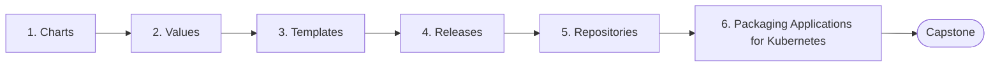

# Level 9 — Helm

> **Goal:** Package, version and deploy Kubernetes applications with Helm.

| | |
|---|---|
| **Recommended time** | 1-2 weeks |
| **Topics** | 6 |
| **Practice / capstone** | Create a Helm chart containing deployment, service, ingress and configuration, with per-environment values. |

## Topics

| # | Topic | What you will learn |
|---|-------|---------------------|
| 1 | [Charts](01-charts.md) | chart structure, Chart.yaml, helm create, dependencies |
| 2 | [Values](02-values.md) | values.yaml, overrides, -f and --set, schema validation |
| 3 | [Templates](03-templates.md) | Go templates, helpers, conditionals, loops, include/tpl, helm template |
| 4 | [Releases](04-releases.md) | install/upgrade/rollback/uninstall, release history, hooks, --atomic |
| 5 | [Repositories](05-repositories.md) | chart repos, OCI registries, helm repo add/search, publishing |
| 6 | [Packaging Applications for Kubernetes](06-packaging-applications.md) | packaging a real app, lint/test, versioning, umbrella charts |
| ★ | [Level capstone project](99-capstone-project.md) | Create a Helm chart containing deployment, service, ingress and configuration, with per-environment values. |

## How to work through this level

1. Read each topic in order: *what it is → why it matters → real-world example → diagram → guide*.
2. Do **every task** in the topic's *Tasks* section and tick the box (`- [x]`) in your own fork or notes.
3. Answer the *Self-check questions* without looking, then reveal the answers.
4. Finish with the **capstone project**, which combines all topics of the level.
5. Move on only when you can do the capstone's *Prove it* task without the guide.

## Topic flow

---
← [Level 8 — Kubernetes](../level-08-kubernetes/README.md) · [Roadmap home](../README.md) · [Level 10 — Observability](../level-10-observability/README.md) →
