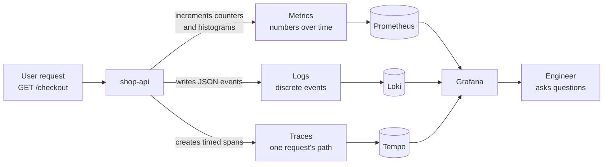
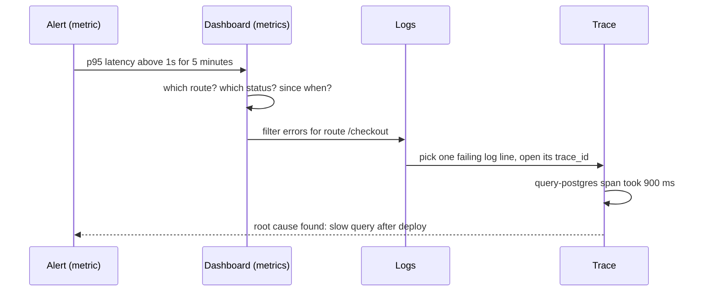

# L10.1 — The Three Pillars: Metrics, Logs and Traces

> **Level 10: Observability** · Topic 1 of 11 · ⏱ ~3 hours · Difficulty: Beginner

## 1. What it is

**Monitoring** is watching a system for problems you already know how to describe: "CPU above 90%", "the
health check fails", "5xx rate above 5%". You decide the questions in advance, build dashboards and alerts
for them, and the system tells you when one of them is true.

**Observability** is a property of a system: *can you understand what it is doing on the inside by looking at
the data it emits on the outside?* An observable system lets you ask a question you did not think of in advance
("why is checkout slow only for customers in Brazil using the Android app?") and answer it without shipping new
code. The term comes from control theory; in software it is usually delivered by three kinds of telemetry
(data a system emits about itself), called the **three pillars**:

| Pillar | What it is | Shape of the data |
|--------|-----------|-------------------|
| **Metrics** | Numbers sampled over time, aggregated | `http_requests_total{route="/checkout"} 48211` at 12:00:15, again at 12:00:30 ... |
| **Logs** | Timestamped records of discrete events | `{"time":"...","level":"error","msg":"payment declined","order_id":"o-17"}` |
| **Traces** | The path of one request across services, as a tree of timed **spans** | `checkout` (480 ms) → `postgres query` (410 ms) |

Monitoring is something you *do* with this data; observability is how *rich and connected* the data is. Good
monitoring tells you something is wrong. Good observability tells you why.

## 2. Why it matters in DevOps

- **Mean time to detect and mean time to recover (MTTD and MTTR)** are dominated by how fast you can go from
  "something is broken" to "this specific thing is broken". Without telemetry that is guesswork and SSH sessions.
- **Distributed systems fail in new ways.** One user request can touch an API, a cache, a database, a queue and a
  payment provider. A single server's logs no longer tell the story.
- **Each signal alone misleads.** Metrics tell you *that* latency rose but not *which* request. Logs tell you
  about one request but you cannot grep 40 million lines for a pattern. Traces show one request's path but are
  sampled, so the interesting one may be missing.
- **Cost and noise are real.** Telemetry is data you pay to ship, store and query. Choosing the right signal for
  each question keeps the bill and the on-call pager under control.
- **Releases need feedback.** Canary and blue/green deployments (see
  [Deployment Strategies](../level-00-what-devops-is/07-deployment-strategies.md)) only work if a metric can tell you
  within minutes that the new version is worse.

## 3. Real-world system example

**Google and the lineage of today's tools.** Google's *Site Reliability Engineering* book describes Borgmon, the
internal monitoring system whose design (scrape time series from targets, query them with a rule language)
inspired **Prometheus**. Prometheus started at SoundCloud and is now a graduated project of the Cloud Native
Computing Foundation (CNCF). Google's 2010 paper on **Dapper**, its production tracing system, inspired
open-source tracers: **Zipkin** (from Twitter) and **Jaeger** (from Uber, also a CNCF graduated project).
The same SRE book defines the **four golden signals** (latency, traffic, errors, saturation) that most dashboards
copy (see [What to Monitor](11-what-to-monitor.md)).

**Convergence on OpenTelemetry.** Two competing instrumentation projects, OpenTracing and OpenCensus, merged in 2019
into **OpenTelemetry (OTel)**, now a CNCF project and the common way to emit metrics, logs and traces without tying
your code to one vendor (see [OpenTelemetry](09-opentelemetry.md)). The **Grafana stack** (Prometheus or Mimir for
metrics, Loki for logs, Tempo for traces, Grafana for the UI) is a widely used open-source implementation of the
three pillars, and this level builds a small version of it on your laptop.

## 4. Diagram

How one `shop-api` request produces all three signals, and where each ends up:



The debugging workflow that connects the pillars. You rarely use one alone:



## 5. How it works

**Choosing a signal.** Ask the question first, then pick the cheapest signal that can answer it.

| Question | Best signal | Why |
|----------|-------------|-----|
| Is the service healthy right now? Is it getting worse? | **Metrics** | Cheap, fast to query, ideal for alerting and trends |
| How many requests per second, what error rate, what p99? | **Metrics** | Pre-aggregated; cost does not grow with traffic |
| What exactly happened to order `o-17`? | **Logs** | Full detail about one event, with arbitrary fields |
| Why did this one request take 4 seconds? | **Traces** | Shows time spent per service and per call |
| Which downstream dependency is the slow one? | **Traces** (then metrics) | The span tree points at the culprit |
| Did the new release increase errors? | **Metrics** (plus error tracking) | Compare before and after with `rate()` |
| What was the stack trace? | **Logs** or error tracker | See [Sentry](10-sentry.md) |

**Trade-offs.**

| | Metrics | Logs | Traces |
|--|---------|------|--------|
| Cost vs traffic | Flat (grows with label combinations, not requests) | Grows with every event | Grows with requests unless sampled |
| Detail per event | None (aggregated) | High | High, for sampled requests |
| Typical retention | Weeks to months | Days to weeks | Hours to days |
| High-cardinality fields (user id) | Dangerous | Fine | Fine |
| Best for | Alerting, SLOs, trends | Forensics, audit | Latency and dependency analysis |

**The glue between pillars.** The pillars become *observability* when you can jump between them:

- Metrics to traces: **exemplars** attach a trace id to a histogram sample.
- Logs to traces: put `trace_id` in every log line (see [Correlation IDs](07-correlation-ids.md)).
- Traces to logs: the trace viewer searches logs by that same id.
- All three share labels such as `service`, `environment` and `version`, so the same names work in every query.

**Other signals** you will meet: **events/errors** (grouped exceptions, see [Sentry](10-sentry.md)), **profiles**
(continuous CPU and memory flame graphs) and **real-user monitoring** (browser timings).

## 6. Step-by-step guide

**Prerequisites:** Node.js 22 or newer (or run the same commands inside `docker run -it --rm -v "$PWD":/w -w /w -p 3000:3000 node:24 bash`),
`curl`, and `jq` (optional but used below). Cost: none. We build a tiny `shop-api` with **hand-made** versions of
all three signals so you can see what each looks like before any tool gets involved.

1. **Create the lab app.**
   ```bash
   mkdir -p ~/l10-lab01 && cd ~/l10-lab01
   npm init -y >/dev/null
   npm install express prom-client pino
   ```
   Expect `added ... packages`.

2. **Write `lab.js`** (a checkout endpoint with three timed steps; `?slow=1` simulates a slow database).
   ```js
   const crypto = require('node:crypto');
   const express = require('express');
   const client = require('prom-client');
   const pino = require('pino');

   const log = pino({ base: { service: 'shop-api' }, formatters: { level: (l) => ({ level: l }) } });
   const latency = new client.Histogram({
     name: 'http_request_duration_seconds',
     help: 'HTTP request latency',
     labelNames: ['route', 'status_code'],
     buckets: [0.05, 0.1, 0.25, 0.5, 1, 2.5],
   });
   const sleep = (ms) => new Promise((r) => setTimeout(r, ms));

   // time one step of a request: this is a hand-made "span"
   async function step(steps, name, ms) {
     const t0 = performance.now();
     await sleep(ms);
     steps.push({ name, ms: Math.round(performance.now() - t0) });
   }

   const app = express();
   app.get('/checkout', async (req, res) => {
     const id = req.get('x-request-id') || crypto.randomUUID();
     const stop = latency.startTimer();
     const steps = [];
     const slow = req.query.slow === '1';
     await step(steps, 'validate-cart', 10);
     await step(steps, 'query-postgres', slow ? 900 : 30);
     await step(steps, 'charge-card', 80);
     stop({ route: '/checkout', status_code: 200 });
     log.info({ request_id: id, route: '/checkout', steps }, 'checkout finished');
     res.set('x-request-id', id).json({ ok: true, request_id: id });
   });
   app.get('/metrics', async (req, res) => {
     res.set('Content-Type', client.register.contentType);
     res.end(await client.register.metrics());
   });
   app.listen(3000, () => log.info('listening on :3000'));
   ```

3. **Start it** (leave this terminal running; logs appear here).
   ```bash
   node lab.js
   ```
   Expect `{"level":"info",...,"msg":"listening on :3000"}`.

4. **Generate traffic from a second terminal:** three normal requests and one slow one.
   ```bash
   for i in 1 2 3; do curl -s localhost:3000/checkout > /dev/null; done
   curl -s "localhost:3000/checkout?slow=1" -H 'x-request-id: req-42'
   ```
   The last call prints `{"ok":true,"request_id":"req-42"}`.

5. **Look at the metrics signal.**
   ```bash
   curl -s localhost:3000/metrics | grep -E '^http_request_duration_seconds_(bucket|sum|count)'
   ```
   Similar to:
   ```text
   http_request_duration_seconds_bucket{le="0.25",route="/checkout",status_code="200"} 3
   http_request_duration_seconds_bucket{le="1",route="/checkout",status_code="200"} 4
   http_request_duration_seconds_sum{route="/checkout",status_code="200"} 1.35
   http_request_duration_seconds_count{route="/checkout",status_code="200"} 4
   ```
   Metrics say: 4 requests, 3 finished within 0.25 s, one took between 0.5 s and 1 s. They do **not** say which one,
   or why. Average latency is `sum / count`, about 0.34 s, a number that describes none of the four requests.

6. **Look at the logs signal** (switch to the first terminal, or pipe to `jq`).
   ```text
   {"level":"info","time":1791531485261,"service":"shop-api","request_id":"req-42","route":"/checkout","steps":[...],"msg":"checkout finished"}
   ```
   Logs identify the exact request (`req-42`) and its fields, but cannot tell you whether 1 request in 1,000 behaves like it.

7. **Look at the "trace" signal.** The `steps` array in that log line is a hand-made trace: a list of named,
   timed segments of one request.
   ```json
   [{"name":"validate-cart","ms":9},{"name":"query-postgres","ms":901},{"name":"charge-card","ms":80}]
   ```
   `query-postgres` took 901 ms of roughly 990. A real tracing system (see [Distributed Tracing](08-distributed-tracing.md))
   does this automatically, across service boundaries, and draws it as a timeline.

8. **Answer three questions, each with a different signal.**
   - *Is something wrong?* The `_bucket{le="1"}` count is greater than `_bucket{le="0.25"}`: metrics.
   - *Which request?* `request_id` equal to `req-42`: logs.
   - *Where did the time go?* `query-postgres`, 901 ms: trace.

   Stop the app with `Ctrl+C` when done.

## 7. Real-world scenario

*Illustrative scenario.* At 14:05 the on-call engineer is paged: **"shop-api p95 latency above 1 s for 5 minutes"**.
The alert comes from a **metric**, which is exactly what metrics are for: cheap, always on, and fast to evaluate.
The dashboard shows the slowdown started at 14:00 and affects only `/checkout`, not `/products`. That narrows it
from "the system" to "one route".

Metrics cannot go further, so the engineer opens **logs** filtered by `route="/checkout"` and `level=error`: a few
`timeout` lines, each carrying a `trace_id`. Opening one in the **trace** view shows a 4.2 s request where 4.0 s is a
single `SELECT` span in PostgreSQL. A deploy at 13:58 dropped an index. The engineer rolls back, p95 returns to normal
in two minutes, and the follow-up is a migration check in CI.

**Lesson:** each pillar answered a different question, and the `trace_id` linking logs to traces turned a 40-minute
search into a 5-minute one. Teams that only have dashboards can see the fire but not the room it is in.

## 8. Common mistakes and best practices

**Don't**

- Treat "we have Grafana" as "we have observability". Dashboards without logs and traces only show symptoms.
- Alert on logs for things a metric can express (error *rate*): logs are expensive to query and slow to alert on.
- Put unbounded values (user id, email, full URL) in **metric labels**. Put them in logs and traces instead.
- Collect everything forever. Unqueried telemetry is pure cost; set retention and sampling deliberately.
- Use a different name for the same thing in each signal (`app`, `service`, `svc`). Joins break.

**Do**

- Start with the questions: what would a user complain about, and which signal answers it?
- Standardise a small set of shared attributes: `service`, `environment`, `version`, `trace_id`.
- Use metrics for alerting and SLOs, logs for forensics and audit, traces for latency and dependencies.
- Make signals jump to each other: log lines with `trace_id`, dashboards linking to log queries.
- Instrument once with open standards (OpenTelemetry, Prometheus exposition format) so you can swap backends.

## 9. Tasks

- [ ] **T1 — Run the three-signal lab** *(≈30 min, beginner)*
  - **Goal:** see one request through metrics, logs and the hand-made trace.
  - **Steps:**
    1. Follow section 6 steps 1-5.
    2. Send 10 normal requests and 2 slow ones.
    3. Read `http_request_duration_seconds_count` and `_sum` and compute the average latency.
  - **Done when:** `_count` is 12, and you can state the average latency and explain why it hides the 2 slow requests.

- [ ] **T2 — Pick the signal** *(≈20 min, beginner)*
  - **Goal:** practise matching questions to pillars.
  - **Steps:**
    1. For each question below write *metric*, *log* or *trace* and one sentence why: (a) error rate in the last hour;
       (b) what did customer `c-9` see at 14:03; (c) which downstream call made request X slow; (d) is disk usage trending to 100%;
       (e) did yesterday's deploy change p99.
    2. Compare with the table in section 5.
  - **Done when:** all five answers match the table, or you can defend a different answer.

- [ ] **T3 — Add a new signal field** *(≈30 min, intermediate)*
  - **Goal:** make a log line more useful and a metric cheaper.
  - **Steps:**
    1. Add `user_id` to the log line in `lab.js`, but **not** to the histogram labels.
    2. Add an `errors_total` counter (`new client.Counter`) incremented when a `?fail=1` query param is present, and return HTTP 500.
    3. Explain in two sentences why `user_id` belongs in the log and not in a label.
  - **Done when:** `/metrics` shows `errors_total 1` after one failing call and the log line contains `user_id`.

- [ ] **T4 — Break it: find the slow request among 200** *(≈30 min, intermediate)*
  - **Goal:** experience why aggregated data is not enough.
  - **Steps:**
    1. Send 200 requests with `for i in $(seq 200); do curl -s "localhost:3000/checkout?slow=$((i % 50 == 0))" > /dev/null; done` (4 will be slow).
    2. Use only `/metrics` to say how many requests exceeded 0.5 s.
    3. Use only the logs, with `jq`, to list the `request_id` of each slow request: `node lab.js 2>&1 | jq -c 'select(.steps[1].ms > 500) | .request_id'` (run the app piped to `jq` before sending traffic).
  - **Done when:** metrics give you the count (4) and logs give you the 4 ids; you can say which question each answered.

- [ ] **T5 — Name your standard attributes** *(≈30 min, intermediate)*
  - **Goal:** design the glue before you build the stack.
  - **Steps:**
    1. Write a half-page "telemetry conventions" note for `shop-api`: required fields for every metric, log line and span (`service`, `environment`, `version`, `trace_id`).
    2. List three values that must never be metric labels and where they go instead.
  - **Done when:** the note exists and a teammate could instrument a new service from it alone.

- [ ] **T6 — Prove it: explain monitoring vs observability** *(≈30 min, advanced)*
  - **Goal:** teach the concept using an incident you walk through live.
  - **Steps:**
    1. Without the guide, restart the lab app and produce one slow request.
    2. In writing or out loud, narrate: what an alert would have caught, what the dashboard could not tell you, and which log field and trace step found the cause.
    3. Explain why "known unknowns" can be monitored and "unknown unknowns" need observability.
  - **Done when:** your explanation names all three pillars, the glue field that connects them, and one failure mode of each pillar.

## 10. Self-check questions

1. What is the difference between monitoring and observability?
2. Why is average latency a poor SLI, and which metric type lets you compute a percentile?
3. Which pillar grows most with traffic, and what do teams do to control that cost?
4. Why must `user_id` not be a Prometheus label, but is fine in a log or span attribute?
5. What single field lets you jump from a log line to the trace it belongs to?

<details>
<summary>Answers</summary>

1. Monitoring checks for known failure conditions you defined in advance. Observability is the ability to ask new questions of rich telemetry and understand unexpected behaviour without new code.
2. An average hides tail latency (a few very slow requests). A **histogram** stores bucket counts, from which `histogram_quantile()` estimates p95 or p99.
3. Logs and traces grow with every request. Teams sample traces, set log levels, drop noisy logs and set short retention.
4. Every distinct label value creates a new time series; millions of users mean millions of series and an overloaded Prometheus. Logs and spans store one record per event, so high-cardinality fields are fine.
5. The `trace_id` (propagated through the request and logged on every line).
</details>

## 11. Further reading

- *Site Reliability Engineering* (Google, free online) - chapter "Monitoring Distributed Systems" (golden signals).
- *Observability Engineering* by Charity Majors, Liz Fong-Jones and George Miranda (O'Reilly).
- *Distributed Systems Observability* by Cindy Sridharan (O'Reilly report).
- Dapper paper: *Dapper, a Large-Scale Distributed Systems Tracing Infrastructure* (Google, 2010).
- Documentation roots: prometheus.io/docs, grafana.com/docs, opentelemetry.io/docs.
- See also: [Observability (Level 0 overview)](../level-00-what-devops-is/10-observability.md), [SLIs](../level-14-sre/01-slis.md).

<!-- nav -->
---
← Previous level: [Level 9 — Helm](../level-09-helm/README.md) · [Level 10 index](README.md) · Next: [Prometheus and PromQL](02-prometheus-and-promql.md) →
