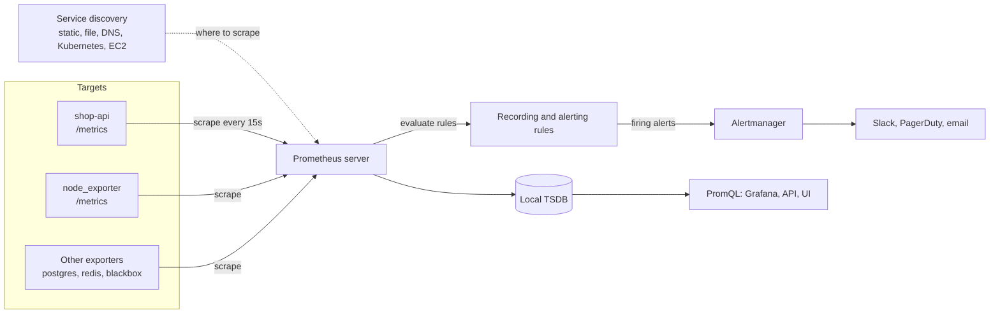
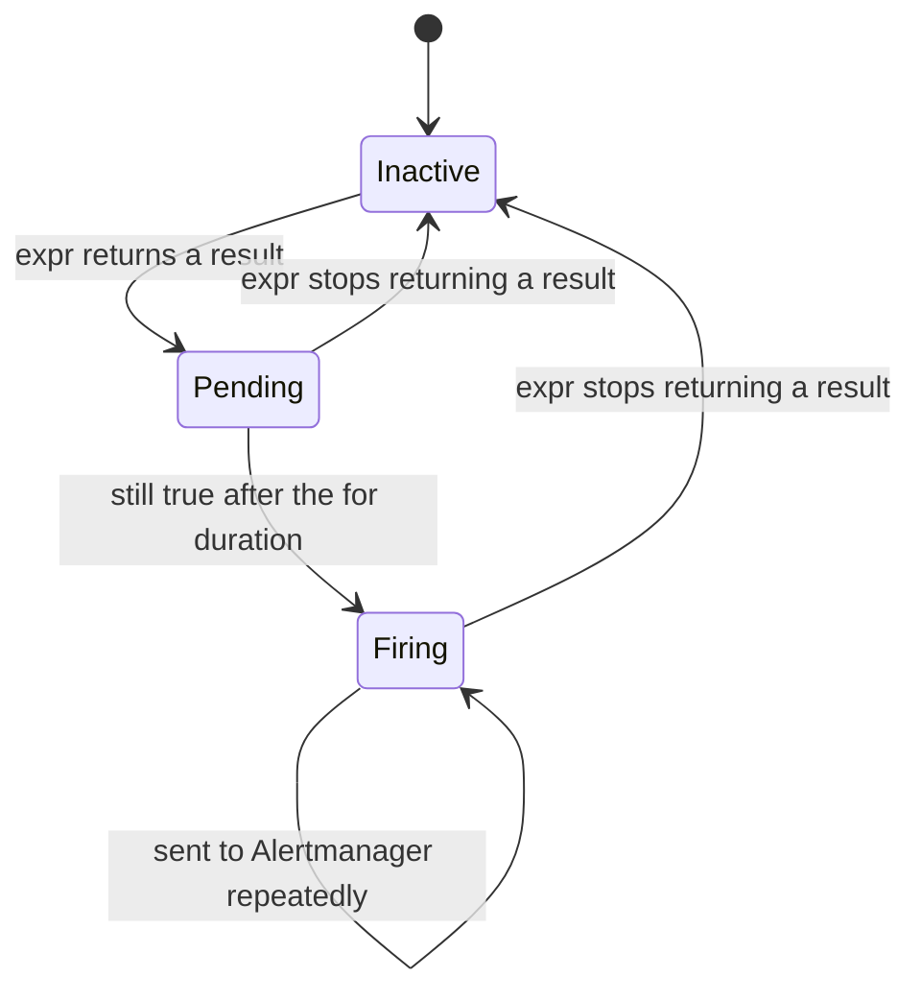

# L10.2 — Prometheus and PromQL

> **Level 10: Observability** · Topic 2 of 11 · ⏱ ~5 hours · Difficulty: Intermediate

## 1. What it is

**Prometheus** is an open-source monitoring system and **time series database (TSDB)**. A time series is a stream of
`(timestamp, number)` samples identified by a metric name plus key/value **labels**, for example
`http_request_duration_seconds_count{route="/checkout", status_code="500"}`. Prometheus works on a **pull model**: every
few seconds it makes an HTTP `GET` to a `/metrics` endpoint on each **target** (an app, a database exporter, a node),
parses the text it gets back, and stores the samples locally.

**PromQL (Prometheus Query Language)** is how you ask questions of that data: "requests per second by route", "the 95th
percentile latency", "which targets are down". The same expressions power dashboards, **recording rules** (precomputed
queries) and **alerting rules** (queries that become alerts when they return results). Alerts are sent to a separate
component, **Alertmanager**, which groups, de-duplicates, silences and routes them to Slack, PagerDuty or email.

## 2. Why it matters in DevOps

- Prometheus is the de facto standard for metrics on Kubernetes and cloud-native stacks. Most open-source infrastructure
  software ships a `/metrics` endpoint in its format.
- PromQL is a skill interviewers test: `rate()` on a counter, `histogram_quantile()` on a histogram, `sum by`. A wrong
  query gives a dashboard that is confidently misleading (averaged percentiles, `rate()` on a gauge).
- Alert rules define who gets woken up. A badly written one pages for a blip or stays silent during an outage.
- The pull model gives a free **health signal**: if a target cannot be scraped, the `up` metric is `0`, so "is the
  monitoring itself working?" is one query away.

## 3. Real-world system example

**Kubernetes.** The API server, kubelet, scheduler and etcd all expose Prometheus-format `/metrics`, and the usual way
to monitor a cluster is the Prometheus Operator / `kube-prometheus-stack`, where Prometheus discovers pods and services
through the Kubernetes API (`kubernetes_sd_configs`) rather than a hand-written list of addresses. Metrics such as
`apiserver_request_duration_seconds` and `kube_pod_container_status_restarts_total` (from kube-state-metrics) are standard
alert inputs.

**Cloudflare** has published engineering blog posts about running Prometheus at very large scale across its data
centers, using it for alerting on infrastructure and edge services. A common pattern across large users is one or a few
Prometheus servers per environment or region, each scraping everything nearby, with long-term storage and a global view
handled by a companion project such as Thanos, Cortex or Mimir.

## 4. Diagram

The pull model, rule evaluation and alert routing:



The life cycle of an alert from an alerting rule (`for:` is the "pending" period that filters out blips):



## 5. How it works

**Data model.** `metric_name{label="value", ...}` plus a float64 sample and a millisecond timestamp. Every unique label
combination is its own series, so label design controls memory (see [Metric Types](04-metric-types.md)). Labels set by the
scraper itself: `job` (from the scrape config) and `instance` (host:port).

**Configuration** (`prometheus.yml`):

| Key | Purpose |
|-----|---------|
| `global.scrape_interval` | how often to scrape (15s is typical); `evaluation_interval` is how often rules run |
| `scrape_configs` | list of jobs: `job_name`, `metrics_path`, targets via `static_configs` or a `*_sd_configs` discovery |
| `relabel_configs` | rewrite or drop **targets** before scraping (choose which pods to scrape) |
| `metric_relabel_configs` | rewrite or drop **samples** after scraping (drop an expensive metric) |
| `rule_files` | recording and alerting rule files |
| `alerting.alertmanagers` | where to send firing alerts |

**Exporters** translate things that do not speak the Prometheus format: `node_exporter` (Linux CPU, memory, disk,
network), `blackbox_exporter` (probe HTTP/TCP/ICMP from outside), `postgres_exporter`, `redis_exporter`, `cAdvisor`
(containers). Your own code uses a **client library** (`prom-client` for Node.js).

**Metric types** you will query: counter (only goes up), gauge (up and down), histogram (bucketed observations),
summary (client-side quantiles). Covered in depth in [Metric Types](04-metric-types.md).

**PromQL essentials.**

| Concept | Example | Notes |
|---------|---------|-------|
| Instant vector | `up` | one latest sample per series |
| Label matchers | `http_request_duration_seconds_count{route="/checkout", status_code=~"5.."}` | `=`, `!=`, `=~` regex, `!~` |
| Range vector | `http_request_duration_seconds_count[5m]` | all samples in the last 5 minutes; only usable inside functions |
| `rate()` | `rate(x_total[5m])` | per-second average increase of a **counter**; handles resets. Window should be at least 4 scrape intervals |
| `increase()` | `increase(x_total[1h])` | total increase over the window (same as `rate * seconds`) |
| `irate()` | `irate(x_total[1m])` | instant rate from the last two samples; for zoomed-in, volatile graphs |
| Aggregation | `sum by (route) (...)`, `avg without (instance) (...)` | `by` keeps listed labels, `without` drops them |
| `histogram_quantile()` | `histogram_quantile(0.95, sum by (le) (rate(x_bucket[5m])))` | estimates a percentile from buckets; **aggregate `le`-preserving first, then quantile** |
| Arithmetic and vector matching | `a / b`, `a / on(job) b` | operands match on identical label sets unless you use `on()` or `ignoring()` |
| `predict_linear()` | `predict_linear(node_filesystem_avail_bytes[6h], 4*3600) < 0` | "disk full within 4 hours" for gauges |
| `absent()` | `absent(up{job="shop-api"})` | returns 1 if the selector matches nothing: alert on vanished targets |
| `topk()` | `topk(3, sum by (route) (rate(...)))` | quick leaderboard |

Rules of thumb:

1. **Counters: always `rate()` (or `increase()`) first, aggregate second.** `sum(rate(x[5m]))`, never `rate(sum(x)[5m])`.
2. **Never average percentiles.** The p95 of two servers is not the average of their p95s. Sum the histogram buckets, then
   take the quantile.
3. **Percentiles are estimates.** `histogram_quantile` interpolates inside the bucket, so its accuracy depends on bucket
   boundaries. Put a boundary at your SLO threshold (for a 500 ms target, include a `0.5` bucket).
4. A ratio of two rates returns **no data**, not zero, if the numerator has no series (no errors have ever occurred).
   Handle it deliberately (`or vector(0)`) or accept that "no data" means "no errors" in that alert.

**Recording rules** precompute expensive or frequently-used queries and store the result as a new series. Naming
convention: `level:metric:operations`, for example `job:http_requests:rate5m`.

**Alerting rules** have a name, an `expr`, an optional `for` duration, `labels` (for routing, e.g. `severity`) and
`annotations` (human text with templating such as `{{ $value }}`).

**Storage and limits.** Local TSDB, default retention 15 days (`--storage.tsdb.retention.time`). One Prometheus server is
not clustered; for HA you run two identical servers, and for long-term/global views you add remote write to Thanos, Mimir
or similar. Prometheus 3.x also supports **native histograms** (high-resolution histograms with no pre-chosen buckets), an
opt-in alternative to the classic `_bucket` series used here.

## 6. Step-by-step guide

**Prerequisites:** Docker with Compose v2, Node.js 22 or newer (only to generate the lock file), `curl`. No cost. Image
versions below were current when written; if a tag is gone, use the latest from the image's Docker Hub page and re-read the
release notes. This builds the sandbox that [Grafana Dashboards](03-grafana-dashboards.md) extends.

1. **Create the project layout.**
   ```bash
   mkdir -p ~/l10-prom/shop-api ~/l10-prom/prometheus/rules && cd ~/l10-prom/shop-api
   npm init -y >/dev/null && npm install express prom-client
   ```

2. **Write the instrumented app** `~/l10-prom/shop-api/app.js` (random latency, 8% errors on `/checkout`, so the
   graphs are interesting).
   ```js
   const express = require('express');
   const client = require('prom-client');

   client.collectDefaultMetrics(); // process_*, nodejs_* (CPU, memory, event loop lag, GC)

   const duration = new client.Histogram({
     name: 'http_request_duration_seconds',
     help: 'HTTP request latency in seconds',
     labelNames: ['method', 'route', 'status_code'],
     buckets: [0.01, 0.025, 0.05, 0.1, 0.25, 0.5, 1, 2.5],
   });

   const sleep = (ms) => new Promise((r) => setTimeout(r, ms));
   const app = express();

   // Time every request. Use the route PATTERN, never the raw URL, to keep label values bounded.
   app.use((req, res, next) => {
     const stop = duration.startTimer();
     res.on('finish', () => {
       stop({ method: req.method, route: req.route ? req.route.path : 'unmatched', status_code: res.statusCode });
     });
     next();
   });

   app.get('/products', async (req, res) => {
     await sleep(20 + Math.random() * 100);
     res.json([{ id: 1, name: 'keyboard' }]);
   });

   app.get('/checkout', async (req, res) => {
     const slow = Math.random() < 0.03; // 3% of requests are slow
     await sleep(50 + Math.random() * 200 + (slow ? 1000 : 0));
     if (Math.random() < 0.08) return res.status(500).json({ error: 'payment provider timeout' }); // 8% errors
     res.json({ status: 'paid' });
   });

   app.get('/metrics', async (req, res) => {
     res.set('Content-Type', client.register.contentType);
     res.end(await client.register.metrics());
   });

   app.listen(3000, () => console.log('shop-api lab listening on :3000'));
   ```

3. **Write the Dockerfile** `~/l10-prom/shop-api/Dockerfile`.
   ```dockerfile
   FROM node:24-alpine
   WORKDIR /app
   COPY package*.json ./
   RUN npm ci --omit=dev
   COPY app.js .
   USER node
   EXPOSE 3000
   CMD ["node", "app.js"]
   ```
   Add a `.dockerignore` containing `node_modules` so the host's modules are not copied.

4. **Write the Prometheus config** `~/l10-prom/prometheus/prometheus.yml`.
   ```yaml
   global:
     scrape_interval: 15s
     evaluation_interval: 15s

   rule_files:
     - /etc/prometheus/rules/*.yml

   alerting:
     alertmanagers:
       - static_configs:
           - targets: ["alertmanager:9093"]

   scrape_configs:
     - job_name: prometheus
       static_configs:
         - targets: ["localhost:9090"]

     - job_name: shop-api
       metrics_path: /metrics
       static_configs:
         - targets: ["shop-api:3000"]
           labels:
             environment: lab

     - job_name: node
       static_configs:
         - targets: ["node-exporter:9100"]
   ```

5. **Write the Compose file** `~/l10-prom/compose.yaml`.
   ```yaml
   services:
     shop-api:
       build: ./shop-api
       ports: ["3000:3000"]

     loadgen:
       image: busybox:1.37
       depends_on: [shop-api]
       command: ["sh", "-c", "while true; do wget -q -O /dev/null http://shop-api:3000/products 2>/dev/null; wget -q -O /dev/null http://shop-api:3000/checkout 2>/dev/null; sleep 0.2; done"]

     node-exporter:
       image: prom/node-exporter:v1.12.1
       command: ["--path.rootfs=/host"]
       pid: host
       volumes: ["/:/host:ro,rslave"]   # Docker Desktop (macOS/Windows): delete this line and "pid: host"

     alertmanager:
       image: prom/alertmanager:v0.34.1
       volumes: ["./alertmanager.yml:/etc/alertmanager/alertmanager.yml:ro"]
       ports: ["9093:9093"]

     prometheus:
       image: prom/prometheus:v3.15.0
       command:
         - --config.file=/etc/prometheus/prometheus.yml
         - --storage.tsdb.path=/prometheus
         - --storage.tsdb.retention.time=7d
         - --web.enable-lifecycle
       volumes:
         - ./prometheus:/etc/prometheus:ro
         - prom-data:/prometheus
       ports: ["9090:9090"]
       depends_on: [shop-api, node-exporter, alertmanager]

   volumes:
     prom-data: {}
   ```
   `--web.enable-lifecycle` lets you reload config with `POST /-/reload`; do not enable it on a publicly reachable server.

6. **A minimal Alertmanager config** `~/l10-prom/alertmanager.yml` (receives alerts, notifies nobody; Slack comes later).
   ```yaml
   route:
     receiver: default
     group_by: [alertname, job]
     group_wait: 10s
     group_interval: 1m
     repeat_interval: 4h
   receivers:
     - name: default
   ```

7. **Write recording and alerting rules** `~/l10-prom/prometheus/rules/shop-api.yml`.
   ```yaml
   groups:
     - name: shop-api-recording
       rules:
         - record: job:http_requests:rate5m
           expr: sum by (job) (rate(http_request_duration_seconds_count[5m]))
         - record: job:http_request_errors:ratio_rate5m
           expr: |
             sum by (job) (rate(http_request_duration_seconds_count{status_code=~"5.."}[5m]))
             /
             sum by (job) (rate(http_request_duration_seconds_count[5m]))
         - record: job_route:http_request_duration_seconds:p95_5m
           expr: |
             histogram_quantile(0.95,
               sum by (job, route, le) (rate(http_request_duration_seconds_bucket[5m])))

     - name: shop-api-alerts
       rules:
         - alert: ShopApiDown
           expr: up{job="shop-api"} == 0
           for: 1m
           labels:
             severity: page
           annotations:
             summary: "shop-api target {{ $labels.instance }} is down"
         - alert: ShopApiHighErrorRate
           expr: job:http_request_errors:ratio_rate5m{job="shop-api"} > 0.05
           for: 5m
           labels:
             severity: page
           annotations:
             summary: "shop-api 5xx ratio is {{ $value | humanizePercentage }}"
   ```
   The lab app fails about 4% of all requests (8% of `/checkout`, mixed with `/products` traffic), so lower the
   threshold to `0.02` if you want to see this alert fire without further changes.

8. **Start everything** and wait about 30 seconds.
   ```bash
   cd ~/l10-prom && docker compose up -d --build
   docker compose ps
   ```
   Expect five services running. Check the target page in a browser: <http://localhost:9090/targets>. All three jobs
   show `UP`. Confirm from the shell:
   ```bash
   curl -s 'http://localhost:9090/api/v1/query?query=up' | python3 -m json.tool | head -30
   ```
   Each result has a `metric` object (with `job` and `instance`) and a `value` of `"1"`.

9. **Run your first PromQL queries** at <http://localhost:9090/query> (the Query tab; older versions call it Graph).
   ```promql
   up
   sum by (route) (rate(http_request_duration_seconds_count[5m]))
   sum(rate(http_request_duration_seconds_count{status_code=~"5.."}[5m])) / sum(rate(http_request_duration_seconds_count[5m]))
   histogram_quantile(0.95, sum by (le) (rate(http_request_duration_seconds_bucket[5m])))
   histogram_quantile(0.95, sum by (route, le) (rate(http_request_duration_seconds_bucket[5m])))
   ```
   Expect a few requests per second per route, an error ratio around `0.04` and a p95 for `/checkout` near 0.25-0.5
   seconds (similar to; random). Switch to the Graph view for the time series.

10. **Query the machine** with node_exporter metrics.
    ```promql
    100 * (1 - avg(rate(node_cpu_seconds_total{mode="idle"}[5m])))
    1 - node_memory_MemAvailable_bytes / node_memory_MemTotal_bytes
    ```
    The first is CPU busy percent across all cores, the second the fraction of memory in use.

11. **Check rules and reload after edits.** Open <http://localhost:9090/rules> and <http://localhost:9090/alerts>. After
    changing any file under `prometheus/`:
    ```bash
    curl -X POST http://localhost:9090/-/reload
    ```
    A syntax error in a rule file keeps the old rules and logs the error: `docker compose logs prometheus | tail`.

12. **Tear down** when finished (keep the folder; [Grafana Dashboards](03-grafana-dashboards.md) builds on it).
    ```bash
    docker compose down        # add -v to also delete stored metrics
    ```

## 7. Real-world scenario

*Illustrative scenario.* A team's dashboard showed "average latency 120 ms, all green" while support tickets said checkout
was timing out. Their panel used `avg(rate(http_request_duration_seconds_sum[5m]) / rate(http_request_duration_seconds_count[5m]))`.
Switching to `histogram_quantile(0.99, sum by (le) (rate(http_request_duration_seconds_bucket[5m])))` showed a p99 of 4
seconds: 1% of requests, all from one payment retry loop, were dragging the experience of the heaviest users.

They also learned two things the hard way: an earlier "p95" panel had been averaging per-instance p95s (wrong), and their
`HighErrorRate` alert showed "no data" rather than `0` before the first 5xx of the day. They fixed the quantile with
`sum by (le)`, recorded the error ratio as a rule so the dashboard and the alert use one definition, and added
`absent_over_time(up{job="shop-api"}[10m])` so a vanished job pages too.

**Lesson:** the query *is* the metric. Averages hide tails, averaged percentiles lie, and an alert on an empty
result needs an explicit decision.

## 8. Common mistakes and best practices

**Don't**

- Apply `rate()` to a gauge or `avg()` to a counter, or graph a raw counter (a line that only goes up tells you nothing).
- Use a `rate()` window shorter than 2-4 scrape intervals; you will get gaps and noise.
- Average or sum percentiles across instances. Aggregate buckets first.
- Put high-cardinality values (user id, full URL, request id) into labels. It is the #1 way to crash Prometheus.
- Alert on raw causes (CPU 80%) when you can alert on user-visible symptoms (error ratio, latency) - see
  [What to Monitor](11-what-to-monitor.md).
- Expose `/-/reload`, `/api/v1/admin` or the UI to the internet without authentication.

**Do**

- Use `rate()`/`increase()` for counters, then `sum by`/`without`.
- Use `for:` on alerts to avoid flapping, and `severity` labels so Alertmanager can route pages vs tickets.
- Record frequently-used and expensive queries as rules named `level:metric:operation`.
- Alert on `up == 0` and `absent()` so a broken scrape is noticed.
- Version-control `prometheus.yml` and rules; validate with `promtool check config` and `promtool check rules` in CI.
- Plan for long-term storage and HA early (two replicas, remote write) if metrics become business critical.

## 9. Tasks

- [ ] **T1 — Bring up the stack and read a target** *(≈45 min, beginner)*
  - **Goal:** see the pull model working end to end.
  - **Steps:**
    1. Follow section 6 steps 1-8.
    2. `curl -s localhost:3000/metrics | head -40` and identify one counter, one gauge and one histogram.
    3. Open `/targets` and find the last-scrape time and duration of the `shop-api` job.
  - **Done when:** all targets are `UP` and you can name the type of `process_cpu_seconds_total`, `nodejs_heap_size_used_bytes` and `http_request_duration_seconds`.

- [ ] **T2 — Write the golden-signal queries** *(≈45 min, intermediate)*
  - **Goal:** express traffic, errors and latency in PromQL.
  - **Steps:**
    1. Write queries for requests per second per route, the 5xx ratio per route, and p50/p95/p99 latency for `/checkout`.
    2. Verify each at the Query tab; check that `histogram_quantile(0.5, ...)` is lower than `0.99`.
    3. Explain why you used `sum by (le)` or `sum by (route, le)` inside the quantile.
  - **Done when:** the three queries return sensible data and you can state what happens to the answer if you drop `le`.

- [ ] **T3 — Add a recording rule and an alert** *(≈45 min, intermediate)*
  - **Goal:** turn a query into a rule and an alert, and watch it fire.
  - **Steps:**
    1. Use the rules file from step 7; change the threshold of `ShopApiHighErrorRate` to `0.02` and `for` to `1m`.
    2. `curl -X POST localhost:9090/-/reload`.
    3. Watch <http://localhost:9090/alerts> go Inactive → Pending → Firing, then confirm in Alertmanager at <http://localhost:9093>.
  - **Done when:** the alert is `FIRING` in both UIs and `job:http_requests:rate5m` is queryable.

- [ ] **T4 — Break it: kill the target and a rule** *(≈45 min, intermediate)*
  - **Goal:** understand `up`, staleness and failed reloads.
  - **Steps:**
    1. `docker compose stop shop-api`; watch `up{job="shop-api"}` become `0` and `ShopApiDown` fire after 1 minute.
    2. Restart it. Then introduce a typo in `rules/shop-api.yml` (remove a `)`), reload, and read `docker compose logs prometheus`.
    3. Fix it and reload again.
  - **Done when:** you saw `ShopApiDown` firing, you saw the rule-load error in the logs, and the final reload succeeded.

- [ ] **T5 — Scrape something new** *(≈60 min, advanced)*
  - **Goal:** add an exporter and a second kind of discovery.
  - **Steps:**
    1. Add a `redis` service plus `oliver006/redis_exporter` (or another exporter you choose) to `compose.yaml`.
    2. Add a scrape job for it using `file_sd_configs` pointing to a JSON file under `prometheus/targets/`.
    3. Drop one noisy metric family with `metric_relabel_configs` (`action: drop`) and show it no longer appears.
  - **Done when:** `up{job="redis"} == 1`, the redis metrics are queryable and the dropped metric returns no series.

- [ ] **T6 — Prove it: explain a percentile** *(≈45 min, advanced)*
  - **Goal:** teach why `histogram_quantile` needs `sum by (le)` and rates.
  - **Steps:**
    1. Without the guide, write the p99-latency query for `/checkout`.
    2. Show on the `/metrics` output how `_bucket`, `_sum` and `_count` relate, and where the estimate comes from.
    3. Demonstrate the wrong answer produced by averaging two p95 queries (run two `shop-api` replicas if you can).
  - **Done when:** you can explain the query line by line and show a case where the averaged p95 differs from the correct one.

## 10. Self-check questions

1. Why does Prometheus pull instead of having apps push, and what do you get for free from that?
2. What does `rate(x_total[5m])` compute, and why can it handle a process restart?
3. Why is `avg(http_p95)` across instances wrong, and what is the correct way to get a fleet-wide p95?
4. What is the difference between a recording rule and an alerting rule, and what does `for: 5m` do?
5. A ratio alert never fires and shows "no data" before the first error. Why, and how do you handle it?
6. When do you use `irate()` instead of `rate()`?

<details>
<summary>Answers</summary>

1. Pull makes the server the source of truth about target health (`up`), lets you run a second Prometheus against the same targets, and means apps just serve a text page with no knowledge of the monitoring system.
2. The per-second average increase of a counter over the last 5 minutes. When a counter resets to 0 on restart, `rate()` detects the drop and treats it as a reset rather than a negative increase.
3. Percentiles cannot be averaged. Sum the `_bucket` rates across instances (`sum by (le)`) and then apply `histogram_quantile`.
4. A recording rule stores a query result as a new series; an alerting rule turns a non-empty result into an alert. `for: 5m` requires the expression to stay true for 5 minutes (pending state) before firing.
5. If no 5xx series exists, the numerator is empty and division yields no result. Either accept that, add `or vector(0)` to the numerator, or alert on `absent()` separately.
6. For high-resolution, volatile graphs where you want the last two samples only. For alerts and normal dashboards, `rate()` is the safer, smoother choice.
</details>

## 11. Further reading

- Prometheus documentation (prometheus.io/docs): "Querying basics", "Configuration", "Recording rules", "Alerting rules", "Best practices: naming and instrumentation".
- *Prometheus: Up & Running* by Brian Brazil (O'Reilly); read alongside the current docs, as some details have moved on.
- *Site Reliability Engineering* (Google), chapter "Practical Alerting from Time-Series Data".
- Alertmanager documentation (grouping, inhibition, routing, silences).
- See also: [Counters, Gauges, Histograms and Summaries](04-metric-types.md), [What to Monitor](11-what-to-monitor.md), [Alert Fatigue Reduction](../level-14-sre/08-alert-fatigue-reduction.md).

<!-- nav -->
---
← Previous: [The Three Pillars: Metrics, Logs and Traces](01-three-pillars.md) · [Level 10 index](README.md) · Next: [Grafana Dashboards](03-grafana-dashboards.md) →
