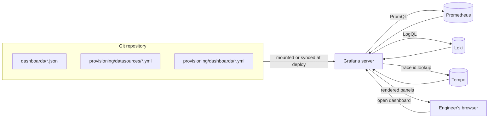
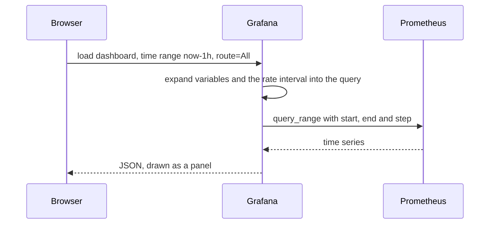

# L10.3 — Grafana Dashboards

> **Level 10: Observability** · Topic 3 of 11 · ⏱ ~4 hours · Difficulty: Intermediate

## 1. What it is

**Grafana** is an open-source web application for querying, visualising and alerting on data from many places. It does
not store your metrics; it connects to **data sources** (Prometheus, Loki, Tempo, PostgreSQL, CloudWatch, Elasticsearch and
dozens more), sends each one a query in its own language, and draws the result as **panels** (time series graphs, stat
tiles, tables, gauges, logs, trace views) arranged on a **dashboard**.

Dashboards can be built by clicking in the UI, but a dashboard is just a **JSON document**. That means it can live in Git,
be reviewed in a pull request and be loaded automatically when Grafana starts. This idea, **dashboards as code** combined
with **provisioning**, is what separates a team's shared, trusted dashboards from a pile of untracked one-offs.

## 2. Why it matters in DevOps

- During an incident, the first thing anyone opens is a dashboard. If it is slow, cluttered, or wrong, minutes are lost.
- Hand-built dashboards drift: someone edits a panel in production, nobody knows why the p95 looks different today, and
  when Grafana is rebuilt the dashboards are gone. Provisioning makes Grafana **reproducible** and **disposable** like
  any other piece of [infrastructure as code](../level-00-what-devops-is/03-infrastructure-as-code.md).
- Variables let one dashboard serve every service, environment and region instead of fifty near-identical copies.
- A dashboard encodes what your team believes matters. Designing it forces the conversation about
  [what to monitor](11-what-to-monitor.md).

## 3. Real-world system example

**kube-prometheus-stack and the monitoring mixins.** The widely used Helm chart `kube-prometheus-stack` deploys
Prometheus, Alertmanager and Grafana together and ships a large set of Kubernetes dashboards. They are not hand-drawn:
they come from the open-source *monitoring mixins* (such as `kubernetes-mixin`), written in Jsonnet, which generate the
dashboard JSON and the matching alert rules. In the chart, dashboards are stored as Kubernetes ConfigMaps and a Grafana
sidecar container loads them, which is provisioning by another route.

**Wikimedia** (the organisation behind Wikipedia) runs a public Grafana instance where anyone can view the dashboards
for its infrastructure, a good place to see what mature, shared dashboards look like. Grafana Labs also hosts a public
library of community dashboards at grafana.com/grafana/dashboards, for example the very popular "Node Exporter Full".

## 4. Diagram

How Grafana turns a dashboard into queries, and how provisioning removes clicking:



What happens when a panel is drawn:



## 5. How it works

**Building blocks**

| Concept | What it is |
|---------|-----------|
| **Data source** | A configured connection (type, URL, auth). Referenced from panels by a stable **uid**, not by name |
| **Panel** | One visualisation with one or more **queries** (`targets`), plus unit, thresholds and legend options |
| **Row** | A collapsible group of panels |
| **Variable** | A dropdown (`$route`, `$instance`, `$env`) whose value is substituted into queries. Types: query, custom, interval, data source, text box, constant |
| **Annotation** | A marker overlaid on graphs (a deploy, an incident) from a query or the API |
| **Folder, tags, links** | Organisation and navigation between dashboards |
| **Explore** | Ad-hoc querying without a dashboard: your debugging scratchpad |
| **Alert rules** | Grafana-managed alerting can query any data source and notify contact points; Prometheus alerting rules remain an alternative that lives next to the data |

**Useful built-in variables.** `$__rate_interval` is a window Grafana computes from the scrape interval and the graph
zoom, so `rate(x[$__rate_interval])` neither goes empty when zoomed in nor over-smooths when zoomed out. Use it instead of
a fixed `[5m]` in dashboards. `$__interval`, `$__range` and `$__from`/`$__to` exist for other uses.

**Provisioning** means Grafana reads YAML and JSON files at startup and keeps them applied:

| File | Location in the container | Purpose |
|------|---------------------------|---------|
| Data source definitions | `/etc/grafana/provisioning/datasources/*.yml` | Create data sources, with fixed `uid` values |
| Dashboard providers | `/etc/grafana/provisioning/dashboards/*.yml` | Tell Grafana which folder of JSON files to load, into which folder, how often to rescan |
| Dashboard JSON | any path named by the provider | The dashboards themselves |
| Alerting and contact points | `/etc/grafana/provisioning/alerting/` | Alert rules and notification settings as files |

**Dashboards as code, in increasing sophistication:**

1. **Exported JSON in Git.** Build in the UI, export (Share → Export → JSON), commit. Simple, diffs are noisy.
2. **Generated JSON.** Jsonnet/Grafonnet, or the Grafana Foundation SDK (typed builders for several languages), produce
   the JSON from code so shared building blocks are reused.
3. **Managed by Terraform** (`grafana_dashboard` resource, see
   [Terraform CI/CD](../level-07-terraform-iac/07-terraform-ci-cd.md)) or pushed through the HTTP API in CI.
4. **Kubernetes-native**: ConfigMaps with a sidecar loader, or the Grafana Operator's `GrafanaDashboard` resources.

Grafana keeps adding features here (for example Git-based synchronisation of dashboards in recent versions); read the
current release notes before choosing a workflow. The JSON model of a classic dashboard remains a good lowest common
denominator and is what this topic uses.

**Design rules that make dashboards useful**

- **One question per dashboard**, answered top-left first: "Is the service healthy?" Put the golden signals (traffic,
  errors, latency, saturation) in the first row.
- Always set **units** (`reqps`, `s`, `percentunit`, `bytes`) and a minimum of 0 where it makes sense.
- Use **thresholds and colours** that mean something (red only for "act now").
- Avoid dashboard sprawl: link a service overview to detailed dashboards rather than building one giant page.
- Show **deploy annotations** so a latency step can be matched with a release.
- Panels should answer a question you can state in a sentence. If you cannot, delete the panel.

## 6. Step-by-step guide

**Prerequisites:** the Compose stack from [Prometheus and PromQL](02-prometheus-and-promql.md) (`~/l10-prom`) running or
ready to start. Docker with Compose v2. No cost. The admin password below is for a local lab only.

1. **Add Grafana to `~/l10-prom/compose.yaml`** (under `services:`, and add `grafana-data: {}` under `volumes:`).
   ```yaml
     grafana:
       image: grafana/grafana:13.0.10
       ports: ["3001:3000"]            # host 3001, because shop-api already uses 3000
       environment:
         GF_SECURITY_ADMIN_USER: admin
         GF_SECURITY_ADMIN_PASSWORD: admin   # lab only; use a secret in real life
       volumes:
         - ./grafana/provisioning:/etc/grafana/provisioning:ro
         - ./grafana/dashboards:/etc/grafana/dashboards:ro
         - grafana-data:/var/lib/grafana
       depends_on: [prometheus]
   ```

2. **Provision the data source** in `~/l10-prom/grafana/provisioning/datasources/datasources.yml`. Fixing the `uid`
   is what lets dashboard JSON refer to it reliably.
   ```yaml
   apiVersion: 1
   datasources:
     - name: Prometheus
       uid: prometheus
       type: prometheus
       access: proxy
       url: http://prometheus:9090
       isDefault: true
       jsonData:
         timeInterval: 15s      # must match the scrape interval so $__rate_interval is right
   ```

3. **Provision a dashboard provider** in `~/l10-prom/grafana/provisioning/dashboards/dashboards.yml`.
   ```yaml
   apiVersion: 1
   providers:
     - name: shop-api
       orgId: 1
       folder: Shop API
       type: file
       disableDeletion: true
       allowUiUpdates: false
       updateIntervalSeconds: 30
       options:
         path: /etc/grafana/dashboards
   ```
   `disableDeletion: true` and `allowUiUpdates: false` make Git the source of truth: edits made in the UI can be tried out
   but will not be saved over the file.

4. **Write the dashboard JSON** `~/l10-prom/grafana/dashboards/shop-api-red.json`: one variable and one panel to start.
   ```json
   {
     "uid": "shop-api-red",
     "title": "shop-api RED",
     "tags": ["shop-api", "red"],
     "schemaVersion": 39,
     "version": 1,
     "editable": true,
     "refresh": "30s",
     "time": { "from": "now-1h", "to": "now" },
     "templating": {
       "list": [
         {
           "name": "route",
           "label": "Route",
           "type": "query",
           "datasource": { "type": "prometheus", "uid": "prometheus" },
           "query": { "query": "label_values(http_request_duration_seconds_count{job=\"shop-api\"}, route)", "refId": "routes" },
           "definition": "label_values(http_request_duration_seconds_count{job=\"shop-api\"}, route)",
           "refresh": 2,
           "multi": true,
           "includeAll": true,
           "allValue": ".*",
           "current": { "selected": true, "text": ["All"], "value": ["$__all"] }
         }
       ]
     },
     "panels": [
       {
         "id": 1,
         "type": "timeseries",
         "title": "Requests per second",
         "datasource": { "type": "prometheus", "uid": "prometheus" },
         "gridPos": { "h": 8, "w": 12, "x": 0, "y": 0 },
         "targets": [
           {
             "refId": "A",
             "expr": "sum by (route) (rate(http_request_duration_seconds_count{job=\"shop-api\", route=~\"$route\"}[$__rate_interval]))",
             "legendFormat": "{{route}}"
           }
         ],
         "fieldConfig": { "defaults": { "unit": "reqps", "min": 0 }, "overrides": [] }
       }
     ]
   }
   ```
   Check the JSON is valid before starting: `python3 -m json.tool grafana/dashboards/shop-api-red.json > /dev/null && echo valid`.

5. **Start Grafana and verify provisioning from the API.**
   ```bash
   cd ~/l10-prom && docker compose up -d grafana
   sleep 10
   curl -s -u admin:admin http://localhost:3001/api/datasources | python3 -m json.tool | grep -E '"(name|uid|type)"'
   curl -s -u admin:admin 'http://localhost:3001/api/search?query=shop-api' | python3 -m json.tool | grep -E '"(title|uid|folderTitle)"'
   ```
   Expect the `Prometheus` data source with uid `prometheus`, and the dashboard `shop-api RED` in the folder `Shop API`.

6. **Open it:** <http://localhost:3001> (user `admin`, password `admin`; Grafana may ask you to change it, skip for the lab).
   Go to Dashboards → Shop API → shop-api RED. Change the `Route` dropdown and watch the legend change.

7. **Explore a query ad hoc.** Open Explore (compass icon), pick the Prometheus data source, and run
   `sum by (route) (rate(http_request_duration_seconds_count[$__rate_interval]))`. Use the *Table* and *Graph* views
   and the *Inspect → Query* option to see the exact request Grafana sent.

8. **Add the other two RED panels in the UI, then export them into Git.**
   - Edit the dashboard (it is read-only because of `allowUiUpdates: false`; use *Save as* to copy it to a scratch
     dashboard, or temporarily set `allowUiUpdates: true`).
   - Add *Error ratio*: `sum(rate(http_request_duration_seconds_count{job="shop-api", route=~"$route", status_code=~"5.."}[$__rate_interval])) / sum(rate(http_request_duration_seconds_count{job="shop-api", route=~"$route"}[$__rate_interval]))`
     with unit *Percent (0.0-1.0)*.
   - Add *p95 latency*: `histogram_quantile(0.95, sum by (le) (rate(http_request_duration_seconds_bucket{job="shop-api", route=~"$route"}[$__rate_interval])))`
     with unit *seconds*.
   - Click *Export → Export as JSON*, save over `grafana/dashboards/shop-api-red.json`. Within 30 seconds (the
     `updateIntervalSeconds`) Grafana reloads it. `git diff` now shows exactly what changed.

9. **Optional: import a community dashboard** for a quick infrastructure view. Dashboards → New → Import → enter ID
   `1860` ("Node Exporter Full") → pick the Prometheus data source. It works against the `node` job from the previous topic.

10. **Stop** (keep files for later topics): `docker compose stop grafana`.

## 7. Real-world scenario

*Illustrative scenario.* During a sale, the on-call engineer opens the team's "checkout" dashboard. Latency looks flat.
A colleague opens a different copy of "the same" dashboard and sees a spike. The two panels use different windows
(`[5m]` vs `[1m]`), one averages per-instance p95s, and one points at the staging data source because someone saved a
copy with the wrong default. Ten minutes go to arguing about which graph is true.

The follow-up is boring and effective: a single `shop-api-red` dashboard in Git, data sources provisioned with fixed
uids, `$__rate_interval` everywhere, an `$env` variable instead of per-environment copies, and a rule that changes go
through a pull request. A deploy annotation lands on the graphs automatically from the CI pipeline.

**Lesson:** a dashboard is code that people make decisions with. Version it, review it, and give it one definition.

## 8. Common mistakes and best practices

**Don't**

- Edit production dashboards by hand without exporting the change. They will be lost or diverge.
- Reference data sources by display name; renaming one breaks every dashboard. Use a fixed `uid`.
- Build one panel per metric ("wall of graphs"). Nobody can read 60 panels at 3 a.m.
- Use a hard-coded `[5m]` and a different one on each panel; use `$__rate_interval`.
- Leave default admin credentials and anonymous editing on a shared Grafana.
- Put credentials (API tokens, database passwords) in dashboard or data source JSON in Git; use environment variable
  expansion or secrets.

**Do**

- Provision data sources and dashboards from files, one source of truth in Git.
- Put the golden signals in the top row and link to deeper dashboards.
- Use variables (`$env`, `$service`, `$route`) to reuse dashboards across services.
- Set units, thresholds, sensible minimums and meaningful panel titles ("p95 latency, seconds", not "Panel 7").
- Keep dashboards fast: limit time range and series count, use recording rules for expensive queries.
- Review dashboard changes in pull requests; lint the JSON in CI.

## 9. Tasks

- [ ] **T1 — Provision Grafana from files** *(≈45 min, beginner)*
  - **Goal:** Grafana starts with the data source and dashboard already present.
  - **Steps:**
    1. Follow section 6 steps 1-6.
    2. Use the API commands in step 5 to list the data source and dashboard.
  - **Done when:** the dashboard `shop-api RED` renders data without you clicking *Add data source* or *Import*.

- [ ] **T2 — Complete the RED dashboard and export it** *(≈60 min, intermediate)*
  - **Goal:** use the UI to design, and Git to own the result.
  - **Steps:**
    1. Add the *Error ratio* and *p95 latency* panels (step 8) and set units and a red threshold at `0.05` on the error panel.
    2. Export JSON over `grafana/dashboards/shop-api-red.json`.
    3. Run `git init` in `~/l10-prom` if needed and `git diff` after a second small change.
  - **Done when:** the file in Git renders all three panels after `docker compose restart grafana`.

- [ ] **T3 — Add variables** *(≈45 min, intermediate)*
  - **Goal:** make one dashboard serve many targets.
  - **Steps:**
    1. Add a query variable `instance` with `label_values(up{job="shop-api"}, instance)` (multi, include All).
    2. Chain it: make the `route` variable depend on `$instance`.
    3. Use `$instance` in all three panel queries.
  - **Done when:** changing `$instance` changes the data on every panel, and `Inspect → Query` shows the substituted value.

- [ ] **T4 — Break it: wrong uid, wrong query** *(≈45 min, intermediate)*
  - **Goal:** recognise common dashboard failures.
  - **Steps:**
    1. Change one panel's `datasource.uid` to `promethus` and reload; note the error message.
    2. Change a panel to `rate(http_request_duration_seconds_count[1s])` and explain why it is empty (fewer than two samples in the window).
    3. Fix both and confirm the dashboard reloads within 30 seconds without a restart.
  - **Done when:** you can state the cause of each symptom and the fix in one sentence each.

- [ ] **T5 — Automate: lint and push in CI** *(≈60 min, advanced)*
  - **Goal:** treat dashboards like any other build artifact.
  - **Steps:**
    1. Write a script that fails when a dashboard in `grafana/dashboards/` is invalid JSON, lacks a `uid`, or contains a
       datasource referenced by name rather than uid (`jq -e '.uid and .title and (.panels | length > 0)' grafana/dashboards/*.json` is a start).
    2. Add it as a CI step (see [GitHub Actions Pipelines](../level-05-cicd/02-github-actions-pipelines.md)).
    3. Stretch: push a dashboard through the API with a service account token: `POST /api/dashboards/db` with `{"dashboard": {...}, "overwrite": true}`.
  - **Done when:** a pull request with a broken dashboard fails the check and a valid one passes.

- [ ] **T6 — Prove it: design a dashboard from a question** *(≈60 min, advanced)*
  - **Goal:** defend design choices, not just reproduce steps.
  - **Steps:**
    1. Without the guide, build a one-row "is shop-api healthy?" dashboard: traffic, error ratio, p95, and one saturation panel (event loop lag or memory).
    2. Provision it from files in a fresh Grafana container.
    3. Explain to a teammate why each panel is there and what action a red value triggers.
  - **Done when:** the dashboard comes up from `docker compose up` alone and your explanation names an action for every panel.

## 10. Self-check questions

1. Why give a provisioned data source a fixed `uid`?
2. What is `$__rate_interval` and why is it better than `[5m]` in a dashboard?
3. What do `allowUiUpdates: false` and `disableDeletion: true` protect against?
4. Name three ways to keep dashboards as code and one downside of exported JSON.
5. A panel shows "No data" for a query that works in Prometheus. List two likely causes.

<details>
<summary>Answers</summary>

1. Dashboard JSON refers to data sources by uid. A fixed uid means the dashboard works in any Grafana instance created from the same files, and renaming the data source does not break it.
2. A window Grafana computes from the scrape interval and graph zoom (at least four scrape intervals). It avoids empty graphs when zoomed in and over-smoothing when zoomed out.
3. Accidental edits and deletions through the UI that would make the running dashboard differ from Git.
4. Exported JSON in Git, generated JSON (Jsonnet/Grafonnet or the Foundation SDK), Terraform or API pushes, ConfigMaps with a sidecar or an operator. Exported JSON produces noisy diffs and is hard to reuse across dashboards.
5. The panel's data source uid is wrong or points at another environment; a variable value substituted into the query matches nothing (for example `route=~"$route"` with an empty selection); the time range or rate window is too short.
</details>

## 11. Further reading

- Grafana documentation (grafana.com/docs/grafana): "Provision Grafana", "Variables", "Dashboards best practices", "Dashboard JSON model".
- The Grafana Foundation SDK and Grafonnet documentation for generating dashboards from code.
- monitoring-mixins project (monitoring.mixins.dev) for production-grade Jsonnet dashboards and alerts.
- *Site Reliability Engineering* (Google) chapter on monitoring distributed systems, for what belongs on a dashboard.
- See also: [What to Monitor](11-what-to-monitor.md), [Terraform CI/CD](../level-07-terraform-iac/07-terraform-ci-cd.md).

<!-- nav -->
---
← Previous: [Prometheus and PromQL](02-prometheus-and-promql.md) · [Level 10 index](README.md) · Next: [Counters, Gauges, Histograms and Summaries](04-metric-types.md) →
